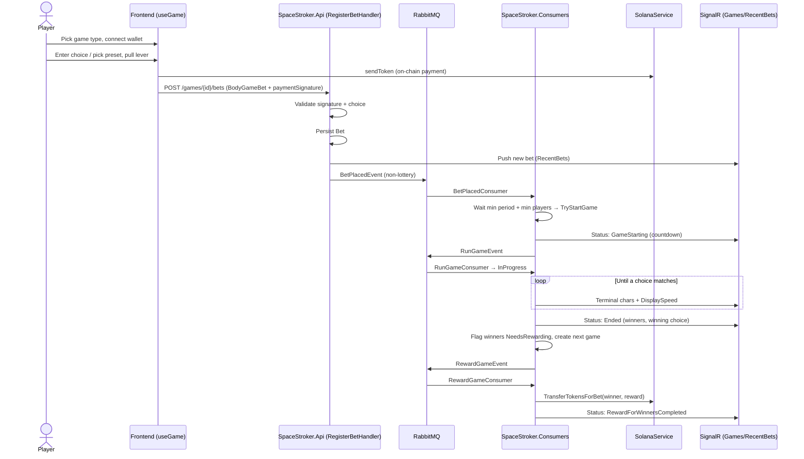
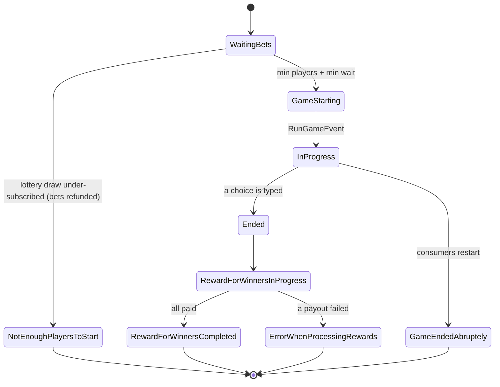

# Feature — Games (types, play flow, typer, rewards)

> The core game loop. A **game** is one round of a game type; players bet on a character
> sequence, a simulated "monkey" types random characters until a bet's sequence appears, and the
> matching bets win the pot.
>
> Primary code:
>
> - Backend domain: `SpaceStroker.Domain/Games/Services/SpaceStrokerTyper.cs`,
> `SpaceStroker.Domain/Bets/Services/BetDomainService.cs`,
> `SpaceStroker.Domain/Games/Entities/*`, `SpaceStroker.Domain/Games/ValueObjects/GameStatus.cs`.
> - Backend services/consumers: `SpaceStroker.Infrastructure/Services/Games/GameService.cs`,
> `SpaceStroker.Infrastructure/Consumers/{BetPlaced,RunGame,RewardGame,RefundInvalidBet,BetNotification}/*`.
> - API: `SpaceStroker.Api/Controllers/GamesController.cs`, DTOs in
> `SpaceStroker.Infrastructure/Contracts/Games/*`. Seed data: `SpaceStroker.Consumers/DefaultGameParameters.cs`.
> - Frontend: `src/pages/{GameSelectPage,GamePage}.vue`,
> `src/components/game-selection/{GameTypes,GameTypeCard}.vue`,
> `src/components/game/{GameTerminal,GameTyper,GameConsole,GameMonkey}.vue`,
> `src/hooks/{useGame,useConnection}.ts`, `src/services/mainService.ts`, `src/types/index.ts`.

---

## 1. What is a "game type"?

A **game type** is a row of `GameParameters` (`SpaceStroker.Domain/Games/Entities/GameParameters.cs`).
A **game** (`Game`) is one concrete round created from a `GameParameters`. Many games are
created over time from the same parameters (one rolls into the next).

The fields on `GameParameters` define how a type behaves:

| Field                        | Meaning                                                                                    |
| ---------------------------- | ------------------------------------------------------------------------------------------ |
| `Name`, `Description`        | Display text for the lobby card.                                                           |
| `AllowedCharacters`          | `GameCharacterType` — which characters the monkey can type and players can choose from. |
| `ChoiceRequiredLength`       | Exact length a player's choice (and the winning sequence) must be.                         |
| `AcceptDuplicatedCharacters` | Whether a choice may repeat characters (e.g. `"aabbcc"`).                                  |
| `MinimumNumberOfPlayers`     | Distinct players required before a round can start.                                        |
| `RequiredAmount`             | The exact stake per bet (USD; `decimal(18,9)`).                                            |
| `AllowFreeBet`               | When `true`, game type accepts free bets if backend/frontend dev flags allow. Default `false`. See `free-bet-mode.md`. |
| `PresetChoices`              | Optional fixed set of allowed choices → turns a type into a "pick from a list" game.       |
| `LotteryParameters`          | Optional → turns a type into a scheduled, pot-based lottery.                               |
| `OperatorId` / `Operator`    | Optional tenant owner (null = "house"). See `operators.md`.                                |

`GameCharacterType` (`SpaceStroker.Domain/Games/ValueObjects/GameCharacterType.cs`) — the
`[Description]` is the literal character pool:

| Value                   | Characters                             |
| ----------------------- | -------------------------------------- |
| `Number = 1`            | `0123456789`                           |
| `Letters = 2`           | `abcdefghijklmnopqrstuvwxyz`           |
| `NumbersAndLetters = 3` | `abcdefghijklmnopqrstuvwxyz0123456789` |

> Choices are **trimmed** (`Bet.Choice` setter) but **case-preserved** — the alphabets above are
> lowercase-only, so a choice containing uppercase (or any out-of-alphabet character) is **rejected**
> as `InvalidCharacters`, not silently lowercased. The pool is lowercase because non-lowercase input
> is refused at validation. See `specs/bet-choice-casing.md`.

---

## 2. The three play modes (taxonomy)

A type's mode is derived from **which optional fields are set** — there is no explicit "mode" enum.

| Mode                   | Condition                                  | How it plays                                                                                                                                                |
| ---------------------- | ------------------------------------------ | ----------------------------------------------------------------------------------------------------------------------------------------------------------- |
| **Free-type race**     | No `PresetChoices`, no `LotteryParameters` | Player types any valid sequence of `ChoiceRequiredLength` from the allowed charset. First matching sequence wins.                                           |
| **Preset-choice race** | `PresetChoices` set                        | Player must pick one of the predefined choices (e.g. 8 animal words). Same race mechanic, restricted choice set.                                            |
| **Lottery**            | `LotteryParameters` set                    | Pot-based. A draw is **scheduled** every `Frequency` (via Hangfire); the pot starts at `LotteryPot` and grows with each bet. Under-subscribed draws refund. |

These are independent flags, so combinations are technically possible (e.g. preset + lottery); the
seeded defaults don't combine them. The reward pot differs only for lottery (it adds `LotteryPot`).

### Seeded default games — dev seeds the SAME catalogue production runs (since 2026-07-23)

`CreateDefaultGameParametersAsync` seeds **`DefaultGameParameters.GenerateMainDefaultParameters()`**
for **both** the "DEV Cassino" operator (non-production only) and **Main** (all environments), so what
is exercised locally is what ships:

| Name          | Charset | Len | Mode                                                                                 |
| ------------- | ------- | --- | ------------------------------------------------------------------------------------ |
| Cosmic Sprint | Letters | 6   | Free-type race                                                                        |
| Beast Mode    | Letters | 6   | Preset race (8 beasts: rabbit, monkey, jaguar, falcon, cougar, turtle, donkey, pigeon) |
| Space Jackpot | Letters | 6   | Lottery (pot 5, drawn every 24h)                                                      |

All: min 2 players, stake 2, duplicates allowed, `PaymentMethod.SolanaToken` backed by that operator's
registered token. Two things differ for the dev copies, both because they must: they point at the
**DEV operator's own token**, and **`AllowFreeBet` stays `true`** so the free-bet path is testable
without a funded wallet (Main has free bets **off**). If no dev token is registered they fall back to
`Standard` so the local stack still has games.

> **`GenerateDefaultParameters()` / `GenerateCryptoDefaultParameters()` are no longer seeded.** The old
> broad dev catalogue (Letters/Number/NumbersAndLetters races, preset races, 4h + 24h lotteries at
> lengths 6 and 8, plus three crypto types) survives **only as test fixtures** — `ProductionGameTests`
> picks a game from it by name and the integration harness seeds all of them. Do not trim those lists
> to match dev, and do not expect those game names to exist in a running stack.

---

## 3. How game types are handled in the frontend

1. **Fetch:** `GameSelectPage` → `GameTypes.vue` calls `mainService.getGamesTypes()`
  (`GET /games/active-types`), returning `ActiveGame[]` (mapped from `GameParametersDto`,
   operator-scoped by the `operator-id` header).
2. **Render cards:** `GameTypes.vue` maps each type to an `ActiveGameCard`, choosing the card
  image by content:
  - `Number` → number art; `NumbersAndLetters` → "free" art; `> 1` `presetChoices` → horse/animal
  art; otherwise letters art.
3. **`GameTypeCard.vue`** shows: name, description, the **price** (`${{ requiredAmount }} MONKI Per
  Ticket`), and a **LOTTERY badge** with formatted frequency when `lotteryParameters` is set.
4. **Select:** clicking a card → `chooseGame(game)` sets `selectedGame`, navigates to
  `/game?type=<gameTypeId>`, then `updateNewGame(true)` loads the live game instance and
   opens the websockets.
5. **Game screen:** `GamePage` renders `GameTerminal` (the CRT terminal + bet console) and
  `GameMonkey`. `GamePage.onMounted` recovers `selectedGame` from the `?type=` query if the user
   deep-linked/reloaded.

Key frontend types (`src/types/index.ts`): `ActiveGame` (incl. `lotteryParameters`,
`presetChoices`), `GameInstance` + `AppliedBet`, `BodyGameBet`.

---

## 4. How a game is played (full end-to-end flow)

> Roles: **API** (`SpaceStroker.Api`) handles bet submission + serves data and SignalR; **Consumers**
> (`SpaceStroker.Consumers`) runs the state machine, the typer, and payouts. See `architecture.md`.

1. **Pick a game type** in the lobby (§3) and land on `/game`.
2. **Connect a Solana wallet** (`solana-wallets-vue`) — **unless** free bet mode is active (see
   `free-bet-mode.md`). The terminal status nudges "CONNECT WALLET TO PLAY" until connected or free
   bet mode is on.
3. **Place a bet** (`GameTerminal.placeBet` → `useGame.bet(seed)`):
  - **Free bet mode** (dev/QA): toggle on → POST with `amount: 0`, empty signature, optional wallet;
    no `sendToken`.
  - **Paid bet** (default): on-chain SPL transfer via `useConnection.sendToken`; signature becomes
    `paymentSignature`.
  - The frontend POSTs `BodyGameBet` to `POST /games/{id}/bets`.
  - **Free-type race:** type a word into the terminal (`userWord`); the UI requires length ≥ 4
   before the lever is allowed, but the backend enforces the exact `ChoiceRequiredLength`.
  - **Preset race:** choose one of the listed preset choices.
4. **Backend registers the bet** (`RegisterBetHandler`): for paid bets, checks payment signature
  reuse and on-chain payment via `ISolanaService`; for free bets, skips payment validation when
  flags allow (see `free-bet-mode.md`). Validates choice (§9), persists the bet, and — for
  non-lottery types — publishes a `BetPlacedEvent`. A `BetNotificationEvent` pushes the bet to the
  recent-bets feed.
5. **Try to start** (`BetPlacedConsumer`): **player validation runs first** — it counts distinct
  players (free bets each count **individually**; paid/identified bets de-duplicate by
  `OperatorPlayerId`). If the count ≥ `MinimumNumberOfPlayers`, the consumer **waits out the remaining
  `MinimumWaitPeriodForBets`** (so the game always honours its full betting window even when it
  fills early) and then calls `TryStartGame` (`WaitingBets → GameStarting`, sets `StartDate`,
  via a concurrency-safe conditional update so only one caller wins); after the start delay it
  publishes `RunGameEvent`. If players are still short while the window is open, it waits for more
  bets. If a **lottery** is under-subscribed once the window has elapsed, every paid bet is refunded
  (`RefundInvalidBetEvent`) and the game is marked `NotEnoughPlayersToStart`.
6. **Run the round** (`RunGameConsumer` → `GameService.RunGame`): status → `InProgress`,
  the `SpaceStrokerTyper` streams characters over SignalR (`…/Terminal`, `…/DisplaySpeed`) until a bet's
   choice appears, then status → `Ended`. Winning bets are flagged `NeedsRewarding`, the **next
   game is created**, and a `RewardGameEvent` is published.
7. **Reward winners** (`RewardGameConsumer`): status → `RewardForWinnersInProgress`; for each
  paid winner it computes the reward (§8) and calls `ISolanaService.TransferTokensForBet(...)`;
  free-bet winners are marked `Rewarded` with no Solana call (see `free-bet-mode.md`). Bets become
  `Rewarded` (or `NeedsManualAnalysis` on failure); status →
   `RewardForWinnersCompleted` (or `ErrorWhenProcessingRewards`).
8. **Next round:** the freshly created game is already `WaitingBets`; the UI invites the player to
  pull the lever again (or shows the lottery's next-draw countdown).

### Lottery specifics

- The draw is scheduled with **Hangfire** (`GameService.ScheduleLottery`), which enqueues a
delayed `BetPlacedEvent` at the game's `StartDate` (now + `Frequency`).
- The pot shown in the UI = `LotteryPot` + `CarriedExtra` (stacked jackpot) + sum of placed bets
(`GameTerminal`/`useGame`).
- If too few players by draw time, all bets are refunded (step 5).
- **Pot stacking:** when a round pays **no one** — a **preset** lottery draws a choice nobody bet on
(`NumberOfWinners == 0`), or an **under-subscribed** round never draws — the un-won pot rolls forward
into the next round via `Game.CarriedExtra` (preset no-winner carries the losing stakes; under-sub
carries the base unchanged; a paid win resets to the base). Deactivating a lottery that still holds an
un-won pot **transfers** it to an eligible lottery. See `features/lottery-pot-stacking.md`.

---

## 5. Game state machine

`GameStatus` (`SpaceStroker.Domain/Games/ValueObjects/GameStatus.cs`):

| Status                       | Set by                           | Meaning                                                                                   |
| ---------------------------- | -------------------------------- | ----------------------------------------------------------------------------------------- |
| `WaitingBets`                | `CreateGame`                  | New game, accepting bets.                                                              |
| `NotEnoughPlayersToStart`    | `BetPlacedConsumer`              | Min players not met (lottery bets refunded).                                              |
| `GameStarting`            | `TryStartGame`                | Threshold met; countdown to start (`StartDate`).                                          |
| `InProgress`                 | `RunGameConsumer`             | The typer is running.                                                                     |
| `Ended`                      | `RunGameConsumer`             | A winning sequence was typed; `WinningChoice`/`Seed` recorded.                            |
| `RewardForWinnersInProgress` | `RewardGameConsumer`          | Paying winners.                                                                           |
| `RewardForWinnersCompleted`  | `RewardGameConsumer`          | All winners paid.                                                                         |
| `ErrorWhenProcessingRewards` | `RewardGameConsumer`          | At least one payout failed.                                                               |
| `GameEndedAbruptely`      | `CloseOngoingGames` (startup) | In-progress games are closed on Consumers restart; their bets → `NeedsManualAnalysis`. |

Helper sets on `Game`: `ActiveGamesStatus` (`WaitingBets, GameStarting, InProgress`),
`GameAcceptingBets` (`WaitingBets, GameStarting`), `GameInProgressStatus`,
`GameEndedStatus`.

The frontend (`GameTerminal.gameStatusLabel`) maps each status to player-facing copy, with separate
wording for **race** vs **lottery** modes.

---

## 6. Real-time / SignalR contract

Two hubs, mapped in `SpaceStroker.Api/Program.cs`, with a **Redis backplane** so messages fan out across
instances. Clients join a per-game group via `JoinGame(gameId)` (and `LeaveGame`).

| Hub (client path)                      | Channel                                        | Direction     | Payload                                                                                                                  |
| -------------------------------------- | ---------------------------------------------- | ------------- | ------------------------------------------------------------------------------------------------------------------------ |
| `ActiveGamesHub` (`/Hubs/Games`) | `<gameId>/Terminal`                         | server→client | Batched typed characters (string).                                                                                       |
|                                        | `<gameId>/DisplaySpeed`                     | server→client | `{ typingSpeed }` (1–3, ramps during the run).                                                                           |
|                                        | `<gameId>/Status`                           | server→client | `GameStatusUpdatedEvent` `{ status, startDate, result }`; `result` carries `winners` + `firstChoiceTyped` on `Ended`. |
|                                        | `<ActiveGamesEndpoint>` / `GameReceived` | server→client | `GameCreatedEvent` — the next game is available.                                                                   |
| `RecentBetsHub` (`/Hubs/RecentBets`)   | `<gameId>/Bets`                             | server→client | New bet `{ amount, choice, wallet, paymentSignature }`.                                                                  |

Endpoint name formats come from `GeneralSettings.Games` (`GameTerminalEndpoint`,
`GameSpeedEndpoint`, `GameStatusEndpoint`, `ActiveGamesEndpoint`). The frontend wires these
in `useGame.initalizeWebsocketConnections` and renders the stream via `GameTyper.vue` (which crops
`terminalOutput` to the last ~2000 chars once it exceeds 20000). JSON is camelCase.

---

## 7. The Typer (`SpaceStrokerTyper` internals)

`SpaceStroker.Domain/Games/Services/SpaceStrokerTyper.cs` is constructed from a `Game` (which must have
bets) and drives the round.

- **Provably-fair seed (commit-reveal + portable RNG):** the typer reads the game's committed
`ServerSeed` (a 64-char hex string generated + hash-committed on the **first bet**; see
`features/provably-fair.md`) and drives characters from an **HMAC-SHA256 counter keystream** over
`ServerSeed ‖ gameId ‖ orderedBetSeeds ‖ counter` (bets ordered `CreatedDate, Id`), mapping bytes
to pool indices by rejection sampling. There is no `System.Random` / `RandomNumberGenerator.Fill` at
run time — the stream is byte-for-byte reproducible in any language. The raw `ServerSeed` is revealed
only after the round Ends; `SHA256(ServerSeed) == ServerSeedHash` proves it wasn't grinded.
- **Bet/choice map (`SetBets`):** counts players per choice; preset choices are pre-registered with
count 0. `QueueLength` = the longest choice length (the rolling-window size).
- **Character pool (`SetCharactersOnTyper`):** chosen from, in priority order:
  - preset-choice characters (if presets exist), else
  - the full `AllowedCharacters` pool.
  - A **minimum diversity** rule tops the pool up to ≥ `allowedChars.Length / 5` distinct characters;
  the pool is sorted.
- **Generation loop (`GenerateNextCharacter`):** emits one random character per tick into a rolling
queue of size `QueueLength`; after each char, `CheckForWinners` compares the concatenated window to
the bet map. On a hit: `HasWinners = true`, records `FirstChoiceTyped` and the number of winners.
If no natural win by the character cap, `DecideFallbackWinner` picks from ordinally-sorted choices via
a dedicated `HMAC-SHA256(ServerSeed, prefix + "|fallback")` draw (`WinnerDecidedByFallback = true`) —
reproducible from the same published inputs.
- **Pacing/speed:** `CalculatePacing` schedules a constant ms-per-character from mode targets
(race mean 8–18 s / p95 ≤ 30 s; lottery mean 10–30 s / p95 ≤ 45 s) and horizon
`min(poolSize^QueueLength / numChoices, MaxTyperCharacters)`. `ApplyPacingDelay` sleeps only when
ahead of the Stopwatch schedule (hardware/load independent). `CurrentTypingSpeed` ramps 1→2→3 at ⅓
and ⅔ of target mean elapsed time (visual only; UI via `DisplaySpeed`). See
`features/typer-pacing-scalability.md`.

`GameService.RunGame` consumes the typer: it batches characters to `TerminalBatchLimit` before
sending each batch to `…/Terminal`, emits `…/DisplaySpeed` on speed changes, and loops until
`HasWinners`.

---

## 8. Reward & refund math (`BetDomainService`)

Constructed per game with `TokenSettings`. `Winners` = bets with `Status == NeedsRewarding`
(**materialized once** in the ctor — the reward consumer flips each winner's status to `Rewarded` as
it pays them, so a deferred set would shrink mid-payout and over-reward later winners).

- **Pot (`SetPotAmount`):** `pot = Σ(all bet amounts)` — zero-amount (free) bets contribute nothing;
  for lottery types, add `LotteryParameters.LotteryPot` **and** the game's `CarriedExtra` (the
  jackpot stacked from prior un-won lottery rounds — see `features/lottery-pot-stacking.md`). The pot
  is never reduced here; the crypto commission (below) is applied per winner at payout.
- **Reward per winner (`CalculateRewardForBet`):**
  - `winnerReward = pot / payableWinnerCount`, where `payableWinnerCount` = the number of **paid**
    winners (`Winners.Count(w => !IsFreeBet(w))`, frozen, guarded ≥ 1). Free-bet winners are marked
    `Rewarded` but receive no payout, so they do **not** dilute the paid winners' share (a free + paid
    winner ⇒ the paid winner takes the whole pot).
  - If `winnerReward < bet.Amount` → `BetRewardBiggerThanThePot` (won't pay less than the stake).
  - **Crypto commission (`SolanaToken` only):** subtract `rate × max(0, winnerReward − ownStake −
    houseFundedShare)`, where `rate = GeneralSettings.Token.CommissionPercentage / 100` (default 0.5%,
    `0` disables) and `houseFundedShare = (LotteryPot + CarriedExtra) / payableWinnerCount`. The cut
    comes only from **profit above the winner's own stake**, and the house-funded lottery base is
    excluded. **Standard games apply no commission.** See `features/crypto-commission.md`.
  - Subtract this bet's already-paid **`Credit`** ledger rows: `winnerReward -= Σ(Credit-type TransactionLog amounts)`.
  If `≤ 0` → `BetHasAlreadyBeenRewarded` (idempotency guard for retries).
  - Round down to `TokenSettings.Decimals`; also compute the smallest-unit integer for the transfer.
- **Refunds (`CalculateRefundForBet` / `CalculateRefundForInvalidBet`):** refund value = `bet.Amount`
minus this bet's prior **`Refund`**-type `TransactionLog` amounts, rounded down; `≤ 0` →
`BetHasAlreadyBeenRefunded`. (`Debit` rows are never subtracted.)

> **Payout/refund routing is per payment model.** Crypto operators (Model B) move money on-chain via
> `ISolanaService`; regulated operators (Model A) instruct the operator's wallet API (debit at bet time,
> credit on reward, refund on cancellation). Every movement is recorded in the unified `TransactionLog`
> (`Credit`/`Debit`/`Refund`); the `RefundLog` table was removed. See `features/operator-wallet-api.md`.

---

## 9. Validation & edge cases

**Choice validation** (`BetDomainService.ChoiceIsValidForGame`, in order):

1. `WrongChoiceLength` — empty, or length ≠ `ChoiceRequiredLength`.
2. `UnacceptedDuplicateCharacters` — duplicates present when `AcceptDuplicatedCharacters == false`.
3. `InvalidAmount` — paid: `bet.Amount != RequiredAmount`; free (`isFreeBet`): `bet.Amount != 0`.
4. `InvalidChoice` — presets exist and the choice isn't one of them.
5. `InvalidCharacters` — choice contains characters outside `AllowedCharacters` (the alphabets are
   lowercase-only, so **uppercase letters**, **internal spaces**, and **symbols** all land here;
   leading/trailing whitespace is trimmed first and does not).
6. otherwise `Valid`.

**Other guards in `RegisterBetHandler`:**

- **Reused payment signature** → `PaymentSignatureHasBeenUsed`.
- **On-chain payment invalid** (`ISolanaService.ValidateBetPayment`) → validation failure.
- **Duplicate bet** (same game+wallet+choice): same signature → `DuplicateBetError`;
different signature → refund (`DuplicateBetRefundedError`).
- **Game not accepting bets / not found / operator expired** → refund with the vague
`GameNotValidForBets` (never reveals operator/contract state — see `operators.md`,
`constraints.md`).
- Invalid bets refund via `RefundInvalidBetEvent` and surface a generic message + refund warning
  (**except free bets** — log only, no refund event; see `free-bet-mode.md`).

**Lifecycle edge cases:**

- **Not enough players:** normal races simply wait; **lotteries** refund all bets at draw time.
- **No winners after a run:** `RewardGameConsumer` marks `RewardForWinnersCompleted` with nothing
to pay (a winning sequence is guaranteed eventually, but guarded for safety).
- **Solana connection failure** before rewarding → `ErrorWhenProcessingRewards`.
- **Consumers restart mid-run:** `CloseOngoingGames` moves in-progress games to
`GameEndedAbruptely` and their bets to `NeedsManualAnalysis`.
- **Reward bigger than pot / already rewarded:** handled per-bet via the result messages above.

---

## 10. Diagrams

### Play flow (sequence)

### Game status (state)

