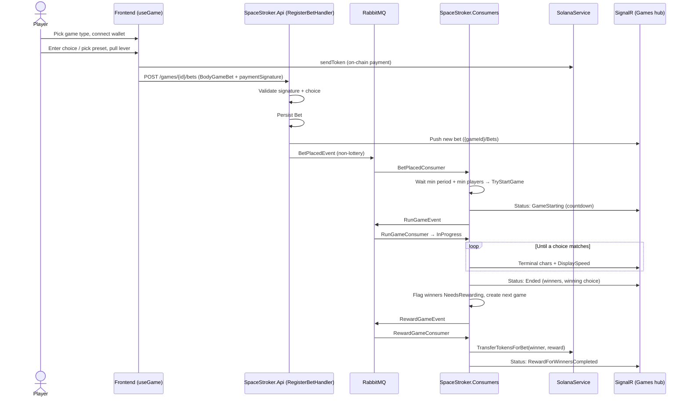
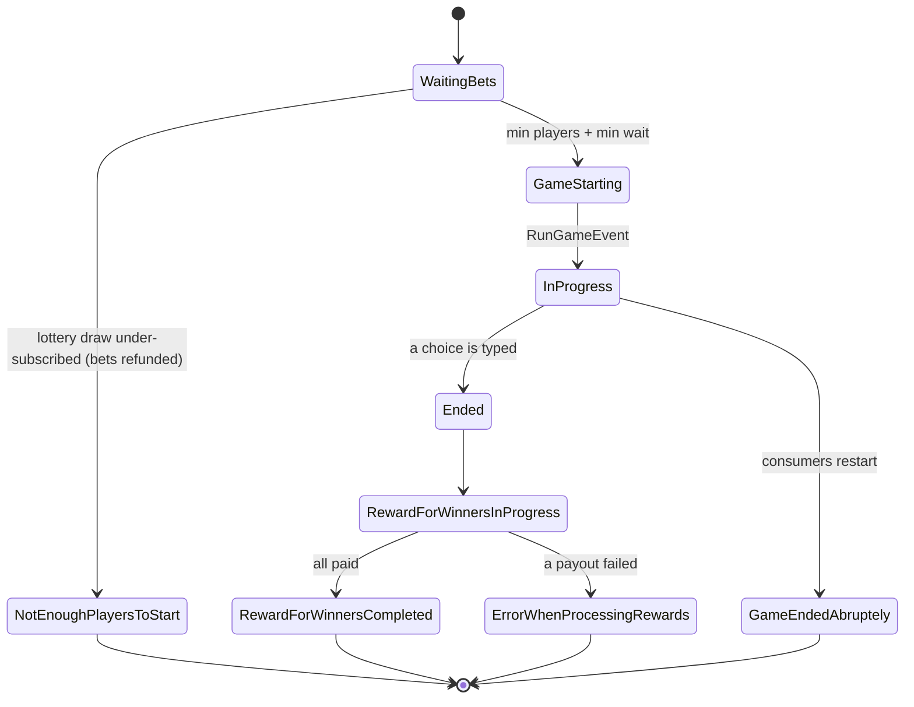

# Domain — Games (types, play flow, typer, rewards)

> The core game loop. A **game** is one round of a game type; players bet on a character
> sequence, a simulated "monkey" types random characters until a bet's sequence appears, and the
> matching bets win the pot.
>
> **§11 onward** covers the rules layered on that loop: choice exclusivity, free-bet mode, the pot
> display, the house seed bet, lottery scheduling and jackpot stacking, typer pacing, and the
> near-miss reveal. Deep design for each is in `../specs/` — linked per section.
>
> Primary code:
>
> - Backend domain: `SpaceStroker.Domain/Games/Services/SpaceStrokerTyper.cs`,
> `SpaceStroker.Domain/Bets/Services/BetDomainService.cs`,
> `SpaceStroker.Domain/Games/Entities/*`, `SpaceStroker.Domain/Games/ValueObjects/GameStatus.cs`.
> - Backend services/consumers: `SpaceStroker.Infrastructure/Services/Games/GameService.cs`,
> `SpaceStroker.Infrastructure/Consumers/{BetPlaced,RunGame,RewardGame,RefundInvalidBet,BetNotification}/*`.
> - API: `SpaceStroker.Api/Controllers/GamesController.cs`, DTOs in
> `SpaceStroker.Infrastructure/Contracts/Games/*`. Seed data: `SpaceStroker.Consumers/DefaultGameParameters.cs`.
> - Frontend: `src/pages/{GameSelectPage,GamePage}.vue`,
> `src/components/game-selection/{GameTypes,GameTypeCard}.vue`,
> `src/components/game/{GameTerminal,GameTyper,GameConsole,GameMonkey}.vue`,
> `src/hooks/{useGame,useConnection}.ts`, `src/services/mainService.ts`, `src/types/index.ts`.

---

## 1. What is a "game type"?

A **game type** is a row of `GameParameters` (`SpaceStroker.Domain/Games/Entities/GameParameters.cs`).
A **game** (`Game`) is one concrete round created from a `GameParameters`. Many games are
created over time from the same parameters (one rolls into the next).

The fields on `GameParameters` define how a type behaves:

| Field                        | Meaning                                                                                    |
| ---------------------------- | ------------------------------------------------------------------------------------------ |
| `Name`, `Description`        | Display text for the lobby card.                                                           |
| `AllowedCharacters`          | `GameCharacterType` — which characters the monkey can type and players can choose from. |
| `ChoiceRequiredLength`       | Exact length a player's choice (and the winning sequence) must be.                         |
| `AcceptDuplicatedCharacters` | Whether a choice may repeat characters (e.g. `"aabbcc"`).                                  |
| `MinimumNumberOfPlayers`     | Distinct players required before a round can start.                                        |
| `RequiredAmount`             | The exact stake per bet, in the configured settlement asset (`decimal(18,9)`).             |
| `AllowFreeBet`               | When `true`, game type accepts free bets if backend/frontend dev flags allow. Default `false`. See `free-bet-mode.md`. |
| `ComingSoon`                 | When `true`, the type is **listed but not playable** — no bets, no new rounds, not Orbit-eligible. Default `false`. ⚠️ **Not** `Active = false`, which removes it from the catalogue entirely. See §19. |
| `PresetChoices`              | Optional fixed set of allowed choices → turns a type into a "pick from a list" game.       |
| `LotteryParameters`          | Optional → turns a type into a scheduled, pot-based lottery.                               |

`GameCharacterType` (`SpaceStroker.Domain/Games/ValueObjects/GameCharacterType.cs`) — the
`[Description]` is the literal character pool:

| Value                   | Characters                             |
| ----------------------- | -------------------------------------- |
| `Number = 1`            | `0123456789`                           |
| `Letters = 2`           | `abcdefghijklmnopqrstuvwxyz`           |
| `NumbersAndLetters = 3` | `abcdefghijklmnopqrstuvwxyz0123456789` |

> Choices are **trimmed** (`Bet.Choice` setter) but **case-preserved** — the alphabets above are
> lowercase-only, so a choice containing uppercase (or any out-of-alphabet character) is **rejected**
> as `InvalidCharacters`, not silently lowercased. The pool is lowercase because non-lowercase input
> is refused at validation. See §11.

---

## 2. The three play modes (taxonomy)

A type's mode is derived from **which optional fields are set** — there is no explicit "mode" enum.

| Mode                   | Condition                                  | How it plays                                                                                                                                                |
| ---------------------- | ------------------------------------------ | ----------------------------------------------------------------------------------------------------------------------------------------------------------- |
| **Free-type race**     | No `PresetChoices`, no `LotteryParameters` | Player types any valid sequence of `ChoiceRequiredLength` from the allowed charset. First matching sequence wins.                                           |
| **Preset-choice race** | `PresetChoices` set                        | Player must pick one of the predefined choices (e.g. 8 animal words). Same race mechanic, restricted choice set.                                            |
| **Lottery**            | `LotteryParameters` set                    | Pot-based. A draw is **scheduled** every `Frequency` (via Hangfire); the pot starts at `LotteryPot` and grows with each bet. Under-subscribed draws refund. |

These are independent flags, so combinations are technically possible (e.g. preset + lottery); the
seeded defaults don't combine them. The reward pot differs only for lottery (it adds `LotteryPot`).

### Seeded default games — dev seeds the SAME catalogue production runs (since 2026-07-23)

Game types are seeded from **`GeneralSettings:Operator:DefaultGames`** in `spacestrokersettings.json`
(`SpaceStroker.Consumers` at startup, **create-only by name**), so what is exercised locally is what
ships — there is one catalogue and one deployment:

| Name          | Charset | Len | Mode                                                                                 |
| ------------- | ------- | --- | ------------------------------------------------------------------------------------ |
| Cosmic Sprint | Letters | 6   | Free-type race                                                                        |
| Beast Mode    | Letters | 6   | Preset race (8 beasts: rabbit, monkey, jaguar, falcon, cougar, turtle, donkey, pigeon) — ⚠️ **`ComingSoon = true` since 2026-08-13: listed, not playable** (§19) |
| Space Jackpot | Letters | 6   | Lottery (pot 5, drawn every 24h)                                                      |

All: min 2 players, duplicates allowed, settled in the single configured asset — **native SOL** since
2026-08-20 (see [`sol-settlement.md`](sol-settlement.md)). Prices: **Cosmic Sprint 0.01** (re-priced
from 0.02 on 2026-08-23), **Beast Mode 0.02**, **Space Jackpot 0.1**. ⚠️ Seeding is create-only by
name and there is **no `RequiredAmount` self-heal**, so a re-price reaches a FRESH install only; an
existing database needs a hand-run script — `deploy/sql/cosmic-sprint-reprice.sql` for the
2026-08-23 price, `deploy/sql/sol-settlement-cutover.sql` for the original SOL cutover. ⚠️ The DB
row and the 12h `ActiveParameters` Redis blob must move **together**: the row is what validates a
bet (`BetDomainService.ChoiceIsValidForGame`, off `GameService.GetGameById` — the DB, not the
cache), the blob is what the browser quotes, and while they disagree every UI bet is refused as
`InvalidAmount` **after its SOL already moved on-chain**. Only a **Consumers boot** clears that key
in production — both invalidating handlers are admin-only and no admin token can be minted there.
**Seeding never
rewrites an existing row** — a type is inserted only when no row with that name exists, so a restart
cannot resurrect an admin-deactivated type or mutate one under a live round. The exceptions are the
**three named startup self-heals**, which reconcile **one field each** and never touch anything else
(least of all `Active`, which is what keeps the resurrection guarantee intact):

| Self-heal | Forces | Why it must exist |
| --- | --- | --- |
| `AllowFreeBet` | `= !IsProduction()` | outside production the free-bet path is testable without a funded wallet; in production free bets are off |
| `AllowOrbit` | `= config.AllowOrbit` | a flag added to config after a row exists would otherwise never reach it |
| `ComingSoon` | `= config.ComingSoon` | the **only** way a seeded type is switched off — there is no admin endpoint behind it (§19) |

> **`DefaultGameParameters.cs` is deleted.** The old broad dev catalogue (Letters/Number/
> NumbersAndLetters races, preset races, 4h + 24h lotteries at lengths 6 and 8) survives **only as test
> fixtures** — `SpaceStroker.Tests/UnitTests/Shared/TestGameParameters.cs` for the unit suite and
> `SpaceStroker.Tests.Integration/Harness/IntegrationGameParameters.cs` for the integration harness.
> `ProductionGameTests` picks a game from it by name. Do not trim those lists
> to match dev, and do not expect those game names to exist in a running stack.

---

## 3. How game types are handled in the frontend

1. **Fetch:** `GameSelectPage` → `GameTypes.vue` calls `mainService.getGamesTypes()`
  (`GET /games/active-types`), returning `ActiveGame[]` (mapped from `GameParametersDto`; the endpoint
   is public and takes no auth header).
2. **Render cards:** `GameTypes.vue` maps each type to an `ActiveGameCard`, choosing the card
  image by content:
  - `Number` → number art; `NumbersAndLetters` → "free" art; `> 1` `presetChoices` → horse/animal
  art; otherwise letters art.
3. **`GameTypeCard.vue`** shows: name, description, the **price** (`{{ requiredAmount }} {{ tokenSymbol }}`, e.g. `0.02 SOL`, beside the Solana mark), and a **LOTTERY badge** with formatted frequency when `lotteryParameters` is set.
4. **Select:** clicking a card → `chooseGame(game)` (⚠️ **not emitted at all when the type is
  `comingSoon`** — §19) sets `selectedGame`, navigates to
  `/game?type=<gameTypeId>`, then `updateNewGame(true)` loads the live game instance and
   opens the websockets.
5. **Game screen:** `GamePage` renders `GameTerminal` (the CRT terminal + bet console) and
  `GameMonkey`. `GamePage.onMounted` recovers `selectedGame` from the `?type=` query if the user
   deep-linked/reloaded.

Key frontend types (`src/types/index.ts`): `ActiveGame` (incl. `lotteryParameters`,
`presetChoices`), `GameInstance` + `AppliedBet`, `BodyGameBet`.

---

## 4. How a game is played (full end-to-end flow)

> Roles: **API** (`SpaceStroker.Api`) handles bet submission + serves data and SignalR; **Consumers**
> (`SpaceStroker.Consumers`) runs the state machine, the typer, and payouts. See `architecture.md`.

1. **Pick a game type** in the lobby (§3) and land on `/game`.
2. **Connect a Solana wallet** (`solana-wallets-vue`) — **unless** free bet mode is active (see
   `free-bet-mode.md`). The terminal status nudges "CONNECT WALLET TO PLAY" until connected or free
   bet mode is on.
3. **Place a bet** (`GameTerminal.placeBet` → `useGame.bet(seed)`):
  - **Free bet mode** (dev/QA): toggle on → POST with `amount: 0`, empty signature, optional wallet;
    no `sendToken`.
  - **Paid bet** (default): on-chain SPL transfer via `useConnection.sendToken`; signature becomes
    `paymentSignature`.
  - The frontend POSTs `BodyGameBet` to `POST /games/{id}/bets`.
  - **Free-type race:** type a word into the terminal (`userWord`); the UI requires length ≥ 4
   before the lever is allowed, but the backend enforces the exact `ChoiceRequiredLength`.
  - **Preset race:** choose one of the listed preset choices.
4. **Backend registers the bet** (`RegisterBetHandler`): for paid bets, checks payment signature
  reuse and on-chain payment via `ISolanaService`; for free bets, skips payment validation when
  flags allow (see `free-bet-mode.md`). Validates choice (§9), persists the bet, and — for
  non-lottery types — publishes a `BetPlacedEvent`. A `BetNotificationEvent` pushes the bet to the
  recent-bets feed.
5. **Try to start** (`BetPlacedConsumer`): **player validation runs first** — it counts distinct
  players (free bets each count **individually**; paid/identified bets de-duplicate by
  `PlayerId`). If the count ≥ `MinimumNumberOfPlayers`, the consumer **waits out the remaining
  `MinimumWaitPeriodForBets`** (so the game always honours its full betting window even when it
  fills early) and then calls `TryStartGame` (`WaitingBets → GameStarting`, sets `StartDate`,
  via a concurrency-safe conditional update so only one caller wins); after the start delay it
  publishes `RunGameEvent`. If players are still short while the window is open, it waits for more
  bets. If a **lottery** is under-subscribed once the window has elapsed, every paid bet is refunded
  (`RefundInvalidBetEvent`) and the game is marked `NotEnoughPlayersToStart`.
6. **Run the round** (`RunGameConsumer` → `GameService.RunGame`): status → `InProgress`,
  the `SpaceStrokerTyper` streams characters over SignalR (`…/Terminal`, `…/DisplaySpeed`) until a bet's
   choice appears, then status → `Ended`. Winning bets are flagged `NeedsRewarding`, the **next
   game is created**, and a `RewardGameEvent` is published.
7. **Reward winners** (`RewardGameConsumer`): status → `RewardForWinnersInProgress`; for each
  paid winner it computes the reward (§8) and calls `ISolanaService.TransferTokensForBet(...)`;
  free-bet winners are marked `Rewarded` with no Solana call (see `free-bet-mode.md`). Bets become
  `Rewarded` (or `NeedsManualAnalysis` on failure); status →
   `RewardForWinnersCompleted` (or `ErrorWhenProcessingRewards`).
8. **Next round:** the freshly created game is already `WaitingBets`; the UI invites the player to
  pull the lever again (or shows the lottery's next-draw countdown).

### Lottery specifics

- The draw is scheduled with **Hangfire** (`GameService.ScheduleLottery`), which enqueues a
delayed `BetPlacedEvent` at the game's `StartDate` (now + `Frequency`).
- The pot shown in the UI = `LotteryPot` + `CarriedExtra` (stacked jackpot) + sum of placed bets
(`GameTerminal`/`useGame`).
- If too few players by draw time, all bets are refunded (step 5).
- **Pot stacking:** when a round pays **no one** — a **preset** lottery draws a choice nobody bet on
(`NumberOfWinners == 0`), or an **under-subscribed** round never draws — the un-won pot rolls forward
into the next round via `Game.CarriedExtra` (preset no-winner carries the losing stakes; under-sub
carries the base unchanged; a paid win resets to the base). Deactivating a lottery that still holds an
un-won pot **transfers** it to an eligible lottery. See `features/lottery-pot-stacking.md`.

---

## 5. Game state machine

`GameStatus` (`SpaceStroker.Domain/Games/ValueObjects/GameStatus.cs`):

| Status                       | Set by                           | Meaning                                                                                   |
| ---------------------------- | -------------------------------- | ----------------------------------------------------------------------------------------- |
| `WaitingBets`                | `CreateGame`                  | New game, accepting bets.                                                              |
| `NotEnoughPlayersToStart`    | `BetPlacedConsumer`              | Min players not met (lottery bets refunded).                                              |
| `GameStarting`            | `TryStartGame`                | Threshold met; countdown to start (`StartDate`).                                          |
| `InProgress`                 | `RunGameConsumer`             | The typer is running.                                                                     |
| `Ended`                      | `RunGameConsumer`             | A winning sequence was typed; `WinningChoice`/`Seed` recorded.                            |
| `RewardForWinnersInProgress` | `RewardGameConsumer`          | Paying winners.                                                                           |
| `RewardForWinnersCompleted`  | `RewardGameConsumer`          | All winners paid.                                                                         |
| `ErrorWhenProcessingRewards` | `RewardGameConsumer`          | At least one payout failed.                                                               |
| `GameEndedAbruptely`      | `CloseOngoingGames` (startup) | In-progress games are closed on Consumers restart; their bets → `NeedsManualAnalysis`. |

Helper sets on `Game`: `ActiveGamesStatus` (`WaitingBets, GameStarting, InProgress`),
`GameAcceptingBets` (`WaitingBets, GameStarting`), `GameInProgressStatus`,
`GameEndedStatus`.

The frontend (`GameTerminal.gameStatusLabel`) maps each status to player-facing copy, with separate
wording for **race** vs **lottery** modes.

---

## 6. Real-time / SignalR contract

Two hubs, mapped in `SpaceStroker.Api/Program.cs`, with a **Redis backplane** so messages fan out across
instances. Clients join a per-game group via `JoinGame(gameId)` (and `LeaveGame`).

| Hub (client path)                      | Channel                                        | Direction     | Payload                                                                                                                  |
| -------------------------------------- | ---------------------------------------------- | ------------- | ------------------------------------------------------------------------------------------------------------------------ |
| `ActiveGamesHub` (`/Hubs/Games`) | `<gameId>/Terminal`                         | server→client | Batched typed characters (string).                                                                                       |
|                                        | `<gameId>/DisplaySpeed`                     | server→client | `{ typingSpeed }` (1–3, ramps during the run).                                                                           |
|                                        | `<gameId>/Status`                           | server→client | `GameStatusUpdatedEvent` `{ status, startDate, result }`; `result` carries `winners` + `firstChoiceTyped` on `Ended`. |
|                                        | `<ActiveGamesEndpoint>` / `GameReceived` | server→client | `GameCreatedEvent` — the next game is available.                                                                   |
|                                        | `<gameId>/Bets`                             | server→client | New bet `{ amount, choice, wallet, paymentSignature }`, published by `BetNotificationConsumer`.                          |

Every stream rides **one hub** (`ActiveGamesHub`) and, on the client, **one connection per tab**:
`useGameHub` opens it lazily on the first game load and keeps it across rollovers and game switches,
swapping the per-game group rather than reconnecting. See `specs/unified-websocket-connection.md`.

Endpoint name formats come from `GeneralSettings.Games` (`GameTerminalEndpoint`,
`GameSpeedEndpoint`, `GameStatusEndpoint`, `GameBetsEndpoint`, `ActiveGamesEndpoint`). The frontend
binds these in `useGame.initalizeWebsocketConnections` (through `useGameHub.attachToGame`) and renders
the stream via `GameTyper.vue` (which crops `terminalOutput` to the last ~2000 chars once it exceeds
20000). JSON is camelCase.

---

## 7. The Typer (`SpaceStrokerTyper` internals)

`SpaceStroker.Domain/Games/Services/SpaceStrokerTyper.cs` is constructed from a `Game` (which must have
bets) and drives the round.

- **Provably-fair seed (commit-reveal + portable RNG):** the typer reads the game's committed
`ServerSeed` (a 64-char hex string generated + hash-committed on the **first bet**; see
`features/provably-fair.md`) and drives characters from an **HMAC-SHA256 counter keystream** over
`ServerSeed ‖ gameId ‖ orderedBetSeeds ‖ counter` (bets ordered `CreatedDate, Id`), mapping bytes
to pool indices by rejection sampling. There is no `System.Random` / `RandomNumberGenerator.Fill` at
run time — the stream is byte-for-byte reproducible in any language. The raw `ServerSeed` is revealed
only after the round Ends; `SHA256(ServerSeed) == ServerSeedHash` proves it wasn't grinded.
- **Bet/choice map (`SetBets`):** counts players per choice; preset choices are pre-registered with
count 0. `QueueLength` = the longest choice length (the rolling-window size).
- **Character pool (`SetCharactersOnTyper`):** chosen from, in priority order:
  - preset-choice characters (if presets exist), else
  - the full `AllowedCharacters` pool.
  - A **minimum diversity** rule tops the pool up to ≥ `allowedChars.Length / 5` distinct characters;
  the pool is sorted.
- **Generation loop (`GenerateNextCharacter`):** emits one random character per tick into a rolling
queue of size `QueueLength`; after each char, `CheckForWinners` compares the concatenated window to
the bet map. On a hit: `HasWinners = true`, records `FirstChoiceTyped` and the number of winners.
If no natural win by the character cap, `DecideFallbackWinner` picks from ordinally-sorted choices via
a dedicated `HMAC-SHA256(ServerSeed, prefix + "|fallback")` draw (`WinnerDecidedByFallback = true`) —
reproducible from the same published inputs.
- **Pacing/speed:** `CalculatePacing` schedules a constant ms-per-character from mode targets
(race mean 8–18 s / p95 ≤ 30 s; lottery mean 10–30 s / p95 ≤ 45 s) and horizon
`min(poolSize^QueueLength / numChoices, MaxTyperCharacters)`. `ApplyPacingDelay` sleeps only when
ahead of the Stopwatch schedule (hardware/load independent). `CurrentTypingSpeed` ramps 1→2→3 at ⅓
and ⅔ of target mean elapsed time (visual only; UI via `DisplaySpeed`). See
`features/typer-pacing-scalability.md`.

`GameService.RunGame` consumes the typer: it batches characters to `TerminalBatchLimit` before
sending each batch to `…/Terminal`, emits `…/DisplaySpeed` on speed changes, and loops until
`HasWinners`.

---

## 8. Reward & refund math (`BetDomainService`)

Constructed per game with `TokenSettings`. `Winners` = bets with `Status == NeedsRewarding`
(**materialized once** in the ctor — the reward consumer flips each winner's status to `Rewarded` as
it pays them, so a deferred set would shrink mid-payout and over-reward later winners).

- **Pot (`SetPotAmount`):** `pot = Σ(all bet amounts)` — zero-amount (free) bets contribute nothing;
  for lottery types, add `LotteryParameters.LotteryPot` **and** the game's `CarriedExtra` (the
  jackpot stacked from prior un-won lottery rounds — see `features/lottery-pot-stacking.md`). The pot
  is never reduced here; the crypto commission (below) is applied per winner at payout.
- **Reward per winner (`CalculateRewardForBet`):**
  - `winnerReward = pot / payableWinnerCount`, where `payableWinnerCount` = the number of **paid**
    winners (`Winners.Count(w => !IsFreeBet(w))`, frozen, guarded ≥ 1). Free-bet winners are marked
    `Rewarded` but receive no payout, so they do **not** dilute the paid winners' share (a free + paid
    winner ⇒ the paid winner takes the whole pot).
  - If `winnerReward < bet.Amount` → `BetRewardBiggerThanThePot` (won't pay less than the stake).
  - **House commission:** subtract `rate × max(0, winnerReward − ownStake − houseFundedShare)`, where
    `rate = GeneralSettings.Operator.Token.CommissionPercentage / 100` (**5%**, `0` disables) and
    `houseFundedShare = (LotteryPot + CarriedExtra) / payableWinnerCount`. The cut comes only from
    **profit above the winner's own stake**, and the house-funded lottery base is excluded. It now
    applies to **every** game type, because there is only one. See `features/crypto-commission.md`.
  - Subtract this bet's already-paid **`Credit`** ledger rows: `winnerReward -= Σ(Credit-type TransactionLog amounts)`.
  If `≤ 0` → `BetHasAlreadyBeenRewarded` (idempotency guard for retries).
  - Round down to `TokenSettings.Decimals`; also compute the smallest-unit integer for the transfer.
- **Refunds (`CalculateRefundForBet` / `CalculateRefundForInvalidBet`):** refund value = `bet.Amount`
minus this bet's prior **`Refund`**-type `TransactionLog` amounts, rounded down; `≤ 0` →
`BetHasAlreadyBeenRefunded`. (`Debit` rows are never subtracted.)

> **There is one payout/refund path:** on-chain via `ISolanaService`, against the token in
> `GeneralSettings:Operator:Token`. Every movement is recorded as exactly one **`TransactionLog`** row
> (`Debit` placement / `Credit` payout / `Refund`), carrying the on-chain detail inline and a
> **nullable `BetId`**. `RefundLog` and then `CryptoTransactionLog` were both folded into it.
> See `features/remove-operators.md`.

---

## 9. Validation & edge cases

**Choice validation** (`BetDomainService.ChoiceIsValidForGame`, in order):

1. `WrongChoiceLength` — empty, or length ≠ `ChoiceRequiredLength`.
2. `UnacceptedDuplicateCharacters` — duplicates present when `AcceptDuplicatedCharacters == false`.
3. `InvalidAmount` — paid: `bet.Amount != RequiredAmount`; free (`isFreeBet`): `bet.Amount != 0`.
4. `InvalidChoice` — presets exist and the choice isn't one of them.
5. `InvalidCharacters` — choice contains characters outside `AllowedCharacters` (the alphabets are
   lowercase-only, so **uppercase letters**, **internal spaces**, and **symbols** all land here;
   leading/trailing whitespace is trimmed first and does not).
6. otherwise `Valid`.

**Other guards in `RegisterBetHandler`:**

- **Reused payment signature** → `PaymentSignatureHasBeenUsed`.
- **On-chain payment invalid** (`ISolanaService.ValidateBetPayment`) → validation failure.
- **Duplicate bet** (same game+wallet+choice): same signature → `DuplicateBetError`;
different signature → refund (`DuplicateBetRefundedError`).
- **Per-round bet limits** (paid, identified bets only — gate `!isFreeBet && PlayerId != null`),
checked right after the duplicate check:
  - **One bet per player per round in preset types** (non-empty `PresetChoices`, e.g. *Beast Mode*):
  a second bet is rejected whatever choice it picks → `OneBetPerPresetRound`. Free-text types are
  unaffected — choice exclusivity already stops two players sharing a sequence.
  - **No second bet while you are the round's only bettor** (every type): rejected with
  `SecondBetNeedsAnotherPlayer` until a bet from a **different** `PlayerId` exists (a `NULL`
  one — an anonymous free bet by someone else — counts); after that there is **no further cap**.
  - Both count **every persisted `Bet` row regardless of `Status`**, so an admin-refunded bet still
  holds your preset slot. Both reset on rollover. Blocked bets take the same `RefundInvalidBet` path
  as `ChoiceAlreadyTaken` (a paid stake is refunded, a free bet is log-only).
  Application-level only — no unique index, so two simultaneous same-wallet bets can both slip
  through (bounded, no money lost). See `specs/fix-bets-logic.md`.
- **Game not accepting bets / not found** → refund with the vague `GameNotValidForBets` (see
`constraints.md` §6).
- **Coming-soon type** (`Parameters.ComingSoon`) → the **same** vague `GameNotValidForBets`, checked
  **with self-exclusion and ahead of payment validation**, so a transfer that already landed on-chain is
  refunded rather than accepted. No `Bet` row, no `Debit` ledger row, no `BetPlacedEvent`. See §19.
- Invalid bets refund via `RefundInvalidBetEvent` and surface a generic message + refund warning
  (**except free bets** — log only, no refund event; see `free-bet-mode.md`).

**Lifecycle edge cases:**

- **Not enough players:** normal races simply wait; **lotteries** refund all bets at draw time.
- **No winners after a run:** `RewardGameConsumer` marks `RewardForWinnersCompleted` with nothing
to pay (a winning sequence is guaranteed eventually, but guarded for safety).
- **Solana connection failure** before rewarding → `ErrorWhenProcessingRewards`.
- **Consumers restart mid-run:** `CloseOngoingGames` moves in-progress games to
`GameEndedAbruptely` and their bets to `NeedsManualAnalysis`.
- **Reward bigger than pot / already rewarded:** handled per-bet via the result messages above.

---

## 10. Diagrams

### Play flow (sequence)

### Game status (state)

---

## 11. Choice exclusivity (free-text types)

Spec: [`../specs/choice-exclusivity.md`](../specs/choice-exclusivity.md).

In **free-text** games (no `PresetChoices` — e.g. *Cosmic Sprint*) each typed sequence is **exclusive
to the first player who bets it** in a round: a different player betting the same sequence is rejected
and **auto-refunded** if they already paid on-chain. **Preset** games (e.g. *Beast Mode*) are
unchanged — many players may share a preset choice. Because a free-text winning sequence maps to
exactly one bet, free-text rounds are effectively **winner-takes-all**.

- **First persisted bet reserves the choice**, per round; choices free up on the next `Game`.
- `Bet.Choice` is **trimmed, case-preserved**. ⚠️ Casing is **not folded** — uppercase is rejected as
  `InvalidCharacters` *before* reservation (the alphabets are lowercase-only), so a reserved choice is
  always lowercase.
- ⚠️ **A second, CROSS-round reservation exists.** An Orbit player may set a fixed word, and on a
  free-text type that word becomes a **standing claim on the game type** (an `OrbitChoiceClaim` row,
  unique on `(GameParametersId, Choice)`) that blocks everyone else in **every** round — including
  rounds Orbit does not bet in. Unlike the per-round reservation it does **not** free on the next
  `Game`; it is released when the word is changed, cleared, or Orbit is disabled. **Preset types are
  never claimed.** A blocked human sees `ChoiceAlreadyTaken` and the same refund path,
  **byte-identical** to a same-round collision — deliberately, so Orbit stays invisible to other
  players. See [`orbit.md`](orbit.md).

## 12. Free-bet mode (dev/QA)

Spec: [`../specs/free-bet-mode.md`](../specs/free-bet-mode.md).

Places bets **without** a wallet or on-chain payment while exercising the full lifecycle. Production
must reject free bets at the API and hide the toggle.

- ⚠️ **Dual guard:** backend `GeneralSettings.Games.AllowFreeBets` (default `false` in production
  deploy config) **and** frontend `allowFreeBets`, **and** the game type's `AllowFreeBet`.
- **Detection is runtime, not a field:** `amount == 0` **and** empty/missing `paymentSignature`. Mixed
  signals (amount 0 *with* a signature, or amount > 0 with none) are **invalid**, not free.
- **Wallet is optional** for free bets; anonymous free bets keep `Bet.PlayerId` NULL.
- **Pot:** free bets are excluded from the pot sum. Mixed rounds: paid bets fund the pot, free bets
  still participate in the typer.
- **Rewards:** free winners are marked `Rewarded` with an info log only — no transfer. The blockhash
  pre-check runs only when at least one **paid** winner exists.
- **Frontend flag `allowFreeBets` is enabled by default** — set `VUE_APP_ALLOW_FREE_BETS=false` in
  production builds.

## 13. The pot display

Spec: [`../specs/game-pot-display.md`](../specs/game-pot-display.md). **Frontend-only** — derived
client-side from data the client already has; no backend, DB, SignalR or settlement change.

- Shown for **all three modes**. Races: sum of placed bet amounts. Lottery: base pot
  `+ game.carriedExtra + Σ bets`.
- ⚠️ **The lottery base comes from `ActiveGameDto.LotteryPot` on the game instance**, not the
  separately-fetched game-type parameters — so it cannot be silently dropped when the two fetches are
  out of sync.
- **Realtime** via the `{gameId}/Bets` stream, for every game type. (That stream moved onto the single
  `Games` hub; event name and payload unchanged — see [`infra.md`](infra.md).)
- **Free bets contribute nothing**, so a dev free-bet race pot reads `0` while a lottery still shows
  its base.
- **Always visible** — pre-run, running and ended, so the final total stays on screen.

## 14. The house seed bet

Spec: [`../specs/house-seed-bet.md`](../specs/house-seed-bet.md). **Production only.**

Every newly created round opens with **one paid bet already on it**, from a dedicated house wallet, on
all three game types. A round never reads as a dead game, and — because the seeded bet counts as a
distinct player — **a single real player is enough to start a round**.

⚠️ **The seeded bet is an ORDINARY bet, and that is the defining property.** No marker column, no DTO
field, no flag, no migration, no payment-validation bypass, no payout redirect, **no branch anywhere**.
It is indistinguishable from any player's bet in the database and in every payload. That works because
the house wallet is **both the transfer's sender and the bet's own `Wallet`**, so
`SolanaService.ValidateBetPayment` resolves both lookups and the shipped validator passes untouched.

⚠️ **`Bet.FundedByOrbit` is never set for a seeded bet, and must not be.** That flag exists solely
because Orbit's *custody account* signs on behalf of a **different** player's wallet. Setting it here
would discard a validation that genuinely passes **and** route a win into the player-custody account.

⚠️ **A round may run on the house seed bet plus Orbit bets alone, with no human in it** (#172), and
such a round carries **zero non-house entropy** — both the house bet's `Seed` and every Orbit bet's
`Seed` are `OrbitChoiceGenerator.DeriveSeed(ServerSeed, playerId)`. This is a **deliberate, accepted**
exposure, not an oversight: [`../specs/orbit-auto-bet-engine.md`](../specs/orbit-auto-bet-engine.md)
decision 13 already accepted it for Orbit-only rounds, and #172 extended that acceptance to rounds the
house **bets in**. It sits alongside — and does not weaken — the AC 21 invariant that a type with
`MinimumNumberOfPlayers < 2` is never seeded at all. See
[`../specs/house-seed-orbit-conflict.md`](../specs/house-seed-orbit-conflict.md).

*(It replaced `SpaceStroker.Seeder`, a console app polling every 6 hours that covered only two types
and stopped whenever that machine was off. The app is deleted.)*

## 15. Lottery draw time

Spec: [`../specs/lottery-draw-time.md`](../specs/lottery-draw-time.md).

A lottery type can pin its draw to a **fixed UTC time of day** instead of drawing one period after
whenever the previous round happened to be created. **Space Jackpot** draws daily at **22:00 UTC** and
does not drift.

⚠️ **The bug that exposed this:** Space Jackpot was configured `"LotteryFrequency": "24:00:00"`, and
.NET's `TimeSpan` parser reads a leading component **above 23** as **days** — so the "daily" jackpot
was drawing every **24 days** while the lobby, the terminal and the landing page all advertised a daily
draw.

- **`LotteryParameters.DrawTimeUtc`** is a nullable UTC time of day. **Null = the legacy rolling
  schedule**, so every pre-existing lottery behaves exactly as before.
- **Anchor and period are both kept.** Draw slots are the fixed grid
  `{ epoch + DrawTimeUtc + k·Frequency }` where the epoch is **`DateTime.MinValue`, not "today"** — so
  the grid is identical across restarts, hosts and rollovers.
- A round draws at the **earliest slot at least `MinimumLotteryDrawLeadSeconds` away** (default 600),
  so it never opens with a uselessly short betting window.
- ⚠️ **That lead must sit strictly between `MinimumWaitPeriodForBets` and the lottery's `Frequency`.**
  Below the wait period, `BetPlacedConsumer` returns before the under-subscribed refund branch — and
  because a lottery gets no other `BetPlacedEvent`, the round is **stuck forever holding real money**.

## 16. Lottery pot stacking

Spec: [`../specs/lottery-pot-stacking.md`](../specs/lottery-pot-stacking.md).

Un-won lottery money **stacks** into the next round instead of vanishing, so the pot grows until
someone wins.

- **The jackpot lives on the game:** `Game.CarriedExtra` (`numeric(18,9)`, default `0`), on top of the
  config base `LotteryParameters.LotteryPot`. Effective pot = `Σ bets + LotteryPot + CarriedExtra`.
  It is `0` for every non-lottery game, a fresh lottery, and the round after a paid win.
- **A lottery pays no one in two ways:** (a) a **preset** lottery draws a winning choice **nobody bet
  on** (the typer registers every preset with count 0, so the draw can land on an un-backed preset);
  (b) **under-subscription** — fewer than `MinimumNumberOfPlayers` by draw time, so the draw never runs
  and paid stakes are refunded. A **free-type** lottery always has a winner when it draws.
- **Carry rule — single source of truth `LotteryPotCarry.NextCarriedExtra(Game)`**, applied once when
  the successor is created: a preset no-winner draw carries `prev + Σ predecessor stakes` (**the losing
  stakes are not refunded — they join the jackpot**); under-subscription or abrupt close carries the
  base unchanged; a paid win resets to the config base.
- **Admin deactivation transfers** an un-won pot to an eligible active lottery (same method/token) or
  **blocks** — it is never destroyed.

## 17. Typer pacing

Spec: [`../specs/typer-pacing-scalability.md`](../specs/typer-pacing-scalability.md).

⚠️ **Pacing-only: the same seed + bets produce the same character stream and the same winner.** Only
wall-clock timing changes.

- **Targets:** race mean **8–18 s**, p95 ≤ 30 s; lottery draw run mean **10–30 s**, p95 ≤ 45 s. **No
  minimum duration** — instant natural wins are allowed.
- **Time-budget pacing:** ms-per-character is scheduled from the mode target and a search-space horizon
  (`min(expectedCharsToWin, MaxTyperCharacters)`). A `Stopwatch` drives delays — ⚠️ **sleep only when
  ahead of schedule (≥ 4 ms surplus), never slow further when behind**, which is what makes it hardware-
  and load-stable.
- **The `DisplaySpeed` ramp (1→2→3)** is tied to elapsed fractions of the target mean (⅓, ⅔), not
  character counts. Visual only.
- **Fallback winner:** at `CharactersTypedCount == _maxCharacters` with no natural match, the winner is
  picked over ordinally-sorted choices. The trigger is a **fixed character count**, so the same seed +
  bets give the same stream **and** the same winner on any host. Exposed as `WinnerDecidedByFallback` —
  see [`provably-fair.md`](provably-fair.md) for how it is derived rather than replayed.

## 18. The near-miss reveal

Spec: [`../specs/characters-away.md`](../specs/characters-away.md). ⚠️ The spec body describes the
original 3/2/1 pinned-milestone design; **the shipped behaviour is the bottom-docked climbing row
below.**

For each word **the current player bet this round**, the terminal shows how close the monkey has come,
as a live `> N AWAY!` row docked at the bottom next to the `> POT:` line. Display-only, every game type.

- **Scope = the player's own committed choices** — one row each. Other players' and un-bet preset
  choices are never shown.
- ⚠️ **Distance is tail-prefix progression (KMP), not window Hamming.** For a choice of length `L`,
  `away = L − k` where `k` is the longest suffix of the stream so far that is a **prefix** of the
  choice. A natural win is exactly `k == L`, mirroring `SpaceStrokerTyper.CheckForWinners`. Matched
  characters render as the first `k` characters of the choice; the rest as neutral underscores.
- **Closest-approach, climbing, 2 s loop.** Each row shows the best `k` of the current attempt; if it
  does not improve for 2 s it resets and climbs again. The number never regresses mid-attempt.
- **Win reveal:** when the round ends, the winning word — **if the player bet it** — types out to
  `away = 0` at ~80 ms/char and holds. Non-winning rows freeze.
- **Always visible** in a sticky, **opaque** bottom dock, so the auto-scrolling stream never hides it.

## 19. Coming soon — published, not playable

Spec: [`../specs/disable-beast-mode.md`](../specs/disable-beast-mode.md). Shipped 2026-08-13 with
**Beast Mode** as the first (and today the only) gated type.

`GameParameters.ComingSoon` is **deactivation semantics without leaving the catalogue**: the type keeps
its lobby card, its `/how-to-play` mode card and its whole settled history, but it accepts no bet and
opens no round. It exists because a front-only "not clickable" gate leaves the game fully bettable
through the API, a stale tab or a saved deep link.

| | `Active`, not coming soon | **`ComingSoon = true`** | `Active = false` |
| --- | --- | --- | --- |
| In `GET /games/active-types` | yes | **yes — carrying `comingSoon: true`** | no |
| Lobby / home picker card | clickable | **gated (see below)** | absent |
| `/how-to-play` mode card | yes | **yes, marked coming soon** | absent |
| Bets accepted | yes | **no — vague `GameNotValidForBets`, paid stake refunded** | no |
| Roll-over / Consumers startup open a round | yes | **no** | no |
| In Orbit `eligibleGameTypes` | if `AllowOrbit` | **no** | no |
| Settled rounds in history / stats / provably-fair | yes | **yes, untouched** | yes |

**It is flipped by config + a Consumers redeploy — there is no endpoint.** ⚠️ **No admin token can be
minted in production today** (`POST /dev/admin-token` is 404 there, the private key sits in Secret
Manager while the API deploys with only the public half, and nothing in `monkify-meta/tools/` signs
that JWT), so an `/admin/*` route would have shipped dead. An EF data migration was rejected too:
reverting would need a second migration and it freezes a game name into migration history.

- **The seeder reconciles the one field** (`ComingSoon` self-heal, §2) via `ComingSoonReconciler` —
  ⚠️ deliberately **a class, not an inline loop in `Consumers/Program.cs`**, because top-level program
  statements are unreachable from a test and `ExecuteUpdate` is a silent no-op on the in-memory
  provider, so the `false → true` transition could not otherwise be asserted at all.
- **On the `false → true` transition the seeder publishes the existing `GameTypeDeactivatedEvent`** —
  the flip has no admin action to publish it. `GameTypeDeactivatedConsumer` needed **no logic change**:
  it filters on `WaitingBets` only and never reads `Active`. So `WaitingBets` rounds are cancelled
  (`NotEnoughPlayersToStart`, paid bets refunded via `RefundInvalidBetEvent`, free bets skipped) while
  ⚠️ **`GameStarting` / `InProgress` rounds are left to finish and pay out** — refunding a round whose
  `ServerSeed` is already committed would break provably-fair. Publishing is safe because these startup
  steps run on `ApplicationStarted`, when the transport is already up.
- **The flip drops the global `ActiveParameters` cache key** (12h TTL) — without it the first boot
  after deploy serves a blob predating the field for half a day, so the lobby keeps offering a game the
  API now refuses.
- ⚠️ **The round-opening skip belongs at the `OpenNewGames` call site, never inside
  `GameService.GetAllActiveGameParameters`.** That method has four callers and only this one wants the
  type gone; the other three — the `/games/active-types` catalogue, the recent-rounds feed and global
  stats — all need it to stay. Filtering in the service empties the very card the feature exists to
  render. `GetActiveParametersForRollover` and `GameParametersCreatedConsumer` carry the same skip, so
  a gated type runs dry after its current round and an admin-created gated type never opens one.
- **Reversible with no data loss:** set the config flag back to `false` and redeploy Consumers — a
  round opens, the card is clickable, the deep link stops bouncing, Orbit gets its option back.

**Frontend — the card is a machine that is switched off, not a broken one.** Everything is resolved
from the `comingSoon` catalogue field alone; ⚠️ **never from the name, the `gameTypeId` or the
archetype** (the id is a fresh GUID after every teardown + reseed, and archetype-matching would
silently gate any future preset type — `utils/gameArt.ts`'s "resolve by SHAPE, never name or id" rule
applied to availability).

- Gated `GameTypeCard`: neutral **`COMING SOON`** pill in the status-pill slot, a **disabled
  "Coming soon"** button, **no chips at all — the ticket price included**, lightly dimmed art
  (`grayscale(.3) brightness(.82)`), `aria-disabled`, **no pointer cursor**, and a click that emits no
  `chooseGame`. ⚠️ **The hover animation — lift, accent glow AND the GIF swap — is deliberately kept**:
  suppressing it made the card read as *broken* rather than *not yet open*, and killed the artwork that
  is the whole reason for keeping the game in the catalogue. Motion says *alive*, not *clickable*; the
  pill, the disabled button and the dead click are what carry "not yet". The **cursor** is the one
  affordance still suppressed — it is the only one that would be an outright lie.
- **The "brief explanation" is the catalogue `description`**, shown in full. No game copy is
  hard-coded in the frontend, so it cannot drift from the catalogue.
- `/game/play?type=<gated-id>` **bounces to the lobby with a toast**, before any live-instance fetch or
  socket open — that closes the bookmark/stale-tab hole the card cannot.
- `useLiveGames` **skips the live fan-out** for gated types (one fewer request per gated type on every
  lobby and home load); the card renders from the catalogue alone. `HomeHero.usualGame` skips them too,
  so a gated favourite simply renders no CTA. `GameTypes`' eyebrow counts **playable** types only.
- `/how-to-play` **keeps the mode card**, dimmed with the same filter and chipped `COMING SOON`, so the
  manual and the lobby tell the same story — but ⚠️ **it keeps its `TICKET:` line**: a manual describes,
  a card invites, and quoting a price on a card for a game that refuses every bet advertises a
  transaction it cannot honour.
- ⚠️ **An older SPA build ignores `comingSoon` and would still let a player in — the backend refusal is
  what actually protects the game.** The front only shapes the UI.

Orbit eligibility and its single-option GAME tab are in [`orbit.md`](orbit.md); the admin portal's
create-time checkbox is in [`admin-and-ops.md`](admin-and-ops.md).
