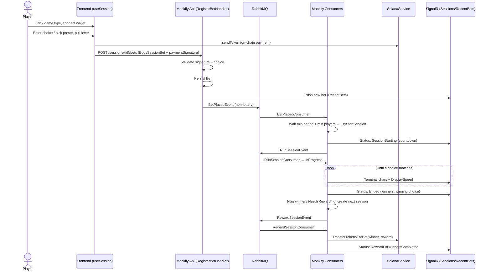
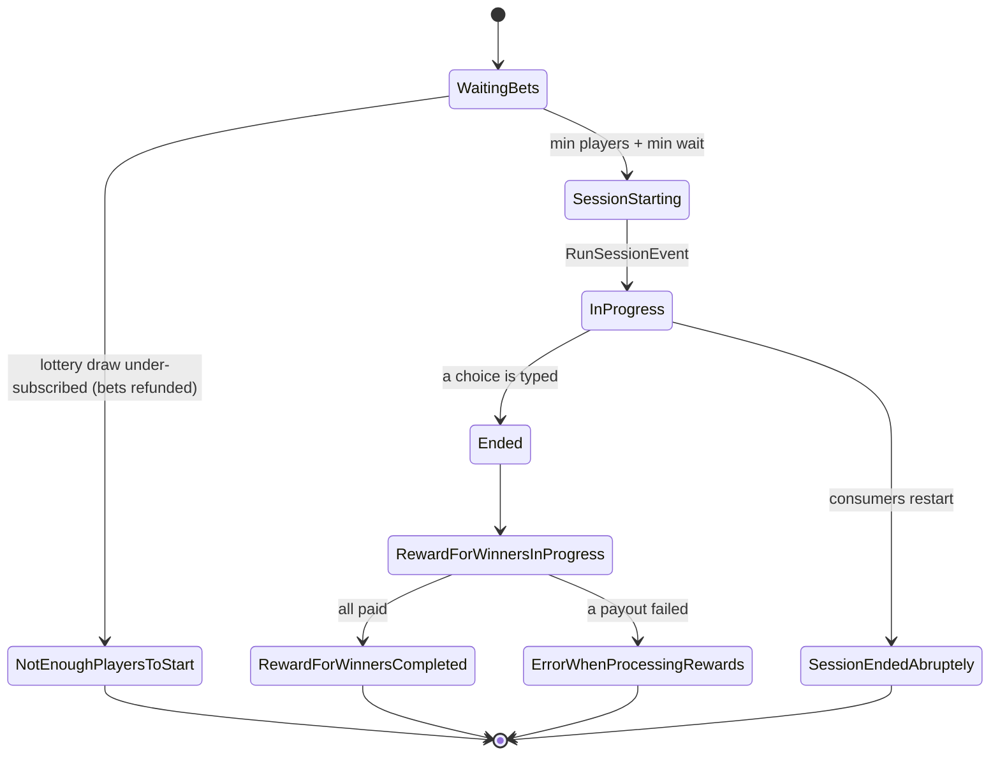

# Feature — Sessions (types, play flow, typer, rewards)

> The core game loop. A **session** is one round of a game type; players bet on a character
> sequence, a simulated "monkey" types random characters until a bet's sequence appears, and the
> matching bets win the pot.
>
> Primary code:
>
> - Backend domain: `Monkify.Domain/Sessions/Services/MonkifyTyper.cs`,
> `Monkify.Domain/Bets/Services/BetDomainService.cs`,
> `Monkify.Domain/Sessions/Entities/*`, `Monkify.Domain/Sessions/ValueObjects/SessionStatus.cs`.
> - Backend services/consumers: `Monkify.Infrastructure/Services/Sessions/SessionService.cs`,
> `Monkify.Infrastructure/Consumers/{BetPlaced,RunSession,RewardSession,RefundInvalidBet,BetNotification}/*`.
> - API: `Monkify.Api/Controllers/SessionsController.cs`, DTOs in
> `Monkify.Infrastructure/Contracts/Sessions/*`. Seed data: `Monkify.Consumers/DefaultSessionParameters.cs`.
> - Frontend: `src/pages/{SessionSelectPage,GamePage}.vue`,
> `src/components/game-selection/{GameTypes,GameTypeCard}.vue`,
> `src/components/game/{GameTerminal,GameTyper,GameConsole,GameMonkey}.vue`,
> `src/hooks/{useSession,useConnection}.ts`, `src/services/mainService.ts`, `src/types/index.ts`.

---

## 1. What is a "session type"?

A **game type** is a row of `SessionParameters` (`Monkify.Domain/Sessions/Entities/SessionParameters.cs`).
A **session** (`Session`) is one concrete round created from a `SessionParameters`. Many sessions are
created over time from the same parameters (one rolls into the next).

The fields on `SessionParameters` define how a type behaves:

| Field                        | Meaning                                                                                    |
| ---------------------------- | ------------------------------------------------------------------------------------------ |
| `Name`, `Description`        | Display text for the lobby card.                                                           |
| `AllowedCharacters`          | `SessionCharacterType` — which characters the monkey can type and players can choose from. |
| `ChoiceRequiredLength`       | Exact length a player's choice (and the winning sequence) must be.                         |
| `AcceptDuplicatedCharacters` | Whether a choice may repeat characters (e.g. `"aabbcc"`).                                  |
| `MinimumNumberOfPlayers`     | Distinct players required before a round can start.                                        |
| `RequiredAmount`             | The exact stake per bet (USD; `decimal(18,9)`).                                            |
| `PresetChoices`              | Optional fixed set of allowed choices → turns a type into a "pick from a list" game.       |
| `LotteryParameters`          | Optional → turns a type into a scheduled, pot-based lottery.                               |
| `OperatorId` / `Operator`    | Optional tenant owner (null = "house"). See `operators.md`.                                |

`SessionCharacterType` (`Monkify.Domain/Sessions/ValueObjects/SessionCharacterType.cs`) — the
`[Description]` is the literal character pool:

| Value                   | Characters                             |
| ----------------------- | -------------------------------------- |
| `Number = 1`            | `0123456789`                           |
| `Letters = 2`           | `abcdefghijklmnopqrstuvwxyz`           |
| `NumbersAndLetters = 3` | `abcdefghijklmnopqrstuvwxyz0123456789` |

> Choices are normalized to **trimmed lowercase** (`Bet.Choice` setter), so the pool is lowercase.

---

## 2. The three play modes (taxonomy)

A type's mode is derived from **which optional fields are set** — there is no explicit "mode" enum.

| Mode                   | Condition                                  | How it plays                                                                                                                                                |
| ---------------------- | ------------------------------------------ | ----------------------------------------------------------------------------------------------------------------------------------------------------------- |
| **Free-type race**     | No `PresetChoices`, no `LotteryParameters` | Player types any valid sequence of `ChoiceRequiredLength` from the allowed charset. First matching sequence wins.                                           |
| **Preset-choice race** | `PresetChoices` set                        | Player must pick one of the predefined choices (e.g. 8 animal words). Same race mechanic, restricted choice set.                                            |
| **Lottery**            | `LotteryParameters` set                    | Pot-based. A draw is **scheduled** every `Frequency` (via Hangfire); the pot starts at `LotteryPot` and grows with each bet. Under-subscribed draws refund. |

These are independent flags, so combinations are technically possible (e.g. preset + lottery); the
seeded defaults don't combine them. The reward pot differs only for lottery (it adds `LotteryPot`).

### Seeded default games (non-production)

`DefaultSessionParameters.GenerateDefaultParameters()` seeds these on startup (all: min 2 players,
1-token entry, duplicates allowed). In dev they are owned by the seeded
"DEV Cassino" operator (see `operators.md`); see `constraints.md`/`architecture.md` for the
production caveat.

| Name                 | Charset | Len | Mode                                                                                    |
| -------------------- | ------- | --- | --------------------------------------------------------------------------------------- |
| 6L Lexicon Lightning | Letters | 6   | Free-type race                                                                          |
| 6N Digit Derby       | Number  | 6   | Free-type race                                                                          |
| 6L Savanna Stakes    | Letters | 6   | Preset race (8 animals: rabbit, monkey, donkey, pigeon, cougar, falcon, turtle, jaguar) |
| 6L Menagerie Mayhem  | Letters | 6   | Preset race (same 8 animals)                                                            |
| 6L Quarter Quill Pot | Letters | 6   | Lottery (pot 4, draw every 4h)                                                          |
| 7L Sevenfold Sunset  | Letters | 7   | Lottery (pot 4, draw daily ~23h59m)                                                     |

---

## 3. How session types are handled in the frontend

1. **Fetch:** `SessionSelectPage` → `GameTypes.vue` calls `mainService.getSessionsTypes()`
  (`GET /sessions/active-types`), returning `ActiveSession[]` (mapped from `SessionParametersDto`,
   operator-scoped by the `operator-id` header).
2. **Render cards:** `GameTypes.vue` maps each type to an `ActiveSessionCard`, choosing the card
  image by content:
  - `Number` → number art; `NumbersAndLetters` → "free" art; `> 1` `presetChoices` → horse/animal
  art; otherwise letters art.
3. **`GameTypeCard.vue`** shows: name, description, the **price** (`${{ requiredAmount }} MONKI Per
  Ticket`), and a **LOTTERY badge** with formatted frequency when `lotteryParameters` is set.
4. **Select:** clicking a card → `chooseSession(session)` sets `selectedSession`, navigates to
  `/game?type=<sessionTypeId>`, then `updateNewSession(true)` loads the live session instance and
   opens the websockets.
5. **Game screen:** `GamePage` renders `GameTerminal` (the CRT terminal + bet console) and
  `GameMonkey`. `GamePage.onMounted` recovers `selectedSession` from the `?type=` query if the user
   deep-linked/reloaded.

Key frontend types (`src/types/index.ts`): `ActiveSession` (incl. `lotteryParameters`,
`presetChoices`), `SessionInstance` + `AppliedBet`, `BodySessionBet`.

---

## 4. How a session is played (full end-to-end flow)

> Roles: **API** (`Monkify.Api`) handles bet submission + serves data and SignalR; **Consumers**
> (`Monkify.Consumers`) runs the state machine, the typer, and payouts. See `architecture.md`.

1. **Pick a game type** in the lobby (§3) and land on `/game`.
2. **Connect a Solana wallet** (`solana-wallets-vue`). The terminal status nudges
  "CONNECT WALLET TO PLAY" until connected.
3. **Place a bet** (`GameTerminal.placeBet` → `useSession.bet(seed)`):
  - **Free-type race:** type a word into the terminal (`userWord`); the UI requires length ≥ 4
   before the lever is allowed, but the backend enforces the exact `ChoiceRequiredLength`.
  - **Preset race:** choose one of the listed preset choices.
  - The bet pays via an on-chain SPL token transfer (`useConnection.sendToken`); the returned
  signature becomes `paymentSignature`.
  - The frontend POSTs `BodySessionBet` to `POST /sessions/{id}/bets`.
4. **Backend registers the bet** (`RegisterBetHandler`): checks the payment signature isn't reused,
  validates the on-chain payment via `ISolanaService`, validates the choice (§9), persists the bet,
  and — for non-lottery types — publishes a `BetPlacedEvent`. A `BetNotificationEvent` pushes the
  bet to the recent-bets feed.
5. **Try to start** (`BetPlacedConsumer`): once `MinimumWaitPeriodForBets` has elapsed and the
  distinct-player count ≥ `MinimumNumberOfPlayers`, it calls `TryStartSession`
   (`WaitingBets → SessionStarting`, sets `StartDate`) and, after the start delay, publishes
   `RunSessionEvent`. If a **lottery** is under-subscribed at draw time, every bet is refunded
   (`RefundInvalidBetEvent`) and the session is marked `NotEnoughPlayersToStart`.
6. **Run the round** (`RunSessionConsumer` → `SessionService.RunSession`): status → `InProgress`,
  the `MonkifyTyper` streams characters over SignalR (`…/Terminal`, `…/DisplaySpeed`) until a bet's
   choice appears, then status → `Ended`. Winning bets are flagged `NeedsRewarding`, the **next
   session is created**, and a `RewardSessionEvent` is published.
7. **Reward winners** (`RewardSessionConsumer`): status → `RewardForWinnersInProgress`; for each
  winner it computes the reward (§8) and calls `ISolanaService.TransferTokensForBet(...)`;
   bets become `Rewarded` (or `NeedsManualAnalysis` on failure); status →
   `RewardForWinnersCompleted` (or `ErrorWhenProcessingRewards`).
8. **Next round:** the freshly created session is already `WaitingBets`; the UI invites the player to
  pull the lever again (or shows the lottery's next-draw countdown).

### Lottery specifics

- The draw is scheduled with **Hangfire** (`SessionService.ScheduleLottery`), which enqueues a
delayed `BetPlacedEvent` at the session's `StartDate` (now + `Frequency`).
- The pot shown in the UI = `LotteryPot` + sum of placed bets (`GameTerminal`/`useSession`).
- If too few players by draw time, all bets are refunded (step 5).

---

## 5. Session state machine

`SessionStatus` (`Monkify.Domain/Sessions/ValueObjects/SessionStatus.cs`):

| Status                       | Set by                           | Meaning                                                                                   |
| ---------------------------- | -------------------------------- | ----------------------------------------------------------------------------------------- |
| `WaitingBets`                | `CreateSession`                  | New session, accepting bets.                                                              |
| `NotEnoughPlayersToStart`    | `BetPlacedConsumer`              | Min players not met (lottery bets refunded).                                              |
| `SessionStarting`            | `TryStartSession`                | Threshold met; countdown to start (`StartDate`).                                          |
| `InProgress`                 | `RunSessionConsumer`             | The typer is running.                                                                     |
| `Ended`                      | `RunSessionConsumer`             | A winning sequence was typed; `WinningChoice`/`Seed` recorded.                            |
| `RewardForWinnersInProgress` | `RewardSessionConsumer`          | Paying winners.                                                                           |
| `RewardForWinnersCompleted`  | `RewardSessionConsumer`          | All winners paid.                                                                         |
| `ErrorWhenProcessingRewards` | `RewardSessionConsumer`          | At least one payout failed.                                                               |
| `SessionEndedAbruptely`      | `CloseOngoingSessions` (startup) | In-progress sessions are closed on Consumers restart; their bets → `NeedsManualAnalysis`. |

Helper sets on `Session`: `ActiveSessionsStatus` (`WaitingBets, SessionStarting, InProgress`),
`SessionAcceptingBets` (`WaitingBets, SessionStarting`), `SessionInProgressStatus`,
`SessionEndedStatus`.

The frontend (`GameTerminal.gameStatusLabel`) maps each status to player-facing copy, with separate
wording for **race** vs **lottery** modes.

---

## 6. Real-time / SignalR contract

Two hubs, mapped in `Monkify.Api/Program.cs`, with a **Redis backplane** so messages fan out across
instances. Clients join a per-session group via `JoinSession(sessionId)` (and `LeaveSession`).

| Hub (client path)                      | Channel                                        | Direction     | Payload                                                                                                                  |
| -------------------------------------- | ---------------------------------------------- | ------------- | ------------------------------------------------------------------------------------------------------------------------ |
| `ActiveSessionsHub` (`/Hubs/Sessions`) | `<sessionId>/Terminal`                         | server→client | Batched typed characters (string).                                                                                       |
|                                        | `<sessionId>/DisplaySpeed`                     | server→client | `{ typingSpeed }` (1–3, ramps during the run).                                                                           |
|                                        | `<sessionId>/Status`                           | server→client | `SessionStatusUpdatedEvent` `{ status, startDate, result }`; `result` carries `winners` + `firstChoiceTyped` on `Ended`. |
|                                        | `<ActiveSessionsEndpoint>` / `SessionReceived` | server→client | `SessionCreatedEvent` — the next session is available.                                                                   |
| `RecentBetsHub` (`/Hubs/RecentBets`)   | `<sessionId>/Bets`                             | server→client | New bet `{ amount, choice, wallet, paymentSignature }`.                                                                  |

Endpoint name formats come from `GeneralSettings.Sessions` (`SessionTerminalEndpoint`,
`SessionSpeedEndpoint`, `SessionStatusEndpoint`, `ActiveSessionsEndpoint`). The frontend wires these
in `useSession.initalizeWebsocketConnections` and renders the stream via `GameTyper.vue` (which crops
`terminalOutput` to the last ~2000 chars once it exceeds 20000). JSON is camelCase.

---

## 7. The Typer (`MonkifyTyper` internals)

`Monkify.Domain/Sessions/Services/MonkifyTyper.cs` is constructed from a `Session` (which must have
bets) and drives the round.

- **Deterministic seed:** `GenerateSessionSeed` mixes 32 random bytes with every bet's `Seed`,
SHA-256s it, and uses the result to seed a `Random`. Storing the session `Seed` makes the outcome
reproducible/auditable.
- **Bet/choice map (`SetBets`):** counts players per choice; preset choices are pre-registered with
count 0. `QueueLength` = the longest choice length (the rolling-window size).
- **Character pool (`SetCharactersOnTyper`):** chosen from, in priority order:
  - preset-choice characters (if presets exist), else
  - bet characters for certain hard letter games (`Letters` with length 7, or length 6 with ≤ 10
  bets), else
  - the full `AllowedCharacters` pool.
  - A **minimum diversity** rule tops the pool up to ≥ `allowedChars.Length / 5` distinct characters;
  the pool is sorted.
- **Generation loop (`GenerateNextCharacter`):** emits one random character per tick into a rolling
queue of size `QueueLength`; after each char, `CheckForWinners` compares the concatenated window to
the bet map. On a hit: `HasWinners = true`, records `FirstChoiceTyped` and the number of winners.
- **Pacing/speed:** `CalculateDelayIntervals` derives a base typing pace from the search space
(`poolSize ^ QueueLength / numChoices`) with a per-length/per-pool correction; `CurrentTypingSpeed`
ramps up (1→2→3) as the run passes expected-char milestones, which the UI reflects via
`DisplaySpeed`.

`SessionService.RunSession` consumes the typer: it batches characters to `TerminalBatchLimit` before
sending each batch to `…/Terminal`, emits `…/DisplaySpeed` on speed changes, and loops until
`HasWinners`.

---

## 8. Reward & refund math (`BetDomainService`)

Constructed per session with `TokenSettings`. `Winners` = bets with `Status == NeedsRewarding`.

- **Pot (`SetPotAmount`):** `pot = Σ(all bet amounts)`; for lottery types, add `LotteryParameters.LotteryPot`;
then apply commission: `pot *= (1 - CommisionPercentage)`.
- **Reward per winner (`CalculateRewardForBet`):**
  - `winnerReward = pot / winnerCount`.
  - If `winnerReward < bet.Amount` → `BetRewardBiggerThanThePot` (won't pay less than the stake).
  - Subtract already-paid **credits** for this bet: `winnerReward -= Σ(TransactionLog amounts)`.
  If `≤ 0` → `BetHasAlreadyBeenRewarded` (idempotency guard for retries).
  - Round down to `TokenSettings.Decimals`; also compute the smallest-unit integer for the transfer.
- **Refunds (`CalculateRefundForBet` / `CalculateRefundForInvalidBet`):** refund value = `bet.Amount`
minus already-paid credits (from `TransactionLog`), rounded down; `≤ 0` → `BetHasAlreadyBeenRefunded`.

---

## 9. Validation & edge cases

**Choice validation** (`BetDomainService.ChoiceIsValidForSession`, in order):

1. `WrongChoiceLength` — empty, or length ≠ `ChoiceRequiredLength`.
2. `UnacceptedDuplicateCharacters` — duplicates present when `AcceptDuplicatedCharacters == false`.
3. `InvalidAmount` — `bet.Amount != RequiredAmount`.
4. `InvalidChoice` — presets exist and the choice isn't one of them.
5. `InvalidCharacters` — choice contains characters outside `AllowedCharacters`.
6. otherwise `Valid`.

**Other guards in `RegisterBetHandler`:**

- **Reused payment signature** → `PaymentSignatureHasBeenUsed`.
- **On-chain payment invalid** (`ISolanaService.ValidateBetPayment`) → validation failure.
- **Duplicate bet** (same session+wallet+choice): same signature → `DuplicateBetError`;
different signature → refund (`DuplicateBetRefundedError`).
- **Session not accepting bets / not found / operator expired** → refund with the vague
`SessionNotValidForBets` (never reveals operator/contract state — see `operators.md`,
`constraints.md`).
- Invalid bets refund via `RefundInvalidBetEvent` and surface a generic message + refund warning.

**Lifecycle edge cases:**

- **Not enough players:** normal races simply wait; **lotteries** refund all bets at draw time.
- **No winners after a run:** `RewardSessionConsumer` marks `RewardForWinnersCompleted` with nothing
to pay (a winning sequence is guaranteed eventually, but guarded for safety).
- **Solana connection failure** before rewarding → `ErrorWhenProcessingRewards`.
- **Consumers restart mid-run:** `CloseOngoingSessions` moves in-progress sessions to
`SessionEndedAbruptely` and their bets to `NeedsManualAnalysis`.
- **Reward bigger than pot / already rewarded:** handled per-bet via the result messages above.

---

## 10. Diagrams

### Play flow (sequence)

### Session status (state)

