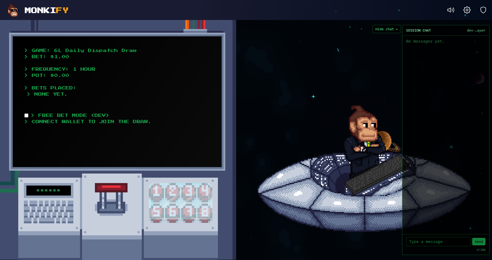
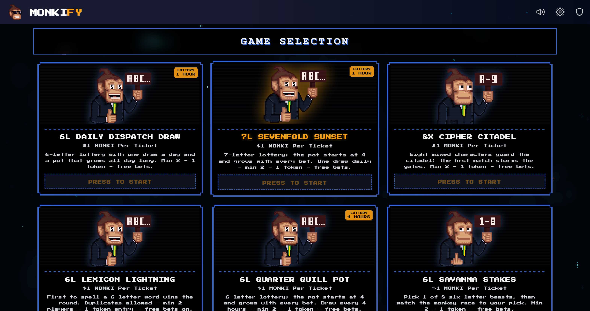
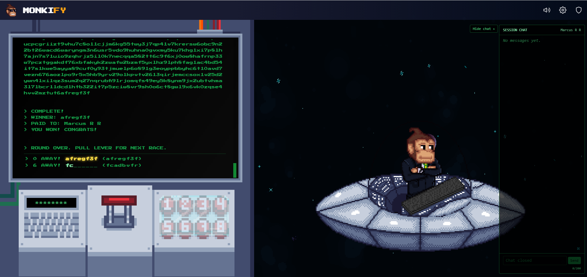

<!--
  MONKIFY PITCH DECK — TEMPLATE (Marp source of truth). Instantiate at pitch/suppliers/<slug>/deck.md.
  RULES (per owner):
    - MINIMAL. Slides carry TOPICS ONLY (short keyword bullets / visuals). No paragraphs.
    - NON-TECHNICAL. No technologies, architecture, APIs, protocols — this is for a SALES audience.
    - The full talking script goes in a sibling speaker-notes.md (see speaker-notes-template.md).
    - Commercial slide shows ONLY the recommended model, and stays "open to discussion". No option menu.
    - Certification: be TRANSPARENT — provably-fair-by-design + replayable now; NOT yet lab-certified;
      setup fee funds certification. Do NOT say "cert-ready".
    - Crypto: "Solana today, open to more tokens as needed." Keep/drop the crypto payments bullet per track:
        crypto supplier → UNIFIED payments slide (fiat + crypto); non-crypto → regulated/fiat-only.
    - Contact = Marcus Ruas · marcusruas.andrade@gmail.com.
    - NEVER on a slide: team size, cash constraints, "they might clone it".
  Front matter MUST stay at the very top of the file (before this comment) or Marp renders it as text.
  Images are relative to the deck file: ../../assets/media/<file>.
-->
<!-- _class: cover -->
<!-- _paginate: false -->

# MONK<b>IFY</b>

A brand-new multiplayer game — {{ONE_LINE_HOOK}}

Prepared for <strong>{{SUPPLIER}}</strong> · {{DATE}}

---
## What Monkify is

- A **real-time multiplayer** betting game
- Players **bet on a sequence** — first one to appear **wins the pot**
- Everyone watches the **same live round** together
- **Not a slot** — a genuinely new format

---
<!-- _class: divider -->
# See it live

---
## The game

---
## A catalogue of modes

---
## A real win — paid on the spot

---
## Why players love it

- **Social & competitive** — play against each other, live
- **Near-miss tension** — "so close" keeps them coming back
- **Fast rounds** — seconds, not minutes
- **Live chat** in every game

---
## Why it's different

- A **category-first** — not another {{SLOT_OR_RESKIN}}
- **Differentiation** your operators can't get elsewhere
- {{DIFFERENTIATION_TOPIC}}
- **Sticky** — races and scheduled draws

---
<!-- _class: divider -->
# How it fits your business

---
## One integration, your whole network

- **One integration → {{NETWORK_PHRASE}}**
- **We run it** — hosting, updates, 24×7 support
- **Embeds** straight into the casino
- **Your branding**, per operator

---
## Payments{{PAYMENTS_TITLE_SUFFIX}}

<!-- UNIFIED (crypto supplier): -->
- **Fiat operators** — settles in the operator's own wallet, in USD
- **Crypto operators** — settles on-chain
- **Solana today**, and open to adding more tokens as you need them
- **One game**, either way
<!-- REGULATED-ONLY (non-crypto): replace the 4 bullets above with:
- Settles in the **operator's own wallet**, in **USD**
- **No player money or personal data** held on our side
- Fits your **regulated, fiat** operators
- Nothing new for your players to learn
-->

---
## Fair & transparent

- **Provably fair** — every round can be independently verified
- **Independent certification is our next milestone** — and the setup fee funds it
- {{CERT_TRACK_TOPIC}}
- We're **upfront** about where we are

---
## Why work with us

- **Ready today** — live, polished, proven
- **24×7 support** with clear response commitments (SLAs)
- **Fully documented** for your operators
- **We handle everything** — you get the differentiation

---
## Commercial model

- **We host & support everything** — infrastructure, updates, 24×7 fixes
- **Start with a pilot** — prove it, low commitment
- **A share of the revenue** the game makes
- **A small monthly minimum** covers infrastructure — credited against the share
- **Open to discussion**

---
## What's next

- **Leaderboards & player rankings**
- **Player badges & status in chat**
- **More game modes** on the way
- **Tournaments & seasonal events**

---
<!-- _class: cover -->
<!-- _paginate: false -->

# Let's talk

A finished, differentiated game — {{CLOSING_HOOK}}

Marcus Ruas · marcusruas.andrade@gmail.com 
Next step: {{NEXT_STEP}}

