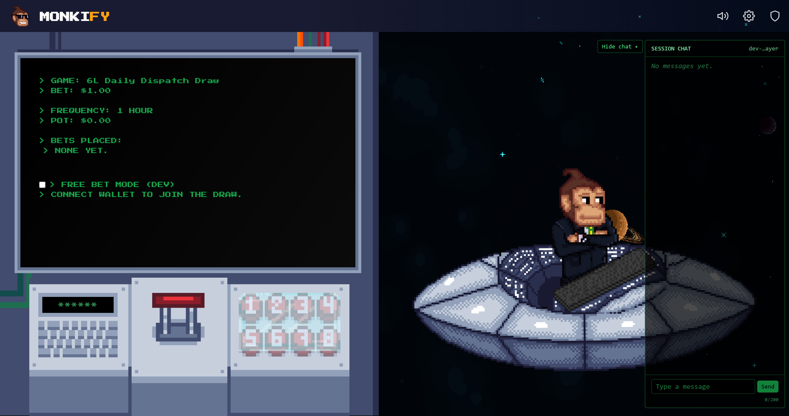
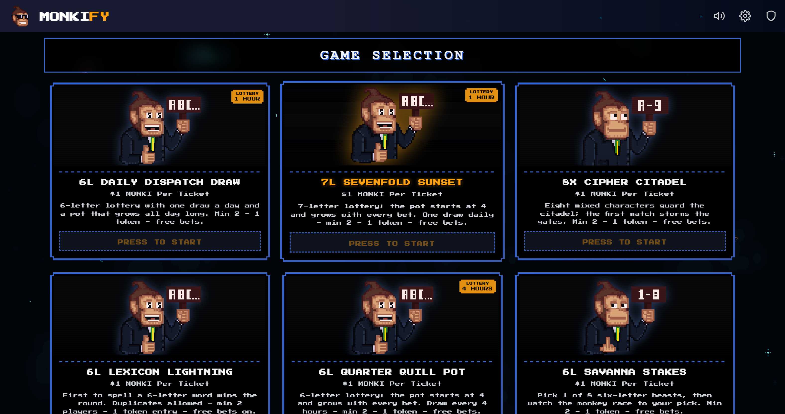
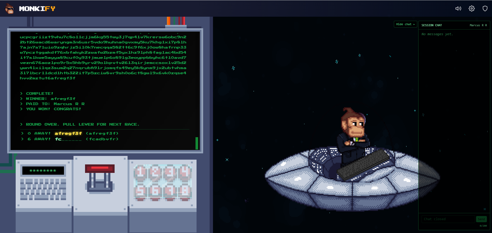

<!--
  Monkify pitch deck — PLAYTECH (regulated-only track: fiat wallet settlement, no crypto slide).
  MINIMAL / topics-only, NON-TECHNICAL (sales audience). Full talking points: speaker-notes.md.
  Build: see pitch/build-decks.sh. Front matter MUST stay at the very top.
-->
<!-- _class: cover -->
<!-- _paginate: false -->

# MONK<b>IFY</b>

A brand-new multiplayer game for the Playtech Open Platform

Prepared for <strong>Playtech</strong> · July 2026

---
## What Monkify is

- A **real-time multiplayer** betting game
- Players **bet on a sequence** — first one to appear **wins the pot**
- Everyone watches the **same live round** together
- **Not a slot** — a genuinely new format

---
<!-- _class: divider -->
# See it live

---
## The game

---
## A catalogue of modes

---
## A real win — paid on the spot

---
## Why players love it

- **Social & competitive** — play against each other, live
- **Near-miss tension** — "so close" keeps them coming back
- **Fast rounds** — seconds, not minutes
- **Live chat** in every game

---
## Why it's different

- A **category-first** — not another slot
- **Differentiation** as slot catalogues look alike
- A **fresh headline** for the Games Marketplace
- **Sticky** — races and scheduled draws

---
<!-- _class: divider -->
# How it fits your business

---
## One integration, your whole network

- **One integration → many operators** — the way POP already works
- **We run it** — hosting, updates, 24×7 support
- **Embeds** straight into the casino
- **Your branding**, per operator

---
## Payments

- Settles in the **operator's own wallet**, in **USD**
- **No player money or personal data** held on our side
- Fits your **regulated, fiat** operators
- Nothing new for your players to learn

---
## Fair & transparent

- **Provably fair** — every round can be independently verified
- **Independent certification is our next milestone** — and the setup fee funds it
- A **staged plan**: integrate now, certify in parallel, go live per market
- We're **upfront** about where we are

---
## Why work with us

- **Ready today** — live, polished, proven
- **24×7 support** with clear response commitments (SLAs)
- **Fully documented** for your operators
- **We handle everything** — you get the differentiation

---
## Commercial model

- **We host & support everything** — infrastructure, updates, 24×7 fixes
- **Start with a pilot** — prove it, low commitment
- **A share of the revenue** the game makes
- **A small monthly minimum** covers infrastructure — credited against the share
- **Open to discussion**

---
## What's next

- **Leaderboards & player rankings**
- **Player badges & status in chat**
- **More game modes** on the way
- **Tournaments & seasonal events**

---
<!-- _class: cover -->
<!-- _paginate: false -->

# Let's talk

A finished, differentiated game — ready for POP's network

Marcus Ruas · marcusruas.andrade@gmail.com 
Next step: a live demo for your Games Marketplace / content team

