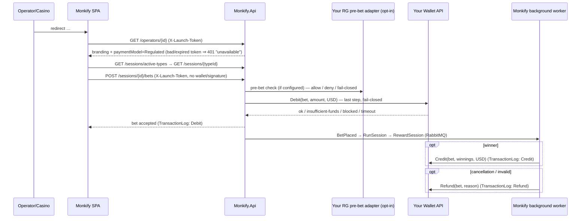

# Monkify — Integration overview, Model A / Regulated (launch → bet → settle)

> **Version:** 1 · **Date:** 2026-07-01
> **Audience:** Casino CTO / integration engineer (regulated / licensed operator)
> **Confidentiality:** **Confidential — shared under NDA.** Integration-level technical detail. It
> contains **no** source code, real keys, credentials, or infrastructure topology; every example
> value below is an obvious mock (`MOCK_…`).
> **Status:** Draft — not legal advice.

## Purpose

The technical deep-dive a **regulated** casino's engineering team reads before (or during) the
integration call. It describes the end-to-end **launch → game load → bet → settle** flow at the
endpoint level, and exactly what the operator implements: a signed launch token, the operator
**wallet API**, and (optionally) a responsible-gaming pre-bet hook. It is grounded in Monkify's
shipped backend. For fairness/RNG detail see the legal **Fairness & Game Rules** document; for
authorship/ownership see **Proof of Ownership** (both in [`../../legal/`](../../legal/)).

> Crypto-native integration? See the [Model B version](../model-b/02-integration-overview.md).

## Your track — Model A (Regulated)

<!-- MODEL-A-PROFILE:EN START -->
### Model A — Regulated (single-model profile)

- **Who it's for:** licensed / regulated operators (BetMGM-style).
- **Payments:** your own wallet — Monkify holds **no** player float.
- **Player identity:** your `ExternalPlayerId`, delivered as the launch-token `sub` claim.
- **Settlement:** Monkify calls your wallet API — **debit** the stake, **credit** winnings, **refund** cancellations (amounts in USD).
- **Responsible gaming:** yours; optionally enforced via Monkify's pre-bet hook (allow / deny / fail-closed).
- **Integration surface:** signed launch token **+** operator wallet API **+** optional RG pre-bet hook.

**You keep** the player account, KYC/AML, funds/float, and RG controls. **Monkify runs** the game
logic, RNG/fairness, live streaming, hosting, bug fixes, and support. Monkify takes **no commission**
— winners receive the full pot.
<!-- MODEL-A-PROFILE:EN END -->

## 1. Launch — signed launch token

The casino launches the game by redirecting the player to:

```
https://<monkify-host>/monkify/game/sessions#launch_token=<jwt>
```

- The token is an **RS256 JWT** you sign with **your private key**. Monkify validates it against your
  stored **public key** (PEM), with optional key-id for rotation.
- **Claims:** `iss` = your operator id, `sub` = the player's **`ExternalPlayerId`**, plus `exp`,
  `iat`, and `jti` (audit only). `displayName` / `currency` are **not** claims.
- Validation (stateless middleware) checks signature, `exp`/`iat` with **±2 min** clock skew, and —
  when the path carries an operator id — that it matches `iss`. Replay protection is **expiry-only**.
  The operator must exist, be contract-active, and have a stored public key.
- **Every operator-scoped REST call carries `X-Launch-Token`.** The SPA captures the token from the
  URL fragment, strips it from the URL, and sends it on every request.
- **Failures are vague by design.** Any failure — missing, expired, bad signature, unknown operator,
  `iss` mismatch — returns a single generic **HTTP 401**; the real reason and a correlation id are
  logged **server-side only**. The game never reveals contract status (e.g. "expired"). A token that
  expires mid-play takes the same path (re-launch).

Example token payload (**mock**):

```json
{ "iss": "MOCK_OPERATOR_GUID", "sub": "MOCK_EXTERNAL_PLAYER_ID", "iat": 0, "exp": 0, "jti": "MOCK_JTI" }
```

## 2. Game load — read endpoints

All calls send `X-Launch-Token`. Responses are wrapped as `{ data, messages }`.

| Endpoint | Purpose |
| --- | --- |
| `GET /operators/{id}` | Branding + **`paymentModel`** (`Regulated`) — the UI shows **no** wallet-connect. |
| `GET /sessions/active-types` | Your active game types (session parameters). |
| `GET /sessions/{sessionTypeId}` | The active session for a game type (to join and bet). |
| `PATCH /players/preferences` | Upserts the player's display name + preferred currency (render-only). |

For a regulated operator the frontend shows no wallet UI: the player bets and settlement runs
off-chain through your wallet.

## 3. Bet — `POST /sessions/{id}/bets`

Request body (Model A — no wallet, no signature; the player is the token `sub`):

```json
{ "amount": 0, "choice": "banana", "seed": "MOCK_SEED" }
```

The bet handler runs, in this **exact order**:

1. **Resolve the operator** (cached, contract-active) — `paymentModel = Regulated`.
2. **Shape checks** — free-bet vs paid.
3. **Resolve player identity** — the token `sub` (`ExternalPlayerId`). Upsert the `OperatorPlayer`.
4. **Bet-parameter validation** — duplicate bet (same player + choice + session), session is
   accepting bets, operator still contract-active, choice valid for the session.
5. **Responsible-gaming pre-bet check** (opt-in; see §5) — **after** local validation, **before** the
   debit.
6. **Debit the operator wallet** (see §4) — the **last** step before persisting.
7. **Persist** the bet and publish `BetPlacedEvent` (non-lottery).

Because the debit is **last**, an invalid, duplicate, or RG-denied bet is **never debited or
persisted**.

## 4. Settlement — your wallet API

Monkify holds no float and calls **your** wallet API. You implement three operations (amounts are
**USD decimals**, `currency: "USD"`):

| Operation | When | Called from |
| --- | --- | --- |
| **Debit(bet, amount)** | At bet time — the last step before the bet is accepted | `Monkify.Api` (synchronous) |
| **Credit(bet, amount)** | When a session is rewarded and the player won | Background worker |
| **Refund(bet, amount, reason)** | Post-acceptance cancellation (lottery under-subscription, abrupt end) | Background worker |

- **Idempotency:** the key is the **bet id** (+ operation). A timeout is not retried synchronously;
  the bet-id key guards against a double-debit on any later retry.
- **Debit result → player message.** A failed debit returns a **specific** player-facing message
  mapped from a canonical error code (a player's own wallet error is specific, not the vague
  operator-status message):

  | Canonical error | Player sees |
  | --- | --- |
  | `InsufficientFunds` | insufficient funds |
  | `PlayerBlocked` | player blocked |
  | `Duplicate` | duplicate bet |
  | `Timeout` / `Unavailable` | "temporarily unavailable, please try again" |

- **Every successful operation writes a `TransactionLog` row** carrying your returned
  `ExternalTransactionReference`.
- **Free bets** (amount 0) make **no** wallet calls.

## 5. Responsible-gaming pre-bet hook (optional)

If you want Monkify to enforce your responsible-gaming controls before a bet, you implement a
**pre-bet check** adapter. It is **opt-in per operator** — unconfigured operators skip the check
entirely.

- Monkify calls your check with `{ operatorId, externalPlayerId, amount, currency, sessionId,
  gameType, betId }` **after** local validation and **before** the debit.
- Your response is one of:
  - **Allowed** → the bet proceeds.
  - **Denied(reason)** → the bet is rejected with a **specific** player message. Canonical reasons:
    `SelfExcluded`, `LimitReached`, `CoolingOff`, `KycRequired`, `Blocked`, `Other`.
  - **Unavailable** (timeout / error) → **fail-closed**: the bet is rejected ("temporarily
    unavailable, please try again"). Any transport exception is treated as Unavailable.
- A denied or failed check means the bet is **never debited or persisted**. Audit is **log-only** — no
  Monkify DB table, no player PII stored.

## 6. Run & stream — session lifecycle

Once a bet is placed, the session advances through a message-driven state machine (RabbitMQ):

```
BetPlaced → RunSession → RewardSession        (RefundInvalidBet on failure)
```

- The **typer** runs the game in the background worker and streams over **SignalR**
  (`/Hubs/Sessions`, `/Hubs/RecentBets`): batched characters, current speed, and status transitions
  (winners are announced on `Ended`). SignalR is session-id scoped — no launch token on the socket.
- On `RewardSession`, winners are paid via your wallet **Credit**; cancellations **Refund** via your
  wallet. Every movement is a `TransactionLog` row (`Credit` / `Debit` / `Refund`). **No commission**
  — the full pot goes to winners.

## 7. End-to-end sequence (Model A)



## 8. What you implement (checklist)

- [ ] **Sign launch tokens** (RS256) with claims `iss` / `sub`=`ExternalPlayerId` / `exp` / `iat` /
      `jti`; give Monkify your **public key**.
- [ ] **Wallet API** exposing **Debit / Credit / Refund** (USD; idempotent on bet id; returns an
      external reference and a canonical error code on failure).
- [ ] *(optional)* **RG pre-bet check** returning Allowed / Denied(reason) / Unavailable.
- [ ] Provide the **`ExternalPlayerId`** you want Monkify to reference per player.

## Out of scope for this document

- Full OpenAPI for every endpoint (shared separately if needed).
- Real infrastructure topology, credentials, and source.
- The crypto (Model B) settlement path — see the [Model B version](../model-b/02-integration-overview.md).
- Certification promises — see the legal Fairness document; lab certification is **DEFERRED**.

## Document control

- **Model A/B source of truth:** [`../README.md`](../README.md) (profile block reused verbatim).
- **Grounded in (read-only):** launch-token validation, operator wallet API (Debit/Credit/Refund,
  unified `TransactionLog`, no commission), the RG pre-bet hook (allow/deny/fail-closed), and the
  session state machine (`BetPlaced → RunSession → RewardSession`, `RefundInvalidBet`).
- **Cross-references:** [`../../legal/`](../../legal/) — Fairness & Game Rules, Proof of Ownership.
- **Deferred (paid) steps:** lab RNG certification (GLI/BMM) — **DEFERRED**.
