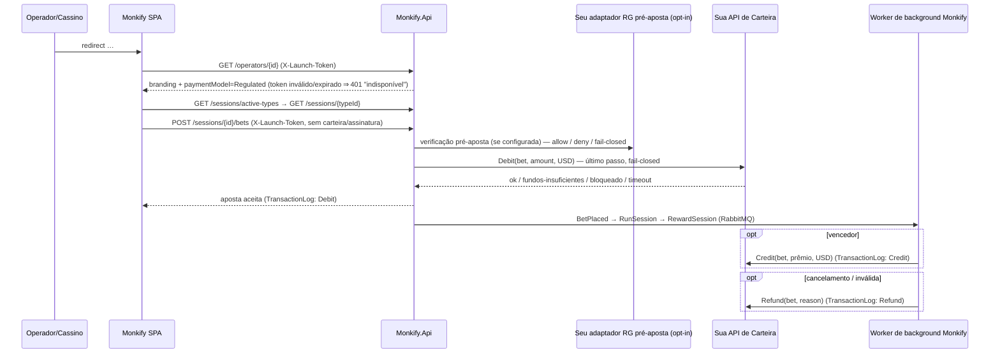

# Monkify — Panorama de integração, Modelo A / Regulado (launch → aposta → liquidação)

> **Versão:** 1 · **Data:** 2026-07-01
> **Público:** CTO / engenheiro de integração do cassino (operador regulado / licenciado)
> **Confidencialidade:** **Confidencial — compartilhado sob NDA.** Detalhe técnico em nível de
> integração. **Não** contém código-fonte, chaves reais, credenciais nem topologia de infraestrutura;
> todo valor de exemplo abaixo é um mock evidente (`MOCK_…`).
> **Status:** Rascunho — não constitui aconselhamento jurídico.

## Objetivo

O aprofundamento técnico que o time de engenharia de um cassino **regulado** lê antes (ou durante) a
call de integração. Descreve o fluxo ponta a ponta **launch → carregamento do jogo → aposta →
liquidação** em nível de endpoint, e exatamente o que o operador implementa: um launch token assinado,
a **API de carteira** do operador e (opcionalmente) um hook pré-aposta de jogo responsável. É
fundamentado no backend em produção do Monkify. Para detalhe de fairness/RNG veja o documento legal
**Regras do Jogo & Fairness**; para autoria/propriedade veja **Prova de Propriedade** (ambos em
[`../../legal/`](../../legal/)).

> Integração cripto-nativa? Veja a [versão Modelo B](../model-b/02-integration-overview.pt-BR.md).

## Sua trilha — Modelo A (Regulado)

<!-- MODEL-A-PROFILE:PT-BR START -->
### Modelo A — Regulado (perfil de modelo único)

- **Para quem é:** operadores licenciados / regulados (estilo BetMGM).
- **Pagamentos:** sua própria carteira — o Monkify **não** retém saldo do jogador.
- **Identidade do jogador:** o seu `ExternalPlayerId`, entregue na claim `sub` do launch token.
- **Liquidação:** o Monkify chama a sua API de carteira — **débito** da aposta, **crédito** dos prêmios, **estorno** de cancelamentos (valores em USD).
- **Jogo responsável:** seu; opcionalmente aplicado via hook pré-aposta do Monkify (permitir / negar / fail-closed).
- **Superfície de integração:** launch token assinado **+** API de carteira do operador **+** hook pré-aposta opcional.

**Você mantém** a conta do jogador, KYC/AML, fundos/saldo e controles de RG. **O Monkify opera** a
lógica do jogo, RNG/fairness, transmissão ao vivo, hospedagem, correções e suporte. O Monkify **não**
cobra comissão — os vencedores recebem o pote inteiro.
<!-- MODEL-A-PROFILE:PT-BR END -->

## 1. Launch — launch token assinado

O cassino abre o jogo redirecionando o jogador para:

```
https://<monkify-host>/monkify/game/sessions#launch_token=<jwt>
```

- O token é um **JWT RS256** que você assina com **sua chave privada**. O Monkify o valida com a sua
  **chave pública** armazenada (PEM), com key-id opcional para rotação.
- **Claims:** `iss` = id do seu operador, `sub` = o **`ExternalPlayerId`** do jogador, mais `exp`,
  `iat` e `jti` (apenas auditoria). `displayName` / `currency` **não** são claims.
- A validação (middleware stateless) checa assinatura, `exp`/`iat` com **±2 min** de tolerância e —
  quando o caminho carrega um id de operador — que ele bate com `iss`. Proteção de replay é **apenas
  por expiração**. O operador deve existir, ter contrato ativo e uma chave pública.
- **Toda chamada REST com escopo de operador carrega `X-Launch-Token`.** A SPA captura o token do
  fragmento da URL, o remove da URL e o envia em cada requisição.
- **Falhas são vagas por design.** Qualquer falha — ausente, expirado, assinatura inválida, operador
  desconhecido, `iss` divergente — retorna um único **HTTP 401** genérico; o motivo real e um
  correlation id são registrados **apenas no servidor**. O jogo nunca revela o status do contrato
  (ex.: "expirado"). Um token que expira durante o jogo segue o mesmo caminho (re-launch).

Exemplo de payload do token (**mock**):

```json
{ "iss": "MOCK_OPERATOR_GUID", "sub": "MOCK_EXTERNAL_PLAYER_ID", "iat": 0, "exp": 0, "jti": "MOCK_JTI" }
```

## 2. Carregamento do jogo — endpoints de leitura

Todas as chamadas enviam `X-Launch-Token`. As respostas vêm no formato `{ data, messages }`.

| Endpoint | Objetivo |
| --- | --- |
| `GET /operators/{id}` | Branding + **`paymentModel`** (`Regulated`) — a UI **não** mostra wallet-connect. |
| `GET /sessions/active-types` | Seus tipos de jogo ativos (parâmetros de sessão). |
| `GET /sessions/{sessionTypeId}` | A sessão ativa de um tipo de jogo (para entrar e apostar). |
| `PATCH /players/preferences` | Faz upsert do nome de exibição + moeda preferida (apenas exibição). |

Para um operador regulado o frontend não mostra UI de carteira: o jogador aposta e a liquidação corre
off-chain pela sua carteira.

## 3. Aposta — `POST /sessions/{id}/bets`

Corpo da requisição (Modelo A — sem carteira, sem assinatura; o jogador é o `sub` do token):

```json
{ "amount": 0, "choice": "banana", "seed": "MOCK_SEED" }
```

O handler de aposta executa, nesta **ordem exata**:

1. **Resolve o operador** (em cache, contrato ativo) — `paymentModel = Regulated`.
2. **Checagens de formato** — free-bet vs paga.
3. **Resolve a identidade do jogador** — o `sub` do token (`ExternalPlayerId`). Faz upsert do
   `OperatorPlayer`.
4. **Validação de parâmetros da aposta** — aposta duplicada (mesmo jogador + escolha + sessão), sessão
   aceitando apostas, operador ainda com contrato ativo, escolha válida para a sessão.
5. **Verificação pré-aposta de jogo responsável** (opt-in; ver §5) — **após** a validação local,
   **antes** do débito.
6. **Débito na carteira do operador** (ver §4) — o **último** passo antes de persistir.
7. **Persiste** a aposta e publica `BetPlacedEvent` (não-loteria).

Como o débito é o **último** passo, uma aposta inválida, duplicada ou negada pelo RG **nunca** é
debitada ou persistida.

## 4. Liquidação — sua API de carteira

O Monkify não retém saldo e chama a **sua** API de carteira. Você implementa três operações (valores
são **decimais em USD**, `currency: "USD"`):

| Operação | Quando | Chamada de |
| --- | --- | --- |
| **Debit(bet, amount)** | No momento da aposta — o último passo antes de aceitá-la | `Monkify.Api` (síncrono) |
| **Credit(bet, amount)** | Quando a sessão é premiada e o jogador venceu | Worker de background |
| **Refund(bet, amount, reason)** | Cancelamento pós-aceite (loteria sem quórum, fim abrupto) | Worker de background |

- **Idempotência:** a chave é o **id da aposta** (+ operação). Um timeout não é reexecutado de forma
  síncrona; a chave por id de aposta impede débito duplicado em qualquer retentativa posterior.
- **Resultado do débito → mensagem ao jogador.** Um débito falho retorna uma mensagem **específica**
  ao jogador, mapeada de um código de erro canônico (o erro da própria carteira do jogador é
  específico, não a mensagem vaga de status do operador):

  | Erro canônico | O jogador vê |
  | --- | --- |
  | `InsufficientFunds` | fundos insuficientes |
  | `PlayerBlocked` | jogador bloqueado |
  | `Duplicate` | aposta duplicada |
  | `Timeout` / `Unavailable` | "temporariamente indisponível, tente novamente" |

- **Toda operação bem-sucedida grava uma linha em `TransactionLog`** com o seu
  `ExternalTransactionReference` retornado.
- **Free bets** (valor 0) **não** fazem chamadas de carteira.

## 5. Hook pré-aposta de jogo responsável (opcional)

Se você quer que o Monkify aplique seus controles de jogo responsável antes de uma aposta, você
implementa um adaptador de **verificação pré-aposta**. É **opt-in por operador** — operadores não
configurados pulam a verificação.

- O Monkify chama a sua verificação com `{ operatorId, externalPlayerId, amount, currency, sessionId,
  gameType, betId }` **após** a validação local e **antes** do débito.
- Sua resposta é uma de:
  - **Allowed** → a aposta prossegue.
  - **Denied(reason)** → a aposta é rejeitada com mensagem **específica**. Razões canônicas:
    `SelfExcluded`, `LimitReached`, `CoolingOff`, `KycRequired`, `Blocked`, `Other`.
  - **Unavailable** (timeout / erro) → **fail-closed**: a aposta é rejeitada. Qualquer exceção de
    transporte é tratada como Unavailable.
- Uma verificação negada ou falha significa que a aposta **nunca** é debitada ou persistida. A
  auditoria é **apenas em log** — sem tabela no banco, sem PII do jogador.

## 6. Execução & streaming — ciclo de vida da sessão

Após a aposta ser registrada, a sessão avança por uma máquina de estados dirigida por mensagens
(RabbitMQ):

```
BetPlaced → RunSession → RewardSession        (RefundInvalidBet em caso de falha)
```

- O **typer** roda o jogo no worker de background e transmite via **SignalR** (`/Hubs/Sessions`,
  `/Hubs/RecentBets`): caracteres em lote, velocidade atual e transições de status (vencedores
  anunciados em `Ended`). O SignalR tem escopo por id de sessão — sem launch token no socket.
- Em `RewardSession`, os vencedores são pagos via `Credit` na sua carteira; cancelamentos estornam via
  `Refund`. Cada movimento é uma linha em `TransactionLog` (`Credit` / `Debit` / `Refund`). **Sem
  comissão** — o pote inteiro vai para os vencedores.

## 7. Sequência ponta a ponta (Modelo A)



## 8. O que você implementa (checklist)

- [ ] **Assinar launch tokens** (RS256) com claims `iss` / `sub`=`ExternalPlayerId` / `exp` / `iat` /
      `jti`; fornecer ao Monkify a sua **chave pública**.
- [ ] **API de carteira** expondo **Debit / Credit / Refund** (USD; idempotente pelo id da aposta;
      retorna uma referência externa e um código de erro canônico em falha).
- [ ] *(opcional)* **Verificação pré-aposta de RG** retornando Allowed / Denied(reason) / Unavailable.
- [ ] Fornecer o **`ExternalPlayerId`** que você quer que o Monkify referencie por jogador.

## Fora do escopo deste documento

- OpenAPI completo de cada endpoint (compartilhado à parte, se necessário).
- Topologia real de infraestrutura, credenciais e código-fonte.
- A trilha de liquidação cripto (Modelo B) — veja a
  [versão Modelo B](../model-b/02-integration-overview.pt-BR.md).
- Promessas de certificação — ver o documento legal de Fairness; a certificação em laboratório é
  **ADIADA**.

## Controle do documento

- **Fonte de verdade Modelo A/B:** [`../README.md`](../README.md) (bloco de perfil reutilizado na
  íntegra).
- **Fundamentado em (somente leitura):** validação de launch token, API de carteira do operador
  (Debit/Credit/Refund, `TransactionLog` unificado, sem comissão), o hook pré-aposta de RG
  (allow/deny/fail-closed) e a máquina de estados da sessão (`BetPlaced → RunSession → RewardSession`,
  `RefundInvalidBet`).
- **Referências cruzadas:** [`../../legal/`](../../legal/) — Regras do Jogo & Fairness, Prova de
  Propriedade.
- **Etapas pagas adiadas:** certificação de RNG em laboratório (GLI/BMM) — **ADIADA**.
