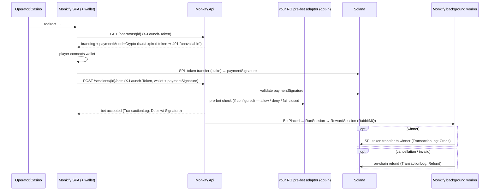

# Monkify — Integration overview, Model B / Crypto-native (launch → bet → settle)

> **Version:** 1 · **Date:** 2026-07-01
> **Audience:** Casino CTO / integration engineer (crypto-native operator)
> **Confidentiality:** **Confidential — shared under NDA.** Integration-level technical detail. It
> contains **no** source code, real keys, credentials, or infrastructure topology; every example
> value below is an obvious mock (`MOCK_…`).
> **Status:** Draft — not legal advice.

## Purpose

The technical deep-dive a **crypto-native** casino's engineering team reads before (or during) the
integration call. It describes the end-to-end **launch → game load → bet → settle** flow at the
endpoint level, where Monkify hosts the on-chain payment flow and the player's wallet is their
identity. It is grounded in Monkify's shipped backend. For fairness/RNG detail see the legal
**Fairness & Game Rules** document; for authorship/ownership see **Proof of Ownership** (both in
[`../../legal/`](../../legal/)).

> Regulated integration (operator wallet)? See the [Model A version](../model-a/02-integration-overview.md).

## Your track — Model B (Crypto-native)

<!-- MODEL-B-PROFILE:EN START -->
### Model B — Crypto-native (single-model profile)

- **Who it's for:** crypto-native casinos (BetFury-style).
- **Payments:** Monkify-hosted, on-chain (SOL / USDT / SPL tokens).
- **Player identity:** the player's crypto wallet public key.
- **Settlement:** on-chain Solana SPL-token transfers (reward and refund).
- **Responsible gaming:** yours; Monkify's pre-bet hook is optional.
- **Integration surface:** signed launch token **+** player wallet connect.

**You keep** KYC/AML per your licence and RG controls. **Monkify runs** the game logic, RNG/fairness,
live streaming, on-chain payments, hosting, bug fixes, and support. Monkify takes **no commission** —
winners receive the full pot.
<!-- MODEL-B-PROFILE:EN END -->

## 1. Launch — signed launch token

The casino launches the game by redirecting the player to:

```
https://<monkify-host>/monkify/game/sessions#launch_token=<jwt>
```

- The token is an **RS256 JWT** you sign with **your private key**. Monkify validates it against your
  stored **public key** (PEM), with optional key-id for rotation.
- **Claims:** `iss` = your operator id, `sub` = **empty** (crypto players are identified by their
  wallet, not an operator player id), plus `exp`, `iat`, and `jti` (audit only). `displayName` /
  `currency` are **not** claims.
- Validation (stateless middleware) checks signature, `exp`/`iat` with **±2 min** clock skew, and —
  when the path carries an operator id — that it matches `iss`. Replay protection is **expiry-only**.
  The operator must exist, be contract-active, and have a stored public key.
- **Every operator-scoped REST call carries `X-Launch-Token`.** The SPA captures the token from the
  URL fragment, strips it from the URL, and sends it on every request.
- **Failures are vague by design.** Any failure — missing, expired, bad signature, unknown operator,
  `iss` mismatch — returns a single generic **HTTP 401**; the real reason and a correlation id are
  logged **server-side only**. A token that expires mid-play takes the same path (re-launch).

Example token payload (**mock**):

```json
{ "iss": "MOCK_OPERATOR_GUID", "sub": "", "iat": 0, "exp": 0, "jti": "MOCK_JTI" }
```

## 2. Game load — read endpoints + wallet connect

All calls send `X-Launch-Token`. Responses are wrapped as `{ data, messages }`.

| Endpoint | Purpose |
| --- | --- |
| `GET /operators/{id}` | Branding + **`paymentModel`** (`Crypto`) — the UI enables **wallet-connect**. |
| `GET /sessions/active-types` | Your active game types (session parameters). |
| `GET /sessions/{sessionTypeId}` | The active session for a game type (to join and bet). |
| `PATCH /players/preferences` | Upserts the player's display name + preferred currency (render-only). |

Because `paymentModel = Crypto`, the frontend runs **wallet-connect** and pays on-chain: the player
signs an SPL-token transfer, and the resulting signature is attached to the bet.

## 3. Bet — `POST /sessions/{id}/bets`

Request body (Model B — a paid bet carries the on-chain payment signature):

```json
{ "amount": 0, "choice": "banana", "seed": "MOCK_SEED", "wallet": "MOCK_WALLET_PUBKEY", "paymentSignature": "MOCK_ONCHAIN_SIG" }
```

The bet handler runs, in this **exact order**:

1. **Resolve the operator** (cached, contract-active) — `paymentModel = Crypto`.
2. **Shape checks** — free-bet vs paid; a **paid** crypto bet **must** carry a `paymentSignature`
   (else it is rejected as malformed).
3. **Resolve player identity** — the **`wallet`** from the body (after wallet-connect). Upsert the
   `OperatorPlayer`.
4. **Signature validation** — reject a **reused** `paymentSignature`; then **validate the on-chain
   payment** on Solana.
5. **Bet-parameter validation** — duplicate bet (same player + choice + session), session is
   accepting bets, operator still contract-active, choice valid for the session.
6. **Responsible-gaming pre-bet check** (optional; see §5).
7. **Persist** the bet and publish `BetPlacedEvent` (non-lottery).

An invalid or duplicate paid bet whose funds already moved on-chain is **refunded on-chain**
(`RefundInvalidBet`); a bet that fails validation before payment is simply rejected.

## 4. Settlement — on-chain (Solana)

Monkify hosts the on-chain flow; there is **no** operator wallet API on this track.

| Movement | How |
| --- | --- |
| **Stake** | The player's SPL-token transfer, validated by its `paymentSignature` at bet time. |
| **Reward** | On-chain **SPL-token transfer** to each winner at reward time. |
| **Refund** | On-chain refund for post-acceptance cancellations (lottery under-subscription, abrupt end) and for invalid paid bets. |

- **Idempotency & audit:** every movement writes a `TransactionLog` row carrying the Solana
  **`Signature`**; the ledger drives reward/refund idempotency.
- **Free bets** (amount 0) carry no signature and make **no** on-chain movement.

## 5. Responsible-gaming pre-bet hook (optional)

If you want Monkify to enforce responsible-gaming controls before a bet, you implement a **pre-bet
check** adapter. It is **opt-in per operator** — unconfigured operators skip the check entirely.

- Monkify calls your check with `{ operatorId, externalPlayerId (the wallet), amount, currency,
  sessionId, gameType, betId }` **after** local validation.
- Your response is one of:
  - **Allowed** → the bet proceeds.
  - **Denied(reason)** → the bet is rejected with a **specific** player message. Canonical reasons:
    `SelfExcluded`, `LimitReached`, `CoolingOff`, `KycRequired`, `Blocked`, `Other`.
  - **Unavailable** (timeout / error) → **fail-closed**: the bet is rejected. Any transport exception
    is treated as Unavailable.
- Audit is **log-only** — no Monkify DB table, no player PII stored.

## 6. Run & stream — session lifecycle

Once a bet is placed, the session advances through a message-driven state machine (RabbitMQ):

```
BetPlaced → RunSession → RewardSession        (RefundInvalidBet on failure)
```

- The **typer** runs the game in the background worker and streams over **SignalR**
  (`/Hubs/Sessions`, `/Hubs/RecentBets`): batched characters, current speed, and status transitions
  (winners are announced on `Ended`). SignalR is session-id scoped — no launch token on the socket.
- On `RewardSession`, winners are paid by **on-chain SPL transfer**; cancellations **refund
  on-chain**. Every movement is a `TransactionLog` row (`Credit` / `Debit` / `Refund`). **No
  commission** — the full pot goes to winners.

## 7. End-to-end sequence (Model B)



## 8. What you implement (checklist)

- [ ] **Sign launch tokens** (RS256) with claims `iss` / `sub`=empty / `exp` / `iat` / `jti`; give
      Monkify your **public key**.
- [ ] Let players **connect their wallet** (the SPA drives the on-chain transfer; Monkify hosts the
      payment flow).
- [ ] *(optional)* **RG pre-bet check** returning Allowed / Denied(reason) / Unavailable.

There is **no** operator wallet API to build on this track — settlement is on-chain.

## Out of scope for this document

- Full OpenAPI for every endpoint (shared separately if needed).
- Real infrastructure topology, credentials, and source.
- The regulated (Model A) operator-wallet settlement path — see the
  [Model A version](../model-a/02-integration-overview.md).
- Certification promises — see the legal Fairness document; lab certification is **DEFERRED**.

## Document control

- **Model A/B source of truth:** [`../README.md`](../README.md) (profile block reused verbatim).
- **Grounded in (read-only):** launch-token validation (`sub` empty for crypto), on-chain payment
  validation and Solana SPL settlement/refund, the unified `TransactionLog` (with Solana `Signature`,
  no commission), the optional RG pre-bet hook, and the session state machine
  (`BetPlaced → RunSession → RewardSession`, `RefundInvalidBet`).
- **Cross-references:** [`../../legal/`](../../legal/) — Fairness & Game Rules, Proof of Ownership.
- **Deferred (paid) steps:** lab RNG certification (GLI/BMM) — **DEFERRED**.
