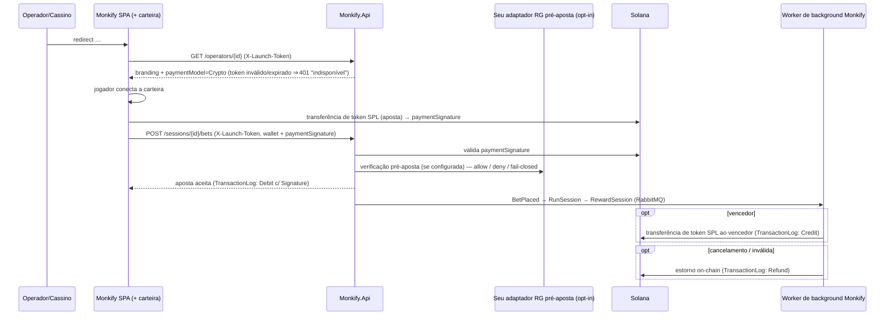

# Monkify — Panorama de integração, Modelo B / Cripto-nativo (launch → aposta → liquidação)

> **Versão:** 1 · **Data:** 2026-07-01
> **Público:** CTO / engenheiro de integração do cassino (operador cripto-nativo)
> **Confidencialidade:** **Confidencial — compartilhado sob NDA.** Detalhe técnico em nível de
> integração. **Não** contém código-fonte, chaves reais, credenciais nem topologia de infraestrutura;
> todo valor de exemplo abaixo é um mock evidente (`MOCK_…`).
> **Status:** Rascunho — não constitui aconselhamento jurídico.

## Objetivo

O aprofundamento técnico que o time de engenharia de um cassino **cripto-nativo** lê antes (ou
durante) a call de integração. Descreve o fluxo ponta a ponta **launch → carregamento do jogo →
aposta → liquidação** em nível de endpoint, onde o Monkify hospeda o fluxo de pagamento on-chain e a
carteira do jogador é a sua identidade. É fundamentado no backend em produção do Monkify. Para detalhe
de fairness/RNG veja o documento legal **Regras do Jogo & Fairness**; para autoria/propriedade veja
**Prova de Propriedade** (ambos em [`../../legal/`](../../legal/)).

> Integração regulada (carteira do operador)? Veja a
> [versão Modelo A](../model-a/02-integration-overview.pt-BR.md).

## Sua trilha — Modelo B (Cripto-nativo)

<!-- MODEL-B-PROFILE:PT-BR START -->
### Modelo B — Cripto-nativo (perfil de modelo único)

- **Para quem é:** cassinos cripto-nativos (estilo BetFury).
- **Pagamentos:** hospedados pelo Monkify, on-chain (SOL / USDT / tokens SPL).
- **Identidade do jogador:** a chave pública da carteira cripto do jogador.
- **Liquidação:** transferências de tokens SPL on-chain na Solana (prêmio e estorno).
- **Jogo responsável:** seu; o hook pré-aposta do Monkify é opcional.
- **Superfície de integração:** launch token assinado **+** conexão de carteira do jogador.

**Você mantém** KYC/AML conforme a sua licença e os controles de RG. **O Monkify opera** a lógica do
jogo, RNG/fairness, transmissão ao vivo, pagamentos on-chain, hospedagem, correções e suporte. O
Monkify **não** cobra comissão — os vencedores recebem o pote inteiro.
<!-- MODEL-B-PROFILE:PT-BR END -->

## 1. Launch — launch token assinado

O cassino abre o jogo redirecionando o jogador para:

```
https://<monkify-host>/monkify/game/sessions#launch_token=<jwt>
```

- O token é um **JWT RS256** que você assina com **sua chave privada**. O Monkify o valida com a sua
  **chave pública** armazenada (PEM), com key-id opcional para rotação.
- **Claims:** `iss` = id do seu operador, `sub` = **vazio** (jogadores cripto são identificados pela
  carteira, não por um id de jogador do operador), mais `exp`, `iat` e `jti` (apenas auditoria).
  `displayName` / `currency` **não** são claims.
- A validação (middleware stateless) checa assinatura, `exp`/`iat` com **±2 min** de tolerância e —
  quando o caminho carrega um id de operador — que ele bate com `iss`. Proteção de replay é **apenas
  por expiração**. O operador deve existir, ter contrato ativo e uma chave pública.
- **Toda chamada REST com escopo de operador carrega `X-Launch-Token`.** A SPA captura o token do
  fragmento da URL, o remove da URL e o envia em cada requisição.
- **Falhas são vagas por design.** Qualquer falha — ausente, expirado, assinatura inválida, operador
  desconhecido, `iss` divergente — retorna um único **HTTP 401** genérico; o motivo real e um
  correlation id são registrados **apenas no servidor**. Um token que expira durante o jogo segue o
  mesmo caminho (re-launch).

Exemplo de payload do token (**mock**):

```json
{ "iss": "MOCK_OPERATOR_GUID", "sub": "", "iat": 0, "exp": 0, "jti": "MOCK_JTI" }
```

## 2. Carregamento do jogo — endpoints de leitura + conexão de carteira

Todas as chamadas enviam `X-Launch-Token`. As respostas vêm no formato `{ data, messages }`.

| Endpoint | Objetivo |
| --- | --- |
| `GET /operators/{id}` | Branding + **`paymentModel`** (`Crypto`) — a UI habilita **wallet-connect**. |
| `GET /sessions/active-types` | Seus tipos de jogo ativos (parâmetros de sessão). |
| `GET /sessions/{sessionTypeId}` | A sessão ativa de um tipo de jogo (para entrar e apostar). |
| `PATCH /players/preferences` | Faz upsert do nome de exibição + moeda preferida (apenas exibição). |

Como `paymentModel = Crypto`, o frontend roda o **wallet-connect** e paga on-chain: o jogador assina
uma transferência de token SPL, e a assinatura resultante é anexada à aposta.

## 3. Aposta — `POST /sessions/{id}/bets`

Corpo da requisição (Modelo B — uma aposta paga carrega a assinatura de pagamento on-chain):

```json
{ "amount": 0, "choice": "banana", "seed": "MOCK_SEED", "wallet": "MOCK_WALLET_PUBKEY", "paymentSignature": "MOCK_ONCHAIN_SIG" }
```

O handler de aposta executa, nesta **ordem exata**:

1. **Resolve o operador** (em cache, contrato ativo) — `paymentModel = Crypto`.
2. **Checagens de formato** — free-bet vs paga; uma aposta cripto **paga** **deve** carregar um
   `paymentSignature` (senão é rejeitada como malformada).
3. **Resolve a identidade do jogador** — a **`wallet`** do corpo (após wallet-connect). Faz upsert do
   `OperatorPlayer`.
4. **Validação de assinatura** — rejeita `paymentSignature` **reutilizado**; então **valida o
   pagamento on-chain** na Solana.
5. **Validação de parâmetros da aposta** — aposta duplicada (mesmo jogador + escolha + sessão), sessão
   aceitando apostas, operador ainda com contrato ativo, escolha válida para a sessão.
6. **Verificação pré-aposta de jogo responsável** (opcional; ver §5).
7. **Persiste** a aposta e publica `BetPlacedEvent` (não-loteria).

Uma aposta paga inválida ou duplicada cujos fundos já se moveram on-chain é **estornada on-chain**
(`RefundInvalidBet`); uma aposta que falha na validação antes do pagamento é simplesmente rejeitada.

## 4. Liquidação — on-chain (Solana)

O Monkify hospeda o fluxo on-chain; **não** há API de carteira do operador nesta trilha.

| Movimento | Como |
| --- | --- |
| **Aposta** | A transferência de token SPL do jogador, validada pelo seu `paymentSignature` no momento da aposta. |
| **Prêmio** | **Transferência de token SPL** on-chain para cada vencedor no momento da premiação. |
| **Estorno** | Estorno on-chain para cancelamentos pós-aceite (loteria sem quórum, fim abrupto) e para apostas pagas inválidas. |

- **Idempotência & auditoria:** cada movimento grava uma linha em `TransactionLog` com a
  **`Signature`** da Solana; o ledger dirige a idempotência de prêmio/estorno.
- **Free bets** (valor 0) não carregam assinatura e **não** fazem movimento on-chain.

## 5. Hook pré-aposta de jogo responsável (opcional)

Se você quer que o Monkify aplique controles de jogo responsável antes de uma aposta, você implementa
um adaptador de **verificação pré-aposta**. É **opt-in por operador** — operadores não configurados
pulam a verificação.

- O Monkify chama a sua verificação com `{ operatorId, externalPlayerId (a carteira), amount, currency,
  sessionId, gameType, betId }` **após** a validação local.
- Sua resposta é uma de:
  - **Allowed** → a aposta prossegue.
  - **Denied(reason)** → a aposta é rejeitada com mensagem **específica**. Razões canônicas:
    `SelfExcluded`, `LimitReached`, `CoolingOff`, `KycRequired`, `Blocked`, `Other`.
  - **Unavailable** (timeout / erro) → **fail-closed**: a aposta é rejeitada. Qualquer exceção de
    transporte é tratada como Unavailable.
- A auditoria é **apenas em log** — sem tabela no banco, sem PII do jogador.

## 6. Execução & streaming — ciclo de vida da sessão

Após a aposta ser registrada, a sessão avança por uma máquina de estados dirigida por mensagens
(RabbitMQ):

```
BetPlaced → RunSession → RewardSession        (RefundInvalidBet em caso de falha)
```

- O **typer** roda o jogo no worker de background e transmite via **SignalR** (`/Hubs/Sessions`,
  `/Hubs/RecentBets`): caracteres em lote, velocidade atual e transições de status (vencedores
  anunciados em `Ended`). O SignalR tem escopo por id de sessão — sem launch token no socket.
- Em `RewardSession`, os vencedores são pagos por **transferência SPL on-chain**; cancelamentos
  **estornam on-chain**. Cada movimento é uma linha em `TransactionLog` (`Credit` / `Debit` /
  `Refund`). **Sem comissão** — o pote inteiro vai para os vencedores.

## 7. Sequência ponta a ponta (Modelo B)



## 8. O que você implementa (checklist)

- [ ] **Assinar launch tokens** (RS256) com claims `iss` / `sub`=vazio / `exp` / `iat` / `jti`;
      fornecer ao Monkify a sua **chave pública**.
- [ ] Permitir que os jogadores **conectem a carteira** (a SPA conduz a transferência on-chain; o
      Monkify hospeda o fluxo de pagamento).
- [ ] *(opcional)* **Verificação pré-aposta de RG** retornando Allowed / Denied(reason) / Unavailable.

**Não** há API de carteira do operador para construir nesta trilha — a liquidação é on-chain.

## Fora do escopo deste documento

- OpenAPI completo de cada endpoint (compartilhado à parte, se necessário).
- Topologia real de infraestrutura, credenciais e código-fonte.
- A trilha de liquidação regulada (Modelo A, carteira do operador) — veja a
  [versão Modelo A](../model-a/02-integration-overview.pt-BR.md).
- Promessas de certificação — ver o documento legal de Fairness; a certificação em laboratório é
  **ADIADA**.

## Controle do documento

- **Fonte de verdade Modelo A/B:** [`../README.md`](../README.md) (bloco de perfil reutilizado na
  íntegra).
- **Fundamentado em (somente leitura):** validação de launch token (`sub` vazio para cripto),
  validação de pagamento on-chain e liquidação/estorno SPL na Solana, o `TransactionLog` unificado
  (com `Signature` da Solana, sem comissão), o hook pré-aposta de RG opcional e a máquina de estados
  da sessão (`BetPlaced → RunSession → RewardSession`, `RefundInvalidBet`).
- **Referências cruzadas:** [`../../legal/`](../../legal/) — Regras do Jogo & Fairness, Prova de
  Propriedade.
- **Etapas pagas adiadas:** certificação de RNG em laboratório (GLI/BMM) — **ADIADA**.
