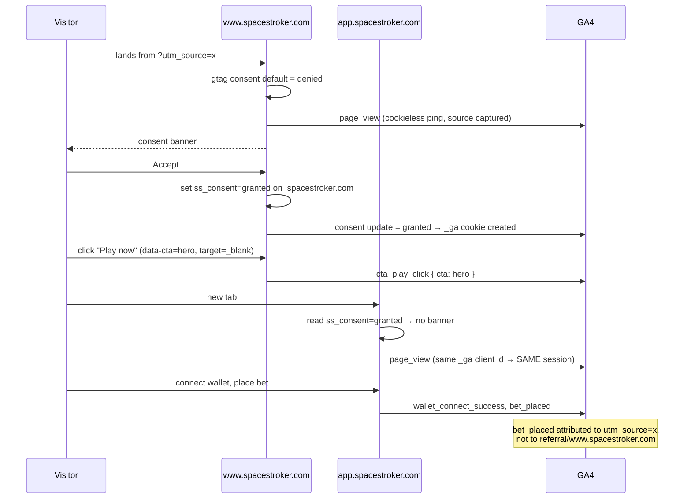
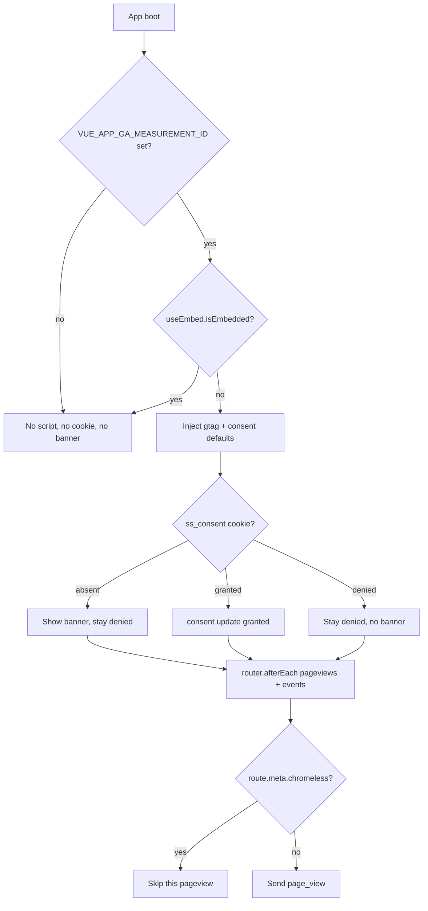

# Space Stroker — "Analytics for LP and app" — Implementation Spec

> **Status: Shipped** — merged to `main` (and the LP's `master`) on `feature/analytics`, 2026-07-27.
> Distilled into `features/analytics.md`; this spec stays the deep design archive.
> **Shipped as specified**, with two implementation details worth recording: the LP's gtag shim keeps
> the classic `function gtag(){dataLayer.push(arguments)}` form (and the app builds a genuine
> `arguments` object) because the tag detects `[object Arguments]` and silently ignores a plain array;
> and the Tier-2 "open in wallet app" path also reports a `wallet_connect_attempt`
> (`connect_path: wallet_in_app_browser`), which §7.2.4 did not enumerate.
>
> **Status: Ready for implementation** — refined via Trello card
> [Analytics for LP and app](https://trello.com/c/Hbfp779A) (2026-07-27).
> Repos affected: `monkify-front`, `monkify-lp`, and this doc in `monkify-meta`.
> **`monkify-backend` is NOT affected** — this feature adds no endpoint, entity, handler, consumer,
> migration or config to the backend.
>
> **Purpose:** Neither the landing page nor the game app reports traffic today, so we cannot answer
> "how many people came, where did they come from, and did they get as far as playing?" — the exact
> question the X + Telegram launch campaigns exist to move. Install **one** GA4 measurement stack
> across both properties, with a consent story that holds up in the EEA/UK, an acquisition→play funnel
> that survives the LP→app hop, and a hard kill switch everywhere the data would be noise (embedded
> casino iframes, dev environments, popups).

---

## 1. Summary

| | Today | After this spec |
| --- | --- | --- |
| **LP** (`monkify-lp`, Astro, GCS + Cloud CDN at `www.spacestroker.com`) | Ships `@vercel/analytics`, which is **inert off Vercel** — `/_vercel/insights/script.js` 404s. Effectively zero measurement. | GA4 via `gtag.js`, plus a `cta_play_click` event on every "Play now" CTA and a consent banner + cookie notice page. |
| **App** (`monkify-front`, Vue CLI SPA, GCS + Cloud CDN at `app.spacestroker.com`) | No analytics of any kind. | GA4 with manual SPA pageviews, wallet-connect funnel events, `bet_placed` (count only), `game_type_selected`, and the same consent banner. |
| **Attribution across the two** | Impossible. | One GA4 property / one data stream / one measurement id. `www.` and `app.` share the registrable domain `spacestroker.com`, so the `_ga` cookie is shared and GA4 keeps **one session** across the hop — the app inherits the LP's original referrer/campaign. |
| **Consent** | No banner, no privacy or cookie policy anywhere in either repo. | Consent Mode v2 defaulting to `denied`, an Accept/Reject banner on both properties, the choice stored in a `.spacestroker.com` cookie so it carries across the hop, and a minimal cookie notice page on the LP. |

**Why one property and not two:** GA4's cross-domain measurement is only needed for *different
registrable domains*. `www.spacestroker.com` → `app.spacestroker.com` is same-site, so a single stream
sees one uninterrupted session and `bet_placed` can be attributed to `utm_source=x` rather than to
"referral / www.spacestroker.com". Splitting LP from app in reports is done by the **hostname**
dimension, which GA4 collects automatically.

**What this feature is not:** it does not measure money. No stake, payout, wallet address or player
identifier ever leaves the browser. The backend's own `GET /games/stats` and the ledger remain the
single authoritative source for financial numbers; GA4 is deliberately not a second, disagreeing set
of figures.

---

## 2. Constraints (MANDATORY)

From `monkify-meta/constraints.md` (full list there):

- **Worktree-per-repo:** work lives in `.worktrees/analytics/<repo>` for `monkify-front`,
  `monkify-lp` and `monkify-meta`. Each shared checkout stays on its default branch as a hub —
  `main` for front/meta, **`master` for the LP**. Branch `feature/analytics` in all three repos is
  the merge/PR ref; push after every branch update.
- **Secrets/config:** the GA4 measurement id is *build config*, not a credential — but committed
  files carry **empty placeholders only**. The real `G-XXXXXXX` goes into the user's un-versioned
  `secrets.production.json`. Only `deploy/secrets.example.json` is tracked in git; the per-environment
  secrets files are local.
- **Unit tests:** `monkify-backend` is untouched, so `SpaceStroker.Tests` needs no work.
  `monkify-front` has **no test runner** — verification is the manual QA matrix in §13, consistent
  with every prior frontend-only feature (`mobile-wallet-connect`, `iframe-embedding`,
  `light-graphics-mode`).
- **Integration test — waived, with reason.** The card is classified **`Feature`**, which normally
  mandates a happy-path test in `SpaceStroker.Tests.Integration` (`AGENTS.md` rule 8). It is waived
  here because the change touches **zero backend code**: that suite boots the real API + Consumers
  hosts against Testcontainers and has no surface to drive. Same precedent as `mobile-wallet-connect`
  (#92). The `features/analytics.md` KB doc is **still required** at ship time.
- **EF mapping / migrations:** N/A — no schema change.
- **Operator messaging:** unchanged; nothing here surfaces operator contract status.
- **`monkify-front` build gotchas** (from prior shipped work): the docker `yarn build` fails on CRLF
  (prettier `endOfLine: lf`), and building the front from a worktree needs the hub's gitignored
  `yarn.lock` copied in first.

---

## 3. Resolved product decisions

| # | Decision |
| --- | --- |
| 1 | **GA4 (Google Analytics 4)** is the platform, chosen over Plausible/Umami (weaker funnels), PostHog (heavier, more setup) and keeping Vercel Analytics (inert on GCP; two disconnected dashboards). |
| 2 | **One property, one data stream, one measurement id** shared by both hostnames. LP vs app is split by the automatic **hostname** dimension. No GA4 cross-domain configuration (same registrable domain). |
| 3 | **Raw `gtag.js`, not Google Tag Manager.** Smaller payload, blocked less often, and every tracking behaviour stays reviewable in the repo instead of an external console. |
| 4 | **Creating the GA4 property and supplying the real id is an ops step the user performs**, like `terraform apply`. The implementation ships the config key present and empty. |
| 5 | **The measurement id rides the existing `frontBuild` block** in `secrets.<env>.json`: `VUE_APP_GA_MEASUREMENT_ID` (read by the Vue CLI app) and `PUBLIC_GA_MEASUREMENT_ID` (read by Astro/Vite). `Deployer.BuildStaticSite` already writes that same block to `.env.production.local` in **both** repos and each toolchain only exposes its own prefix ⇒ **no `SpaceStroker.Deploy` code change**. |
| 6 | **Empty or unset id ⇒ analytics is completely absent** — no script tag, no cookie, no banner, no console noise. This is what keeps local dev, docker-compose and the development GCP environment out of the production property. |
| 7 | **Consent Mode v2, defaulting to `denied`**, initialized *before* the `config` call. Consent is granted only on an explicit Accept. Denied visitors still send cookieless pings, so traffic volume and source survive. |
| 8 | **Accept and Reject are equally prominent** in the banner. A reject that is harder to reach than accept is what invalidates a consent banner; do not style Reject as a de-emphasized link. |
| 9 | **The consent choice is stored in a cookie scoped to `.spacestroker.com`**, deliberately not `localStorage`: `www.` and `app.` are different origins and would not share it, so the player would be asked twice. The consent cookie itself is strictly necessary and is written for both answers. |
| 10 | **A minimal cookie notice page is added to the LP** and linked from both banners and the LP footer (which today has no links at all). It is a factual technical notice — not legal advice; a legal review remains the user's call. Full privacy/terms pages are a separate card. |
| 11 | **Events:** LP `cta_play_click`; app `wallet_connect_attempt` / `wallet_connect_success` / `wallet_connect_failure`, `bet_placed` (**count only**), `game_type_selected`, plus pageviews of the secondary surfaces. |
| 12 | **`bet_placed` carries no money.** Game type name, payment method and free-vs-paid only. No stake, no payout, no wallet address, no launch-token `sub`/`iss`, no display name, no chat content. |
| 13 | **Bet outcome (`won`/`lost`) is explicitly not tracked.** Considered during refinement and dropped. |
| 14 | **Analytics is fully off when embedded** (iframe) — no script, no banner, no cookie. It matches how Fair/Stats are already hidden when embedded, third-party cookie blocking makes the data unreliable, partner-casino traffic would pollute our own B2C acquisition data, and we must not set cookies inside a partner's page outside their consent flow. |
| 15 | **Excluded surfaces:** the `chromeless` routes `/space-stroker/wallet-bridge` and `/space-stroker/background`, and the standalone static pages `public/verify.html` + `public/embed-example.html` (which do not load the SPA bundle at all, so they are excluded by construction). `/error` **is** tracked — a spike there is a signal worth having. |
| 16 | **A documented UTM convention** lands in `monkify-meta/marketing/` and is applied to the `[PLAY_URL]` links in the X and Telegram campaign docs. Without it every launch channel collapses into one undifferentiated social/direct bucket. |
| 17 | **Accepted limitation:** GA4 is blocked by a meaningful share of a crypto-savvy audience (expect a 20–40% undercount). It is consistent over time, so trends and relative source mix stay valid. A first-party proxy or server-side tagging to defeat blockers is out of scope. |
| 18 | **`?ga_debug=1` turns on `debug_mode`** so a QA session shows up in GA4 DebugView without installing an extension. |

---

## 4. Data model

**None.** No entity, column, enum, EF mapping or migration. This section is intentionally empty.

---

## 5. Configuration

### 5.1 New build-time variables

| Variable | Repo | Read by | Empty/unset behaviour |
| --- | --- | --- | --- |
| `VUE_APP_GA_MEASUREMENT_ID` | `monkify-front` | `src/hooks/useAnalytics.ts` (Vue CLI bakes `VUE_APP_*` in at **build** time) | Analytics disabled entirely |
| `PUBLIC_GA_MEASUREMENT_ID` | `monkify-lp` | `src/layouts/Layout.astro` via `import.meta.env` (Astro/Vite exposes only `PUBLIC_*` to the client) | Analytics disabled entirely |

### 5.2 How the values reach a build

`SpaceStroker.Deploy` already does the work — `Deployer.BuildStaticSite(repo, isYarn)` calls
`WriteFrontEnv(repo)`, which serializes the whole `frontBuild` dictionary from `secrets.<env>.json`
into `<repo>/.env.production.local` before running the build. Both the front (`yarn build`) and the LP
(`npm run build`) go through it, and each toolchain ignores the other's prefix. So:

```jsonc
// deploy/secrets.<env>.json  → "frontBuild"
"VUE_APP_GA_MEASUREMENT_ID": "",      // production: the real G-XXXXXXX (local file only)
"PUBLIC_GA_MEASUREMENT_ID":  ""       // production: the same G-XXXXXXX
```

- `deploy/secrets.example.json` — the only tracked secrets file — documents both keys as empty
  placeholders.
- The user's local `secrets.development.json` keeps both **empty** (the dev GCP environment must not
  report into the production property); `secrets.production.json` carries the real id.
- **No C# change.** Do not add an `lpBuild` block — the shared `frontBuild` block already works for
  both repos and a second block would be one more thing to keep in sync.

### 5.3 GA4 console steps (ops, not code)

These are the user's to perform; the implementation cannot do them and must not block on them:

1. Create the GA4 property + a single Web data stream for `spacestroker.com`; copy the `G-XXXXXXX`.
2. **Register the custom event parameters as custom dimensions** (`cta`, `wallet_name`,
   `connect_path`, `game_type`, `payment_method`, `is_free`, `failure_reason`). GA4 collects
   unregistered parameters but will not show them in standard reports — this is the single most
   common reason instrumentation "doesn't work".
3. Optionally mark `cta_play_click`, `wallet_connect_success` and `bet_placed` as key events
   (conversions).
4. Set data retention to 14 months (the default is 2, which silently truncates historical comparison).

---

## 6. Backend behaviour

**None.** `monkify-backend` is not touched: no controller, handler, consumer, domain service, DTO,
EF mapping, migration, `GeneralSettings` key or secret. `SpaceStroker.Tests` and
`SpaceStroker.Tests.Integration` are unchanged and must stay green without edits.

---

## 7. Frontend behaviour

### 7.1 The shared contract (implemented twice, deliberately)

The two repos share no package, so the same small contract is implemented independently in each.
Keep the **event names and parameter names byte-identical** across both — they land in one GA4
property and a typo creates a second, silently-diverging dimension.

**Boot order (both properties), all of it skipped when the id is empty:**

```js
window.dataLayer = window.dataLayer || [];
function gtag(){ dataLayer.push(arguments); }

// 1. Consent defaults FIRST — before the tag loads, or the first hit sets a cookie.
gtag('consent', 'default', {
  analytics_storage: 'denied',
  ad_storage: 'denied',
  ad_user_data: 'denied',
  ad_personalization: 'denied',
  wait_for_update: 500,
});

// 2. Then the tag.
gtag('js', new Date());
gtag('config', MEASUREMENT_ID, { /* per-property options, see below */ });

// 3. On Accept only:
gtag('consent', 'update', { analytics_storage: 'granted' });
```

**Consent cookie**

| Property | Value |
| --- | --- |
| Name | `ss_consent` |
| Values | `granted` \| `denied` |
| Domain | `.spacestroker.com` **when** `location.hostname` ends with `spacestroker.com`; otherwise host-only (a non-matching `domain` attribute is silently rejected by the browser, which would make the banner reappear forever on any other host) |
| Attributes | `path=/; max-age=15552000` (180 days); `SameSite=Lax`; `Secure` when `location.protocol === 'https:'` |

Reading `ss_consent` at boot decides three things: whether to show the banner (absent ⇒ show), and
whether to immediately `consent update` to granted (`granted` ⇒ yes; `denied` ⇒ leave denied).

**Event catalogue** (identical names in both repos):

| Event | Parameters | Fired from |
| --- | --- | --- |
| `page_view` | `page_path`, `page_location`, `page_title` | LP: automatic. App: manual, per route change. |
| `cta_play_click` | `cta` (`hero` \| `how_it_works` \| `header` \| `header_mobile`) | LP only |
| `wallet_connect_attempt` | `wallet_name`, `connect_path` | App only |
| `wallet_connect_success` | `wallet_name`, `connect_path` | App only |
| `wallet_connect_failure` | `wallet_name`, `connect_path`, `failure_reason` (the error *name*, never its message — messages can carry addresses) | App only |
| `game_type_selected` | `game_type`, `payment_method` | App only |
| `bet_placed` | `game_type`, `payment_method` (`Standard` \| `SolanaToken`), `is_free` (bool) | App only |

`connect_path` is one of `desktop_extension` \| `mobile_deeplink` \| `wallet_in_app_browser`.

**Every call site must be a safe no-op.** If the script is blocked, missing, or analytics is disabled,
the helper returns immediately. No call may throw, delay a navigation, or gate a bet.

### 7.2 The app (`monkify-front`)

#### 7.2.1 `src/hooks/useAnalytics.ts` (new) — the only module that touches `gtag`

Nothing else in the app imports the tag. The composable owns:

- **`isEnabled`** — computed once at module load:
  `!!process.env.VUE_APP_GA_MEASUREMENT_ID && !useEmbed().isEmbedded`.
  `useEmbed` already evaluates the framing context once at module load and exposes `isEmbedded` as a
  plain boolean, so this is a constant for the page's life.
- **`initAnalytics()`** — injects the script + consent defaults, reads `ss_consent`, and returns
  early when `!isEnabled`. Called from `main.ts` before `app.mount`.
- **`trackPageView(path, title)`**, **`grantConsent()`**, **`denyConsent()`**,
  **`consentDecided` (ref)** for the banner.
- Typed event helpers: `trackCtaPlayClick` is LP-only and therefore *not* here;
  `trackWalletConnect(phase, { walletName, connectPath, failureReason })`,
  `trackGameTypeSelected({ gameType, paymentMethod })`,
  `trackBetPlaced({ gameType, paymentMethod, isFree })`.
- `debug_mode: true` in the `config` call when `location.search` contains `ga_debug=1`.

Export it from `src/hooks/index.ts` alongside the existing `useConnection` / `useOperator` exports.

#### 7.2.2 Pageviews — `src/main.ts`

The app is a SPA, so GA4's automatic pageview would fire once and never again:

```ts
gtag('config', ID, { send_page_view: false });   // inside initAnalytics
// after the router exists:
router.afterEach((to) => {
  if (to.meta?.chromeless) return;               // wallet-bridge + background
  trackPageView(to.fullPath, document.title);
});
```

`router.afterEach` fires **after** `router.isReady()` resolves for the initial navigation too, so the
first load is counted exactly once — this is the shape that avoids the classic double-count. Route the
`chromeless` check through `to.meta` rather than a hard-coded name list, mirroring how `App.vue`
already decides whether to render the header.

#### 7.2.3 Consent banner — `src/components/ConsentBanner.vue` (new)

- Rendered from `App.vue` next to `<mobile-wallet-modal />`, with
  `v-if="analyticsEnabled && !consentDecided"`. Because `isEnabled` already folds in the embedded
  check, an embedded session never renders it.
- Fixed to the bottom, above the vignette but below toasts. Reuse the existing arcade surface styling
  (`main.css` / the `PrimaryButton` component) — a dark panel, VT323 body copy, two equally-weighted
  buttons **ACCEPT** and **REJECT**, and a text link to
  `https://www.spacestroker.com/cookies` (absolute, because the notice page lives on the LP).
- Must not obstruct the bet controls on a phone in landscape — it is dismissed by either button and
  never re-shown.

#### 7.2.4 Event call sites

| Event | Exact site | Notes |
| --- | --- | --- |
| `bet_placed` | `src/hooks/useGame.ts` → `submitBet`, immediately after `await mainService.applyBet(...)` succeeds (next to the existing `postToParent('bet-placed', …)`) | **`submitBet` is the single choke point** every path funnels through — free, Standard, SolanaToken desktop, the embedded popup handoff, and the resumed mobile-deeplink bet. Instrument it there and nowhere else. Read `game_type` from `selectedGame.value?.name`, `payment_method` from `selectedGame.value?.paymentMethod`, and `is_free` from `body.amount === 0`. |
| `game_type_selected` | `src/components/game-selection/GameTypes.vue:37`, in the `chooseGame` handler where `selectedGame.value = game` is assigned before `router.push` | `GameTypeCard.vue` only emits `chooseGame`; do not instrument the card. |
| `wallet_connect_attempt` / `_success` (desktop) | `App.vue` — a `watch` on `connecting` / `connected` from `useWallet()` | `connecting: false → true` ⇒ attempt; `connected: false → true` ⇒ success. `connect_path: 'desktop_extension'`, `wallet_name` from `wallet.value?.adapter?.name`. |
| `wallet_connect_failure` | `src/utils/wallet.ts` → `handleWalletError(error, adapter)` | This is already the plugin's `onError` (wired in `main.ts`) **and it already suppresses pre-interaction auto-connect noise** via `userHasInteracted` — so the failure event inherits that filter for free and will not fire on boot-time auto-connect churn. Send `error.name`, never `error.message`. |
| `wallet_connect_attempt` (mobile deeplink) | `src/hooks/useMobileWallet.ts` → `connectMobileWallet(app)` (~line 185) | `connect_path: 'mobile_deeplink'`, `wallet_name` from the `WalletApp`. |
| `wallet_connect_success` / `_failure` (mobile deeplink) | `useMobileWallet.ts`, in the deeplink-return handler where the session is established or the `errorCode` branch is taken | The return is a **fresh page load**, so the attempt and its outcome are different pageviews — that is expected and correct. |
| `wallet_connect_success` (wallet in-app browser) | `App.vue` → `autoConnectInWalletBrowser()`, after `await connect()` resolves | `connect_path: 'wallet_in_app_browser'`. No attempt event here — it is automatic, not player-initiated. |

Secondary-surface pageviews (History, Stats) come free from `router.afterEach`. The **Fair** modal
(`GameFairModal.vue`) and the customization modal (`PlayerCustomizationModal.vue`) are not routes; if
their engagement is wanted later it is a follow-up — **this spec does not instrument them**, and the
card's "secondary pages" scope is satisfied by the real routes.

### 7.3 The LP (`monkify-lp`)

#### 7.3.1 Remove Vercel Analytics

Drop `import Analytics from "@vercel/analytics/astro"` and the `<Analytics />` tag from
`Layout.astro`, remove `@vercel/analytics` from `package.json`, and regenerate `package-lock.json`
(`npm install`). It has been requesting a 404 on every page load since the LP moved to GCP.

While in `astro.config.mjs`, correct the now-false comment above `site:` — it claims "Vercel serves
www as the canonical host and 308-redirects the apex". The **value stays
`https://www.spacestroker.com`** (both `domains.lp` and `domains.lpWww` exist in the GCP deploy and
`www` remains canonical); only the explanation changes.

#### 7.3.2 Tag + consent in `Layout.astro`

Inline the boot sequence from §7.1 in `<head>`, guarded by
`const gaId = import.meta.env.PUBLIC_GA_MEASUREMENT_ID;` and rendered only when non-empty. The LP is
a genuine multi-page site (`/`, `/cookies`, `/404`), so **leave GA4's automatic `page_view` on** —
`send_page_view: false` is an app-only concern.

#### 7.3.3 CTA tracking must be a delegated listener, not a Vue handler

**This is the one non-obvious constraint in the LP half.** The "Play now" buttons in `index.astro`
are `<PrimaryButton asLink newTab href={GAME_URL}>` with **no `client:*` directive** — Astro renders
them to static HTML and ships no Vue runtime for them, so an `@click` handler would never fire. The
`Header.vue` CTAs *are* hydrated (`client:load`), so a per-component handler would work there and
silently not work in the hero. Do not mix the two approaches.

Instead, add one delegated listener in the Layout's analytics script:

```ts
document.addEventListener('click', (e) => {
  const link = (e.target as HTMLElement)?.closest?.('a[href]') as HTMLAnchorElement | null;
  if (!link || !link.href.startsWith(GAME_URL)) return;
  trackEvent('cta_play_click', { cta: link.dataset.cta ?? 'unknown' });
}, { capture: true });
```

Then add `data-cta="…"` to the four real CTA sites. **The four sites, verified in code:**

| `data-cta` | File | Line (at spec time) |
| --- | --- | --- |
| `hero` | `src/pages/index.astro` | 162 |
| `how_it_works` | `src/pages/index.astro` | 292 |
| `header` | `src/components/Header.vue` | 98 |
| `header_mobile` | `src/components/Header.vue` | 146 |

> **Correction to the Trello card:** the card lists "Header, hero, GameModes, Footer". In the actual
> code `GameModes.vue` and `Footer.vue` contain **no** `GAME_URL` link — the second in-page CTA lives
> in `index.astro` at the end of the how-it-works section. Use the table above.

`PrimaryButton.vue` forwards unknown attributes onto its root `<component :is>` element, so
`data-cta` reaches the rendered `<a>` without a component change. Every CTA is `target="_blank"`, so
the click never races a same-tab navigation — no `transport_type: 'beacon'` gymnastics needed.

#### 7.3.4 Consent banner + cookie notice

- `src/components/ConsentBanner.vue` (new), mounted in `Layout.astro` with **`client:idle`** so it
  never competes with first paint. Same copy, same two equally-weighted buttons, same `ss_consent`
  cookie contract as the app. Styled with the existing `.btn-arcade` / `.btn-arcade--sm` classes from
  `src/styles/global.css`.
- `src/pages/cookies.astro` (new) — uses the existing `Layout` with a specific `title` +
  `description`. **Indexable and included in the sitemap** (the existing `@astrojs/sitemap` filter
  only excludes `/404`; leave it alone). Content: what GA4 collects (pageviews, referrer, UTM,
  coarse geo, device), what it explicitly does **not** collect (wallet addresses, bet amounts, player
  identity), the two cookies (`_ga*` and `ss_consent`), and how to withdraw consent.
- `src/components/Footer.vue` gains its first link — "Cookies" → `/cookies`.
- `.gitignore` gains `.env.production.local`. It currently ignores `.env` and `.env.production` but
  **not** the `.local` variant the deploy tool writes on every LP build, so it shows up as untracked
  noise in `git status` and is one careless `git add .` away from being committed.

---

## 8. Flow diagrams

### 8.1 Consent + the LP→app hop



### 8.2 The app's kill switch



---

## 9. Out of scope

- Any backend change, server-side tagging, or GA4 Measurement Protocol events from
  `SpaceStroker.Api` / `SpaceStroker.Consumers`.
- A first-party analytics proxy or custom subdomain to defeat ad blockers.
- Bet **outcome** (won/lost) events, and any monetary value in GA4.
- Google Tag Manager, ad pixels (X/Reddit/Google Ads), remarketing tags.
- Full legal pages (privacy policy, terms, responsible gaming) — only the minimal **cookie notice**
  is in scope.
- Analytics inside the embedded (iframe) product, and any operator-facing/B2B reporting.
- Instrumenting the Fair modal and the customization modal (non-route surfaces).
- Google Search Console setup, GA4 console configuration, dashboard building (ops steps, §5.3).
- Repairing the deploy tool's LP path or stale KB/Vercel references beyond the touched files.

---

## 10. File checklist

### 10.1 Backend (`monkify-backend`)

**No files.** The repo is not touched and gets no branch.

### 10.2 App (`monkify-front`) — worktree `.worktrees/analytics/monkify-front`

| # | File | Change |
| --- | --- | --- |
| 1 | `src/hooks/useAnalytics.ts` | **New.** The only module touching `gtag`: enablement, script injection, consent defaults + `ss_consent` cookie, `trackPageView`, typed event helpers, `debug_mode` on `?ga_debug=1`. |
| 2 | `src/hooks/index.ts` | Export `useAnalytics` alongside `useConnection` / `useOperator`. |
| 3 | `src/components/ConsentBanner.vue` | **New.** Bottom-docked arcade banner, ACCEPT / REJECT equally weighted, link to the LP cookie notice. |
| 4 | `src/main.ts` | Call `initAnalytics()` before `app.mount`; add the `router.afterEach` pageview hook that skips `meta.chromeless`. |
| 5 | `src/App.vue` | Render `<consent-banner>`; add the desktop `connecting` / `connected` watcher (attempt + success); emit `wallet_connect_success` with `connect_path: 'wallet_in_app_browser'` after `autoConnectInWalletBrowser`'s `connect()` resolves. |
| 6 | `src/hooks/useGame.ts` | `trackBetPlaced` in `submitBet` right after `applyBet` succeeds (beside the existing `postToParent('bet-placed', …)`). |
| 7 | `src/components/game-selection/GameTypes.vue` | `trackGameTypeSelected` in the `chooseGame` handler (line ~37) before `router.push`. |
| 8 | `src/utils/wallet.ts` | `wallet_connect_failure` inside `handleWalletError`, after its existing `userHasInteracted` guard; send `error.name` only. |
| 9 | `src/hooks/useMobileWallet.ts` | `wallet_connect_attempt` in `connectMobileWallet`; success/failure in the deeplink-return handler. |
| 10 | `.env.example` | Document `VUE_APP_GA_MEASUREMENT_ID=` (empty) with the "empty ⇒ disabled" note, in the existing commented style. |

### 10.3 LP (`monkify-lp`) — worktree `.worktrees/analytics/monkify-lp`, branch off `master`

| # | File | Change |
| --- | --- | --- |
| 1 | `src/layouts/Layout.astro` | Remove the `@vercel/analytics` import + `<Analytics />`; add the gtag boot + consent defaults (guarded on `PUBLIC_GA_MEASUREMENT_ID`), the delegated `cta_play_click` listener, and `<ConsentBanner client:idle />`. |
| 2 | `src/components/ConsentBanner.vue` | **New.** Same contract/copy as the app's; `.btn-arcade` styling. |
| 3 | `src/pages/cookies.astro` | **New.** Minimal cookie notice; indexable; in the sitemap. |
| 4 | `src/components/Footer.vue` | Add the "Cookies" link (its first link). |
| 5 | `src/pages/index.astro` | `data-cta="hero"` (line ~162) and `data-cta="how_it_works"` (line ~292). |
| 6 | `src/components/Header.vue` | `data-cta="header"` (line ~98) and `data-cta="header_mobile"` (line ~146). |
| 7 | `package.json` + `package-lock.json` | Drop `@vercel/analytics`; regenerate the lock file. |
| 8 | `astro.config.mjs` | Correct the stale Vercel comment above `site:` (value unchanged). |
| 9 | `.gitignore` | Add `.env.production.local`. |

### 10.4 Meta (`monkify-meta`) — worktree `.worktrees/analytics/monkify-meta`

| # | File | Change |
| --- | --- | --- |
| 1 | `specs/analytics.md` | **New.** This spec. |
| 2 | `INDEX.md` | Map row for this spec + "Feature currently in flight". |
| 3 | `deploy/secrets.example.json` | Both keys in `frontBuild` as empty placeholders, with a `_comment` explaining "empty ⇒ analytics disabled" and that the same id serves both properties. |
| 4 | `marketing/utm-conventions.md` | **New.** The UTM scheme (`utm_source` / `utm_medium` / `utm_campaign` vocabulary) + ready-to-paste tagged URLs. |
| 5 | `marketing/twitter-launch-campaign.md` | Apply the UTM scheme to the `[PLAY_URL]` links. |
| 6 | `marketing/telegram-launch-campaign.md` | Same. |
| 7 | `features/analytics.md` | **Created at ship time** by `/monkify-ship-feature` (required — Level = `Feature`), not in this spec's commit. |

> The user's local `deploy/secrets.development.json` / `secrets.production.json` are **not tracked**;
> the implementer must tell the user to add the two keys there (empty for development, real id for
> production) rather than editing them into git.

---

## 11. Unit tests

**Backend:** none — `monkify-backend` is untouched. `SpaceStroker.Tests` and
`SpaceStroker.Tests.Integration` must remain green with **no edits**; if either needs a change,
something has gone wrong with the scope.

**Frontend:** `monkify-front` and `monkify-lp` have no test runner (no Jest/Vitest configured), so
there is no automated layer to add without introducing a test framework — which is out of scope.
Verification is the manual matrix in §13, and its evidence (GA4 DebugView screenshots or the network
panel) is what the implementer reports at the end.

---

## 12. Acceptance criteria

Mirrored 1:1 from the Trello **Acceptance Criteria** checklist.

1. Given a production build with `VUE_APP_GA_MEASUREMENT_ID` / `PUBLIC_GA_MEASUREMENT_ID` set, when a
   visitor loads the LP or the app, then the `gtag.js` script loads once and a `page_view` for that
   hostname appears in GA4 Realtime within ~30s.
2. Given the measurement id is empty or unset (local dev, docker-compose, the development GCP env),
   when either site loads, then no analytics script is requested, no GA cookie is set, no consent
   banner is shown, and no console error is emitted.
3. Given a first-time visitor, when the page loads and before any consent choice is made, then
   `gtag` has been initialized with Consent Mode v2 defaults of `analytics_storage: 'denied'` and no
   `_ga` cookie exists.
4. Given the consent banner is shown, when the visitor clicks Accept, then `analytics_storage` is
   updated to `granted`, the `_ga` cookie is created, and the banner never appears again on
   subsequent visits.
5. Given the consent banner is shown, when the visitor clicks Reject, then no `_ga` cookie is ever
   created, cookieless pings still reach GA4, and the banner never appears again.
6. Given a visitor already accepted (or rejected) on `www.spacestroker.com`, when they click a Play
   CTA and land on `app.spacestroker.com`, then the app honours that same choice and shows no second
   banner (consent cookie scoped to `.spacestroker.com`).
7. Given a visitor arrives on the LP from a UTM-tagged campaign link and then clicks through to the
   app, when they place a bet, then the whole journey is ONE GA4 session and `bet_placed` is
   attributed to the original `utm_source`/`medium`/`campaign` — not to "referral /
   www.spacestroker.com".
8. Given the LP, when the visitor clicks any CTA pointing at `GAME_URL` (header, hero, how-it-works,
   header mobile), then exactly one `cta_play_click` event fires identifying which CTA it was, and
   the navigation to the app is neither delayed nor blocked.
9. Given a player in the app lobby, when they open a game type, then exactly one
   `game_type_selected` event fires carrying the game type name.
10. Given a player attempts a wallet connect, when the attempt resolves, then
    `wallet_connect_attempt` fires and is followed by exactly one `wallet_connect_success` or
    `wallet_connect_failure` carrying the wallet name and the path taken (desktop extension / mobile
    deeplink / wallet in-app browser).
11. Given a player places a bet, when the bet is accepted, then exactly one `bet_placed` event fires
    with game type, payment method (`Standard`/`SolanaToken`) and free-vs-paid — and the outgoing
    payload contains NO stake amount, NO payout, NO wallet address and NO player identifier
    (verified in the browser network panel).
12. Given the app is loaded inside an iframe (`public/embed-example.html`), when the page loads and a
    full round is played, then no analytics script is requested, no consent banner renders, and no
    analytics cookie is set.
13. Given the chromeless routes `/space-stroker/wallet-bridge` and `/space-stroker/background`, or
    the static pages `public/verify.html` and `public/embed-example.html`, when any of them loads,
    then no analytics script is requested and no `page_view` is sent.
14. Given a player navigates the SPA (lobby → play → history → stats → `/error`), when each route
    change completes, then exactly one `page_view` is sent per navigation with the correct path, and
    the initial load is not double-counted.
15. Given an ad blocker or DNS filter prevents `gtag.js` from loading, when the visitor clicks CTAs,
    connects a wallet and places a bet, then every flow completes normally with no thrown error, no
    blocked navigation and no blocked bet.
16. Given the consent banner on either property, when the visitor opens its cookie-notice link, then
    the LP cookie notice page loads describing exactly what GA4 collects and how to opt out, and the
    same page is also reachable from the LP footer.
17. Given the LP after this change, when it is built and deployed, then `@vercel/analytics` is no
    longer a dependency and no `/_vercel/insights` request is made from any page.
18. Given the repos after this change, when they are reviewed, then `secrets.example.json` documents
    both measurement-id keys as empty placeholders, no real `G-XXXXXXX` id is committed anywhere,
    `monkify-lp/.gitignore` covers `.env.production.local`, and the X/Telegram marketing links carry
    the documented UTM scheme.

---

## 13. Manual QA

Run with a **test** GA4 property id (never the production one) exported into the local env files, and
GA4 **DebugView** open (`?ga_debug=1`).

**A. Disabled path (the default local state)**

1. `yarn serve` (front) and `npm run dev` (LP) with the ids unset → confirm zero requests to
   `googletagmanager.com`, no banner, no `_ga`/`ss_consent` cookies, clean console. (AC 2)

**B. Consent**

2. Set the test id in both. Load the LP fresh (clear cookies) → banner appears; Application →
   Cookies shows **no** `_ga`. (AC 3)
3. Accept → `_ga` appears, `ss_consent=granted` on domain `.spacestroker.com` (in local dev it will be
   host-only — expected), banner gone; hard-reload → still gone. (AC 4)
4. Repeat from a clean state with Reject → no `_ga` ever, DebugView still receives events, banner
   gone. (AC 5)

**C. The hop** *(needs the deployed hosts, or a local hosts-file alias for both sub-domains)*

5. Open `www…/?utm_source=qa&utm_medium=manual&utm_campaign=spec`, Accept, click each of the four
   CTAs → four distinct `cta_play_click` events with the right `cta` values. (AC 8)
6. From the app tab: no second banner (AC 6); place a bet; in GA4 Realtime confirm the session's
   source is `qa / manual` and it carries both `cta_play_click` and `bet_placed`. (AC 7)

**D. App events**

7. Lobby → open each game type → one `game_type_selected` each. (AC 9)
8. Connect a desktop wallet → attempt + success with `connect_path: desktop_extension`; reject the
   wallet prompt → attempt + failure with an error **name**. (AC 10)
9. Place a free bet and a paid `SolanaToken` bet → two `bet_placed` events; inspect the outgoing
   request payload in the network panel and confirm no amount / wallet / identifier. (AC 11)
10. Navigate lobby → play → history → stats → `/error` and back; count `page_view` hits: exactly one
    per navigation, one for the initial load. (AC 14)

**E. Exclusions**

11. Open `public/embed-example.html` → no `googletagmanager.com` request at all, no banner. (AC 12)
12. Open `/space-stroker/wallet-bridge`, `/space-stroker/background`, `public/verify.html` → same.
    (AC 13)
13. Enable uBlock Origin → reload the app, click a CTA on the LP, connect, bet → everything works,
    console clean. (AC 15)

**F. Mobile** (real device or device emulation)

14. Standalone mobile → deeplink connect to Phantom → attempt before the hop, success after the
    return. Note the return is a fresh page load, so an extra `page_view` is expected and accepted.

---

## 14. Trello / pipeline

- **Source card:** [Analytics for LP and app](https://trello.com/c/Hbfp779A) (#101) — list
  **Specs created**; the `## Implementation` block on the card carries branch, worktree, spec path
  and **Level: Feature**.
- **Branches:** `feature/analytics` in `monkify-front`, `monkify-lp` (off `master`) and
  `monkify-meta`, each in its own worktree under `.worktrees/analytics/`.
- **Next:** `/monkify-implement-feature Analytics for LP and app` — note the integration test is
  **waived** (§2) but the manual QA matrix in §13 is the required evidence.
- **After merge:** `/monkify-ship-feature Analytics for LP and app` — must create
  `features/analytics.md` (Level = `Feature`) and update `INDEX.md` + `architecture.md`.

---

## 15. Revision log

| Date | Change |
| --- | --- |
| 2026-07-27 | Initial spec from refined card #101 (Hbfp779A) + in-thread refinement. Code exploration corrected the card's LP CTA list (`GameModes`/`Footer` carry no `GAME_URL`; the second CTA is in `index.astro`), established that the LP's static buttons are un-hydrated so CTA tracking must be a delegated listener, and identified `useGame.submitBet` as the single bet choke point and `handleWalletError` as a failure hook that already filters auto-connect noise. |
