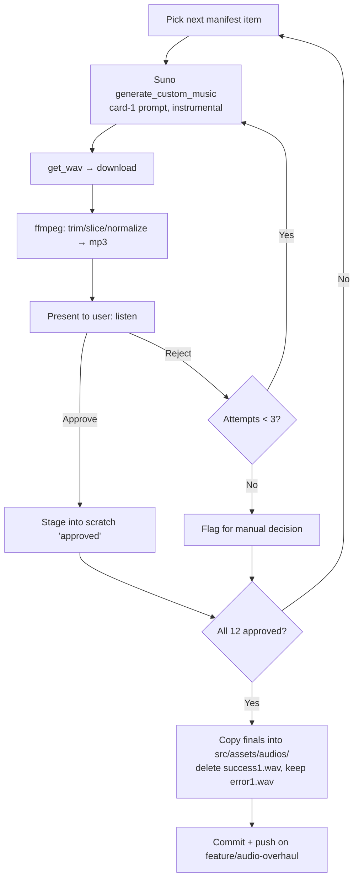

# SpaceStroker — "Audio Overhaul with AI" — (2/3) Asset Generation Spec

> **Status: Shipped** (2026-07-07, merged via `feature/audio-overhaul`). **Post-ship reality:** assets
> were generated **manually in the Suno UI** (the MCP ran out of credits) then post-processed with
> ffmpeg; **9 assets** shipped (kept `error1.wav`, dropped `success1.wav` + old `.wav`s) — the 3 coin
> bleeps were cut. See `../features/audio-overhaul.md`. Originally refined via Trello card
> [Overhaul audio/songs with AI — (2/3) Generate audio assets via Suno](https://trello.com/c/OuXhyqyU/34-overhaul-audio-songs-with-ai-2-3-generate-audio-assets-via-suno)
> (2026-07-07).
> Repos affected: **`monkify-front`** (the generated assets) + this doc in **`monkify-meta`**.
> **No `monkify-backend` change.**
>
> **Purpose:** Produce the 12 audio files defined by card 1's manifest, using the Suno MCP for
> generation and `ffmpeg` for post-processing, with a human approving each before commit — then land
> them in `monkify-front/src/assets/audios/` on the shared `feature/audio-overhaul` branch. **Assets
> only; no game wiring** (that is card 3).

> ### ℹ️ Card 2 of 3 — shared branch, generation only
> This is the **middle** card of the audio overhaul. It **consumes** card 1's manifest and **feeds**
> card 3's wiring; all three share **one** branch/worktree `feature/audio-overhaul`.
>
> | Card | Trello | Role |
> | --- | --- | --- |
> | (1/3) Manifest & Suno spec | [#17 `9qiDtDAe`](https://trello.com/c/9qiDtDAe) | **Input** — `specs/audio-overhaul.md` (§5 per-item prompts/durations, §8 filenames) |
> | **(2/3) — this card** | [#34 `OuXhyqyU`](https://trello.com/c/OuXhyqyU) | **Generate + post-process + commit the 12 assets** |
> | (3/3) Wire into game | [#35 `RvVdpO25`](https://trello.com/c/RvVdpO25) | **Consumer** — imports the assets, adds triggers/engine/UI |
>
> **Hard rule:** reuse `feature/audio-overhaul` (existing worktrees) — **never fork a new slug**. This
> spec's own file is `specs/audio-overhaul-generation.md` so it does not overwrite card 1's
> `specs/audio-overhaul.md` on the shared branch.

---

## 1. Summary

Generate every asset in **card 1's manifest** (`specs/audio-overhaul.md` §5) via the **Suno MCP**,
post-process each with **`ffmpeg`** (trim to the target duration, slice the escalating bleep take into
three files, loudness-normalize, export **mp3**), have the **user listen to and approve each one**, and
only then commit the 12 files to `monkify-front/src/assets/audios/` on `feature/audio-overhaul`.
`error1.wav` is left untouched; `success1.wav` is deleted.

This card writes **no application code** — no `.vue`/`.ts`/import changes. It is a generation +
review + commit pipeline. Card 1 owns the sound design (prompts, durations, SNES inspirations); this
card **executes it to the letter** and does not re-decide any sound.

**The 12 deliverable files (card 1 §8):**

| Group | Files | Target |
| --- | --- | --- |
| Loops (music) | `game_waiting.mp3`, `game_running_1.mp3`, `game_running_2.mp3`, `game_running_3.mp3` | seamless loop; ~60s / ~15s×3 |
| One-shot music | `game_starting.mp3` | ~10s, glasses sting inside the tail |
| One-shot SFX | `phone_beep.mp3` (remaster), `victory.mp3` (~5s), `lose.mp3` (~5s), `button_press.mp3` (~0.1s) | dry, short |
| Bleep set | `bleep_3away.mp3`, `bleep_2away.mp3`, `bleep_1away.mp3` (<1s each) | sliced from one escalating take |

Retained: `error1.wav`. Deleted: `success1.wav`.

---

## 2. Constraints (MANDATORY)

From `monkify-meta/constraints.md` (full list there):

- **Shared branch/worktree:** work in the **existing** `feature/audio-overhaul` worktrees
  (`.worktrees/audio-overhaul/monkify-front` for assets, `.worktrees/audio-overhaul/monkify-meta` for
  this spec). The hubs stay on `main`. **Do not create a new branch/slug.**
- **Mock secrets only:** the `ACEDATACLOUD_API_TOKEN` in any committed file (`E:\SpaceStroker\.mcp.json`)
  stays a **placeholder**. The real token is supplied by the user at runtime (environment / local
  edit) and is **never printed, echoed, or committed**.
- **Frontend-only → no backend integration test** (no backend behavior). **No unit tests** are added
  by this card — it only adds binary assets; the logic that uses them lands in card 3.
- **Format is a reversible convention:** mp3 for everything generated here; a single tiny SFX may keep
  `.wav` if mp3 proves lossy, but mp3 is the default. `error1.wav` stays as-is.
- **EF / migrations / operator-messaging** constraints are **N/A**.

---

## 3. Resolved product decisions

| # | Decision |
| --- | --- |
| 1 | **Agent-automated generation via the Suno MCP.** Server `suno` = `mcp-suno` (`uvx mcp-suno`, env `ACEDATACLOUD_API_TOKEN`), installed + registered in `E:\SpaceStroker\.mcp.json`. |
| 2 | **Verify before generating.** The `suno` MCP must be loaded (game restarted after the token is set) and its tools must respond. If the token/MCP is missing or failing → **stop and tell the user**; never fabricate or hand-fake assets. |
| 3 | **Post-processing with `ffmpeg`/`ffprobe`** (n7.1.1, confirmed present): trim to target durations, **slice** the escalating bleep take into 3 files, loudness-normalize, convert to mp3. No manual audio editor. |
| 4 | **Generate strictly to card 1's manifest** — each item uses card 1 §5's prompt (instrumental; SNES reference + video URL passed **verbatim** per §5.0). This card does not alter the sound design. |
| 5 | **Human review loop — approve each before commit.** Present each generated + processed asset for the user to listen; **nothing is committed until the user signs off on all 12.** The agent does **not** self-approve audio. |
| 6 | **Re-roll cap: 3 attempts per asset, then flag.** Up to 3 Suno generations per asset; if still not approved, **flag it** for a manual decision (tweak the card-1 prompt, accept best-of, or hand-source) — do not loop. |
| 7 | **Assets only** — no `.vue`/`.ts`/import/wiring changes (card 3). Keep `error1.wav`; delete `success1.wav`. |

---

## 4. Prerequisites & environment

Confirmed on this machine during refinement (2026-07-07):

| Tool | Version | Use |
| --- | --- | --- |
| `uv` / `uvx` | 0.11.7 (`C:\Users\Marcu\.local\bin`) | runs `mcp-suno` |
| Python | 3.12.10 | `mcp-suno` runtime |
| `mcp-suno` | 2026.7.4.0 (installed via `uv tool install`) | Suno MCP server |
| `ffmpeg` / `ffprobe` | n7.1.1 (`C:\Program Files (x86)\ffmpeg\bin`) | trim / slice / normalize / mp3 |

**MCP registration** — `E:\SpaceStroker\.mcp.json` (workspace root, untracked):

```json
{
  "mcpServers": {
    "suno": {
      "command": "uvx",
      "args": ["mcp-suno"],
      "env": { "ACEDATACLOUD_API_TOKEN": "REPLACE_WITH_REAL_ACEDATACLOUD_API_TOKEN" }
    }
  }
}
```

**Before implementing (blocking):**

1. **User sets the real `ACEDATACLOUD_API_TOKEN`** (from https://platform.acedata.cloud → API docs →
   Acquire). Keep the committed value a placeholder; inject the real token via environment or a local,
   uncommitted edit.
2. **Restart Claude Code** so the `suno` server loads (MCP servers load only at game start), and
   **approve** the project MCP server when prompted.
3. **Smoke-test** the MCP: call `list_models` / `list_actions` and one cheap `generate_*` to confirm
   the token works. If it fails → stop and report.

---

## 5. Suno MCP tool reference (relevant subset)

The `mcp-suno` server exposes (see `list_actions` at runtime for exact params):

- **Generation:** `generate_music`, `generate_custom_music` (custom style + instrumental flag —
  **primary** here), `extend_music`, `cover_music`, `remaster_music`, `concat_music`,
  `replace_section`, `stems_music`, `upload_audio`, `upload_cover`, `upload_extend`.
- **Media fetch:** `get_wav`, `get_mp4`, `get_midi`, `get_timing`, `extract_vocals`.
- **Tasks/info:** `get_task`, `get_tasks_batch`, `list_models`, `list_actions`,
  `get_lyric_format_guide`.

**Conventions for this card:**

- Use **`generate_custom_music`** with **instrumental = true** and card 1's per-item **style/prompt**
  (do not use lyric generation). Pick the newest model from `list_models`.
- Suno returns a task; poll `get_task` (or `get_tasks_batch`) for completion, then fetch audio with
  **`get_wav`** (lossless for clean ffmpeg processing) — fall back to `get_mp4`/its audio if wav is
  unavailable.
- **Own-bet remaster (`phone_beep`):** primary path = `generate_custom_music` from card 1 §5 #4's
  remaster prompt. Optional fidelity path = `upload_audio` the existing `phone_beep.wav` then
  `cover_music`/`remaster_music` to keep it recognizably the same cue. Either is acceptable; pick the
  one that sounds closest to the current chirp in review.

> Exact argument names may differ by `mcp-suno` version — resolve them via `list_actions` at run time
> rather than hard-coding. This spec fixes the **intent** (instrumental custom generation + wav fetch),
> not the wire format.

---

## 6. Generation + post-processing procedure (per item)

For **each** of the 12 files: **generate → fetch wav → ffmpeg post-process → present for approval →
(re-roll ≤3) → stage**. Card 1 §5 is the source of the prompt, duration, mood, and SNES reference for
each — **use it verbatim**; the table below adds only the **post-processing** recipe.

| # | File | Suno call (instrumental, card-1 prompt) | ffmpeg post-processing | Target |
| --- | --- | --- | --- | --- |
| 1 | `game_waiting.mp3` | `generate_custom_music` — idle prompt (Simian Segue, DKC) | pick a clean bar-aligned ~60s span; crossfade-check the loop seam; `-c:a libmp3lame -q:a 4` | seamless ~60s |
| 2 | `game_starting.mp3` | `generate_custom_music` — Game Starting prompt (Start, Super Bomberman) | trim to **≤10s** with the ending sting fully inside (aim sting at ~8.8–9.5s); **do not** loop it | one-shot ~10s |
| 3–5 | `game_running_1/2/3.mp3` | `generate_custom_music` ×3 (running prompt; distinct melodies, same tempo/key/energy) | trim each to ~15s, loop-align, loudness-match the three to each other | seamless ~15s ×3 |
| 6 | `phone_beep.mp3` | `generate_custom_music` (or upload+`remaster_music`) — own-bet prompt | trim to ≤1s, strip lead/trail silence | one-shot ~0.8s |
| 7 | `victory.mp3` | `generate_custom_music` — victory prompt (Battle Victory, Super Bomberman) | trim to ~5s with a clean ending | one-shot ~5s |
| 8 | `lose.mp3` | `generate_custom_music` — lose prompt (Death SFX, DKC) | trim to ~5s, softer/lower level than victory | one-shot ~5s |
| 9–11 | `bleep_3away/2away/1away.mp3` | **one** `generate_custom_music` — escalating Mario-coin set | **slice** at the gaps into 3 files (`-ss`/`-to`), trim each **<1s**, normalize so brightness rises 3→1 | 3 blips <1s |
| 12 | `button_press.mp3` | `generate_custom_music` — button-click prompt | trim to the transient only (~0.1s), no tail | one-shot ~0.1s |

**Loudness/soft-ear guard (card 1 §5.0 rule 1):** normalize gently (e.g. `loudnorm` toward a
conservative target) and **reject anything harsh/piercing in review** rather than fixing it in
mastering. Loops should sit quieter than SFX (matches the engine's base levels: loops `0.02`, SFX
`0.1`).

**Working directory:** generate/download/process in a scratch dir (e.g. the game scratchpad), and
copy only the **approved** finals into
`.worktrees/audio-overhaul/monkify-front/src/assets/audios/`.

---

## 7. Review, re-roll, and commit flow



- **No commit before full sign-off:** assets are only copied into `monkify-front` and committed once
  the user has approved all 12 (or explicitly accepted a flagged best-of / deferral).
- **Re-roll bound:** ≤3 Suno generations per asset; then flag (don't loop). Record which items were
  flagged in the completion report.

---

## 8. File checklist

### 8.1 Meta (`monkify-meta`) — **this card (create-spec)**

| # | File | Change |
| --- | --- | --- |
| 1 | `specs/audio-overhaul-generation.md` | **New** — this generation spec |
| 2 | `INDEX.md` | Add spec row (status Ready) + update the audio-overhaul in-flight entry |

### 8.2 Frontend (`monkify-front`) — **the implement step**, shared branch

| # | Path | Change |
| --- | --- | --- |
| 1 | `src/assets/audios/game_waiting.mp3` | add (idle loop) |
| 2 | `src/assets/audios/game_starting.mp3` | add (one-shot, sting in tail) |
| 3–5 | `src/assets/audios/game_running_1/2/3.mp3` | add (3 running variants) |
| 6 | `src/assets/audios/phone_beep.mp3` | add (remaster) |
| 7 | `src/assets/audios/victory.mp3` | add |
| 8 | `src/assets/audios/lose.mp3` | add |
| 9–11 | `src/assets/audios/bleep_3away/2away/1away.mp3` | add (sliced bleeps) |
| 12 | `src/assets/audios/button_press.mp3` | add |
| — | `src/assets/audios/error1.wav` | **keep unchanged** |
| — | `src/assets/audios/success1.wav` | **delete** |

> No source/import changes here — those are card 3. Old `.wav` originals for recreated slots
> (`game_starting.wav`, `game_running.wav`, `game_waiting.wav`, `phone_beep.wav`) may be left in place
> and removed by card 3 when it swaps the imports, **or** removed here if the user prefers — either is
> fine (card 3 changes the imports regardless). Default: leave them; card 3 cleans up.

### 8.3 Backend (`monkify-backend`)

**None.**

---

## 9. Out of scope

- **All wiring/code** (engine gain/mute, `GameAudio.vue`/`GameMonkey.vue`/`GameConsole.vue`,
  victory/lose logic, proximity bleeps, mute/volume control) — **card 3 (#35)**.
- **Any change to the sound design** in `specs/audio-overhaul.md` — locked by card 1.
- **Any backend work**, tests, or migrations.
- Installing/authing the real Suno token (user action) — this spec only assumes it exists at run time.

---

## 10. Tests

- **Backend integration test:** **N/A** (frontend-only; no backend behavior).
- **Unit tests:** **none** — this card adds only binary assets; the logic that consumes them is
  card 3's (and card 3 carries the FE unit tests per `specs/audio-overhaul.md` §11).
- **Verification** for this card is the **human listen-through** (§7) plus `ffprobe` duration checks
  (see §12).

---

## 11. Acceptance criteria

Mapped 1:1 from the Trello card's **Acceptance Criteria** checklist.

1. **Suno MCP verified first** — the implementer confirms the `suno` MCP (`mcp-suno`) responds with a
   real `ACEDATACLOUD_API_TOKEN` before generating, and **stops** (no fabricated assets) if the
   token/MCP is missing.
2. **All 12 generated to spec** — every file in §8.2 / card 1 §8 is produced via Suno to its target
   duration/type (idle ~60s; Game Starting ~10s with the sting inside; running ×3 ~15s; `phone_beep`
   remaster; victory/lose ~5s; bleeps <1s; button ~0.1s), using card 1's per-item prompt with the SNES
   reference + video URL passed verbatim.
3. **Post-processed with ffmpeg** — each asset is trimmed to length, the bleep take is sliced into
   `bleep_3away/2away/1away`, loudness-normalized, and exported mp3 — no manual audio editor.
4. **Approve each before commit** — the agent presents each processed asset for the user to listen and
   approve; **nothing is committed to `monkify-front` until the user signs off on all 12** (no agent
   self-approval).
5. **Re-roll cap enforced** — ≤3 Suno attempts per asset; anything still unapproved is **flagged** for
   a manual decision instead of looping.
6. **Assets committed correctly** — the 12 mp3 files land in `monkify-front/src/assets/audios` on the
   shared `feature/audio-overhaul` branch (existing worktree, no new slug); `error1.wav` untouched;
   `success1.wav` deleted.
7. **Assets-only + secret hygiene** — no `.vue`/`.ts`/import/wiring changes (card 3); any
   `ACEDATACLOUD_API_TOKEN` in committed config stays a mock/placeholder — never a real secret.

---

## 12. Manual QA (verification)

1. `ffprobe -show_entries format=duration` each generated file; confirm it matches its §6 target
   (±tolerance; Game Starting ≤10s with the sting inside; bleeps <1s; button ~0.1s).
2. Listen to each: confirm **chill / warm / non-harsh** (card 1 §5.0 rule 1), the SNES character is
   audible, loops are seam-free, and the three running variants feel interchangeable.
3. Confirm the bleep set escalates 3→2→1 in pitch/excitement.
4. `ls src/assets/audios/` — 12 new mp3 present, `success1.wav` gone, `error1.wav` present.
5. Confirm no source/import diffs in the front repo for this card (`git status` shows only asset
   files).

---

## 13. Trello / pipeline

- **Source card:** [#34 `OuXhyqyU`](https://trello.com/c/OuXhyqyU) — moved to **Specs created**;
  **Implementation** section lists the shared branch + this spec.
- **Depends on:** [#17 `9qiDtDAe`](https://trello.com/c/9qiDtDAe) (manifest). **Feeds:**
  [#35 `RvVdpO25`](https://trello.com/c/RvVdpO25) (wiring).
- **Next:** `/monkify-implement-feature` for #34 (after the user sets the real token + restarts so the
  Suno MCP loads); then create-spec/implement #35; **ship all three together** via
  `/monkify-ship-feature`.

---

## 14. Revision log

| Date | Change |
| --- | --- |
| 2026-07-07 | Initial generation spec from refined card #34. Suno MCP (`mcp-suno`) install + registration confirmed; toolchain (uv/uvx, Python 3.12, ffmpeg n7.1.1) verified; per-item Suno-call + ffmpeg post-processing recipes, human approve-each review loop, 3-attempt re-roll cap, and assets-only commit flow authored against card 1's manifest. |
