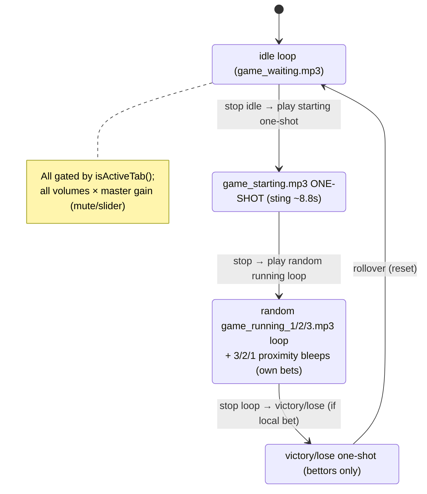

# Monkify — "Audio Overhaul with AI" — (3/3) Wiring Spec

> **Status: Shipped** (2026-07-07, merged via `feature/audio-overhaul`). **Post-ship reality:**
> proximity bleeps were **omitted** (their assets were dropped); shipped **extras beyond this spec** —
> a menu loop on the sessions page (`LobbyAudio.vue`), a `/`→`/monkify/game` redirect, and a
> session-connection teardown fix (`disconnectAllPreviousConnections`). See
> `../features/audio-overhaul.md`. Originally refined via Trello card
> [Overhaul audio/songs with AI — (3/3) Wire new audio into the game](https://trello.com/c/RvVdpO25/35-overhaul-audio-songs-with-ai-3-3-wire-new-audio-into-the-game)
> (2026-07-07).
> Repos affected: **`monkify-front`** (all the wiring) + this doc in **`monkify-meta`**.
> **No `monkify-backend` change.**
>
> **Purpose:** Wire card 2's generated audio assets into the game per card 1's manifest — swap the
> existing sound imports, add every new trigger (idle loop, one-shot Game Starting, random running
> variant, own-bet, error, victory/lose, button-press, 3/2/1 proximity bleeps), add a header
> **mute + volume** control, and fix the three known timing issues — all client-side, display-only.

> ### ℹ️ Card 3 of 3 — the consumer card, shared branch
> This card **consumes** card 1's design contract and card 2's assets; it is the last of the three and
> ships them all together on **one** branch/worktree `feature/audio-overhaul`.
>
> | Card | Trello | Role |
> | --- | --- | --- |
> | (1/3) Manifest & Suno spec | [#17 `9qiDtDAe`](https://trello.com/c/9qiDtDAe) | **Design** — `specs/audio-overhaul.md` **§7 is the contract this card implements** |
> | (2/3) Generate assets | [#34 `OuXhyqyU`](https://trello.com/c/OuXhyqyU) | **Assets** — the 12 mp3 files this card imports |
> | **(3/3) — this card** | [#35 `RvVdpO25`](https://trello.com/c/RvVdpO25) | **Wire it all in + mute/volume UI + timing fixes** |
>
> **Hard rule:** reuse `feature/audio-overhaul` (existing worktrees) — **never fork a new slug**. This
> spec's own file is `specs/audio-overhaul-wiring.md`.

---

## 1. Summary

Card 1 (`specs/audio-overhaul.md`) locked the sound design and, in **§7**, the exact frontend
integration contract. This card **implements §7 verbatim** against the real files, plus the three
timing fixes the card owner called out. It is **frontend-only, display-only** (no effect on bets,
settlement, or outcomes) and **preserves the existing tab-visibility gating**.

**What gets wired (all in `monkify-front`):**

| Area | Change | Card 1 ref |
| --- | --- | --- |
| Engine | `helpers.ts` master gain + mute multiplier, live re-apply to loops | §7.1 |
| Idle / Starting / Running | `GameAudio.vue`: idle loop on `WaitingBets`; **one-shot** Game Starting on `SessionStarting`; **random** running variant on `InProgress` | §7.2 |
| Own-bet / error / button | `GameMonkey.vue` (`phone_beep`), `GameConsole.vue` (keep `error1`, add `button_press`) | §7.3 |
| Victory / Lose | end-of-session selection, bettors only | §7.4 |
| Proximity bleeps | extend `useNearMiss` to fire 3/2/1 on the raw KMP match | §7.5 |
| Mute + volume | header speaker icon (mute click + hover/expand slider), `localStorage` | §7.6 |
| Timing fixes | (1) sting-on-glasses alignment, (2) clean loop handoff, (3) own-bet beep sync | this card §6.8 |

**No test framework is added** — `monkify-front` has none; verification is manual QA (§11).

---

## 2. Constraints (MANDATORY)

From `monkify-meta/constraints.md` (full list there):

- **Shared branch/worktree:** work in the **existing** `feature/audio-overhaul` worktree
  (`.worktrees/audio-overhaul/monkify-front`); this spec lives in `.worktrees/audio-overhaul/monkify-meta`.
  Hubs stay on `main`. **Do not create a new branch/slug.**
- **Frontend-only → no backend integration test** (no backend behavior). **No FE unit tests / no test
  runner added** — the repo has none; verification is manual QA (§11). *(This supersedes card 1 §11's
  assumption of FE unit tests.)*
- **Frontend env vars use `VUE_APP_*`**, never `VITE_*`. *(This card adds no new env var.)*
- **EF / migrations / API / SignalR / operator-messaging** constraints are **N/A** — nothing backend
  is touched.
- **Format is a reversible convention:** the new assets are mp3; `error1.wav` is retained.
- **Display-only:** audio must never affect bets, settlement, winners, or session state.

---

## 3. Resolved product decisions

| # | Decision |
| --- | --- |
| 1 | **Implement `specs/audio-overhaul.md` §7 verbatim** — §7.1–§7.7 are the contract; this spec adds the concrete file/line edits and the timing fixes. |
| 2 | **Session-start sting is baked into `game_starting.mp3`** — no separate sting playback. Game Starting is a **one-shot** on `SessionStarting`, not a loop. |
| 3 | **Running music = random of 3 variants** (`game_running_1/2/3.mp3`) chosen per `InProgress`. |
| 4 | **Victory/Lose — bettors only** (bet & won → victory; bet & lost → lose; no bet → neither), fires once, via existing `useSession` state. |
| 5 | **Proximity bleeps** reuse `useNearMiss`, firing on the **raw per-char KMP `k`** (not `displayK`), 3/2/1 escalating, re-arm on break, closest-bet drives the tier, short choices fire only tiers ≤ L. Frontend-only. |
| 6 | **Mute + volume UI:** header **speaker icon** — mute on click, **volume slider on hover/expand**; `localStorage` (default unmuted/full); master gain/mute in `helpers.ts` with **live re-apply** to a playing loop. Client display-only. |
| 7 | **Three timing fixes:** (1) Game Starting sting lands on the glasses moment (~8.8s); (2) clean loop start/stop handoff (one loop at a time); (3) own-bet beep in sync with the call animation. |
| 8 | **Asset import swap + cleanup:** point imports at the new mp3s; **delete the 4 unused old originals** (`game_starting.wav`, `game_running.wav`, `game_waiting.wav`, `phone_beep.wav`); keep `error1.wav`; `success1.wav` already dropped by card 2. |
| 9 | **Testing = manual QA only** — no test runner/framework added. |

---

## 4. Current implementation (audit — the exact edit points)

All paths in `monkify-front`. Verified against the live code (`feature/audio-overhaul` base).

### 4.1 `src/constants/helpers.ts` (engine)

- `playAudio(src, volume = 0.1)` — one-shot; `playLoopingAudio(src, volume = 0.02)` → returns
  `stop()`; `stopAllAudio()`; `preloadAudios()`. Elements cached in `audioCache`; live loops tracked in
  `activeAudios`. **No master gain/mute today** — add it here (§6.1).

### 4.2 `src/components/game/GameAudio.vue` (status → track)

- Imports `runningAudio` (`game_running.wav`), `startingAudio` (`game_starting.wav`); `waitingAudio`
  import is **commented out**. `currentTrack: 'none' | 'starting' | 'running'`.
- `updateAudioForStatus(status)`: `SessionStarting → playTrack('starting')` (looped);
  `InProgress → playTrack('running')` (looped); `WaitingBets`/`Reward`/`Ended`/default → `stopAudio()`.
- `playTrack()` gates on `isActiveTab()` (visible **and** focused), stops current, then
  `playLoopingAudio(...)` in a `requestAnimationFrame`. Visibility/focus handlers re-sync on refocus.
- **Changes (§6.2):** add a `'waiting'` track (idle loop); make **starting a one-shot** (`playAudio`,
  drop the `'starting'` loop track); make **running pick a random variant**; keep the tab gate and the
  clean stop-before-start handoff (timing fix 2).

### 4.3 `src/components/game/GameMonkey.vue` (own-bet call)

- Imports `beep` (`phone_beep.wav`); `tryPlayNextBetAnimation()` sets `currentAnimation = call` and
  calls `playAudio(beep)`, capped at `MAX_BET_ANIMATIONS = 2`; `CALL_ANIMATION_MS = 3500`,
  `GLASSES_DELAY_MS = 8800`. `isOwnBet()` uses `lastOwnBetChoice` / wallet match.
- **Changes (§6.3/§6.8):** import `phone_beep.mp3`; keep the beep firing once per call animation, in
  sync, consistent with the 2-cap (timing fix 3). `GLASSES_DELAY_MS = 8800` is the anchor the Game
  Starting sting must align to (timing fix 1).

### 4.4 `src/components/game/GameConsole.vue` (error + preset buttons)

- Imports `errorAudio` (`error1.wav`); `leverError()` → `playAudio(errorAudio)`.
  `selectPresetButton(btnIndex)` sets `userWord` and **plays nothing** today.
- **Changes (§6.3):** keep `error1.wav`; add `playAudio(buttonPress)` (`button_press.mp3`) at the top
  of `selectPresetButton`.

### 4.5 `src/hooks/useSession.ts` (state + terminal feed)

- Exposes `ownBetChoices` (durable own choices this session), `winnerChoice`
  (`result.firstChoiceTyped`), `winners` (`result.winners`), `sessionInstance.status`. The `Terminal`
  handler already calls `nearMiss.feed(data)`; the `Status` handler calls `nearMiss.finish(...)` on
  `Ended`; `updateNewSession()` calls `nearMiss.reset()`.
- **Changes (§6.4):** on `Status → Ended`, run the victory/lose selection (bettors only), once.

### 4.6 `src/utils/nearMiss.ts` + `src/hooks/useNearMiss.ts` (proximity)

- `advance(matcher, ch)` returns the **raw** matched-prefix length `k` per char. `useNearMiss.feed()`
  already iterates every streamed char through every tracked own choice's matcher; the composable
  keeps a display high-water `displayK` (drops only after a 2s stall) — **not** suitable for bleeps.
- **Changes (§6.5):** emit a proximity tier event from inside `feed()` using the **raw `k`** so the
  bleep logic sees the true match state (drops immediately on break).

### 4.7 Game header

- The header component (e.g. `src/components/game/GameHeader.vue`) is where the wallet cluster / gear
  live. **Add** the mute icon + hover/expand volume slider here (§6.6). *(Confirm the exact filename
  during implementation; the audio control belongs wherever the header controls render.)*

### 4.8 Assets — `src/assets/audios/`

- After card 2: the 12 new mp3s exist; `error1.wav` retained; `success1.wav` deleted. The old
  originals `game_starting.wav`, `game_running.wav`, `game_waiting.wav`, `phone_beep.wav` may still be
  present — **this card deletes them** when swapping imports (§6.9).

---

## 5. Configuration

**None.** No new env var, no `GeneralSettings`, no `VUE_APP_*`. The mute/volume state lives only in
`localStorage` (suggested key `monkify.audio` → `{ muted: boolean, volume: number }`).

---

## 6. Frontend behaviour (implementation)

Order the work engine-first so the triggers can rely on the master gain.

### 6.1 Engine master gain + mute — `helpers.ts`

- Add module state: `let masterVolume = 1;` `let muted = false;`.
- Effective volume helper: `effective(base) => clampVolume(base * (muted ? 0 : masterVolume))`.
  Apply it in `playAudio` and `playLoopingAudio` (multiply the passed `base` = `0.1` / `0.02`).
- Export `setMasterVolume(v)`, `setMuted(b)`, `getMasterVolume()`, `getMuted()`, and a
  `applyVolumeToActive()` that walks `activeAudios` and sets each `audio.volume = effective(itsBase)`.
  Track each active audio's base (e.g. a `WeakMap<HTMLAudioElement, number>` set on play) so re-apply
  uses the right base per element (loops `0.02`, SFX `0.1`).
- No Web Audio graph — stays `HTMLAudioElement`.

### 6.2 Idle / Game Starting (one-shot) / random Running — `GameAudio.vue`

- **Imports:** add `waiting` (`game_waiting.mp3`), `starting` (`game_starting.mp3`), and an array
  `runningVariants = [game_running_1.mp3, game_running_2.mp3, game_running_3.mp3]`.
- **`WaitingBets`:** `playTrack('waiting')` → `playLoopingAudio(waiting)`; add `'waiting'` to
  `currentTrack`'s union.
- **`SessionStarting`:** **one-shot** — `stopAudio()` (stop the idle loop) then `playAudio(starting)`
  (do **not** loop; drop the old `'starting'` loop branch). The baked-in glasses sting plays near the
  end (timing fix 1). Guard so it plays **once** per entry into `SessionStarting`.
- **`InProgress`:** `stopAudio()` then `playLoopingAudio(runningVariants[Math.floor(Math.random() *
  runningVariants.length)])`. Track `currentTrack = 'running'`.
- **`Ended` / reward / default:** `stopAudio()` (victory/lose one-shots are fired from §6.4, not here).
- **Timing fix 2 (clean handoff):** keep the "stop current before starting next" order; ensure only
  one loop is ever active (`stopAudio()` calls `stopAllAudio()`), and the one-shot Game Starting is not
  treated as a loop (so it isn't double-stopped/started). Preserve `isActiveTab()` gating and the
  refocus re-sync (§7.7).

### 6.3 Own-bet / error / button — `GameMonkey.vue`, `GameConsole.vue`

- `GameMonkey.vue`: change the import to `phone_beep.mp3`; leave the existing `playAudio(beep)` call in
  `tryPlayNextBetAnimation()` (already once-per-call-animation, capped at 2) — timing fix 3 is just
  keeping it in sync with the animation start.
- `GameConsole.vue`: keep `error1.wav` + `leverError()` unchanged; import `button_press.mp3` and call
  `playAudio(buttonPress)` at the start of `selectPresetButton()`.

### 6.4 Victory / Lose — end of session (bettors only)

- Add a small watcher (in `useSession` or a dedicated `useEndSessionAudio` composable) on
  `sessionInstance.value?.status === SessionStatus.Ended`:
  - `didBet = ownBetChoices.value.length > 0` → if false, **play neither** and return.
  - `won = ownBetChoices.value.includes(winnerChoice.value)` *(primary, works across payment models;
    for crypto, `won ||= winners.value.includes(wallet)` as belt-and-suspenders)*.
  - `won ? playAudio(victory) : playAudio(lose)`.
- Fire **once** per session end (a `firedForSession` guard keyed by `sessionId`); reset on
  `updateNewSession()`. Respect `isActiveTab()`.

### 6.5 Proximity bleeps — extend `useNearMiss`

- In `feed(batch)`, for each char, for each tracked own choice, the loop already calls
  `advance(att.matcher, ch)` → the raw matched length `k`. Compute `away = att.matcher.L - k`.
- Maintain per-choice **armed tier** state (independent of `displayK`): remember the last tier fired
  for the current match run. When `away` decreases to 3/2/1 and that tier hasn't fired since the last
  break, mark a candidate. **Across all own choices for this char, pick the smallest `away`** and fire
  **that single** tier's bleep (`playAudio(bleep3|bleep2|bleep1)`), so only one bleep per char.
- **Re-arm:** when a choice's `k` drops (match broke) so `away` grows past a tier, clear that tier's
  fired flag for that choice so it can fire again on the next approach.
- **Short choices:** only tiers `≤ L` are eligible (skip tier 3 if `L < 3`, etc.).
- Expose this via a new reactive pulse or an `onProximity(tier)` callback the audio layer subscribes
  to — **or** play directly inside the composable (import `playAudio` + the bleep assets). Keep it a
  **single matcher pass** (do not add a second KMP walk). No backend/SignalR change. Respect the tab
  gate + master mute/volume (bleeps go through `playAudio`, which already applies master gain).
- `reset()`/`finish()` already run on rollover/end — clear the armed-tier state there too.

### 6.6 Mute + volume control — game header

- Render a **speaker icon** in the header. Click → toggle mute (`setMuted`, swap icon
  muted/unmuted). On hover/focus (or click-to-expand) reveal a **volume slider** (0–1) bound to
  `setMasterVolume`; on input, call `applyVolumeToActive()` so a playing loop updates live.
- **Persist** `{ muted, volume }` to `localStorage` on change; **hydrate** on mount and call
  `setMuted`/`setMasterVolume` so state survives reloads. **Default unmuted, volume 1.**
- Purely presentational — no wallet/bet/session coupling.

### 6.7 Preserved behaviour (§7.7)

- Keep `isActiveTab()` gating (nothing starts while inactive; re-sync on refocus).
- Loops fully stop on `Ended`/rollover; `nearMiss.reset()` on `updateNewSession()` clears proximity
  (extend it to clear the new armed-tier state).

### 6.8 The three timing fixes (summary)

1. **Sting on glasses:** Game Starting is a ~10s one-shot whose sting sits at ~8.8–9.5s to match
   `GLASSES_DELAY_MS = 8800` — realized by playing `game_starting.mp3` once at `SessionStarting` entry
   (asset shaped by card 1/2; wiring just plays it as a one-shot).
2. **Clean loop handoff:** one loop at a time; stop-before-start; no overlap/double-play/stray loop
   across `WaitingBets → SessionStarting → InProgress → Ended` (§6.2).
3. **Own-bet beep sync:** beep fires with the call animation, once per own bet, 2-cap consistent
   (§6.3).

### 6.9 Asset import swap + cleanup

- Point all imports at the new mp3s (§6.2/§6.3). **Delete** `game_starting.wav`, `game_running.wav`,
  `game_waiting.wav`, `phone_beep.wav` from `src/assets/audios/`. Keep `error1.wav`.

---

## 7. Flow diagram — status → audio (post-change)

---

## 8. Out of scope

- Generating assets (**card 2 #34**) and any change to card 1's sound design.
- Any backend / DB / migration / API / SignalR work.
- Adding a frontend test framework or component tests (manual QA only).
- Real-fiat currency, wallet-cluster, or other unrelated header changes.

---

## 9. File checklist

### 9.1 Meta (`monkify-meta`) — **this card (create-spec)**

| # | File | Change |
| --- | --- | --- |
| 1 | `specs/audio-overhaul-wiring.md` | **New** — this wiring spec |
| 2 | `INDEX.md` | Add spec row (Ready) + update the audio-overhaul in-flight entry |

### 9.2 Frontend (`monkify-front`) — **the implement step**, shared branch

| # | File | Change |
| --- | --- | --- |
| 1 | `src/constants/helpers.ts` | Master `masterVolume`/`muted` + `effective()` + setters + `applyVolumeToActive()` (§6.1) |
| 2 | `src/components/game/GameAudio.vue` | Idle loop (`WaitingBets`); one-shot Game Starting (`SessionStarting`); random running variant (`InProgress`); clean handoff; keep tab gating (§6.2) |
| 3 | `src/components/game/GameMonkey.vue` | Import `phone_beep.mp3`; beep synced to call animation (§6.3) |
| 4 | `src/components/game/GameConsole.vue` | Keep `error1.wav`; add `button_press.mp3` in `selectPresetButton` (§6.3) |
| 5 | `src/hooks/useNearMiss.ts` | Emit proximity tier from `feed()` on raw `k`; fire 3/2/1 bleeps; clear armed state on reset/finish (§6.5) |
| 6 | `src/hooks/useSession.ts` (or new `useEndSessionAudio.ts`) | Victory/lose on `Ended`, bettors only, once (§6.4) |
| 7 | `src/components/game/GameHeader.vue` (or the header host) | Mute icon + hover/expand volume slider + `localStorage` (§6.6) |
| 8 | `src/assets/audios/` | Import the 12 new mp3s; delete the 4 old `.wav` originals; keep `error1.wav` (§6.9) |

### 9.3 Backend (`monkify-backend`)

**None.**

---

## 10. Tests

- **Backend integration test:** **N/A** (frontend-only; no backend behavior).
- **FE unit tests:** **none added** — `monkify-front` has no test runner (only serve/build/lint) and
  card 3 does not introduce one (refinement decision). Verification is manual QA (§11). *(This
  supersedes card 1 §11.)*

---

## 11. Manual QA (the verification for this card)

Run the app (`npm run serve`) and play through:

1. **Idle:** enter a session in `WaitingBets` (tab focused) → idle loop plays; blur the tab → nothing
   new starts; refocus → re-syncs.
2. **Starting:** on `SessionStarting` → `game_starting.mp3` plays **once** (not looping); the glasses
   sting lands as the monkey puts glasses on (~8.8s); no separate sting.
3. **Running:** on `InProgress` → one of the 3 running variants loops (varies across sessions); no
   overlap with the starting one-shot; only one loop audible.
4. **Own-bet:** place your own bet → beep fires once with the call animation; place a second → still
   capped/synced; **error:** invalid lever → `error1` still plays; **button:** click a preset button →
   `button_press` fires.
5. **Proximity:** bet a choice; as the stream approaches it, hear 3→2→1 escalating bleeps once each;
   when the partial match breaks and re-approaches, they re-fire; with two own bets the closest drives
   it; a short choice fires only its applicable tiers.
6. **Victory/Lose:** win a bet → victory once; lose a bet → lose once; **spectate** (no bet) → neither.
7. **Mute/volume:** header speaker icon mutes on click and reveals a slider on hover; dragging changes
   a **currently-playing** loop live; reload the page → setting persisted; default is unmuted/full.
8. **Cleanup:** `git status` shows the 4 old `.wav` deleted, `error1.wav` kept, 12 mp3s referenced.
9. **No backend diff**; audio never changes bet/settlement/winner behaviour.

---

## 12. Trello / pipeline

- **Source card:** [#35 `RvVdpO25`](https://trello.com/c/RvVdpO25) — moved to **Specs created**;
  **Implementation** section lists the shared branch + this spec.
- **Depends on:** [#17 `9qiDtDAe`](https://trello.com/c/9qiDtDAe) (§7 contract) + [#34
  `OuXhyqyU`](https://trello.com/c/OuXhyqyU) (assets — must be generated/committed first).
- **Next:** `/monkify-implement-feature` for **#34** (needs the real `ACEDATACLOUD_API_TOKEN` +
  session restart), then **#35**; **ship all three together** via `/monkify-ship-feature`.

---

## 13. Revision log

| Date | Change |
| --- | --- |
| 2026-07-07 | Initial wiring spec from refined card #35. Audited the live audio code (helpers/GameAudio/GameMonkey/GameConsole/useSession/useNearMiss); mapped card 1 §7 to concrete edits; specified engine master gain/mute, idle+one-shot-starting+random-running, victory/lose (bettors-only), proximity bleeps on raw KMP `k`, header mute/volume UI, the three timing fixes, asset swap+cleanup, and manual-QA-only verification (no FE test runner). |
