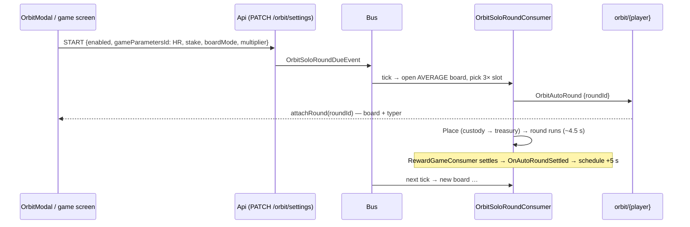

# SpaceStroker — "Orbit auto-bet for Monkey Duel & Hyper Roll" — Implementation Spec

> **Status: Shipped (2026-10-06, branch `feature/auto-bet-duel-hyper-roll`)** in `monkify-backend`,
> `monkify-front` and `monkify-meta`. Distilled in
> [`../features/auto-bet-duel-hyper-roll.md`](../features/auto-bet-duel-hyper-roll.md); where this spec and
> the code disagree, the code wins. See the post-ship notes in §15.
>
> *(Original status:)* **Ready for implementation** — refined via Trello card
> [#200 Enable auto bet for monkey duel & hyper roll](https://trello.com/c/i6thj637) (2026-10-05).
> Repos affected: `monkify-backend`, `monkify-front`, and this doc in `monkify-meta`.
> Branch / worktree: `feature/auto-bet-duel-hyper-roll` → `.worktrees/auto-bet-duel-hyper-roll/<repo>`.
> Level: **`Feature`**. Modal design: mockup **A2 · game tiles**
> (<https://claude.ai/artifact/Uzzm7DYGqqV9GHeYkE3yj7>).
>
> **Purpose:** Orbit's auto-bet engine can today only play **Cosmic Sprint**, because it rides the shared
> round rhythm (`GameOpenedEvent` → planner → one bet per round). This card lets a player point auto-bet
> at **Monkey Duel (VS HOUSE)** or **Hyper Roll** instead — one game at a time — with a stake they set,
> and for Hyper Roll a board mode plus a multiplier (or RANDOM). Both are **solo, on-demand** games with
> no shared round and no rollover, so this adds a **second engine loop** that opens the player's round
> itself, bets, waits for settlement, pauses a configurable gap, and goes again.

---

## 1. Summary

| Aspect | Cosmic Sprint auto (unchanged) | **Hyper Roll auto (new)** | **Monkey Duel auto (new)** |
| --- | --- | --- | --- |
| Who opens the round | Shared rollover (`OpenNewGames`) | **The loop** (`IGameService.OpenSoloBoard(params, mode)`) | **The loop** (`IGameService.OpenDuelRoom(params, DuelKind.House)`) |
| Trigger | `GameOpenedEvent` → `OrbitPlacementPlannerConsumer` | **`OrbitSoloRoundDueEvent`** (new) | same |
| Pace | One bet per shared round | Back to back + **`SoloRoundGapSeconds`** (default 5 s) after settlement | same |
| Stake | `RequiredAmount` | **`OrbitEnrollment.Stake`** (null ⇒ `RequiredAmount`), bounded `RequiredAmount..MaximumStake` | **`OrbitEnrollment.Stake`**, bounded `RequiredAmount..Duel.MaximumStake` |
| Choice | Enrolment word, or derived (`AutoPickChoice`) | **A board slot**: the slot carrying `OrbitEnrollment.Multiplier` on a fresh board of `OrbitEnrollment.BoardMode`; RANDOM / duplicate multipliers → seed-derived | **Enrolment word** (same field as Cosmic Sprint), or derived when `AutoPickChoice` |
| Standing word claim (`OrbitChoiceClaim`) | Yes (free-text) | **No** | **No** |
| House can't take it | n/a | **Stay Enabled, no money moves, retry after the gap, "Waiting for the house…"** | same |
| Placement money path | `OrbitStakePlacer` (custody → treasury), `FundedByOrbit`, `OrbitAutoPlaced` | **same placer, unchanged** | **same placer, unchanged** |
| Threshold / floor / stop-loss, win toast, Telegram | Yes | **Yes — unchanged** (`OrbitAutoPlaced`) | **Yes — unchanged** |
| Lever on the game screen | Locked (`OrbitAutoPlayActive`) | Locked **and the console follows the auto rounds live** | Locked **and follows live** (the duel console gets the lock it lacks today) |

**One game at a time** is already structural: `OrbitEnrollment` is one row per player with one
`GameParametersId` (unique `PlayerId` index). This card keeps that and adds a UI picker that is locked
while running.

---

## 2. Constraints (MANDATORY)

From `monkify-meta/constraints.md` (full list there):

- **Worktree-per-repo:** work only in `.worktrees/auto-bet-duel-hyper-roll/<repo>` on
  `feature/auto-bet-duel-hyper-roll`; the hubs stay on `main`.
- **Unit tests:** update/add in `SpaceStroker.Tests`; run via `scripts/run_tests.bat` (never the full
  `dotnet test` — `ProductionSessions` is a slow Monte-Carlo suite); **report changed tests** at the end.
- **Integration test (Feature):** mandatory happy-path test in `SpaceStroker.Tests.Integration` (§11.2).
- **EF mapping:** inline in `SpaceStrokerDbContext.OnModelCreating`; no `IEntityTypeConfiguration`.
- **Migrations:** under `SpaceStroker.Infrastructure/Migrations/`; applied only by
  `SpaceStroker.Consumers` at startup. Additive only.
- **NoTracking DbContext:** every write is `ExecuteUpdateAsync` or an explicit `Update` — a
  load-mutate-`SaveChanges` silently persists nothing.
- **Money moves only in `SpaceStroker.Consumers`.** The API validates and publishes; it never signs.
- **Orbit is LIVE with real money.** Every new path is a money path. The ledger invariant
  `OrbitBalance.Amount == SUM(OrbitTransaction.Amount)` per pool/player must hold; the loop never writes
  ledger rows itself — only `OrbitStakePlacer` / `OrbitBetSettlementService` do, unchanged.
- **Vague messaging:** settings refusals use the existing `OrbitRequestInvalid`; the waiting line never
  says whether the treasury, the maintenance switch or coverage caused it.
- **Secrets/config:** mock-only values in committed files.

---

## 3. Resolved product decisions

| # | Decision |
| --- | --- |
| 1 | The card's "CF" line means: the Cosmic Sprint Orbit word **carries over to Monkey Duel** (both are 6 letters, one `OrbitEnrollment.Choice`). Hyper Roll has its own pick rule (decision 5). |
| 2 | **One game at a time** — unchanged single enrolment row. |
| 3 | **Monkey Duel auto = VS HOUSE only.** The loop opens `DuelKind.House` rounds. Orbit never joins or posts OPEN DUELS (no bot on the PVP board; the joiner edge is ~52%). |
| 4 | **Stake** for Duel and Hyper Roll is player-set per round (`OrbitEnrollment.Stake`, null ⇒ the type's `RequiredAmount`), bounded by the type's floor/ceiling at SOL precision (9 dp). Never clamped or resized silently. Editable **only while paused**. Cosmic Sprint ignores it (fixed price). |
| 5 | **Hyper Roll pick:** mode (`AVERAGE`/`SUPER`/`HYPER`, null ⇒ default = lowest `Position`), then a multiplier from that mode's ladder, or **RANDOM** (null). Every round opens a **fresh board** in that mode (no reroll) and bets the slot with that multiplier. When the board has the multiplier on more than one slot, or for RANDOM, the slot is **derived from the round's committed `ServerSeed`** (§6.5). A stored multiplier that is no longer in the mode's ladder (config change) **falls back to RANDOM** — never refuses. |
| 6 | **Pace:** back to back with a server gap, `Orbit.SoloRoundGapSeconds` (default **5**), measured from settlement (or the refund/failed attempt) to the next open. One knob, an ops brake. No per-player pace. |
| 7 | **Game screen while auto runs on that type:** lever locked with the existing *"Orbit is auto-playing this game — pause it to bet manually."*; the console **follows each auto round live** (board / words, typer, result, VS splash for a duel) via a new private-channel event (§6.8) plus `OrbitDto.CurrentAutoRoundId` for reloads. |
| 8 | **Switching games:** a game picker in the modal, **locked while `Enabled`**. Pause → pick → START. The API enforces it (§6.2). |
| 9 | **Modal = mockup A2 (game tiles)** — §7.2. |
| 10 | **House can't take the bet** (coverage fails, the `HouseEdgeEnabled` maintenance switch is off, or a coverage refusal after transfer): the enrolment **stays `Enabled`**, no Orbit money moves (or it comes back through the shipped case-B return), the loop retries after the gap, and the modal + game screen show *"Waiting for the house…"*. No auto-pause. |
| 11 | The Cosmic Sprint word claim (`OrbitChoiceClaim`) is **released when the enrolment leaves Cosmic Sprint**, and **no claim is ever taken on a Duel or Hyper Roll type** — a standing claim on Monkey Duel would block that word in everyone's duels for the whole type. |
| 12 | The **word stays editable while running** (today's Cosmic Sprint behaviour, takes effect next round). Only **game type, stake, mode and multiplier** are locked while `Enabled`. *(The A2 mockup greyed the word too; the spec keeps today's word behaviour so Cosmic Sprint does not regress — the front greys only the four locked fields.)* |
| 13 | Level **Feature**: mandatory happy-path integration test + new `features/auto-bet-duel-hyper-roll.md` at ship. |

---

## 4. Data model

### 4.1 `OrbitEnrollment` — new columns

`monkify-backend/src/SpaceStroker.Domain/Orbit/Entities/OrbitEnrollment.cs`

```csharp
// Solo-type setup (Monkey Duel / Hyper Roll). Ignored on Cosmic Sprint.
public decimal? Stake { get; set; }          // null ⇒ the type's RequiredAmount
public string? BoardMode { get; set; }       // Hyper Roll only; null ⇒ the type's default mode
public decimal? Multiplier { get; set; }     // Hyper Roll only; null ⇒ RANDOM

// Solo loop bookkeeping. Written ONLY with ExecuteUpdate (NoTracking context).
public Guid? SoloRoundId { get; set; }            // the auto round in flight, if any
public DateTime? SoloLeaseUntil { get; set; }     // short claim taken BEFORE opening a round (§6.4)
public DateTime? NextSoloRoundAt { get; set; }    // earliest time the next round may open (the gap)
public DateTime? WaitingForHouseSince { get; set; } // set while the house refuses; cleared on a placed bet
```

### 4.2 EF configuration (inline)

In the existing `modelBuilder.Entity<OrbitEnrollment>` block of `SpaceStrokerDbContext.OnModelCreating`:

```csharp
builder.Property(x => x.Stake).HasPrecision(18, 9);
builder.Property(x => x.BoardMode).HasMaxLength(20);
builder.Property(x => x.Multiplier).HasPrecision(9, 2);
// The sweep's query: enabled solo enrolments with nothing in flight.
builder.HasIndex(x => new { x.Enabled, x.SoloRoundId });
```

### 4.3 Migration

`OrbitSoloAutoBet` — additive only (7 nullable columns + 1 index). From
`monkify-backend/src`:

```bash
dotnet ef migrations add OrbitSoloAutoBet -p SpaceStroker.Infrastructure -s SpaceStroker.Consumers
```

The latest existing migration is `20261001185217_HolderJackpot`. An old API/Consumers revision running
against the new schema ignores the columns, so the deploy needs no ordering beyond the usual Consumers-first.

---

## 5. Configuration

| Key | Where | Value |
| --- | --- | --- |
| `AllowOrbit` | `spacestrokersettings.json` → `DefaultGames[Hyper Roll]` and `DefaultGames["Monkey Duel (CoinFlip)"]` | `false` → **`true`**. Healed onto existing DBs at Consumers startup by `CreateDefaultGameParametersAsync` (`ExecuteUpdate` by name + `ActiveParameters` cache drop) — no SQL. |
| `SoloRoundGapSeconds` | `OrbitSettings` (`GeneralSettings:Operator:Token:Orbit:SoloRoundGapSeconds`) | `int`, C# default **5**; add `"SoloRoundGapSeconds": 5` to the committed Orbit block in `spacestrokersettings.json` (beside `OrbitBetGateTimeoutSeconds`). Non-secret — no `secrets.<env>.json` / Terraform binding needed. *(The card wrote `GeneralSettings:Orbit:…`; the Orbit options actually live under `Operator.Token.Orbit`, so it goes there.)* |
| `SoloLeaseSeconds` | same class | `int`, default **60** — the claim lease of §6.4. Not surfaced in config files. |

⚠️ **Do not flip `AllowOrbit` without the §6.1 guards in the same commit.** Today both
`BetPlacedConsumer` (its `PlanPlacements` re-plan) and `UpdateOrbitSettingsHandler.ConsiderTheCurrentRound`
treat *any* open round of an `AllowOrbit` type as a shared round: with the flag on alone, a human's
Hyper Roll bet or anyone's settings save would fan **other** enrolled players into **that human's solo
round** — their custody transfers would land and then be refused (case B).

---

## 6. Backend behaviour

### 6.1 Keep the shared-round engine away from solo rounds (blocking fixes)

A **solo type** is `parameters.IsHouseEdge || parameters.IsDuel`. Add one helper so the rule has one
spelling — `OrbitSoloTypes.IsSolo(GameParameters p)` in `SpaceStroker.Domain/Orbit/Services/` (new,
static).

1. `OrbitBetPlacementService.PlanPlacements(Game)` — **return immediately** for a solo type (before
   `CashOutFloorStoppedPlayers`; the floor sweep for solo players runs from settlement, §6.6).
2. `BetPlacedConsumer` — skip the `PlanPlacements` re-plan for a solo type (house-edge / duel rounds are
   started by their own branches already; this only removes the Orbit re-plan).
3. `OrbitBetPlacementService.IsOrbitEligible` and `PlaceOrbitBetConsumer` — refuse (`SkipPlacement`) a
   `PlaceOrbitBetEvent` whose round is a solo type. Defence in depth; nothing should publish one.
4. `UpdateOrbitSettingsHandler.ConsiderTheCurrentRound` — for a solo type, publish
   `OrbitSoloRoundDueEvent(playerId)` instead of `GameOpenedEvent` (§6.3).
5. `OrbitDepositCreditedConsumer` — after its existing re-plan, if the player's enrolment is `Enabled` on
   a solo type, publish `OrbitSoloRoundDueEvent(playerId)` (a deposit can unblock a "needs money" loop).

### 6.2 Settings: `PATCH /orbit/settings`

`UpdateOrbitSettingsRequest` body gains (PATCH-style, null = leave alone):

```csharp
public decimal? Stake { get; init; }        public bool ClearStake { get; init; }
public string? BoardMode { get; init; }     public bool ClearBoardMode { get; init; }
public decimal? Multiplier { get; init; }   public bool ClearMultiplier { get; init; }  // Clear = RANDOM
```

`UpdateOrbitSettingsHandler` additions, in this order (every refusal is the existing vague
`OrbitRequestInvalid` unless noted):

1. **Lock while enabled.** If the stored enrolment is `Enabled` **and** the request changes
   `GameParametersId`, `Stake`, `BoardMode` or `Multiplier` to a value different from the stored one
   (including any `Clear*` that would change it) → refuse. Turning `Enabled` off in the **same** request is
   allowed: apply `Enabled = false` first, then the rest (so "pause + switch" can be one call; the front
   still sends two). Word, auto-pick, cash-out rules and notifications stay editable while enabled.
2. **Stake** — only meaningful for a solo type; for a non-solo type a non-null `Stake` is refused. Must be
   `> 0`, at most 9 decimal places, and `RequiredAmount ≤ stake ≤ ceiling` where ceiling is
   `parameters.MaximumStake` (house-edge) or `parameters.Duel.MaximumStake` (duel — the same field the bet
   path reads; a null ceiling fails closed = refuse).
3. **BoardMode** — house-edge types only; must match a `GameBoardModes` row name for the type
   (case-insensitive; stored as the row's canonical name). Duel / Cosmic Sprint → refuse a non-null mode.
4. **Multiplier** — house-edge only; must equal one of the multipliers in the ladder of the *effective*
   mode (`BoardMode ?? default`). Changing the mode with a stored multiplier not on the new mode's ladder →
   the handler sets `Multiplier = null` (RANDOM) rather than refusing.
5. **Type change** — when `GameParametersId` changes: if the old type was free-text non-solo (Cosmic
   Sprint) call `_claims.Release(player, oldType)`. Reset `Stake`, `BoardMode`, `Multiplier` to null
   unless the same request sets them (values are per-type). Keep `Choice` (decision 1).
6. **No claims on solo types.** Every existing `_claims.TryClaim(...)` call (l.~191 and l.~223) is
   guarded with `!OrbitSoloTypes.IsSolo(parameters)`. A solo type still validates the word with
   `_claims.IsValidForType` (6 letters for the duel; Hyper Roll ignores `Choice`, it is not validated
   against Hyper Roll's `ChoiceRequiredLength = 10`).
7. **Enabled → true on a solo type** additionally requires a playable choice for the duel
   (`Choice != null || AutoPickChoice`) — same blocker as Cosmic Sprint today; Hyper Roll needs none.
   Clear `WaitingForHouseSince` and `NextSoloRoundAt`, then `ConsiderTheCurrentRound` → publishes
   `OrbitSoloRoundDueEvent` (§6.1.4).
8. **Enabled → false** on a solo type: clear `WaitingForHouseSince`. Leave `SoloRoundId` — the in-flight
   round settles normally and the settlement hook (§6.6) clears it.

### 6.3 New message + consumer

- `SpaceStroker.Infrastructure/Consumers/OrbitSoloRound/OrbitSoloRoundDueEvent.cs` —
  `record OrbitSoloRoundDueEvent(Guid PlayerId)`.
- `OrbitSoloRoundConsumer : BaseConsumer<OrbitSoloRoundDueEvent>` (Consumers host, **its own receive
  endpoint**, like `OrbitPlacementPlannerConsumer` — a slow on-chain placement must not delay planning).
  It only calls `IOrbitSoloAutoBetService.RunOnce(playerId, ct)`.
- Scheduling a future tick uses the existing Hangfire pattern (`GameService.ScheduleOrbitGateExpiry`):
  `BackgroundJob.Schedule(() => _messageBus.PublishEventAsync(new OrbitSoloRoundDueEvent(playerId)), delay)`.
  Wrap it as `IOrbitSoloAutoBetService.ScheduleNext(playerId, delay)`.

### 6.4 `OrbitSoloAutoBetService.RunOnce` — one tick

New `SpaceStroker.Infrastructure/Services/Orbit/OrbitSoloAutoBetService.cs` (+ interface), scoped,
registered in `AddDefaultServices` (Consumers is the only caller). Every tick is **idempotent**; duplicate
events are expected (sweep + schedule + settings + deposit) and are absorbed by the lease.

1. **Load** the enrolment + its `GameParameters`. Return (no-op) unless `Enabled`, the type is solo,
   `Active`, `AllowOrbit`, not `ComingSoon`, and the player is not self-excluded.
2. **In flight?** If `SoloRoundId != null`: load that game. *(As built — `OrbitSoloRoundState.IsFinished`,
   shared with the sweep:)* the round is in flight while its status is in `HouseEdgeCoverage.UnsettledStatuses`
   (every status before rewards complete — NOT `Game.ActiveGamesStatus`, which would let a duplicate tick
   re-stake between round end and the stop-loss evaluation); a terminal round counts as finished only once it
   is older than `SoloRoundGapSeconds + 60 s` (the settlement hook is the fast path); a round in
   `ErrorWhenProcessingRewards` is **never** finished — the loop holds until an operator resolves the payout
   (the sweep logs it at Error once, then hourly); a deleted round is finished at once. Finished → clear it
   with `ExecuteUpdate … WHERE SoloRoundId = @stale` and continue.
3. **Gap.** If `NextSoloRoundAt > now` → `ScheduleNext(player, NextSoloRoundAt - now)` and return.
4. **Lease.** `ExecuteUpdate SET SoloLeaseUntil = now + SoloLeaseSeconds WHERE PlayerId = @p AND Enabled
   AND SoloRoundId IS NULL AND (SoloLeaseUntil IS NULL OR SoloLeaseUntil < now)
   AND (NextSoloRoundAt IS NULL OR NextSoloRoundAt <= now)`. **0 rows → return**
   (another tick owns it). The lease is taken **before** any round is opened, so a duplicate tick never
   leaves an orphan board.
5. **Stake & funds.** `stake = Stake ?? RequiredAmount`. If the settled **or the spendable** pool balance
   `< stake` (a manual Orbit wager riding elsewhere lowers the spendable one) → release the lease, clear the
   waiting flag, return (no reschedule — the shipped zero-out / "needs money" path applies; a deposit
   re-triggers via §6.1.5). If a **cash-out floor** is set and the settled balance is **strictly below** it →
   release the lease, run `EvaluateFloor` (the stop-loss cash-out), return — the same rule the shared planner
   applies to Cosmic Sprint. If `placer.IsLowOnFees()` → release lease, `ScheduleNext(gap)`, return.
   *(As built: the lease value is a token — `SetRound` and `ReleaseLease` only act on the tick's own lease; a
   duel's stored word is re-validated before the lease; Enabled and self-exclusion are re-read just before
   placing.)*
6. **House pre-check (no money yet).**
   - `HouseEdgeEnabled == false` (both types honour it — `OpenDuelRoomHandler` already does for House) →
     **waiting**.
   - Hyper Roll: `IHouseEdgeCoverageService.EvaluateAsync(new HouseEdgeNewBet(null, "", stake,
     topMultiplierOfEffectiveMode))` not coverable → **waiting**. *(Worst case for a not-yet-drawn board is
     the mode's top multiplier — the same price `HouseEdgeCoverage.WorstCase` will charge.)*
   - Duel: same call with `DuelHouseRules.PayoutMultiplier(parameters.CommissionPercentage)` (mirrors
     `OpenDuelRoomHandler`, but with the **enrolment stake**, not `RequiredAmount`).
   - **Waiting** = `ExecuteUpdate SET WaitingForHouseSince = COALESCE(WaitingForHouseSince, now),
     SoloLeaseUntil = NULL, NextSoloRoundAt = now + gap`, publish the private status event (§6.8, so the
     modal flips without polling), `ScheduleNext(gap)`, return.
7. **Open the round** (in-process, the same services the controllers use):
   - Hyper Roll: `gameService.OpenSoloBoard(parameters, effectiveMode)`.
   - Duel: `gameService.OpenDuelRoom(parameters, DuelKind.House)`.
   A null id (empty pool / invalid mode — logged at Error by those services) → treat as **waiting**.
8. **Record** `ExecuteUpdate SET SoloRoundId = @roundId, SoloLeaseUntil = NULL WHERE PlayerId = @p`.
   Publish the `OrbitAutoRound` private event (§6.8) **before** placing, so the front can attach while the
   transfer runs.
9. **Choice.** Hyper Roll → §6.5 slot resolution over the new round's `GameBoardChoices`. Duel →
   `enrolment.Choice` if set, else `OrbitChoiceGenerator.DeriveChoice(serverSeed, playerId, attempt,
   parameters)` (attempt 0…9, the same generator Cosmic Sprint auto-pick uses — a duel type looks like a
   free-text race to it). No choice → release `SoloRoundId`, `ScheduleNext(gap)`, return (the unbet shell
   expires via `HouseEdgeBoardCleanupJob`).
10. **Place** — `placer.Place(new StakePlacement(roundId, player, stake, choice,
    OrbitChoiceGenerator.DeriveSeed(serverSeed, playerId), 0, OrbitAutoPlaced: true,
    PlacementRequestId: null, Memo: $"orbit-solo:{roundId:N}"))`. Unchanged placer → custody transfer →
    in-process `RegisterBetRequest { FundedByOrbit = true, OrbitAutoPlaced = true }` →
    `RegisterHouseEdgeBet` / `RegisterDuelBet` (coverage lock, solo validation, the duel house word drawn
    under the duel lock).
11. **Outcome** —
    | `StakeOutcome` | Action |
    | --- | --- |
    | `Placed` | `ExecuteUpdate SET WaitingForHouseSince = NULL`. Done — settlement drives the next tick (§6.6). |
    | `InsufficientFunds` | Clear `SoloRoundId`; no reschedule (needs-money path). |
    | `AlreadyClaimed` / `TransferFailed` | Clear `SoloRoundId`; `NextSoloRoundAt = now + gap`; `ScheduleNext(gap)`. |
    | `RegistrationRefused` (case B — e.g. coverage refused under the lock) | Money comes back via the shipped `OrbitStakeReconciliationJob`. Clear `SoloRoundId`; set **waiting**; `ScheduleNext(gap)`. |
    | `InDoubt` | **Leave `SoloRoundId` set.** The reconciliation job resolves the money; the round either settles (hook fires) or its unbet shell is deleted by the board cleanup, after which the sweep (§6.7) clears it. |
12. Any exception after step 4 → log Error with `PlayerId`/`roundId`, clear the lease, `ScheduleNext(gap)`.
    Never retry a transfer inside the tick.

```mermaid
sequenceDiagram
  participant T as trigger (settings / deposit / settlement / sweep)
  participant C as OrbitSoloRoundConsumer
  participant S as OrbitSoloAutoBetService
  participant G as GameService
  participant P as OrbitStakePlacer
  participant R as RegisterBetHandler
  participant W as RewardGameConsumer
  T->>C: OrbitSoloRoundDueEvent(playerId)
  C->>S: RunOnce
  S->>S: in-flight? gap? lease (ExecuteUpdate)
  S->>S: funds + house pre-check
  alt house refuses
    S-->>T: WaitingForHouseSince, schedule +gap
  else ok
    S->>G: OpenSoloBoard(mode) / OpenDuelRoom(House)
    S->>S: SoloRoundId = round; push OrbitAutoRound
    S->>P: Place(stake, slot/word, OrbitAutoPlaced)
    P->>R: RegisterBetRequest (FundedByOrbit, OrbitAutoPlaced)
    R-->>W: round runs → RewardGameEvent
    W->>W: CreditWin / floors (unchanged)
    W->>S: OnAutoRoundSettled(round) → clear SoloRoundId, NextSoloRoundAt = now+gap, schedule
  end
```

### 6.5 Hyper Roll slot resolution

New static `OrbitSlotPicker` in `SpaceStroker.Domain/Orbit/Services/`:

```csharp
// rows: the round's GameBoardChoices ordered by Position (the order GET /games/rounds/{id} returns).
public static GameBoardChoice Pick(string serverSeed, Guid playerId, Guid gameId,
                                   IReadOnlyList<GameBoardChoice> rows, decimal? multiplier)
```

- Candidates = rows whose `Multiplier == multiplier`; if `multiplier` is null **or** no row matches
  (decision 5 fallback) → all rows.
- One candidate → it. Several → index from
  `HMAC-SHA256(serverSeed, $"orbit-slot|{gameId:N}|{playerId:N}")`, first 4 bytes as uint, **32-bit
  rejection sampling** (no modulo bias — same technique as `ProvablyFair.WeightedFallbackIndex`), uniform
  over the candidates.
- The bet's choice is the picked row's `Choice` word. Uniform pick, **not** weighted — every slot pays
  back the same RTP, so the pick only shapes variance (and what the player asked for).

### 6.6 Settlement hook

In `RewardGameConsumer`, right after the existing `EvaluateOrbitFloors` call — on **both** the normal
path and the no-winners early return — call `IOrbitSoloAutoBetService.OnAutoRoundSettled(game)`:

- If the round's type is solo and it has an `OrbitAutoPlaced` bet: for that bet's player
  `ExecuteUpdate SET SoloRoundId = NULL, NextSoloRoundAt = now + gap WHERE PlayerId = @p AND
  SoloRoundId = @gameId`; if 1 row → `ScheduleNext(player, gap)`.
- The floor / threshold / stop-loss rules already ran for that bet (it is `OrbitAutoPlaced`), so a stopped
  or cashed-out player simply fails step 1 or 5 of the next tick.

Same call from `RefundInvalidBetConsumer` when it refunds an `OrbitAutoPlaced` bet on a solo round (duel
give-up paths, coverage backstop refusals) — so a refunded round also releases the loop.

⚠️ `RewardGameConsumer` returns early **before** any Orbit work when a round has no bets; an auto round
always has the Orbit bet, so that branch never matters for the loop. Do not move the hook above it.

### 6.7 Startup pass + sweep (liveness)

- **Consumers startup** (`Program.cs`, beside the existing Orbit startup re-plan): for every enrolment
  `Enabled` on a solo type → publish `OrbitSoloRoundDueEvent`. Ticks are idempotent, so restarting during
  a round is safe (step 2 returns while it is in flight).
- **Recurring Hangfire job** `orbit-solo-autobet-sweep`, every minute, in `ScheduleRecurringJobs`
  (`OrbitSoloAutoBetSweepJob`): publish a due event for every `Enabled` solo enrolment where
  `SoloRoundId IS NULL AND (NextSoloRoundAt IS NULL OR NextSoloRoundAt <= now)` **or** whose `SoloRoundId`
  game is gone or not in `ActiveGamesStatus`. This covers a lost Hangfire schedule, an `InDoubt` round
  whose shell was cleaned up, and a missed settlement hook. It does not shorten the gap.

### 6.8 Realtime (private Orbit channel)

`ActiveGamesHub` group `OrbitNotificationChannel.GroupFor(playerId)` (`"orbit/{playerId}"`), sent from
Consumers through `IHubContext<ActiveGamesHub>` (Redis backplane), like `OrbitNotificationConsumer`.
Add a `GameSettings.OrbitAutoRoundEndpoint` property (configured like the existing `OrbitNotificationEndpoint`, value `"OrbitAutoRound"` in `spacestrokersettings.json`) and payload:

```json
{ "gameTypeId": "guid", "roundId": "guid | null", "waitingForHouse": false }
```

- Sent at §6.4 step 8 (`roundId` set, `waitingForHouse: false`) and on entering waiting (§6.4 step 6,
  `roundId: null, waitingForHouse: true`).
- Not sent to Telegram. No other event changes.

### 6.9 Read side: `GET /orbit` (`GetOrbitHandler` → `OrbitDto`)

- `OrbitDto` gains `Stake`, `BoardMode`, `Multiplier`, `WaitingForHouse` (`WaitingForHouseSince != null
  && Enabled`) and `CurrentAutoRoundId` (`SoloRoundId` when that game is in `ActiveGamesStatus`, else
  null).
- `OrbitEligibleGameTypeDto` gains `IsHouseEdge`, `IsDuel`, `MaximumStake` (house-edge `MaximumStake` /
  duel `Duel.MaximumStake`, null otherwise), and `Modes` (house-edge only, by `Position`):

```csharp
public record OrbitBoardModeDto(string Name, int WordCount, decimal RtpPercent,
                                IReadOnlyList<OrbitBoardSlotDto> Slots);   // Slots in ladder order
public record OrbitBoardSlotDto(decimal Multiplier, int Weight);          // Weight of 1,000,000
```

  Parse with the existing `HouseEdgeRules.ParseLadder`. The front derives the distinct multipliers and
  the single-slot odds (`weight / 1,000,000`) from `Slots`.
- `eligibleGameTypes` keeps its filter (`Active && AllowOrbit && !ComingSoon`), so with §5 it now returns
  Cosmic Sprint, Hyper Roll and Monkey Duel; order by the type's existing display order.

### 6.10 Zero-out / needs-money for solo types

`OrbitBetSettlementService.EvaluateZeroOut(playerId)` compares the settled balance with the type's
`RequiredAmount`. For a solo enrolment compare with the **effective stake** (`Stake ?? RequiredAmount`)
instead, so the one-time Telegram "out of money" message and the word release logic fire when the loop
actually stops. No other settlement change.

### 6.11 What does **not** change

`OrbitStakePlacer`, `RegisterBetHandler` (`RegisterHouseEdgeBet`, `RegisterDuelBet`, the
`OrbitAutoPlayActive` rule), the custody/ledger rows, `OrbitBetSettlementService.CreditWin` / threshold /
floor, `HouseEdgeCoverage`, the duel house word draw, the provably-fair draw and `verify.html`, the
shared-round planner for Cosmic Sprint, manual Orbit wagers, the house seed bet, and the board cleanup
job (it already sweeps unowned unbet duel/house-edge shells).

---

## 7. Frontend behaviour

### 7.1 Types and service

- `src/types/orbit.ts`:
  - `OrbitEligibleGameType` += `isHouseEdge: boolean`, `isDuel: boolean`, `maximumStake: number | null`,
    `modes: OrbitBoardMode[]` (`{ name, wordCount, rtpPercent, slots: { multiplier, weight }[] }`).
  - `OrbitState` += `stake: number | null`, `boardMode: string | null`, `multiplier: number | null`,
    `waitingForHouse: boolean`, `currentAutoRoundId: string | null`.
  - `OrbitSettingsPatch` += `stake`, `clearStake`, `boardMode`, `clearBoardMode`, `multiplier`,
    `clearMultiplier`.
  - `OrbitAutoRoundEvent { gameTypeId: string; roundId: string | null; waitingForHouse: boolean }`.
- `src/services/orbitService.ts` — no new route; `patchOrbitSettings` passes the new fields through.

### 7.2 The Orbit modal auto-bet section (mockup A2)

In `src/components/orbit/OrbitModal.vue` (the section is inline today). Extract the section into
`src/components/orbit/sections/OrbitAutoBetSection.vue` (the modal is long; the other sections already
live under `sections/`).

- **Title:** `LET ORBIT PLAY` (no game name — the tiles say it). Section id stays `autobet`; the jump
  strip chip stays `AUTO-BET`.
- **Selected type** = `orbit.gameParametersId` if it is in `eligibleGameTypes`, else
  `eligibleGameTypes[0]` (replaces the hard-wired `autoBetType = eligibleGameTypes[0]`). Selecting a tile
  while paused sends `PATCH { gameParametersId }`.
- **Game tiles** (`OrbitGameTiles.vue`, new): one tile per eligible type — art via
  `utils/gameArt.ts` / `utils/gameArchetype.ts` (they take an `ActiveGame`; add a small adapter
  `archetypeOfOrbitType(t)` keyed on `isDuel` / `isHouseEdge` / `presetChoices` rather than names), the
  type name, and a one-line description: race · fixed `<requiredAmount>` / `1v1 vs the house` /
  `pick a multiplier`. Selected tile = violet outline (`--color-orbit`).
- **Per-type fields:**
  - **Cosmic Sprint:** unchanged (`OrbitWordField` + "Choose a random word for me every game").
  - **Monkey Duel:** the same `OrbitWordField` + random checkbox (same `choice` field), a `YOU · <word>
    VS HOUSE` strip, the copy *"Same word as Cosmic Sprint. The house draws its word on every duel."*,
    then the stake plate.
  - **Hyper Roll:** `1 · BOARD` — three mode tiles from `type.modes` (`name`, `wordCount` words,
    `≤ top×`); `2 · MULTIPLIER` — the mode's **distinct** multipliers as chips coloured by
    `houseEdge.boardTier` over that mode's slots, plus `RND`; an odds hint *"Pays N× · wins about 1 in X ·
    every pick on this board pays back R%."* where X = `1,000,000 / weight` of **one** slot (a duplicated
    multiplier is still one slot per round — decision 5); RND → *"A different multiplier every round,
    picked from the round's committed seed."*; then the stake plate.
  - **Stake plate** (`OrbitStakePlate.vue`, new, shared by Duel and Hyper Roll): `−` / LCD / `+` / `MIN` /
    `MAX`, 0.01 steps clamped to `requiredAmount..maximumStake` (reuse `utils/houseEdge.ts`
    `stepStake`/`parseStake`), LCD shows `stake ?? requiredAmount`. Commits on blur / key press via
    `PATCH { stake }` (debounced like the rules, 600 ms).
  - All three keep **AUTO CASHOUT · AUTO-BETS ONLY** and START/PAUSE unchanged.
- **Locked while running** (`orbitStatus === 'running'`): tiles, mode tiles, multiplier chips and the
  stake plate are disabled, with the line *"Pause auto-bet to switch games or change its setup."* The
  word field and rules stay editable (decision 12).
- **Waiting:** when `orbit.waitingForHouse`, show *"Waiting for the house…"* under the status line
  (status tag stays RUNNING).
- **START blockers:** `hasFundsForRound` compares the balance with the **effective stake**
  (`stake ?? requiredAmount`) instead of `requiredAmount`. Same for `needsFirstDeposit` /
  `isPausedForFunds` in `useOrbit.ts` (~l.944).
- **Copy:** the help popover (~l.831) *"It can also auto-play Cosmic Sprint for you"* → *"It can also
  auto-play Cosmic Sprint, Monkey Duel or Hyper Roll for you — one game at a time."*

### 7.3 Following auto rounds on the game screen

- `src/hooks/useGameHub.ts` — `joinOrbitChannel` also subscribes to `OrbitAutoRound` and forwards
  payloads to `useOrbitNotifications`, which exposes `lastAutoRound` (ref) and patches
  `orbit.waitingForHouse` / `currentAutoRoundId` locally.
- `src/hooks/useGame.ts` — new `attachRound(roundId)`: `disconnectAllPreviousConnections()`, the
  per-round resets `updateNewGame` does, load the round (`mainService.getHouseEdgeRound(roundId)` for
  Hyper Roll; for a duel see the backend note below), set `gameInstance`, `initalizeWebsocketConnections()`,
  and for Hyper Roll write the stored board key so a reload resumes it. Watch `lastAutoRound`: when its
  `gameTypeId === selectedGame.gameTypeId` and `orbitAutoPlaysThisGame`, `attachRound(roundId)`. On page
  load, if `orbitAutoPlaysThisGame && orbit.currentAutoRoundId`, attach to it instead of opening a board
  (`loadHouseEdgeRound`) / looking up the wallet's duel (`loadDuelRound`).
- Between rounds (gap) the console keeps the last result on screen; it never opens a board of its own
  while `orbitAutoPlaysThisGame`.
- **Duel lock:** `src/components/game/DuelConsole.vue` today ignores `orbitAutoPlaysThisGame` — add it to
  the lever / OK lock exactly as `GameConsole.vue` does (`OrbitBetLock`), with the same message.
- **Backend dependency:** `GET /games/rounds/{roundId}` (`GetHouseEdgeRoundHandler`) refuses any round
  that is not `IsHouseEdge`. **Extend it to accept House-duel rounds** (`round.Parameters.IsDuel &&
  round.DuelKind == DuelKind.House`), returning the same `ActiveGameDto` shape `GET /games/{type}?wallet=`
  returns for a duel. Unknown / other rounds keep the vague `GameNotValidForBets`.

### 7.4 Flag

Everything stays behind `orbitEnabled` (`constants/featureFlags.ts`, `VUE_APP_ORBIT_ENABLED`). With the
flag off nothing here renders, and the backend loop only runs for players who enabled it through the API.

---

## 8. Flow — one auto round (Hyper Roll)



---

## 9. Out of scope

- OPEN DUELS by Orbit (join or post).
- Per-player pace; auto-bet on several games at once.
- Hyper Roll rerolls in auto; Space Jackpot auto-bet (`AllowOrbit: false` stays).
- New SFX/music, LP or how-to-play page changes (`GuideOrbit.vue` is already game-agnostic).
- Removing the legacy fields or re-shaping the Cosmic Sprint planner.

---

## 10. File checklist

### 10.1 Backend (`monkify-backend/src`)

| # | File | Change |
| --- | --- | --- |
| 1 | `SpaceStroker.Domain/Orbit/Entities/OrbitEnrollment.cs` | 7 new properties (§4.1) |
| 2 | `SpaceStroker.Domain/Orbit/Services/OrbitSoloTypes.cs` | **New** — `IsSolo(GameParameters)` |
| 3 | `SpaceStroker.Domain/Orbit/Services/OrbitSlotPicker.cs` | **New** — §6.5 |
| 4 | `SpaceStroker.Domain/Configs/Entities/OrbitSettings.cs` | `SoloRoundGapSeconds = 5`, `SoloLeaseSeconds = 60` |
| 5 | `SpaceStroker.Infrastructure/Data/Context/SpaceStrokerDbContext.cs` | Inline mapping §4.2 |
| 6 | `SpaceStroker.Infrastructure/Migrations/<ts>_OrbitSoloAutoBet.cs` | **New** — additive |
| 7 | `SpaceStroker.Infrastructure/Handlers/Orbit/UpdateOrbitSettings/*` | Body fields + validation, lock, claim guard, type-change reset, solo `ConsiderTheCurrentRound` (§6.2, §6.1.4) |
| 8 | `SpaceStroker.Infrastructure/Handlers/Orbit/GetOrbit/*` | `OrbitDto` + `OrbitEligibleGameTypeDto` fields, `OrbitBoardModeDto`/`OrbitBoardSlotDto` (§6.9) |
| 9 | `SpaceStroker.Infrastructure/Services/Orbit/OrbitBetPlacementService.cs` | `PlanPlacements` + `IsOrbitEligible` solo guards (§6.1) |
| 10 | `SpaceStroker.Infrastructure/Consumers/OrbitBetPlacement/PlaceOrbitBetConsumer.cs` | Skip solo rounds (§6.1.3) |
| 11 | `SpaceStroker.Infrastructure/Consumers/BetPlaced/BetPlacedConsumer.cs` | No Orbit re-plan on solo rounds (§6.1.2) |
| 12 | `SpaceStroker.Infrastructure/Consumers/OrbitDepositCredited/OrbitDepositCreditedConsumer.cs` | Publish due event for solo enrolments (§6.1.5) |
| 13 | `SpaceStroker.Infrastructure/Consumers/OrbitSoloRound/OrbitSoloRoundDueEvent.cs` + `OrbitSoloRoundConsumer.cs` | **New** (§6.3) |
| 14 | `SpaceStroker.Infrastructure/Services/Orbit/OrbitSoloAutoBetService.cs` (+ `IOrbitSoloAutoBetService`) | **New** — `RunOnce`, `OnAutoRoundSettled`, `ScheduleNext` (§6.4, §6.6) |
| 15 | `SpaceStroker.Infrastructure/Consumers/RewardGame/RewardGameConsumer.cs` | Call `OnAutoRoundSettled` after `EvaluateOrbitFloors`, both paths (§6.6) |
| 16 | `SpaceStroker.Infrastructure/Consumers/RefundInvalidBet/RefundInvalidBetConsumer.cs` | Call `OnAutoRoundSettled` for an auto solo refund (§6.6) |
| 17 | `SpaceStroker.Infrastructure/Services/Orbit/OrbitBetSettlementService.cs` | `EvaluateZeroOut` uses the effective stake for solo enrolments (§6.10) |
| 18 | `SpaceStroker.Infrastructure/Jobs/OrbitSoloAutoBetSweepJob.cs` | **New** — §6.7 |
| 19 | `SpaceStroker.Consumers/Program.cs` | Register consumer endpoint, startup pass, recurring `orbit-solo-autobet-sweep` (§6.7) |
| 20 | `SpaceStroker.Infrastructure/DependencyInjection.cs` | Register `IOrbitSoloAutoBetService` |
| 21 | `SpaceStroker.Domain/Configs/Entities/GameSettings.cs` | `OrbitAutoRoundEndpoint` property (beside `OrbitNotificationEndpoint`) |
| 22 | `SpaceStroker.Infrastructure/Handlers/Games/GetHouseEdgeRound/GetHouseEdgeRoundHandler.cs` | Also serve House-duel rounds (§7.3) |
| 23 | `SpaceStroker.Common/spacestrokersettings.json` | `AllowOrbit: true` for Hyper Roll and "Monkey Duel (CoinFlip)"; `SoloRoundGapSeconds: 5` in the Orbit block; `Games.OrbitAutoRoundEndpoint: "OrbitAutoRound"` |

### 10.2 Frontend (`monkify-front/src`)

| # | File | Change |
| --- | --- | --- |
| 1 | `types/orbit.ts` | §7.1 fields + `OrbitAutoRoundEvent` |
| 2 | `services/orbitService.ts` | Pass-through of new patch fields |
| 3 | `hooks/useOrbit.ts` | Effective stake in `needsFirstDeposit` / `isPausedForFunds`; local patch from `OrbitAutoRound` |
| 4 | `hooks/useGameHub.ts` | Subscribe `OrbitAutoRound` on the Orbit channel (also on reconnect) |
| 5 | `hooks/useOrbitNotifications.ts` | `lastAutoRound` ref |
| 6 | `components/orbit/OrbitModal.vue` | Use `OrbitAutoBetSection`; help-popover copy; drop `eligibleGameTypes[0]` hard-wire |
| 7 | `components/orbit/sections/OrbitAutoBetSection.vue` | **New** — A2 section (§7.2) |
| 8 | `components/orbit/OrbitGameTiles.vue` | **New** — game tiles |
| 9 | `components/orbit/OrbitStakePlate.vue` | **New** — − / LCD / + / MIN / MAX |
| 10 | `components/orbit/OrbitMultiplierPicker.vue` | **New** — mode tiles + multiplier chips + RND + odds hint |
| 11 | `hooks/useGame.ts` | `attachRound(roundId)`; follow `lastAutoRound`; attach to `currentAutoRoundId` on load; no own board while auto plays |
| 12 | `components/game/DuelConsole.vue` | Orbit auto-play lock (`orbitAutoPlaysThisGame`, `OrbitBetLock`) |
| 13 | `utils/gameArt.ts` / `utils/gameArchetype.ts` | Adapter for an `OrbitEligibleGameType` |

### 10.3 Meta (`monkify-meta`)

| # | File | Change |
| --- | --- | --- |
| 1 | `specs/auto-bet-duel-hyper-roll.md` | This spec |
| 2 | `INDEX.md` | Map row + feature in flight |
| 3 | (at ship) `features/auto-bet-duel-hyper-roll.md`, `features/orbit.md`, `features/hyper-roll.md`, `features/monkey-duel.md` | New doc + corrections ("one eligible type", `AllowOrbit: false` lines) |

---

## 11. Tests

### 11.1 Unit tests (`SpaceStroker.Tests`)

| Test file | Test cases | Expected |
| --- | --- | --- |
| `OrbitSlotPickerTests` (new) | single matching slot; duplicated multiplier (HYPER 10×) picks among the two only; RANDOM over all rows; multiplier not on the board → all rows; known-answer vector for a fixed seed/player/game | Deterministic; only candidates returned; vector pinned |
| `UpdateOrbitSettingsHandlerTests` | stake below min / above max / >9 dp / on Cosmic Sprint → `OrbitRequestInvalid`; mode unknown or on a duel → refused; multiplier not on the mode → refused; mode change with off-ladder multiplier → multiplier cleared; change type/stake/mode/multiplier while `Enabled` → refused; `enabled:false` + change in one call → accepted; switching away from Cosmic Sprint releases the claim; **no `TryClaim` on Hyper Roll / Duel**; enabling a solo type publishes `OrbitSoloRoundDueEvent`, not `GameOpenedEvent` | as stated |
| `OrbitSoloAutoBetServiceTests` (new) | not enabled / not solo → no-op; in-flight round → no-op; stale settled round cleared; gap not elapsed → reschedule only; lease lost → no open; balance < stake → no open, no reschedule; maintenance off / coverage refused → waiting + reschedule, **no `Place` call**; happy path opens board with mode, picks slot, places with `OrbitAutoPlaced = true` and the enrolment stake, sets `SoloRoundId`, clears waiting; duel uses `Choice`, derives when `AutoPickChoice`; each `StakeOutcome` row of §6.4 step 11 | as stated |
| `OrbitSoloAutoBetServiceTests.OnAutoRoundSettled` | clears `SoloRoundId` and schedules +gap only when it matches; non-solo round → nothing | as stated |
| `OrbitBetPlacementServiceTests` | `PlanPlacements` on a house-edge or duel round → no candidates, no fan-out, no gate | regression guard |
| `BetPlacedConsumerTests` | human Hyper Roll bet with `AllowOrbit` on → `PlanPlacements` not called | regression guard |
| `PlaceOrbitBetConsumerTests` | `PlaceOrbitBetEvent` on a solo round → skipped, no transfer | as stated |
| `OrbitBetSettlementServiceTests` | `EvaluateZeroOut` on a solo enrolment uses `Stake` | as stated |
| `GetOrbitHandlerTests` | eligible types include Hyper Roll + Duel with `isHouseEdge`/`isDuel`/`maximumStake`/`modes.slots`; `waitingForHouse`, `currentAutoRoundId` mapping | as stated |
| `OrbitSettingsBindingTests` | `DefaultGames_CarryTheSeededOrbitEligibility`: Hyper Roll **true**, Monkey Duel (CoinFlip) **true**; `DefaultGames_HyperRoll_IsAValidHouseEdgeConfig`: drop the `AllowOrbit.ShouldBeFalse()` assertion (now true); `SoloRoundGapSeconds` binds to 5 | updated |
| `GetHouseEdgeRoundHandlerTests` | House-duel round returned; OpenRoom duel / race round → `GameNotValidForBets` | as stated |

### 11.2 Integration tests (`SpaceStroker.Tests.Integration`) — mandatory happy path

New `OrbitSoloAutoBetFlowTests` (Testcontainers harness; set `SoloRoundGapSeconds` to 1 in the fixture):

1. **`HyperRoll_AutoBet_PlaysRoundsBackToBack`** — `SeedOrbitEnrollmentAsync(wallet, hyperRollId, 1 SOL)`,
   PATCH `{ stake: 0.01, boardMode: "AVERAGE", multiplier: 3 }` then `{ enabled: true }`; assert a round
   opens with an `OrbitAutoPlaced` bet of 0.01 on the 3× slot, the ledger has `BetDebit −0.01`, the round
   settles (`WaitForHouseEdgeRoundsToSettleAsync`), win → `WinCredit +0.03` (steer the draw or accept
   either outcome and assert the matching ledger row), and **a second round** opens after the gap. Pause
   → no third round.
2. **`MonkeyDuel_AutoBet_DuelsTheHouse`** — enrolment on the duel type with `Choice = "rocket"`,
   `stake 0.01`; assert a `DuelKind.House` round with the Orbit creator bet + the house word, settlement
   via `SteerHouseDuelAsync`, the win credited to custody (`1.98 × stake`) or the loss, and the next duel
   after the gap.
3. **`SoloAutoBet_HouseRefuses_WaitsWithoutMovingMoney`** (complex flow) — `SetHouseEdgeEnabled(false)`
   (or `SetTreasuryBalance(0)`): no bet, balance and ledger unchanged, `GET /orbit` →
   `waitingForHouse: true`, enrolment still enabled; re-enable → the next tick places.
4. **`HumanHyperRollBet_DoesNotPullOrbitPlayersIn`** (regression for §6.1) — one player enabled on
   Cosmic Sprint and another on Hyper Roll; a human opens a board and bets; assert no Orbit bet lands on
   the human's round.

---

## 12. Acceptance criteria

1. Given a funded Orbit player with auto-bet Enabled on Hyper Roll (AVERAGE, 3×, 0.01 SOL), when the loop runs, then a fresh AVERAGE board is opened, the 3× slot is bet with 0.01 SOL from Orbit (`OrbitAutoPlaced`), the round settles (win → stake × 3 credited to Orbit), and the next round opens ~`SoloRoundGapSeconds` after settlement.
2. Given a funded Orbit player with auto-bet Enabled on Monkey Duel with word ROCKET and stake 0.01, when the loop runs, then a VS HOUSE duel opens with ROCKET at 0.01 SOL from Orbit, the house answers as today, the winner gets 1.98× the stake (Orbit win credited to custody), and the next duel opens after the gap.
3. Given Hyper Roll RANDOM, or a multiplier that appears twice on the mode's ladder, when a round is placed, then the slot is derived from the round's committed `ServerSeed`; given a stored multiplier no longer in the ladder, then the round is placed as RANDOM.
4. Given auto-bet RUNNING on any type, when the player tries to change the game type, stake, mode or multiplier, then the modal locks those fields and the API refuses the PATCH with the vague `OrbitRequestInvalid`; after PAUSE the change is accepted.
5. Given a stake outside the type's `RequiredAmount..MaximumStake`, or a mode/multiplier not on the type, when settings are saved, then they are refused with `OrbitRequestInvalid` and nothing is stored.
6. Given auto-bet RUNNING on Duel/Hyper Roll and the house cannot cover the stake (or Hyper Roll maintenance is on), when the loop ticks, then no bet is placed and no Orbit money moves, the enrolment stays Enabled, the modal and game screen show "Waiting for the house…", and play resumes automatically once coverage returns.
7. Given an Orbit balance below the enrolment stake, when the loop ticks, then no bet is placed, the shipped NEEDS MONEY state and out-of-funds toast appear, and the stake is never reduced.
8. Given auto-bet RUNNING on Duel/Hyper Roll, when the loop runs (including after a Consumers restart or message redelivery), then the player never has more than one auto round in flight and no round is opened twice.
9. Given auto-bet RUNNING on Hyper Roll or Monkey Duel, when the player opens that game's screen, then the lever is locked with "Orbit is auto-playing this game — pause it to bet manually." and the console follows each auto round live (board/words, typer, result; VS splash for a duel) via the new private-channel event.
10. Given a Cosmic Sprint enrolment holding a word claim, when the player pauses and switches the enrolment to Monkey Duel or Hyper Roll, then the `OrbitChoiceClaim` is released and the word stays pre-filled for the Duel.
11. Given the Orbit modal, when the auto-bet section opens, then it shows LET ORBIT PLAY with three game tiles (mockup A2) and per-game fields: Sprint = word + random; Duel = word + stake plate; Hyper Roll = mode tiles + multiplier chips (boardTier colours) + RND + odds hint + stake plate; all with the auto-cashout rules and START/PAUSE.
12. Given an auto Hyper Roll/Duel win or loss, when it settles, then the threshold, floor (strictly below) and stop-loss rules evaluate exactly as for Cosmic Sprint auto-bets, and the ledger invariant `OrbitBalance == SUM(OrbitTransaction)` holds.
13. Given the backend test suites, when the feature is done, then an integration test in `SpaceStroker.Tests.Integration` covers the happy path (Orbit auto-plays a Hyper Roll round and a VS HOUSE duel end to end) and unit tests cover settings validation, slot resolution, stake eligibility, the gap and the one-in-flight guard.

---

## 13. Manual QA (local stack)

1. Deposit into Orbit, open the modal → AUTO-BET shows three tiles; pick HYPER ROLL → AVERAGE → 3× →
   stake 0.01 → START. Open the Hyper Roll screen: lever locked, boards appear and play every ~10 s
   (4.5 s round + 5 s gap); history shows "via Orbit".
2. While running: the tiles, mode, multiplier and stake are greyed; the word field is still editable.
3. PAUSE → switch to MONKEY DUEL → START: VS HOUSE duels with the Cosmic Sprint word; the duel lever is
   locked.
4. Flip `HouseEdgeEnabled` off (compose override + restart): "Waiting for the house…" appears, balance
   untouched; flip back → play resumes.
5. Restart the consumers container mid-round: exactly one round continues, then the loop resumes.
6. Verify `GET /orbit` ledger invariant via the DB console: `OrbitBalances.Amount == SUM(OrbitTransactions.Amount)`.

---

## 14. Trello / pipeline

- **Source card:** [#200](https://trello.com/c/i6thj637) — list **Specs created**; the
  **Implementation** section on the card lists branch, worktree, spec and level.
- **Next:** `/monkify-implement-feature Enable auto bet for monkey duel & hyper roll`, then
  `/monkify-ship-feature Enable auto bet for monkey duel & hyper roll`.
- **Deploy note:** additive migration; Consumers then API, then the **front in the same window** — the
  `AllowOrbit` flip is live the moment the new Consumers starts, and an old front lists Hyper Roll / Duel as
  ordinary types it can't follow. **Rollback:** rolling Consumers back leaves the `orbit-solo-autobet-sweep`
  recurring job and any scheduled `OrbitSoloRoundDueEvent` jobs pointing at code the old build lacks — remove
  them (`RecurringJob.RemoveIfExists("orbit-solo-autobet-sweep")` or the Hangfire dashboard). **Held loop:** a
  player whose auto round sits in `ErrorWhenProcessingRewards` is parked until an operator resolves that
  round's payout (the sweep logs it at Error). Hangfire's Postgres storage polls ~15 s, so the real gap between
  auto rounds is ~5–30 s, not exactly 5 s. The `AllowOrbit` flip is healed at Consumers
  startup — no SQL. Prove it in prod by `GET /orbit` listing three `eligibleGameTypes`.

---

## 15. Revision log

| Date | Change |
| --- | --- |
| 2026-10-05 | Initial spec from refined card #200 (short-mode refinement in the same chat) + code exploration. Corrections vs the card: there is no `DuelHouseBetConsumer` (the house word is drawn in `RegisterDuelBet`), coverage for both types is `IHouseEdgeCoverageService`, solo rounds publish no `GameOpenedEvent`, and `AllowOrbit` alone would let the shared planner pull Orbit players into another player's solo round (§6.1). `SoloRoundGapSeconds` lives under `Operator.Token.Orbit`. |
| 2026-10-05 | Implementation feedback (SDD reviews): in-flight rule = `UnsettledStatuses` + grace, errored payouts hold the loop, lease token, `NextSoloRoundAt` in the lease, settled **and** spendable funds check, stop-loss floor checked before staking, duel word re-validated, deploy/rollback notes. |
| 2026-10-06 | **Shipped.** Post-ship notes (code wins): `StakeOutcome.AlreadyClaimed` **holds** `SoloRoundId` like `InDoubt` (§6.4 step 11 said clear + reschedule); static refusals (stake outside the type's bounds, duel with no word / an invalid stored word) are checked **before** the lease and idle the loop with a log, no reschedule; scheduling goes through `IOrbitSoloScheduler`/`HangfireOrbitSoloScheduler` and every enrolment write through `IOrbitSoloLoopStore`; `OrbitDto.AutoStakeInFlight` added so the front's auto-park never parks a loop mid-round; the stake ceiling reads `GameParameters.MaximumStake` for both types (the duel's is seeded from `Duel.MaximumStake`); a deposit on a solo enrolment publishes the due event **instead of** the shared re-plan; the sweep also logs (Error, hourly) loops held by an errored payout or a round unsettled > 10 min. Front: the owner trimmed the A2 modal in QA (no per-tile subtitles, no duel VS strip, no "same word" line, no RND sentence; the lock line is a tooltip), the stake LCD accepts typed amounts, the setup locks while `enabled` (not only `running`), and solo auto-play never redirects the player. QA also standardised the result screens (duel: Sprint lanes + `RaceResultFx`, house word on the VS splash, win/lose sting; Hyper Roll: loss card, no lanes, AUTO stake LCD; winning word highlighted in every mode). ⚠️ **Known limitation:** real round-to-round time is ~10–30 s (5 s gap + Hangfire ~15 s schedule polling + on-chain transfer + 2 s duel countdown), not the §8 / §13 "~10 s"; the owner chose not to change the backend for now. |
