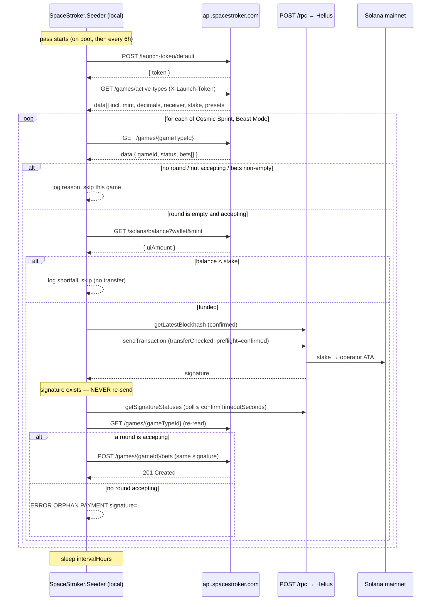

# Space Stroker — "Auto Bet Seeder" — Implementation Spec

> **Status: Shipped** — merged to `main` on **2026-07-28** from `feature/auto-bet-seeder`
> (`monkify-meta` only). Refined via Trello card
> [#113 Setup a console app to automatically add 1 bet in beast mode & cosmit sprint](https://trello.com/c/AhRfdxga)
> (2026-07-28).
>
> ⚠️ **Shipped without a live run.** `constraints.md` §5 forbids an agent pointing this at production,
> and the transfer path cannot be exercised locally without a funded wallet, so the on-chain half is
> **correct-by-construction but behaviourally unverified**: the `TransferChecked` instruction shape,
> the `preflightCommitment: Confirmed` fix, the `getSignatureStatuses` poll, and the JSON field
> mappings. What *was* verified by execution: the Solnet 6.1.0 signatures and the base58 keypair
> round-trip (reflection probes), the 94 unit tests, both fail-fast config paths, and the gitignore
> rules. Nothing in the product depends on this tool, so a wire-format mistake is a follow-up card,
> not a rollback. **Run it first with a wallet holding roughly one stake plus a little SOL.**
> Repos affected: **`monkify-meta` only** (this doc + a new console app under `deploy/tools/`).
> `monkify-backend` and `monkify-front` are **not touched**.
>
> **Purpose:** on production, **Cosmic Sprint** and **Beast Mode** frequently sit at zero bets, and an
> empty round reads as a dead game — nobody wants to be the first one in when
> `MinimumNumberOfPlayers` is 2. A small console app, run locally by the operator, places **one real
> paid bet** into whichever of those two rounds is empty, then rechecks every 6 hours.

---

## 1. Summary

A new .NET 8 console app, **`SpaceStroker.Seeder`** (assembly `spacestroker-seeder`), joins the
existing local operator tooling in `monkify-meta/deploy/tools/`. It is a **pure client** of
already-shipped public API endpoints — it adds no backend, frontend, database, API, SignalR or
game-flow code, and is never deployed to a server.

One **seeding pass** does this, per target game, sequentially:

| Step | Action | Skip / stop condition |
| --- | --- | --- |
| 1 | Mint a launch token (`POST /launch-token/default`) | mint fails ⇒ abort the pass |
| 2 | Resolve the game type **by name** (`GET /games/active-types`) | name absent, or not `SolanaToken` ⇒ skip game |
| 3 | Read the current round (`GET /games/{gameTypeId}`) | no active round; status ∉ {`WaitingBets`, `GameStarting`}; **≥ 1 bet already** ⇒ skip game |
| 4 | Read the wallet's token balance (`GET /solana/balance`) | balance < `RequiredAmount` ⇒ skip game |
| 5 | Pick a valid choice | preset list empty for a preset game ⇒ skip game |
| 6 | Build + sign + send the SPL `transferChecked` (via `POST /rpc`) | send fails ⇒ skip game (no signature exists ⇒ safe) |
| 7 | Confirm the signature (`getSignatureStatuses` poll) | **never re-sends** — poll only |
| 8 | Re-read the current round, then `POST /games/{gameId}/bets` | no round accepting bets ⇒ log the **orphan signature** at error |

The pass runs **immediately on start**, then every **6 hours**, until the process is stopped.

**What makes it self-limiting:** the app's own bet from an earlier pass counts as a bet at step 3, so
the next pass skips that game. At most **one** outstanding seeded bet exists per game at any time,
with no state file and no bookkeeping.

**What it deliberately does not do:** it never places a second bet to make the round actually *start*
(that needs a second distinct wallet), and it never refunds a stranded bet.

---

## 2. Constraints (MANDATORY)

From `monkify-meta/constraints.md` (full list there):

- **Worktree-per-repo (§2):** `feature/auto-bet-seeder`, worktree at
  `.worktrees/auto-bet-seeder/monkify-meta`. The `monkify-meta` hub stays on `main`. Only one repo is
  affected, so only one worktree exists.
- **Secrets (§1):** only `deploy/secrets.seeder.example.json` — with obvious placeholders — is
  committed. The real `deploy/secrets.seeder.json` is gitignored. **No agent ever writes, prints,
  logs or commits a real wallet private key.** The app must never hold the Main operator's RS256
  signing key.
- **Production data (§5):** an agent must **not** run this app against production, place a
  production bet, or read production data. Running it is an **operator step for the user**. Build,
  `dotnet test` and a dry-run against a local stack are the only agent-side verification.
- **Vague operator messaging (§6):** the app logs whatever the API returned. It never infers or
  reports operator contract state.
- **Scope (§8):** new project confined to `deploy/tools/`; no refactoring of `SpaceStroker.Deploy`,
  `SpaceStroker.DbConsole`, or anything in `monkify-backend` / `monkify-front`.
- **Tests (§3):** card **Level = `Minor change`** ⇒ **no** `SpaceStroker.Tests.Integration` test and
  **no** `features/auto-bet-seeder.md` doc. Unit tests on the pure decision logic are still required,
  and the added tests are reported at the end of implementation.
- **`AGENTS.md` rule 5:** push `feature/auto-bet-seeder` to `origin` immediately after any commit.

---

## 3. Resolved product decisions

Decisions 1–14 come from the refined card. Decisions 15–18 are **spec-level** resolutions of gaps the
card did not reach; each states why.

| # | Decision |
| --- | --- |
| 1 | **Target = production.** `https://api.spacestroker.com`, the **Main** operator, the real mainnet registered token. Every bet is real money committed on-chain. |
| 2 | **Home = `monkify-meta/deploy/tools/SpaceStroker.Seeder`**, added to the existing `SpaceStroker.DeployTools.sln`. Never deployed to a server. |
| 3 | **Targets = "Cosmic Sprint" and "Beast Mode" only.** Space Jackpot is deliberately excluded. The two names are **compile-time constants** (the card rejected a configurable list), but the `gameTypeId`, mint, decimals, stake, choice rules and preset choices are all **resolved at runtime** — never hardcoded. |
| 4 | **One bet per empty round.** Never two; the round is not made to start. |
| 5 | **Self-limiting:** the app's own prior bet makes the round non-empty, so no stacking. No state file. |
| 6 | **Cadence:** long-running process, pass on start then every 6h. Reboot stops seeding until restarted — accepted. |
| 7 | **Auth = launch token only** (`POST /launch-token/default`). No admin token, no operator signing key. |
| 8 | **Chain = the API's `POST /rpc` proxy**, using only `getLatestBlockhash`, `sendTransaction`, `getSignatureStatuses`. **The allow-list is not widened.** |
| 9 | **Balance = `GET /solana/balance`** (cached ~10s). The `/balance/live` route is **not** used — a 6-hourly pre-flight has no staleness problem and that route carries the tightest rate rule (20/min). |
| 10 | **Key storage = unversioned `deploy/secrets.seeder.json`**, template `deploy/secrets.seeder.example.json`. |
| 11 | **Bet identity = an ordinary-looking display name** from config. |
| 12 | **Failure = bounded jittered retry inside the pass**, then wait for the next tick. The process never exits on a failed pass. |
| 13 | **Retry is phase-aware.** Free retries before the transfer; **once a signature exists it is never re-sent** — poll `getSignatureStatuses`, then POST with that same signature. |
| 14 | **Choices:** Cosmic Sprint → a random 6-character lowercase-letter sequence; Beast Mode → a random entry from the type's `presetChoices` as returned by the API. |
| 15 | **Spec decision — a confirmed stake is always spent if it can be.** After confirmation the app re-reads the round; if the round **rolled over**, it POSTs into whichever round is **currently accepting bets**, even if that round is no longer empty. Rationale: the payment signature is not bound to a `gameId`, so refusing to bet would strand tokens the wallet has already lost for no gain. Emptiness gates **whether we pay**, not **where an already-paid stake lands**. Only when *no* round is accepting does the app log the orphan signature. |
| 16 | **Spec decision — the launch token is re-minted every pass.** `LaunchTokens.MainTokenTtlSeconds` is **3600** (1 hour) and the interval is 6 hours, so a cached token is always expired by the next pass. Minting is one unauthenticated call; there is no refresh flow to build. |
| 17 | **Spec decision — no ATA creation instruction.** Both token accounts are associated token accounts that must already exist: the destination is the operator's, which receives every player's bet, and the source is the seeder wallet's, which must already hold the token to bet at all. Solnet 6.1.0 has no *idempotent* ATA-create instruction, and creating a non-idempotent one would fail on an existing account. The app derives both ATAs locally (pure PDA maths, **zero RPC**) and sends a single `TransferChecked`. A missing source ATA surfaces as a zero balance at step 4 and skips the game. |
| 18 | **Spec decision — provably-fair fields.** `Seed` is generated as `HMAC-SHA256(clientSeed, nonce)` hex (exactly 64 chars, matching the `[MaxLength(64)]` contract) from a random 32-byte client seed created **once per process**, with `Nonce` incrementing per bet. This mirrors the shipped Stake-style client-seed model (`features/provably-fair.md`) rather than sending an arbitrary random string. The client seed is not persisted — verification of a seeded bet is possible within a process run, which is all this tool needs. |

---

## 4. Data model

**Not applicable.** No entity, column, EF mapping, migration or `SpaceStrokerDbContext` change. The
app owns no database and no persistent state whatsoever — every decision is derived from the API on
each pass.

---

## 5. Configuration

### 5.1 `deploy/secrets.seeder.json` (unversioned — real values, never committed)

```jsonc
{
  "apiBaseUrl": "https://api.spacestroker.com",
  "walletPrivateKeyBase58": "<the seeder wallet's base58 secret key>",
  "displayName": "Edson",
  "intervalHours": 6,
  "retryAttempts": 3,
  "retryBaseDelaySeconds": 5,
  "confirmTimeoutSeconds": 90
}
```

### 5.2 `deploy/secrets.seeder.example.json` (committed — placeholders ONLY)

```jsonc
{
  // The Space Stroker API. Production: https://api.spacestroker.com
  "apiBaseUrl": "https://api.spacestroker.com",

  // Base58 secret key of the wallet that places the seeded bets.
  // MUST NOT be the operator's token-owner / treasury wallet — see spec §6.1.
  // Needs the game token for the stakes and a little SOL for transaction fees.
  "walletPrivateKeyBase58": "REPLACE_ME",

  // Display name shown next to the seeded bet in the recent-bets feed and history.
  "displayName": "REPLACE_ME",

  // Hours between seeding passes. The first pass runs immediately on start.
  "intervalHours": 6,

  // Bounded retry inside a pass, for transient failures BEFORE any transfer is sent.
  "retryAttempts": 3,
  "retryBaseDelaySeconds": 5,

  // How long to poll getSignatureStatuses for a sent transfer before giving up.
  "confirmTimeoutSeconds": 90
}
```

### 5.3 Loading and validation (`SeederConfig.Load`)

Mirrors `SpaceStroker.Deploy/SecretsFile.cs` — same `JsonSerializerOptions`
(`PropertyNameCaseInsensitive`, `ReadCommentHandling.Skip`, `AllowTrailingCommas`), same fail-fast
style with a `SeederException`.

Fail fast, before anything else runs, when:

- the file is missing → *"Copy deploy/secrets.seeder.example.json and fill it in."*
- `apiBaseUrl` is blank or not an absolute `http`/`https` URI
- `walletPrivateKeyBase58` is blank or still `REPLACE_ME`
- `walletPrivateKeyBase58` does not decode to a valid Solana keypair
- `displayName` is blank or still `REPLACE_ME`
- `intervalHours` ≤ 0, `retryAttempts` < 0, `retryBaseDelaySeconds` ≤ 0, `confirmTimeoutSeconds` ≤ 0

**The parsed key is never logged, never included in an exception message, and never echoed.** Only
the derived **public** key is ever printed.

### 5.4 `deploy/.gitignore`

Already ignores `secrets*.json` at any depth (pattern has no slash) with one negation for
`secrets.example.json`. Add a second negation so the new template is trackable:

```gitignore
secrets*.json
!secrets.example.json
!secrets.seeder.example.json
```

`deploy/secrets.seeder.json` is then ignored by the existing rule with no further change.

---

## 6. App behaviour

### 6.1 Startup (once, before the first pass)

1. Load and validate config (§5.3). Derive the wallet's public key.
2. Print a banner: API base URL, wallet **public** key, display name, interval, the two target game
   names.
3. Resolve the game types once (§6.3 steps 1–2) and run the **treasury guard**:

   > **Fail fast and exit** if the configured wallet's public key equals **any** target type's
   > `tokenReceiverPublicKey`.

   **Why this is fatal rather than a skip.** `SolanaService.ValidateBetPayment` matches the
   pre/post token balances by **owner** — `token.TokenOwnerPublicKey` for the recipient side and
   `bet.Wallet` for the sender side (`SolanaService.cs:381-416`). When both are the same wallet, both
   lookups resolve to the *same* balance entry, the computed delta is **0**, and the bet is rejected
   as having sent fewer tokens than declared — after the transfer has already confirmed on chain. The
   transfer itself is a self-transfer no-op, so this fails silently and repeatedly.
   (Recorded previously as memory `prod-bet-from-treasury-wallet`.)

### 6.2 The loop

`Program.cs` runs: pass → wait `intervalHours` → pass → … with a `CancellationTokenSource` wired to
`Console.CancelKeyPress` and `AppDomain.ProcessExit` so `Ctrl+C` ends the current wait cleanly.

**A pass never throws out of the loop.** Any unhandled exception inside a pass is caught, logged with
its stack trace, and the loop proceeds to the next wait.

### 6.3 One seeding pass

Per pass, once:

1. **Mint a launch token** — `POST /launch-token/default`, no auth, no body.
   Response is **bare** `{ "token": "..." }` — `LaunchController` extends `ControllerBase`, not
   `BaseController`, so this response is **not** wrapped in `ApiResult`. A failure here aborts the
   whole pass (nothing else can be read without it).
2. **Resolve both game types** — `GET /games/active-types` with `X-Launch-Token`.
   Response **is** wrapped: `{ "data": [ GameParametersDto, … ], "messages": [] }`.
   Match `name` **case-insensitively** against the two constants. For each match, require
   `paymentMethod == 1` (`SolanaToken`) and non-null `tokenMintAddress`, `tokenDecimals`,
   `tokenReceiverPublicKey`; otherwise log and skip that game.

Then, per target game, independently — **a failure on the first game must not skip the second**:

3. **Read the current round** — `GET /games/{gameTypeId}` with `X-Launch-Token`.
   Response wrapped: `{ "data": ActiveGameDto, "messages": [] }`; `data` is `null` with a **404** when
   there is no active round. Skip the game when:
   - `data` is null (no active round), or
   - `status` ∉ { `1` `WaitingBets`, `2` `GameStarting` }, or
   - `bets` is non-empty — **the emptiness check**.

   Each skip is logged with its reason and the observed status.
4. **Pre-flight the balance** — `GET /solana/balance?wallet={pubkey}&mint={tokenMintAddress}`.
   No launch token (the route is outside `ProtectedPrefixes`). **Send no `Origin` header** — a
   console app has none, and `OriginAllowList.IsAllowed` returns `true` for an absent Origin. Response
   wrapped: `{ "data": { wallet, mint, uiAmount, rawAmount, decimals }, "messages": [] }`.
   If `uiAmount < requiredAmount`, log the shortfall and skip — **no transfer is attempted**.
5. **Pick a choice** (§6.4).
6. **Pay** (§6.5) → a confirmed payment signature.
7. **Place the bet** (§6.6).

### 6.4 Choice selection (`ChoicePicker` — pure, unit-tested)

Inputs: `presetChoices`, `allowedCharacters` (`GameCharacterType`: 1 = `Number`, 2 = `Letters`,
3 = `NumbersAndLetters`), `choiceRequiredLength`, `acceptDuplicatedCharacters`, and an injected
`Random`.

- **Preset game** (`presetChoices` non-empty) → return a uniformly random entry **verbatim**. Never
  synthesize a beast name; the list is whatever the API returned.
- **Free-text game** → build a string of exactly `choiceRequiredLength` characters from the charset
  for `allowedCharacters`. When `acceptDuplicatedCharacters` is `false`, generate without repeats.

Charsets mirror `GameCharacterType`'s `[Description]` values exactly and are **lowercase-only**:

| Value | Characters |
| --- | --- |
| `1` Number | `0123456789` |
| `2` Letters | `abcdefghijklmnopqrstuvwxyz` |
| `3` NumbersAndLetters | `abcdefghijklmnopqrstuvwxyz0123456789` |

> ⚠️ **Uppercase is rejected, not lowercased.** Since `specs/bet-choice-casing.md` the backend
> refuses any character outside the pool as `InvalidCharacters`. The picker must never uppercase, and
> the choice must never be title-cased for display.

An unknown `allowedCharacters` value is an error for that game (log + skip), **not** a silent
fallback to charset 3 — a wrong charset produces a bet the backend rejects after payment.

### 6.5 Paying the stake (`SolanaTransferClient`)

Uses **Solnet 6.1.0** (`Solnet.Rpc`, `Solnet.Wallet`, `Solnet.Programs` — the same versions
`SpaceStroker.Infrastructure` already depends on), pointed at **`{apiBaseUrl}/rpc`**.

1. Derive both associated token accounts locally — `AssociatedTokenAccountProgram
   .DeriveAssociatedTokenAccount(owner, mint)`. **Zero RPC calls.**
   - source = `derive(seederWallet, mint)`
   - destination = `derive(tokenReceiverPublicKey, mint)`
   Deriving the destination from the **owner** is correct: validation matches on owner, not on a
   specific account (§6.1), and it is exactly what the frontend does.
2. Compute the raw amount as an **integer**: `requiredAmount × 10^tokenDecimals`, using `decimal`
   maths and a checked conversion to `ulong`. Never `Math.Pow` on a `double` — that routes a money
   value through binary floating point.
3. `getLatestBlockhash` at **`Commitment.Confirmed`**.
4. Build one `TransactionBuilder` with a single
   `TokenProgram.TransferChecked(source, destination, rawAmount, decimals, authority: seederWallet,
   mint)` instruction, fee payer = the seeder wallet, and sign it.
5. `sendTransaction` with **`preflightCommitment: Commitment.Confirmed`**.

   > ⚠️ **Known blocker — do not leave this at the default.** Solnet's `SendTransactionAsync`
   > defaults `preflightCommitment` to `Finalized`. A blockhash fetched at `Confirmed` is not yet
   > visible to a finalized-commitment preflight, so the send fails with a blockhash-not-found error.
   > `specs/solana-connection-rpc.md` hit exactly this on the frontend and fixed it the same way.

6. **Confirm** by polling `getSignatureStatuses` for that signature at ~1s intervals until
   `confirmationStatus` reaches `confirmed`/`finalized`, or `confirmTimeoutSeconds` elapses.

> ⚠️ **`/rpc` rejects JSON-RPC batch arrays** — `RpcController` requires a single request **object**
> with a string `method` and 400s on anything else. Solnet's per-method calls are all single
> requests; do **not** use any batching API.

**Rate budget.** One pass costs at most: 1 `/launch-token/default` + 1 `/games/active-types` +
2 `/games/{id}` (+2 re-reads) + 2 `/solana/balance` + 2 `getLatestBlockhash` + 2 `sendTransaction` +
~180 `getSignatureStatuses` + 2 `POST /bets`. Against `*:/rpc` 240/min, `*:/solana/*` 120/min and
Cloud Armor's 600/60s per IP, a once-per-6h pass is far inside every bucket.

### 6.6 Placing the bet

1. **Re-read** `GET /games/{gameTypeId}`. Per decision 15:
   - a round is accepting bets → POST into **that** round's `gameId`, even if it is a different round
     than the one seen at step 3 and even if it now has bets;
   - no round is accepting → **do not** POST. Log at **error**: the payment signature, the seeder
     wallet, the game name and the amount, so the stranded stake can be reconciled by hand.
2. `POST /games/{gameId}/bets` with `X-Launch-Token` and body `RegisterBetRequestBody`:

   | Field | Value |
   | --- | --- |
   | `PaymentSignature` | the confirmed transfer signature |
   | `Wallet` | the seeder wallet's base58 public key |
   | `ExternalPlayerId` | `null` — crypto identity is the wallet |
   | `DisplayName` | `displayName` from config |
   | `Amount` | `requiredAmount` (decimal, exact) |
   | `Choice` | the picked choice |
   | `Seed` | `HMAC-SHA256(clientSeed, nonce)` as lowercase hex — exactly 64 chars |
   | `Nonce` | incrementing counter, starts at 0 |

3. **Success** is `201`. Log the game, choice, amount, signature and `gameId`.
4. **Failure** returns `400` with the envelope's `messages` populated (`ApiResult<T>.Messages`). Log
   every message verbatim — they are the vague, operator-safe strings and must not be reinterpreted.
   Then apply §6.7.

### 6.7 Retry (`RetrySchedule` + `RetryPhase` — pure, unit-tested)

Two phases, and the boundary is the moment a transfer signature exists.

| Phase | Covers | Retry policy |
| --- | --- | --- |
| **`PreSend`** | token mint, active-types, active-round read, balance read, `getLatestBlockhash` | Up to `retryAttempts` retries on a **transient** failure, delays `retryBaseDelaySeconds × 2^n` with **±20% jitter**. Give up ⇒ skip the game, wait for the next tick. |
| **`PostSend`** | everything after `sendTransaction` returned a signature | **The transfer is NEVER re-sent.** Only `getSignatureStatuses` (bounded by `confirmTimeoutSeconds`) and the bet POST (retried with the **same** signature) may repeat. |

**Transient** = no HTTP response at all (connection reset, DNS, timeout), or `408`, `429`, or `5xx`.
Everything else — including a `400` carrying validation messages — is **terminal** for that game.

> A Cloud Armor denial reaches a console app as a plain `429`; the CORS-invisibility that made
> `specs/entry-path-recovery.md` hard applies to browsers, not to this client. Both cases are covered
> by the definition above.

Retrying the bet POST is safe: a reused signature is rejected by `RegisterBetHandler` as
`PaymentSignatureHasBeenUsed`, so the worst case is a rejection — **never a double stake**.

### 6.8 Logging

Console only (`stdout`), one line per event, timestamped `yyyy-MM-dd HH:mm:ss`. No log file, no
telemetry, no external calls. Levels are a prefix (`INFO` / `WARN` / `ERROR`).

**Never logged:** the wallet private key, the launch token, the RPC upstream URL (the app only ever
knows `{apiBaseUrl}/rpc`, which carries no key).

These conditions get distinguishable, greppable messages so the log alone diagnoses them:

| Condition | Message shape |
| --- | --- |
| Out of SOL for fees | `ERROR … send failed — the seeder wallet may be out of SOL for transaction fees` |
| Insufficient token balance | `WARN … balance {x} < stake {y} — skipping` |
| Round not empty | `INFO … already has {n} bet(s) — skipping` |
| Round not accepting | `INFO … status {s} is not accepting bets — skipping` |
| Orphan signature | `ERROR ORPHAN PAYMENT … signature={sig} wallet={pk} game={name} amount={x}` |

---

## 7. Frontend behaviour

**None.** No `monkify-front` file changes. The seeded bet reaches players through paths that already
exist and are unaware of it: the `{gameId}/Bets` SignalR feed, the `> POT:` line, the Games History
page and the STATS tiles. It renders exactly like any other player's paid bet.

---

## 8. Flow diagram



---

## 9. Out of scope

- **Space Jackpot** (the 24h lottery) — deliberately not seeded.
- Making a round actually **start** (needs a second distinct wallet — rejected on the card).
- Any automated refund or bail-out of a stranded seeded bet. Recovery stays the manual operator-admin
  `POST /admin/bets/refund { paymentSignature }`, which moves money on the next 12h
  `PendingRefundSweepJob` pass (`features/refund-safeguards.md`).
- Any `monkify-backend` / `monkify-front` / Terraform change. **In particular, the `/rpc` method
  allow-list is not widened** — it was deliberately narrowed 7 → 3 by `frontend-helius-gateway`.
- Adding a `/dev/*` endpoint for this (those are non-production only).
- Deploying or hosting the app (Cloud Run, VM, Windows service). It runs by hand on the operator's
  machine.
- Local/dev/devnet targeting — the `fill-crypto-clash` skill already covers that need.
- Any change to game seeding, stakes or `MinimumNumberOfPlayers`.
- A `features/auto-bet-seeder.md` KB doc and a `SpaceStroker.Tests.Integration` test — both waived by
  the card's `Minor change` level.

---

## 10. File checklist

### 10.1 Backend (`monkify-backend`)

**No files.** Zero changes — pinned by acceptance criterion 16.

### 10.2 Frontend (`monkify-front`)

**No files.** Zero changes — pinned by acceptance criterion 16.

### 10.3 Meta (`monkify-meta`)

| # | File | Change |
| --- | --- | --- |
| 1 | `deploy/tools/SpaceStroker.Seeder/SpaceStroker.Seeder.csproj` | **New.** net8.0 exe, `AssemblyName` `spacestroker-seeder`, nullable + implicit usings on, `InvariantGlobalization`; `PackageReference` Solnet.Rpc / Solnet.Wallet / Solnet.Programs `6.1.0` |
| 2 | `deploy/tools/SpaceStroker.Seeder/Program.cs` | **New.** Entry point: load config, startup guard, the pass→wait loop, `Ctrl+C` cancellation, top-level catch so a pass never kills the loop |
| 3 | `deploy/tools/SpaceStroker.Seeder/SeederConfig.cs` | **New.** Config record + `Load(path)` with the §5.3 fail-fast validation; `SeederException` |
| 4 | `deploy/tools/SpaceStroker.Seeder/SpaceStrokerApiClient.cs` | **New.** Typed `HttpClient`: `MintLaunchTokenAsync`, `GetActiveTypesAsync`, `GetActiveGameAsync`, `GetTokenBalanceAsync`, `PostBetAsync`. Unwraps `ApiResult<T>`; surfaces `messages` on failure; sends **no** `Origin` header |
| 5 | `deploy/tools/SpaceStroker.Seeder/ApiContracts.cs` | **New.** DTO records mirroring `GameParametersDto`, `ActiveGameDto`/`BetDto`, `TokenBalanceDto`, `RegisterBetRequestBody`, `ApiResult<T>` |
| 6 | `deploy/tools/SpaceStroker.Seeder/SeedDecision.cs` | **New. Pure.** `Evaluate(GameParametersDto?, ActiveGameDto?, decimal balance) → SeedVerdict(bool ShouldSeed, string Reason)` — the whole skip ladder in one testable function |
| 7 | `deploy/tools/SpaceStroker.Seeder/ChoicePicker.cs` | **New. Pure.** §6.4, with an injected `Random` |
| 8 | `deploy/tools/SpaceStroker.Seeder/RetrySchedule.cs` | **New. Pure.** `RetryPhase` enum, `IsTransient(...)`, and the jittered delay schedule |
| 9 | `deploy/tools/SpaceStroker.Seeder/SolanaTransferClient.cs` | **New.** §6.5 — ATA derivation, raw-amount maths, build/sign/send at `Confirmed`, `getSignatureStatuses` poll |
| 10 | `deploy/tools/SpaceStroker.Seeder/BetSeeds.cs` | **New. Pure.** §6.6 seed/nonce generation (`HMAC-SHA256(clientSeed, nonce)` → 64-char hex) |
| 11 | `deploy/tools/SpaceStroker.Seeder/SeedingPass.cs` | **New.** Orchestrates §6.3 per game; never throws out |
| 12 | `deploy/tools/SpaceStroker.Seeder/Log.cs` | **New.** §6.8 timestamped console logging |
| 13 | `deploy/tools/SpaceStroker.Seeder.Tests/SpaceStroker.Seeder.Tests.csproj` | **New.** xunit 2.4.2 + Shouldly 4.2.1 + Test.Sdk 17.6.0, mirroring `SpaceStroker.Deploy.Tests.csproj`; `ProjectReference` to the seeder |
| 14 | `deploy/tools/SpaceStroker.Seeder.Tests/SeedDecisionTests.cs` | **New.** §11 |
| 15 | `deploy/tools/SpaceStroker.Seeder.Tests/ChoicePickerTests.cs` | **New.** §11 |
| 16 | `deploy/tools/SpaceStroker.Seeder.Tests/RetryScheduleTests.cs` | **New.** §11 |
| 17 | `deploy/tools/SpaceStroker.Seeder.Tests/SeederConfigTests.cs` | **New.** §11 |
| 18 | `deploy/tools/SpaceStroker.Seeder.Tests/BetSeedsTests.cs` | **New.** §11 |
| 19 | `deploy/tools/SpaceStroker.DeployTools.sln` | Add both new projects (`{A1B2C3D4-0004-…}` / `{A1B2C3D4-0005-…}`, following the existing GUID convention) with Debug/Release configs |
| 20 | `deploy/secrets.seeder.example.json` | **New.** §5.2 — placeholders only |
| 21 | `deploy/.gitignore` | Add `!secrets.seeder.example.json` (§5.4) |
| 22 | `deploy/README.md` | New section: what the seeder is, how to configure and run it, the treasury-wallet warning, and that a stranded bet is recovered via `POST /admin/bets/refund` |
| 23 | `specs/auto-bet-seeder.md` | **This spec.** |
| 24 | `INDEX.md` | Spec row + "Feature currently in flight" |

---

## 11. Unit tests

Project: **`monkify-meta/deploy/tools/SpaceStroker.Seeder.Tests`** (xUnit + Shouldly, matching
`SpaceStroker.Deploy.Tests`). **No network and no chain access in any test** — every covered function
is pure.

| Test file | Test cases | Expected |
| --- | --- | --- |
| `SeedDecisionTests` | round is `WaitingBets` with zero bets and a sufficient balance | `ShouldSeed == true` |
| | round is `GameStarting` with zero bets | `true` (still accepting) |
| | round has 1 bet / many bets | `false`, reason names the bet count |
| | status `InProgress` (3), `Ended` (4), `RewardForWinnersCompleted` | `false`, reason names the status |
| | active game is `null` (404) | `false`, reason "no active round" |
| | balance < `requiredAmount` (incl. exact-boundary `balance == stake` ⇒ seed) | `false` below, `true` at equality |
| | `paymentMethod != SolanaToken` | `false`, reason names the payment method |
| | game type not found by name | `false`, reason names the missing type |
| `ChoicePickerTests` | preset game | result is always a member of `presetChoices`, verbatim |
| | preset list empty on a preset game | throws / returns a skip result, never fabricates a choice |
| | free-text, `Letters`, length 6, duplicates allowed | length 6, all chars in `a-z`, **no uppercase** |
| | free-text, `Number` / `NumbersAndLetters` | chars confined to the right pool |
| | `acceptDuplicatedCharacters == false` | no repeated character |
| | unknown `allowedCharacters` value | error, **not** a silent fallback to charset 3 |
| | seeded `Random` | deterministic output for a fixed seed |
| `RetryScheduleTests` | `IsTransient`: no response, 408, 429, 500, 502, 503 | `true` |
| | `IsTransient`: 400, 401, 403, 404 | `false` |
| | delays for `retryAttempts = 3`, base 5 | 3 delays, exponential, each within ±20% of 5/10/20s |
| | jitter | two schedules from different seeds differ; every value stays in bounds |
| | `RetryPhase.PostSend` | the transfer step is **not** retryable — pinned by an explicit assertion |
| `SeederConfigTests` | valid file | parses; every field lands |
| | missing file | throws with the "copy the example" guidance |
| | `walletPrivateKeyBase58` = `REPLACE_ME` / blank / undecodable | throws |
| | `displayName` = `REPLACE_ME` | throws |
| | `intervalHours` ≤ 0, `retryAttempts` < 0, `confirmTimeoutSeconds` ≤ 0 | throws |
| | comments + trailing commas in the JSON | parses (matching `SecretsFile.JsonOpts`) |
| | **no exception message contains the key** | asserted explicitly |
| `BetSeedsTests` | generated seed | exactly 64 chars, lowercase hex |
| | same client seed + same nonce | identical seed (deterministic) |
| | same client seed + different nonce | different seed |

---

## 12. Acceptance criteria

Copied 1:1 from the Trello **Acceptance Criteria** checklist (17 items).

1. Given the app is started with a valid config, when it boots, then it immediately runs one seeding pass and afterwards runs one pass every 6 hours until stopped.
2. Given a seeding pass runs, when it resolves its targets, then it finds "Cosmic Sprint" and "Beast Mode" by NAME from `GET /games/active-types` and never uses a hardcoded `gameTypeId`, mint address, decimals, stake, choice length or preset choice list.
3. Given a target game whose current round is `WaitingBets` or `GameStarting` and has zero bets, when a pass runs, then the app transfers exactly `RequiredAmount` of the game's token on-chain and POSTs exactly one bet carrying that payment signature.
4. Given a target game whose current round already has at least one bet (including the app's own bet from an earlier pass), when a pass runs, then no bet is placed for that game and the skip is logged with the reason.
5. Given a target game whose current round is `InProgress`, `Ended`, or any other non-betting status, when a pass runs, then no bet is placed and the skip is logged with the observed status.
6. Given Beast Mode is the target, when the app picks a choice, then it is one of the `presetChoices` returned by the API; given Cosmic Sprint is the target, then the choice is a randomly generated 6-character lowercase-letter sequence.
7. Given the app needs chain access, when it builds, sends and confirms the stake transfer, then every JSON-RPC call goes through the API's `POST /rpc` proxy and uses only `getLatestBlockhash`, `sendTransaction` and `getSignatureStatuses` — the allow-list is not widened.
8. Given the app authenticates, when it calls the launch-token-protected endpoints, then it uses only a token minted by `POST /launch-token/default` and never holds, signs with, or requires the Main operator's signing key or an admin token.
9. Given the configured bot wallet equals the game type's `tokenReceiverPublicKey` (the operator/treasury wallet), when the app starts, then it fails fast with a clear error and places no bet — because a same-ATA SPL transfer confirms as a no-op and the bet would be rejected as underpaid.
10. Given the bot wallet's token balance read from `GET /solana/balance` is below the game's `RequiredAmount`, when a pass runs, then the app logs the shortfall, places no bet, and attempts no on-chain transfer.
11. Given a transient failure occurs BEFORE any transfer signature exists, when the app retries, then it retries a bounded number of times with jitter within the same pass and gives up to the next 6h tick without crashing the process.
12. Given a transfer signature already exists, when anything afterwards fails or times out, then the app NEVER re-sends the transfer — it polls `getSignatureStatuses` for that exact signature and retries only the bet POST with the same signature, so no pass can ever spend two stakes for one bet.
13. Given the stake transfer confirmed but the bet POST is ultimately rejected, when the pass ends, then the payment signature, wallet, game and amount are logged at error level so the stranded tokens can be reconciled by hand.
14. Given both target games are empty in the same pass, when the first one fails for any reason, then the app still attempts the second one.
15. Given the repository is inspected after the work, when the committed files are read, then only `secrets.example.json` exists with obvious placeholder values, the real secrets file is gitignored, and no wallet private key or RPC key appears in any committed file or log line.
16. Given the work is complete, when `monkify-backend` and `monkify-front` are diffed against `main`, then neither repo has a single changed file — all changes live in `monkify-meta/deploy/tools` plus the deploy README and `.gitignore`.
17. Given the decision logic (is-this-game-seedable, choice selection, retry-phase gating), when the test suite runs, then it is covered by unit tests in the existing `SpaceStroker.Deploy.Tests` style with no network or chain access, and the added tests are reported at the end of the work.

> Criterion 15 reads "only `secrets.example.json`" from the card; this spec adds a **second**
> committed template, `secrets.seeder.example.json` (§5.2). The criterion's intent — *no real secret
> is ever committed* — is unchanged and still binding. Read it as "only `*.example.json` templates".

---

## 13. Manual QA

An agent must **not** run steps 4–6 (production money — `constraints.md` §5). They are operator
steps for the user.

**Agent-side (safe):**

1. `dotnet build deploy/tools/SpaceStroker.DeployTools.sln` — the two new projects compile and the
   existing three still do.
2. `dotnet test deploy/tools/SpaceStroker.Seeder.Tests` — green; report the added tests.
3. Point `apiBaseUrl` at a **local** stack (`http://localhost:6001`) with a throwaway devnet wallet
   and confirm the skip ladder logs correctly (no active round / not accepting / already has bets /
   balance too low). The local stack seeds the same catalogue, so both game names resolve.

**Operator-side (production, by the user):**

4. Fund the seeder wallet with the game token and a little SOL. Confirm it is **not** the token-owner
   wallet.
5. Run `spacestroker-seeder`. On a round that is genuinely empty, confirm the bet appears in the
   live bets feed and on the Games History page with the configured display name.
6. Leave it running through one 6h tick and confirm the second pass **skips** both games (its own bet
   now makes each round non-empty).

---

## 14. Trello / pipeline

- **Source card:** [#113](https://trello.com/c/AhRfdxga) — list **Specs created**; the
  **Implementation** section on the card carries branch, worktree, spec path and level.
- **Level:** `Minor change` ⇒ no integration test, no `features/` doc.
- **Next:** `/monkify-implement-feature` to build it, then `/monkify-ship-feature` to sync the KB and
  merge to `main`.

---

## 15. Revision log

| Date | Change |
| --- | --- |
| 2026-07-28 | Initial spec from refined card #113, with code exploration against `monkify-backend` `main` (`GameParametersDto`, `LaunchController`, `RpcProxyOptions`, `SolanaController`, `OriginAllowList`, `SolanaService.ValidateBetPayment`, `RegisterBetRequestBody`, `ApiResult<T>`, `IpRateLimiting`). |
