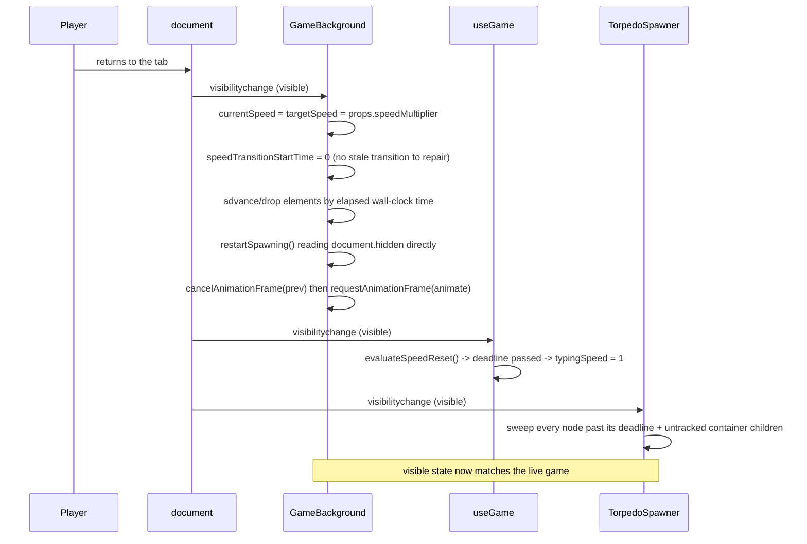

# Space Stroker — "Background & Game Display Lifecycle Hardening" — Implementation Spec

> **Status: Ready for implementation** — refined via Trello card
> [background and game display get really bugged](https://trello.com/c/No2Z0NMP) (2026-08-09).
> Repos affected: `monkify-front` and this doc in `monkify-meta`. **No backend change.**
>
> **Purpose:** Stop the game screen from degrading into a broken, laggy visual state when a player
> switches Chrome tabs while rounds roll over — and, on top of the correctness fixes, lower the
> baseline cost of the starfield for **every** player behind a single density constant that a future
> user-facing slider can drive.

---

## 1. Summary

Two unrelated symptom families were reported on one card, plus one scope addition made during
refinement:

| # | Symptom | Root cause family |
| --- | --- | --- |
| A | Backdrop looks wrong ("many BGs"), no new starfield elements spawn, the screen stays laggy across rounds, typing speed never returns to normal | **The animation layer trusts `setTimeout` and in-flight transitions across tab hide/show.** Chrome throttles (and eventually freezes) timers in hidden tabs, so every deadline expressed as a timer is unreliable. |
| B | The game terminal scrolls **horizontally** | Unrelated: a plain `overflow-auto` (both axes) on the terminal form, combined with post-round content that cannot wrap. |
| C | *(scope added in refinement)* The starfield is too expensive for everyone, not just weak renderers | Today the only relief valve is the automatic **light graphics mode** (`features/light-graphics-mode.md`), which is all-or-nothing and never applies to a healthy desktop GPU. |

**Level: bug fix + QOL tweak — NOT a new feature.** `AGENTS.md` rule 8 (mandatory backend
integration test) does **not** apply, and there is no backend surface to test. `monkify-front` has no
test suite, so verification is the manual QA in §13 against the acceptance criteria in §12.

### 1.1 The six confirmed defects

Line references are **pre-fix**, verified against `monkify-front@main` (74c3dbe) while writing this
spec.

| # | File:line | Defect |
| --- | --- | --- |
| 1 | `GameBackground.vue:308-311` | On tab-return, `speedTransitionStartTime += pauseDuration`. If the `speedMultiplier` watcher already fired **while hidden** (line 242) it had reset that timestamp to a later `performance.now()`; adding the pause on top pushes it into the **future**, `progress` (line 167) goes negative, and the ease function squares it (`2 * p * p`, line 171) so the transition moves the **wrong direction**. Speed is then cubed (`SPEED_BOOST_FACTOR = 3`, line 182), so a wrong `currentSpeed` is up to a ~27× error on both backdrop drift and spawn cadence. |
| 2 | `useGame.ts:1016-1027` | `gradualSpeedReset()` is two nested `setTimeout`s. A round that **ends while the tab is hidden** can leave `typingSpeed` stranded at 3 — this is the reported "a new round starts, it kinda goes back to normal but it's not." |
| 3 | `TorpedoSpawner.vue:49-56` | Removal is `setTimeout(..., 15000)` (throttled when hidden) against a **22s** CSS animation (`blast`, line 87) with no `animation-fill-mode`. Orphan nodes accumulate in `#torpedo-container` across rounds. |
| 4 | `GameBackground.vue:227-235` | `restartSpawning` no-ops while hidden (line 232) and is only re-armed from `handleVisibilityChange` (line 314). Any desync of the plain `let isPageVisible` (line 67) leaves spawning permanently dead while the rAF loop keeps running — "no elements spawning". |
| 5 | `GameTerminal.vue:362` | The terminal form is `overflow-auto` (**both** axes) whenever the game is not `InProgress`. This is the reported X-scroll. |
| 6 | `GameBackground.vue:324` + `:353-369` | The template shifts the backdrop by a hard-coded `70vw` (`backgroundPositionX: ${-bgPosition * 70}vw`), but CSS sets `background-size` to `150%` (`<=1024px`) and `200%` (`<=768px`). The shift stops matching the tile width, so the tile seam becomes visible ("many BGs") on tablet/phone widths. |

### 1.2 Two additional findings from code exploration

Both were found while writing this spec and are **in scope** — each is required for its own numbered
defect above to actually be fixed. Neither widens the card's intent.

**Finding A — the `<=768px` media query is dead code today (defect #6).**
In `GameBackground.vue`'s scoped `<style>`, `@media (max-width: 768px) { background-size: 200% }`
is declared at lines 358-362, **before** `@media (max-width: 1024px) { background-size: 150% }` at
lines 365-369. Both match at any width ≤768px and both have identical specificity, so **source order
decides and the 1024px rule wins**. Phones therefore render at `150%`, never `200%`. Any fix that
derives the shift from "the tile width for this breakpoint" must derive it from the size the browser
**actually applies** (150% below 1024px, including below 768px), not from reading the two
declarations at face value. See §7.4 for the required handling.

**Finding B — `overflow-x: hidden` alone would clip a winner's identifier (defect #5).**
The likely trigger for the reported X-scroll is `GameTerminal.vue:395-399`: `> PAID TO:
{{ winnerLabel(winner) }}`. `winnerLabel` (line 82-89) falls back to `return winner` — the raw
external player id, a long unbroken string — and those `<p>` elements set no wrapping. That content
renders **exactly** in the non-`InProgress` state where the X-scroll was reported. Switching the form
to `overflow-x-hidden` without adding wrapping would make the overflow **invisible instead of
absent**: the winner's identifier would be silently clipped. §7.5 therefore pairs the overflow change
with wrapping on those lines. (The provably-fair server seed at line 410 already carries `break-all`
and needs nothing.)

### 1.3 The density knob, in one sentence

Introduce **one exported `BG_DENSITY` constant (0..1)** that scales **both** the per-layer element
cap **and** the spawn rate (and the new torpedo cap), default it **below** today's normal-mode
values, and compose light mode as a **floor on top** of it rather than a competing knob.

Today, for reference:

| Knob | Today (normal) | Today (light) |
| --- | --- | --- |
| Elements per layer | `MAX_ELEMENTS = 64` → **up to 128 on screen** across the two layers | `LIGHT_MAX_ELEMENTS = 8` |
| Spawn delay | `timeout / speed³` — secondary layer reaches **~37ms** at speed 3 (`1000 / 27`); main layer ~185ms (`5000 / 27`) | the same `× LIGHT_SPAWN_FACTOR (2.5)` |
| Torpedoes | **uncapped** — one per bet | disabled entirely (`App.vue:262`) |

---

## 2. Constraints (MANDATORY)

From `monkify-meta/constraints.md` (full list there):

- **Worktree-per-repo** (§2): work lives in
  `.worktrees/background-lifecycle-hardening/monkify-front` and
  `.worktrees/background-lifecycle-hardening/monkify-meta`. Each shared checkout stays on `main` as a
  hub and is **never** switched to the feature branch. Branch `feature/background-lifecycle-hardening`
  is the merge/PR ref, pushed to `origin`.
- **Unit tests** (§3): N/A — no backend change. `monkify-front` has no test suite.
- **Integration tests** (§3 → "Integration tests are mandatory for every new feature"): **does not
  apply.** This is a bug fix + QOL tweak, not a new feature, and it changes no game flow.
- **EF mapping / migrations** (§4): N/A — no backend change.
- **Secrets/config** (§1): N/A — the only new value is a plain numeric constant in source, not config.
- **User-facing messaging** (§6): N/A — this card introduces no new copy, states or errors.
- **CRLF / lint**: `monkify-front` requires uniform CRLF line endings or `yarn lint` fails on
  `Insert ␍`. Do not let an editor or a `sed -i` rewrite these files to LF.
- **Feature-specific:** no new secrets, no new env var, no `localStorage` key. `BG_DENSITY` is a
  plain exported constant only.

---

## 3. Resolved product decisions

| # | Decision |
| --- | --- |
| 1 | **Scope = harden the lifecycle, not patch the symptoms.** All six defects in §1.1 ship together because the first four share one root cause and live in the same two files. |
| 2 | **The terminal X-scroll stays on this card** — unrelated cause, but a one-line change in a file this card already opens. |
| 3 | **Tab return = resync to a clean state**, not "resume where it paused": re-derive speed from the **current** game status, drop elements that should already have drifted off, re-arm spawning, sweep orphan torpedoes. A full remount was **rejected** — it would visibly restart the starfield on every tab switch. |
| 4 | **Timers become wall-clock deadlines + a `visibilitychange` catch-up.** Store a target timestamp; on becoming visible, evaluate every pending deadline and apply whatever is already due. This is the existing `useIdleDisconnect` / `useTokenBalance` convention in this repo (§6.1) — follow it, do not invent a new one. |
| 5 | **Mobile seam (#6): derive the shift from the real tile width** per breakpoint instead of the hard-coded `70vw`. Every breakpoint keeps **exactly** the look it has today; only the seam goes away. Do **not** unify `background-size` and do **not** freeze the mobile backdrop. |
| 6 | **One exported `BG_DENSITY` constant (0..1)** scales both the per-layer element cap and the spawn rate. A future user-facing slider must need to write **only** this one value. |
| 7 | **The default is lowered below today's** for normal (non-light) mode. |
| 8 | **Light mode is a harder floor on top of the density value, not a competing knob.** It must not be possible for `BG_DENSITY` to make light mode heavier than it is today. |
| 9 | **`spawnDelay` keeps its `timeout / speed³` coupling** (faster typing should still read as a busier starfield) **but gains a minimum floor**, because today speed 3 spawns one element every ~37ms on the secondary layer. |
| 10 | **Torpedoes get a concurrent cap scaled by the same `BG_DENSITY`.** Beyond the cap, a new bet skips the flourish (or recycles the oldest). Bets remain fully visible in the terminal and the POT — only decoration is dropped. |
| 11 | **Same density everywhere**, including `/space-stroker/background` and the practice screens. `/background` exists precisely so the capture asset can never drift from the in-game look (`specs/background-page.md` §3 decision 1); a per-route density would defeat that. **No per-route override may exist.** |
| 12 | **The final numeric default is chosen visually, not in this spec.** The implementer picks a starting value, deploys to the local Docker stack, and the user approves the look. Acceptance criteria assert the **mechanism**, never a magic number. |
| 13 | **No backend work**, no SignalR contract change, no new user-facing copy or states. Purely visual / lifecycle. |
| 14 | *(from §1.2, Finding B)* **The overflow fix carries wrapping with it.** Clipping a winner's identifier instead of scrolling to it is not an acceptable reading of "no horizontal scroll". |
| 15 | *(from §1.2, Finding A)* **The breakpoint mapping is derived from what the browser actually applies**, not from the two `background-size` declarations read at face value. The dead `<=768px` rule is left behaving exactly as it does today (§7.4). |

---

## 4. Data model

**N/A.** No entity, enum, column, EF mapping or migration change. No backend surface at all.

---

## 5. Configuration

**No new env var, no new config file, no new `localStorage` key.**

The single new value is a source constant:

```ts
// src/constants/background.ts (new file)

/**
 * Global starfield density, 0..1 — the ONE value a future user-facing slider will write.
 * Scales the per-layer element cap, the spawn rate, and the concurrent torpedo cap together.
 * 1 = the pre-#149 look (2 layers x 64 elements). The default is deliberately below that.
 */
export const BG_DENSITY = 0.5; // starting value — tuned visually before the card advances (§12 AC 17)
```

- `0.5` is a **placeholder**: per decision 12 the implementer deploys to the local Docker stack and
  the user approves the look before the card advances. Do not treat it as final.
- The constant lives in a **new** `src/constants/background.ts` rather than in
  `src/constants/space-elements.ts` (which is an asset manifest) or `featureFlags.ts` (which is
  env-driven and this value is not).
- **No env var.** A build-time flag would prevent the future slider from moving it at runtime.

---

## 6. Backend behaviour

**None.** No handler, consumer, endpoint, hub, header or migration change.

### 6.1 The convention this card must follow (frontend, for reference)

`useIdleDisconnect.ts:26-29` states the rule this whole card is an application of:

> Timestamps, **NOT** timers: background/mobile tabs throttle or freeze `setTimeout`, and a frozen tab
> never runs it at all, so an armed timer is not a reliable trigger. Elapsed time is always derived by
> comparing `Date.now()` against these on the next evaluation.

And `useIdleDisconnect.ts:70-79` shows the catch-up shape to copy:

```ts
const onVisibilityChange = () => {
  if (document.hidden) { hiddenSince = Date.now(); return; }
  // Evaluate BEFORE clearing hiddenSince: this is the load-bearing path.
  evaluateIdle();
  hiddenSince = null;
};
```

Every deadline introduced in §7 uses this shape: **store a target timestamp, evaluate on
`visibilitychange`, and apply whatever is already due.**

---

## 7. Frontend behaviour

### 7.1 `GameBackground.vue` — visibility resync (defects #1, #4)

Replace the "adjust the paused transition" logic in `handleVisibilityChange` (lines 300-316) with a
**resync**:

On `document.hidden === false`:

1. **Re-derive speed from the current props, not from the paused transition.**
   Set `currentSpeed = targetSpeed = props.speedMultiplier` and `speedTransitionStartTime = 0`.
   Delete the `pauseDuration` arithmetic at lines 308-311 entirely — there is no in-flight transition
   worth repairing, because the game moved on while the tab was hidden. This alone closes defect #1:
   a `speedTransitionStartTime` in the future becomes unreachable.
2. **Advance or drop elements that should have drifted off.** Using the wall-clock time the tab was
   hidden, advance each element's `progress` by the elapsed time at the *current* element speed and
   splice out anything at `progress >= 1`, rather than letting a screen full of stale sprites resume
   mid-flight. (`startTime` is already stored per element at line 143.)
3. **Re-arm spawning unconditionally**, then start the rAF loop.
4. **Reset `lastUpdate = 0`** (already done at line 305 — keep it).

Additionally, make defect #4 unreachable rather than merely unlikely:

- `restartSpawning` must **read `document.hidden` directly** instead of trusting the module-local
  `let isPageVisible` (line 67), so a desynced flag cannot leave spawning permanently dead.
  Keep `isPageVisible` as the rAF guard, but derive it from `document.hidden` at the top of
  `handleVisibilityChange` rather than assigning it in two separate branches.
- **Idempotence:** `restartSpawning` already clears `intervalId` before setting a new one (lines
  228-231) — keep that. `handleVisibilityChange` must likewise `cancelAnimationFrame` any existing
  `animationFrameId` before requesting a new one, so rapid hide/show cycling can never start a second
  rAF loop (AC 5).

### 7.2 `GameBackground.vue` — density-scaled caps and spawn floor (decisions 6-9)

```ts
import { BG_DENSITY } from '@/constants/background';

const MAX_ELEMENTS = 64;          // unchanged — the BG_DENSITY = 1 reference point
const LIGHT_MAX_ELEMENTS = 8;     // unchanged — light mode's existing hard value

// Density scales the normal-mode cap. Light mode then clamps it DOWN, never up: it is a floor on
// the cheap side, not a competing knob (decision 8).
const maxElements = computed(() => {
  const scaled = Math.max(1, Math.round(MAX_ELEMENTS * BG_DENSITY));
  return lightMode.value ? Math.min(LIGHT_MAX_ELEMENTS, scaled) : scaled;
});
```

- **`Math.min` is the load-bearing part of decision 8.** With `BG_DENSITY = 1` light mode still gets
  8; with `BG_DENSITY = 0.05` light mode gets 3, not 8. Light mode can only ever get *cheaper*.
- **`Math.max(1, …)` guards the degenerate end** — a density near 0 must still leave a starfield, not
  an empty screen.

Spawn cadence (replacing lines 221-225):

```ts
const SPAWN_DELAY_FLOOR_MS = 150; // no layer may machine-gun; today the secondary hits ~37ms at speed 3

function spawnDelay(speed: number): number {
  const effectiveSpeed = Math.pow(speed, SPEED_BOOST_FACTOR);
  // Speed coupling KEPT (decision 9): faster typing still reads as a busier sky.
  const base = props.timeout / effectiveSpeed;
  const scaled = base / Math.max(BG_DENSITY, 0.01); // lower density => longer delay => fewer spawns
  const withMode = lightMode.value ? scaled * LIGHT_SPAWN_FACTOR : scaled;
  return Math.max(withMode, SPAWN_DELAY_FLOOR_MS);
}
```

- Division (not multiplication) is what makes a **lower** density mean a **longer** delay — i.e.
  fewer spawns — so both dimensions move the same direction when the future slider drops the value
  (AC 7).
- `Math.max(BG_DENSITY, 0.01)` prevents a division by zero at the degenerate end.
- The floor applies **after** the light-mode factor, so light mode is never made faster by it.
- `SPAWN_DELAY_FLOOR_MS = 150` is a starting value tuned with the density default (decision 12).

**The existing `watch(lightMode, …)` trim (lines 252-257) stays and still works** — it splices to
`maxElements.value`, which now already composes density and light mode (AC 11).

### 7.3 `TorpedoSpawner.vue` — deadline removal, orphan sweep, concurrent cap (defect #3, decision 10)

Three changes:

1. **Removal becomes event-driven, with a deadline fallback.** Listen for the `animationend` event on
   the spawned node and remove it there — the animation is the authority on when the torpedo is done,
   and `animationend` does not fire while hidden but *does* fire on return if the animation is still
   running. Alongside it, record a wall-clock deadline (`Date.now() + BLAST_MS`) per node, where
   `BLAST_MS = 22000` matches the `blast` keyframe duration (line 87) — **not** the current 15000,
   which was already shorter than the animation.
2. **Orphan sweep on tab return.** Add a `visibilitychange` listener: on becoming visible, remove
   every tracked node whose deadline has already passed, and defensively sweep any
   `#torpedo-container` child not in the tracked set. This is what makes AC 4 hold across several
   rounds rolling over while hidden.
3. **Concurrent cap.**

```ts
import { BG_DENSITY } from '@/constants/background';

const MAX_TORPEDOES = Math.max(1, Math.round(12 * BG_DENSITY));
```

   When a new bet arrives and the live count is at the cap, **skip the flourish** (preferred) or
   recycle the oldest node. Either is acceptable; skipping is simpler and cannot yank a torpedo out
   mid-flight. **The bet itself is untouched** — it still appears in the terminal and counts in the
   POT, because this component only ever renders decoration (AC 12).

`onUnmounted` (lines 15-26) must still clear the tracked set, and the tracking structure needs the
deadline alongside the id — `allBets: ref<string[]>` becomes a list of `{ id, deadline }` (or a `Map`).

**Light mode needs no work here:** `App.vue:262` already gates the whole component behind
`v-if="!lightMode"`.

### 7.4 `GameBackground.vue` — breakpoint-aware backdrop shift (defect #6)

The backdrop tile is rendered by the **secondary** layer only: `App.vue:245-253` passes no
`overlay-background`, so `backgroundImage` resolves to the image, while `main-bg` (line 259) passes
`overlay-background` and gets `'none'`. Both layers still evaluate `backgroundPositionX`, which is
harmless on the imageless one.

For the drift to tile seamlessly, the shift range must equal the tile width. Today the template
hard-codes `70vw` (line 324) while `background-size` is:

| Viewport | Declared | **Actually applied** (see §1.2 Finding A) |
| --- | --- | --- |
| `> 1024px` | `70% 100%` | **70%** |
| `769px – 1024px` | `150% 100%` | **150%** |
| `<= 768px` | `200% 100%` *and* `150% 100%` | **150%** — the later 1024px rule wins on equal specificity |

Required behaviour:

- Compute the tile width reactively from the viewport (a `matchMedia('(max-width: 1024px)')`
  listener, or reuse `useIsMobile`'s pattern) and use it in the template:
  `backgroundPositionX: \`${-bgPosition * tileWidthVw}vw\``.
- **Every breakpoint must keep exactly the zoom level it has today** (AC 15). Concretely: `70` above
  1024px and `150` at or below it. **Do not "fix" the 768px rule into effect** — making the 200%
  declaration finally apply would change how zoomed the backdrop looks on phones, which decision 5
  explicitly forbids. Either leave the two media queries exactly as they are (and derive `150` for
  everything ≤1024px), or delete the dead `<=768px` block and add a comment recording why 150% is
  correct there. **Do not reorder them into effect.**
- `bgPosition` stays normalized `0..1` (line 188) — only the multiplier changes.
- Recompute on resize/rotation so crossing the breakpoint live does not reintroduce the seam.

### 7.5 `GameTerminal.vue` — vertical-only scroll (defect #5, + §1.2 Finding B)

Line 362 becomes:

```
gameInstance?.status === GameStatus.InProgress ? 'overflow-hidden' : 'overflow-y-auto overflow-x-hidden',
```

**Both axes are set explicitly, and that matters.** Per `main.css:57-64`, CSS computes a `visible`
axis to `auto` whenever the other axis is not `visible` — setting only `overflow-x: hidden` would
silently turn the Y axis into a scroll container anyway. Naming both is what makes the result
predictable.

**Companion change (required — see §1.2 Finding B):** add wrapping to the winner lines at
`GameTerminal.vue:395-399` so a raw external player id wraps instead of being clipped by the new
`overflow-x-hidden`:

```html
<p v-if="winners.length === 1" class="break-all">> PAID TO: {{ winnerLabel(winners[0]) }}</p>
<template v-else>
  <p>> PAID TO:</p>
  <p v-for="winner in winners" :key="winner" class="break-all">> {{ winnerLabel(winner) }}</p>
</template>
```

`break-all` is the class already used for the same problem on the server-seed line (line 410), so
this introduces no new idiom. Note the scoped rule at line 662 (`.fairness-verify .break-all`) is
scoped to the fairness block — Tailwind's own `break-all` utility applies here.

`PracticeTerminal.vue:122` carries the same `terminal-scroll` class; check whether it has the same
`overflow-auto` branch and, if so, apply the identical change so practice and live behave alike.

### 7.6 `useGame.ts` — `gradualSpeedReset` as a wall-clock deadline (defect #2)

Replace lines 1016-1027. The intent is unchanged: after a round ends, step 3 → 2 → 1 (or → 1 from
below 3) over ~1.5-2s. What changes is that the steps are **deadlines**, not timers:

```ts
// Wall-clock deadlines, NOT timers: a round that ends while the tab is hidden must still land
// typingSpeed back at 1 by the time the player looks again (constraints: useIdleDisconnect.ts:26).
let speedResetDeadline: number | null = null;
let speedResetStep: 1 | 2 | null = null;

const evaluateSpeedReset = () => {
  if (speedResetDeadline === null) return;
  if (Date.now() < speedResetDeadline) return;
  typingSpeed.value = 1;
  speedResetDeadline = null;
  speedResetStep = null;
};

const gradualSpeedReset = () => {
  if (typingSpeed.value === 3) {
    typingSpeed.value = 2;
    speedResetStep = 2;
    speedResetDeadline = Date.now() + 2000;
  } else {
    speedResetStep = 1;
    speedResetDeadline = Date.now() + 1500;
  }
  // Keep the timer for the common case (visible tab); the deadline is the safety net.
  setTimeout(evaluateSpeedReset, speedResetStep === 2 ? 2000 : 1500);
};
```

- The `setTimeout` is kept **only** as the fast path for a visible tab; correctness comes from the
  deadline. A throttled or frozen timer no longer matters.
- Register a **`visibilitychange` listener** that calls `evaluateSpeedReset()` on becoming visible,
  alongside the existing lifecycle wiring in this composable. Evaluate **before** clearing any
  hidden-since bookkeeping, matching `useIdleDisconnect.ts:75-78`.
- **A second `gradualSpeedReset()` while one is pending must overwrite the deadline, not stack.**
  `gradualSpeedReset` is called from two places — `onGameReceived` (line 400) and the `Ended` status
  branch (line 497) — and both can fire for the same rollover.
- Clean up the listener where the composable already tears down (`stopIdleWatch` and friends) so a
  route change does not leave it bound.

### 7.7 What must NOT change

- **No unification of `background-size`** and no frozen mobile backdrop (decision 5).
- **No per-route density override** — `/space-stroker/background` and practice inherit the global
  value (decision 11). `BackgroundPage.vue` renders nothing and must stay that way.
- **No new user-facing control, no persistence, no `localStorage`** (§9).
- **No change to the speed → typer coupling** in `GameTyper.vue:42-46` or `GameMonkey.vue:201` —
  those read `typingSpeed` and are correct once §7.6 stops stranding it.
- **The light-mode contract in `features/light-graphics-mode.md` stays true**: nothing here may make
  light mode heavier, and the `light-graphics` class mirroring in `App.vue:54-60` is untouched.

---

## 8. Flow diagrams

### 8.1 Today — the broken tab-return path (defects #1, #2, #3, #4)

```mermaid
sequenceDiagram
  participant P as Player
  participant D as document
  participant BG as GameBackground
  participant G as useGame
  participant T as TorpedoSpawner

  P->>D: switches to another tab
  D->>BG: visibilitychange (hidden)
  BG->>BG: clearInterval(spawn), cancelAnimationFrame
  Note over BG: pausedTimestamp = performance.now()
  Note over G,T: SignalR keeps delivering; Chrome throttles setTimeout
  G-->>BG: speedMultiplier changes (watcher fires WHILE HIDDEN)
  Note over BG: speedTransitionStartTime = performance.now() (later!)
  G->>G: round ends, gradualSpeedReset() arms setTimeout
  Note over G: throttled -> typingSpeed stranded at 3
  T->>T: 22s blast animation ends; 15s setTimeout throttled
  Note over T: orphan node stays in #torpedo-container
  P->>D: returns to the tab
  D->>BG: visibilitychange (visible)
  BG->>BG: speedTransitionStartTime += pauseDuration
  Note over BG: timestamp now in the FUTURE -> progress < 0<br/>ease squares it -> transition runs BACKWARDS<br/>speed is cubed -> up to ~27x error
```

### 8.2 After — resync on return



---

## 9. Out of scope

- **The user-facing density slider** and any persistence of the value (`localStorage`, player
  preferences). This card ships the constant only; the control is a later card.
- **Mobile / narrow-viewport verification.** The seam fix (§7.4) is in scope as **code correctness
  with a spot-check**, but mobile is deliberately **not** part of the acceptance bar.
- **Embedded-iframe verification.** Not part of the acceptance bar.
- Any backend change, and any rework of the game / typer / Orbit logic itself.
- Practice-mode-specific tuning — practice inherits the same global density; nothing bespoke.
  (§7.5's `PracticeTerminal.vue` check is the overflow fix, not density tuning.)
- Unrelated refactoring of `GameBackground.vue` beyond what these fixes require.
- Making the dead `<=768px` `background-size` rule take effect (§7.4) — that would change the mobile
  zoom level, which decision 5 forbids.

---

## 10. File checklist

### 10.1 Backend (`monkify-backend`)

**None.** No file changes.

### 10.2 Frontend (`monkify-front`)

| # | File | Change |
| --- | --- | --- |
| 1 | `src/constants/background.ts` | **New.** Export `BG_DENSITY` (0..1) with the doc comment from §5. |
| 2 | `src/components/background/GameBackground.vue` | Resync on `visibilitychange` (§7.1); delete the `pauseDuration` arithmetic (lines 308-311); `restartSpawning` reads `document.hidden` (§7.1); density-scaled `maxElements` with light mode as `Math.min` floor (§7.2); `spawnDelay` density division + `SPAWN_DELAY_FLOOR_MS` (§7.2); breakpoint-aware `tileWidthVw` replacing the hard-coded `70` at line 324 (§7.4). |
| 3 | `src/components/background/TorpedoSpawner.vue` | `animationend` + wall-clock deadline (`BLAST_MS = 22000`) replacing the 15s `setTimeout` (§7.3); `visibilitychange` orphan sweep; `MAX_TORPEDOES` scaled by `BG_DENSITY`; tracking structure carries `{ id, deadline }`. |
| 4 | `src/hooks/useGame.ts` | `gradualSpeedReset()` → wall-clock deadline + `evaluateSpeedReset()` + `visibilitychange` catch-up (§7.6); overwrite-not-stack on a second call; listener teardown. |
| 5 | `src/components/game/GameTerminal.vue` | Line 362 → `overflow-y-auto overflow-x-hidden`; add `break-all` to the `PAID TO` lines at 395-399 (§7.5). |
| 6 | `src/components/practice/PracticeTerminal.vue` | Apply the same overflow fix **if** it carries the same `overflow-auto` branch (verify first). |

**Not changed:** `src/hooks/usePerfMode.ts`. The refined card listed it, but light mode composes as a
floor **inside `GameBackground.vue`** (§7.2) — `usePerfMode` only publishes the `lightMode` verdict
and needs no knowledge of density. Keeping the composition at the consumer avoids giving the perf
verdict a second responsibility. `App.vue` is likewise unchanged: its `v-if="!lightMode"` torpedo
gate (line 262) already does the right thing.

### 10.3 Meta (`monkify-meta`)

| # | File | Change |
| --- | --- | --- |
| 1 | `specs/background-lifecycle-hardening.md` | **New.** This spec. |
| 2 | `INDEX.md` | Register the spec (status **Ready**); update "Feature currently in flight". |
| 3 | `features/light-graphics-mode.md` | **At ship time** (`/monkify-ship-feature`, not now): record that the element cap and spawn rate are now `BG_DENSITY`-scaled and that light mode is a floor over that value. |

---

## 11. Unit tests

**N/A.** No backend change, so `SpaceStroker.Tests` and `SpaceStroker.Tests.Integration` are
untouched — and per `constraints.md` §3 the mandatory-integration-test rule does not apply to a bug
fix / QOL change. `monkify-front` has no test suite (`.spec` / `.test` files do not exist in the
repo), so verification is the manual QA in §13 mapped against §12.

The one automated gate that **does** apply: `yarn lint` must pass in `monkify-front` with no new
errors, CRLF preserved (AC 18).

---

## 12. Acceptance criteria

Copied 1:1 from the Trello checklist.

1. Given a round is running at typing speed 3, when the player switches to another Chrome tab and returns after the round has ended, then `typingSpeed` is back at 1 and the starfield drifts at its idle speed — no matter how long the tab was hidden.
2. Given the game status changed while the tab was hidden, when the player returns, then the background speed is re-derived from the **current** game status instead of resuming a stale in-flight transition — it never overshoots or moves in the wrong direction.
3. Given the player returns to the tab after any absence, then new starfield elements start spawning again within one spawn interval — "no elements spawning" is unreachable while the rAF loop is alive.
4. Given several rounds roll over while the tab is hidden, when the player returns, then `#torpedo-container` holds no orphaned torpedo nodes and the on-screen starfield element count is within the configured caps.
5. Given repeated rapid hide/show cycling of the tab, then exactly one rAF loop and at most one spawn interval remain active per `GameBackground` layer — no duplicated loops or intervals.
6. Given Orbit is on in desktop Chrome and 5+ rounds run back-to-back while the player switches tabs throughout, then the background and game display render correctly the whole time and no laggy/broken state carries into the following round.
7. Given a single exported `BG_DENSITY` constant (0..1), when its value is lowered, then **both** the per-layer element cap and the spawn rate drop proportionally with no other code change — a future slider needs to write only this one value.
8. Given light mode is ON, whatever `BG_DENSITY` is set to, then the effective element cap and spawn rate are never heavier than today's light-mode values — light mode acts as a floor, not a competing knob.
9. Given light mode is OFF, then the default number of simultaneous starfield elements is measurably lower than today's (2 layers × `MAX_ELEMENTS` 64 = up to 128).
10. Given the game is running at typing speed 3, then `spawnDelay` never falls below the configured minimum floor on either layer (today the secondary layer reaches ~37ms), while faster typing still visibly produces a busier starfield.
11. Given light mode is toggled ON mid-round, then already-spawned elements are trimmed immediately to the new effective cap rather than waiting to drift off screen.
12. Given a burst of simultaneous bets exceeding the torpedo cap, then the extra torpedoes are skipped or the oldest recycled, while every one of those bets still appears in the terminal and is counted in the POT total.
13. Given a torpedo has been spawned, when its travel animation finishes (including when the tab was hidden across it), then its DOM node is removed — no torpedo node outlives its animation.
14. Given the game is NOT `InProgress` and the terminal content is wider than its box, when the player interacts with the terminal, then it scrolls vertically only — no horizontal scrollbar and no horizontal drag.
15. Given a viewport under 1024px or under 768px, when the backdrop drifts, then the shift matches the actual `background-size` tile width and no tile seam is visible; the backdrop's zoom level at each breakpoint is unchanged from today.
16. Given the `/background` capture page and the practice screens, then they render at exactly the same density as the live game — no per-route density override exists.
17. Given the change is deployed to the local Docker stack, when the user reviews the starfield, then the chosen `BG_DENSITY` default is **approved by the user** before the card advances.
18. Given the frontend changes are complete, when `yarn lint` runs in `monkify-front`, then it passes with no new errors (CRLF line endings preserved).

**Implied by §1.2 Finding B, verified alongside AC 14:** a winning player's raw external id on the
`PAID TO` line wraps and stays fully readable — it is never clipped by the new `overflow-x-hidden`.

---

## 13. Manual QA

Run against the local Docker stack (`setup_local_environment.bat`; see
`conventions/` and the local-deploy notes). Desktop Chrome, light mode OFF unless stated.

1. **Speed strand (AC 1, 2).** Start a round, wait until the typer is at speed 3, switch to another
   tab, wait for the round to end **plus** ~30s, return. → `typingSpeed` is 1, the starfield drifts
   at idle speed, and the backdrop never lurches or reverses.
2. **Spawn re-arm (AC 3).** Switch away for ~2 minutes and return. → New elements appear within one
   spawn interval; the starfield is not frozen or empty.
3. **Orphan sweep (AC 4, 13).** With bets flowing, switch away across 3+ round rollovers, return, and
   inspect `#torpedo-container` in DevTools. → No leftover `.torpedo-animation` nodes.
4. **Rapid cycling (AC 5).** Hide/show the tab ~10 times quickly. → In DevTools, exactly one rAF loop
   and one spawn interval per layer; the frame rate does not degrade with each cycle.
5. **The reported scenario (AC 6).** Orbit on, 5+ rounds back-to-back, switching tabs throughout. →
   No "many BGs", no lag carried into the next round.
6. **Density knob (AC 7, 9).** Temporarily set `BG_DENSITY = 0.2`, rebuild. → Visibly fewer elements
   **and** visibly slower spawning. Restore the chosen default.
7. **Light-mode floor (AC 8, 11).** With `BG_DENSITY = 1`, force light mode (DevTools ≤1023px width,
   or a software-renderer profile). → At most 8 elements per layer. Toggle it mid-round by resizing
   across 1024px. → Extra elements are trimmed immediately, not lazily.
8. **Spawn floor (AC 10).** At speed 3, log or measure the spawn interval on the secondary layer. →
   Never below `SPAWN_DELAY_FLOOR_MS`; the sky is still visibly busier than at speed 1.
9. **Torpedo cap (AC 12).** Drive a burst of simultaneous bets (Orbit, or the free-bet path from
   two browser profiles). → Torpedoes stop at the cap while **every** bet still appears in the
   terminal and in the POT total.
10. **Terminal scroll (AC 14).** Finish a round so `PAID TO` renders, then try to drag the terminal
    horizontally. → No horizontal scrollbar, no drag, and the winner's identifier wraps onto the next
    line rather than being cut off.
11. **Seam spot-check (AC 15).** With DevTools device emulation at ~900px and ~400px width, let the
    backdrop drift a full cycle. → No visible tile seam; the zoom level matches `main` at the same
    width (compare against a second tab on `main`).
12. **Density parity (AC 16).** Open `/space-stroker/background` and a practice screen side by side
    with the live game. → Identical density.
13. **Lint (AC 18).** `yarn lint` in the `monkify-front` worktree. → Clean, no `Insert ␍`.
14. **Density approval (AC 17).** Deploy to the local Docker stack and get the user's sign-off on the
    chosen default **before** advancing the card.

---

## 14. Trello / pipeline

- **Source card:** [background and game display get really bugged](https://trello.com/c/No2Z0NMP)
  (#149) — list **Specs created**; the **Implementation** section on the card carries the branch,
  worktree and spec path.
- **Next:** `/monkify-implement-feature background and game display get really bugged` — note AC 17
  requires a **local Docker deploy and the user's visual approval** of the `BG_DENSITY` default
  before the card advances to **Implemented**.
- **After merge:** `/monkify-ship-feature background and game display get really bugged` (reads the
  branch from the card). The ship step also updates `features/light-graphics-mode.md` per §10.3.

---

## 15. Revision log

| Date | Change |
| --- | --- |
| 2026-08-09 | Initial spec from refined card #149, plus two findings from code exploration (§1.2): the dead `<=768px` media query, and the winner-id clipping risk in the overflow fix. |
