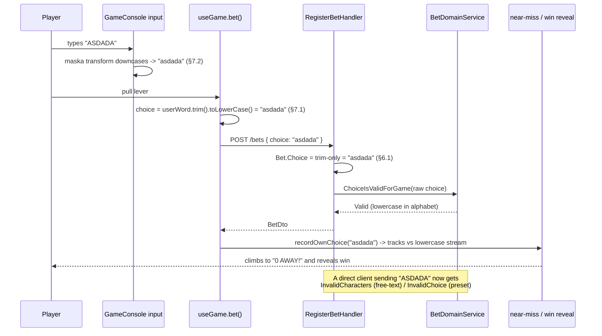

# SpaceStroker — "Bet Choice Casing" Fix — Implementation Spec

> **Status: Shipped** — merged to `main` on `feature/bet-choice-casing` (2026-07-24). Distilled into
> `features/games.md`, `features/choice-exclusivity.md`, and `glossary.md` (Minor change → no dedicated
> `features/bet-choice-casing.md`). This spec stays as the deep design archive.
>
> **Status: Ready for implementation** — refined via Trello card
> [weirdness with capitalized chars](https://trello.com/c/7yXgbqcQ/93-weirdness-with-capitalized-chars) (2026-07-24).
> Repos affected: `monkify-backend`, `monkify-front`, and this doc in `monkify-meta`.
>
> **Purpose:** Fix the bug where a bet whose chosen sequence contains **uppercase** letters (e.g.
> `ASDADA`) is accepted but the near-miss UI is stuck at "N AWAY!" forever and the win is never
> surfaced. Make casing consistent end to end: the **frontend** normalizes the choice to lowercase at
> the single capture point, and the **backend** stops silently lowercasing and instead **rejects**
> out-of-alphabet input (uppercase, symbols, internal spaces) as `InvalidCharacters`.

---

## 1. Summary

The typer's alphabet is **lowercase-only** (`GameCharacterType`: `Number` = `0123456789`, `Letters`
= `abcdefghijklmnopqrstuvwxyz`, `NumbersAndLetters` = both). Today an uppercase bet slips through and
"works" only by accident:

| Layer | Today (buggy) | After this fix |
| --- | --- | --- |
| **Backend accept** | `Bet.Choice` getter/setter silently `.Trim().ToLower()`, handler re-`.ToLower()`s → uppercase is **silently accepted** and stored lowercase | Choice is **trim-only** (case preserved through validation); uppercase / out-of-alphabet chars are **rejected** as `InvalidCharacters` |
| **Backend match/pay** | Stored lowercase matches the lowercase stream → the bet **wins and is paid out** | Unchanged — valid (lowercase) choices still match and pay |
| **Frontend send** | Sends the **raw** `userWord` (e.g. `ASDADA`) | Sends the **normalized** (trim + lowercase) choice |
| **Frontend near-miss** | Tracks the raw choice **case-sensitively** vs the lowercase stream → `'A' !== 'a'` → stuck at "N AWAY!" | Tracks the lowercase choice → advances normally, reaches "0 AWAY!" |
| **Frontend win reveal** | Looks up lowercase `firstChoiceTyped` in a map keyed by the raw uppercase choice → **no win reveal**, player not shown as winner | Keys/lookups both lowercase → win reveal fires, player shown as winner |

**Root cause:** the frontend never normalizes the value it *sends/tracks/recognizes* (only the
exclusivity pre-check lowercases, and only for its own comparison), and the backend hides the problem
by silently mutating input instead of validating it. **No money is or was lost** — uppercase bets
actually win and pay on the backend; the visible symptom is purely a frontend display failure. This
fix makes the two layers agree and turns silent acceptance into an explicit reject.

---

## 2. Constraints (MANDATORY)

From `monkify-meta/constraints.md` (full list there):

- **Worktree-per-repo:** work lives in `.worktrees/bet-choice-casing/<repo>`; the shared checkout of
  each repo stays on `main` (hub). Branch `feature/bet-choice-casing` in each affected repo is the
  merge/PR ref.
- **Unit tests:** update/add in `SpaceStroker.Tests` and **report changed tests** at end of
  implementation. Run the suite via `scripts/run_tests.bat` (not the full `dotnet test`, which drags
  in the slow `ProductionSessions` Monte-Carlo suite).
- **No new integration test required:** this is a **Minor change** (bug fix), and it does **not**
  change the game lifecycle/flow — existing `GameFlowTests` place lowercase bets and stay green. (Per
  `constraints.md` §3, integration tests are mandatory only for **new features** or game-flow
  changes; neither applies.)
- **EF mapping:** inline in `SpaceStrokerDbContext.OnModelCreating`; no `IEntityTypeConfiguration`.
  **No migration** — no schema change (the `ExclusiveChoice` column + unique index are unchanged).
- **Secrets/config:** mock-only values in committed files (not touched here).
- **Operator messaging:** vague errors only (not touched here).

---

## 3. Resolved product decisions

| # | Decision |
| --- | --- |
| 1 | **Frontend normalizes at the source.** `useGame.bet()` reads `userWord`, trims + lowercases it **once**, and that single normalized value flows to the POST body, `recordOwnChoice`/near-miss tracking, and win-recognition. No other frontend site needs changing. |
| 2 | **Frontend input is downcased on entry (UX).** The bet input visibly shows lowercase as the player types (uppercase keystrokes are downcased, not silently dropped), so what they see matches what is sent. The existing `lowercase` CSS class is display-only and is **not** the fix. |
| 3 | **Backend rejects uppercase instead of silently lowering.** Validation runs on the **raw (trim-only)** choice; any char outside the game's allowed alphabet (uppercase letters, internal spaces, symbols) → `InvalidCharacters`. |
| 4 | **Backend keeps whitespace trimming** as a nicety (`"  asdada  "` → `"asdada"`, accepted). Only casing/alphabet is now strict. |
| 5 | **Remove the silent `.ToLower()`** from `Bet.Choice` (getter and setter) and the redundant `.ToLower()` in `RegisterBetHandler` — keep `.Trim()`. The stored value equals the validated input; there is no hidden mutation. |
| 6 | **Level: Minor change (bug fix).** No mandatory happy-path integration test, no dedicated `features/<slug>.md` doc. Unit tests + keeping existing KB docs current still apply. |
| 7 | **Preset-type games** reject uppercase as `InvalidChoice` (the uppercase choice won't equal any lowercase preset, and that check precedes the character check); free-text games reject as `InvalidCharacters`. Both are correct rejections — no separate handling needed. |

---

## 4. Data model

**No schema change. No migration.**

### 4.1 Entity change — `Bet.Choice` (casing only)

`monkify-backend/src/SpaceStroker.Domain/Bets/Entities/Bet.cs:66-67` — drop `.ToLower()`, keep
`.Trim()` on both accessors:

```csharp
// before
public string Choice { get => _choice?.Trim()?.ToLower(); set => _choice = value.Trim()?.ToLower(); }
// after
public string Choice { get => _choice?.Trim(); set => _choice = value?.Trim(); }
```

> Note the added `value?.` null-guard on set (the old code called `.Trim()` on a possibly-null
> `value`; preserve at least the current null-tolerance — `string.IsNullOrEmpty(bet.Choice)` is
> already handled first in validation).

`ExclusiveChoice` is unchanged: it is assigned from `_bet.Choice` **after** validation
(`RegisterBetHandler.cs:143`), so every valid free-text choice reaching the unique
`(GameId, ExclusiveChoice)` index is already lowercase. The `HasMaxLength(20)` mapping and unique
index in `SpaceStrokerDbContext.cs` stay as-is.

### 4.2 EF configuration

No change.

### 4.3 Migration

None.

---

## 5. Configuration

None. `GameCharacterType` alphabets (`Number` / `Letters` / `NumbersAndLetters`) stay lowercase-only;
no new game types, no seed changes.

---

## 6. Backend behaviour

### 6.1 Stop silently lowering the choice

Two edits so validation sees the **raw** (trim-only) choice:

1. `Bet.cs:67` — `Choice` accessors: `.Trim()` only (see §4.1).
2. `RegisterBetHandler.cs:117` — construct the bet with the raw choice, not a pre-lowered one:

   ```csharp
   // before
   _bet = new(request.GameId, request.Body.Seed, operatorPlayerId, request.Body.Choice?.ToLower(), amount, method, request.Body.Nonce);
   // after
   _bet = new(request.GameId, request.Body.Seed, operatorPlayerId, request.Body.Choice, amount, method, request.Body.Nonce);
   ```

   (The `Bet.Choice` setter still trims; the constructor path already assigns through `Choice`.)

### 6.2 Reject out-of-alphabet input

No new code is needed in `BetDomainService.ChoiceIsValidForGame`
(`monkify-backend/src/SpaceStroker.Domain/Bets/Services/BetDomainService.cs:59-85`) — the existing
allowed-characters check now does the work, because `bet.Choice` is no longer force-lowercased:

```csharp
var acceptedCharacters = parameters.AllowedCharacters.StringValueOf().ToArray(); // lowercase-only
if (!bet.Choice.All(character => acceptedCharacters.Contains(character)))
    return BetValidationResult.InvalidCharacters;   // uppercase / symbol / internal space -> rejected
```

**Validation order (unchanged, called from `ValidateBetParameters` at `RegisterBetHandler.cs:129`,
before `ExclusiveChoice` is set at :143 and before settlement):**

1. `WrongChoiceLength` — length check (uses trimmed `Choice`; `"  asdada  "` → length 6, OK).
2. `UnacceptedDuplicateCharacters`.
3. `InvalidAmount`.
4. `InvalidChoice` — for **preset** games, an uppercase choice fails `PresetChoices.Any(x => x.Choice == bet.Choice)` here (presets are lowercase) → rejected as `InvalidChoice`.
5. `InvalidCharacters` — for **free-text** games, uppercase / internal space / symbol rejected here.

A rejected bet flows through the existing invalid-bet path (refund for paid, reject for free) — no
new branch. `InvalidCharacters` / `InvalidChoice` are existing `BetValidationResult` values with
existing user-facing messages; **do not** add casing-specific messages.

### 6.3 What does not change

Typer alphabet, `GenerateNextCharacter`, `CheckForWinners`, fallback winner, payout, pot/stats — all
already operate on lowercase and are untouched.

---

## 7. Frontend behaviour

### 7.1 Normalize at the single capture point — `hooks/useGame.ts`

`bet()` (`monkify-front/src/hooks/useGame.ts:373-375`) — normalize once:

```ts
const bet = async (onBetFail?: () => void) => {
  const gameId = gameInstance.value?.gameId as string;
  const choice = userWord.value.trim().toLowerCase();   // was: userWord.value
  ...
```

This single change propagates correctly to every consumer of `choice`:

- Exclusivity pre-check (`:385`) `b.choice === choice.trim().toLowerCase()` — still correct (now
  comparing lowercase to lowercase; the extra trim/lower is harmless).
- `submitBet(gameId, choice, { amount, choice, ... })` — the POST body `choice` is now lowercase, and
  `submitBet` sets `lastOwnBetChoice`, calls `recordOwnChoice(choice)` (`:348`) and
  `postToParent('bet-placed', { choice })` (`:355`) — all lowercase.
- `recordOwnChoice` (`:93-97`) pushes into `ownBetChoices` and calls `nearMiss.trackChoice(choice, L)`
  — both lowercase, so the near-miss matcher advances against the lowercase typed stream and
  `ownBetChoices.includes(firstChoiceTyped)` (win reveal) matches the backend's lowercase winner.

No change is needed in `utils/nearMiss.ts` (the KMP matcher stays case-sensitive but now receives
lowercase on both sides) or `hooks/useNearMiss.ts`.

### 7.2 Downcase the input on entry — `components/game/GameConsole.vue`

The masks are built from `@` (letters), `*` (alphanumeric), `#` (digits)
(`GameConsole.vue:164-173`) and bound via `v-maska="currentMask"` (`:231`, `:302`) using
`maska@^3.1.0`. maska's default `@`/`*` tokens accept `A–Z`, so uppercase currently enters `userWord`.

Make uppercase visibly downcase on entry. **Primary:** define custom maska tokens with a lowercase
`transform` and bind them alongside the mask (maska v3 supports per-token `transform`), e.g. `@` →
`{ pattern: /[a-zA-Z]/, transform: (c) => c.toLowerCase() }` and `*` →
`{ pattern: /[a-zA-Z0-9]/, transform: (c) => c.toLowerCase() }` (`#` digits need no transform). The
implementer verifies the exact maska v3 token-binding syntax against the installed version.

**Guaranteed fallback** if the token-transform route is awkward with the current binding: add a
watcher in `GameConsole.vue` setup that downcases the model —
`watch(userWord, (v) => { const lo = v.toLowerCase(); if (lo !== v) userWord.value = lo; })`. Either
way, §7.1 remains the authoritative normalization; §7.2 is the display nicety so the input matches
what is sent.

The exclusivity pre-check in `GameConsole.vue:97` already lowercases for its own comparison and needs
no change.

---

## 8. Flow diagram



---

## 9. Out of scope

- Adding uppercase to the typer alphabet or supporting case-sensitive games.
- Any change to `GameCharacterType` or the seeded default game types.
- New game types.
- Data backfill (existing bets are already stored lowercase — nothing to migrate).

---

## 10. File checklist

### 10.1 Backend (`monkify-backend`)

| # | File | Change |
| --- | --- | --- |
| 1 | `src/SpaceStroker.Domain/Bets/Entities/Bet.cs` (:66-67) | `Choice` accessors: keep `.Trim()`, remove `.ToLower()`; add `value?.` null-guard on set |
| 2 | `src/SpaceStroker.Infrastructure/Handlers/Games/RegisterBet/RegisterBetHandler.cs` (:117) | Pass `request.Body.Choice` raw (drop the `?.ToLower()`) |
| 3 | `src/SpaceStroker.Domain/Bets/Services/BetDomainService.cs` (:80-82) | No code change — the existing `InvalidCharacters` check now genuinely rejects uppercase once the choice is no longer force-lowered. (Verify order: preset check precedes it.) |

### 10.2 Frontend (`monkify-front`)

| # | File | Change |
| --- | --- | --- |
| 1 | `src/hooks/useGame.ts` (:375) | `bet()`: `const choice = userWord.value.trim().toLowerCase();` — the single normalization point |
| 2 | `src/components/game/GameConsole.vue` (:164-173, :231, :302) | Downcase uppercase on entry via custom maska tokens with a lowercase `transform` (fallback: a `userWord` watcher). Display nicety only |

### 10.3 Meta (`monkify-meta`)

| # | File | Change |
| --- | --- | --- |
| 1 | `specs/bet-choice-casing.md` | This spec (new) |
| 2 | `INDEX.md` | Add spec row (status Ready); set "Feature currently in flight" |

> No `features/*.md` doc is created (Minor change). If any existing `features/*.md` describes bet
> choice validation or the near-miss/away behaviour and is contradicted by this fix, correct it at
> ship time; a scan at ship found none required beyond this spec.

---

## 11. Unit tests

Project: `monkify-backend/src/SpaceStroker.Tests`. Run via `scripts/run_tests.bat`.

| Test file | Test cases | Expected |
| --- | --- | --- |
| `UnitTests/Domain/Games/BetDomainServiceTests.cs` | **Change** `ChoiceIsValidForGame_ChoiceWithUppercase_ShouldReturnValid` → rename to `..._ShouldReturnInvalidCharacters`. `[InlineData(Letters,"MACACO")]`, `"MaCaCo"`, `" MaCaCo "` | `BetValidationResult.InvalidCharacters` |
| `UnitTests/Domain/Games/BetDomainServiceTests.cs` | **Add** lowercase-with-whitespace accepted: `[InlineData(Letters,"  macaco  ")]` (len 6) | `BetValidationResult.Valid` |
| `UnitTests/Domain/Games/BetDomainServiceTests.cs` | **Add** internal space / symbol rejected: `[InlineData(Letters,"mac co")]`, `[InlineData(Number,"12a4")]`-style out-of-alphabet | `InvalidCharacters` |
| `UnitTests/Handlers/RegisterBetHandlerTests.cs` | **Change** `RegisterBet_ChoiceTaken_CaseAndWhitespaceInsensitive_ShouldRefund` → submit lowercase-with-whitespace (`" abcd "` instead of `" ABCD "`) so it still exercises whitespace-trim + duplicate `ExclusiveChoice` refund; assert `ExclusiveChoice == "abcd"` | Duplicate refund path, `ExclusiveChoice == "abcd"` |
| `UnitTests/Handlers/RegisterBetHandlerTests.cs` | **Add** an uppercase submission is rejected as an invalid bet (refund for paid) rather than accepted | Invalid-bet path (`InvalidCharacters`), not persisted as a valid bet |

Frontend: add a unit test (the previously-missing near-miss casing path) —

| Test file | Test cases | Expected |
| --- | --- | --- |
| `monkify-front` near-miss / useGame test (co-located with existing FE tests) | Given a choice entered as `"ASDADA"`, after normalization the near-miss matcher fed the lowercase stream `a,s,d,a,d,a` reaches `away == 0`; and `ownBetChoices` contains `"asdada"` so a lowercase `firstChoiceTyped` win-recognizes | matcher reaches 0-away; win reveal recognizes the own choice |

---

## 12. Acceptance criteria

From the Trello **Acceptance Criteria** checklist:

1. Given a game with `AllowedCharacters = Letters`, when a bet is placed with `choice = "ASDADA"`, then the API rejects it as `InvalidCharacters` and no bet is created.
2. Given `choice = "  asdada  "` (surrounding whitespace, lowercase), when a bet is placed, then it is accepted and stored as `"asdada"`.
3. Given `choice = "as da"` (internal space), when a bet is placed, then the API rejects it as `InvalidCharacters`.
4. Given the frontend bet input, when the player types uppercase letters, then the bound choice value is lowercase and the `POST /bets` body sends the lowercase choice.
5. Given a player's own bet, when the typed stream matches it, then the near-miss row reaches "0 AWAY!" and the player is shown as the winner (the case mismatch no longer blocks the reveal).
6. Given a winning choice returned as lowercase `firstChoiceTyped`, when the round ends, then the frontend win-recognition matches it against the player's normalized (lowercase) choices.
7. Given the affected backend unit tests (uppercase case, case/whitespace refund), when the change is implemented, then they are updated to the reject-uppercase contract and pass, and a new frontend near-miss casing test is added.

---

## 13. Manual QA (optional)

1. Local prod/dev stack: open `/space-stroker/game`, pick a `Letters` game type.
2. In the bet input, type uppercase letters — confirm they appear **lowercase** as you type.
3. Place the bet — confirm it is accepted and the near-miss row climbs (not stuck at "N AWAY!").
4. When the typer produces your sequence, confirm the "0 AWAY!" reveal fires and you are shown as the winner.
5. (Negative) With devtools, `POST /games/{id}/bets` a body with `choice` containing an uppercase letter → expect a validation failure (`InvalidCharacters`), not a silently-accepted bet.

---

## 14. Trello / pipeline

- **Source card:** [weirdness with capitalized chars](https://trello.com/c/7yXgbqcQ/93-weirdness-with-capitalized-chars) — moved to **Specs created**; **Implementation** section on the card lists worktree + branch + spec + Level.
- **Next:** `/monkify-implement-feature weirdness with capitalized chars` to build it (Minor change → no new integration test), then `/monkify-ship-feature weirdness with capitalized chars` to sync the KB and merge `feature/bet-choice-casing` → `main` in each repo.

---

## 15. Revision log

| Date | Change |
| --- | --- |
| 2026-07-24 | Initial spec from refined card #93 (investigation reframed it as a frontend display bug + a backend reject-instead-of-silently-normalize change; Minor change). |
