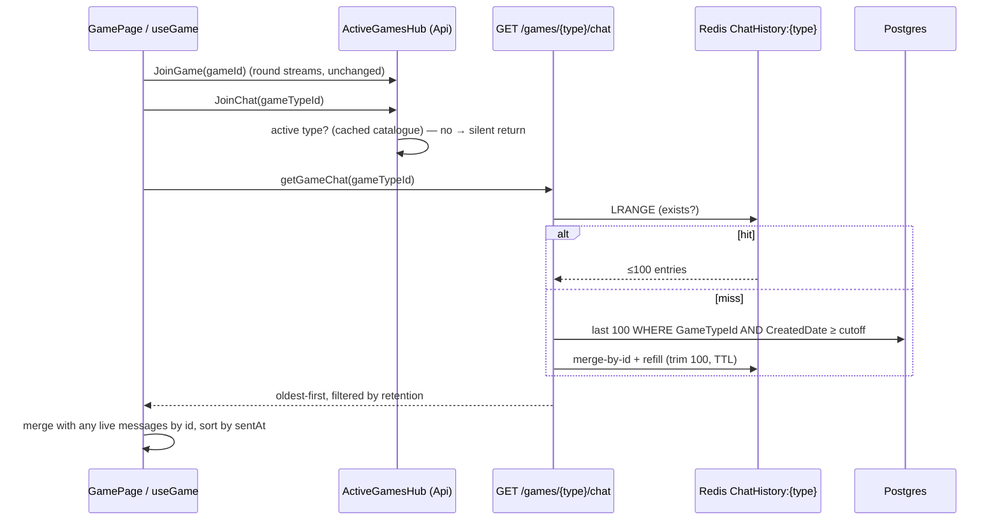
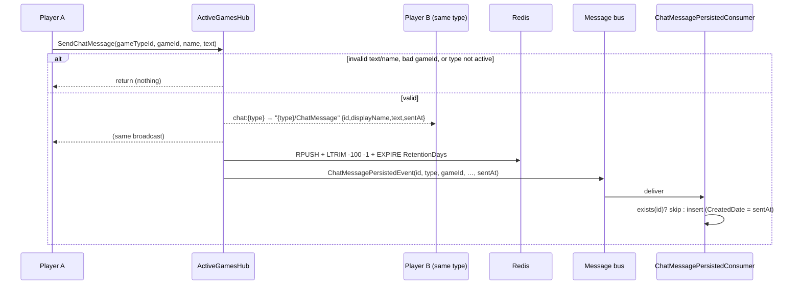
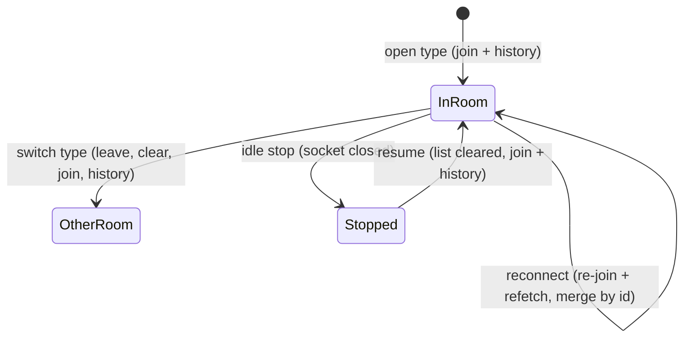

# SpaceStroker — "Chat per game type" Feature — Implementation Spec

> **Status: Shipped** — merged `feature/chat-per-game-type` → `main` on 2026-09-16 (monkify-backend,
> monkify-front, monkify-meta). Distilled rules: [`../features/game-chat.md`](../features/game-chat.md).
> One naming deviation from §6.1: the limit constant is `Services/Chat/ChatHistory.Limit`, not
> `ActiveGamesHub.ChatHistoryLimit`.
>
> Refined via Trello card
> [Fix chat per game type.](https://trello.com/c/11UnFT07/185-fix-chat-per-game-type) (#185, 2026-09-16).
> Repos affected: `monkify-backend`, `monkify-front`, and this doc in `monkify-meta`.
>
> **Purpose:** game chat today lives and dies with a single **round** — it is wiped on every rollover,
> locked at `Ended`, and erased by a page refresh. This moves the chat room to the **game type**
> (Cosmic Sprint, Space Jackpot, …) so the conversation survives rounds and refreshes, and shows the
> **last 100 messages** (Redis-cached, retention-bounded) when a player opens the game. It also fixes one
> line of How-to-Play copy ("takes the lot" → "takes the pot").
>
> **Supersedes** these rules of [`game-chat.md`](game-chat.md) (v2): decision #1 (room = game instance),
> #8/#10 (no history, ephemeral list), #11 (read-only on `Ended`, full reset on rollover), and §7.3's
> read-only input. Everything else in that spec (identity, client limits, server length guard, audit
> persistence, purge) still holds.

---

## 1. Summary

| Aspect | Today (`game-chat.md` v2) | After this spec |
| --- | --- | --- |
| **Room** | SignalR group = round `gameId` (shared with Terminal/Status/Bets) | Dedicated group `chat:{gameTypeId}` (`GameParameters.Id`) |
| **Rollover** | List cleared, re-joins the new round's group | **Nothing happens** — same room, same list |
| **`Ended`** | Input read-only ("CHAT CLOSED") | Input stays enabled |
| **Refresh / late join** | Sees nothing | Sees the last ≤100 messages of the type within retention |
| **History source** | — | Per-type **Redis list** (capped 100, TTL = retention) → DB fallback on miss |
| **Payload** | `{ displayName, text, sentAt }` | `{ id, displayName, text, sentAt }` (`id` = server GUID, additive) |
| **Hub send** | `SendChatMessage(gameId, displayName, text)` | `SendChatMessage(gameTypeId, gameId, displayName, text)` |
| **Room validation** | Any string accepted | Must be an **active** game type (cached catalogue) — else silent drop |
| **DB row** | `GameId, DisplayName, Text, CreatedDate` | + `GameTypeId` (backfilled); `Id` = broadcast id; `CreatedDate` = `sentAt` |
| **Mobile unread dot** | Any arriving message | **Live** messages only — history never lights it |

There is one new REST route: **`GET /games/{parametersId}/chat`**.

---

## 2. Constraints (MANDATORY)

From `monkify-meta/constraints.md` (full list there):

- **Worktree-per-repo:** work lives in `.worktrees/chat-per-game-type/<repo>` on branch
  `feature/chat-per-game-type` in `monkify-backend`, `monkify-front`, `monkify-meta`. Hubs stay on `main`.
- **Unit tests:** update/add in `SpaceStroker.Tests` (§11.1); run via `scripts/run_tests.bat`; report
  every changed/added test at the end.
- **Integration test (MANDATORY — Level: Feature):** happy path end to end in
  `SpaceStroker.Tests.Integration` (§11.2), plus the Redis-miss fallback as a complex flow. The existing
  `GameChatTests` must be updated to the new hub signature (they break otherwise).
- **EF mapping:** inline in `SpaceStrokerDbContext.OnModelCreating`; no `IEntityTypeConfiguration`.
- **Migrations:** under `SpaceStroker.Infrastructure/Migrations/`, generated with `dotnet ef`; applied only
  by `SpaceStroker.Consumers`. Never hand-edit the snapshot (the backfill SQL goes in the migration's
  `Up`, not the snapshot).
- **Host responsibilities:** the API broadcasts, writes the Redis list and publishes the persist event;
  it **never** writes chat to the DB. Persistence stays in `SpaceStroker.Consumers`.
- **User-facing messaging (§6):** an unknown/inactive game type on the history route returns the
  existing vague `ErrorMessages.ParameterNotFound`; the hub drops silently and returns nothing.
- **Secrets/config:** no new secrets; config changes are non-secret.

---

## 3. Resolved product decisions

| # | Decision |
| --- | --- |
| 1 | **One room per game type** (`GameParameters.Id`) — not per game mode, not per round with replay. |
| 2 | **Rounds never touch chat:** no clear on rollover, no read-only at `Ended`. The client joins the type's room once and leaves only on a game-type switch (or the idle stop). |
| 3 | **History = per-type Redis list capped at 100.** The hub appends on send and trims to 100. `GET /games/{parametersId}/chat` reads the list with no DB hit; on a miss (flush / cold key) it reads the last 100 DB rows for the type and refills the list. DB persistence stays async (event → consumer). |
| 4 | **History respects retention.** Entries older than `Chat.RetentionDays` are filtered out on read, and the Redis key's TTL is refreshed to `RetentionDays` on every append — Redis and the DB fallback always agree; purged content never resurfaces. |
| 5 | **Server message `id` + subscribe-before-fetch.** The hub generates a GUID per message used for the broadcast, the Redis entry and the DB row's `Id`. The client joins the room **first**, then fetches history, merges by `id`, sorts by `sentAt`. |
| 6 | **Backfill:** the migration adds `GameTypeId`, fills it from `Games.ParametersId`, then makes it NOT NULL. `GameId` is **kept** (required) for round-level audit. |
| 7 | **Round id comes from the client:** `SendChatMessage(gameTypeId, gameId, displayName, text)`. `gameId` is audit-only, trusted like the display name; it must parse as a GUID or the message is dropped. |
| 8 | **Mobile unread dot:** only live messages set it; loaded history never does. |
| 9 | **Game-type switch:** leave the old room, clear the list, join the new room, load its history. |
| 10 | **Room must be an active game type**, checked against the cached catalogue (`IGameService.GetAllActiveGameParameters`, 12h cache invalidated by admin create/deactivate) — no per-message DB hit while warm. Unknown, non-GUID or deactivated → silent drop (no broadcast, no Redis, no publish). `JoinChat` applies the same check. The history route answers `ParameterNotFound`. |
| 11 | **Copy fix in the app guide** (`GuideHowTheGameWorks.vue`), not `monkify-lp` — the sentence does not exist in the LP. |
| 12 | **Unchanged:** client-supplied display name (trusted), crypto must connect a wallet to send, client 200-char / 1 msg/s limits, server length/non-empty guard, plain text only, daily DB purge job. |

---

## 4. Data model

### 4.1 Entity — `SpaceStroker.Domain/Games/Entities/GameChatMessage.cs`

Add `GameTypeId` and a constructor that takes the hub-generated id and send time. Keep the parameterless
constructor (EF + existing tests). Update the XML doc: history **is** now replayed (per type, ≤100,
within retention).

```csharp
public class GameChatMessage : TableEntity
{
    public GameChatMessage() { }

    // id + sentAt come from the hub so the DB row, the Redis entry and the broadcast share one identity
    // and one timestamp (specs/chat-per-game-type.md §6.1).
    public GameChatMessage(Guid id, Guid gameTypeId, Guid gameId, string displayName, string text, DateTime sentAt)
    {
        Id = id;
        GameTypeId = gameTypeId;
        GameId = gameId;
        DisplayName = displayName;
        Text = text;
        CreatedDate = sentAt;
    }

    public Guid GameTypeId { get; set; }
    public Guid GameId { get; set; }
    public string DisplayName { get; set; }
    public string Text { get; set; }
}
```

> Remove the old `(gameId, displayName, text)` constructor; its only production caller is the consumer
> (§6.3). Update test call sites.

### 4.2 EF configuration (inline) — `SpaceStrokerDbContext.cs` (~line 153)

```csharp
modelBuilder.Entity<GameChatMessage>(builder =>
{
    builder.HasKey(x => x.Id);
    builder.Property(x => x.GameTypeId).IsRequired();
    builder.Property(x => x.GameId).IsRequired();
    builder.Property(x => x.DisplayName).IsRequired().HasMaxLength(100);
    builder.Property(x => x.Text).IsRequired().HasMaxLength(200);

    builder.HasIndex(x => new { x.GameId, x.CreatedDate });
    builder.HasIndex(x => x.CreatedDate);
    // History fallback: last 100 of a type, newest first.
    builder.HasIndex(x => new { x.GameTypeId, x.CreatedDate });
});
```

No FK to `GameParameters` / `Games` is added (the table never had one; purge must not be blocked).

### 4.3 Migration

```bash
# from .worktrees/chat-per-game-type/monkify-backend/src
dotnet ef migrations add ChatPerGameType \
  --project SpaceStroker.Infrastructure --startup-project SpaceStroker.Consumers
```

EF will scaffold `AddColumn GameTypeId uuid NOT NULL DEFAULT '0000…'` + the index. **Hand-edit the
generated `Up`** (the migration file, not the snapshot) into three steps:

```csharp
// 1) nullable first, so existing rows survive
migrationBuilder.AddColumn<Guid>(name: "GameTypeId", table: "GameChatMessages", type: "uuid", nullable: true);

// 2) backfill from the round's game type; drop rows whose round no longer exists (cannot be attributed)
migrationBuilder.Sql(@"
    UPDATE ""GameChatMessages"" m
       SET ""GameTypeId"" = g.""ParametersId""
      FROM ""Games"" g
     WHERE g.""Id"" = m.""GameId"";
    DELETE FROM ""GameChatMessages"" WHERE ""GameTypeId"" IS NULL;");

// 3) enforce
migrationBuilder.AlterColumn<Guid>(name: "GameTypeId", table: "GameChatMessages", type: "uuid", nullable: false,
    oldClrType: typeof(Guid), oldType: "uuid", oldNullable: true);

migrationBuilder.CreateIndex(name: "IX_GameChatMessages_GameTypeId_CreatedDate", table: "GameChatMessages",
    columns: new[] { "GameTypeId", "CreatedDate" });
```

`Down`: drop the index and the column. The table is small (committed retention is **2 days**), so the
backfill is a quick single statement.

---

## 5. Configuration

- **`SpaceStroker.Common/spacestrokersettings.json`** — `GeneralSettings.Games.GameChatEndpoint` stays
  `"{0}/ChatMessage"` but is now formatted with the **game type id** (event name
  `"{gameTypeId}/ChatMessage"`). No value change.
- **`GeneralSettings.Chat.RetentionDays`** — reused as the history window. ⚠️ The committed value is
  **`2`** (the class default is 7). History therefore reaches back 2 days unless ops changes it; no change
  in this spec.
- **New constant** `ActiveGamesHub.ChatHistoryLimit = 100` (not config — the card fixes it at 100).
- No new env var in the front (the existing API base URL and `VUE_APP_WEBSOCKET_BASE_URL` are reused).
- No new rate-limit rule: the route is a cheap Redis read, like `/games/{id}/stats`.

---

## 6. Backend behaviour

### 6.1 `ActiveGamesHub` (`SpaceStroker.Infrastructure/Hubs/ActiveGamesHub.cs`)

Inject two more services: `IGameService` (active-type catalogue) and the new `IChatHistoryStore` (§6.2).
`GameService` depends on `IHubContext<ActiveGamesHub>` (a singleton), so there is no DI cycle.

```csharp
public const int MaxChatMessageLength = 200;
public const int ChatHistoryLimit = 100;
public const string ChatGroupPrefix = "chat:";

public static string ChatGroupFor(Guid gameTypeId) => $"{ChatGroupPrefix}{gameTypeId}";

public async Task JoinChat(string gameTypeId)
{
    var typeId = await ResolveActiveGameType(gameTypeId);
    if (typeId is null) return; // silent, like JoinOrbitNotifications
    await Groups.AddToGroupAsync(Context.ConnectionId, ChatGroupFor(typeId.Value));
}

public Task LeaveChat(string gameTypeId)
    => Guid.TryParse(gameTypeId, out var id)
        ? Groups.RemoveFromGroupAsync(Context.ConnectionId, ChatGroupFor(id))
        : Task.CompletedTask;

public async Task SendChatMessage(string gameTypeId, string gameId, string displayName, string text)
{
    if (string.IsNullOrWhiteSpace(text) || text.Length > MaxChatMessageLength) return;
    if (string.IsNullOrWhiteSpace(displayName)) return;
    if (!Guid.TryParse(gameId, out var roundId)) return;

    var typeId = await ResolveActiveGameType(gameTypeId);
    if (typeId is null) return;

    var message = new GameChatMessageDto(Guid.NewGuid(), displayName.Trim(), text.Trim(), DateTime.UtcNow);

    // 1) Broadcast first — realtime path, no DB.
    var chatEndpoint = string.Format(_settings.Games.GameChatEndpoint, typeId.Value);
    await Clients.Group(ChatGroupFor(typeId.Value)).SendAsync(chatEndpoint, message.AsJson());

    // 2) History list (append, trim to 100, refresh TTL). A Redis failure is logged and swallowed —
    //    the message was already delivered live and the DB fallback still covers history.
    await _chatHistory.AppendAsync(typeId.Value, message);

    // 3) Audit persistence via event -> consumer (unchanged pattern).
    await _messageBus.PublishEventAsync(new ChatMessagePersistedEvent(
        message.Id, typeId.Value, roundId, message.DisplayName, message.Text, message.SentAt));
}

// Active = present in the cached catalogue. NOT GetGameParametersById: that falls through to the DB on
// a miss, which would put a query behind every crafted GUID.
private async Task<Guid?> ResolveActiveGameType(string gameTypeId)
{
    if (!Guid.TryParse(gameTypeId, out var id)) return null;
    var active = await _gameService.GetAllActiveGameParameters();
    return active.ContainsKey(id) ? id : null;
}
```

- Guard order: cheap string checks first, then the catalogue lookup.
- `JoinGame` / `LeaveGame` are **unchanged** (round streams still use the `gameId` group); the
  `ChatMessage` event simply stops being published per round.
- The payload JSON must serialize camelCase (`id`, `displayName`, `text`, `sentAt`) — same `.AsJson()`
  helper as today.
- The XML doc on `SendChatMessage` is rewritten to describe the per-type room and history.

### 6.2 `IChatHistoryStore` (new, `SpaceStroker.Infrastructure/Services/Chat/`)

`RedisCacheService` only does string keys, so the list gets its own small abstraction:

```csharp
public interface IChatHistoryStore
{
    /// Append, trim to the newest ChatHistoryLimit, refresh TTL to RetentionDays. Never throws.
    Task AppendAsync(Guid gameTypeId, GameChatMessageDto message);

    /// Oldest-first entries, or null when the key does not exist (a MISS — distinct from an empty room).
    Task<IReadOnlyList<GameChatMessageDto>?> ReadAsync(Guid gameTypeId);

    /// Replace the list with these entries (oldest-first), trimmed + TTL. Used by the DB fallback.
    Task RefillAsync(Guid gameTypeId, IReadOnlyList<GameChatMessageDto> messages);
}
```

- **Key:** `ChatHistory:{gameTypeId}` — add `CacheHelper.GenerateChatHistoryKey(Guid)` next to the other
  factories (key only; TTL comes from `Chat.RetentionDays`).
- **`RedisChatHistoryStore`** (uses the registered `IConnectionMultiplexer`):
  - `AppendAsync`: one `ITransaction` — `ListRightPushAsync(key, json)`, `ListTrimAsync(key, -100, -1)`,
    `KeyExpireAsync(key, TimeSpan.FromDays(RetentionDays))`. Catch + `Log.Error`, never rethrow.
  - `ReadAsync`: `KeyExistsAsync` false → `null`; else `ListRangeAsync(key, 0, -1)` deserialized.
    On a Redis exception → log and return `null` (treated as a miss → DB fallback).
  - `RefillAsync`: re-read the current list first and **merge by `Id`** with the DB rows (a live append
    may have landed between the miss and the refill), keep the newest 100 by `SentAt`, then one
    transaction: `KeyDeleteAsync`, `ListRightPushAsync(key, values[])`, `KeyExpireAsync`. An empty set
    writes nothing (the key stays absent; the next read is a miss again — cheap, bounded query).
  - JSON: `System.Text.Json` camelCase, no `ReferenceHandler.Preserve` (flat DTO).
- **`MemoryChatHistoryStore`** (Redis-less local runs / unit tests): singleton
  `ConcurrentDictionary<Guid, List<(DateTime ExpiresAt, GameChatMessageDto)>>` with a lock per append;
  same trim/TTL semantics.
- **DI** (`SpaceStroker.Infrastructure/DependencyInjection.cs` ~line 102): register in the same Redis
  branch — `AddSingleton<IChatHistoryStore, RedisChatHistoryStore>()` when the Redis connection string is
  set, else `AddSingleton<IChatHistoryStore, MemoryChatHistoryStore>()`.

### 6.3 Persist event + consumer

- **`ChatMessagePersistedEvent`** (`Consumers/ChatMessagePersisted/ChatMessagePersistedEvent.cs`):
  `record ChatMessagePersistedEvent(Guid Id, Guid GameTypeId, Guid GameId, string DisplayName, string Text, DateTime SentAt)`.
- **`ChatMessagePersistedConsumer`**: idempotent on redelivery —

  ```csharp
  if (await context.GameChatMessages.AnyAsync(x => x.Id == message.Id))
      return;

  context.GameChatMessages.Add(new GameChatMessage(
      message.Id, message.GameTypeId, message.GameId, message.DisplayName, message.Text, message.SentAt));

  try { await context.SaveChangesAsync(); }
  catch (DbUpdateException) when (await context.GameChatMessages.AsNoTracking().AnyAsync(x => x.Id == message.Id))
  { /* concurrent redelivery won the insert — already persisted */ }
  ```

  (Insert of a new entity is unaffected by the context's NoTracking default.) Update the comment: rows
  **are** replayed now, via the history fallback.
- **Queue compatibility:** events already sitting in the Postgres transport queue at deploy time carry the
  old shape (`GameId, DisplayName, Text`) — `Id`/`GameTypeId` deserialize as `Guid.Empty`. The consumer
  **drops** an event with `GameTypeId == Guid.Empty` (log at Warning): it is at most a few seconds of
  pre-deploy audit chat, and a row with an empty type would never be served anyway.

### 6.4 History route

- **Controller** (`SpaceStroker.Api/Controllers/GamesController.cs`, next to `GetGameTypeStats`):

  ```csharp
  /// <summary>The last (up to 100) chat messages of a game type within retention, oldest first.</summary>
  /// <response code="200">Returns the messages (empty list when the room is quiet).</response>
  /// <response code="400">The game type was not found.</response>
  [HttpGet("{parametersId}/chat")]
  public async Task<IActionResult> GetGameChat(Guid parametersId)
      => await ProcessRequest(new GetGameChatRequest(parametersId));
  ```

- **Request/handler** — `SpaceStroker.Infrastructure/Handlers/Games/GetGameChat/`
  (`GetGameChatRequest.cs`, `GetGameChatHandler.cs`), `BaseRequestHandler<GetGameChatRequest, IEnumerable<GameChatMessageDto>>`:
  1. `_gameService.GetGameParametersById(id)`; `null` or `!Active` →
     `Messaging.ReturnValidationFailureMessage(ErrorMessages.ParameterNotFound)` (mirrors
     `GetGameTypeStatsHandler`).
  2. `cutoff = UtcNow - RetentionDays` (`_settings.Chat?.RetentionDays ?? 7`, same fallback as the purge job).
  3. `cached = await _chatHistory.ReadAsync(id)`. Hit → return `cached.Where(SentAt >= cutoff)`.
  4. Miss → DB:
     ```csharp
     var rows = await Context.GameChatMessages.AsNoTracking()
         .Where(x => x.GameTypeId == id && x.CreatedDate >= cutoff)
         .OrderByDescending(x => x.CreatedDate).Take(ActiveGamesHub.ChatHistoryLimit)
         .Select(x => new GameChatMessageDto(x.Id, x.DisplayName, x.Text, x.CreatedDate))
         .ToListAsync(cancellationToken);
     rows.Reverse(); // oldest first
     await _chatHistory.RefillAsync(id, rows);
     return rows;
     ```
- **DTO** — `SpaceStroker.Infrastructure/Contracts/Games/GameChatMessageDto.cs`:
  `public record GameChatMessageDto(Guid Id, string DisplayName, string Text, DateTime SentAt);`
  (shared by the broadcast, the Redis entry and the route). `SentAt` serialized as UTC ISO-8601.

### 6.5 What does NOT change

- `ChatMessagePurgeJob` (DB, daily) — Redis ages out via TTL + the read filter.
- `JoinGame`/`LeaveGame`, `BetNotificationConsumer`, the game lifecycle, Orbit channel.
- Client-supplied display name, server length/empty guards, no server rate limiting.

---

## 7. Frontend behaviour (`monkify-front`)

### 7.1 Types (`src/types/index.ts` ~line 305)

```ts
// Game-type chat message. Mirrors the payload broadcast by ActiveGamesHub.SendChatMessage →
// `{gameTypeId}/ChatMessage` and the rows of GET /games/{parametersId}/chat. `id` is server-generated
// and is the merge key between history and live messages.
export interface ChatMessage {
  id: string;
  displayName: string;
  text: string;
  sentAt: string; // ISO 8601, server UTC
}
```

### 7.2 Service (`src/services/mainService.ts`)

```ts
const getGameChat = async (parametersId: string) => {
  const { data } = await mainAPI.get<DefaultResponse<ChatMessage[]>>(`/games/${parametersId}/chat`);
  return data;
};
```

Export it. Not `singleFlight`-wrapped: it is called once per room join.

### 7.3 `src/hooks/useGameHub.ts` — a chat channel beside the round channel

Mirror the round attach/detach, but keyed by game type and **not** touched by rollover:

- Module state: `currentChatTypeId = ref<string | null>(null)`, `boundChatEvent: string | null`.
- `attachToChat(gameTypeId, handler)`: if `currentChatTypeId === gameTypeId` → no-op (returns `false`);
  otherwise `detachFromChat()`, `ensureConnected()`, `invoke('JoinChat', gameTypeId)`, bind
  `${gameTypeId}/ChatMessage`, set `currentChatTypeId`; return `true` (a new room was joined).
- `detachFromChat()`: `off` the event, `invoke('LeaveChat', id)` (ignore errors), clear state.
- `onreconnected`: after the Orbit re-join and **independent of** `currentGameId`, re-invoke
  `JoinChat(currentChatTypeId)` if set, then call a registered `onChatRejoined` callback (§7.4 refetch).
- `stopForIdle`: also clears `currentChatTypeId` / `boundChatEvent`.
- Export `attachToChat`, `detachFromChat`, `onChatRejoined(cb)`, `currentChatTypeId` (computed).
- Update the module header comment: a rollover swaps the **round** group only; the chat group follows
  the **game type**.

### 7.4 `src/hooks/useGame.ts`

- **Remove** `ChatMessage: onChatMessage` from the `hub.attachToGame(gameId, {...})` handler map (~line 730).
- **Remove** `chatMessages.value = []` from `updateNewGame` (~line 1238) and update the comment at
  ~line 1174 (resumeFromIdle no longer "resets chat").
- **New** module-level `lastLiveChatMessage = ref<ChatMessage | null>(null)` (the unread signal, §7.6).
- **New** `mergeChatMessages(incoming: ChatMessage[])`: `Map` by `id` over `chatMessages` + `incoming`,
  sort ascending by `sentAt`, assign.
- **New** `ensureChatRoom()` called at the end of `initalizeWebsocketConnections` (after the round
  attach), using `selectedGame.value?.gameTypeId`:
  ```ts
  const typeId = selectedGame.value?.gameTypeId;
  if (!typeId) return;
  if (hub.currentChatTypeId.value !== typeId) chatMessages.value = []; // type switch / idle rebuild
  const joined = await hub.attachToChat(typeId, (data) => {
    const msg = JSON.parse(data) as ChatMessage;
    mergeChatMessages([msg]);
    lastLiveChatMessage.value = msg;
  });
  if (joined) await loadChatHistory(typeId); // subscribe BEFORE fetch (decision #5)
  ```
- **New** `loadChatHistory(typeId)`: `mainService.getGameChat(typeId)` → `mergeChatMessages(data)`;
  discard the result if `selectedGame.value?.gameTypeId !== typeId` by then (fast type switch); on error
  log only (no toast — chat history is non-critical).
- Register `hub.onChatRejoined(() => loadChatHistory(currentType))` once, so a reconnect backfills the gap.
- `sendChatMessage(displayName, text)` → `hub.invoke('SendChatMessage', selectedGame.value?.gameTypeId,
  gameInstance.value?.gameId, displayName, text)`; return early if either id is missing.
- Export `lastLiveChatMessage`.

### 7.5 `src/hooks/useGameChat.ts`

- **Remove** `isReadOnly` and the "Chat is closed for this game." branch in `send`; drop the `GameStatus`
  import if unused. Stop returning `isReadOnly`.
- Update the header comment (per-type room).

### 7.6 `src/components/game/GameChatPanel.vue`

- Remove every `isReadOnly` use: `inputDisabled = !canSend`, placeholder has no "Chat closed",
  `connectionLabel` has no `CHAT CLOSED`.
- `v-for` key → `msg.id` (was `index`; merges can reorder).
- **Unread dot:** replace the `messages.length` watcher that calls `bumpChatUnread` with a watcher on
  `lastLiveChatMessage` (from `useGame`): when it changes, `!props.visible`, and `!isMine(msg)` → bump.
  The scroll-to-bottom watcher on `messages.length` stays.

### 7.7 Copy — `src/components/guide/sections/GuideHowTheGameWorks.vue` (~line 130)

```
Pick a word. Every stake in the round goes into one pot. The first word Edson types out takes
the pot.
```

⚠️ Keep LF line endings and run `prettier --check` on the touched files (docker build fails on CRLF /
prettier reflow — see the front build gotcha).

### 7.8 What does NOT change

`GameSidePanel.vue`, `GameMobileTabs.vue`, `useChatUnread.ts` (API unchanged), identity resolution in
`useGameChat`, client limits, practice mode (no chat).

---

## 8. Flow diagrams

### 8.1 Open game page → room + history



### 8.2 Send



### 8.3 Lifecycle



---

## 9. Out of scope

- Global / lobby / cross-type chat.
- Moderation, profanity filter, server rate limiting, muting, reporting.
- Server-verified identity (display name stays client-supplied).
- Paging beyond the last 100 / infinite scroll; a client-side cap on a long session's in-memory list.
- Any `monkify-lp` change.
- Changing `Chat.RetentionDays` (committed `2`).

---

## 10. File checklist

### 10.1 Backend (`monkify-backend`)

| # | File | Change |
| --- | --- | --- |
| 1 | `SpaceStroker.Domain/Games/Entities/GameChatMessage.cs` | Add `GameTypeId`; new `(id, gameTypeId, gameId, displayName, text, sentAt)` ctor; drop old ctor; doc. |
| 2 | `SpaceStroker.Infrastructure/Data/Context/SpaceStrokerDbContext.cs` | Inline mapping: `GameTypeId` required + `(GameTypeId, CreatedDate)` index. |
| 3 | `SpaceStroker.Infrastructure/Migrations/*_ChatPerGameType.cs` (+ Designer, snapshot) | **New** — nullable add → backfill SQL → NOT NULL → index (§4.3). |
| 4 | `SpaceStroker.Infrastructure/Contracts/Games/GameChatMessageDto.cs` | **New** record `(Id, DisplayName, Text, SentAt)`. |
| 5 | `SpaceStroker.Infrastructure/Services/Chat/IChatHistoryStore.cs` | **New** interface (§6.2). |
| 6 | `SpaceStroker.Infrastructure/Services/Chat/RedisChatHistoryStore.cs` | **New** — list append/trim/TTL, read (null = miss), merge-refill; never throws. |
| 7 | `SpaceStroker.Infrastructure/Services/Chat/MemoryChatHistoryStore.cs` | **New** — in-memory equivalent. |
| 8 | `SpaceStroker.Infrastructure/Services/Cache/CacheHelper.cs` | `GenerateChatHistoryKey(Guid)`. |
| 9 | `SpaceStroker.Infrastructure/DependencyInjection.cs` | Register the store in the Redis / no-Redis branches (singleton). |
| 10 | `SpaceStroker.Infrastructure/Hubs/ActiveGamesHub.cs` | Inject `IGameService` + `IChatHistoryStore`; `JoinChat`/`LeaveChat`; new `SendChatMessage` signature/flow; constants; docs. |
| 11 | `SpaceStroker.Infrastructure/Consumers/ChatMessagePersisted/ChatMessagePersistedEvent.cs` | New shape `(Id, GameTypeId, GameId, DisplayName, Text, SentAt)`. |
| 12 | `SpaceStroker.Infrastructure/Consumers/ChatMessagePersisted/ChatMessagePersistedConsumer.cs` | Idempotent insert with provided id/type/sentAt; drop `GameTypeId == Empty` legacy events. |
| 13 | `SpaceStroker.Infrastructure/Handlers/Games/GetGameChat/GetGameChatRequest.cs` | **New** request. |
| 14 | `SpaceStroker.Infrastructure/Handlers/Games/GetGameChat/GetGameChatHandler.cs` | **New** — active check → Redis hit / DB fallback + refill → retention filter. |
| 15 | `SpaceStroker.Api/Controllers/GamesController.cs` | `GET {parametersId}/chat` + using. |
| 16 | `SpaceStroker.Tests/UnitTests/Hubs/ActiveGamesHubTests.cs` | Update ctor wiring + chat tests (§11.1). |
| 17 | `SpaceStroker.Tests/UnitTests/Chat/ChatMessagePersistedConsumerTests.cs` | Update to new event; idempotency; legacy drop. |
| 18 | `SpaceStroker.Tests/UnitTests/Chat/ChatMessagePurgeJobTests.cs` | Update entity construction only (behaviour unchanged). |
| 19 | `SpaceStroker.Tests/UnitTests/Chat/MemoryChatHistoryStoreTests.cs` | **New**. |
| 20 | `SpaceStroker.Tests/UnitTests/Handlers/GetGameChatHandlerTests.cs` | **New**. |
| 21 | `SpaceStroker.Tests.Integration/GameChatTests.cs` | Rewrite for per-type room + history (§11.2). |
| 22 | `SpaceStroker.Tests.Integration/Harness/IntegrationTestFixture.cs` | Helpers: `GetChatHistoryAsync(parametersId)` (+ raw variant), `GetChatMessagesByTypeAsync`, `DeleteChatHistoryKeyAsync`. |

### 10.2 Frontend (`monkify-front`)

| # | File | Change |
| --- | --- | --- |
| 1 | `src/types/index.ts` | `ChatMessage.id`; comment. |
| 2 | `src/services/mainService.ts` | `getGameChat(parametersId)` + export. |
| 3 | `src/hooks/useGameHub.ts` | `attachToChat` / `detachFromChat` / `onChatRejoined` / `currentChatTypeId`; reconnect + idle handling. |
| 4 | `src/hooks/useGame.ts` | Chat off the round bundle; `ensureChatRoom`, `loadChatHistory`, `mergeChatMessages`, `lastLiveChatMessage`; no clear on rollover; new send args. |
| 5 | `src/hooks/useGameChat.ts` | Remove `isReadOnly`. |
| 6 | `src/components/game/GameChatPanel.vue` | No read-only states; key by `id`; unread bump from `lastLiveChatMessage`. |
| 7 | `src/components/guide/sections/GuideHowTheGameWorks.vue` | "…takes the pot." |

### 10.3 Meta (`monkify-meta`)

| # | File | Change |
| --- | --- | --- |
| 1 | `specs/chat-per-game-type.md` | This spec. |
| 2 | `INDEX.md` | Map row + feature in flight. |
| 3 | `specs/game-chat.md` | On ship: status note "rules #1/#8/#10/#11 superseded by chat-per-game-type". |
| 4 | `features/game-chat.md` | **New on ship** (Level: Feature) — distilled chat doc. |
| 5 | `features/frontend-ux.md` §6 | On ship: per-type room, history, no read-only. |

---

## 11. Tests

### 11.1 Unit tests (`SpaceStroker.Tests`)

| Test file | Test cases | Expected (AC) |
| --- | --- | --- |
| `ActiveGamesHubTests` | valid send on an active type | broadcasts to group `chat:{type}` on `{type}/ChatMessage` with `id`/`displayName`/`text`/`sentAt`; `AppendAsync` called once with the same id; one `ChatMessagePersistedEvent` with the same id, type, round id (AC 1, 8) |
| `ActiveGamesHubTests` | type not in catalogue / non-GUID type / deactivated (absent) type | no broadcast, no append, no publish (AC 10) |
| `ActiveGamesHubTests` | non-GUID `gameId` | no broadcast, no append, no publish |
| `ActiveGamesHubTests` | empty/whitespace text, 201 chars, empty name | nothing; exactly 200 chars → sent (AC 13) |
| `ActiveGamesHubTests` | `JoinChat` active / unknown | `AddToGroupAsync("chat:{type}")` once / never |
| `ActiveGamesHubTests` | history store throws | broadcast + publish still happen (store is non-throwing contract; mock returns completed) |
| `ChatMessagePersistedConsumerTests` | valid event | row with `Id`, `GameTypeId`, `GameId`, name, text, `CreatedDate == SentAt` (AC 8) |
| `ChatMessagePersistedConsumerTests` | same event twice | exactly one row (AC 8) |
| `ChatMessagePersistedConsumerTests` | `GameTypeId == Guid.Empty` | no row |
| `ChatMessagePurgeJobTests` | existing cases | unchanged behaviour with new ctor |
| `MemoryChatHistoryStoreTests` | 101 appends | read returns newest 100, oldest first (AC 4) |
| `MemoryChatHistoryStoreTests` | never-written type | `ReadAsync` → `null` (miss) |
| `MemoryChatHistoryStoreTests` | refill merges with a concurrently appended id | union by id, newest 100 |
| `GetGameChatHandlerTests` | store hit | returns cached entries, no DB rows read (AC 3) |
| `GetGameChatHandlerTests` | store miss with DB rows (incl. >100 and other types) | newest 100 of that type, oldest first; `RefillAsync` called with them (AC 4, 5) |
| `GetGameChatHandlerTests` | entries older than `RetentionDays` in store and DB | filtered out of both paths (AC 6) |
| `GetGameChatHandlerTests` | unknown / inactive type | `ParameterNotFound` validation failure (AC 10) |

### 11.2 Integration test (`SpaceStroker.Tests.Integration`) — MANDATORY

Rewrite `GameChatTests.cs`. **Gotcha:** the hub validates against the **12h cached** active-type
catalogue — after `SeedIsolatedTypeAsync` call `_fixture.InvalidateGlobalCaches()` or every send is
silently dropped.

1. **`ChatHistory_SurvivesRounds_HappyPath`** (AC 1, 2, 3, 7, 8, 15): seed an isolated type +
   invalidate caches; seed round 1 (`SeedWaitingBetsGameAsync`). Connections A and B `JoinChat(type)`;
   B registers `"{type}/ChatMessage"`. A sends "hello" with round 1's id → B receives it with a non-empty
   `id`. Seed round 2 for the same type; A sends "again" with round 2's id. `GET /games/{type}/chat` →
   exactly `["hello","again"]` in order, ids equal to the broadcast ids. Wait until both DB rows exist
   with `GameTypeId == type` and their respective round ids.
2. **`ChatHistory_RedisMiss_FallsBackToDb`** (AC 5 — complex flow): send two messages, wait for both DB
   rows, delete `ChatHistory:{type}` in Redis, `GET` → both messages (from DB); key exists again afterwards.
3. **`InvalidMessages_AreDropped`** (AC 10, 13 — replaces `OverLengthMessage_IsDropped`): 201-char text,
   unknown type GUID, round id passed as the type → none broadcast, none in history, none persisted; a
   following valid message is the only one stored.

Run with `scripts/run_integration_tests.bat` (Docker required).

---

## 12. Acceptance criteria

1. Given two players on the same game type, when one sends a message, then the other receives it in realtime as `{ id, displayName, text, sentAt }` via the game-type room.
2. Given messages were sent during a round, when the round ends and rolls over to the next, then the chat list is not cleared and the input stays enabled (no read-only at `Ended`).
3. Given a game type with chat messages within retention, when a player loads or refreshes the game page, then `GET /games/{parametersId}/chat` returns and the panel shows the last (up to) 100 messages for that type, oldest first.
4. Given more than 100 messages were sent on a game type, when history is fetched, then exactly the 100 most recent are returned.
5. Given the per-type Redis history list is empty (flushed/cold), when history is fetched, then the endpoint returns the last 100 DB rows for that type within retention and refills the Redis list.
6. Given messages older than `Chat.RetentionDays` exist in Redis or the DB, when history is fetched, then those messages are not returned; and each push refreshes the Redis key TTL to `RetentionDays`.
7. Given a message is broadcast while the client's history request is in flight, when the client merges history with live messages, then the message appears exactly once (deduped by server id) and the list is ordered by `sentAt`.
8. Given a valid message is sent, when it is persisted, then a `GameChatMessage` row exists with `Id` equal to the broadcast id, the `GameTypeId`, the round `GameId`, display name and text; and a redelivered persist event does not create a duplicate row.
9. Given existing `GameChatMessage` rows before the deploy, when the migration runs, then every row's `GameTypeId` is backfilled from its `Game.ParametersId` and `GameId` is preserved.
10. Given `SendChatMessage` is invoked with an id that is not an active game type (unknown GUID, non-GUID, a round id, or a deactivated type), when the hub processes it, then nothing is broadcast, pushed to Redis, or persisted — and the history endpoint returns the generic not-found/unavailable response for such ids.
11. Given a player switches from one game type to another, when the new game page loads, then the client leaves the old type's room, clears the list, joins the new type's room and shows that type's history.
12. Given a mobile player on the GAME segment, when history loads (page open or type switch), then the chat unread dot is not set; when a live message arrives, then it is set.
13. Given the existing client rules, when a player chats, then display-name identity, connect-wallet-to-send, 200-char / 1 msg-per-second client limits and the server length/non-empty guard behave as before.
14. Given the How-to-Play guide, when a player reads the "THE WHOLE GAME" tip, then it reads "Pick a word. Every stake in the round goes into one pot. The first word Edson types out takes the pot."
15. Given the Testcontainers integration suite, when a happy-path test sends chat messages on a game type, lets the round roll over, then fetches history for that type, then the messages come back in order with their ids (integration test mandatory for this Feature).

> AC 9's backfill is verified by the migration running green on a DB that already holds chat rows
> (Manual QA step 2); orphan rows whose `Games` row is gone are deleted by design (§4.3).

---

## 13. Manual QA (local)

1. `docker-compose` the backend; serve the front from the worktree (junction the hub `node_modules`).
2. **Before** applying the migration, send a few messages on `main`'s build; then start the branch's
   Consumers → rows have `GameTypeId` set (AC 9).
3. Two tabs on Cosmic Sprint: chat A↔B realtime; wait for a rollover → list intact, input enabled at
   `Ended` (AC 1, 2).
4. Refresh tab B → history shows the earlier messages in order (AC 3).
5. Switch B to Space Jackpot → empty/other history; back → Cosmic Sprint history again (AC 11).
6. `redis-cli DEL ChatHistory:<typeId>` → refresh → history still shown; key exists again (AC 5).
7. Mobile viewport on GAME segment: refresh → no unread dot; message from A → dot (AC 12).
8. Console: `invoke('SendChatMessage', '<random guid>', '<gameId>', 'x', 'hi')` → nothing anywhere (AC 10).
9. How-to-Play → "…takes the pot." (AC 14).

---

## 14. Trello / pipeline

- **Source card:** [Fix chat per game type.](https://trello.com/c/11UnFT07/185-fix-chat-per-game-type) —
  list **Specs created**; the **Implementation** section on the card lists worktree, branch, spec and
  Level (`Feature`).
- **Next:** `/monkify-implement-feature Fix chat per game type.` → then `/monkify-ship-feature Fix chat per game type.`
  (creates `features/game-chat.md`, updates `frontend-ux.md` §6 and marks `game-chat.md` rules superseded).

---

## 15. Revision log

| Date | Change |
| --- | --- |
| 2026-09-16 | **Shipped.** Implemented as specified (constant named `ChatHistory.Limit`); unit 1278 + integration 160 green; migration backfill verified against Postgres. |
| 2026-09-16 | Initial spec from refined card #185 (short-mode refinement, 11 decisions) + code exploration: committed `Chat.RetentionDays` is 2; hub active-type check needs `InvalidateGlobalCaches` in integration tests; legacy queued persist events handled; existing `GameChatTests` must be rewritten. |
