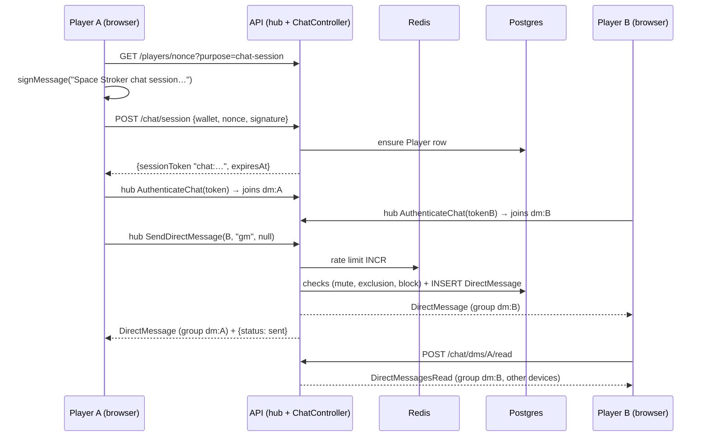

# SpaceStroker — "Chat revamp" Feature — Implementation Spec

> **Status: Ready for implementation** — refined via Trello card
> [Chat revamp](https://trello.com/c/il70nAG8/205-chat-revamp) (#205, 2026-10-19).
> Repos affected: `monkify-backend`, `monkify-front`, and this doc in `monkify-meta`.
> Level: **`Feature`**.
>
> **Purpose:** chat today is one room **per game type**, shown **only on the game screen**, and has
> **no authentication** — `SendPlayerChatMessage` trusts a client-supplied display name and wallet, so
> anyone can post as anyone (name, `LV` square and profile link included). This replaces it with **one
> app-wide room** reachable from **every page**, adds **player-to-player direct messages**, and gates
> **every send** behind a **7-day wallet-signed chat session** so the server — not the browser — decides
> who the sender is. Also: reply-to quotes, an approximate online count, a server-side per-wallet rate
> limit, and admin delete / mute.
>
> **Supersedes** [`chat-per-game-type.md`](chat-per-game-type.md) (room, history key, hub contract,
> history route) and the identity rule of [`game-chat.md`](game-chat.md) (client-trusted name). The
> daily purge job, the Redis-list history shape (RPUSH + LTRIM + EXPIRE, DB fallback + merge refill) and
> the 200-char limit carry over.

---

## 1. Summary

| Aspect | Today (`features/game-chat.md`) | After this spec |
| --- | --- | --- |
| **Room** | One per game type, group `chat:{gameTypeId}` | **One global room**, group `chat:global` |
| **Where** | Game screen only (docked panel / mobile `GAME \| CHAT`) | **Every page**: header chat button → drawer (desktop) / full-screen sheet (mobile) with **GLOBAL \| DMs**; the game screen panel shows the same global room. Hidden when embedded and on `/game/practice` |
| **Identity** | Client-supplied `displayName` + `wallet`, trusted | **Chat session** (one `signMessage`, 7 days). Server resolves wallet + display name. Level/theme stay client-resolved via `/players/levels` — now from a **verified** wallet |
| **History** | `GET /games/{id}/chat`, Redis `ChatHistory:{typeId}` | **`GET /chat`**, Redis `ChatHistory:global`, same 100 / `Chat.RetentionDays` (2) |
| **DMs** | — | Open DMs between player wallets, persisted 30 days, live via per-wallet group `dm:{wallet}`, server-side unread, block list |
| **Reply** | — | `replyTo { id, displayName, snippet ≤80, deleted }` on global + DM messages |
| **Online count** | — | Approximate, Redis-tracked, pushed every 30s |
| **Abuse** | Client-only 1 msg/s | Server per-wallet **1/s + 20/min** (silent drop) + admin **delete message** + admin **mute wallet** |
| **Self-exclusion** | Not considered | Global: unaffected. DMs: an excluded wallet cannot send or receive |

---

## 2. Constraints (MANDATORY)

From `monkify-meta/constraints.md` (full list there):

- **Worktree-per-repo:** work lives in `.worktrees/chat-revamp/<repo>` on branch `feature/chat-revamp`
  in `monkify-backend`, `monkify-front`, `monkify-meta`. Hubs stay on `main`.
- **Unit tests:** update/add in `SpaceStroker.Tests` (§11.1); run via `scripts/run_tests.bat`; report
  every changed/added test at the end.
- **Integration tests (MANDATORY — Level: Feature):** happy path end to end plus the complex flows in
  §11.2 (`SpaceStroker.Tests.Integration`, `scripts/run_integration_tests.bat`). `GameChatTests` is
  **replaced** (its hub methods are deleted).
- **EF mapping:** inline in `SpaceStrokerDbContext.OnModelCreating`; no `IEntityTypeConfiguration`.
  ⚠️ The context defaults to **NoTracking** — every write uses `AsTracking()`, `Add`, or `ExecuteUpdate/ExecuteDelete`.
- **Migrations:** under `SpaceStroker.Infrastructure/Migrations/`, generated with `dotnet ef`; applied only
  by `SpaceStroker.Consumers`. Never hand-edit the snapshot.
- **Host responsibilities:** the API owns the hub, the global Redis history, presence, rate limiting and
  **DM writes** (synchronous — a DM is persisted before it is delivered, decision #12). Global messages
  stay **async-persisted** via the existing event → consumer in `SpaceStroker.Consumers`.
- **User-facing messaging (§6):** a bad / expired / forged chat session, a bad signature, an unknown or
  replayed nonce → one vague result, never a reason. A refused DM (blocked, self-excluded, house, self,
  unknown wallet) → the single sentence **"This player is unavailable."** — a block must be
  indistinguishable from an exclusion.
- **Secrets/config:** **no new secret.** The chat token reuses the existing session HMAC key (§6.2), so
  there is no Secret Manager entry and no Terraform binding (see memory "deploy secrets need a Terraform
  binding"). New settings are non-secret and committed.
- **Frontend:** CRLF working tree, `.eslintrc` `endOfLine: 'auto'`; run `yarn lint` + `yarn build`.

---

## 3. Resolved product decisions

| # | Decision |
| --- | --- |
| 1 | Global chat **and** DMs ship together in #205 (one spec, one branch). |
| 2 | **One single app-wide room.** Per-type rooms removed; no channel picker. |
| 3 | **Everywhere:** header chat button opens a drawer (desktop, ≥`lg`) / full-screen sheet (mobile) on every page, tabs **GLOBAL \| DMs**. The game screen's docked `GameSidePanel` and the mobile `GAME \| CHAT` segment show the same global room. Hidden when embedded (`useEmbed().isEmbedded`) and on the `Practice` route. |
| 4 | **One wallet signature → a 7-day chat session** required for **any** send (global + DM). Server derives sender wallet + display name from the session + `Player` row; client values are ignored. Reading global needs nothing. `SendChatMessage` / `SendPlayerChatMessage` / `JoinChat` / `LeaveChat` are **removed** (stale tabs cannot send until refreshed — accepted). |
| 5 | **Open DMs:** any signed-in player can DM any player wallet that has a `Player` row, except **self** and **house wallets**. Recipient can **block**. |
| 6 | **DM retention 30 days** — new `Chat.DirectMessageRetentionDays` (committed 30), purged by the existing daily `game-chat-purge` job. A thread opens with the last **50**, paged older via a `before` cursor. |
| 7 | **In-app DM notifications only**, live via a per-wallet SignalR group joined with the chat session; **server-side last-read per conversation**; header badge = total unread DMs; per-conversation counts. No Telegram/push. |
| 8 | **Self-exclusion:** an excluded wallet keeps global chat (read + post) but **cannot send or receive DMs**; its past threads stay readable. A DM to it → "This player is unavailable." |
| 9 | **In:** reply-to + online count. **Out:** emoji picker, avatars (Profile V2 #202). |
| 10 | **Abuse:** server rate limit **1 msg/s and 20/min per wallet** (global + DM combined; excess dropped silently) + admin **delete global message** (removed live + from history + DB) + admin **mute wallet until a time** (blocks global + DM sends), `AdminToken`-gated, surfaced in `AdminPage`. |
| 11 | **Cutover:** the global room **starts clean**; old per-type rows and `ChatHistory:{typeId}` keys age out (2 days). No merge. |
| 12 | **Defaults (owner-confirmed):** reply snippet ≤ **80** chars; a deleted parent shows "message deleted"; online count approximate (Redis presence, pushed every **30 s**); DMs persisted **before** delivery; block = **DMs only**, per wallet, unblock from the thread; fixed anti-scam notice in every DM thread; DM limits = global (200 chars, plain text). |
| 13 | **Spec-time (security, no product change):** a chat token is **not interchangeable** with an Orbit/referral token — its signed payload carries a `chat:` prefix (§6.2). An Orbit token must never be able to chat-sign-in and, more importantly, a chat token must never authorise an Orbit bet. |
| 14 | **Spec-time:** level/theme stay **client-resolved** (`usePlayerLevels` → `GET /players/levels`) — the wallet on the message is now server-verified, so the badge is trustworthy without moving the level aggregate into the hot send path. |
| 15 | **Spec-time:** **minting a chat session creates the `Player` row** if missing (mirror `CreateOrbitSessionHandler.EnsurePlayerExists`), so every signed-in chatter is DM-reachable and has a place for block/read state. House wallets are refused at mint. |

---

## 4. Data model

### 4.1 `GameChatMessage` — global messages (`SpaceStroker.Domain/Games/Entities/GameChatMessage.cs`)

The table stays (it is the audit trail + history fallback). Global rows have **no** game type / round.

```csharp
public class GameChatMessage : TableEntity
{
    public GameChatMessage() { }

    public GameChatMessage(Guid id, string displayName, string text, DateTime sentAt, string wallet,
                           ChatReply? reply)
    {
        Id = id; DisplayName = displayName; Text = text; CreatedDate = sentAt; Wallet = wallet;
        ReplyToId = reply?.Id; ReplyToDisplayName = reply?.DisplayName; ReplyToSnippet = reply?.Snippet;
    }

    public Guid? GameTypeId { get; set; }      // legacy per-type rows only; null for global
    public Guid? GameId { get; set; }          // legacy audit only; null for global
    public string DisplayName { get; set; }
    public string Text { get; set; }
    public string? Wallet { get; set; }        // server-verified for every global row
    public Guid? ReplyToId { get; set; }
    public string? ReplyToDisplayName { get; set; }
    public string? ReplyToSnippet { get; set; }
    public bool ReplyToDeleted { get; set; }
}
```

`ChatReply` is a small domain record `(Guid Id, string DisplayName, string Snippet)` in
`SpaceStroker.Domain/Chat/ChatReply.cs`, with `ChatReply.SnippetOf(string text)` → first 80 chars
(trimmed; `…` appended when cut — the `…` counts toward the 80).

### 4.2 New entities (`SpaceStroker.Domain/Chat/Entities/`)

Everything is keyed by **wallet string** (`varchar(44)`), not a `Player` FK — the same reason the chat
row carries `Wallet`: purge and moderation must never be blocked by a row elsewhere, and a mute must be
placeable on any wallet.

```csharp
public class DirectMessage : TableEntity          // CreatedDate = sentAt
{
    public string SenderWallet { get; set; }
    public string RecipientWallet { get; set; }
    public string Text { get; set; }
    public Guid? ReplyToId { get; set; }
    public string? ReplyToSenderWallet { get; set; }
    public string? ReplyToSnippet { get; set; }
}

public class DirectMessageReadState : TableEntity
{
    public string OwnerWallet { get; set; }        // the reader
    public string CounterpartWallet { get; set; }
    public DateTime LastReadAt { get; set; }        // messages FROM counterpart with CreatedDate > this are unread
}

public class ChatBlock : TableEntity
{
    public string BlockerWallet { get; set; }
    public string BlockedWallet { get; set; }
}

public class ChatMute : TableEntity
{
    public string Wallet { get; set; }
    public DateTime MutedUntil { get; set; }
}
```

### 4.3 EF configuration (inline, `SpaceStrokerDbContext.cs`)

- `GameChatMessage` (existing block ~L250): `GameTypeId`/`GameId` **no longer required**;
  `ReplyToDisplayName` max 100, `ReplyToSnippet` max 80. Keep the three existing indexes; add
  `HasIndex(x => x.CreatedDate)` already exists (history fallback reads `CreatedDate DESC` for global
  rows: filter `GameTypeId == null`).
- `DirectMessage`: wallets required max 44, `Text` required max 200, `ReplyToSenderWallet` max 44,
  `ReplyToSnippet` max 80. Indexes `(SenderWallet, RecipientWallet, CreatedDate)`,
  `(RecipientWallet, CreatedDate)`, `(CreatedDate)`.
- `DirectMessageReadState`: wallets required max 44; **unique** `(OwnerWallet, CounterpartWallet)`.
- `ChatBlock`: wallets required max 44; **unique** `(BlockerWallet, BlockedWallet)`.
- `ChatMute`: `Wallet` required max 44, **unique**; `MutedUntil` required.
- New `DbSet`s: `DirectMessages`, `DirectMessageReadStates`, `ChatBlocks`, `ChatMutes`.

### 4.4 Migration

```bash
# from .worktrees/chat-revamp/monkify-backend/src
dotnet ef migrations add ChatRevamp \
  --project SpaceStroker.Infrastructure --startup-project SpaceStroker.Consumers
```

Additive + relaxing only: `AlterColumn GameTypeId/GameId → nullable`, four `AddColumn`s on
`GameChatMessages`, four `CreateTable`s. No backfill (decision #11). Safe to deploy ahead of the front.

---

## 5. Configuration

`SpaceStroker.Domain/Configs/Entities/ChatSettings.cs`:

```csharp
public int RetentionDays { get; set; } = 7;                 // committed 2 (global history)
public int DirectMessageRetentionDays { get; set; } = 30;   // NEW, committed 30
public int MessagesPerSecond { get; set; } = 1;             // NEW
public int MessagesPerMinute { get; set; } = 20;            // NEW
public int OnlineBroadcastSeconds { get; set; } = 30;       // NEW
```

`SpaceStroker.Common/spacestrokersettings.json` → `"Chat": { "RetentionDays": 2,
"DirectMessageRetentionDays": 30, "MessagesPerSecond": 1, "MessagesPerMinute": 20,
"OnlineBroadcastSeconds": 30 }`.

- **Remove** `GameSettings.GameChatEndpoint` and its json line (`"{0}/ChatMessage"`). Event names become
  constants in `SpaceStroker.Infrastructure/Services/Chat/ChatEvents.cs` (§6.4) — there is no value an
  operator would ever change, and a format string with a now-meaningless `{0}` invites misuse.
- Session TTL reuses `Orbit.SessionTtlDays` (7). No new secret (§6.2).
- No new AspNetCoreRateLimit rule (`RateLimitSettingsTests.GeneralRules_AreExactlyTheQuotaProtectingPatterns`
  must keep passing); hub paths stay whitelisted — the per-wallet limiter (§6.7) is the guard.

---

## 6. Backend behaviour

### 6.1 Chat session — mint (`POST /chat/session`)

- New nonce purpose `WalletNoncePurpose.ChatSession = "chat-session"` (add to the constants and
  `IsKnown()` in `GetWalletNonceRequest.cs`).
- Message (byte-identical in the front): `ChatMessages.BuildSessionMessage(wallet, nonce)` in
  `Services/Chat/ChatMessages.cs` →
  `"Space Stroker chat session\nWallet: {wallet}\nNonce: {nonce}"`.
- Handler `Handlers/Chat/CreateChatSession/CreateChatSessionHandler.cs` (request
  `{ Wallet, Nonce, Signature }`, response `ChatSessionDto { SessionToken, ExpiresAt }`):
  1. `WalletAddress.IsValid(wallet)` else vague failure.
  2. House wallet (`HouseWallets.Resolve(settings.Operator.Token)`) → vague failure.
  3. `WalletProof.TryConsume(cache, ChatSession, wallet, nonce, signature, ChatMessages.BuildSessionMessage)`
     else vague failure.
  4. Ensure the `Player` row exists (copy `CreateOrbitSessionHandler.EnsurePlayerExists`, `AsTracking`,
     unique-violation tolerant).
  5. Return `_sessions.MintChat(wallet)` + expiry.
- Every failure → one validation message `ErrorMessages.ChatSessionInvalid` = *"Your chat sign-in could
  not be completed."* (400). Self-exclusion does **not** block minting (global chat is allowed).
- Route: `ChatController` `[Route("chat")]`, `[HttpPost("session")]`.

### 6.2 Chat tokens are not session tokens (`WalletSessionService`)

Extend `IWalletSessionService` with:

```csharp
string MintChat(string wallet);                       // payload "chat:{wallet}|{exp}"
string? ValidateChatAndGetWallet(string? token);      // requires the "chat:" prefix, strips it
```

Same HMAC key, same TTL, same format (`Base64Url(payload).Base64Url(hmac)`). Refactor the parse into one
private `TryParse(token, out payload-wallet-part)` and:

- `ValidateAndGetWallet` (Orbit / referral) **returns null if the wallet part contains `:`** — base58
  never does, so every real token minted so far still validates, and a chat token never does.
- `ValidateChatAndGetWallet` returns null unless the wallet part starts with `chat:`, then returns the
  remainder (still validated with `WalletAddress.IsValid`).

Unit tests pin both directions (§11.1).

### 6.3 Hub (`SpaceStroker.Infrastructure/Hubs/ActiveGamesHub.cs`)

Remove `ChatGroupPrefix`, `ChatGroupFor`, `JoinChat`, `LeaveChat`, `SendChatMessage`,
`SendPlayerChatMessage`. Keep `ResolveActiveGameType` (duel board uses it). Replace the hub's direct
`IChatHistoryStore` dependency with **`IChatService`** (§6.5) and **`IChatPresence`** (§6.8) so the hub
stays thin; the constructor becomes
`(GeneralSettings, IMessageBus, IWalletSessionService, SpaceStrokerDbContext, IGameService, IChatService, IChatPresence)`.

```csharp
public const string GlobalChatGroup = "chat:global";
public const string ChatWalletItemKey = "chat-wallet";
public const string ChatTokenItemKey = "chat-token";
public static string DirectMessageGroupFor(string wallet) => $"dm:{wallet}";

public async Task JoinGlobalChat()          // anonymous; also registers presence
public async Task LeaveGlobalChat()         // removes presence
public async Task<bool> AuthenticateChat(string sessionToken)
public async Task SendGlobalMessage(string text, string? replyToId)
public async Task<DirectMessageSendResult> SendDirectMessage(string recipientWallet, string text, string? replyToId)
public override async Task OnDisconnectedAsync(Exception? e)   // presence remove, then base
```

- `AuthenticateChat`: `ValidateChatAndGetWallet(token)`; null → return `false`, join nothing. Else add the
  connection to `DirectMessageGroupFor(wallet)` (name derived **server-side**, never from the caller),
  store wallet + token in `Context.Items`, return `true`. Re-called by the client after every reconnect.
- Sends read the wallet from `Context.Items` and **re-validate the stored token** (cheap HMAC — a 7-day
  token can expire on a long-lived socket). Not authenticated / expired → global: silent drop; DM:
  `Dropped`.
- `DirectMessageSendResult(string Status, DirectMessageDto? Message)` where `Status` ∈
  `"sent" | "unavailable" | "dropped"` (`ChatSendStatus` constants). The front shows the vague sentence
  only for `unavailable`; `dropped` (rate limit, mute, bad text, no session) keeps the text in the input.

### 6.4 Payloads and events (`Services/Chat/ChatEvents.cs`, `Contracts/Chat/*`)

```csharp
public static class ChatEvents
{
    public const string GlobalMessage = "ChatMessage";
    public const string GlobalMessageDeleted = "ChatMessageDeleted";   // { id }
    public const string OnlineCount = "ChatOnlineCount";               // { count }
    public const string DirectMessage = "DirectMessage";               // DirectMessageDto
    public const string DirectMessagesRead = "DirectMessagesRead";     // { counterpartWallet, lastReadAt }
}

public record ChatReplyDto(Guid Id, string DisplayName, string? Snippet, bool Deleted);
public record ChatMessageDto(Guid Id, string DisplayName, string Text, DateTime SentAt, string? Wallet, ChatReplyDto? ReplyTo);
public record DirectMessageDto(Guid Id, string SenderWallet, string RecipientWallet, string Text, DateTime SentAt, ChatReplyDto? ReplyTo);
```

Payloads are sent as **objects** via the camelCase JSON protocol (the old `.AsJson()` string payload is
dropped; the front's `JSON.parse` goes with it). `GameChatMessageDto` is renamed `ChatMessageDto` and
moved to `Contracts/Chat/`. For a DM reply, `ChatReplyDto.DisplayName` = the parent sender's display name
resolved at send (stored as `ReplyToSenderWallet`; the DTO resolves name at read via the `Player` row,
falling back to the short wallet).

**Display name rule (server):** `Player.DisplayName` if set, else `ChatNames.Short(wallet)` =
`first4 + "…" + last4` (same shape as the front's `shortenId`).

### 6.5 `IChatService` (`Services/Chat/ChatService.cs`, scoped)

Owns the send logic so the hub and tests share it. Dependencies: `SpaceStrokerDbContext`,
`IChatHistoryStore`, `IChatRateLimiter`, `IMessageBus`, `IHubContext<ActiveGamesHub>`, `GeneralSettings`.

**`SendGlobalAsync(wallet, text, replyToId)`** — in order, any failure returns silently:
1. Text non-empty after trim and ≤ 200.
2. Load sender `Player` (wallet) → display name; **active `ChatMute`** (`MutedUntil > now`) → drop.
3. `IChatRateLimiter.TryAcquire(wallet)` → drop when over.
4. Reply: if `replyToId` parses, look it up in the global history store (then DB, `GameTypeId == null`);
   not found → send **without** a reply (never refuse the message for a stale reply).
5. Build `ChatMessageDto` (`Guid.NewGuid()`, `DateTime.UtcNow`) → broadcast `ChatEvents.GlobalMessage`
   to `GlobalChatGroup` → `_history.AppendAsync(ChatRooms.Global, dto)` → publish
   `ChatMessagePersistedEvent`.

**`SendDirectAsync(senderWallet, recipientWallet, text, replyToId)`**:
1. Text guard → `dropped`.
2. Sender `Player`; active mute → `dropped`; rate limit → `dropped`.
3. **Sender self-excluded** (`SelfExcludedAt != null && (SelfExcludedUntil == null || SelfExcludedUntil > now)`)
   → `unavailable`.
4. Recipient: `WalletAddress.IsValid`, not self, not a house wallet, **has a `Player` row**, **not
   self-excluded**, and **no `ChatBlock(blocker = recipient, blocked = sender)`** — any failure →
   `unavailable`.
5. Reply: must be a `DirectMessage` in **this** conversation (either direction) still in the table;
   else send without reply.
6. **Insert** `DirectMessage` (`SaveChangesAsync`) — then push `ChatEvents.DirectMessage` to
   `DirectMessageGroupFor(recipient)` **and** `DirectMessageGroupFor(sender)` (sender's other tabs/devices).
7. Return `sent` + DTO.

### 6.6 History store (`Services/Chat/*`)

Re-key the store by a **room string** instead of a game-type Guid: `AppendAsync(string room, ChatMessageDto)`,
`ReadAsync(string room)`, `RefillAsync(string room, list)`, plus new **`RemoveAsync(string room, Guid id)`**
(rewrite the list without that id **and** with every reply to it patched `Deleted = true, Snippet = null`,
in one transaction; TTL preserved). `ChatRooms.Global = "global"`; key
`CacheHelper.GenerateChatHistoryKey(string room) => $"ChatHistory:{room}"`. Memory store mirrors it.

### 6.7 Rate limiter (`Services/Chat/IChatRateLimiter.cs`)

`Task<bool> TryAcquireAsync(string wallet)`. Redis implementation (`IConnectionMultiplexer`, singleton):
`INCR ChatRate:s:{wallet}:{unixSecond}` (EXPIRE 2s) and `INCR ChatRate:m:{wallet}:{unixMinute}`
(EXPIRE 70s) in one batch; allowed iff `s ≤ MessagesPerSecond && m ≤ MessagesPerMinute`. A Redis
error **allows** (fail-open — chat must not die with Redis; the client limit still applies).
Memory fallback (`ConcurrentDictionary`, same windows) registered in the existing Redis-vs-memory
branch of `DependencyInjection.cs`. Global + DM share the budget.

### 6.8 Presence / online count (`Services/Chat/IChatPresence.cs`)

- `JoinGlobalChat` → `AddAsync(connectionId)`; `LeaveGlobalChat` / `OnDisconnectedAsync` → `RemoveAsync`.
- Redis implementation: sorted set `ChatOnline`, member = connectionId, score = last-seen unix seconds.
  Each API instance keeps its own joined connection ids in a static `ConcurrentDictionary`.
- **`ChatPresenceBroadcaster`** (`BackgroundService`, registered in **`SpaceStroker.Api` only**): every
  `OnlineBroadcastSeconds` it re-scores its local ids (`ZADD`), `ZREMRANGEBYSCORE` entries older than
  `3 × OnlineBroadcastSeconds` (a dead instance's members age out), `ZCARD`, and broadcasts
  `ChatEvents.OnlineCount { count }` to `GlobalChatGroup`. Several instances broadcasting the same number
  is harmless. Memory fallback counts the local dictionary.
- `JoinGlobalChat` also sends the caller the current count immediately (`Clients.Caller`).

### 6.9 Global history route (`GET /chat`)

`Handlers/Chat/GetGlobalChat/GetGlobalChatHandler.cs` — the old `GetGameChatHandler` re-keyed: read
`ChatHistory:global`, filter `SentAt ≥ cutoff`; on miss read the newest 100 `GameChatMessages` with
`GameTypeId == null && CreatedDate ≥ cutoff` (reversed), map replies, refill. Anonymous. Delete
`GetGameChat*` and `GamesController`'s `{parametersId}/chat` route.

### 6.10 Persistence consumer (`Consumers/ChatMessagePersisted/*`)

`ChatMessagePersistedEvent(Guid Id, string DisplayName, string Text, DateTime SentAt, string Wallet,
Guid? ReplyToId, string? ReplyToDisplayName, string? ReplyToSnippet)` — drop the game-type/round fields
and the `Guid.Empty` guard (an old queued event deserializes with extra fields ignored and simply
persists as a global row with `GameTypeId = null` — acceptable for ≤ a deploy's worth of messages).
Idempotency unchanged. **New:** skip the insert if `ChatDeleted:{id}` exists in the cache (an admin
deleted it before the consumer ran — §6.12).

### 6.11 DM HTTP routes (`ChatController`, header `X-Chat-Session`)

`Api/Chat/ChatSessionAccessor.cs` (mirror `ReferralSessionAccessor`, but calls
`ValidateChatAndGetWallet`). Missing/invalid session → 401 with the generic body (same as
`OrbitController.RejectWithoutSession`).

| Route | Behaviour |
| --- | --- |
| `GET /chat/dms` | Conversations of the session wallet within `DirectMessageRetentionDays`: one row per counterpart `{ counterpartWallet, counterpartDisplayName, lastMessage: DirectMessageDto, unreadCount, blocked }`, newest first, max 50; plus `totalUnread`. Unread = messages **from** the counterpart with `CreatedDate > LastReadAt` (no read state ⇒ all). Two grouped queries, no N+1. |
| `GET /chat/dms/{wallet}?before={iso}` | The thread, **oldest first**, page of 50 older than `before` (default now), `{ messages, hasMore, counterpartDisplayName, blocked, available }`. `available` = the counterpart could receive a DM right now (same checks as §6.5 step 4 **minus** the block-by-them check, which is never revealed); used to disable the composer. An invalid wallet → empty thread, `available = false`. |
| `POST /chat/dms/{wallet}/read` | Upsert `DirectMessageReadState.LastReadAt = max(existing, newest message from counterpart)`; push `ChatEvents.DirectMessagesRead` to the owner's own group (clears other devices). 204. |
| `POST /chat/blocks/{wallet}` / `DELETE /chat/blocks/{wallet}` | Idempotent upsert / delete of `ChatBlock(blocker = session wallet)`. Blocking does **not** delete history. 204. |

Self-excluded owner: reads still work (decision #8); sends are refused in the hub.

### 6.12 Admin (`AdminController`, `X-Admin-Token`)

Add the routes to the controller's `[HttpOptions]` preflight list.

| Route | Behaviour |
| --- | --- |
| `DELETE /admin/chat/messages/{id:guid}` | `RemoveAsync(ChatRooms.Global, id)`; set `ChatDeleted:{id}` (TTL `RetentionDays`); `ExecuteDelete` the row; `ExecuteUpdate` replies (`ReplyToId == id` → `ReplyToDeleted = true, ReplyToSnippet = null`); broadcast `ChatEvents.GlobalMessageDeleted { id }`. Unknown id → 404 (authenticated route: specific is fine). |
| `GET /admin/chat/mutes` | Active mutes `{ wallet, mutedUntil }`. |
| `POST /admin/chat/mutes` | `{ wallet, mutedUntil }` — valid wallet, `mutedUntil > now` (field-level 400s allowed). Upsert. |
| `DELETE /admin/chat/mutes/{wallet}` | Remove. 204. |

DMs cannot be read or deleted by admins (out of scope).

### 6.13 Purge (`Jobs/ChatMessagePurgeJob.cs`)

Same daily job, three more statements: `DirectMessages` older than `DirectMessageRetentionDays`;
`DirectMessageReadStates` with `LastReadAt` older than that; `ChatMutes` with `MutedUntil < now`.

---

## 7. Frontend behaviour

### 7.1 Composables (new)

- **`hooks/useChatSession.ts`** — module singleton. `ensureChatSession(wallet, { allowHop })` →
  stored token (`space-stroker.chat-session.${wallet}`, `{ sessionToken, expiresAt }`, client expiry
  check) else `getWalletNonce(wallet, 'chat-session')` → sign `buildChatSessionMessage` (byte-identical to
  §6.1) → `chatService.createChatSession` → store. Mirrors `useOrbit.ensureSession` incl. the **mobile
  deeplink hop**: new `MobilePendingChat` stash + `signMobileChat` / `getPendingChat` in
  `useMobileWallet.ts`, and a resume arm in `useGame.handleMobileDeeplinkReturn` **before** the bet arm
  (after resume, reopen the drawer and authenticate). `forgetChatSession(wallet)` on any 401.
  `allowHop` only on a user click (send / MESSAGE), never on background calls.
- **`hooks/useGlobalChat.ts`** — module singleton, replaces the chat parts of `useGame` and
  `useGameChat`: `messages`, `onlineCount`, `lastLiveMessage`, `replyingTo`, `start()` (ensure
  connected → `hub.joinGlobalChat(handlers)` → `getGlobalChat()` → merge by `id`, sort by `sentAt`),
  `send(text)` (client limits 200 chars / 1 per s kept; `ensureChatSession` + `authenticateChat` on
  first send; `invoke('SendGlobalMessage', text, replyingTo?.id ?? null)`), deleted-message handling
  (remove + patch replies), `canSend`, `validationMessage`, `ownWallet`.
- **`hooks/useDirectMessages.ts`** — module singleton: `conversations`, `totalUnread`, `activeThread`
  (`wallet`, `messages`, `hasMore`, `available`, `blocked`, `counterpartDisplayName`), `loadConversations`,
  `openThread(wallet)` (load + mark read), `loadOlder`, `send(text)` (`invoke('SendDirectMessage', …)`;
  `unavailable` → toast "This player is unavailable." and set `available = false`), `block`/`unblock`,
  live handlers for `DirectMessage` (append to the open thread and mark read, else bump that
  conversation + `totalUnread`) and `DirectMessagesRead`. `requestMessage({ wallet, name })` mirrors
  `useDonate.requestDonate`: no wallet → `afterConnect` + `requestConnect`; then open the drawer on DMs
  with that thread.
- **`hooks/useChatDrawer.ts`** — `isOpen`, `tab: 'global' | 'dms'`, `open(tab?)`, `close()`.

### 7.2 Hub (`hooks/useGameHub.ts`)

Replace `attachToChat` / `detachFromChat` / `onChatRejoined` / `currentChatTypeId` with:
`joinGlobalChat(handlers)` (binds `ChatMessage`, `ChatMessageDeleted`, `ChatOnlineCount`; invokes
`JoinGlobalChat`), `leaveGlobalChat()`, `authenticateChat(token, dmHandlers)` (binds `DirectMessage`,
`DirectMessagesRead`; invokes `AuthenticateChat`). `onreconnected` re-invokes `JoinGlobalChat` +
`AuthenticateChat` (stored token) and calls a `chatRejoined` hook (refetch history + conversations).
**Rebind on a rebuilt connection:** when `ensureConnected` builds a **new** `HubConnection`, re-run the
global + DM joins and handler binds (today a rebuilt connection silently loses chat — blocker found in
exploration). `stopForIdle` clears the chat flags; opening the drawer calls `ensureConnected` + rejoin.

### 7.3 App-wide start

`GameHeader.vue` (next to `useOrbitNotifications().start()` ~L115, the one component mounted app-wide):
when `!isEmbedded && route.name !== 'Practice'`, call `useGlobalChat().start()`; when a wallet is
connected **and** a stored chat session exists, `authenticateChat` silently (no signature prompt) and
`loadConversations()` so the badge is right on load. On wallet change: leave the old DM group (by
re-authenticating), reset DM state.

### 7.4 UI

- **`components/chat/ChatButton.vue`** in `GameHeader` right cluster (before the menu root): pixel `chat`
  icon (new entry in `constants/icons.ts`) + numeric badge `totalUnread` (`99+` cap). Hidden when
  embedded / Practice. Fits the 54px mobile bar.
- **`components/chat/ChatDrawer.vue`** mounted once in `App.vue` (beside `<player-card/>`),
  `<Teleport to="#app">` (the header's `backdrop-filter` traps `fixed` children). Desktop: a **docked
  340px column** under the header (`z-furniture`), **not a modal** — no backdrop, scroll lock or focus
  trap, so the page stays usable while chatting. It publishes `--chat-dock-w` on `<html>` and `<main>`
  (`.chat-dock-aware`) pads by it, so the page reflows instead of being covered. Collapses to a 48px rail
  (unread count + expand); open/collapsed is remembered in `localStorage` (`ss_chat_dock`, desktop only);
  the header button toggles it; in-chat profile links keep it open (`dismissForNavigation` closes only the
  mobile sheet); a collapsed column does not count as "thread on screen" for DM read state. Mobile
  (`useIsMobile`): full-screen modal sheet (`useOverlayStack`, `useFocusTrap`, `useBodyScrollLock`).
  Tabs **GLOBAL | DMs** (DMs tab shows the unread count).
- **`components/chat/GlobalChatView.vue`** — the message list + composer extracted from
  `GameChatPanel.vue` (keeps the `LV` square / theme / profile link rendering via `usePlayerLevels`), plus:
  room title "GLOBAL CHAT" + "N online"; per-message **reply** action; quote line `↪ name: snippet` (or
  "message deleted"); a reply bar above the input with ✕.
- **`components/chat/ChatComposer.vue`** — input + SEND + reply bar, shared by global and DM.
- **`components/chat/DirectMessagesView.vue`** — conversation list (counterpart `PlayerTag`, last line,
  unread count, newest first; empty state "No messages yet. Tap a player's name to start one.") and
  the thread (back arrow, header with name + BLOCK/UNBLOCK, **fixed notice** *"Staff will never DM you
  asking for funds, seed phrases or keys."*, "LOAD OLDER" on scroll-top / button, composer). Composer
  disabled with *"This player is unavailable."* when `available === false`; when the owner is
  self-excluded: *"Direct messages are unavailable while self-excluded."* (owner-only copy, not a leak).
- **`GameChatPanel.vue`** becomes a thin wrapper rendering `GlobalChatView` (docked/maximized props kept);
  `GameSidePanel` / `GameMobileTabs` unchanged otherwise; the mobile unread **dot** keeps working off
  `useGlobalChat().lastLiveMessage` (live only, not mine).
- **MESSAGE buttons:** `PlayerProfilePage.vue` hero next to DONATE (~L344) and `PlayerCardBody.vue` button
  row (~L197), shown when available and not own wallet → `requestMessage`.
- **No wallet:** "CONNECT WALLET TO CHAT" (existing copy) in both tabs; DMs tab shows the connect CTA.
- **Admin:** `GameTypeManager.vue` gets a `'chat'` section → new `components/admin/ChatModerationManager.vue`:
  the last 100 global messages (from `GET /chat`) each with DELETE (confirm), a mute form (wallet + preset
  1h / 24h / 7d / 30d), and the active mutes list with UNMUTE. `adminService` gains
  `deleteChatMessage`, `getChatMutes`, `muteChatWallet`, `unmuteChatWallet`.

### 7.5 Services / types

- `services/chatService.ts` (new): `CHAT_SESSION_HEADER = 'X-Chat-Session'`, `createChatSession`,
  `getConversations`, `getThread(wallet, before?)`, `markRead`, `block`, `unblock`; `getGlobalChat`
  (`GET /chat`, single-flighted).
- `mainService.getWalletNonce` purpose union gains `'chat-session'`; remove `getGameChat`.
- `types/chat.ts`: `ChatReply`, `ChatMessage` (moved from `types/index.ts`, + `replyTo`),
  `DirectMessage`, `Conversation`, `ConversationsResponse`, `ThreadResponse`, `DirectMessageSendResult`.
- Remove the chat code from `useGame.ts` (`chatMessages`, `mergeChatMessages`, `loadChatHistory`,
  `onChatMessage`, `sendChatMessage`, the room join in `initalizeWebsocketConnections`) and delete
  `useGameChat.ts` (folded into `useGlobalChat`).

---

## 8. Flow diagrams



---

## 9. Out of scope

Emoji picker; avatars (Profile V2 #202); message requests; Telegram / browser-push DM notifications;
editing messages; images / links / rich text; admins reading or deleting DMs; channels or language rooms;
terms/privacy copy for DMs (stays with #202's legal pass); migrating old per-type history.

---

## 10. File checklist

### 10.1 Backend (`monkify-backend/src`)

| # | File | Change |
| --- | --- | --- |
| 1 | `SpaceStroker.Domain/Games/Entities/GameChatMessage.cs` | Nullable `GameTypeId`/`GameId`; reply columns; new ctor (§4.1) |
| 2 | `SpaceStroker.Domain/Chat/ChatReply.cs` | New record + `SnippetOf` |
| 3 | `SpaceStroker.Domain/Chat/Entities/{DirectMessage,DirectMessageReadState,ChatBlock,ChatMute}.cs` | New |
| 4 | `SpaceStroker.Domain/Configs/Entities/ChatSettings.cs` | 4 new settings |
| 5 | `SpaceStroker.Domain/Configs/Entities/GameSettings.cs` | Remove `GameChatEndpoint` |
| 6 | `SpaceStroker.Common/spacestrokersettings.json` | `Chat` block; remove `GameChatEndpoint` |
| 7 | `SpaceStroker.Infrastructure/Data/Context/SpaceStrokerDbContext.cs` | Mapping + DbSets (§4.3) |
| 8 | `SpaceStroker.Infrastructure/Migrations/*_ChatRevamp.cs` | Generated |
| 9 | `SpaceStroker.Infrastructure/Services/Wallets/{IWalletSessionService,WalletSessionService}.cs` | `MintChat`, `ValidateChatAndGetWallet`, `:` guard (§6.2) |
| 10 | `SpaceStroker.Infrastructure/Handlers/Players/GetWalletNonce/GetWalletNonceRequest.cs` | `ChatSession` purpose |
| 11 | `SpaceStroker.Infrastructure/Services/Chat/ChatMessages.cs` | Session message builder |
| 12 | `SpaceStroker.Infrastructure/Services/Chat/{ChatEvents,ChatRooms,ChatNames,ChatSendStatus}.cs` | Constants/helpers |
| 13 | `SpaceStroker.Infrastructure/Services/Chat/{IChatHistoryStore,RedisChatHistoryStore,MemoryChatHistoryStore,ChatHistory}.cs` | Room-string key, `RemoveAsync`, DTO rename |
| 14 | `SpaceStroker.Infrastructure/Services/Chat/{IChatService,ChatService}.cs` | New (§6.5) |
| 15 | `SpaceStroker.Infrastructure/Services/Chat/{IChatRateLimiter,RedisChatRateLimiter,MemoryChatRateLimiter}.cs` | New (§6.7) |
| 16 | `SpaceStroker.Infrastructure/Services/Chat/{IChatPresence,RedisChatPresence,MemoryChatPresence,ChatPresenceBroadcaster}.cs` | New (§6.8) |
| 17 | `SpaceStroker.Infrastructure/Services/Cache/CacheHelper.cs` | `GenerateChatHistoryKey(string)`, `ChatDeleted:{id}` key |
| 18 | `SpaceStroker.Infrastructure/DependencyInjection.cs` | Register chat services (Redis vs memory branch) |
| 19 | `SpaceStroker.Infrastructure/Hubs/ActiveGamesHub.cs` | §6.3 |
| 20 | `SpaceStroker.Infrastructure/Contracts/Chat/*` | `ChatMessageDto`, `ChatReplyDto`, `DirectMessageDto`, `DirectMessageSendResult`, `ChatSessionDto`, conversation/thread DTOs; delete `Contracts/Games/GameChatMessageDto.cs` |
| 21 | `SpaceStroker.Infrastructure/Handlers/Chat/CreateChatSession/*` | New |
| 22 | `SpaceStroker.Infrastructure/Handlers/Chat/GetGlobalChat/*` | New (from `GetGameChat`); delete `Handlers/Games/GetGameChat/*` |
| 23 | `SpaceStroker.Infrastructure/Handlers/Chat/{GetConversations,GetThread,MarkThreadRead,SetChatBlock}/*` | New |
| 24 | `SpaceStroker.Infrastructure/Handlers/Admin/{DeleteChatMessage,GetChatMutes,SetChatMute,RemoveChatMute}/*` | New |
| 25 | `SpaceStroker.Infrastructure/Consumers/ChatMessagePersisted/*` | Event shape, `ChatDeleted` skip |
| 26 | `SpaceStroker.Infrastructure/Jobs/ChatMessagePurgeJob.cs` | DM / read-state / mute purge |
| 27 | `SpaceStroker.Infrastructure/Messaging/ErrorMessages.resx` (or the existing error source) | `ChatSessionInvalid`, `PlayerUnavailable` |
| 28 | `SpaceStroker.Api/Controllers/ChatController.cs` | New |
| 29 | `SpaceStroker.Api/Chat/ChatSessionAccessor.cs` + `Program.cs` | Accessor, `ChatPresenceBroadcaster` hosted service |
| 30 | `SpaceStroker.Api/Controllers/GamesController.cs` | Remove chat route |
| 31 | `SpaceStroker.Api/Controllers/AdminController.cs` | 4 routes + OPTIONS list |

### 10.2 Frontend (`monkify-front/src`)

| # | File | Change |
| --- | --- | --- |
| 1 | `hooks/useChatSession.ts` | New |
| 2 | `hooks/useGlobalChat.ts` | New |
| 3 | `hooks/useDirectMessages.ts` | New |
| 4 | `hooks/useChatDrawer.ts` | New |
| 5 | `hooks/useGameHub.ts` | §7.2 |
| 6 | `hooks/useGame.ts` | Remove chat; deeplink resume arm |
| 7 | `hooks/useGameChat.ts` | Delete (folded into `useGlobalChat`) |
| 8 | `hooks/useMobileWallet.ts`, `types/mobileWallet.ts` | Chat-session stash + hop |
| 9 | `services/chatService.ts` | New |
| 10 | `services/mainService.ts` | Nonce purpose; remove `getGameChat` |
| 11 | `services/adminService.ts` | 4 moderation calls |
| 12 | `types/chat.ts`, `types/index.ts` | New types; move `ChatMessage` |
| 13 | `constants/icons.ts` (+ icon asset) | `chat` icon |
| 14 | `components/chat/{ChatButton,ChatDrawer,GlobalChatView,ChatComposer,DirectMessagesView}.vue` | New |
| 15 | `components/game/GameChatPanel.vue` | Wrapper around `GlobalChatView` |
| 16 | `components/GameHeader.vue` | Chat button, app-wide start |
| 17 | `App.vue` | Mount `ChatDrawer` |
| 18 | `pages/PlayerProfilePage.vue`, `components/player/PlayerCardBody.vue` | MESSAGE button |
| 19 | `components/admin/GameTypeManager.vue`, `components/admin/ChatModerationManager.vue` | Chat section |
| 20 | `pages/GamePage.vue` | Unread dot source |

### 10.3 Meta (`monkify-meta`)

| # | File | Change |
| --- | --- | --- |
| 1 | `specs/chat-revamp.md` | This spec |
| 2 | `INDEX.md` | Map row + in-flight |
| 3 | (ship) `features/chat.md` | New; supersedes `features/game-chat.md` |

---

## 11. Tests

### 11.1 Unit (`SpaceStroker.Tests`)

| Test file | Cases |
| --- | --- |
| `UnitTests/Wallets/WalletSessionServiceTests.cs` (extend) | chat token round-trips via `ValidateChatAndGetWallet`; a chat token returns **null** from `ValidateAndGetWallet`; an Orbit token returns **null** from `ValidateChatAndGetWallet`; expired / tampered chat token → null |
| `UnitTests/Handlers/CreateChatSessionHandlerTests.cs` | valid proof mints + creates Player; existing Player reused; house wallet / bad signature / replayed nonce / invalid wallet → same `ChatSessionInvalid` |
| `UnitTests/Chat/ChatServiceGlobalTests.cs` | broadcast + history append + event published with server display name (or short wallet); empty/over-length dropped; muted dropped; rate-limited dropped; reply resolved (snippet ≤ 80); unknown reply → sent without reply |
| `UnitTests/Chat/ChatServiceDirectTests.cs` | sent: persisted then pushed to both groups; recipient blocked sender / self-excluded / house / self / no Player / invalid → `unavailable` + nothing stored; sender self-excluded → `unavailable`; muted / rate-limited / bad text → `dropped`; reply outside the conversation → sent without reply |
| `UnitTests/Chat/MemoryChatRateLimiterTests.cs` | 1/s; 20/min; windows roll |
| `UnitTests/Chat/MemoryChatHistoryStoreTests.cs` (update) | room-string keys; `RemoveAsync` removes + patches replies |
| `UnitTests/Chat/ChatMessagePersistedConsumerTests.cs` (update) | new event shape; `ChatDeleted` skip; idempotent |
| `UnitTests/Chat/ChatMessagePurgeJobTests.cs` (update) | DMs past 30d, read states, expired mutes purged; recent kept |
| `UnitTests/Handlers/GetGlobalChatHandlerTests.cs` (from `GetGameChatHandlerTests`) | store hit; retention filter; miss → DB (global rows only) + refill |
| `UnitTests/Handlers/GetConversationsHandlerTests.cs` | grouping, newest first, unread counts with/without read state, retention |
| `UnitTests/Handlers/GetThreadHandlerTests.cs` | paging `before`, `hasMore`, `available` false for excluded/house, `blocked` flag |
| `UnitTests/Handlers/MarkThreadReadHandlerTests.cs` | upsert, never moves backwards |
| `UnitTests/Handlers/Admin/ChatModerationHandlerTests.cs` | delete → store removal + row delete + replies patched + tombstone; unknown id 404; mute upsert / validation; unmute |
| `UnitTests/Hubs/ActiveGamesHubTests.cs` (update) | new ctor; `AuthenticateChat` joins `dm:{wallet}` only with a chat token (Orbit token → false); send without auth → dropped; old chat tests removed |
| `UnitTests/Hubs/HubDuelHarness.cs` (update) | new ctor |
| `UnitTests/Api/RateLimitSettingsTests.cs` | unchanged — must still pass |

### 11.2 Integration (`SpaceStroker.Tests.Integration`) — MANDATORY

Replace `GameChatTests.cs` with `ChatFlowTests.cs`:

1. **Happy path (global + DM):** wallet A and B each sign a real nonce (`MintWalletNonceAsync(…, "chat-session")`
   + Solnet `Account.Sign`) → `POST /chat/session`; two hub connections `JoinGlobalChat` +
   `AuthenticateChat`; A `SendGlobalMessage` → B receives `ChatMessage` with A's server-resolved name and
   wallet → it appears in `GET /chat` (and, after the consumer, in `GameChatMessages` with
   `GameTypeId == null`); A `SendDirectMessage(B)` → status `sent`, B receives `DirectMessage`, row
   persisted, `GET /chat/dms` (B) shows unread 1 → `POST /chat/dms/A/read` → 0.
2. **Refusal flow (complex):** B blocks A → A's DM returns `unavailable`, nothing stored, B receives
   nothing; unblock → sent.
3. **Moderation flow (complex):** A posts, B replies to it; admin `DELETE /admin/chat/messages/{id}` →
   both connections get `ChatMessageDeleted`; `GET /chat` no longer has it and B's reply has
   `replyTo.deleted = true`; admin mutes A → A's next global send is not delivered.
4. **Token separation:** an Orbit session token (`MintOrbitSession`) → `AuthenticateChat` returns false.

---

## 12. Acceptance criteria

(From the Trello checklist.)

1. Given two players on different pages (home and a game screen), when one signed-in player sends a global message, then both see it live in the same global room.
2. Given any page outside embed/practice, when the player clicks the header chat button, then a drawer (desktop) or full-screen sheet (mobile) opens with GLOBAL | DMs tabs.
3. Given a visitor with no wallet, when they open chat, then they can read the global room and its last 100 messages within 2 days via GET /chat, but cannot send.
4. Given a connected wallet with no chat session, when the player sends their first message, then one wallet signature is requested and a 7-day chat session is created; later sends need no signature until it expires.
5. Given a send call carrying a forged display name or another wallet, when the server broadcasts it, then the sender name, wallet, level and theme are those of the session's wallet.
6. Given an invalid or expired chat session, when a send is attempted, then nothing is broadcast or stored and no distinguishable error is returned.
7. Given the old per-type rooms, when this ships, then JoinChat(typeId), GET /games/{id}/chat and SendChatMessage/SendPlayerChatMessage are removed and the global room starts empty.
8. Given a message in the room, when a player replies to it, then the reply shows a quote line with the parent's name and a snippet of at most 80 characters.
9. Given a replied-to message is deleted by an admin, when the reply is shown, then its quote reads "message deleted".
10. Given the global room, when connections join and leave, then an approximate online count next to the room title updates at least every 30 seconds.
11. Given two signed-in players, when A clicks MESSAGE on B's profile or mini card and sends a DM, then B receives it live on any page, the DM is persisted, and B's header badge and conversation unread count increase by 1.
12. Given B has unread DMs from A, when B opens the conversation, then it is marked read server-side and the unread counts drop to 0 on every device after refresh.
13. Given a conversation with more than 50 messages, when it opens, then the last 50 load and scrolling up loads older ones.
14. Given a DM older than Chat.DirectMessageRetentionDays (30), when the daily purge job runs, then it is deleted.
15. Given B has blocked A, when A sends B a DM, then A sees "This player is unavailable", nothing is stored, and B is not notified.
16. Given B is self-excluded, when anyone sends B a DM, then the sender sees "This player is unavailable" and nothing is stored.
17. Given A is self-excluded, when A opens chat, then A can read and post in global and read old DM threads but cannot send DMs.
18. Given a player tries to DM themselves or the house wallet, when they send, then the DM is refused with the vague unavailable message.
19. Given any DM thread, when it is open, then a fixed anti-scam notice is shown.
20. Given a wallet sending faster than 1 message per second or more than 20 per minute, when it exceeds the limit, then the extra messages are dropped server-side.
21. Given an admin with the AdminToken, when they delete a global message, then it disappears live for everyone and from GET /chat.
22. Given an admin mutes a wallet until a time, when that wallet sends a global message or a DM before then, then nothing is delivered or stored.
23. Given a SignalR reconnect, when the connection returns, then the client re-joins the global room and its DM group and backfills global history and DM unread.
24. Given the app embedded in an iframe or in practice mode, when the page renders, then no chat button, drawer or panel is shown.
25. Given the backend integration suite, when it runs, then a happy-path test covers: chat session sign-in, global send received by a second connection and present in GET /chat, and a DM delivered live, persisted, unread 1, mark-read to 0.

---

## 13. Manual QA

1. Local stack, two browsers (or one + private window) with two devnet wallets.
2. Home page: open the chat drawer — global history loads, "N online" shows.
3. First send → one signature prompt; second send → none. Message shows in the other browser on `/game/play`'s docked panel.
4. Reply to a message → quote line on both sides.
5. From B's profile, MESSAGE → DM thread opens; A sees the header badge go to 1 on any page; opening the thread clears it; refresh keeps it cleared.
6. B blocks A → A's next DM shows "This player is unavailable."
7. `/admin#admin_token=…` → Chat section: delete a message (vanishes live), mute A for 1h (A's sends stop).
8. `?embed=1` and `/game/practice` → no chat button.
9. Mobile width: the sheet is full-screen; the deeplink wallet signs the chat session and returns to the drawer.

---

## 14. Trello / pipeline

- **Source card:** [#205 Chat revamp](https://trello.com/c/il70nAG8) — list **Specs created**; the
  **Implementation** section on the card lists branch, spec, worktree and level.
- **Next:** `/monkify-implement-feature Chat revamp`, then `/monkify-ship-feature Chat revamp` (ship writes
  `features/chat.md` and marks `features/game-chat.md` + `specs/chat-per-game-type.md` superseded).

---

## 15. Revision log

| Date | Change |
| --- | --- |
| 2026-10-19 | Initial spec from the refined card + same-chat refinement; code exploration added decisions #13–#15 (token separation, client-resolved level, Player row at mint) and the hub-rebind / app-wide-start / mobile-hop frontend findings. |
| 2026-10-20 | Owner QA: the modal drawer blocked betting while chat was open. Desktop chat is now a docked, non-modal column that pushes the page (Claude Design option 1a), with a collapsible rail; mobile keeps the full-screen sheet (§7.4). |
