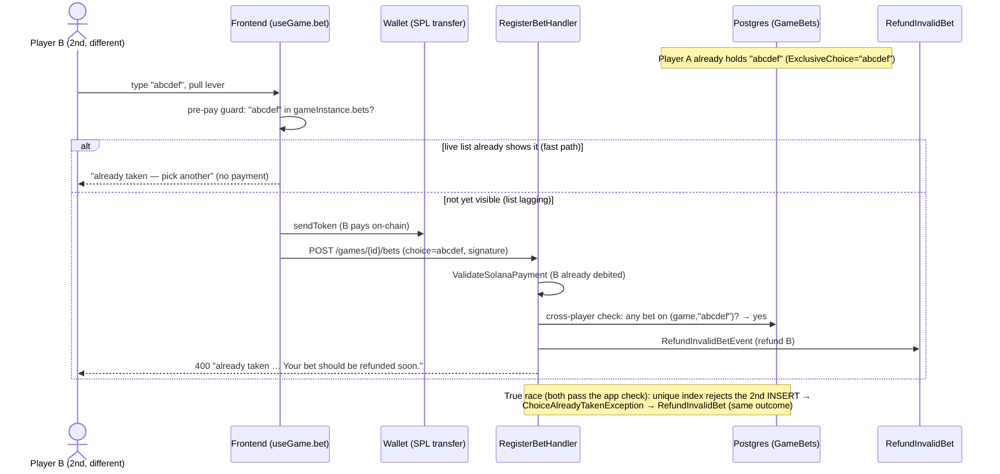

# SpaceStroker — "Choice Exclusivity" Feature — Implementation Spec

> **Status: Shipped** — merged via `feature/choice-exclusivity` on 2026-07-24. Distilled summary:
> `../features/choice-exclusivity.md`. Refined via Trello card
> [Choice exclusivity](https://trello.com/c/6OZSbfSE/86-choice-exclusivity) (2026-07-24).
> Repos affected: `monkify-backend`, `monkify-front`, and this doc in `monkify-meta`.
>
> **Purpose:** In **free-text games** (no preset choices — e.g. *Cosmic Sprint*) each typed sequence
> becomes **exclusive** to the first player who bets it in a round. A second, different player who
> tries the same sequence is rejected (and auto-refunded if they already paid on-chain). Preset games
> (e.g. *Beast Mode*) are unchanged and still allow many bettors to share a choice. The effect is a
> unique thing-to-root-for per bet and a winner-takes-all free-text round.

---

## 1. Summary

Today two different players can bet the **same** free-text sequence, and if it wins they split the
pot. The only guard is per-player (`RegisterBetHandler.ValidateBetParameters`, ~line 211-232) and the
`(GameId, Choice)` DB index is **non-unique**. This feature adds a **cross-player uniqueness rule for
free-text games only**, enforced at two layers: an application check (fast path, good message) and a
**DB unique index** (race backstop). Collisions on a paid `SolanaToken` bet are **auto-refunded**
(the on-chain debit already happened before validation); free/Standard collisions are rejected with
no money movement.

| Game mode | Discriminator | Choice sharing | This feature |
| --- | --- | --- | --- |
| **Free-type race / lottery** | `PresetChoices` empty | many bettors could share | **Now exclusive — one player per choice per round** |
| **Preset race / lottery** | `PresetChoices` non-empty | many bettors share a preset choice (by design) | **Unchanged** |

| Bet path | On-chain debit timing | Collision outcome |
| --- | --- | --- |
| `SolanaToken` paid | `ValidateSolanaPayment` **before** `ValidateBetParameters` (handler line 126-129) — player already paid | **Reject + auto-refund** via `RefundInvalidBetEvent` + "already taken" + refund warning |
| `Standard` paid | `DebitStandard` **after** validation (line 137-138) — never debited | **Reject**, bare "already taken" message, no refund needed |
| Free (`amount == 0`) | never debited | **Reject**, log-only, bare message |

---

## 2. Constraints (MANDATORY)

From `monkify-meta/constraints.md` (full list there):

- **Worktree-per-repo:** work lives in `.worktrees/choice-exclusivity/<repo>`; hubs stay on `main`.
  Branch `feature/choice-exclusivity` in each affected repo (already created + pushed).
- **Unit tests:** update/add in `SpaceStroker.Tests`; run via `scripts/run_tests.bat` (never the full
  `dotnet test` suite — `ProductionSessions` is a slow Monte-Carlo suite). Report changed tests at end.
- **Integration test (mandatory — this is a `Feature`):** at least one happy-path test in
  `SpaceStroker.Tests.Integration` (Testcontainers), run via `scripts/run_integration_tests.bat`.
- **EF mapping:** inline in `SpaceStrokerDbContext.OnModelCreating`; no `IEntityTypeConfiguration`.
- **Migrations:** under `SpaceStroker.Infrastructure/Migrations/`; applied only by `SpaceStroker.Consumers`
  at startup. Never hand-edit the model snapshot — regenerate with `dotnet ef migrations add`.
- **Secrets/config:** mock-only values in committed files (not relevant here — no new secrets).
- **Operator messaging:** the "already taken" message is a **legitimate game state**, not operator/
  contract status, so a **specific** message is allowed (the vague-operator-messaging rule does not
  apply to it).

---

## 3. Resolved product decisions

| # | Decision |
| --- | --- |
| 1 | **Scope = free-text games only** (`GameParameters.PresetChoices` null/empty), whether race **or** lottery. Preset games keep shared choices. |
| 2 | Exclusivity is **per game round, first persisted bet wins**. Choices free up again on the next round (new `Game`). |
| 3 | **Same-player behavior unchanged:** a player re-betting the *same* choice still hits the existing `DuplicateBetError` / `DuplicateBetRefundedError` path; a player may still place multiple bets on *different* free-text choices. The new cross-player check runs **after** the per-player check. |
| 4 | **Normalization:** comparisons use the trimmed-lowercase `Bet.Choice` (`ABC` == `abc`). This run also **fixes an existing bug** — the per-player duplicate query compares the raw `request.Body.Choice` (handler lines 216, 223); switch both to `_bet.Choice`. |
| 5 | **Paid `SolanaToken` collision → reject + auto-refund** by routing through the existing `RefundInvalidBet(...)` helper (publishes `RefundInvalidBetEvent`, message + `RefundWarning`). |
| 6 | **Standard paid + free collisions → reject, no refund** (Standard is debited only after validation; free bets never debit). `RefundInvalidBet(...)` already produces exactly this (log-only) for non-SolanaToken / free bets. |
| 7 | **Message via resx**, not the `BetValidationResult` enum. Add `ErrorMessages.ChoiceAlreadyTaken`, mirroring the `DuplicateBetError` sibling the feature reuses. *(Deviation from the refined card's "new `BetValidationResult` value": that enum feeds the pure static `ChoiceIsValidForGame`, which has no DB access; cross-player exclusivity is a handler-level DB check like the duplicate check, which already uses `ErrorMessages.*`.)* |
| 8 | **Concurrency = DB unique index** on a NULL-for-preset shadow column `Bet.ExclusiveChoice` (= `Choice` for free-text, `null` for preset). Postgres treats multiple `NULL`s as distinct, so preset games never collide, and free-text gets DB-level first-writer-wins. The app-level check is the fast path; the index is the correctness backstop for the check-then-act race. |
| 9 | **Winner/reward unchanged:** with exclusivity a free-text winning choice maps to exactly one bet → single winner takes the whole pot. Existing `pot / payableWinnerCount` handles N=1; no reward-math change. |
| 10 | **Frontend pre-pay guard (block-on-submit only):** before payment, block a bet whose sequence is already in the live `gameInstance.bets`. Best-effort (the live list can lag) — the backend is authoritative. **No** live inline "taken" warning. |
| 11 | **Admin-refunded reservation stays reserved** for the round (the row still occupies the unique slot). Accepted as rare; not freed mid-round. |

---

## 4. Data model

### 4.1 Entity / column changes

`monkify-backend/src/SpaceStroker.Domain/Bets/Entities/Bet.cs` — add a nullable **`ExclusiveChoice`**
property (the free-text exclusivity key; `null` for preset-game bets so they never collide):

```csharp
// Set only for free-text games (PresetChoices empty) = the normalized Choice; null for preset games.
// Backs the unique (GameId, ExclusiveChoice) index that enforces one-player-per-choice per round.
public string? ExclusiveChoice { get; set; }
```

The handler sets it just before persistence (see §6.3). Do **not** compute it inside the `Choice`
setter — it depends on the game type, which the entity doesn't know.

### 4.2 EF configuration (inline)

`monkify-backend/src/SpaceStroker.Infrastructure/Data/Context/SpaceStrokerDbContext.cs`, inside the
existing `Bet` mapping block (~lines 171-189). Keep the existing non-unique `(GameId, Choice)` index
(it backs the app-level lookup) and **add**:

```csharp
builder.Property(x => x.ExclusiveChoice).HasMaxLength(20);                 // nullable by default
builder.HasIndex(x => new { x.GameId, x.ExclusiveChoice }).IsUnique();     // NULLs distinct → preset unaffected
```

Precedent for `.IsUnique()` in this file: `OperatorPlayers` at ~line 114
(`HasIndex(x => new { x.OperatorId, x.ExternalPlayerId }).IsUnique()`). Postgres/Npgsql default is
`NULLS DISTINCT`, which is what makes the many-null preset rows non-colliding — do **not** add
`NULLS NOT DISTINCT`.

### 4.3 Migration

```bash
# from the backend worktree, in src/
dotnet ef migrations add AddBetExclusiveChoice \
  --project SpaceStroker.Infrastructure --startup-project SpaceStroker.Consumers
```

- Adds nullable `text` column `ExclusiveChoice` (max length 20) to `GameBets` and the unique index
  `IX_GameBets_GameId_ExclusiveChoice`.
- **No backfill:** existing rows get `NULL` (historical/ended games need no reservation). New bets set
  it going forward.
- Applied only by `SpaceStroker.Consumers` at startup. Regenerate the snapshot via the command above;
  never hand-edit `SpaceStrokerDbContextModelSnapshot.cs`.

---

## 5. Configuration

None. No new `GeneralSettings`, env vars, or seed data. (`AllowedCharacters`, `ChoiceRequiredLength`,
`PresetChoices` already exist on `GameParameters`.)

---

## 6. Backend behaviour

All in `monkify-backend/src/SpaceStroker.Infrastructure/Handlers/Games/RegisterBet/RegisterBetHandler.cs`
unless noted. Failures short-circuit via `Messaging.ReturnValidationFailureMessage(msg)` which throws
`ValidationFailureException` → HTTP 400 `{ data, messages:[{type,value}] }`. `RefundInvalidBet(msg)`
(lines 268-282) is the reused choke point: publishes `RefundInvalidBetEvent` + `msg + " " + RefundWarning`
for paid `SolanaToken`; logs + bare `msg` for free / Standard.

### 6.1 New error message

`monkify-backend/src/SpaceStroker.Common/Resources/ErrorMessages.resx` (+ regenerated
`ErrorMessages.Designer.cs`) — add, mirroring `DuplicateBetError`:

```
Name:  ChoiceAlreadyTaken
Value: This sequence has already been taken by another player. Pick a different one.
```

### 6.2 Fix the per-player duplicate query to compare normalized choice

In `ValidateBetParameters`, change the two `FirstOrDefaultAsync` predicates (~lines 216, 223) from
`x.Choice == request.Body.Choice` to `x.Choice == _bet.Choice` (normalized). This closes the
raw-vs-normalized mismatch and guarantees the per-player check runs on the same value as the new
cross-player check.

### 6.3 New cross-player exclusivity check (application fast path)

In `ValidateBetParameters`, **immediately after** the existing per-player `if (existingBet != null) { … }`
block (~after line 232) and **before** the free-bet/operator checks (~line 234), for **free-text games
only**:

```csharp
// Choice exclusivity (free-text games only): a choice taken by ANOTHER player is rejected.
// The per-player duplicate block above already handled the same-player case, so any existing bet
// on this normalized choice now is necessarily a different player.
var isFreeTextGame = betGame?.Parameters?.PresetChoices.IsNullOrEmpty() ?? false;
if (isFreeTextGame)
{
    var choiceTaken = await _spacestrokerDbContext.GameBets
        .AnyAsync(x => x.GameId == request.GameId && x.Choice == _bet.Choice);
    if (choiceTaken)
        await RefundInvalidBet(ErrorMessages.ChoiceAlreadyTaken);
}
```

- Runs on the normalized `_bet.Choice`.
- `RefundInvalidBet` gives free = log-only, Standard = bare reject, SolanaToken = refund + warning —
  exactly decisions #5/#6, for free.
- Preset games skip the check entirely (shared choices retained).

### 6.4 Set the exclusivity key before persistence

In `HandleRequest`, just before `await RegisterBet();` (~line 140), set the shadow column from the
validated game type:

```csharp
_bet.ExclusiveChoice = (betGame?.Parameters?.PresetChoices).IsNullOrEmpty() ? _bet.Choice : null;
```

(By this point the game has passed `ValidateBetParameters`; for an invalid/preset game the value is
harmless because either the bet was already refunded or `ExclusiveChoice` stays coherent with the
free-text rule.)

### 6.5 Concurrency backstop — surface the unique-violation as "already taken"

The app check in §6.3 is check-then-act; two truly concurrent bets can both pass it. The unique index
(§4.2) guarantees only one `INSERT` wins. Today `GameService.InsertBet`
(`SpaceStroker.Infrastructure/Services/Games/GameService.cs:165-202`) catches **all** exceptions and
returns `false`, so the loser would currently fall into `RegisterBet`'s `betSaved == false` →
`RefundInvalidBet(ErrorMessages.FailedToRegisterBet)` (money-safe for SolanaToken, but wrong message).
Make the loser get the **"already taken"** message + refund:

1. Add a typed exception
   `monkify-backend/src/SpaceStroker.Infrastructure/Services/Games/ChoiceAlreadyTakenException.cs`
   (or an existing Infrastructure exceptions folder).
2. In `InsertBet`, **before** the generic `catch`, catch `DbUpdateException` whose inner is a
   `Npgsql.PostgresException { SqlState: "23505" }` on the `IX_GameBets_GameId_ExclusiveChoice`
   constraint and rethrow `ChoiceAlreadyTakenException` (do not swallow it). Other exceptions keep
   today's behavior (log + return `false`).
3. In `RegisterBetHandler.RegisterBet()`, wrap the `InsertBet` call in `try { … } catch
   (ChoiceAlreadyTakenException) { await RefundInvalidBet(ErrorMessages.ChoiceAlreadyTaken); }` so the
   race-loser is refunded (SolanaToken) / rejected (free/Standard) with the correct message.

> Money is safe either way (any SolanaToken failure path refunds); this step only upgrades the
> race-loser's message from "failed to register" to "already taken".

### 6.6 Unaffected

No change to `BetDomainService` reward/pot math, `SpaceStrokerTyper`, SignalR contracts
(`{gameId}/Bets`, `{gameId}/Status`), the DTOs, or `RefundInvalidBetConsumer` (it already skips free
bets and flips the bet to `Refunded` on success).

---

## 7. Frontend behaviour

`monkify-front`. Goal (decision #10): a free-text bet whose sequence is already in the live bet list is
blocked **before** any on-chain payment, so the player never pays for a doomed bet. Backstop is the
backend reject+refund.

### 7.1 Pre-pay guard in `useGame.bet()`

`src/hooks/useGame.ts`, in `bet()` right after `const choice = userWord.value;` (~line 374), before any
`sendToken` / popup / `submitBet`:

```ts
const isPreset = !!selectedGame.value?.presetChoices?.length;
const normalizedChoice = choice.trim().toLowerCase();
if (!isPreset && gameInstance.value?.bets?.some((b) => b.choice === normalizedChoice)) {
  betOutput.value = 'That sequence is already taken — pick another.';
  isLoadingBet.value = false;
  onBetFail?.();
  return;
}
```

- `gameInstance.bets` (`AppliedBet[]`, `choice` normalized lowercase) is already seeded on load
  (`getBets`) and appended live from the `{gameId}/Bets` SignalR stream — no new API call.
- `betOutput` is the existing reactive channel used for bet results (rendered in the terminal); reuse
  it for the message. Placing the guard here covers every caller (desktop lever, mobile button).

### 7.2 Optional arcade buzz in `GameConsole.placeBet`

`src/components/game/GameConsole.vue`, in `placeBet` (~lines 76-91) alongside the existing length /
duplicate-character validations, add for free-text games so the lever doesn't animate down:

```ts
if (
  !isPresetGame.value &&
  gameInstance.value?.bets?.some((b) => b.choice === userWord.value.trim().toLowerCase())
) {
  leverError();
  return;
}
```

(`isPresetGame` and `gameInstance` are already in scope.) The authoritative message + block remains in
`bet()` (§7.1); this only adds the `leverError()` buzz and skips the lever-down animation.

### 7.3 Unaffected

No change to preset games, the "BETS PLACED" terminal list (already shows taken choices for
reference), types, services, or env flags.

---

## 8. Flow diagram



---

## 9. Out of scope

- Preset games / preset lotteries (shared choices retained).
- Any change to reward-split math, the typer, or SignalR contracts.
- Live inline "taken" warnings or disabling/hiding taken choices as the player types (block-on-submit
  only).
- Any change to same-player duplicate-bet behavior.
- Freeing a choice when its reserving bet is later admin-refunded (stays reserved for the round).

---

## 10. File checklist

### 10.1 Backend (`monkify-backend`)

| # | File | Change |
| --- | --- | --- |
| 1 | `src/SpaceStroker.Domain/Bets/Entities/Bet.cs` | Add nullable `ExclusiveChoice` property (§4.1). |
| 2 | `src/SpaceStroker.Common/Resources/ErrorMessages.resx` (+ `.Designer.cs`) | Add `ChoiceAlreadyTaken` string (§6.1). |
| 3 | `src/SpaceStroker.Infrastructure/Handlers/Games/RegisterBet/RegisterBetHandler.cs` | Fix per-player query to `_bet.Choice` (§6.2); add cross-player free-text check (§6.3); set `_bet.ExclusiveChoice` before `RegisterBet()` (§6.4); catch `ChoiceAlreadyTakenException` around `InsertBet` (§6.5). |
| 4 | `src/SpaceStroker.Infrastructure/Services/Games/GameService.cs` | In `InsertBet`, detect the 23505 unique-violation on `IX_GameBets_GameId_ExclusiveChoice` and rethrow `ChoiceAlreadyTakenException` (§6.5). |
| 5 | `src/SpaceStroker.Infrastructure/Services/Games/ChoiceAlreadyTakenException.cs` | **New** typed exception (§6.5). |
| 6 | `src/SpaceStroker.Infrastructure/Data/Context/SpaceStrokerDbContext.cs` | Map `ExclusiveChoice` + unique `(GameId, ExclusiveChoice)` index (§4.2). |
| 7 | `src/SpaceStroker.Infrastructure/Migrations/*_AddBetExclusiveChoice.cs` (+ snapshot) | **New** migration (§4.3). |

### 10.2 Frontend (`monkify-front`)

| # | File | Change |
| --- | --- | --- |
| 1 | `src/hooks/useGame.ts` | Pre-pay exclusivity guard in `bet()` (§7.1). |
| 2 | `src/components/game/GameConsole.vue` | Optional `leverError()` buzz in `placeBet` (§7.2). |

### 10.3 Meta (`monkify-meta`)

| # | File | Change |
| --- | --- | --- |
| 1 | `specs/choice-exclusivity.md` | This spec. |
| 2 | `INDEX.md` | Map row (Ready) + "Feature currently in flight". |
| 3 | `features/choice-exclusivity.md` | **At ship** (`/monkify-ship-feature`), not now. |

---

## 11. Unit tests

Project: `monkify-backend/src/SpaceStroker.Tests`. Mirror `UnitTests/Handlers/RegisterBetHandlerTests.cs`
(base `UnitTestsClass`, in-memory EF, `ShouldReturnValidationFailure`, `SolanaBody()/StandardBody()/
FreeBody()` builders; seed a prior bet via `game.Bets.Add(BetTestFactory.CreateGameBet(...))` under a
**different** `OperatorPlayerId`). The in-memory provider does **not** enforce the unique index, so
these cover the **application** check (§6.3); the DB backstop (§6.5) is covered by the integration
test.

| Test file | Test cases | Expected |
| --- | --- | --- |
| `UnitTests/Handlers/RegisterBetHandlerTests.cs` | `RegisterBet_SolanaToken_ChoiceTakenByAnotherPlayer_ShouldRefund` — seed a bet on `"abcdef"` under player A, place player B's paid SolanaToken bet on `"abcdef"` | Throws `ValidationFailureException`; message == `ErrorMessages.ChoiceAlreadyTaken + " " + ErrorMessages.RefundWarning`; `PublishEventAsync(RefundInvalidBetEvent)` `Times.Once`. |
| ″ | `RegisterBet_Standard_ChoiceTakenByAnotherPlayer_ShouldRejectWithoutRefundEvent` — same, Standard game, different launch `sub` | Message == `ErrorMessages.ChoiceAlreadyTaken` (bare); `RefundInvalidBetEvent` `Times.Never`; no wallet debit. |
| ″ | `RegisterBet_FreeBet_ChoiceTakenByAnotherPlayer_ShouldRejectLogOnly` — free-text game, identified free bet by a different player on a taken choice | Message == `ErrorMessages.ChoiceAlreadyTaken` (bare); `RefundInvalidBetEvent` `Times.Never`. |
| ″ | `RegisterBet_SamePlayerSameChoice_StillHitsDuplicatePath` — same player re-bets their own choice | Hits existing `DuplicateBetError`/`DuplicateBetRefundedError`, **not** `ChoiceAlreadyTaken`. |
| ″ | `RegisterBet_PresetGame_SameChoiceDifferentPlayer_ShouldSucceed` — preset game, player B bets an already-taken preset choice | Bet persists (no exclusivity for preset); `ExclusiveChoice` is `null`. |
| ″ | `RegisterBet_ChoiceTaken_CaseAndWhitespaceInsensitive` — seed `"abcdef"`, player B submits `" ABCDEF "` | Rejected as taken (normalized comparison). |
| ″ | `RegisterBet_FreeText_SetsExclusiveChoice` / `RegisterBet_Preset_ExclusiveChoiceNull` — assert `_bet.ExclusiveChoice` on the persisted bet | free-text = normalized choice; preset = `null`. |

Report exactly which unit tests were added/changed at the end of implementation (constraints §3).

---

## 12. Acceptance criteria

Mapped 1:1 from the Trello **Acceptance Criteria** checklist:

1. Given a free-text round with an active bet on `"abcdef"` by player A, when a different player B
   submits a **paid** bet on `"abcdef"`, then B's bet is rejected, automatically refunded, and B sees a
   specific "already taken — pick another" message with a refund warning.
2. Given player A already bet `"abcdef"` in a free-text game, when player B types `"abcdef"` and pulls
   the lever, then the frontend blocks the bet **before any payment** (no `sendToken` / no POST) and
   shows the "already taken" message.
3. Given a preset game (Beast Mode) where player A bet `"rabbit"`, when a different player B bets
   `"rabbit"`, then B's bet is **accepted** (preset games retain shared choices).
4. Given a free-text game where player A bet `"abcdef"`, when **player A** submits another bet on
   `"abcdef"`, then it hits the existing **same-player** `DuplicateBet` path — not the new "already
   taken" path.
5. Given an existing bet on `"abcdef"`, when a different player bets `"ABCDEF"` / `" abcdef "`, then it
   is treated as the same choice (trimmed-lowercase) and rejected/refunded.
6. Given two different players submit paid bets on the same free-text sequence near-simultaneously
   (both pass the client pre-check), when both reach the backend, then exactly **one** bet persists and
   the other is rejected + refunded (unique index; no double reservation).
7. Given a free-bet-mode free-text game where a choice is already taken, when another player places a
   **free** bet on that choice, then it is rejected and **logged only** (no refund event).
8. Given a free-text round with exclusivity enforced, when the winning sequence is typed, then exactly
   one bet matches it and that **single winner takes the whole pot**; multi-winner splitting still works
   for preset games.

---

## 13. Manual QA (local Docker stack)

1. Bring up the local stack; open *Cosmic Sprint* (free-text) in two browser profiles (two wallets /
   two players; free-bet mode is fine for a quick check).
2. Player A bets `abcdef`. Confirm it appears in "BETS PLACED".
3. Player B types `abcdef` and pulls the lever → blocked pre-payment with the "already taken" message
   (no wallet prompt). Player B bets `ghijkl` → succeeds.
4. Paid path: with two funded devnet wallets, have B bet A's choice via a path where B's live list is
   stale (e.g. bet immediately) → B is refunded on-chain (poll balance / `TransactionLog` Refund row)
   and sees the refund warning.
5. Open *Beast Mode* (preset) → two players bet `rabbit` → both accepted.

---

## 14. Trello / pipeline

- **Source card:** [Choice exclusivity #86](https://trello.com/c/6OZSbfSE/86-choice-exclusivity) —
  list **Specs created**; **Implementation** section on the card carries branch + spec + worktree.
- **Next:** `/monkify-implement-feature Choice exclusivity` (build it in the worktrees, with the
  mandatory happy-path integration test + unit tests, deploy to the local Docker stack), then
  `/monkify-ship-feature Choice exclusivity` (sync the KB incl. a new `features/choice-exclusivity.md`,
  merge `feature/choice-exclusivity` → `main` in each repo).

---

## 15. Revision log

| Date | Change |
| --- | --- |
| 2026-07-24 | Initial spec from the refined card + in-chat refinement decisions and code exploration. |
