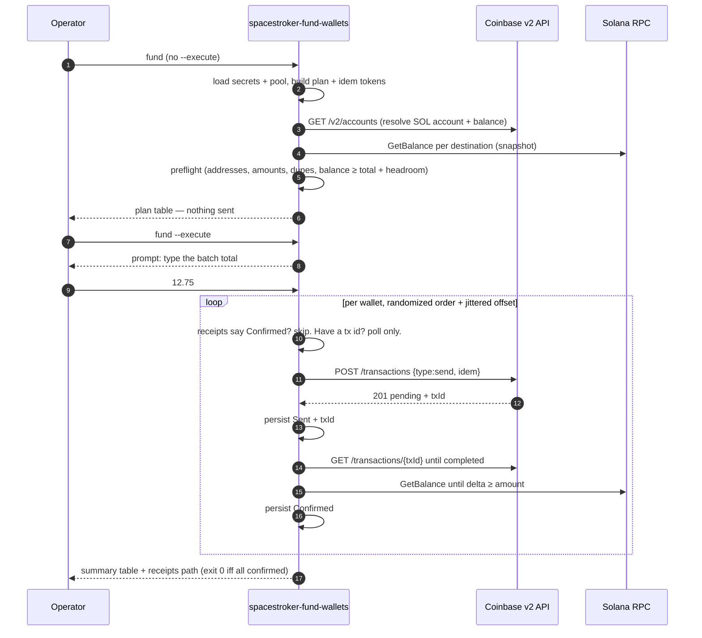

# SpaceStroker — "Coinbase wallet funding" — Implementation Spec

> **Status: Shipped** — merged via `feature/coinbase-wallet-funding` on **2026-08-11**
> (`monkify-meta` only). Refined + specced from Trello card
> [Create coinbase integration for filling wallets #165](https://trello.com/c/9OoHAuEa) (2026-08-11).
> Repos affected: **`monkify-meta` only** (new `tools/` solution + knowledge base). No
> `monkify-backend`, no `monkify-front`, no `monkify-lp` change.
> Distilled in [`features/coinbase-wallet-funding.md`](../features/coinbase-wallet-funding.md).
>
> **Post-ship notes — what shipped differs from this spec in three ways, all recorded in §12:**
> 1. **Location and structure.** The app lives at `monkify-meta/tools/` (`SpaceStroker.Tools.sln`), not
>    the `token-ops/` folder this spec originally named, and it is split
>    **Domain / Infrastructure / Application** — now a standing rule in
>    [`conventions/backend.md`](../conventions/backend.md).
> 2. **`Portable.BouncyCastle` 1.9.0**, not `BouncyCastle.Cryptography` 2.4.0 (§12 finding 7).
> 3. **Usage errors exit 2** via a dedicated `UsageException`, matching §5.
>
> **Not executed at ship time:** the live Coinbase round-trip in §14 remains an **operator step**.
> AC1, AC10, AC11, AC13 and AC14 have never run against a real CDP key; the other 15 are covered by the
> 60-test suite.
>
> **Purpose:** a standalone console app that funds a pool of Solana wallets with SOL out of a
> Coinbase account, so the ghost-wallet pool that card
> [#63 "Create ghost wallet snipe app"](https://trello.com/c/nokWHm7z) will drive holds SOL before it
> has to buy anything. Funding a dozen-plus wallets by hand is slow, irreversible when an address is
> mistyped, and stamps the whole pool with one funding timestamp. This tool makes the batch
> **dry-runnable, double-send-proof, resumable, on-chain-confirmed and time-spread**.
>
> ⚠️ **This tool moves real money.** Every design decision below that looks like ceremony
> (dry-run default, typed confirmation, deterministic idempotency tokens, preflight abort, plan-drift
> refusal) exists because the failure mode is unrecoverable SOL. Do not simplify them away.

---

## 1. Summary

One new console app, `spacestroker-fund-wallets`, in a **new `monkify-meta/tools/` solution**
(sibling of `deploy/`; card #63 will later add its own project to the same solution).

| Stage | What happens |
| --- | --- |
| **Load** | Read the git-ignored `tools/secrets.json` — Coinbase CDP key + Solana RPC + funding options + the wallet pool (`PublicKey` + `SOLAmount`). Unknown JSON fields (e.g. #63's `PrivateKey`) are **ignored**. |
| **Plan** | Build an ordered `PlannedTransfer[]`, compute a **plan hash**, derive each wallet's **deterministic `idem` UUID** from it. |
| **Preflight** | Validate addresses/amounts/duplicates, resolve the Coinbase SOL account, snapshot each destination's on-chain balance, check `balance ≥ Σ amounts + fee headroom`. **Any failure aborts before send #1.** |
| **Confirm** | Dry-run prints the plan and stops. `--execute` additionally requires a **typed confirmation** echoing the batch total. |
| **Send** | Sends dispatched in **randomized order at randomized offsets** across a configurable spread window; each POST carries its deterministic `idem`. |
| **Settle** | Poll Coinbase to `completed`, **then** verify the destination's on-chain SOL balance actually rose. Only then is a wallet `Confirmed`. |
| **Record** | A receipts JSON is written after every state change; it **is** the resume state. Failures don't stop the batch; the process exits non-zero. |

### Before / after

| Aspect | Today | After |
| --- | --- | --- |
| Funding a wallet pool | Manual sends in the Coinbase UI, one at a time | One command over the whole pool |
| Double-send protection | Operator attention | Deterministic `idem` (server-side dedupe) + receipts resume |
| Mistyped address | Discovered when the SOL is gone | Preflight abort before any send |
| Underfunded account | Batch dies partway, reconcile by hand | Preflight abort with the shortfall reported |
| "Did it land?" | Check a block explorer per wallet | On-chain balance delta required before `Confirmed` |
| Funding footprint | N deposits in the same minute | Randomized order + jitter across a spread window |
| Record of the batch | None | Receipts JSON + console summary table |

---

## 2. Constraints (MANDATORY)

From `monkify-meta/constraints.md` (full list there):

- **Worktree-per-repo:** work lives in `.worktrees/coinbase-wallet-funding/monkify-meta`; the
  `monkify-meta` hub stays clean on `main`. Branch `feature/coinbase-wallet-funding` is pushed to
  `origin` (§2 Git).
- **Secrets — mock only in committed files.** `tools/secrets.example.json` carries placeholders
  only. `tools/secrets.json` and `tools/receipts*.json` are git-ignored by a **new
  `tools/.gitignore`** (see §4.4 — the `monkify-meta` root `.gitignore` does **not** cover them).
  The CDP API secret and the generated JWT must never be printed, logged, or written to receipts.
- **No production queries / no live external API calls during implementation.** Real Coinbase sends
  are an **operator step** the user performs (`constraints.md` §5). This card delivers code + docs.
- **Backend:** unchanged ⇒ **no `SpaceStroker.Tests` change** and **no integration test**. The card's
  `## Level` is **`Feature`**, and the mandatory happy-path integration test in
  `SpaceStroker.Tests.Integration` is **explicitly waived on the card** because the tool has zero
  backend surface (waiver precedent: `specs/main-production-operator.md`). The **`features/` doc is
  still required** at ship time.
- **Unit tests are required** for the pure, Coinbase-free logic — plan/idem derivation, preflight,
  receipts/resume, spread schedule (§11). There is **no fake Coinbase sender** (card decision).
- **Knowledge base stays current:** `tools/README.md`, `INDEX.md`, and a new
  `features/coinbase-wallet-funding.md` at ship time.
- **Feature-specific:** the tool must never be able to send without `--execute` **and** the typed
  confirmation; and it must never re-send for a wallet that already has a recorded Coinbase
  transaction id.

---

## 3. Resolved product decisions

Carried from the refined card (answer mode: **short**). Items 19–21 are spec-level additions made
while exploring the code; they are called out as such.

| # | Decision |
| --- | --- |
| 1 | **Coinbase surface:** CDP **Secret API Key** (server-to-server) against the Coinbase App v2 API, `POST /v2/accounts/{account_id}/transactions` with `type: "send"`. Not OAuth2 — that endpoint requires **2FA per send** under OAuth2, which kills unattended batch funding. Not Prime/Exchange — the SOL is in the retail Coinbase app. |
| 2 | Required key scope: **`wallet:transactions:send`**. Coinbase returns `status: "pending"`; the docs direct you to **poll the status field** for `completed`. |
| 3 | The SOL account id is **resolved** from `GET /v2/accounts` by `currency.code == "SOL"`, with an optional explicit `coinbase.accountId` override. Missing or ambiguous ⇒ fail fast. |
| 4 | **Location:** new **`monkify-meta/tools/`** solution (`SpaceStroker.Tools.sln`), sibling of `deploy/`. Card #63 will add its project to the same solution. A real-money withdrawal CLI does not belong in the GCP deploy stack nor in a repo built into Cloud Run images. |
| 5 | **Wallet input:** the tool reads **only `PublicKey` + `SOLAmount`** (plus an **optional `Label`** used purely for display/receipts, per AC17 — see §6.2) and **ignores unknown JSON fields**, so #63's ghost-wallet pool file pastes in verbatim while this tool never loads, holds or logs a spend key. |
| 6 | **Re-run safety:** each wallet's `idem` UUID is **derived deterministically from the plan** (plan hash + address + lamports) **and** a receipts JSON is written after every state change. A repeat run reuses the same token, so **Coinbase dedupes server-side even if the receipts file is lost**. |
| 7 | ⚠️ **Corollary:** editing the pool between runs **changes the derived idem**, so a resend would be a **new** transaction. The tool stores the plan hash in the receipts file and **refuses to resume a drifted plan** without `--force-plan-change`. |
| 8 | **Execute gate:** dry-run is the default (prints the plan, sends nothing). Money moves only with `--execute` **AND** a typed confirmation echoing the batch total + wallet count. |
| 9 | **Preflight** (all before send #1, else abort): well-formed Solana addresses; positive amounts at or above `minAmountSol`; **no duplicate addresses**; Coinbase SOL balance ≥ **batch total + network-fee headroom**. |
| 10 | ⚠️ Coinbase charges a **network fee** on on-chain sends, taken from the account. `SOLAmount` is defined as **the amount the destination receives**, hence the headroom in the balance check. |
| 11 | **Send timing:** spread across a configurable window (`spreadMinutes`, `0` = immediate) with **randomized gaps and randomized wallet order**; **amounts exactly as specified** (no amount jitter — #63's supply percentages assume exact SOL). Inherits #63's anti-fingerprint constraint: a Coinbase send arrives from Coinbase's shared hot wallets, so the *sender* does not identify the account — **clustering is the signal**. |
| 12 | **"Funded"** = Coinbase `completed` **and** an observed on-chain balance increase at the destination. #63 cannot snipe with SOL that has not landed. |
| 13 | **Failure policy:** one wallet's failure does not stop the batch. Remaining wallets are funded, the failure + error is recorded, the process **exits non-zero**, and a re-run targets only the unfunded. |
| 14 | **Output:** receipts JSON (doubles as resume state) + a console summary table. **No HTML report** — that is #63's artifact. |
| 15 | **Config:** unversioned `tools/secrets.json` (CDP key + pool + options), committed `tools/secrets.example.json` with placeholders only. Not env vars (they leak into shell history, process listings and crash dumps). |
| 16 | **Asset:** **SOL on Solana mainnet only**, hard-coded `currency`/`network`. A configurable asset would let one wrong config line send the wrong asset to the right address. |
| 17 | **Testing:** no fake Coinbase sender and no `--fake` mode; the live path is verified by dry-running against the real key. Unit tests **are** required for the pure logic. |
| 18 | **Level: `Feature`** — `features/coinbase-wallet-funding.md` required at ship time; backend integration test **waived** (no backend surface). |
| 19 | **(Spec addition)** An optional **`--pool <path>`** override loads the wallet array from a standalone JSON file instead of `secrets.json`'s `wallets`. Rationale: card decision #5 exists precisely so #63's pool file can be used as-is; without this flag the operator has to copy-paste it into `secrets.json` on every change, which is the step most likely to introduce a typo. Same parsing, same unknown-field tolerance. |
| 20 | **(Spec addition)** A read-only **`status`** command polls pending transactions and re-checks on-chain confirmation from the receipts file **without ever sending**. Rationale: AC12 requires a resume that never re-sends; a command that structurally *cannot* send is the safest way to offer it. |
| 21 | **(Spec addition)** Retrying a failed **send POST** is safe and therefore permitted, because the request carries its deterministic `idem`. Retries are limited to transport errors, `429` and `5xx`; `4xx` other than `429` never retries. |

---

## 4. Solution layout and configuration

There is **no application data model change** — no entity, no EF mapping, no migration. This section
replaces §4 of the template with the file layout and config model.

### 4.1 New solution — `monkify-meta/tools/`

The project is split **Domain / Infrastructure / Application** per `conventions/backend.md` → "The
folder tree must show the architecture", using the same layer vocabulary as the backend's own projects.
The split is not cosmetic: **`Domain/` is IO-free**, which is exactly what lets the money-safety rules be
unit-tested with no fake Coinbase sender (there isn't one — card decision #17).

```
tools/
├── SpaceStroker.Tools.sln                     # new solution; #63 joins it later
├── .gitignore                                 # MANDATORY — see §4.4
├── README.md                                  # how to configure + run (mirrors deploy/README.md)
├── secrets.example.json                       # tracked; placeholders only
├── SpaceStroker.WalletFunder/
│   ├── SpaceStroker.WalletFunder.csproj
│   ├── Program.cs                             # entry point only: parse → load → run → map exit code
│   ├── Domain/                                # pure; no IO, no HTTP, no filesystem
│   │   ├── WalletPool.cs                      # PoolEntry, parsing (unknown fields ignored), lamports
│   │   ├── FundingPlan.cs                     # PlannedTransfer[], plan hash, deterministic idem
│   │   ├── Preflight.cs                       # validation + balance rule (balance passed as a value)
│   │   ├── SendSchedule.cs                    # randomized order + jittered offsets across the window
│   │   ├── ReceiptEntry.cs                    # ReceiptEntry/ReceiptsDocument + resume & drift rules
│   │   └── FunderException.cs                 # FunderException + UsageException
│   ├── Infrastructure/                        # everything that touches the outside world
│   │   ├── SecretsFile.cs                     # config model + Load() with placeholder detection
│   │   ├── ReceiptsStore.cs                   # receipts persistence (save after every change)
│   │   ├── Coinbase/
│   │   │   ├── CoinbaseJwt.cs                 # Ed25519 / ES256 bearer-token construction
│   │   │   └── CoinbaseClient.cs              # accounts, send, status, retry policy, key masking
│   │   └── Solana/
│   │       └── SolanaConfirmer.cs             # on-chain balance snapshot + delta confirmation
│   └── Application/                           # orchestration + presentation
│       ├── Funder.cs                          # the run: preflight → confirm → send → settle
│       ├── CliOptions.cs                      # argument parsing + usage banner
│       └── ConsoleReport.cs                   # plan table, typed confirmation, summary table
└── SpaceStroker.WalletFunder.Tests/           # mirrors the same folders
    ├── SpaceStroker.WalletFunder.Tests.csproj
    ├── Domain/
    │   ├── WalletPoolTests.cs
    │   ├── FundingPlanTests.cs
    │   ├── PreflightTests.cs
    │   └── SendScheduleTests.cs
    ├── Infrastructure/
    │   ├── ReceiptsStoreTests.cs
    │   ├── SecretsFileTests.cs
    │   └── CoinbaseJwtTests.cs
    └── Application/
        └── ConsoleReportTests.cs
```

Namespaces follow the folders exactly: `SpaceStroker.WalletFunder.Domain`,
`…​.Infrastructure`, `…​.Infrastructure.Coinbase`, `…​.Infrastructure.Solana`, `…​.Application`.

### 4.2 Project files — mirror the `deploy/tools` conventions

`SpaceStroker.WalletFunder.csproj` (copy the shape of
`deploy/tools/SpaceStroker.Deploy/SpaceStroker.Deploy.csproj`):

```xml
<Project Sdk="Microsoft.NET.Sdk">
  <PropertyGroup>
    <OutputType>Exe</OutputType>
    <TargetFramework>net8.0</TargetFramework>
    <ImplicitUsings>enable</ImplicitUsings>
    <Nullable>enable</Nullable>
    <RootNamespace>SpaceStroker.WalletFunder</RootNamespace>
    <AssemblyName>spacestroker-fund-wallets</AssemblyName>
    <InvariantGlobalization>true</InvariantGlobalization>
  </PropertyGroup>
  <ItemGroup>
    <!-- Portable.BouncyCastle, NOT BouncyCastle.Cryptography — see §12 finding 7 (CS0433 with Solnet). -->
    <PackageReference Include="Portable.BouncyCastle" Version="1.9.0" />
    <PackageReference Include="Solnet.Rpc" Version="6.1.0" />
    <PackageReference Include="Solnet.Wallet" Version="6.1.0" />
  </ItemGroup>
</Project>
```

`SpaceStroker.WalletFunder.Tests.csproj` — copy
`deploy/tools/SpaceStroker.Deploy.Tests/SpaceStroker.Deploy.Tests.csproj` verbatim (net8.0,
`IsTestProject`, `Microsoft.NET.Test.Sdk` 17.6.0, `Shouldly` 4.2.1, `xunit` 2.4.2,
`xunit.runner.visualstudio` 2.4.5) and repoint the `ProjectReference`.

> Solnet 6.1.0 is the version already used by `monkify-backend` (`Solnet.Rpc`, `Solnet.Wallet`,
> `Solnet.Programs`) — keep them in step.

### 4.3 `secrets.json` model (`SecretsFile.cs`)

Follow `deploy/tools/SpaceStroker.Deploy/SecretsFile.cs`: `[JsonPropertyName]` on every member, a
static `Load(path)` that throws `FunderException` with an actionable message, and **placeholder
detection that fails fast** (the deploy tool rejects `gcp.projectId` starting with `your-`; here,
reject any value still equal to a `REPLACE_ME*` sentinel).

`secrets.example.json` (tracked — placeholders only):

```jsonc
{
  "coinbase": {
    "apiKeyId": "organizations/REPLACE_ME_ORG_ID/apiKeys/REPLACE_ME_KEY_ID",
    "apiKeySecret": "REPLACE_ME_BASE64_ED25519_PRIVATE_KEY",
    "keyAlgorithm": "ed25519",
    "accountId": "",
    "apiHost": "api.coinbase.com",
    "apiVersion": "2024-01-01"
  },
  "solana": {
    "rpcUrl": "https://api.mainnet-beta.solana.com"
  },
  "funding": {
    "spreadMinutes": 45,
    "networkFeeHeadroomSol": 0.05,
    "minAmountSol": 0.001,
    "sendPollTimeoutSeconds": 300,
    "chainConfirmTimeoutSeconds": 120
  },
  "wallets": [
    { "PublicKey": "REPLACE_ME_BASE58_ADDRESS", "SOLAmount": 2.54 }
  ]
}
```

| Field | Meaning |
| --- | --- |
| `coinbase.apiKeyId` | CDP Secret API Key id — becomes the JWT `kid` **and** `sub`. |
| `coinbase.apiKeySecret` | The key's private material. **Never logged, never echoed, never written to receipts.** |
| `coinbase.keyAlgorithm` | `ed25519` (Coinbase's recommended default) or `ecdsa`. Drives §6.1. |
| `coinbase.accountId` | Optional override; empty ⇒ resolve the SOL account by currency. |
| `coinbase.apiVersion` | Sent as the `CB-VERSION` header, which the v2 API requires. |
| `solana.rpcUrl` | Used only for balance reads (§6.4). A keyed endpoint may be pasted in. |
| `funding.spreadMinutes` | Send window; `0` ⇒ back-to-back. |
| `funding.networkFeeHeadroomSol` | Added to the batch total in the preflight balance check (§6.3). |
| `funding.minAmountSol` | Floor for a single transfer; rejects fat-finger dust. |
| `wallets[]` | `PublicKey` + `SOLAmount`. **Unknown fields are ignored** (see §6.2). |

### 4.4 `tools/.gitignore` — MANDATORY, and not covered by the repo root

**Code-exploration finding.** `monkify-meta/.gitignore` ignores exactly one thing (`sales/pdf/`).
The reason `deploy/secrets.development.json` is safe today is a **nested** `deploy/.gitignore`.
Without an equivalent file, `tools/secrets.json` — holding a live withdrawal credential — would
be committable, and `git add .` would take it. Create it in the same shape:

```gitignore
# Local secrets — the operator's source of truth. NEVER commit (only the template is tracked).
secrets*.json
!secrets.example.json

# Run state / receipts — contains addresses, amounts and Coinbase transaction ids.
receipts*.json

# .NET build output for the console apps
**/bin/
**/obj/
```

---

## 5. CLI surface

```
spacestroker-fund-wallets [command] [options]

Commands:
  fund        (default) build the plan and — with --execute — fund the pool.
              Without --execute it is a dry run: plan table + full preflight, nothing sent.
  status      read-only: poll pending transactions + re-check on-chain confirmation. Never sends.

Options:
  --secrets <path>       secrets file (default: tools/secrets.json)
  --pool <path>          load the wallet array from a standalone JSON file instead of secrets.wallets
  --receipts <path>      receipts file (default: tools/receipts.json)
  --execute              actually send. Without it, `fund` is a dry run.
  --spread-minutes <n>   override funding.spreadMinutes for this run
  --force-plan-change    allow resuming against receipts whose plan hash differs (DANGEROUS — §6.6)
  -h | --help            usage
```

Follow `deploy/tools/SpaceStroker.Deploy/Program.cs`: top-level statements, a
`file sealed class CliOptions` with hand-rolled parsing (no `System.CommandLine`), a `try/catch` on
the domain exception printing `error: {message}`.

**Exit codes:** `0` success (all confirmed, or a dry run, or an empty pool) · `1` any failure,
unconfirmed or still-pending wallet, or a fatal error · `2` usage error.

---

## 6. Behaviour

### 6.1 Authentication — `CoinbaseJwt.cs`

Every request carries a **freshly minted** bearer token (they are valid ~2 minutes and the `uri`
claim is bound to that method + path):

```
Authorization: Bearer <jwt>
CB-VERSION: <coinbase.apiVersion>
Content-Type: application/json
```

JWT header: `{ "alg": "EdDSA", "typ": "JWT", "kid": <apiKeyId>, "nonce": <16 random hex bytes> }`
JWT claims: `{ "sub": <apiKeyId>, "iss": "cdp", "aud": ["cdp_service"], "nbf": <now>, "exp": <now+120>, "uri": "<METHOD> <host><path>" }`

The `uri` claim format is `"{METHOD} {HOST}{PATH}"`, e.g.
`POST api.coinbase.com/v2/accounts/<id>/transactions` — **no scheme, no query string**.

**Code-exploration findings — three traps that will silently produce `401`:**

1. **.NET 8 has no Ed25519 in the BCL.** `System.Security.Cryptography` offers no EdDSA, and
   `Microsoft.IdentityModel.*` will not sign `EdDSA` without a custom crypto provider. Build the
   JWS by hand — `base64url(header) + "." + base64url(payload)`, signed with BouncyCastle's
   `Ed25519Signer` — and append `"." + base64url(signature)`. Hence the `Portable.BouncyCastle`
   reference in §4.2 (see §12 finding 7 for why not the newer package). Base64url is **unpadded, `+`→`-`, `/`→`_`**.
2. **The CDP Ed25519 secret is 64 bytes** (32-byte seed ‖ 32-byte public key) once base64-decoded.
   `Ed25519PrivateKeyParameters` wants **the first 32 bytes only**. Passing all 64 throws; passing
   the wrong 32 produces a well-formed token that Coinbase rejects.
3. **If `keyAlgorithm` is `ecdsa`**, the key is a PEM EC private key: `ECDsa.Create()` +
   `ImportFromPem`, `alg: "ES256"`, and the signature **must** be raw `r‖s`
   (`DSASignatureFormat.IeeeP1363FixedFieldConcatenation`). The .NET default is DER, which JWS
   rejects.

> **Verify on the first live call:** the CDP docs describe an additional `X-Wallet-Auth` header for
> **CDP server-wallet** signing operations. The Coinbase App account send is authorized by the
> bearer token plus the key's `wallet:transactions:send` scope, so this tool does not send that
> header. If a live send ever returns a `401` naming `X-Wallet-Auth`, that assumption is wrong and
> the wallet-auth JWT (ES256 with a `reqHash` claim over the canonicalized body) must be added.

### 6.2 Pool loading — `WalletPool.cs`

- Source: `secrets.wallets`, or the JSON array at `--pool <path>` when given.
- Deserialize into a type carrying **only** `PublicKey` (string), `SOLAmount` (`decimal`) and an
  **optional `Label`** (string). The label is display/receipts metadata only — AC17 requires it in
  the receipts file, and #63's pool entries are already named (`W01`, `W10`, …). When absent it
  defaults to `W{index:00}`. It is **not** part of the plan hash or the idem derivation: renaming a
  wallet must not invalidate a resume.
  System.Text.Json ignores unknown members by default — **do not** set
  `JsonSerializerOptions.UnmappedMemberHandling = Disallow`, and **do not** add a `PrivateKey`
  property "for completeness". #63's pool entries carry a `PrivateKey`; this tool must never bind it.
- `SOLAmount` is `decimal`, never `double`. Convert to **lamports** (`amount * 1_000_000_000`,
  checked, must be integral) for hashing, comparison and confirmation.
- The outbound `amount` field is formatted with `CultureInfo.InvariantCulture`. The csproj sets
  `InvariantGlobalization`, but format explicitly anyway — a `pt-BR` machine would otherwise emit
  `"2,54"` and Coinbase would reject or misread it.

### 6.3 Plan + preflight — `FundingPlan.cs`, `Preflight.cs`

**Plan hash.** Canonicalize the pool as a list of `{address, lamports}` **sorted by address**,
serialize compactly, `SHA256` it, hex-encode. The hash covers exactly what a resend would change —
addresses and amounts — and nothing that shouldn't invalidate a resume (ordering, spread window,
formatting).

**Deterministic `idem`.** Coinbase wants "a UUIDv4 token to ensure idempotence", so the derived
value must be UUID-shaped:

```
bytes = SHA256(planHash + "|" + address + "|" + lamports).Take(16)
bytes[6] = (bytes[6] & 0x0F) | 0x40   // version 4
bytes[8] = (bytes[8] & 0x3F) | 0x80   // RFC 4122 variant
idem     = new Guid(bytes) formatted "D"
```

Same plan ⇒ same tokens ⇒ Coinbase dedupes a repeat run server-side, even with the receipts file
deleted. Changed amount or address ⇒ different token ⇒ **a genuinely new send** (hence §6.6).

**Preflight — every check runs before send #1; any failure aborts the run:**

| # | Check | Failure |
| --- | --- | --- |
| 1 | Pool is non-empty | Message + **exit 0** (nothing to do) |
| 2 | Every `PublicKey` is a valid Solana address | Abort, naming the entry |
| 3 | Every `SOLAmount` > 0 and ≥ `minAmountSol`, and integral in lamports | Abort, naming the entry |
| 4 | No duplicate addresses in the pool | Abort, naming the duplicate |
| 5 | Coinbase SOL account resolves (by `accountId`, else `currency.code == "SOL"`) | Abort |
| 6 | `account balance ≥ Σ amounts + networkFeeHeadroomSol` | Abort, reporting the shortfall |
| 7 | Snapshot each destination's on-chain balance (for §6.4) | Abort if the RPC is unreachable |

> **Code-exploration finding — address validation.** Solnet's `new PublicKey(string)` is **not**
> validation: `monkify-backend` uses it only on values already known to be addresses
> (`SolanaService.cs:211`, `HouseSeedAccountResolver.cs:60`). Use `PublicKey.IsValid(address)` and
> additionally assert the base58 decode is **32 bytes** — a truncated or over-long base58 string is
> exactly the mistyped-address case this check exists to catch, and it is irreversible if it gets
> through.

Check 6 is where card decision #10 bites: the Coinbase network fee is charged **on top of** the sent
amount, so a balance exactly equal to the batch total fails partway through. `networkFeeHeadroomSol`
is deliberately a plain config number rather than a fee estimate — an over-estimate costs nothing,
and a fee-quote API round-trip per wallet buys precision this decision does not need.

### 6.4 Sending and settling — `CoinbaseClient.cs`, `SolanaConfirmer.cs`

Per scheduled wallet, in schedule order:

1. **Resume gate.** Receipts say `Confirmed` ⇒ skip entirely. Receipts hold a transaction id
   (`Sent`/`Pending`) ⇒ **go straight to step 3, never re-send**.
2. **Send.** `POST /v2/accounts/{accountId}/transactions`

   ```json
   { "type": "send", "to": "<address>", "amount": "2.54",
     "currency": "SOL", "network": "solana", "idem": "<derived uuid>" }
   ```

   Persist `Sent` + the returned transaction id **immediately** on response.
3. **Poll.** `GET /v2/accounts/{accountId}/transactions/{txId}` until `data.status` is `completed`,
   or a terminal failure (`failed`/`canceled`/`expired`), or `sendPollTimeoutSeconds` elapses
   (⇒ record `Pending`, exit non-zero, resumable).
4. **Confirm on-chain.** Poll `GetBalanceAsync(address, Commitment.Confirmed)` (Solnet, same call
   shape as `SolanaService.cs:529`) until `balance − snapshot ≥ lamports`, or
   `chainConfirmTimeoutSeconds` elapses (⇒ record `Unconfirmed`, exit non-zero).
   The comparison is a **delta against the preflight snapshot**, not an absolute balance — the
   wallet may already hold SOL, and `≥` tolerates an unrelated concurrent deposit.
5. **Record** `Confirmed` and move on.

**Retry policy.** Transport errors, `429` and `5xx` retry with exponential backoff + jitter (4
attempts). Any other `4xx` is terminal for that wallet. Retrying the send POST is safe **because of
the `idem`** (decision #21). `401`/`403` — a revoked key, a missing `wallet:transactions:send`
scope, or a destination blocked by Coinbase address allowlisting — **aborts the whole run
immediately with an actionable message and no retry loop**; it is a configuration problem and every
subsequent wallet would fail identically.

**Secret hygiene.** The API secret and the minted JWT are never logged. `apiKeyId` is printed
masked (mirroring the backend's `MaskRpcUrl` habit). Receipts contain addresses, amounts, idem
tokens, transaction ids, statuses and errors — **no credential material**.

### 6.5 Spread schedule — `SendSchedule.cs`

```csharp
public static IReadOnlyList<ScheduledTransfer> Build(
    IReadOnlyList<PlannedTransfer> transfers, TimeSpan window, Random rng)
```

- Draw one uniform offset in `[0, window)` per transfer, sort ascending.
- Fisher-Yates shuffle the transfers with the same `rng`, then zip: shuffled order ↔ sorted offsets.
- `window == 0` ⇒ every offset is zero and the sends run back-to-back.
- **`Random` is injected** so the schedule is unit-testable (§11) without any Coinbase involvement.
  Production passes `Random.Shared`; nothing about the schedule is persisted or reproducible by
  design.

The process must stay alive across the window. Being killed mid-spread is covered by resume — that
is the point of §6.6, not an accident.

### 6.6 Receipts, resume and the plan-drift guard — `Receipts.cs`

```jsonc
{
  "planHash": "9f2c…",
  "createdUtc": "2026-08-11T14:00:00Z",
  "updatedUtc": "2026-08-11T14:41:12Z",
  "entries": [
    {
      "label": "W10", "address": "…", "amountSol": 2.54, "lamports": 2540000000,
      "idem": "…", "coinbaseTransactionId": "…",
      "status": "Confirmed",              // Planned|Sent|Pending|Confirmed|Unconfirmed|Failed
      "chainConfirmed": true,
      "error": null,
      "sentUtc": "…", "settledUtc": "…"
    }
  ]
}
```

- Written after **every** state change, not at the end — a crash must not lose a transaction id.
- **Resume:** `Confirmed` skipped; `Sent`/`Pending` polled (never re-sent); `Failed`/`Planned`
  re-attempted.
- **Plan-drift guard:** on load, if `receipts.planHash != currentPlanHash`, **refuse to run** with a
  message naming both hashes and explaining that the derived idem tokens have changed, so proceeding
  risks double-funding. `--force-plan-change` is the only override, and it re-keys the receipts file
  to the new hash.

### 6.7 Console output — `ConsoleReport.cs`

- **Plan table** (dry run and before the confirmation prompt): index · masked-but-verifiable address
  (first 6 + last 6 chars) · amount · idem prefix · resume status. Footer: wallet count, batch total,
  Coinbase balance, headroom, spread window.
- **Confirmation prompt** (only under `--execute`): print the total and wallet count, require the
  operator to type the exact total (e.g. `12.75`). Any mismatch ⇒ no send, exit non-zero.
- **Summary table** at the end: per wallet the final status + transaction id, then counts of
  confirmed / pending / unconfirmed / failed and the receipts-file path.

---

## 7. Frontend behaviour

**None.** No composable, service, type or component. `monkify-front` is untouched.

---

## 8. Flow diagram



---

## 9. Out of scope

- Card **#63** itself (the ghost-wallet snipe app) and any pump.fun interaction.
- Generating or creating the wallets / their private keys.
- Sweeping SOL back out of the wallets.
- Buying SOL on Coinbase — the account must already hold enough.
- Coinbase account setup: creating the CDP key, granting `wallet:transactions:send`, address
  allowlisting. **Operator preconditions**, documented in `tools/README.md`.
- Any asset other than SOL; any network other than Solana mainnet.
- Any change to `monkify-backend`, `monkify-front` or `monkify-lp`.
- **Executing a live funding run** — an operator step (`constraints.md` §5).
- Cleaning up the stale, source-free `deploy/tools/SpaceStroker.Seeder{,.Tests}` folders (see §12).

---

## 10. File checklist

### 10.1 Backend (`monkify-backend`)

**No change.** No entity, handler, consumer, EF mapping, migration, endpoint or header.
`SpaceStroker.Tests` is untouched.

### 10.2 Frontend (`monkify-front`, `monkify-lp`)

**No change.**

### 10.3 Meta (`monkify-meta`)

| # | File | Change |
| --- | --- | --- |
| 1 | `tools/SpaceStroker.Tools.sln` | **New** — solution holding the funder + its tests (#63 joins later). |
| 2 | `tools/.gitignore` | **New** — `secrets*.json` + `!secrets.example.json`, `receipts*.json`, `bin/obj`. **Mandatory** (§4.4). |
| 3 | `tools/README.md` | **New** — configure, operator preconditions (key scope, allowlisting, funded account), dry-run-first workflow, resume, exit codes. |
| 4 | `tools/secrets.example.json` | **New** — tracked template, placeholders only. |
| 5 | `…/SpaceStroker.WalletFunder.csproj` | **New** — net8.0 exe, `AssemblyName spacestroker-fund-wallets`, BouncyCastle + Solnet. |
| 6 | `…/Program.cs` | **New** — entry point only: parse → load → run, and map `FunderException` ⇒ 1 / `UsageException` ⇒ 2. |
| 7 | `…/Domain/WalletPool.cs` | **New** — `PoolEntry`, parsing with unknown fields ignored, decimal→lamports, invariant formatting. |
| 8 | `…/Domain/FundingPlan.cs` | **New** — `PlannedTransfer`, plan hash, deterministic UUIDv4-shaped idem. |
| 9 | `…/Domain/Preflight.cs` | **New** — the validation rules of §6.3; balance arrives as a value, keeping it pure. |
| 10 | `…/Domain/SendSchedule.cs` | **New** — randomized order + jittered offsets, injectable `Random`. |
| 11 | `…/Domain/ReceiptEntry.cs` | **New** — `ReceiptEntry`/`ReceiptsDocument` + resume, never-re-send and plan-drift rules. |
| 12 | `…/Domain/FunderException.cs` | **New** — `FunderException` (exit 1) + `UsageException` (exit 2). |
| 13 | `…/Infrastructure/SecretsFile.cs` | **New** — config model + `Load()` with `REPLACE_ME` placeholder rejection. |
| 14 | `…/Infrastructure/ReceiptsStore.cs` | **New** — receipts persistence; saves after every state change. |
| 15 | `…/Infrastructure/Coinbase/CoinbaseJwt.cs` | **New** — Ed25519 (BouncyCastle) / ES256 bearer tokens; the three §6.1 traps. |
| 16 | `…/Infrastructure/Coinbase/CoinbaseClient.cs` | **New** — accounts, send, status, retry policy, `CoinbaseAuthException`, key masking. |
| 17 | `…/Infrastructure/Solana/SolanaConfirmer.cs` | **New** — Solnet `IRpcClient` balance snapshot + delta confirmation. |
| 18 | `…/Application/Funder.cs` | **New** — the run: preflight → confirm → scheduled send → settle → summary. |
| 19 | `…/Application/CliOptions.cs` | **New** — argument parsing + usage banner. |
| 20 | `…/Application/ConsoleReport.cs` | **New** — plan table, typed confirmation prompt, summary table. |
| 21 | `…/SpaceStroker.WalletFunder.Tests.csproj` | **New** — xunit + Shouldly, copied from `SpaceStroker.Deploy.Tests`. |
| 22 | `…Tests/Domain/{WalletPool,FundingPlan,Preflight,SendSchedule}Tests.cs` | **New** — §11. |
| 23 | `…Tests/Infrastructure/{ReceiptsStore,SecretsFile,CoinbaseJwt}Tests.cs` | **New** — §11. |
| 24 | `…Tests/Application/ConsoleReportTests.cs` | **New** — §11. |
| 25 | `INDEX.md` | Map row for this spec + "Feature currently in flight". |
| 26 | `features/coinbase-wallet-funding.md` | **At ship time** (`/monkify-ship-feature`) — Level is `Feature`. |

---

## 11. Unit tests

Project: `monkify-meta/tools/SpaceStroker.WalletFunder.Tests` (xunit + Shouldly, mirroring
`deploy/tools/SpaceStroker.Deploy.Tests`), with `Domain/`, `Infrastructure/` and `Application/` folders
mirroring the project under test. **No Coinbase call in any test** — there is no fake
sender by decision #17; every case below exercises pure logic.

| Test file | Test cases | Expected |
| --- | --- | --- |
| `FundingPlanTests` | Same pool ⇒ same idem tokens across two independent builds | Byte-identical (AC8) |
| | Amount changed for one wallet | Only that wallet's idem changes; plan hash changes |
| | Address changed | That wallet's idem changes; plan hash changes |
| | Pool re-ordered, same content | Plan hash **unchanged** (canonical sort) |
| | Idem shape | Parses as `Guid`, version nibble `4`, RFC 4122 variant |
| | `2.54` SOL → lamports | `2_540_000_000`; non-integral lamports rejected |
| | Amount formatting under a comma-decimal culture | `"2.54"` (invariant), never `"2,54"` |
| `PreflightTests` | Malformed / truncated / 31-byte base58 address | Abort naming the entry (AC4) |
| | Duplicate address | Abort naming the duplicate (AC5) |
| | Zero, negative, below-`minAmountSol` amount | Abort naming the entry (AC5) |
| | Balance == batch total (no headroom) | Abort with shortfall (AC3) |
| | Balance ≥ total + headroom | Passes |
| | Empty pool | No-op result, exit code 0 |
| | Pool carrying `PrivateKey` fields | Parses; no private key on the plan (AC6) |
| `ReceiptsTests` | Entry `Confirmed` | Skipped, no send scheduled (AC7) |
| | Entry `Sent`/`Pending` with a tx id | Marked poll-only, never re-sent (AC12) |
| | Entry `Failed` | Re-attempted on resume |
| | Receipts plan hash ≠ current | Refuses to resume (AC9) |
| | …with `--force-plan-change` | Proceeds and re-keys the file |
| | Save then load round-trip | All fields preserved; no credential field present (AC19) |
| `SendScheduleTests` | Window 30 min, 10 transfers | 10 scheduled, offsets within `[0, 30m)`, ascending |
| | Every transfer scheduled exactly once | Set equality with the plan (AC15) |
| | Seeded `Random`, two builds | Identical schedules (determinism harness) |
| | Window 0 | All offsets zero (AC16) |

---

## 12. Code-exploration findings

Documented so the implementer does not rediscover them:

1. **`monkify-meta/.gitignore` ignores only `sales/pdf/`.** Secrets safety in `deploy/` comes from a
   **nested** `deploy/.gitignore` (`secrets*.json` + `!secrets.example.json`). `tools/.gitignore`
   is therefore mandatory, not decorative (§4.4).
2. **.NET 8 has no Ed25519**; the CDP secret's first 32 of 64 decoded bytes are the seed; ECDSA JWS
   needs P1363 (`r‖s`), not DER (§6.1).
3. **Solnet's `new PublicKey(string)` does not validate** — use `PublicKey.IsValid` plus a 32-byte
   decode assertion (§6.3).
4. **Invariant decimal formatting is required** for the outbound `amount` string; a `pt-BR` machine
   would emit `"2,54"` (§6.2).
5. **`deploy/tools/SpaceStroker.Seeder` and `SpaceStroker.Seeder.Tests` contain only stale
   `bin/obj`** — no sources, and they are absent from `SpaceStroker.DeployTools.sln`. That is
   corroborating evidence for decision #4 (a separate solution rather than growing the deploy one),
   and the leftovers are **out of scope** to clean here.
6. **Version pinning:** Solnet `6.1.0` matches `monkify-backend`; the test stack (`xunit` 2.4.2,
   `Shouldly` 4.2.1, `Microsoft.NET.Test.Sdk` 17.6.0) matches `SpaceStroker.Deploy.Tests`.
7. ⚠️ **`BouncyCastle.Cryptography` 2.4.0 cannot coexist with Solnet.** `Solnet.Wallet` pulls in
   `Portable.BouncyCastle` **1.9.0** transitively, and with both on the graph every `Ed25519*` type is
   ambiguous (`CS0433`). **Declare `Portable.BouncyCastle` 1.9.0 explicitly and do not reference
   `BouncyCastle.Cryptography`** — the 1.9.0 API (`Ed25519Signer`, `Ed25519PrivateKeyParameters`) is
   identical for this use. Found at build time, after the spec had named 2.4.0.
8. **The .NET 10 SDK creates `.slnx`, not `.sln`.** `dotnet new sln` needs **`--format sln`** to produce
   the classic solution the workspace uses (`SpaceStroker.DeployTools.sln`).
9. **Project structure is now a convention, not a preference.** `conventions/backend.md` →
   "The folder tree must show the architecture" requires the Domain/Infrastructure/Application split
   (with matching namespaces, mirrored in the test project) for every .NET project including these
   console tools. §4.1 is the worked example.

---

## 13. Acceptance criteria

Mapped 1:1 from the Trello **Acceptance Criteria** checklist (AC1–AC20).

1. Given a valid pool file, when the tool runs with no flags, then it prints the funding plan
   (per-wallet address + amount, batch total, current Coinbase SOL balance) and performs no send.
2. Given a valid plan, when the tool runs with `--execute` but the typed confirmation does not match
   the batch total, then no send is issued and the process exits non-zero.
3. Given the Coinbase SOL balance is below the batch total plus network-fee headroom, when preflight
   runs, then the run aborts before the first send and reports the shortfall.
4. Given a pool entry whose `PublicKey` is not a well-formed Solana address, when preflight runs,
   then the run aborts before any send and names the offending entry.
5. Given two pool entries share the same `PublicKey`, or any `SOLAmount` is zero/negative/below the
   Coinbase minimum, when preflight runs, then the run aborts before any send.
6. Given a pool file that also carries `PrivateKey` fields, when the tool loads it, then the unknown
   fields are ignored and no private key is read into the plan, the receipts file, or any log output.
7. Given a wallet is already recorded funded in the receipts file, when the tool is re-run with the
   same plan, then that wallet is skipped and no new send is issued for it.
8. Given the receipts file has been deleted, when the tool is re-run with an unchanged plan, then
   each wallet's idem token is byte-identical to the first run's, so Coinbase does not create a
   second transaction.
9. Given the pool file was edited after a partial run (an amount or address changed), when the tool
   is re-run against those receipts, then it detects the plan drift and refuses to resume without an
   explicit override flag.
10. Given a send returns status `pending`, when polling reaches `completed`, then the tool verifies
    the destination's on-chain SOL balance increased before marking the wallet funded.
11. Given Coinbase reports `completed` but the destination's on-chain balance did not increase, when
    the run finishes, then the wallet is recorded unconfirmed (not funded) and the process exits
    non-zero.
12. Given a send remains `pending` when the batch ends, when the tool is re-run, then it resumes by
    polling that transaction's status and never issues a second send for it.
13. Given one wallet's send fails, when the run continues, then the remaining wallets are still
    funded, the failure and its error are written to the receipts file, and the process exits
    non-zero.
14. Given the API key lacks the `wallet:transactions:send` scope, or the destination is not
    allowlisted on the Coinbase account, when the first send is attempted, then the tool stops with a
    clear actionable message and does not retry-loop.
15. Given a spread window of N minutes is configured, when a batch executes, then the sends are
    dispatched in randomized wallet order at randomized intervals across that window, and each
    `SOLAmount` is sent exactly as specified (no amount jitter).
16. Given a spread window of 0, when a batch executes, then the sends are dispatched back to back
    with no added delay.
17. Given a run completes, when it exits, then a receipts JSON exists carrying per wallet the label,
    address, amount, idem, Coinbase transaction id, status, on-chain confirmation and any error, and
    a readable summary table was printed to the console.
18. Given the committed `secrets.example.json`, when it is inspected, then it contains placeholder
    values only and no real key material, and the real `secrets.json` is gitignored.
19. Given any run (dry or live), when console output and the receipts file are inspected, then the
    CDP API secret never appears in either.
20. Given the new tools solution, when its test project runs, then preflight validation,
    deterministic idem derivation, receipts/resume filtering and the spread schedule are each covered
    by unit tests that make no Coinbase call.

---

## 14. Manual QA (operator, against a real Coinbase account)

Implementation verification is `dotnet build` + `dotnet test` + a dry run. The steps below are the
**operator's** live sequence and are deliberately not run by the implementer (`constraints.md` §5).

1. Create a CDP Secret API Key with **`wallet:transactions:send`**; if the Coinbase account has
   **address allowlisting** enabled, allowlist the destination wallets first.
2. Copy `secrets.example.json` → `secrets.json`, fill the key + pool. Confirm
   `git status` shows **nothing** to commit from `tools/` (proves §4.4).
3. `spacestroker-fund-wallets fund` (no `--execute`) — plan table renders, balances read, preflight
   passes, nothing sent.
4. **Single-wallet live test:** a one-entry pool with a dust amount, `fund --execute`. Confirm the
   summary reports `Confirmed`, the receipts file exists, and the wallet's on-chain balance rose.
5. **Idempotency test:** re-run the same command. Expect the wallet skipped, no second transaction.
6. **Lost-receipts test:** delete the receipts file, re-run. Expect the same idem tokens and **no**
   duplicate transaction at Coinbase.
7. **Drift test:** change the amount, re-run. Expect a refusal naming both plan hashes.
8. Full pool: dry-run `fund`, then `fund --execute` with the real spread window. Leave the process alive
   for the whole window; verify the summary and each wallet on-chain.

---

## 15. Trello / pipeline

- **Source card:** [Create coinbase integration for filling wallets #165](https://trello.com/c/9OoHAuEa)
  — list **Specs created**; the **Implementation** section on the card carries the branch, worktree,
  spec path and Level.
- **Sibling card:** [#63 Create ghost wallet snipe app](https://trello.com/c/nokWHm7z) — consumes the
  funded pool and will join `SpaceStroker.Tools.sln`.
- **Next:** `/monkify-implement-feature Create coinbase integration for filling wallets` (integration
  test **waived**; unit tests required), then `/monkify-ship-feature` (which must create
  `features/coinbase-wallet-funding.md` — Level is `Feature`).

---

## 16. Revision log

| Date | Change |
| --- | --- |
| 2026-08-11 | Initial spec from the refined card (#165) + code exploration of `deploy/tools`, `monkify-backend` Solnet usage, and the CDP authentication docs. |
