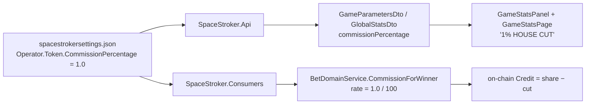
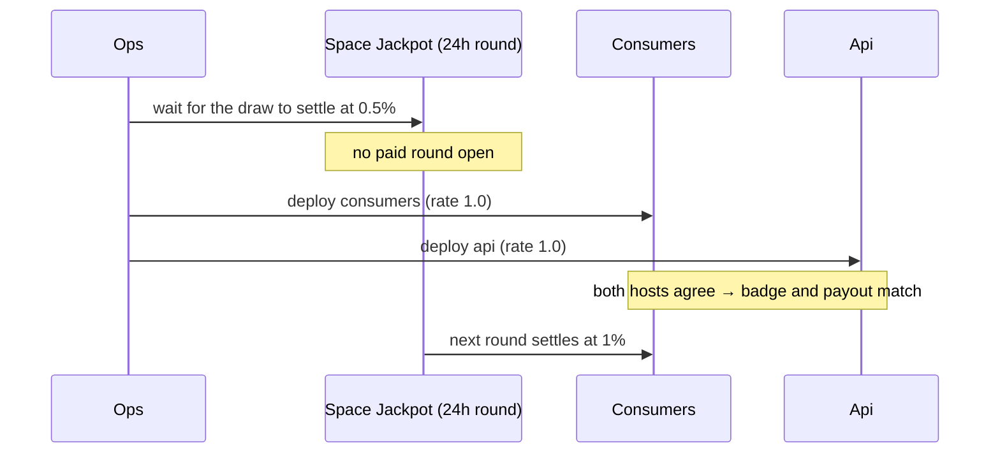

# Space Stroker — "House commission 0.5% → 1%" — Implementation Spec

> **Status: Ready for implementation** — refined via Trello card
> [Increase comission from 0.5% per pot to 1%](https://trello.com/c/quCTPKxZ) (#147, 2026-08-04).
> Repos affected: `monkify-backend`, `monkify-lp`, and this doc in `monkify-meta`.
> **`monkify-front` is NOT affected** — it renders the rate live from the backend.
>
> **Purpose:** double the house's revenue per round by raising the commission on winnings from
> **0.5% to 1%**, without changing *what* the commission is taken from. The commission is already
> shipped and config-driven (`features/crypto-commission.md`), so this is a **rate change plus the
> copy and the guard test that keep it honest** — not new machinery.

---

## 1. Summary

One config value changes:

```jsonc
// src/SpaceStroker.Common/spacestrokersettings.json → GeneralSettings.Operator.Token
"CommissionPercentage": 0.5   →   "CommissionPercentage": 1.0
```

Everything else in this spec exists to make that value **correct, visible, and non-revertible**:
the player-facing copy that hardcodes the old number, and one assertion that pins the shipped rate.

### 1.1 What the rate applies to (unchanged — read this before touching anything)

⚠️ **The card title says "0.5% per pot". That is NOT what ships, and this spec does not change it.**
Per winner, in `BetDomainService.CalculateRewardForBet`:

```
houseFundedShare = (LotteryParameters.LotteryPot + Game.CarriedExtra) / payableWinnerCount
commission       = rate × max(0, winnerShare − ownStake − houseFundedShare)
netReward        = winnerShare − commission        // then rounded DOWN to Token.Decimals
```

The rate applies to each winner's **profit above their own stake**, with house-funded lottery money
excluded — equivalently `rate × (losing-bet stakes)`. **Do not implement a percentage-of-pot rake.**
Because every bet in a round shares one fixed `RequiredAmount`, the yield as a share of the pot is
always *below* the nominal rate:

| Round shape | Retained at 0.5% (today) | Retained at 1% (this card) | As % of pot |
| --- | --- | --- | --- |
| 6 paid bets stake `A`, 1 winner | `0.005 × 5A` | `0.01 × 5A` | 0.83 % |
| 2 paid bets stake `A`, 1 winner | `0.005 × A` | `0.01 × A` | 0.50 % |
| 3 paid bets stake 1, 2 winners | `0.005` (each nets 1.4975) | `0.01` (each nets **1.495**) | 0.33 % |
| Lottery — house-funded base | untaxed | untaxed | — |
| Free bets (amount 0) | no stake in, no payout out | same | — |

### 1.2 Before / after

| | Today | After |
| --- | --- | --- |
| Configured rate | `0.5` | `1.0` |
| Commission base | profit above own stake, lottery base excluded | **unchanged** |
| STATS badge (`/game`) | `0.5% HOUSE CUT` | `1% HOUSE CUT` — **no frontend change** |
| Global badge (`/game/stats`) | `0.5% HOUSE CUT` | `1% HOUSE CUT` — **no frontend change** |
| How-to-play guide | names no number (deliberate) | **unchanged, still no number** |
| LP Terms page | hardcoded "0.5% house cut" | **1%**, reworded to defer to the in-app badge |
| Test asserting the rate | none | one exact-value guard |
| Schema / migration / API / SignalR | — | **nothing** |

---

## 2. Constraints (MANDATORY)

From `monkify-meta/constraints.md` (full list there):

- **Worktree-per-repo** (§2): work lives in `.worktrees/commission-rate-1-percent/<repo>`; the shared
  checkouts stay on their default branch — `main` for backend/meta, **`master` for `monkify-lp`**.
  Branch `feature/commission-rate-1-percent` in all three repos, already created and pushed.
- **Unit tests** (§3): update/add in `SpaceStroker.Tests`; run via `scripts/run_tests.bat` — **never**
  the full `dotnet test` (the ProductionSessions Monte Carlo suite is slow). Integration suite via
  `scripts/run_integration_tests.bat` (Docker required). **Report exactly which tests changed.**
- **No new integration test** (§3, "Scope of new feature"): this is a **Minor change** — a rate tweak
  to shipped behavior, not a new capability. The existing happy-path coverage
  (`PaidCryptoRace_AppliesCommission_CreditsPotMinusCut`) already drives this path and derives its
  expectation from the configured rate.
- **Secrets/config** (§1): `spacestrokersettings.json` also holds `TokenOwnerPrivateKey` and the Orbit
  keys. Change **only** `CommissionPercentage`; leave every placeholder credential byte-identical.
- **Database** (§4): no entity, no EF mapping change, **no migration**.
- **User-facing messaging** (§6): no new error/message surface; the badge copy is generated from the
  numeric rate and needs no wording change.
- **Money path (feature-specific):** this changes every payout in production. The commission base is
  fixed by §3 — an implementer may **not** re-derive it.

---

## 3. Resolved product decisions

| # | Decision |
| --- | --- |
| 1 | **Same base, double the rate.** `CommissionPercentage: 0.5 → 1.0`; the `profit above own stake, house-funded base excluded` formula is untouched. A percentage-of-pot rake was **rejected**: it would tax the winner's own stake (a heads-up winner would net *below* their stake without a new floor) and tax the house's own `LotteryPot + CarriedExtra`, breaking the shipped promise *"A winner never nets less than they staked"* published on the LP Terms page and implied by the in-app guide. |
| 2 | **The rate lives in the committed `spacestrokersettings.json` only.** No deploy-tool `appConfig` / Secret Manager / per-env override is added (rejected: it adds an infra + `deploy/README.md` surface for a knob turned roughly yearly). **Consequence:** prod reads this committed file, so the change requires a redeploy of **both** Cloud Run services. |
| 3 | **The rate-change boundary is accepted, not engineered away.** No per-`Game` rate snapshot (rejected: a nullable column + migration + two-rates-live-at-once badge/payout split for a one-line tweak). A round in flight when Consumers restarts settles at 1% even for bets placed while the badge read 0.5%. Mitigation is procedural: deploy with **no paid round open** — the exposure is **Space Jackpot**, the 24h lottery, which can hold bets placed a day earlier. |
| 4 | **The LP Terms page is corrected AND future-proofed.** `monkify-lp/src/pages/terms.astro` states 1%, leads with the rule, and names the in-app badge as the live figure — so the next rate change does not silently falsify a legal page. Removing the number entirely was rejected (a terms page that won't name its fee reads evasive). |
| 5 | **One guard assertion pins the shipped rate to `1m`.** Without it nothing anywhere asserts the new value, so a silent revert or a dropped merge line would cost revenue with a green suite. The `BetDomainServiceTests` 0.5% fixtures are **deliberately left alone** — they test the *formula* independently of the configured rate; re-pointing them is churn on ~7 passing tests for no new coverage. |
| 6 | **Level = Minor change.** Both Feature artifacts would duplicate what already exists for this behavior (the integration test in #5's note, and `features/crypto-commission.md`); a second KB doc would fragment the commission's documentation. |
| 7 | **KB convention.** `specs/*.md` are historical records of what shipped and keep their 0.5% text (`specs/crypto-commission.md` gets a one-line post-ship note). The **living** docs — `features/*`, `architecture.md`, `INDEX.md` — are corrected to 1%. |
| 8 | **Scope of the fee.** Deposits, cash-outs and refunds stay **free**; the win commission remains the only cut (`specs/orbit-custodial-wallet.md` §16). |

---

## 4. Data model

**N/A — nothing.** No entity, no property, no EF mapping change, **no migration**. The rate is
runtime configuration (`TokenSettings.CommissionPercentage`, already present), never persisted per
game or per bet. This is the direct consequence of decision §3.3.

---

## 5. Configuration

### 5.1 The change

`monkify-backend/src/SpaceStroker.Common/spacestrokersettings.json` → `GeneralSettings.Operator.Token`
(currently **line 111**):

```jsonc
"Decimals": 6,
"CommissionPercentage": 1.0,      // was 0.5 — see specs/commission-rate-1-percent.md
"BalanceCacheSeconds": 10,
```

Semantics are unchanged and already implemented: the value is a **percent** (`1.0` == 1 %), the domain
divides by 100 (`_commissionRate = settings.CommissionPercentage / 100m`), and **`0` still disables**
the commission entirely.

### 5.2 How each environment picks it up

`CommissionPercentage` appears in **no** override surface — not in `deploy/secrets.example.json`, not
in `deploy/terraform/workload/production.tfvars.example`, not in the two hard-coded secret lists in
`deploy/terraform/workload/main.tf`. Therefore:

| Environment | Source of the rate | How it takes effect |
| --- | --- | --- |
| Local / Docker / `Tests.Integration` | the committed JSON | rebuild |
| GCP **dev** | the committed JSON, baked into the image | `deploy api` + `deploy consumers` |
| GCP **prod** | the committed JSON, baked into the image | `deploy api` + `deploy consumers` |

**Both hosts must ship together.** `SpaceStroker.Consumers` owns the payout
(`RewardGameConsumer` → `BetDomainService`); `SpaceStroker.Api` owns the number players see
(`GameParametersDto`, `GlobalStatsDto`). A half-deploy makes the badge and the payout disagree.



---

## 6. Backend behaviour

**No code change.** Every mechanism the new rate needs is already in place; this section is the
verification contract, not a change list.

### 6.1 The reward path at 1 % (`BetDomainService`, unchanged logic)

1. Ctor: `_commissionRate = settings.CommissionPercentage / 100m` → **`0.01`**;
   `_houseFundedBase = (Parameters?.LotteryParameters?.LotteryPot ?? 0) + game.CarriedExtra`;
   `Winners` materialized once; `_payableWinnerCount = Winners.Count(w => !IsFreeBet(w))`, guarded ≥ 1.
2. `CalculateRewardForBet`: `winnerReward = PotAmount / PayableWinnerCount`.
3. Guard (untouched): `winnerReward < bet.Amount` → `BetRewardBiggerThanThePot`.
4. `CommissionForWinner`: `rate ≤ 0` → `0`; else
   `commissionableProfit = winnerReward − bet.Amount − (_houseFundedBase / PayableWinnerCount)`;
   `≤ 0` → `0`; else `commissionableProfit × 0.01`.
5. Subtract prior `Credit` ledger rows (retry idempotency → `BetHasAlreadyBeenRewarded`).
6. `Math.Round(..., Decimals, MidpointRounding.ToZero)` **after** the commission, then the
   smallest-unit `ulong` for the transfer.

Retained funds are realized by **crediting less on-chain** — no new transfer, no ledger row, no
`TransactionLog` type. "Total paid out" in stats drops accordingly, by design.

### 6.2 Comment corrections (the only backend edits besides the JSON)

Two comments name the old default and would become misleading:

- `src/SpaceStroker.Domain/Configs/Entities/TokenSettings.cs:25-26` — *"House commission on crypto
  (SolanaToken) winnings, as a PERCENT (0.5 == 0.5%)"*. Keep the percent-unit explanation (it is the
  thing that prevents a `0.01` mistake) but stop implying 0.5 is the value; also drop the stale
  "crypto (SolanaToken)" / "Standard games ignore it" qualifier — `Standard` no longer exists
  (`features/remove-operators.md`).
- `src/SpaceStroker.Domain/Bets/Services/BetDomainService.cs:138` — *"The house cut for a single
  winner: 0.5% (configurable)"* → state the rule and call the rate configurable without a number.

### 6.3 Behaviour that must NOT change

| Rule | Where it lives |
| --- | --- |
| A winner never nets below their stake | `commissionableProfit ≤ 0 ⇒ 0` + the `BetRewardBiggerThanThePot` guard |
| House-funded lottery money is untaxed | `houseFundedShare` subtraction |
| Free bets pay no commission | zero-amount bets take no share (`PayableWinnerCount`) |
| Refunds return the **full** stake | `CalculateRefundForBet` / `CalculateRefundForInvalidBet` — commission is reward-only |
| Retry safety | `Credit`-sum subtraction → `BetHasAlreadyBeenRewarded` |
| `0` disables the commission | `_commissionRate <= 0m` early return |
| Orbit wins credit the pool net of the cut, cash-out free | `OrbitBetSettlementService` consumes the net reward |

---

## 7. Frontend behaviour (`monkify-front`)

**No code change — and none is allowed.** Every surface already renders the backend value:

| Surface | Code | Result after the API deploy |
| --- | --- | --- |
| `/game` STATS badge | `components/game/GameStatsPanel.vue:56-60` — `${houseCutPct}% HOUSE CUT` + blurb, from `ActiveGame.commissionPercentage` | `1% HOUSE CUT` / "Winners keep the pot minus a 1% house cut." |
| `/game/stats` global badge | `pages/GameStatsPage.vue:21-25`, from `GlobalStatsDto.commissionPercentage` | same |
| How-to-play guide | `components/guide/sections/GuideWhatYouWin.vue` | unchanged — it deliberately names **no** number (its own comment: hardcoding "0.5%" is a promise that goes stale) |

**Rendering check (QA, not code):** `decimal 1.0` serializes as JSON `1.0`, which JS parses to the
number `1`, so the template interpolates `1% HOUSE CUT` — **not** `1.0%`. Confirm visually; if a
`1.0%` artifact ever appeared it would be a frontend formatting bug, out of scope here.

---

## 7b. Landing-page behaviour (`monkify-lp`)

`src/pages/terms.astro` (branch **`feature/commission-rate-1-percent`** off `master`), the
*PAYOUTS AND THE HOUSE CUT* list, currently **line 67-70**:

```astro
<li>
  On crypto games we take a <strong class="text-ink">0.5% house cut</strong> of winnings, taken
  only from profit above your own stake. A winner never nets less than they staked.
</li>
```

Replace with copy that leads with the rule, states the current number, and points at the live figure:

```astro
<li>
  We take a house cut of winnings — <strong class="text-ink">currently 1%</strong> — taken only
  from profit above your own stake. A winner never nets less than they staked. The rate in force
  is always shown on the STATS panel in the game.
</li>
```

- Drop the *"On crypto games"* qualifier: there is one settlement method now
  (`features/remove-operators.md`), so the phrase implies a distinction that no longer exists.
- Keep the sibling bullets (on-chain automatic payout, multi-winner pot division) untouched.
- **`terms.astro` is the only file this card may change in `monkify-lp`.** Gate: `npm run build`.
  (The `monkify-lp/CLAUDE.md` note about uncommitted roadmap work is **stale** — the hub was verified
  clean, including untracked files, on 2026-08-04.)

---

## 8. Deploy sequencing (the one genuinely non-obvious flow)



If the window slips, the failure is not a crash: a round straddling the restart pays its **remaining**
winners at 1% while any winner already paid keeps 0.5% — the `Credit` idempotency guard prevents a
double payout but cannot retro-tax the one already settled. That asymmetry is the reason for the
quiet-window rule, not merely player optics.

---

## 9. Out of scope

- Re-basing the cut on the pot or on the winner's stake (explicitly rejected — §3.1).
- Per-game-type / per-`GameParameters` rates; admin-portal control over the rate.
- Snapshotting the rate on `Game`; any schema change or migration.
- Moving the rate into Secret Manager, deploy `appConfig`, or `secrets.<env>.json`.
- A commission ledger row, a dedicated house-cut transfer, or house-revenue reporting.
- Any fee on deposits, cash-outs or refunds — cash-out stays free.
- Changing the how-to-play guide's deliberate number-free copy.
- Player-facing announcement copy (marketing/Telegram/X) — separate card if wanted.
- The real `terraform apply` / GCP deploy — an **ops step**, not code.
- `monkify-front` code changes of any kind.

---

## 10. File checklist

### 10.1 Backend (`monkify-backend`)

| # | File | Change |
| --- | --- | --- |
| 1 | `src/SpaceStroker.Common/spacestrokersettings.json` | `GeneralSettings.Operator.Token.CommissionPercentage`: `0.5` → `1.0` (line 111). **The whole behavior change.** |
| 2 | `src/SpaceStroker.Tests.Integration/GameFlowTests.cs` | Line **123**: `_fixture.CommissionPercentage.ShouldBeGreaterThan(0m, …)` → `ShouldBe(1m, "the configured house commission must be 1% — see specs/commission-rate-1-percent.md")`. The **guard**. The rest of the test already derives its expectation from the rate and needs no edit. |
| 3 | `src/SpaceStroker.Domain/Configs/Entities/TokenSettings.cs` | Comment (L25-26): keep "value is a PERCENT", drop the `0.5`-as-default implication and the stale `Standard`/SolanaToken qualifier. |
| 4 | `src/SpaceStroker.Domain/Bets/Services/BetDomainService.cs` | Comment (L138): drop the hardcoded `0.5%`; state the rule + "configurable". |

### 10.2 Frontend (`monkify-front`)

**None.** No branch was created for this repo.

### 10.3 Landing page (`monkify-lp`)

| # | File | Change |
| --- | --- | --- |
| 1 | `src/pages/terms.astro` | *PAYOUTS AND THE HOUSE CUT* bullet (L67-70): 1%, rule-first wording, defer to the in-app badge, drop "On crypto games". **Only file touched.** |

### 10.4 Meta (`monkify-meta`)

Created by `/monkify-create-spec` (this run):

| # | File | Change |
| --- | --- | --- |
| 1 | `specs/commission-rate-1-percent.md` | This spec. |
| 2 | `INDEX.md` | KB-map row (status **Ready**) + "Feature currently in flight". |

Deferred to `/monkify-ship-feature` (KB sync — living docs corrected to 1 %, historical specs annotated):

| # | File | Change |
| --- | --- | --- |
| 3 | `features/crypto-commission.md` | "defaults to 0.5%" → 1%; recompute the worked example (3-token/2-winner: `1.4975` → **`1.495`**); badge examples. |
| 4 | `features/games.md` §8 (~L297) | "default 0.5%" → 1%. |
| 5 | `architecture.md` (~L282) | "default 0.5%" → 1%. |
| 6 | `features/legal-docs-self-exclusion.md` (~L50) | "0.5% crypto house cut" → 1%. |
| 7 | `features/orbit-auto-bet-engine.md` (~L132) | "net of the shipped 0.5% commission" → 1%. |
| 8 | `INDEX.md` | map rows quoting 0.5% for the living `features/` docs; move this feature to "last shipped". |
| 9 | `specs/crypto-commission.md` | **Historical** — keep the 0.5% body; add a one-line post-ship note pointing here. Same for `specs/orbit-custodial-wallet.md` §16, `specs/orbit-auto-bet-engine.md` AC18, `specs/legal-docs-self-exclusion.md`, `specs/fair-stats-menu.md`, `specs/how-to-play.md`. |

---

## 11. Unit tests

Projects: `monkify-backend/src/SpaceStroker.Tests` (run `scripts/run_tests.bat`) and
`src/SpaceStroker.Tests.Integration` (run `scripts/run_integration_tests.bat`, Docker required).

### 11.1 The one test change

| Test file | Test case | Expected |
| --- | --- | --- |
| `SpaceStroker.Tests.Integration/GameFlowTests.cs` | `PaidCryptoRace_AppliesCommission_CreditsPotMinusCut` (L123 assertion) | The rate loaded by a **real host** from the committed `spacestrokersettings.json` is exactly `1m`. Reverting the JSON to `0.5` **fails**. The body then asserts `credit.Amount == round(2×stake − 0.01×stake, 6, ToZero)` — derived, so it validates 1% math end to end with no further edit. |

Why this file: `IntegrationTestFixture` overrides only `ConnectionStrings__*`,
`GeneralSettings__Games__*`, `GeneralSettings__Workers__*` and `…Token__Orbit__*` — it **never**
overrides the commission, so `Settings.Operator.Token.CommissionPercentage` is the shipped value.
A cheaper unit-level `ConfigurationBuilder` load of the same key is an acceptable substitute;
**exactly one guard is wanted, not both.**

### 11.2 Tests that must stay green **without edits**

| Test file | Why it is unaffected |
| --- | --- |
| `UnitTests/Domain/Games/BetDomainServiceTests.cs` | Builds its own `CryptoSettings(commissionPercentage: 0.5m)` and never reads the JSON. Its 6 commission cases + the sequential-payout regression (`1.4975` twice, `19.95`, `18.98`, `no-profit ⇒ no cut`, `rate 0 ⇒ no cut`) prove the **formula**, which this card does not change. **Do not re-point these fixtures** (§3.5). |
| `UnitTests/Handlers/GetActiveParametersHandlerTests.cs` | Asserts the DTO equals `Settings.Operator.Token.CommissionPercentage` from its own injected settings. |
| `UnitTests/Handlers/GetGlobalStatsHandlerTests.cs` | Uses its own `2.5m` fixture. |
| `UnitTests/Contracts/GlobalStatsDtoTests.cs` | Parameterized `Token(commission:)`, asserts `0.5m`/`0m` pass-through. |

If any of these **do** fail, that is a signal the change leaked beyond config — stop and investigate
rather than adjusting the expectation.

### 11.3 Reporting

Per `constraints.md` §3, report at the end exactly which tests were changed or added — expected to be
**one assertion in one integration test**, with the unit suite untouched.

---

## 12. Acceptance criteria

Mirrors the Trello **Acceptance Criteria** checklist (14 items) verbatim in intent:

1. Given the committed `spacestrokersettings.json`, when `GeneralSettings:Operator:Token:CommissionPercentage` is read, then it is `1.0` (not `0.5`), and no other key in that file changed.
2. Given the guard assertion is in place, when the shipped config is loaded by a real host (`IntegrationTestFixture`) and the rate is asserted, then it must equal exactly `1m` — so reverting the rate to `0.5` fails the suite.
3. Given a paid race with 6 bets of stake `A` and exactly 1 winner at a 1% rate, when rewards are processed, then the winner is credited `6A − 0.01 × 5A` (rounded down to the token's decimals) and the remaining `0.05A` stays in the house token account with no extra transfer and no extra ledger row.
4. Given a paid race of 3 bets of stake 1 with 2 winners at a 1% rate, when both winners are rewarded, then each nets `1.495` (share 1.5 minus 1% of the 0.5 profit) — both winners identical — and total retained is `0.01` = 1% of the single losing stake.
5. Given a round where a winner's pot share equals their own stake (no profit), when the reward is calculated at 1%, then the commission is `0` and the winner is paid their full stake — a winner never nets less than they staked.
6. Given a lottery round with a house-funded base (`LotteryPot + CarriedExtra`), when a winner is rewarded at 1%, then that base is still excluded from the commissionable amount (`houseFundedShare / payableWinnerCount`), so only player-stake-funded winnings are taxed.
7. Given `CommissionPercentage` is configured as `0`, when a winner is rewarded, then no commission is taken and the winner receives the full pot share — the disable escape hatch still works after this change.
8. Given a bet is refunded (under-subscribed round, invalid bet, taken choice, or reward failure), when the refund is calculated at a 1% rate, then the player receives their **full** stake back — the commission never touches refunds or cash-outs.
9. Given the API serves the new rate, when a player opens the `/game` STATS tab and the `/game/stats` page, then both badges read `1% HOUSE CUT` (not `1.0%`) with the matching "…minus a 1% house cut" blurb — achieved with **zero** `monkify-front` code changes.
10. Given the how-to-play guide (`GuideWhatYouWin.vue` / `GuideHowTheGameWorks.vue`), when it is reviewed after the change, then it still names **no** percentage and its "house cut applies to winnings above your own stake" wording still reads true.
11. Given the LP Terms page, when the *PAYOUTS AND THE HOUSE CUT* section is read, then it states **1%**, states the rule (taken only from profit above your own stake, a winner never nets less than they staked), and names the in-app badge as the live figure — and `git status` in `monkify-lp` shows `src/pages/terms.astro` as the only file this card staged.
12. Given the backend suites are run via `scripts/run_tests.bat` (plus the Docker integration suite), when they finish, then everything is green with **no** edits to the `BetDomainServiceTests` 0.5% fixtures or their expected values (`1.4975`, `19.95`, `18.98`), and the list of changed tests is reported.
13. Given the rate is deployed, when the release is performed, then **both** Cloud Run services (API + Consumers) ship the new value together and the deploy happens with **no paid round open** (ideally right after a Space Jackpot draw), so no player is charged a rate the badge did not show them.
14. Given the KB is synced at ship, when the living docs are searched for "0.5%", then no living doc still claims the rate is 0.5% (`features/crypto-commission.md`, `features/games.md` §8, `architecture.md`, `features/legal-docs-self-exclusion.md`, `features/orbit-auto-bet-engine.md`, `INDEX.md`), while shipped `specs/*.md` keep their historical text.

---

## 13. Manual QA

1. Set the rate to `1.0` and bring up the local stack (`scripts/setup_local_environment.bat`).
2. Open `/game` → pick a `SolanaToken` type → **STATS** tab → badge reads **`1% HOUSE CUT`** and the
   blurb says "…minus a 1% house cut". Then `/game/stats` → the global badge matches.
3. Fill a round with real paid bets (`/fill-crypto-clash`, or two wallets by hand), let it settle, and
   compare the winner's `TransactionLog` `Credit` amount against `pot − 0.01 × (losing stakes)`.
   Confirm the retained remainder stayed in the house token account (no extra transfer row).
4. Force the no-profit case: a round where the winner's share equals their stake → the credit equals
   the stake exactly, no cut.
5. Set the rate to `0`, restart, re-run step 3 → the winner receives the full pot share.
6. `cd monkify-lp && npm run build`, open `/terms` → the house-cut bullet reads 1% and points at the
   STATS panel.

---

## 14. Trello / pipeline

- **Source card:** [#147 — Increase comission from 0.5% per pot to 1%](https://trello.com/c/quCTPKxZ)
  — list **Specs created**; the card's **Implementation** section carries branch, worktree, spec and
  **Level: Minor change**.
- **Worktrees:** `.worktrees/commission-rate-1-percent/{monkify-backend,monkify-lp,monkify-meta}`,
  branch `feature/commission-rate-1-percent` (pushed in all three; `monkify-lp` branched off
  `master`).
- **Next:** `/monkify-implement-feature Increase comission from 0.5% per pot to 1%` → then
  `/monkify-ship-feature` (which performs the §10.4 KB sync and merges to `main` / `master`).
- **No release train** — `release/ui-ux-changes` landed on `main` on 2026-08-04 and nothing is
  currently in flight, so this merges straight to the default branch.

---

## 15. Revision log

| Date | Change |
| --- | --- |
| 2026-08-04 | Initial spec from refined card #147 (short-mode refinement, same session). Corrected the card's guard-test line reference (`GameFlowTests.cs` **123**, not 127 — the card cited a stale worktree copy) and its note about uncommitted `monkify-lp` work (the hub is clean; the `CLAUDE.md` warning is stale). |
