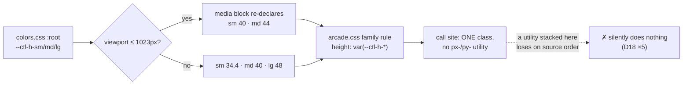

# Space Stroker — "Control sizing system" — Implementation Spec

> **Status: Ready for implementation** — refined via Trello card
> [Standardize every button and input to one sizing system (#135)](https://trello.com/c/jMuAlPBV/135-standardize-every-button-and-input-to-one-sizing-system)
> (2026-08-02), re-read against `monkify-front@4b5faaa` / `monkify-meta@dfb163d` the same day.
> Repos affected: `monkify-front`, and this doc in `monkify-meta`. **No backend change.**
>
> **Purpose:** buttons and inputs in `monkify-front` have no shared sizing system, so controls that
> sit side by side end up different heights. This card introduces **one control-sizing scale**
> (three height steps as CSS custom properties) that every in-scope button and input family consumes,
> so any button and any input placed in the same row are the same height **by construction** — not by
> hand-tuning padding at the call site. Each family keeps its own **skin**; only **height, horizontal
> padding and font-size** come from the scale.

---

## 1. Summary

The flagship symptom is the custom-seed row in Settings: `.dialog-input` (~45px) sits beside
`.btn-dialog` (~33px) — 12px off — because the two use different typefaces and **neither declares a
height**. The client-seed `COPY` row and the `/game/history` filter bar repeat the defect at
different sizes.

| | Today | After this card |
| --- | --- | --- |
| Where a control's height comes from | vertical padding + the family's font-size + border, per class, never stated | a `--ctl-h-*` token on the class; padding is horizontal only |
| Settings seed row | input ~45 vs SET/ROTATE ~33 | all three **40px**, aligned, with **no size class at the call site** |
| Client-seed row | `.dialog-field` ~43 vs COPY ~33 | both **40px** |
| Button wrapper components | `PrimaryButton.vue` (4 sites) + `SecondaryButton.vue` (**0** sites) | **both deleted**; one way to make a button — a class |
| The input class | `.dialog-input` (a dialog name used on a shipped *page*) | **`.input-arcade`** — one class for dialogs and pages, **no alias** |
| `<select>` | native OS arrow, browser-specific gutter width | `appearance: none` + our own pixel chevron |
| Focus ring | 5 classes hand-roll a `box-shadow`; **`.btn-arcade` has none at all** | **one `outline` treatment** on every in-scope family, `.btn-arcade` included |
| Below 1023px | ad-hoc: `.btn-dialog` gets a mobile padding override, header icons get `md:h-10` | **one media block** steps the tokens up; no call-site class changes |

### 1.1 Where it stands today (verified in code, 2026-08-02, `monkify-front@4b5faaa`)

**Five parallel systems**, not four:

| System | Files | Shape |
| --- | --- | --- |
| `.btn-arcade` (+ `--primary`/`--cyan`/`--ghost`/`--ghost-cyan`/`--sm`) | 11 `.vue` + the 2 wrappers | `3rem`, 2px border, bevelled, 5px amber key-drop, presses in on `:active` |
| `.btn-dialog` (+ `--primary`/`--tour`) | 7 `.vue` | flat, 1px border, 4px radius, PS2P 8px, `10px 13px` padding, 2px cyan focus **box-shadow** |
| `PrimaryButton.vue` | 4 call sites (`WalletButtons` ×3, `ErrorPage` ×1) | wrapper over `.btn-arcade`; `asLink` is `false` at **every** site |
| `SecondaryButton.vue` | **0** | **dead** since #124 moved its consumers to `.btn-dialog` |
| `.admin-input` | 2 | **`<style scoped>` copy-pasted verbatim** into `GameTypeForm.vue` + `BetRefundManager.vue` |

**24** real `<input>`/`<select>`/`<textarea>` — 25 raw matches, one of which is a literal `<input>`
inside a CSS comment in `GuideBetPanelArt.vue:53`. **Only 6 are in scope** once `/admin` (12) and
game-page furniture come out.

**Measured heights that ship today** (border-box, computed from the declarations):

| Control | Height | In scope? |
| --- | --- | --- |
| chat composer (`py-1`) | ~24 | **out** (D5) |
| `/game/history` select · `MINE ONLY` · `/game/stats` select | ~30 | in |
| `.btn-dialog` (desktop) | 33.2 | in |
| `.btn-arcade--sm` | 34.4 (`2.15rem`) | in — **must not move on desktop** |
| `.admin-input` | ~34 (inherited font-size) | **out** (D6) |
| `.btn-dialog--tour` | 40.6 | **deleted** (D20 — 0 consumers) |
| `.dialog-field` | 43.4 | in |
| `.btn-dialog` (≤1023px override) | 44.6 | in |
| `.dialog-input` | 44.7 | in |
| `.btn-arcade` | 48 (`3rem`) | in — **must not move** |
| header icon squares | 36 `<md` / 40 `≥md` | in |

---

## 2. Constraints (MANDATORY)

From `monkify-meta/constraints.md` (full list there):

- **Worktree-per-repo (§2 / `AGENTS.md` 6):** the work lives in
  `.worktrees/control-sizing-system/monkify-front` and `.worktrees/control-sizing-system/monkify-meta`,
  branch `feature/control-sizing-system` in both; the shared checkouts stay on `main`. **Push after
  branch work** (`AGENTS.md` 5).
- **Unit tests (§3):** `monkify-backend` is **not touched**, so `SpaceStroker.Tests` is not touched and
  **no unit-test report is due**. `monkify-front` has no test infrastructure.
- **Integration test (§3 / `AGENTS.md` 8): does not apply.** This is a visual/refactor consolidation
  with **no backend surface** — not a new feature. There is nothing to exercise end to end.
- **EF / migrations (§4):** N/A — no entity, no schema, no migration.
- **Secrets/config (§1):** N/A — no `.env`, no config, no secret touched.
- **User-facing messaging (§6):** no new copy and no new string. Nothing about *why* anything is
  unavailable changes.
- **Feature-specific — `arcade.css` beats Tailwind utilities.** `main.css` imports `arcade.css`
  **after** `@tailwind utilities`, and the arcade classes are plain single-class rules, so at equal
  specificity **the arcade class wins and the stacked utility silently does nothing**. The scale
  therefore **must live in the classes**, never in call-site utilities. This is not theoretical: §3
  D18 lists **five** shipped instances of utilities that have never done anything.

---

## 3. Resolved product decisions

D1–D18 come from the card's refinement (2026-08-02). **D19–D22 were resolved during spec writing**
(2026-08-02, answer mode: short) against what the code actually contains.

| # | Decision |
| --- | --- |
| **D1** | **`.btn-arcade` joins the scale for HEIGHT, keeps its own SKIN.** One token set; each family keeps its material (bevel + key-drop / flat hairline / inset fill). Honours `conventions/frontend.md`'s *"do not restyle `.btn-arcade` to match"* while still making any two controls equal-height by construction — **height is not skin**. |
| **D2** | **Three steps, anchored so the loudest shipped controls do not move.** Tokens live in `colors.css` beside `--radius-arcade`. `sm` and `lg` are pinned to today's arcade values, so the lever, wallet cluster, dashboard and game cards stay byte-identical and QA concentrates on dialogs and pages. |
| **D3** | **A step means BORDER-BOX height.** `.btn-arcade`'s `box-shadow: 0 5px 0` key-drop **overhangs** it: a 48px arcade button and a 48px input have aligned tops and visually different bottoms by 5px. Intended — it is a 3D object — and after D5 the two families share a row almost nowhere (`/responsible-gaming`, the one page with both, stacks them). **Documented so nobody "fixes" it.** |
| **D4** | **Font-size comes from the step; the VALUE is per family.** PS2P 8px and VT323 19px are the same *apparent* size, so one `--ctl-fs-md` cannot serve both. Ramps: arcade `0.58/0.65/0.72rem`, dialog button `7/8/9px`, input `17/19/21px`. There is therefore **no `--ctl-fs-*` token** — each family's size rule declares its own font-size. |
| **D5** | **Scope.** IN: every `ArcadeModal` consumer; the pages `/`, `/how-to-play`, `/responsible-gaming`, `/game/history`, `/game/stats`, `/error`, `/soon`; the header + wallet cluster. OUT: game-page furniture (terminal word input, lever, mobile preset keypad, `GameMobileTabs`, chat composer), **`/admin`**, `monkify-lp`, and non-box controls (range sliders, checkboxes, text-link buttons). |
| **D6** | **`/admin` stays out and its duplicated `.admin-input` survives — deliberately.** Bringing the blue/Courier surface onto the arcade scale is a separate card. A future agent finding `.admin-input` copy-pasted in two files is looking at a **recorded decision**, not an oversight. |
| **D7** | **Flat family defaults to `md` (40px).** `.btn-dialog` 33→40, `.input-arcade` 45→40, `.dialog-field` 43→40. Because the input and the dialog button share the **same default**, the seed row aligns with **no call-site classes at all** — that is the actual fix. Dialog footers grow ~7px (a two-button footer 57→64). |
| **D8** | **Family defaults, so the common case is one class:** `.btn-arcade` → **lg 48**; `.btn-arcade--sm` → sm 34.4; `.btn-dialog` → **md 40**; `.input-arcade` → **md 40**; `.dialog-field` → **md 40**; icon square → md 40. `.dialog-row` is **not a member** (D11). |
| **D9** | **Delete BOTH wrapper components.** `SecondaryButton.vue` has 0 consumers; `PrimaryButton.vue`'s only non-class feature (`asLink`) is `false` at all 4 sites. Inline the classes and delete both files. **One way to make a button: a class.** ⚠️ See **D19** — it is *not* a pure pass-through. |
| **D10** | **`.dialog-input` → `.input-arcade`, one class for dialogs and pages.** The old name already lies on a shipped page: `/responsible-gaming` followed #124's button rule but its `<select>` is still `class="dialog-input"` — there was no page input class to move to. Unlike buttons, a dialog input and a page input are **visually identical**, so one class is correct. **Delete the old name; do not alias it** — an alias is how two names for one thing start drifting. |
| **D11** | **`.dialog-field` joins at `md`; `.dialog-row` is documented OUT.** The field shares a row with the `COPY` button in the client-seed block, so it must join. `.dialog-row` is a full-width list item (wallet picker) carrying an icon plus two lines — a fixed height would clip it, and it never sits beside a control. |
| **D12** | **`<select>`: `appearance: none` + our own chevron.** Only way a select and a text input actually match at 40px across Windows/macOS/iOS/Android — a native arrow gutter is browser-specific width, so the text inside would sit at a different inset. The dropdown **list** stays OS-drawn and unstyleable: unavoidable, acceptable. |
| **D13** | **Unclassed button tail: boxed buttons join, plus a square icon variant.** Boxed one-offs (`MINE ONLY`, the guide section nav) take a step. Icon-only buttons get a square at the same steps, so the header's 40px squares finally have a token behind them. **Text-only link buttons are a legitimate third kind with no height** (the `retry` link under a failed history load) and stay as they are — write this down, or a later sweep will box them. |
| **D14** | **Tokens step up below `lg` (1023px) in ONE media block.** `--ctl-h-sm` 34.4→40, `--ctl-h-md` 40→44; `lg` stays 48. **No call-site class changes**, and every control clears the 44px touch target on the two steps where it matters. Reuses the existing `useIsMobile()` / `max-lg:` boundary — **no new breakpoint**. |
| **D15** | **One focus treatment, and it MUST be `outline`, not `box-shadow`.** ⚠️ **Verified in code:** `.btn-arcade--primary`'s key-drop **is** a `box-shadow`, and `html.light-graphics .btn-arcade--primary` (`arcade.css:988`) re-declares `box-shadow` at specificity **(0,2,1)**, beating a `.btn-arcade:focus-visible` rule at **(0,2,0)**. A box-shadow ring would **wipe the key-drop on desktop** and be **invisible on every phone** (all phones run `light-graphics`). Use `outline: 2px solid var(--color-cyan); outline-offset: 2px`, and convert the four existing box-shadow rings to it so there is one implementation. `GuideSectionNav.vue` already does exactly this — it is the precedent, not an invention. |
| **D16** | **`.btn-arcade` gains a focus ring it has never had.** There is **no global focus rule anywhere** in the app; five classes hand-roll a ring and `.btn-arcade` — the loudest, most-shipped family — falls back to the browser default. Closing that belongs in this card. |
| **D17** | **The scale pins height, horizontal padding and font-size only.** Border-width stays a skin property (arcade 2px is structural to the bevel; flat 1px). `--radius-arcade: 4px` is already uniform and is documented, not re-tokenised. |
| **D18** | **Dead utility stacks found and deleted in the sweep** — every one an instance of the documented cascade hazard: **(1)** `PrimaryButton`'s `asLink` → `<a>` branch, `false` at every call site. **(2)** `WalletButtons.vue`'s `size === 'sm' ? 'text-xs …' : 'text-sm'` — both lose to `.btn-arcade`'s `font-size: 0.72rem`. **(3)** `/responsible-gaming`'s `<select class="dialog-input uppercase text-primary">` — `.dialog-input` sets `color: var(--color-ink)` and **beats** `text-primary`; **that select is meant to be amber and renders in ink today**. **(4, new)** `PlayerCustomizationModal.vue:175`'s `<span class="dialog-field border-0 bg-transparent p-0 text-cyan">` — **all four** utilities lose, so the "Next bet nonce" value renders as a bordered inset box in ink-dim, not the borderless cyan it was written to be (**D21**). **(5, new)** `PlayerCustomizationModal.vue:165`'s `<code class="dialog-field … text-primary">` — the **client seed** is D18.3's twin and renders ink-dim too (**D22**). |
| **D19** | **`PrimaryButton` is NOT a pure pass-through — the inline must preserve two live props.** Verified: `HomeHero.vue:151` renders `<wallet-buttons variant="ghost" size="md" />`, so *both* branches of `variant` and *both* branches of `size` ship. Inlining means writing the full computed class list at each of the three `WalletButtons` sites, and **`md:w-[200px]` must survive** the D18.2 deletion — it is a `width`, which `.btn-arcade` does not declare, so unlike `text-xs`/`text-sm` it **does** work and it is what stops the sticky header reflowing as the wallet label changes. |
| **D20** | **`.btn-dialog--tour` is deleted.** Verified **0 consumers** — it was the quick tours' action button and #130 deleted them. D2 cited it as half the `md` anchor; `.dialog-field` (43.4) still anchors `md`, so the number is unaffected. Deleting it follows D9's "one way to make a button" and avoids leaving exactly the dangling-rule condition #124 was filed to fix. The **black material itself survives** via `.arcade-frame--black` / `GuideTip`; a future black overlay rebuilds its action from the scale. *(Owner's call, 2026-08-02.)* |
| **D21** | **The nonce readout is fixed, not carried.** `PlayerCustomizationModal.vue:175` drops `.dialog-field` for plain classes, so it renders **borderless and cyan** as written and takes **no height** from the scale. Without this, D11's 40px height turns a two-word hint row into a 40px bordered box. This is a **third visible correction** beyond the card's stated two. *(Owner's call, 2026-08-02.)* |
| **D22** | **The client-seed readout gets D18.3's fix too.** Same bug, same row as AC2: `text-primary` loses to `.dialog-field`'s `color`, so the seed renders ink-dim. Fixed the same way as the `/responsible-gaming` select — by the rule the owner already accepted for D18.3. *(Spec-level call — reversible in one line if unwanted.)* |
| **D23** | **The guide section nav joins at `md`, keeping its own skin.** `GuideSectionNav.vue`'s scoped style carries a recorded decision **not** to adopt `.btn-arcade` ("five of them stacked would read as five levers rather than as a list of links"). That is a **skin** argument, and D1 separates height from skin — so `.guide-nav-link` takes `height: var(--ctl-h-md)` and nothing else. Its VT323 text, left-bar active marker, hover and mobile chip-row treatment are untouched. *(Owner's call, 2026-08-02.)* |
| **D24** | **A step is materialised only where it has a consumer.** The **tokens** are the scale (all three steps always exist); a family's `--sm`/`--lg` *class* is written only when something uses it. So `.btn-arcade--sm` and the `md` defaults ship, and `.btn-dialog--sm` does **not** — the card kept it "available for dense toolbars", but AC10 puts the one candidate toolbar (`/game/history`) at `md`, leaving it with 0 consumers. Same principle that just deleted `--tour` (D20) and both wrappers (D9). Adding it later is two lines. *(Spec-level call.)* |
| **D25** | **`MINE ONLY`'s active state must move INTO `arcade.css`.** Adopting `.btn-dialog` on a control whose active state is written as `border-primary text-primary bg-primary/10` **silently kills that state** — the utilities tie `.btn-dialog` on specificity and lose on order. A new `.btn-dialog--active` modifier carries it. This is the cascade hazard biting during the fix itself. |
| **D26** | **The flat family is no longer "dialog-only".** D7 + D10 make the input class shared between dialogs and pages; its button partner has to be shareable too, or `MINE ONLY` cannot be 40px beside a 40px select (AC10) without becoming a 48px lever. `conventions/frontend.md`'s *"`.btn-dialog` inside a dialog, `.btn-arcade` everywhere else"* is amended to a **flat control family** rule: use the flat family wherever a control must line up with an input; `.btn-arcade` stays the cabinet's furniture. AC16 already anticipates this amendment. |

---

## 4. Data model

**N/A.** No entity, column, EF mapping or migration. `monkify-backend` is not opened.

## 5. Configuration

**N/A.** No `GeneralSettings`, no `VUE_APP_*` env var, no seed data, no secret.

## 6. Backend behaviour

**N/A.** No endpoint, DTO, handler, consumer, SignalR contract, rate-limit rule or game-flow change.

---

## 7. Frontend behaviour (`monkify-front`)

### 7.1 The tokens (`src/assets/styles/colors.css`)

Add beside `--radius-arcade`, inside `:root`:

```css
  /* — Control sizing scale (#135) —
     ONE height scale that every button and input family consumes, so any two controls in a row are
     the same height by construction. Each family keeps its own SKIN (bevel / hairline / inset fill)
     and its own font ramp — a step pins HEIGHT, HORIZONTAL PADDING and FONT-SIZE only, and a step is
     BORDER-BOX height (.btn-arcade's 5px key-drop overhangs it on purpose: it is a 3D object).
     sm and lg are pinned to the arcade values that already ship, so the lever, the wallet cluster,
     the dashboard and the game cards do not move by a pixel. */
  --ctl-h-sm: 2.15rem; /* 34.4px — == .btn-arcade--sm today */
  --ctl-h-md: 2.5rem; /* 40px */
  --ctl-h-lg: 3rem; /* 48px — == .btn-arcade today */
  --ctl-px-sm: 10px;
  --ctl-px-md: 13px;
  --ctl-px-lg: 16px;
```

And **one** media block at the end of `colors.css`:

```css
/* Below lg (1023px) the two lower steps grow a thumb, so every control clears the 44px touch target
   on the steps where it matters. This is the app's existing useIsMobile()/max-lg: boundary — no new
   breakpoint — and it needs NO call-site class change anywhere: the tokens do all of it. lg stays at
   48, which already clears the target. */
@media (max-width: 1023px) {
  :root {
    --ctl-h-sm: 2.5rem; /* 40px */
    --ctl-h-md: 2.75rem; /* 44px */
  }
}
```

> **Why `rem` for `sm`/`lg` and `px` for `md`:** `2.15rem` and `3rem` are literally the values
> `.btn-arcade--sm` / `.btn-arcade` ship today, so AC4's "unchanged" is exactly true rather than
> true-to-a-rounding. `md` has no incumbent to match; `2.5rem`/`2.75rem` keeps the set in one unit.
>
> **Known sub-pixel deltas from `--ctl-px-*`:** `.btn-arcade` goes `1.4em` (16.13px) → `16px`, and
> `.btn-arcade--sm` goes `1em` (9.28px) → `10px`. Both are horizontal-only, and the one
> `--sm` consumer (`GameTypeCard`'s CTA) is `w-full`, so nothing reflows. AC4 is a **height**
> assertion and is unaffected.

### 7.2 The families (`src/assets/styles/arcade.css`)

**Arcade family — height from the scale, skin untouched.**

```css
  .btn-arcade {
    …
    height: var(--ctl-h-lg);        /* was: height: 3rem */
    padding: 0 var(--ctl-px-lg);    /* was: padding: 0 1.4em */
    font-size: 0.72rem;             /* unchanged — the lg rung of the arcade ramp */
  }
  .btn-arcade--sm {
    height: var(--ctl-h-sm);        /* was: height: 2.15rem */
    padding: 0 var(--ctl-px-sm);    /* was: padding: 0 1em */
    font-size: 0.58rem;             /* unchanged — the sm rung */
  }
```

No `.btn-arcade--md` (D24 — no consumer). The `md` rung of the arcade ramp is `0.65rem` and is
recorded in `conventions/frontend.md`, not written as a class.

**Flat family — the actual fix.** `.btn-dialog` and `.input-arcade` share the **same default step**,
so the seed row aligns with **zero call-site classes**:

```css
  .btn-dialog {
    …
    height: var(--ctl-h-md);
    padding: 0 var(--ctl-px-md);    /* was: 10px 13px — vertical padding is what the height replaces */
    font-size: 8px;                 /* unchanged — the md rung of the dialog-button ramp */
  }
  /* MINE ONLY's toggled state. It MUST live here: written as border-primary/text-primary/bg-primary/10
     utilities it ties .btn-dialog on specificity and loses on source order — the state would render
     nowhere. (D25.) */
  .btn-dialog--active {
    color: var(--color-primary);
    border-color: var(--color-primary);
    background-color: color-mix(in oklab, var(--color-primary) 10%, transparent);
  }
```

`.btn-dialog--tour` is **deleted** (D20).

**`.dialog-input` → `.input-arcade`** — renamed, not aliased (D10):

```css
  .input-arcade {
    width: 100%;
    height: var(--ctl-h-md);
    padding: 0 var(--ctl-px-md);    /* was: 9px 11px */
    background-color: var(--color-surface-inset);
    border: 1px solid var(--color-line);
    border-radius: var(--radius-arcade);
    font-family: var(--font-body, 'VT323', ui-monospace, monospace);
    font-size: 19px;                /* unchanged — the md rung of the input ramp */
    line-height: 1.3;
    color: var(--color-ink);
  }
  .input-arcade::placeholder { color: var(--color-ink-mute); }

  /* A select and a text input only match at 40px if we own the arrow gutter: the native one is a
     browser-specific width, so the text inside would sit at a different inset on every OS. The
     chevron is drawn with two gradients rather than a data-URI SVG so it reads --color-ink-mute
     directly — a data URI cannot resolve a custom property, and a baked hex is how a token drifts.
     The dropdown LIST stays OS-drawn and unstyleable: unavoidable, accepted (D12). */
  .input-arcade--select {
    appearance: none;
    -webkit-appearance: none;
    padding-right: calc(var(--ctl-px-md) + 16px);
    background-image:
      linear-gradient(45deg, transparent 50%, var(--color-ink-mute) 50%),
      linear-gradient(135deg, var(--color-ink-mute) 50%, transparent 50%);
    background-position:
      right calc(var(--ctl-px-md) + 5px) center,
      right var(--ctl-px-md) center;
    background-size: 5px 5px, 5px 5px;
    background-repeat: no-repeat;
  }
```

**`.dialog-field` joins at `md`** — and centres by `line-height`, **not** by `display: flex`:

```css
  .dialog-field {
    height: var(--ctl-h-md);
    padding: 0 var(--ctl-px-md);    /* was: 9px 11px */
    line-height: calc(var(--ctl-h-md) - 2px);  /* border-box minus the two 1px borders */
    font-size: 19px;                /* was 18 — the md rung of the input ramp (D4) */
    …
  }
```

> ⚠️ **Do not make `.dialog-field` a flex container.** Its one remaining consumer is the client-seed
> readout, which relies on Tailwind's `truncate` (`overflow:hidden; text-overflow:ellipsis;
> white-space:nowrap`). On a flex container the text becomes an anonymous flex item and
> `text-overflow` no longer applies — the seed would clip with no ellipsis. Vertical centring by
> `line-height` keeps the text in the element's own box, which is what `truncate` needs.

**The square icon variant** — geometry only, deliberately **family-agnostic**:

```css
  /* Icon-only buttons: a square at the same steps, so the header's squares finally have a token
     behind them. It declares NO skin — no border, no fill, no colour — because the header's icons
     are flat hover-tint squares and a family class would box them. (D13.) */
  .btn-icon {
    display: inline-flex;
    align-items: center;
    justify-content: center;
    flex: none;
    width: var(--ctl-h-md);
    height: var(--ctl-h-md);
    padding: 0;
  }
```

> **Naming:** the card calls this "the `--icon` variant". It ships as the standalone `.btn-icon`
> because a `--icon` modifier would have to hang off a family and would drag that family's skin onto
> the header. Same thing, correct shape.

**One focus treatment (D15/D16)** — replaces the four `box-shadow` rings and adds the missing one:

```css
  /* ⚠️ outline, NOT box-shadow. .btn-arcade--primary's amber key-drop IS a box-shadow, and
     `html.light-graphics .btn-arcade--primary` re-declares box-shadow at (0,2,1) — it beats a
     `.btn-arcade:focus-visible` rule at (0,2,0). A box-shadow ring would wipe the key-drop on desktop
     and be INVISIBLE on every phone, since all phones run light-graphics. An outline is a different
     property entirely, so it cannot be suppressed by either. */
  .btn-arcade:focus-visible,
  .btn-dialog:focus-visible,
  .btn-icon:focus-visible,
  .dialog-row:focus-visible,
  .dialog__close:focus-visible {
    outline: 2px solid var(--color-cyan);
    outline-offset: 2px;
  }
  /* Text inputs and selects keep `:focus` (not `:focus-visible`): today's .dialog-input shows its
     ring on a mouse click too, and a <select> clicked with a mouse does NOT match :focus-visible in
     Chrome. One TREATMENT, two selectors — the treatment is what D15 unifies. */
  .input-arcade:focus {
    outline: 2px solid var(--color-cyan);
    outline-offset: 2px;
  }
```

Every one of these must drop its old `outline: none; box-shadow: 0 0 0 2px var(--color-cyan);` pair.

**The `≤1023px` block in `arcade.css` (line 857)** — the `.btn-dialog` **padding** override is
deleted (the token now supplies the height) and `.btn-dialog--tour` goes with the class. **Keep
`font-size: 9px`**: D4 defines no mobile font ramp, and dropping to 8px on phones would be a
legibility regression the card never asked for. The block's stale comment ("a 48px-tall hit area" —
it computes to 44.6px today) is corrected to **44px**.

**`prefers-reduced-motion`** — the new rules add no transition or animation, so the existing freeze
block at line 900 needs no new entry. Do not introduce one.

### 7.3 Components

| Surface | Change |
| --- | --- |
| `ui/PrimaryButton.vue`, `ui/SecondaryButton.vue` | **deleted** (D9) |
| `header/WalletButtons.vue` | 3 `<PrimaryButton>` → `<button type="button">` with the class list inlined (D19); the dead `text-xs`/`text-sm` deleted, **`md:w-[200px]` kept**; import removed |
| `pages/ErrorPage.vue` | `<primary-button>` → `<button type="button" class="btn-arcade btn-arcade--primary">`; import removed |
| `GameHeader.vue` | the two icon squares drop `h-9 w-9 md:h-10 md:w-10` for `btn-icon`; their `rounded-arcade` / colour / hover utilities stay (D13) |
| `header/PlayerCustomizationModal.vue` | 2 `.dialog-input` → `.input-arcade`; the client seed gets `!text-primary` (D22); the nonce span drops `.dialog-field` (D21) |
| `header/DisplayNamePrompt.vue` | `.dialog-input` → `.input-arcade` |
| `pages/ResponsibleGamingPage.vue` | the duration select → `.input-arcade .input-arcade--select` + `!text-primary` (D18.3) |
| `pages/GameHistoryPage.vue` | select → `.input-arcade .input-arcade--select`; `MINE ONLY` → `.btn-dialog` + `.btn-dialog--active` (D25); the hand-written `px-3 py-2` boxes go |
| `pages/GameStatsPage.vue` | select → `.input-arcade .input-arcade--select`; `self-start` kept |
| `guide/GuideSectionNav.vue` | `.guide-nav-link` gains `height: var(--ctl-h-md)` + `display:flex; align-items:center` and swaps `padding: 7px 12px` → `0 var(--ctl-px-md)`; skin untouched (D23) |
| `game/GameFairModal.vue`, `game/GameIdleOverlay.vue`, `LegalGate.vue`, `wallet/MobileWalletModal.vue` | **no edit** — they use `.btn-dialog`/`.dialog-row` unmodified and inherit the new heights. Listed because they are the **QA surfaces** for the footer growth (AC15) and the `.dialog-row` non-membership (AC14). |

**The header icon squares change on phones, and that is intended.** Today they are 36px below
`md` (768px) and 40px above it. Under `.btn-icon` they are **44px ≤1023px** and **40px ≥1024px** —
the `md:` boundary is replaced by the scale's `lg` boundary. 36→44 on phones is D14 delivering the
touch target; 40→44 on 768–1023px tablets follows from the same token.

**Inlining `PrimaryButton` (D19)** — the class list at each `WalletButtons` site:

```html
<button
  type="button"
  :class="[
    'btn-arcade',
    variant === 'ghost' ? 'btn-arcade--ghost' : 'btn-arcade--primary',
    { 'btn-arcade--sm': size === 'sm' },
    size === 'sm' ? 'md:w-[200px]' : '',
  ]"
  @click="…"
>
```

### 7.4 Where the seven heights land

| Control | Today | Desktop after | ≤1023px after |
| --- | --- | --- | --- |
| `.btn-arcade` | 48 | **48** (unchanged) | 48 |
| `.btn-arcade--sm` | 34.4 | **34.4** (unchanged) | 40 |
| `.btn-dialog` | 33.2 / 44.6 mobile | **40** | 44 |
| `.input-arcade` (was `.dialog-input`) | 44.7 | **40** | 44 |
| `.dialog-field` | 43.4 | **40** | 44 |
| `.btn-icon` (header squares) | 36 / 40 | **40** | 44 |
| history + stats select, `MINE ONLY` | ~30 | **40** | 44 |
| `.guide-nav-link` | ~36 | **40** | 44 |
| `.btn-dialog--tour` | 40.6 | **deleted** | — |
| `.dialog-row` · `.dialog__close` · text-link buttons · `.admin-input` · game furniture | — | **unchanged** | unchanged |

### 7.5 Expected visible changes (none of these are regressions)

1. Dialog footers grow ~7px (two-button footer 57→64).
2. `/game/history` + `/game/stats` selects adopt the flat family's **skin** as well as its height —
   `--color-surface-inset` + `--color-line` instead of `void 82%` + `terminal-border/60`. This is
   D10 applied ("a dialog input and a page input are visually identical"), not scope creep.
3. `/responsible-gaming`'s duration select renders **amber**, and draws our chevron (D18.3, D12).
4. The Settings **client seed** renders amber (D22) and the **nonce** renders borderless cyan (D21).
5. `.btn-arcade` shows a cyan focus outline for the first time (D16).
6. On phones, header icon squares and every `sm`/`md` control grow to 40/44px (D14).

### 7.6 What is NOT touched

No composable, service, type, route, API call, header, SignalR contract or user-facing string. No
`src/hooks/`, `src/services/`, `src/types/`, `src/utils/`, `src/constants/` file is opened.

---

## 8. Flow — how a height resolves



---

## 9. Out of scope

- **`/admin`** and its duplicated `.admin-input` (D6).
- **Game-page furniture:** `GameTerminal`, `GameConsole` (CRT word input + lever), `GameTyper`,
  `GameMonkey`, the mobile preset keypad, `GameMobileTabs`, the docked side-panel cabinet, the chat
  composer.
- **`monkify-lp`** and **`monkify-backend`** — not opened.
- **Non-box controls:** range sliders (both header volume `<input type="range">`), checkboxes, and
  **text-link buttons** (the `retry` links on `/game/history` + `/game/stats`, D13).
- Any **skin / colour / material / copy** change beyond the corrections enumerated in §7.5.
- **A new `features/` doc** — this is a refactor of an existing system; it lands in
  `conventions/frontend.md` instead.
- Backend work, unit tests, integration tests, migrations.

> ⚠️ **`feature/mobile-game-design-update` (#134) is in flight on `monkify-front`** and rewrites
> `GameConsole` / `GameTerminal` / `GameMonkey` / `GamePage` — all four are out of scope here, so the
> two branches should not touch a common file. If a conflict does appear, it is in `arcade.css` or
> `colors.css` and this card owns those.

---

## 10. File checklist

### 10.1 Backend (`monkify-backend`)

**None.** The repo is not opened, no worktree is created for it.

### 10.2 Frontend (`monkify-front`)

| # | File | Change |
| --- | --- | --- |
| 1 | `src/assets/styles/colors.css` | Add the six `--ctl-*` tokens; add the single `@media (max-width: 1023px)` `:root` block (§7.1) |
| 2 | `src/assets/styles/arcade.css` | `.btn-arcade`/`--sm` take the height + px tokens; `.btn-dialog` takes `md`; **delete `.btn-dialog--tour`**; add `.btn-dialog--active`; rename `.dialog-input*` → `.input-arcade*` and add `--select`; `.dialog-field` takes `md` via `line-height`; add `.btn-icon`; add the one `outline` focus block and **delete the four `box-shadow` rings**; in the `≤1023px` block drop `.btn-dialog`'s padding + the `--tour` rule and fix the stale comment |
| 3 | `src/components/ui/PrimaryButton.vue` | **DELETE** |
| 4 | `src/components/ui/SecondaryButton.vue` | **DELETE** |
| 5 | `src/components/header/WalletButtons.vue` | 3 sites inlined (D19); dead `text-xs`/`text-sm` removed, `md:w-[200px]` kept; import dropped |
| 6 | `src/pages/ErrorPage.vue` | `<primary-button>` → inline `.btn-arcade .btn-arcade--primary`; import dropped |
| 7 | `src/components/GameHeader.vue` | mute + ☰ squares: `h-9 w-9 md:h-10 md:w-10` → `btn-icon` |
| 8 | `src/components/header/PlayerCustomizationModal.vue` | 2× `.dialog-input` → `.input-arcade`; client seed `text-primary` → `!text-primary` (D22); nonce span drops `.dialog-field` + its 4 dead utilities (D21) |
| 9 | `src/components/header/DisplayNamePrompt.vue` | `.dialog-input` → `.input-arcade` |
| 10 | `src/pages/ResponsibleGamingPage.vue` | select → `.input-arcade .input-arcade--select uppercase !text-primary` (D18.3) |
| 11 | `src/pages/GameHistoryPage.vue` | select → `.input-arcade .input-arcade--select`; `MINE ONLY` → `.btn-dialog` + `:class` toggling `.btn-dialog--active`; hand-written box utilities removed |
| 12 | `src/pages/GameStatsPage.vue` | select → `.input-arcade .input-arcade--select` (keep `self-start`) |
| 13 | `src/components/guide/GuideSectionNav.vue` | `.guide-nav-link` gains the `md` height + token padding; skin untouched (D23) |

**Verification (no test suite exists):** `yarn lint` and `yarn build` must both pass clean (AC17),
plus §13.

### 10.3 Meta (`monkify-meta`)

| # | File | Change |
| --- | --- | --- |
| 1 | `specs/control-sizing-system.md` | This spec |
| 2 | `INDEX.md` | Row for this spec; "Feature currently in flight" |
| 3 | `conventions/frontend.md` | **Rewrite** the "Design system (required)" bullet (it currently tells agents to build UI with `PrimaryButton`/`SecondaryButton`, both deleted here — left as-is it becomes exactly the dangling rule #124 was filed to fix). **Amend** "`.btn-dialog` inside a dialog, `.btn-arcade` everywhere else" per D26. **Add** the scale: token table, family defaults, mobile step-up, the font ramps, and the documented non-members. **Add** the `outline`-not-`box-shadow` focus rule (D15) with its light-graphics reason, beside the existing cascade hazard. **Extend** the cascade-hazard bullet from three shipped proofs to five (D18) |

---

## 11. Unit tests

**N/A — and deliberately so.** `monkify-backend` is not touched, so `SpaceStroker.Tests` is not
touched and `constraints.md` §3's report obligation does not arise. `AGENTS.md` rule 8's mandatory
integration test does not apply: rule 8 scopes to **new features**, and this is a visual/refactor
consolidation with no backend surface. `monkify-front` has no test infrastructure at all — the
verification contract is `yarn lint` + `yarn build` + the manual QA in §13.

---

## 12. Acceptance criteria

Copied from the Trello checklist. **AC11 is amended** — see the note under it.

1. **AC1** — Given the Settings modal is open on desktop, when the custom-seed row renders with no
   size class written at the call site, then the input and the SET and ROTATE buttons are all 40px
   tall and their tops and bottoms align.
2. **AC2** — Given the Settings modal is open on desktop, when the client-seed row renders, then the
   `.dialog-field` readout and the COPY button are both 40px tall and vertically aligned.
3. **AC3** — Given a viewport at or below 1023px, when any in-scope control at the `sm` or `md` step
   renders, then it measures 40px or 44px respectively, achieved by the token media block alone with
   no call-site class change.
4. **AC4** — Given the desktop lobby and game page, when the lever, the wallet cluster button, the
   dashboard buttons and the `GameTypeCard` CTA render, then `.btn-arcade` still measures 48px and
   `.btn-arcade--sm` still measures 34.4px, unchanged from before the card.
5. **AC5** — Given a keyboard user tabs onto any `.btn-arcade`, when it takes focus, then a 2px cyan
   outline at 2px offset is visible **and** the amber key-drop shadow is still rendered underneath it.
6. **AC6** — Given `html.light-graphics` is forced on, when a keyboard user tabs onto a
   `.btn-arcade--primary`, then the cyan focus outline is still visible (it is an outline, not a
   box-shadow, so the light-graphics box-shadow override cannot suppress it).
7. **AC7** — Given the merged branch, when `src/components/ui` is listed and the repo is searched for
   imports, then `PrimaryButton.vue` and `SecondaryButton.vue` do not exist and no file references
   them.
8. **AC8** — Given the merged branch, when the repo is searched for the string `dialog-input`, then
   there are zero occurrences, and `.input-arcade` is the class used by inputs in both dialogs and
   pages.
9. **AC9** — Given `/responsible-gaming` on desktop, when the duration select renders, then it is
   40px tall, its text is amber (`--color-primary`) rather than ink, and it draws our own chevron
   instead of the native OS arrow.
10. **AC10** — Given `/game/history` and `/game/stats`, when the game-type select and the `MINE ONLY`
    button render in the same row, then both are 40px tall on desktop and 44px at or below 1023px,
    and neither carries a hand-written `px-`/`py-` utility for its box.
11. **AC11 (amended)** — Given the header on desktop, when the **mute and ☰ menu** icon buttons
    render, then each is a 40px square supplied by `.btn-icon` and `GameHeader.vue` no longer writes
    `h-9 w-9 md:h-10 md:w-10`.
    > ⚠️ The original AC named "the gear, mute and menu" icon buttons. **There is no gear button
    > any more** — `features/games-history.md` replaced it with the ☰ menu, and Settings is now a
    > full-width text row *inside* that menu, not an icon square. Two squares, not three.
12. **AC12** — Given `/admin`, when its forms and buttons render, then they are byte-identical to
    before the card: `.admin-input` still exists in both `GameTypeForm.vue` and
    `BetRefundManager.vue` and no admin control was moved onto the scale.
13. **AC13** — Given the game page on desktop and phone, when the terminal word input, the lever, the
    mobile preset keypad, `GameMobileTabs` and the chat composer render, then all keep the exact sizes
    they had before the card.
14. **AC14** — Given the wallet-picker modal, when a `.dialog-row` renders with an icon plus two lines
    of text, then it grows to fit and carries no fixed height from the scale.
15. **AC15** — Given a dialog at `compact` (380) size with a two-button footer, when it renders as a
    bottom sheet on a phone, then both 44px buttons fit on one row without overflow or clipping.
16. **AC16** — Given `monkify-meta/conventions/frontend.md` on the feature branch, when the frontend
    conventions are read, then the "Design system (required)" bullet no longer names
    `PrimaryButton`/`SecondaryButton`, and the file documents the control-sizing scale (tokens, family
    defaults, mobile step-up, the documented non-members) and the outline-not-box-shadow focus rule
    with its light-graphics reason.
17. **AC17** — Given `monkify-front` on the feature branch, when `yarn lint` and `yarn build` are run,
    then both pass with no new errors or warnings.

**Added by this spec** (each traces to a decision resolved above):

18. **AC18** — Given the Settings modal, when the "Next bet nonce" row renders, then the value is
    cyan, has no border or inset fill, and carries no fixed height (D21).
19. **AC19** — Given the merged branch, when `arcade.css` is searched, then `btn-dialog--tour` has
    zero occurrences and no `.vue` file references it (D20).
20. **AC20** — Given `/how-to-play` on desktop, when the section nav renders, then each nav item is
    40px tall and still shows its VT323 text with the 2px left-bar active marker — not a bevelled
    arcade button (D23).

---

## 13. Manual QA

`monkify-front` has no test suite, so this list **is** the verification. Run the local stack
(`yarn serve` from the worktree, with the hub's `.env.local` + `yarn.lock` copied in).

1. **Desktop, Settings modal** — measure the seed row (AC1) and the client-seed row (AC2) in
   DevTools; both rows must read 40px on every element. Check the seed is amber and the nonce is
   borderless cyan.
2. **Desktop, `/game/history` + `/game/stats`** — select and `MINE ONLY` both 40px; toggle `MINE
   ONLY` and confirm the **amber active state still appears** (this is the D25 trap: if it stayed as
   utilities, the state renders nowhere).
3. **Desktop, `/responsible-gaming`** — duration select 40px, **amber**, our chevron; open it by
   keyboard and confirm the OS list still opens.
4. **Desktop, `.btn-arcade` regression sweep (AC4)** — the lever, the header wallet button, the home
   dashboard buttons and `GameTypeCard`'s CTA must be pixel-identical to `main`. Screenshot-compare;
   do not eyeball.
5. **Keyboard focus (AC5)** — tab onto a `.btn-arcade--primary`: cyan outline **and** amber key-drop
   both visible.
6. **`html.light-graphics` forced on, GPU-rasterizing desktop (AC6)** — same check. This bug class is
   invisible on one of the two machines; check both, per the KB's `backdrop-filter` precedent.
7. **Phone / ≤1023px (AC3, AC15)** — every `sm`/`md` control 40/44px with no class change; open a
   `compact` 380 dialog with a two-button footer (`LegalGate` is the one to use — its buttons are
   `max-lg:flex-1`) as a bottom sheet and confirm both fit on one row.
8. **Small phone (iPhone SE, 320px)** — the `LegalGate` footer and the Settings seed row (which wraps
   via `basis-full sm:basis-auto`) must not overflow.
9. **Out-of-scope proof (AC12, AC13, AC14)** — `/admin`, the game console/terminal/lever/keypad/chat
   composer, and the wallet picker's `.dialog-row` all unchanged.
10. **Embedded** — `/`, `/how-to-play`, `/responsible-gaming` redirect to the lobby when framed, so
    their changes never render embedded; dialogs **do** render embedded and inherit the new heights.
    Confirm no new frame-height assumption via `public/embed-example.html`.

---

## 14. Trello / pipeline

- **Source card:** [#135 — Standardize every button and input to one sizing system](https://trello.com/c/jMuAlPBV/135-standardize-every-button-and-input-to-one-sizing-system)
  — list **Specs created**; the **Implementation** block on the card carries branch, worktree and
  spec path.
- **Worktrees:** `.worktrees/control-sizing-system/monkify-front` and
  `.worktrees/control-sizing-system/monkify-meta`, branch `feature/control-sizing-system` in both.
- **Delivery order (card's risk plan)** — per-area commits so any one can be dropped if QA gets
  expensive: ① tokens + classes (no visual change alone) → ② dialogs (the flagship seed-row fix) →
  ③ header + wallet cluster (includes deleting both wrappers) → ④ pages + guide nav. Then the
  `monkify-meta` KB commit on the same branch.
- **Next:** `/monkify-implement-feature Standardize every button and input to one sizing system`,
  then `/monkify-ship-feature` with the same card.

---

## 15. Revision log

| Date | Change |
| --- | --- |
| 2026-08-02 | Initial spec from refined card #135. Verified every count and height against `monkify-front@4b5faaa`. Resolved D19–D26 during spec writing: `PrimaryButton` is not a pure pass-through and `md:w-[200px]` must survive; `.btn-dialog--tour` is dead and gets deleted; the nonce and client-seed readouts are D18's fourth and fifth dead-utility stacks; the guide nav joins on height only; a step is materialised only where it has a consumer; `MINE ONLY`'s active state must move into `arcade.css`; the flat family is no longer dialog-only. Corrected AC11 (there is no gear button) and added AC18–AC20. |
