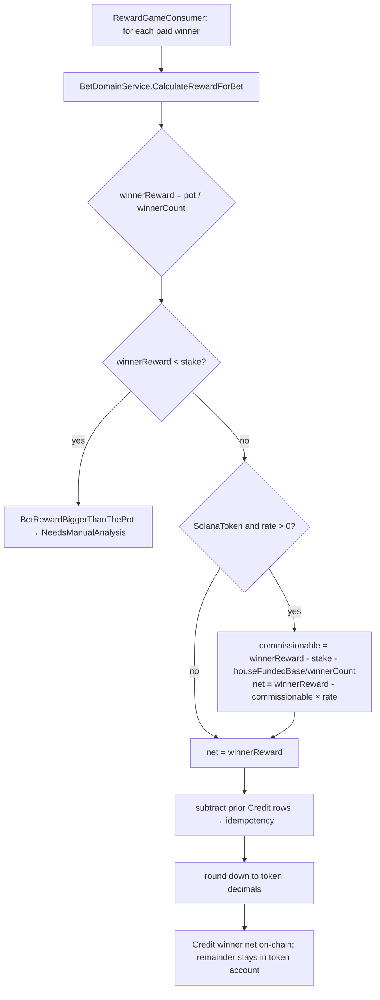

# SpaceStroker — "Add commission (crypto games)" Feature — Implementation Spec

> **Status: Shipped** — merged via `feature/crypto-commission` on 2026-07-17. Refined via Trello card
> [Add comission (#66)](https://trello.com/c/qq0F0ZNJ). Distilled: `features/crypto-commission.md`.
> Repos affected: `monkify-backend`, `monkify-front`, and this doc in `monkify-meta`.
>
> **Purpose:** Re-introduce a house **commission** on winnings, scoped to **crypto (SolanaToken)
> games only**. When a crypto game's winners are rewarded, **0.5% of the player-funded winnings is
> retained** ("stays in the token") instead of being paid out, and the fee is stated in the game's
> STATS side panel. Standard/USD games are unchanged (0% cut). SpaceStroker previously had a commission
> (`TokenSettings.CommisionPercentage`) that was **removed** in the operator-wallet-api refactor; this
> re-adds it, correctly spelled and crypto-scoped.

---

## 1. Summary

Today `BetDomainService` pays winners the **full pot** (`pot / winnerCount`) with no commission
(`SetPotAmount` comment: *"No SpaceStroker commission…"*). This feature adds a configurable house cut
that applies **only to `SolanaToken` game types**, computed so that:

- a winner **always keeps their full stake** (the cut comes only from profit above the stake), and
- the **house-funded lottery money** (`LotteryParameters.LotteryPot` + `Game.CarriedExtra`) is
  **never taxed** — only winnings funded by *other players' stakes* are.

Because every bet in a game shares one fixed `RequiredAmount`, the aggregate retained equals
**0.5% × (losing-bet stakes)**, split across winners. The retained amount is realized by simply
**crediting winners less on-chain** — the remainder stays in the operator's token account. No new
transfer, no ledger row, no migration.

| | Standard (USD) game | SolanaToken (crypto) game |
| --- | --- | --- |
| Pot paid to winners | 100% of pot (unchanged) | pot − commission |
| Commission | none | `rate × (player-funded profit above stake)` |
| House-funded lottery base taxed? | n/a | **No** |
| Winner ever below own stake? | No | No (cut is profit-only) |
| STATS badge | `0% HOUSE CUT` | `0.5% HOUSE CUT` (from backend rate) |

---

## 2. Constraints (MANDATORY)

From `monkify-meta/constraints.md` (full list there):

- **Worktree-per-repo:** work in `.worktrees/crypto-commission/<repo>`; the shared checkout stays on
  `main` (never `git checkout -b` there). Branch `feature/crypto-commission` in each affected repo.
- **Unit tests:** update/add in `SpaceStroker.Tests`; run via `scripts/run_tests.bat` (never the full
  `dotnet test` — `ProductionSessions` is a slow Monte-Carlo suite). Report changed tests at the end.
- **Integration test mandatory (new feature):** add at least one happy-path integration test in
  `SpaceStroker.Tests.Integration` (Testcontainers) asserting a crypto winner receives `pot − 0.5%`
  end-to-end; the lottery/multi-winner variant covers the more complex flow (see §11.2).
- **EF mapping:** inline in `SpaceStrokerDbContext.OnModelCreating`; no `IEntityTypeConfiguration`.
  **(N/A here — no schema change.)**
- **Migrations:** applied only by `SpaceStroker.Consumers`. **(N/A — no migration.)**
- **Secrets/config:** mock/placeholder values only in committed files (`spacestrokersettings.json`).
- **Operator messaging:** vague errors only; never reveal contract status. (No user-facing operator
  messaging changes here.)

---

## 3. Resolved product decisions

| # | Decision |
| --- | --- |
| 1 | **Scope: `SolanaToken` games only.** `Standard` games are unchanged (full pot, 0% cut). Reward math branches on `game.Parameters.PaymentMethod`. |
| 2 | **What is taxed = player-funded winnings above the winner's own stake.** Per winner: `commission = rate × max(0, winnerReward − ownStake − houseFundedShare)`; `net = winnerReward − commission`. |
| 3 | **House-funded lottery base excluded.** `houseFundedShare = (LotteryPot + CarriedExtra) / winnerCount`; subtracted before applying the rate. For races it is 0. |
| 4 | **A winner never nets below their stake** — the cut is profit-only; the existing gross `BetRewardBiggerThanThePot` guard stays. |
| 5 | **Rate is configurable, default 0.5%.** Single global value `GeneralSettings.Token.CommissionPercentage` (a percent, `0.5` = 0.5%). `0`/absent disables it. Restores the old (removed) `TokenSettings.CommisionPercentage` location, correctly spelled. |
| 6 | **Retained funds stay in the operator's token account** — realized by a reduced on-chain credit. **No new transfer, no dedicated ledger/`CryptoTransactionLog` row, no migration.** "Total paid out" stats drop naturally. |
| 7 | **Rounding unchanged** — the net reward still rounds down to the token decimals (`Math.Round(..., MidpointRounding.ToZero)`), applied after the commission so payouts never exceed the pot held on-chain. |
| 8 | **Free bets** (amount 0) contribute nothing and pay nothing → no commission. **Refunds** are unaffected (always return the full stake). |
| 9 | **UI: STATS side-panel badge only.** The `0% HOUSE CUT` badge becomes method-aware from a backend-provided per-game rate: SolanaToken → `0.5% HOUSE CUT`; Standard → `0% HOUSE CUT`. **No terminal line, no lobby game-card change.** |
| 10 | The commission rate is surfaced to the frontend on the existing active-types payload (`GameParametersDto` → `ActiveGame`): `commissionPercentage` = configured rate for SolanaToken games, `0` for Standard. |

---

## 4. Data model

**No entity, EF-mapping, or migration change.** The feature is reward-math + config + one DTO field.

The only config-shaped addition is a property on the existing `TokenSettings` POCO (§5) — it is a
bound config object (`[ExcludeFromCodeCoverage]`), not an EF entity, so no `OnModelCreating` or
migration work.

---

## 5. Configuration

Add a commission rate to the existing token settings (this is where the *old* commission lived
before removal, so it restores a known location):

`SpaceStroker.Domain/Configs/Entities/TokenSettings.cs`
```csharp
public class TokenSettings
{
    public string ClusterUrl { get; set; }
    public string MintAddress { get; set; }
    public string SenderAccount { get; set; }
    public string TokenOwnerPublicKey { get; set; }
    public string TokenOwnerPrivateKey { get; set; }
    public int Decimals { get; set; }
    // House commission on crypto (SolanaToken) winnings, as a PERCENT (0.5 == 0.5%).
    // 0 (or absent) disables the commission. Standard/USD games ignore it.
    public decimal CommissionPercentage { get; set; }
}
```

`SpaceStroker.Common/spacestrokersettings.json` → `GeneralSettings.Token`: add `"CommissionPercentage": 0.5`
(mock/default committed value). Absence binds to `0` (a safe no-commission fallback).

> The rate is a **percent**. Convert to a fraction in the domain: `rate = CommissionPercentage / 100m`.

---

## 6. Backend behaviour

### 6.1 `BetDomainService` — apply the commission in the reward calc

`SpaceStroker.Domain/Bets/Services/BetDomainService.cs`. The constructor already receives the full
`Game` and the global `TokenSettings`, so no new dependency is needed. Capture the three inputs the
commission needs once, in the constructor:

```csharp
private readonly TokenSettings _settings;
private readonly bool _isSolanaToken;
private readonly decimal _houseFundedBase;   // LotteryPot + CarriedExtra (0 for races)
private readonly decimal _commissionRate;    // fraction, e.g. 0.005m

public BetDomainService(Game game, TokenSettings settings)
{
    _settings = settings;
    // …existing bet/winner guards + SetPotAmount(game)…

    _isSolanaToken   = game.Parameters?.PaymentMethod == PaymentMethod.SolanaToken;
    _houseFundedBase = (game.Parameters?.LotteryParameters?.LotteryPot ?? 0m) + game.CarriedExtra;
    _commissionRate  = settings.CommissionPercentage / 100m;
}
```

`CalculateRewardForBet(Bet bet)` — insert the commission **after** the gross `BetRewardBiggerThanThePot`
guard and **before** the prior-credit subtraction:

```csharp
decimal winnerReward = PotAmount / Winners.Count();

if (winnerReward < bet.Amount)
    return new BetTransactionAmountResult(ErrorMessages.BetRewardBiggerThanThePot);   // unchanged

// NEW — house commission on player-funded profit above the stake (SolanaToken only).
if (_isSolanaToken && _commissionRate > 0m)
{
    decimal houseFundedShare  = _houseFundedBase / Winners.Count();      // 0 for races
    decimal commissionable    = winnerReward - bet.Amount - houseFundedShare;
    if (commissionable > 0m)
        winnerReward -= commissionable * _commissionRate;
}

decimal credits = SumTransactionsForBet(bet, TransactionLogType.Credit);
winnerReward -= credits;
if (winnerReward <= 0) return new BetTransactionAmountResult(ErrorMessages.BetHasAlreadyBeenRewarded);

winnerReward = Math.Round(winnerReward, _settings.Decimals, MidpointRounding.ToZero);
ulong rewardInTokens = (ulong)(winnerReward * (decimal)Math.Pow(10, _settings.Decimals));
return new BetTransactionAmountResult(winnerReward, rewardInTokens);
```

**Reward-division fix (found during implementation — pre-existing bug the commission surfaced).**
`BetDomainService.Winners` was a **deferred** query (`game.Bets.Where(Status == NeedsRewarding)`), and
`RewardGameConsumer` flips each winner's `Status` to `Rewarded` as it pays them. So `Winners.Count()`
**shrank mid-payout**, and later winners divided the pot by a smaller count — a multi-winner round
over-paid (a 3-token / 2-winner round paid the second winner the **whole pot**). Fix: **materialize
`Winners` once** (`.ToList()`) and divide the pot among **paid winners only**
(`PayableWinnerCount = Winners.Count(w => !IsFreeBet(w))`, frozen; guarded to ≥ 1). Paid-winner
division also preserves the free+paid rule (a free winner takes no share, so the paid winner keeps the
whole pot) that the old drift achieved only by accident. Both the reward divisor and the commission's
`houseFundedShare` use `PayableWinnerCount`. Regression test:
`CalculateRewardForBet_WinnersRewardedSequentially_CountDoesNotDrift`.

Notes:
- `net = winnerReward − commission` is what `RewardGameConsumer` passes to
  `paymentResolver.Resolve(...).Credit(winner, rewardResult.Value, …)`, so the on-chain transfer is
  already reduced — the retained remainder simply stays in the token account. **No extra code in
  `RewardGameConsumer`, `SolanaTokenPaymentMethodService`, or `ISolanaService`.**
- **Idempotency preserved:** commission is deterministic in `PotAmount`/`winnerCount`; on a redelivery
  the recomputed net minus the prior `Credit` rows resolves to `≤ 0` → `BetHasAlreadyBeenRewarded`.
- **Stake floor preserved:** `net − stake = houseFundedShare + commissionable × (1 − rate) ≥ 0`, so a
  winner never nets below their stake; the gross guard still rejects a genuinely-too-small pot.
- `SetPotAmount` is **unchanged** — the pot stays the full amount; commission is per-winner in the
  payout calc. (Keeps the pot/`> POT:`/stats semantics intact; only the transferred payout drops.)

### 6.2 Surface the rate on the active-types payload

`SpaceStroker.Infrastructure/Contracts/Games/GameParametersDto.cs` — add a field and an optional ctor
param (default 0 keeps existing test/callers compiling):

```csharp
public class GameParametersDto(GameParameters parameters, decimal commissionPercentage = 0m)
{
    // …existing fields…
    // House cut shown in the STATS badge. Configured rate for SolanaToken games; 0 for Standard.
    public decimal CommissionPercentage { get; set; } =
        parameters.PaymentMethod == PaymentMethod.SolanaToken ? commissionPercentage : 0m;
}
```

`SpaceStroker.Infrastructure/Handlers/Games/GetActiveParameters/GetActiveParametersHandler.cs` — inject
`GeneralSettings` and pass the rate:

```csharp
public GetActiveParametersHandler(IGameService gameService, SpaceStrokerDbContext context,
    IMessaging messaging, GeneralSettings settings) : base(context, messaging)
{ _gameService = gameService; _settings = settings; }

// …
return activeParameters.Select(x =>
    new GameParametersDto(x.Value, _settings.Token.CommissionPercentage));
```

`GeneralSettings` is DI-registered (resolved elsewhere, e.g. `RewardGameConsumer`), so the added
constructor parameter binds without new registration.

> The per-game *instance* DTO (`ActiveGameDto`) does **not** need the rate — the STATS panel reads
> `selectedGame` (an `ActiveGame`, sourced from `/games/active-types` → `GameParametersDto`).

---

## 7. Frontend behaviour

`monkify-front`. The active-types response deserializes straight into `ActiveGame[]` (no manual
mapper), so adding the DTO field flows through as `commissionPercentage`.

- **`src/types/index.ts`** — add to the `ActiveGame` interface:
  ```ts
  // House cut % for this game (SolanaToken only; 0 for Standard). Shown in the STATS badge.
  commissionPercentage: number;
  ```
- **`src/components/game/GameStatsPanel.vue`** — make the top trust badge method-aware. Today it is
  hardcoded:
  ```html
  <p class="… text-primary">0% HOUSE CUT</p>
  <p class="…">Winners split 100% of the pot. Every round is seed-verifiable.</p>
  ```
  Derive from the selected game:
  ```ts
  const houseCutPct = computed(() => selectedGame.value?.commissionPercentage ?? 0);
  const houseCutLabel = computed(() => `${houseCutPct.value}% HOUSE CUT`); // "0.5% HOUSE CUT" / "0% HOUSE CUT"
  const houseCutBlurb = computed(() =>
    houseCutPct.value > 0
      ? `Winners keep the pot minus a ${houseCutPct.value}% house cut. Every round is seed-verifiable.`
      : 'Winners split 100% of the pot. Every round is seed-verifiable.');
  ```
  Render `{{ houseCutLabel }}` and `{{ houseCutBlurb }}`. Keep the existing styling/classes; format
  the number so `0.5` shows as `0.5` and `0` as `0` (no trailing zeros).
- **No other UI change** — no `GameTerminal.vue` line, no `GameTypeCard.vue` change, bet flow
  untouched.

---

## 8. Flow diagram (reward payout with commission)



---

## 9. Out of scope

- Standard/USD (operator-wallet) settlement — untouched.
- Refund math/amounts (`CalculateRefundForBet` / `CalculateRefundForInvalidBet`).
- Provably-fair verification (`GET /games/{id}/verification`, `public/verify.html`) — these verify
  **winner selection**, not payout amounts, so no change.
- Any dedicated commission ledger/reporting, on-chain treasury sweep, or per-operator/per-token rate
  override (global rate only).
- Terminal / lobby-card fee display (STATS badge only).

---

## 10. File checklist

### 10.1 Backend (`monkify-backend`)

| # | File | Change |
| --- | --- | --- |
| 1 | `src/SpaceStroker.Domain/Configs/Entities/TokenSettings.cs` | Add `decimal CommissionPercentage`. |
| 2 | `src/SpaceStroker.Common/spacestrokersettings.json` | `GeneralSettings.Token.CommissionPercentage: 0.5` (mock/default). |
| 3 | `src/SpaceStroker.Domain/Bets/Services/BetDomainService.cs` | Capture `_isSolanaToken`, `_houseFundedBase`, `_commissionRate` in ctor; apply commission in `CalculateRewardForBet` (SolanaToken only, profit-above-stake, house base excluded). |
| 4 | `src/SpaceStroker.Infrastructure/Contracts/Games/GameParametersDto.cs` | Add `CommissionPercentage` field + optional ctor param (SolanaToken → rate, else 0). |
| 5 | `src/SpaceStroker.Infrastructure/Handlers/Games/GetActiveParameters/GetActiveParametersHandler.cs` | Inject `GeneralSettings`; pass `Token.CommissionPercentage` to the DTO. |

### 10.2 Frontend (`monkify-front`)

| # | File | Change |
| --- | --- | --- |
| 1 | `src/types/index.ts` | Add `commissionPercentage: number` to `ActiveGame`. |
| 2 | `src/components/game/GameStatsPanel.vue` | Method-aware house-cut badge label + blurb from `selectedGame.commissionPercentage`. |

### 10.3 Meta (`monkify-meta`)

| # | File | Change |
| --- | --- | --- |
| 1 | `specs/crypto-commission.md` | This spec. |
| 2 | `INDEX.md` | KB map row + "Feature currently in flight". |
| 3 | (at ship) `features/games.md`, `features/payment-methods.md`, `features/operator-wallet-api.md` | KB sync during `/monkify-ship-feature` (reward-math "No commission" notes now qualified for crypto). |

---

## 11. Tests

### 11.1 Unit tests — `src/SpaceStroker.Tests`

Extend `UnitTests/Domain/Games/BetDomainServiceTests.cs` (already tests `CalculateRewardForBet`).
Use a config with `CommissionPercentage = 0.5m`.

| Test case | Setup | Expected |
| --- | --- | --- |
| SolanaToken race, 2 paid bets, 1 winner | stake 1 each, pot 2 | net = 2 − 0.5%×1 = 1.995 (rounded to decimals) |
| SolanaToken race, N losers → 1 winner | pot = N×stake | net = pot − 0.5%×((N−1)×stake) |
| SolanaToken, multi-winner | pot split among W winners | each net = pot/W − 0.5%×(perWinner player-funded profit); Σ retained = 0.5%×(losing stakes) |
| Winner reward == stake (no profit) | pot/winnerCount == stake | commission 0; net == stake |
| SolanaToken lottery | pot = stakes + LotteryPot + CarriedExtra | house-funded base **not** taxed; only stake-funded profit taxed |
| Standard game unchanged | `PaymentMethod.Standard`, `CommissionPercentage = 0.5m` | net == full pot share (no commission) |
| Rate = 0 disables | `CommissionPercentage = 0m`, SolanaToken | net == full pot share |
| Idempotency retry | prior `Credit` row == net | `BetHasAlreadyBeenRewarded` |
| Free bet winner | amount 0 | no commission path (handled upstream in `RewardGameConsumer`; free winner marked `Rewarded`) |

Also add a `GetActiveParametersHandler`/DTO test (extend the relevant handler test): SolanaToken type
→ `CommissionPercentage == configured`; Standard type → `0`.

### 11.2 Integration tests — `src/SpaceStroker.Tests.Integration` (mandatory)

Extend `GameFlowTests.cs` (the Testcontainers suite; SolanaToken payouts run through the harness's
`FakeSolanaService`, which records transfers):

1. **Happy path (required):** the existing SolanaToken bet→run→reward flow, asserting the winner's
   **credited/transferred amount == pot − 0.5%×(losing stakes)** (read from the recorded transfer /
   the winner bet's `Credit` `TransactionLog`), and that a Standard flow still pays the full pot.
2. **Complex flow:** a SolanaToken **lottery or multi-winner** round asserting the house-funded base
   is untaxed and the split/retained totals match §11.1.

---

## 12. Acceptance criteria

Mapped 1:1 from the Trello **Acceptance Criteria** checklist:

1. Given a SolanaToken race with two equal paid bets and one winner, when winners are rewarded, then
   the winner is paid `pot − 0.5%×otherStakes` and the 0.5% remains in the operator's token account.
2. Given a Standard/USD game with winners, when winners are rewarded, then the full pot is paid out
   with no commission (unchanged).
3. Given a winner whose gross reward equals their own stake, when commission is applied, then
   commission is 0 and the winner keeps their full stake.
4. Given a SolanaToken lottery whose pot includes a house-funded `LotteryPot + CarriedExtra`, when a
   winner is rewarded, then the 0.5% is taken only from the player-stake-funded portion and the
   house base is not taxed.
5. Given a SolanaToken game with multiple winners, when they are rewarded, then each winner's net =
   `(pot/winnerCount) − their 0.5% on player-funded profit`, and total retained = 0.5% of the losing
   stakes.
6. Given a free (amount 0) SolanaToken bet that wins, when winners are rewarded, then no commission
   is taken.
7. Given the commission rate is configured (default 0.5%), when reward math runs for a SolanaToken
   game, then the configured global rate is used and `0` disables it.
8. Given a SolanaToken game open in the STATS panel, when the player views the house-cut badge, then
   it shows the configured fee (e.g. `0.5% house cut`) from the backend rate.
9. Given a Standard game open in the STATS panel, when the player views the house-cut badge, then it
   still shows `0% house cut`.
10. Given a rewarded SolanaToken game, when a reward retry (redelivery) occurs, then the net payout
    recomputes identically and no double payment happens.

---

## 13. Manual QA (local Docker stack)

1. Ensure `GeneralSettings.Token.CommissionPercentage = 0.5` in the local config.
2. Open a **SolanaToken** game (e.g. `6X Crypto Clash`) → STATS tab → badge reads `0.5% HOUSE CUT`.
   Open a **Standard** game → badge reads `0% HOUSE CUT`.
3. Fill a crypto round (see the `fill-crypto-clash` skill), let it resolve, and confirm the winner's
   on-chain payout ≈ `pot − 0.5%×(losing stakes)` (compare the recorded transfer / `TransactionLog`).

---

## 14. Trello / pipeline

- **Source card:** [Add comission (#66)](https://trello.com/c/qq0F0ZNJ) — list **Specs created**;
  the **Implementation** section on the card lists branch + spec + worktree.
- **Next:** `/monkify-implement-feature Add comission` to build it (with the mandatory integration
  test), then `/monkify-ship-feature Add comission` to sync the KB and merge to `main`.

---

## 15. Revision log

| Date | Change |
| --- | --- |
| 2026-07-17 | Initial spec from refined card #66 (crypto-only commission, profit-above-stake, house-base-excluded, STATS-badge-only, global rate config). |
| 2026-07-17 | Implementation: fixed a pre-existing multi-winner reward-division bug the commission surfaced — freeze the winner set + divide the pot among paid winners only (`PayableWinnerCount`). Product decision confirmed: keep the profit-above-stake model (a 3-token / 2-winner round pays 1.4975 each, not 1.4925). |
