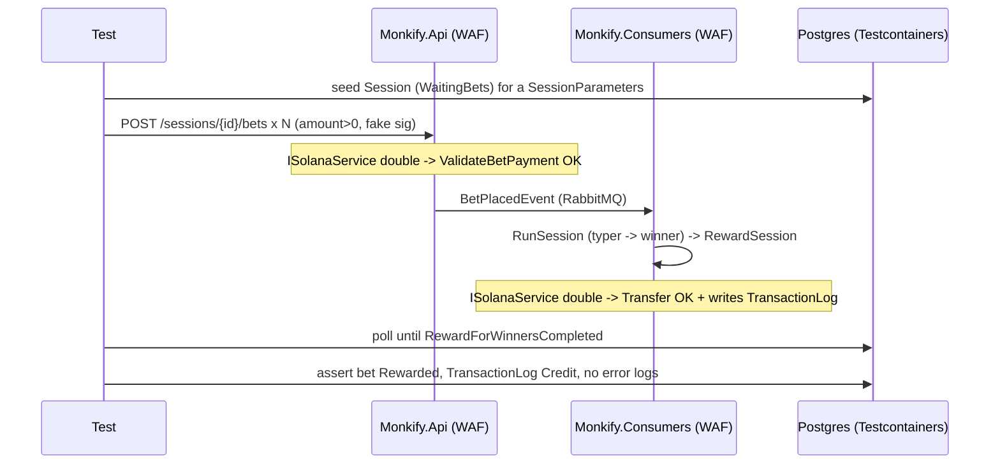

# Monkify — "DEV QOL Stuff" Feature — Implementation Spec

> **Status: Ready for implementation** — refined via Trello card
> [DEV QOL Stuff](https://trello.com/c/dHExBJHg/28-dev-qol-stuff) (2026-06-30).
> Repos affected: `monkify-backend`, `monkify-front`, and this doc in `monkify-meta`.
>
> **Purpose:** Four developer quality-of-life items that make local development of the launch-token
> flow easier and add an end-to-end safety net for the session lifecycle. Audience: us (devs/QA),
> **not** players or operators. No production behaviour changes except the documented launch-URL shape
> and a slimmed dev-only endpoint response.

---

## 1. Summary

Four largely independent work items:

| # | Item | Repos | Notes |
| --- | --- | --- | --- |
| **A** | Drop `operatorId` from the game URL; resolve the operator from the launch token's `iss` claim instead | front + backend | Backend change is only the dev-mint response shape |
| **B** | Replace the silent dev auto-mint with two explicit dev-only buttons (Crypto / Regulated) on a token-less landing | front | Buttons are the only dev entry point |
| **C** | New `Monkify.Tests.Integration` project (Testcontainers) running sessions end-to-end | backend | **Independent — can be built by a parallel agent** |
| **D** | Meta rule: session-flow changes must update the integration suite | meta | Doc-only |

**A, B** are coupled (same frontend launch flow + one backend response tweak). **C** is independent.
**D** is a knowledge-base rule that lands with this feature.

> **Note on "the launch token":** in production a casino redirects the player to Monkify with a
> signed RS256 JWT (`#launch_token=<jwt>`); the operator is the token's `iss` claim. See
> `features/launch-token-validation.md`. This feature does **not** change token signing/validation —
> only where the frontend reads the operatorId from, and the shape of the dev-only mint response.

---

## 2. Constraints (MANDATORY)

From `monkify-meta/constraints.md` (full list there):

- **Branch-per-repo:** `feature/dev-qol-stuff` in `monkify-backend`, `monkify-front`, and `monkify-meta`
  (already created + pushed by `/monkify-create-spec`).
- **Unit tests:** update/add in `Monkify.Tests`; **report changed tests at end of implementation.**
  Run `scripts/run_tests.bat` (fast suite) before declaring done. The new integration suite (item C)
  runs separately via `scripts/run_integration_tests.bat`.
- **EF mapping / migrations:** **none needed** — this feature adds no entities, columns, or migrations.
- **Secrets/config:** the dev launch-token signing key stays a **mock** placeholder in
  `monkifysettings.json` — never a real key. Testcontainers connection strings are ephemeral/mock.
- **Operator messaging:** unchanged — auth/operator failures still route to a vague `/error`; never
  reveal contract status.
- **Hosts:** API stays stateless and does **not** migrate; `Monkify.Consumers` keeps owning
  background/typer/money work + migrations. (Relevant to how the integration harness boots both hosts.)

---

## 3. Resolved product decisions

| # | Decision |
| --- | --- |
| 1 | The launch token is the source of truth for operator identity. The frontend reads the operatorId from the token's `iss` claim (client-side base64 decode of the JWT payload, validated with `isValidOperatorGuid`). **No** new backend operator-resolution endpoint. |
| 2 | `operatorId` is removed from the game route path. Operator-scoped pages no longer carry `:operatorId`. |
| 3 | `DevController.MintLaunchToken` returns **`{ token }` only** (drop `operatorId` from the response + XML doc). |
| 4 | The silent dev auto-mint (`mintDevToken` in `useLaunch.ts`) is **removed entirely**. |
| 5 | Two **dev-only** buttons (Crypto / Regulated) live on a token-less landing at `/monkify/game` (prod → `/error`). Each mints via `POST /dev/launch-token?paymentModel=…`, stores the token, and navigates to the session-select page. |
| 6 | New backend integration tests live in a **separate** `Monkify.Tests.Integration` project, excluded from the default fast suite, with their own runner script. |
| 7 | Integration tests use **Testcontainers** (PostgreSQL + RabbitMQ + Redis), boot the **API** + **Consumers** hosts, run a representative sample of default session types end-to-end, and cover **both free and paid** bets. Solana is mocked. |
| 8 | Solana is never really called in tests — `ISolanaService` is replaced with a test double (crypto/Model B paths); the regulated/Model A paid path mocks `IOperatorWalletService` instead. |
| 9 | Meta rule: any change to the session lifecycle/flow must also update `Monkify.Tests.Integration`. |

---

## 4. Data model

**No data-model changes.** No new entities, columns, EF mapping, or migrations. (Item C reads/asserts
existing tables — `Sessions`, `Bets`, `TransactionLogs` — but adds none.)

---

## 5. Configuration

- **Backend:** no new `GeneralSettings`. The integration harness **overrides** the three connection
  strings to point at Testcontainers, via environment variables (.NET double-underscore convention):
  - `ConnectionStrings__Monkify` → the Postgres container (also used by Hangfire).
  - `ConnectionStrings__RabbitMQ` → the RabbitMQ container.
  - `ConnectionStrings__Redis` → the Redis container.
  Lower `GeneralSettings:Sessions:MinimumWaitPeriodForBets` (and related worker intervals) in the test
  config so race sessions start promptly instead of waiting the production window.
- **Frontend:** new env flag **`VUE_APP_DEV_LAUNCH`** (codebase convention is **`VUE_APP_*`**, Vue CLI,
  not `VITE_*`) gates the dev landing/buttons — `devLaunchEnabled = process.env.VUE_APP_DEV_LAUNCH !==
  'false'` in `src/constants/featureFlags.ts`, mirroring `allowFreeBets`. Default **on** (so local
  `yarn serve` works with zero config). **Do not gate on `NODE_ENV`** — the docker local environment
  builds the SPA in production mode (`yarn build`), so a `NODE_ENV` guard would hide the buttons
  exactly where they are needed.
  - **Env files (same convention as `VUE_APP_ALLOW_FREE_BETS`):** `.env.production` and the `*.local`
    files are **git-ignored** (ops/deploy-managed); the committed template is **`.env.example`**, which
    documents `VUE_APP_DEV_LAUNCH`. The **production deploy must set `VUE_APP_DEV_LAUNCH=false`** in its
    `.env.production` (so `/monkify/game` → `/error`).
  - **Local docker env:** `scripts/refresh_containers.bat` materialises `VUE_APP_DEV_LAUNCH=true`
    into the generated `.env.production.local` (Vue CLI's highest-priority file → overrides
    `.env.production`). The api/consumers containers run `ASPNETCORE_ENVIRONMENT=Development`, so the
    `/dev/launch-token` endpoint the buttons call is available there.

---

## 6. Backend behaviour

### 6.1 `DevController.MintLaunchToken` — slim the response (item A)

File: `monkify-backend/src/Monkify.Api/Controllers/DevController.cs`

Today (line 58): `return Ok(new { token, operatorId = devOperator.Id });`

**Change:** return only the token:

```csharp
return Ok(new { token });
```

Also update the XML `<summary>` (lines 28-32) — it currently says "returns the token and the operator
id"; change to "returns the token". The operator is recoverable from the token's `iss` claim, so the
frontend no longer needs it (decision #1, #3).

> **Hidden blocker (must fix):** `DevControllerTests` asserts the `operatorId` property on the
> response — see §11. Those two tests break unless updated in the same change.

### 6.2 No other backend production code changes for items A/B

The middleware, `LaunchTokenService`, `OperatorService`, `GET /operators/{id}`, and the
`iss == path operatorId` check are **unchanged**. The frontend keeps calling `GET /operators/{id}`
with the operatorId it decodes from the token, so the existing iss-match protection still holds.

### 6.3 Integration test harness (item C)

This is **test-project work only** — no production code changes. Documented here so the implementer
has the exact seams.

**New project:** `monkify-backend/src/Monkify.Tests.Integration` (see §10.1 for csproj + §10.4 for the
.sln entry). Namespace root `Monkify.Tests.Integration.*` — naturally excluded from
`scripts/run_tests.bat` (which `cd`s into `Monkify.Tests` and also filters `FullyQualifiedName~UnitTests`).

**Containers (Testcontainers):**

| Container | Module | Purpose |
| --- | --- | --- |
| PostgreSQL | `Testcontainers.PostgreSql` | EF store **and** Hangfire storage (`ConnectionStrings__Monkify`) |
| RabbitMQ | `Testcontainers.RabbitMq` | MassTransit broker (`ConnectionStrings__RabbitMQ`) |
| Redis | `Testcontainers.Redis` | Cache + SignalR backplane (`ConnectionStrings__Redis`) |

> The existing `Monkify.Tests.csproj` references `Testcontainers.MsSql`, which is the **wrong** engine
> (Monkify is Postgres/Npgsql). Do **not** reuse it — add the three modules above to the new project.

**Booting the hosts** (collection fixture, started once, shared across the suite):

1. Start the three containers; capture their connection strings into environment variables
   (`ConnectionStrings__Monkify/RabbitMQ/Redis`) **before** building the hosts.
2. Boot **`Monkify.Consumers`** via `WebApplicationFactory<Program>` (it is a `WebApplication`). On
   startup it **applies EF migrations**, **seeds the two dev operators** (`DEV Cassino` /
   `DEV Regulated Cassino`), seeds the default session parameters, and registers the MassTransit
   consumers + Hangfire. This is the host that runs the game loop.
3. Boot **`Monkify.Api`** via `WebApplicationFactory<Program>` against the **same** containers (it does
   not migrate). Use its `HttpClient` to place bets.
4. In **both** factories' `ConfigureTestServices`, **replace Solana / wallet** with test doubles
   (§6.4) and **lower** `MinimumWaitPeriodForBets`.
   - `Program.cs` is top-level-statements; reference it via `public partial class Program { }` (add a
     one-line partial in each host project if `WebApplicationFactory<Program>` cannot see it).

> **Caveat — background session creator:** `Monkify.Consumers` runs a `BaseWorker`-derived background
> service (interval `GeneralSettings:Workers` / `CreateSessionsInterval`) plus `BetPlacedConsumer` /
> `RunSessionConsumer`, all of which auto-create `Session` rows. For **deterministic** tests, **seed
> the `Session` row directly** via a DbContext scope (status `WaitingBets`, tied to a chosen seeded
> `SessionParameters`) rather than racing the worker, and key assertions on **that** session id.

**Driving a session end-to-end (per chosen session type):**

1. Resolve a seeded `SessionParameters` for a dev operator (from the post-startup DB).
2. Seed a `Session` (`WaitingBets`) for it via DbContext.
3. Mint a launch token for the operator (reuse `ILaunchTokenService` / the dev mint), then place
   `MinimumNumberOfPlayers` bets via `POST /sessions/{id}/bets` on the API client:
   - **Free** bets: `amount = 0`, no `paymentSignature` (skips payment + ledger).
   - **Paid crypto** bets (Model B / `DEV Cassino`): `amount > 0` + a (fake) `paymentSignature` + wallet;
     `ISolanaService` double validates them (§6.4).
   - **Paid regulated** bets (Model A / `DEV Regulated Cassino`): `amount > 0`, no wallet/signature
     (player from token `sub`); the operator-wallet double handles debit/credit (§6.4).
4. The lifecycle runs on its own: `BetPlacedConsumer` → `RunSessionConsumer` (the typer always
   produces a winner, via fallback) → `RewardSessionConsumer`. **Poll** the DB until the session
   reaches a terminal status (`RewardForWinnersCompleted`) or a timeout.
5. Assert (§12 / item C).

**Which session types (correction to the card):** the card text assumed "5 of the **6**" default
types; the code actually generates **18** in `DefaultSessionParameters.GenerateDefaultParameters()`
(3 letter-race, 3 number-race, 3 alphanumeric-race, 3 preset-choice race, 3 four-hour lottery,
3 daily lottery). Honour the original intent — **a representative ~5** — by covering one of each race
flavour plus one preset:

| # | Flavour | Example name | Bet type in this run |
| --- | --- | --- | --- |
| 1 | Letters race | `6L Lexicon Lightning` | Free |
| 2 | Numbers race | `6N Digit Derby` | Paid crypto (Model B) |
| 3 | Alphanumeric race | `6X Alphanumeric Ambush` | Paid crypto (Model B) |
| 4 | Preset-choice race | `6L Savanna Stakes` | Paid regulated (Model A) |
| 5 | Letters race (2nd len) | `7L Septagram Scramble` | Mixed free + paid |

> **Lottery types are intentionally excluded** from the default run: their draw is Hangfire-scheduled
> 4–24h out, so they cannot complete in a test without manually triggering the draw. Driving a lottery
> draw (enqueue/trigger the scheduled `BetPlacedEvent`) is an **optional** advanced case — document if
> added; do not block the suite on it.

### 6.4 Solana / operator-wallet test doubles (item C)

Replace via `ConfigureTestServices` (registered after the real registration, so the test wins):

**`ISolanaService` (crypto / Model B):** real `SolanaService` writes the ledger row *internally*
(`SolanaService.cs:105`), so a plain mock would skip it. The double must replicate the happy path
**including the `TransactionLog` write**, so the paid-crypto ledger assertion holds:

```csharp
// pseudocode for the test double
ValidateBetPayment(bet)               => new ValidationResult();           // valid
GetLatestBlockhashForTokenTransfer()  => "TEST_BLOCKHASH";                 // non-empty
TransferTokensForBet(bet, amount)     => { dbContext.TransactionLogs.Add(new TransactionLog(bet.Id, amount.Value, "TEST_SIG")); save(); return true; }
RefundTokens(...)                     => true;                              // (+ optional Refund log)
```

**`IOperatorWalletService` / `IOperatorWalletResolver` (regulated / Model A):** mock `Credit` (and
`Debit` for stake) to return success with a fake `ExternalTransactionReference`. The **real consumer**
(`RewardSessionConsumer.CreditThroughOperatorWallet`, `RewardSessionConsumer.cs:158`) and the real
register-bet debit path then write the `TransactionLog` Debit/Credit rows — so the regulated ledger
assertion exercises real ledger code (preferred).

**Ledger-write reference (so assertions match reality):**

| Path | Where the `TransactionLog` row is written | Type |
| --- | --- | --- |
| Crypto reward (Model B) | `SolanaService.TransferTokensForBet` (mocked → double must write it) | Credit |
| Regulated stake (Model A) | register-bet debit path (real) | Debit |
| Regulated reward (Model A) | `RewardSessionConsumer.CreditThroughOperatorWallet` (real) | Credit |
| Free bet | **none** — free bets skip the ledger entirely | — |

---

## 7. Frontend behaviour

### 7.1 Decode the operator from the token (item A)

File: `monkify-front/src/utils/launchToken.ts`

Add a helper that extracts the operatorId from the stored/issued JWT:

```typescript
// Read iss from the JWT payload (no signature check needed — backend validates on every call).
export function getOperatorIdFromToken(token: string | null = getLaunchToken()): string | null {
  if (!token) return null;
  try {
    const payload = JSON.parse(atob(token.split('.')[1]));
    const iss = payload?.iss as string | undefined;
    return iss && isValidOperatorGuid(iss) ? iss : null;
  } catch {
    return null;
  }
}
```

(`isValidOperatorGuid` lives in `src/utils/operatorRoute.ts`; import it or co-locate.)

### 7.2 Routes — remove the `:operatorId` segment (item A + B)

File: `monkify-front/src/routes.ts`

Current routes:

| Name | Path (today) | Component |
| --- | --- | --- |
| — | `/monkify/game` | redirect → `/error` |
| `Session` | `/monkify/game/:operatorId` | `SessionSelectPage.vue` |
| `Game` | `/monkify/game/:operatorId/play` | `GamePage.vue` |
| `Error` | `/error` | `ErrorPage.vue` |

New routes:

| Name | Path (new) | Component | Notes |
| --- | --- | --- | --- |
| `DevLanding` | `/monkify/game` | new `DevLandingPage.vue` (dev only) | In **production**, redirect → `/error` (dev-only buttons never ship/render). |
| `Session` | `/monkify/game/sessions` | `SessionSelectPage.vue` | (exact path string is a naming choice — keep it param-free) |
| `Game` | `/monkify/game/play` | `GamePage.vue` | |
| `Error` | `/error` | `ErrorPage.vue` | |

- **Remove** the `requireValidOperator` `beforeEnter` guard (there is no `:operatorId` to validate).
  Operator/token presence is already enforced by `useOperator.loadOperator` (it redirects to `/error`
  when no token / no operator resolves).
- The dev-landing route must be reachable **without** a token; gate it on the **`devLaunchEnabled`**
  flag (`VUE_APP_DEV_LAUNCH !== 'false'`, see §5) and redirect to `/error` when disabled (production).
- **Production casino launch landing.** Because `/monkify/game` is the dev landing (prod → `/error`),
  the real casino launch lands on the **session-select route**: the new launch URL is
  **`…/monkify/game/sessions#launch_token=<jwt>`** (replacing `…/monkify/game/<operatorId>#launch_token=<jwt>`).
  `App.vue`'s `onMounted` already calls `loadOperator()` for the `Session`/`Game` routes, so the
  fragment token is captured, stripped, stored, and decoded on that hard load. (The dev buttons reach
  the same `Session` route via SPA navigation and call `loadOperator()` themselves.)

### 7.3 `useLaunch` — remove the silent auto-mint (item B)

File: `monkify-front/src/hooks/useLaunch.ts`

- **Delete** `mintDevToken` and the dev auto-mint block inside `ensureLaunchToken` (lines ~56-63).
- Change `ensureLaunchToken(operatorId)` → `ensureLaunchToken()` (no argument). It now only: reads a
  fresh fragment token (capture + strip + store), else returns the stored token, else `null`
  (→ caller routes to `/error`). Keep the fragment capture/strip/`sessionStorage` behaviour intact.

### 7.4 `useOperator` — derive operatorId from the token (item A)

File: `monkify-front/src/hooks/useOperator.ts`

- Replace the `operatorId` computed (currently `route.params.operatorId`) with
  `getOperatorIdFromToken()` (decode from the stored token).
- In `loadOperator`: call `ensureLaunchToken()` (no arg) first; then `const id = getOperatorIdFromToken(token)`;
  if `!id` → `/error`; else `mainService.getOperator(id)` as today. `applyOperatorTheme` / `paymentModel`
  unchanged.

### 7.5 Param-free router pushes (item A)

Drop the `operatorId` param from every router navigation:

- `src/components/GameHeader.vue` — `sessionHomeRoute` → `{ name: 'Session' }` (no `params`).
- `src/pages/GamePage.vue` — `router.push({ name: 'Session' })` (no `params`).
- `src/components/game-selection/GameTypes.vue` — `chooseSession` →
  `router.push({ name: 'Game', query: { type: session.sessionTypeId } })` (no `params`).

### 7.6 Dev landing page + two buttons (item B)

New file: `monkify-front/src/pages/DevLandingPage.vue` (or a small component rendered by the
`/monkify/game` route). Dev-only.

- Renders exactly two buttons: **Crypto** and **Regulated**.
- On click:
  ```typescript
  const { data } = await axios.post(`${baseURL}/dev/launch-token`, null, {
    params: { paymentModel },   // 'Crypto' | 'Regulated'
  });
  setLaunchToken(data.token);            // from launchToken.ts
  router.push({ name: 'Session' });      // session-select; useOperator decodes iss + loads branding
  ```
- Guard: when `devLaunchEnabled` is false (production — `VUE_APP_DEV_LAUNCH=false`), `/monkify/game`
  redirects to `/error` and the buttons are never rendered/shipped (see §5).

---

## 8. Flow diagrams

### 8.1 Dev entry (after this change)

```mermaid
sequenceDiagram
    participant Dev as Developer (no token)
    participant FE as Frontend (/monkify/game, dev only)
    participant API as DevController
    Dev->>FE: open /monkify/game
    FE-->>Dev: show [Crypto] [Regulated]
    Dev->>FE: click Regulated
    FE->>API: POST /dev/launch-token?paymentModel=Regulated
    API-->>FE: { token }
    FE->>FE: setLaunchToken(token); decode iss
    FE->>FE: router.push(Session) -> getOperator(iss) -> branding
```

### 8.2 Integration test (one session, paid crypto)



---

## 9. Out of scope

- Any change to launch-token **signing/validation**, claims, or middleware (only the dev-mint
  *response shape* changes).
- A new backend operator-resolution endpoint (decided against — the client decodes `iss`).
- Running **all** default session types in the integration suite, or load/perf testing.
- Driving **lottery** draws in the integration suite (optional/advanced; excluded from the default run).
- Real Solana calls in tests (always mocked).
- Knowledge-base `features/` updates beyond item D's rule (the post-merge `features/` sync is handled
  by `/monkify-ship-feature`).

---

## 10. File checklist

### 10.1 Backend (`monkify-backend`)

| # | File | Change |
| --- | --- | --- |
| 1 | `src/Monkify.Api/Controllers/DevController.cs` | `MintLaunchToken` returns `{ token }` only; update XML doc |
| 2 | `src/Monkify.Tests/UnitTests/Controllers/DevControllerTests.cs` | Drop `operatorId` assertions (see §11) |
| 3 | `src/Monkify.Tests.Integration/Monkify.Tests.Integration.csproj` | **New** project (see §10.3) |
| 4 | `src/Monkify.Tests.Integration/*` | **New** collection fixture (containers + 2 WAF hosts), test doubles, session-flow tests |
| 5 | `src/Monkify.Api/Program.cs` & `src/Monkify.Consumers/Program.cs` | Add `public partial class Program { }` if needed for `WebApplicationFactory<Program>` |
| 6 | `scripts/run_integration_tests.bat` | **New** runner (mirror `run_production_session_tests.bat`) |
| 7 | `src/Monkify.sln` | Add the new project + build configs |
| 8 | `scripts/refresh_containers.bat` | Materialise `VUE_APP_DEV_LAUNCH=true` into the generated `.env.production.local` so the local (prod-built) container shows the dev launch buttons |
| 9 | `src/Monkify.Api/Dockerfile` & `src/Monkify.Consumers/Dockerfile` | Add `COPY` for `Monkify.Tests.Integration.csproj` before `dotnet restore` (the layered restore is on the whole `.sln`, so every referenced csproj must be copied) |

### 10.2 Frontend (`monkify-front`)

| # | File | Change |
| --- | --- | --- |
| 1 | `src/utils/launchToken.ts` | Add `getOperatorIdFromToken()` |
| 2 | `src/routes.ts` | Drop `:operatorId`; remove `requireValidOperator`; `/monkify/game` → dev landing (prod → `/error`) |
| 3 | `src/hooks/useLaunch.ts` | Remove `mintDevToken` + auto-mint; `ensureLaunchToken()` no arg |
| 4 | `src/hooks/useOperator.ts` | Derive `operatorId` from token; call `ensureLaunchToken()`/`getOperatorIdFromToken()` |
| 5 | `src/components/GameHeader.vue` | `sessionHomeRoute` → `{ name: 'Session' }` (no params) |
| 6 | `src/pages/GamePage.vue` | `router.push({ name: 'Session' })` (no params) |
| 7 | `src/components/game-selection/GameTypes.vue` | `chooseSession` push without `operatorId` param |
| 8 | `src/pages/DevLandingPage.vue` | **New** dev-only landing with Crypto/Regulated buttons |
| 9 | `src/constants/featureFlags.ts` | Add `devLaunchEnabled` (`VUE_APP_DEV_LAUNCH !== 'false'`) |
| 10 | `.env.example` (committed) | Document `VUE_APP_DEV_LAUNCH`. NB `.env.production` is git-ignored/ops-managed — production deploy must set `VUE_APP_DEV_LAUNCH=false` there |

### 10.3 New integration csproj (mirror of `Monkify.Tests.csproj`)

`net8.0`, `IsTestProject=true`. Package references: `Microsoft.NET.Test.Sdk` 17.6.0, `xunit` 2.4.2,
`xunit.runner.visualstudio` 2.4.5, `Shouldly` 4.2.1, `Moq` 4.20.70, `Bogus` 35.5.0,
`coverlet.collector` 6.0.2, **`Microsoft.AspNetCore.Mvc.Testing`** (8.0.x, for `WebApplicationFactory`),
**`Testcontainers.PostgreSql`**, **`Testcontainers.RabbitMq`**, **`Testcontainers.Redis`** (4.6.0, to
match the existing Testcontainers 4.6.0). Project references: `Monkify.Api`, `Monkify.Consumers`,
`Monkify.Infrastructure`, `Monkify.Domain`, `Monkify.Common`. (Do **not** copy `Testcontainers.MsSql`.)

### 10.4 Meta (`monkify-meta`)

| # | File | Change |
| --- | --- | --- |
| 1 | `conventions/backend.md` | Add the rule: session-flow changes must update `Monkify.Tests.Integration` |
| 2 | `constraints.md` | Add a one-line pointer (in §3 Unit tests) to that rule |
| 3 | `features/launch-token-validation.md` | (on ship) update the launch URL example: production launch lands on the session route — `…/monkify/game/sessions#launch_token=<jwt>` (was `…/monkify/game/<operatorId>#launch_token=<jwt>`) |
| 4 | `specs/dev-qol-stuff.md` | This spec |
| 5 | `INDEX.md` | Map row + "Feature currently in flight" |

---

## 11. Unit tests

Project: `monkify-backend/src/Monkify.Tests` (fast suite) + the new `Monkify.Tests.Integration`.
**Report all changed/added tests at end of implementation.**

### 11.1 `DevControllerTests` (existing — must update)

File: `src/Monkify.Tests/UnitTests/Controllers/DevControllerTests.cs`

| Test case | Change |
| --- | --- |
| `MintLaunchToken_Crypto_ReturnsCryptoOperator` | Remove the `operatorId` property assertion; keep `token` non-empty. Rename if the name now overclaims. |
| `MintLaunchToken_Regulated_ReturnsRegulatedOperator` | Same — drop `operatorId` assertion |
| `MintLaunchToken_DefaultsToCrypto` / `_NoDevOperator_Returns404` / `_Production_Returns404` | Unchanged (no `operatorId` assertion) |
| **New** | Assert the response shape has **no** `operatorId` property (reflection: `GetProperty("operatorId") == null`) |

### 11.2 `Monkify.Tests.Integration` (new)

Namespace `Monkify.Tests.Integration.*`. One collection fixture (containers + both WAF hosts + doubles).

| Test | Expect |
| --- | --- |
| Letters-race, free bets | Session → `RewardForWinnersCompleted`; ≥1 winner `Rewarded`; **no** `TransactionLog` rows; no error logs |
| Numbers-race, paid crypto (Model B) | Session completes; winner `Rewarded`; one `Credit` `TransactionLog` (via Solana double); no error logs |
| Alphanumeric-race, paid crypto | As above |
| Preset-race, paid regulated (Model A) | Session completes; winner `Rewarded`; `Debit` + `Credit` `TransactionLog` rows (real consumer); no error logs |
| Mixed free + paid in one session | Pot from paid only; free winner `Rewarded` with no ledger row; paid winner with ledger row |
| Error-log capture | Assert API + Consumers emit **no** `Error`-level logs across all runs (e.g. an in-memory/Serilog sink the fixture inspects) |

> The typer always yields a winner (fallback winner mechanism — see `features/typer-pacing-scalability.md`),
> so "≥1 winner" assertions are stable without forcing a specific typed sequence.

---

## 12. Acceptance criteria

Mapped 1:1 from the Trello **Acceptance Criteria** checklist (card #28):

1. **A1** — Given a valid launch token (fragment or `sessionStorage`), when the player opens the game
   page with no operatorId in the URL, then the operator is resolved from the token's `iss` claim and
   branding/theme loads correctly.
2. **A2** — Given no operatorId anywhere in the URL, when the frontend calls `GET /operators/{id}`,
   then it uses the operatorId decoded from the token's `iss` (validated by `isValidOperatorGuid`).
3. **A3** — Given a successful `POST /dev/launch-token` in dev, when the response is returned, then its
   body contains only `{ token }` and no `operatorId`.
4. **B1** — Given dev environment with no token, when a dev opens `/monkify/game`, then a dev-only
   landing renders exactly two buttons: Crypto and Regulated.
5. **B2** — Given the dev landing, when the dev clicks Crypto (or Regulated), then
   `POST /dev/launch-token?paymentModel=Crypto` (or `Regulated`) is called, the returned token is
   stored via `setLaunchToken`, and the dev is navigated to the session-select page for that operator.
6. **B3** — Given production build, when a user navigates to `/monkify/game`, then they are redirected
   to `/error` and no dev buttons are present in the shipped bundle.
7. **B4** — Given dev environment and no token, when the app loads, then no token is auto-minted
   silently (the `mintDevToken` fallback is removed); entry requires clicking a button.
8. **C1** — Given the `Monkify.Tests.Integration` suite with Testcontainers (Postgres + RabbitMQ +
   Redis), when it runs the representative default session types end-to-end (free and paid bets, Solana
   mocked), then each session reaches a terminal status and winners are marked `Rewarded`.
9. **C2** — Given the integration run, when the API and Consumers process the sessions, then no
   error-level logs are emitted by either host.
10. **C3** — Given the containerized DB after a run, when assertions execute, then paid winners have
    correct payout and `TransactionLog` rows, free bets are excluded from the pot, and all bets
    persisted with expected statuses.
11. **C4** — Given the default fast suite (`scripts/run_tests.bat`), when it runs, then
    `Monkify.Tests.Integration` is excluded and runs only via its own `scripts/run_integration_tests.bat`.
12. **D1** — Given a change to the session lifecycle/flow, when the work is done, then `monkify-meta`
    (`conventions/backend.md` + `constraints.md §3` pointer) documents that `Monkify.Tests.Integration`
    must also be updated.

---

## 13. Manual QA (dev)

1. Run backend (Consumers + API) locally with docker-compose (Postgres/RabbitMQ/Redis up).
2. Run the frontend in dev. Open `/monkify/game` → see **Crypto** / **Regulated** buttons.
3. Click **Crypto** → lands on the session-select page, branded for `DEV Cassino`, with a token in
   `sessionStorage` and **no** `operatorId` in the URL. Play a session.
4. Click **Regulated** (fresh tab) → branded for `DEV Regulated Cassino`; bet without a wallet.
5. Build with `VUE_APP_DEV_LAUNCH=false` (the `.env.production` default) and open `/monkify/game` →
   redirected to `/error`, no buttons. (The docker local env sets it back to `true` via
   `refresh_containers.bat`, so the buttons appear there.)
6. `cd backend && scripts/run_tests.bat` → passes, integration suite **not** run.
7. `scripts/run_integration_tests.bat` → containers spin up, sessions run, suite passes.

---

## 14. Trello / pipeline

- **Source card:** [DEV QOL Stuff](https://trello.com/c/dHExBJHg/28-dev-qol-stuff) — list
  **Specs created**; the **Implementation** section on the card lists the branch + spec.
- **After merge:** run `/monkify-ship-feature DEV QOL Stuff` (reads branch/spec from the card) — it
  syncs the KB (incl. the `features/launch-token-validation.md` launch-URL update) and moves the card
  to **Implemented**.

---

## 15. Revision log

| Date | Change |
| --- | --- |
| 2026-06-30 | Initial spec from the refined card (#28) + backend code exploration (hosts, session lifecycle, ledger, test project). |
