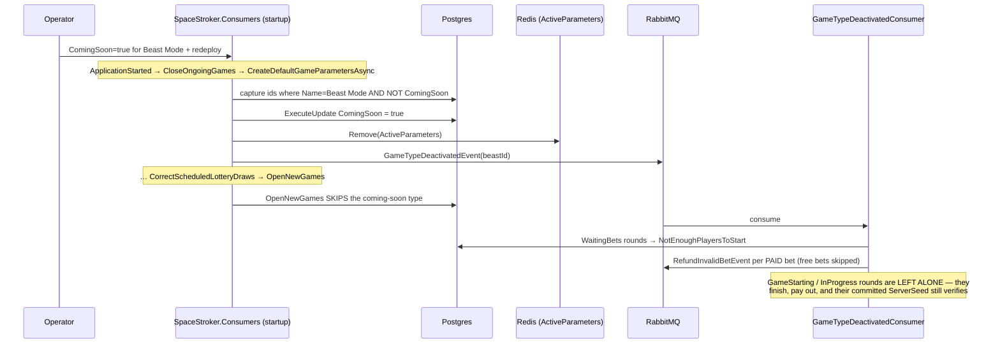
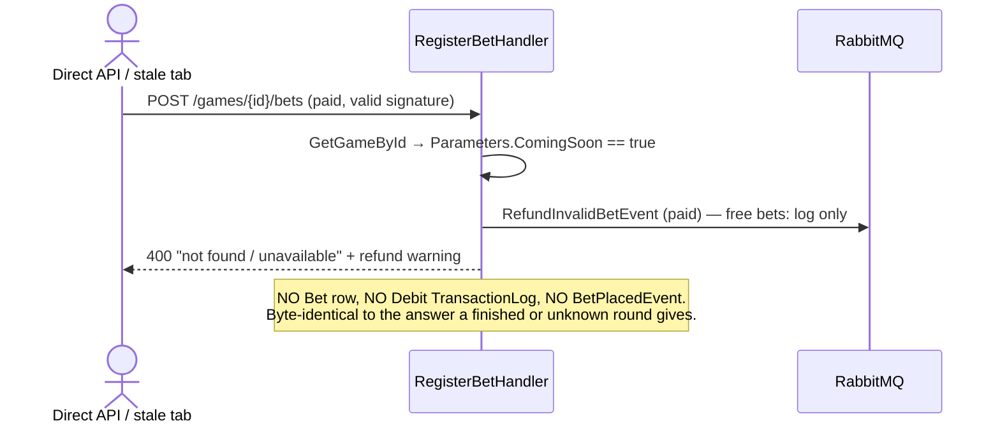

# SpaceStroker — "Disable Beast Mode" — Implementation Spec

> **Status: Ready for implementation** — refined via Trello card
> [Disable Beast MOde #168](https://trello.com/c/ZWPTO6yg) (refined 2026-08-12, spec 2026-08-12).
>
> Repos affected: `monkify-backend`, `monkify-front`, and this doc in `monkify-meta`.
> **`monkify-lp` is NOT affected** — the LP keeps advertising all three modes (card, out of scope).
>
> **Level: `Feature`** — a new persisted per-type field with new lifecycle, bet-path, roll-over and
> Orbit behaviour. `AGENTS.md` rule 8 therefore applies: **at least one happy-path integration test**
> in `SpaceStroker.Tests.Integration`, plus a distilled `features/` update at ship time.
>
> **Purpose:** Beast Mode (the seeded preset type — 8 beasts, 6 letters) is judged pointless and
> possibly exploitable in its current form and must stop being playable, **without leaving the
> catalogue** — the lobby card, and the `/how-to-play` mode card, keep selling it as *coming soon* so
> the rework (card #169) lands as a return rather than as a game nobody heard of. A new persisted
> `GameParameters.ComingSoon` flag gates it **server-side**, because a front-only change leaves the
> game fully bettable through the API, a stale tab or a saved deep link.

---

## 1. Summary

`ComingSoon` is **deactivation semantics without leaving the catalogue**. Contrast the three states a
game type can be in after this change:

| | `Active = true`, `ComingSoon = false` | `Active = true`, **`ComingSoon = true`** | `Active = false` |
| --- | --- | --- | --- |
| In `GET /games/active-types` | yes | **yes** (this is the point) | no |
| Lobby / home picker card | clickable | **gated: dimmed, `COMING SOON`, no click** | absent |
| `/how-to-play` mode card | yes | **yes, marked coming soon** | absent |
| Bets accepted | yes | **no — generic unavailable + refund** | no |
| Roll-over opens a successor | yes | **no** | no |
| Re-opened by Consumers startup | yes | **no** | no |
| In Orbit `eligibleGameTypes` | if `AllowOrbit` | **no** | no |
| Settled rounds in history / stats / provably-fair | yes | **yes, untouched** | yes |
| Live `WaitingBets` round when the flag flips on | — | **cancelled + paid bets refunded** | cancelled + refunded |
| Live `GameStarting` / `InProgress` round | — | **finishes and pays out normally** | finishes and pays out |

**How it is flipped:** config only. `ComingSoon` is added to each
`GeneralSettings:Operator:DefaultGames[]` entry, set `true` for **Beast Mode**, and the startup
seeder **reconciles this one field onto already-seeded rows** — the same self-heal exception
`AllowFreeBet` and `AllowOrbit` already have, because seeding itself is create-only by name and would
never reach the live row. Flipping it either way = edit config + redeploy `SpaceStroker.Consumers`. No
data migration, no admin endpoint.

**Why not an admin endpoint** (recorded on the card as a finding, no separate card raised):
⚠️ **there is no way to mint an admin token in production today.** `POST /dev/admin-token` is 404
outside non-production, the signing key `GeneralSettings:Operator:AdminToken:PrivateKeyPem` lives in
GCP Secret Manager while the API deploys with only `PublicKeyPem`, and **nothing in `monkify-meta/tools/`
signs that JWT**. Every `/admin/*` route — including `POST /admin/bets/refund`, which
`features/refund-safeguards.md` depends on — is effectively unreachable in prod without someone
pulling the key and signing offline. A new `/admin/game-types/{id}/coming-soon` would have shipped
dead.

---

## 2. Constraints (MANDATORY)

From `monkify-meta/constraints.md` (full list there):

- **Worktree-per-repo** (§2, `AGENTS.md` rule 6): `.worktrees/disable-beast-mode/<repo>`, branch
  `feature/disable-beast-mode` in **`monkify-backend`, `monkify-front` and `monkify-meta`**. The
  shared checkouts stay on `main`. Already created and pushed by `/monkify-create-spec`.
- **Unit tests** (§3): update + add in `SpaceStroker.Tests`; run via **`scripts/run_tests.bat`** — a bare
  `dotnet test` also runs the `ProductionGames` Monte Carlo suite and "fails" ~156 meaninglessly.
  Report exactly which tests changed at the end.
- **Integration test** (§3, `AGENTS.md` rule 8): this is a **`Feature`**, so
  `SpaceStroker.Tests.Integration` (Testcontainers, `scripts/run_integration_tests.bat`, Docker
  required) **must** gain at least one happy-path test — see §11.2.
- **EF mapping is inline** (§4) in `SpaceStrokerDbContext.OnModelCreating`; no
  `IEntityTypeConfiguration`. Migrations under `SpaceStroker.Infrastructure/Migrations/`, applied
  **only by `SpaceStroker.Consumers`** at startup. Never hand-edit the model snapshot.
- **Vague messaging** (§6): the bet refusal reuses the **existing** generic
  `ErrorMessages.GameNotValidForBets`. **No new error code, no new copy, no "this game is coming
  soon" from the API.** Anyone who reaches it is bypassing the UI.
- **Secrets/config** (§1): `spacestrokersettings.json` gets a new **boolean** only. Never touch the
  key material in that file.

---

## 3. Resolved product decisions

| # | Decision |
| --- | --- |
| 1 | The gate is a **new persisted per-type boolean `GameParameters.ComingSoon`**, following the `AllowOrbit` precedent (config-driven for seeded types, admin-settable at creation, never editable afterwards). |
| 2 | **Rejected: front-side name / id / archetype matching.** `gameTypeId` is a fresh GUID after every teardown + reseed; matching by archetype would silently gate any future preset type; matching by name breaks `utils/gameArt.ts`'s documented "resolve by SHAPE, never name or id" rule. |
| 3 | **The already-seeded row gets the flag from the startup seeder, which reconciles this one field.** `DefaultGames` seeding is create-only by name and never rewrites an existing row, so config alone would never reach the live Beast Mode row. Same shape as the `AllowFreeBet` / `AllowOrbit` self-heals. |
| 4 | The reconcile **never touches `Active`**, so the "a restart cannot resurrect an admin-deactivated type" guarantee is intact. |
| 5 | **Rejected: an EF data migration** (reverting needs a second migration + deploy, and it freezes a game name into migration history) **and rejected: a new admin endpoint** (unreachable in prod — see §1). |
| 6 | A `ComingSoon` type **stays in `GET /games/active-types`** and carries `comingSoon: true`. That is the whole feature — the card must still render in order to say "coming soon". |
| 7 | **Bets are refused** with the existing generic `GameNotValidForBets` + the standard refund warning. A paid stake that already landed on-chain **is refunded** through the existing `RefundInvalidBetEvent` path; a free bet is reject-only. **No `Bet` row is persisted.** |
| 8 | **Roll-over opens no successor**, and **Consumers startup opens no round**, so the type runs dry after its current round. |
| 9 | **The flip reuses the `GameTypeDeactivatedEvent` path**: every `WaitingBets` round of that type is cancelled (paid bets refunded, free bets skipped, game → `NotEnoughPlayersToStart`); `GameStarting` / `InProgress` rounds are **left to finish and pay out normally** — refunding a round whose `ServerSeed` is already committed would break provably-fair. |
| 10 | The flip **must invalidate the global `ActiveParameters` cache key** (12h TTL), exactly as the create / deactivate / `AllowOrbit`-patch paths already do. |
| 11 | **Orbit is not live yet** (`VUE_APP_ORBIT_ENABLED`, dark in production), so there are **no enrolments to migrate, notify or cash out**. No Orbit data work in this card. |
| 12 | `ComingSoon` types drop out of Orbit's `eligibleGameTypes`, out of the settings validator, and out of the placement engine's eligibility test. Beast Mode is one of only two `AllowOrbit: true` types (Space Jackpot is `false`), so **Orbit's picker collapses to exactly one option: Cosmic Sprint.** |
| 13 | With a single eligible type, **`OrbitGameTab.vue` drops the dropdown entirely** for a read-only line naming the game (still auto-committing it, so the enrolment row is created exactly as `commitGame` does today), plus **"More modes coming to Orbit soon."** A dropdown with one option is a control that cannot be used. |
| 14 | **`OrbitModal.vue`'s game picker keeps its `<select>`** — see §7.7 for why. It is a *confirm-then-navigate* flow, not an auto-committing field, and it only renders when nothing is set up yet. |
| 15 | The gated `GameTypeCard` reads as a machine that is **switched off**, not as a broken card: dimmed/desaturated art, a `COMING SOON` pill where the status pill goes, the button replaced by a **disabled "Coming soon"**, no hover lift, **no GIF fetch**, no live/pot chip, no `chooseGame` emit, `aria-disabled`, no `cursor-pointer`. |
| 16 | **The "brief explanation of the game as it is today" is the catalogue `description` already on the card** — *"Back a beast - the first one Edson spells out moons the whole pot. No typing."* It stays visible in full. **No new front-side game copy**, so game copy cannot drift from the catalogue. |
| 17 | The **Ticket chip stays** on the gated card. It is catalogue data (like the name, the tag and the description), not a live/pot chip; dropping it would make the lobby say less about the game than the manual does. |
| 18 | **Deep link `/game/play?type=<BEAST_ID>`** (bookmark, stale tab, hand-typed) **bounces to `/game` (`GameLobby`) with a short toast**, before any live-instance fetch or socket open. Closes the bypass the card itself cannot. |
| 19 | **`HomeHero.usualGame` skips `comingSoon` types** — the "Play <game>" CTA is simply not rendered, the same fall-through already documented there for a deactivated favourite. `featured` reads `liveByType` and can never surface one, since no rounds open. |
| 20 | **`/how-to-play` KEEPS the Beast Mode mode card**, marked with the same coming-soon treatment, so the manual and the lobby tell the same story. |
| 21 | **Stats, games history and provably-fair verification are untouched.** Settled Beast Mode rounds stay visible and auditable — real money moved in them. |
| 22 | **No new validation rule** is added for `ComingSoon` on `GameTypeRequestBody`. A bool has no invalid value; `GameParametersValidation` is not modified. |
| 23 | **The `(Active, AllowOrbit)` index is NOT extended to three columns.** `GameParameters` holds a handful of rows; the existing index already covers the Orbit read, and a third column would be migration cost for nothing. |

---

## 4. Data model

### 4.1 Entity

`SpaceStroker.Domain/Games/Entities/GameParameters.cs` — new property, immediately after `AllowOrbit`
(line 34), in the same commented style:

```csharp
// Whether this type is published as "coming soon" (#168). The type stays in the catalogue and keeps
// its settled rounds visible, but it accepts no bets, opens no new round, and is not Orbit-eligible.
// Config-driven for seeded types via DefaultGameSettings.ComingSoon and admin-settable at creation;
// like AllowOrbit it is never edited in place, because the admin portal is deactivate-or-create.
// ⚠️ NOT the same as Active = false, which removes the type from the catalogue entirely.
public bool ComingSoon { get; set; }
```

### 4.2 EF configuration (inline)

`SpaceStroker.Infrastructure/Data/Context/SpaceStrokerDbContext.cs`, inside the existing
`modelBuilder.Entity<GameParameters>(...)` block, next to line 49:

```csharp
builder.Property(x => x.ComingSoon).IsRequired().HasDefaultValue(false);
```

Nothing else changes in that block. ⚠️ **Do not add an index** — see decision 23.

### 4.3 Migration

```bash
# from monkify-backend/src
dotnet ef migrations add AddGameParametersComingSoon \
  --project SpaceStroker.Infrastructure \
  --startup-project SpaceStroker.Consumers
```

Expected shape: `AddColumn<bool>(name: "ComingSoon", table: "GameParameters", type: "boolean",
nullable: false, defaultValue: false)`. Applied **only** by `SpaceStroker.Consumers` at startup
(`ApplyMigrations(app)`, `Program.cs:232`). Regenerate the snapshot with the tool; never hand-edit
`SpaceStrokerDbContextModelSnapshot.cs`.

---

## 5. Configuration

### 5.1 The binding model

`SpaceStroker.Domain/Configs/Entities/OperatorSettings.cs` → `DefaultGameSettings`, next to
`AllowOrbit` (line 75):

```csharp
// Publish this type as "coming soon" (#168): listed in the catalogue, not bettable, opens no round.
// Like AllowOrbit this IS a config field (a property of the game type, not of the environment), and
// like AllowOrbit a name-matched startup self-heal pushes changes onto already-seeded rows.
public bool ComingSoon { get; set; }
```

Also update the class's own doc comment (lines 55-60), which currently asserts create-only and names
`AllowFreeBet` as the sole derived field — it must now name the **three** self-healed fields
(`AllowFreeBet`, `AllowOrbit`, `ComingSoon`) so the next reader is not misled.

### 5.2 The committed defaults

`SpaceStroker.Common/spacestrokersettings.json` → `GeneralSettings:Operator:DefaultGames`. Add
`"ComingSoon"` to **all three** entries (explicit `false` on the two that stay playable is deliberate:
an omitted key binds to `false` anyway, but a reader of the catalogue should see the flag on every
type rather than infer it):

| Entry | `ComingSoon` |
| --- | --- |
| `Cosmic Sprint` (line 153) | `false` |
| **`Beast Mode` (line 164)** | **`true`** |
| `Space Jackpot` (line 184) | `false` |

Place the key immediately after `"AllowOrbit"` in each object. ⚠️ Nothing else in this file is
touched — in particular the `AdminToken` PEM block stays byte-identical.

---

## 6. Backend behaviour

### 6.1 The seeder — reconcile `ComingSoon`, then fire the cancellation

`SpaceStroker.Consumers/Program.cs` → `CreateDefaultGameParametersAsync` (line 305).

**6.1a — map it on create.** `ToGameParameters` (line 432) gains `ComingSoon = config.ComingSoon,`
next to `AllowOrbit`. A fresh environment therefore seeds Beast Mode already gated, and never opens a
round for it.

**6.1b — reconcile it on existing rows.** Add a block modelled exactly on the `AllowOrbit` self-heal
(lines 403-427), **after** it. It must capture *which* types transitioned `false → true`, because
that is the trigger for 6.1c:

```csharp
// Self-heal: align each configured type's coming-soon flag with config (#168). Same reason as the
// AllowOrbit patch above — seeding is create-only by name, so a flag added to config after a row
// exists would never reach it, and this flag is the ONLY way Beast Mode gets switched off.
// ExecuteUpdate because the context is NoTracking: load-mutate-SaveChanges persists nothing.
var comingSoonPatched = 0;
var newlyGated = new List<Guid>();

foreach (var config in defaults)
{
    var desiredComingSoon = config.ComingSoon;

    // Capture the ids BEFORE the update — this is the false -> true transition, and it is what the
    // cancellation below keys on. A type already gated stays out of the list, so a restart does not
    // re-publish (the consumer is idempotent anyway, but a no-op event per boot is noise).
    if (desiredComingSoon)
    {
        newlyGated.AddRange(context.GameParameters
            .AsNoTracking()
            .Where(x => x.Name == config.Name && !x.ComingSoon)
            .Select(x => x.Id)
            .ToList());
    }

    comingSoonPatched += context.GameParameters
        .Where(x => x.Name == config.Name && x.ComingSoon != desiredComingSoon)
        .ExecuteUpdate(setters => setters.SetProperty(x => x.ComingSoon, desiredComingSoon));
}

if (comingSoonPatched > 0)
{
    // ⚠️ Do NOT delete this as redundant. GameParametersDto gains comingSoon and the ActiveParameters
    // cache has a 12h TTL — without dropping the key the first boot after deploy serves a blob that
    // predates the field, so the lobby keeps offering a game the API now refuses, for half a day.
    cacheService.Remove(CacheHelper.GenerateActiveParametersCacheSettings());
    Log.Information("Patched {Count} default type(s) for ComingSoon.", comingSoonPatched);
}
```

**6.1c — cancel + refund the open round.** For each id in `newlyGated`, publish the **existing**
`GameTypeDeactivatedEvent(id)` on the message bus. Resolve `IMessageBus` from the same scope.

⚠️ **This is safe precisely because these startup steps run on `ApplicationStarted`, not inline**
(`Program.cs:249-256`, with the comment explaining that the transport's database is provisioned by a
hosted service). `OpenNewGames` already publishes `GameOpenedEvent` from this same block, so the bus
is up.

⚠️ **`GameTypeDeactivatedConsumer` needs NO change.** Read it (`Consumers/GameTypeDeactivated/`): it
filters on `ParametersId + Status == WaitingBets` only and never inspects `Active`, so it already
does exactly the right thing for a `ComingSoon` flip — refund paid bets via `RefundInvalidBetEvent`,
skip free bets, set the game to `NotEnoughPlayersToStart`, and leave `GameStarting` / `InProgress`
alone. Only its XML summary needs a sentence saying it now also serves the coming-soon flip.

### 6.2 ⚠️ Startup round-opening — the gap that would undo the whole card

`SpaceStroker.Consumers/Program.cs` → `OpenNewGames` (line 479) creates a round for **every active
type that has no live game**. The flip *requires* a Consumers redeploy, so without a filter here the
flag would be reconciled and a fresh Beast Mode round opened **in the same boot**, every boot.

```csharp
foreach (var parameter in activeParameters)
{
    if (liveParameterIds.Contains(parameter.Key))
        continue;

    // #168: a coming-soon type stays in the catalogue but never opens a round. Filtered HERE and not
    // inside GetAllActiveGameParameters — see the warning below.
    if (parameter.Value.ComingSoon)
        continue;
    ...
}
```

> ⚠️ **Do NOT filter `ComingSoon` inside `GameService.GetAllActiveGameParameters`.** That method is
> shared by four call sites and only one of them wants the type gone:
>
> | Call site | Must a `ComingSoon` type appear? |
> | --- | --- |
> | `GetActiveParametersHandler` → `GET /games/active-types` | **YES** — the card must render (decision 6) |
> | `GetRecentRoundsHandler` → recent rounds | **YES** — settled rounds stay visible (decision 21) |
> | `GetGlobalStatsHandler` → global stats | **YES** — same |
> | `OpenNewGames` (Consumers startup) | **no** |
>
> Filtering in the service silently empties the lobby card, the recent-rounds feed and the stats
> page — i.e. it breaks the feature it is meant to implement, and acceptance criteria 2 and 14 with
> it. The filter belongs at the one call site that wants it.

### 6.3 Roll-over

`GameService.GetActiveParametersForRollover` (line 475) is the single funnel `RunGameConsumer` uses
after a round Ends (`RunGameConsumer.cs:50`). Extend its guard:

```csharp
// A deactivated OR coming-soon type returns null, so no successor game is created (#168).
if (parameters == null || !parameters.Active || parameters.ComingSoon)
    return null;
```

Update the method's leading comment accordingly. `RunGameConsumer` itself needs **no change** — it
already treats `null` as "do not roll over".

### 6.4 A newly created coming-soon type opens no round

`Consumers/GameParametersCreated/GameParametersCreatedConsumer.cs:34` — extend the existing skip:

```csharp
if (parameters == null || !parameters.Active || parameters.ComingSoon)
{
    Log.Warning("GameParameters {ParametersId} not found, inactive or coming soon; no game created.", message.ParametersId);
    return;
}
```

Without this, an admin creating a type with `ComingSoon = true` gets an immediately-open, immediately
un-bettable round.

### 6.5 Bet registration — refuse, refund, persist nothing

`Infrastructure/Handlers/Games/RegisterBet/RegisterBetHandler.cs`.

Add the check in `HandleRequest`, **immediately after the self-exclusion block (line 108-114) and
before `ValidatePayment()` (line 118)** — the same position and for the same reason self-exclusion
sits there: *the normal path must never validate (and thereby accept) a payment for a bet that cannot
stand*. A stale tab or a direct API call that already transferred is refunded instead.

```csharp
// #168 — a coming-soon type is listed but not bettable. Placed with self-exclusion, ahead of payment
// validation, so an on-chain transfer that already landed is refunded rather than accepted.
// ⚠️ The VAGUE, EXISTING message (constraints.md §6): byte-identical to what a finished round or an
// unknown game answers. Anyone who sees it is bypassing the UI, and telling them why would be a new
// error code this card explicitly does not add.
if (betGame?.Parameters?.ComingSoon == true)
    await RefundInvalidBet(ErrorMessages.GameNotValidForBets);
```

Notes for the implementer:

- `RefundInvalidBet` (line 338) already does both halves: a **free** bet is reject-only with an info
  log; a **paid** bet publishes `RefundInvalidBetEvent` carrying `GameId` + `Signature` (mandatory —
  the bet row does not exist yet) and returns the message plus `ErrorMessages.RefundWarning`.
- It throws out of the handler, so **`InsertBet` never runs** ⇒ no `Bet` row, no `TransactionLog`
  `Debit` row, no `BetPlacedEvent`. That is acceptance criterion 3.
- `?.` on both hops is deliberate: `betGame is null` is still handled by the pre-existing check at
  line 301, which must **not** be duplicated or moved.
- **Do not** touch `BetDomainService.ChoiceIsValidForGame` or `BetValidationResult` — no new enum
  member, no new resource string.

### 6.6 Orbit — three eligibility reads

All three currently test `Active && AllowOrbit`; all three gain `&& !ComingSoon`:

| # | File | Line | Change |
| --- | --- | --- | --- |
| 1 | `Handlers/Orbit/GetOrbit/GetOrbitHandler.cs` | 65 | `.Where(x => x.Active && x.AllowOrbit && !x.ComingSoon)` — drops the type from `eligibleGameTypes`, which is what collapses the front's picker |
| 2 | `Handlers/Orbit/UpdateOrbitSettings/UpdateOrbitSettingsHandler.cs` | 76 | `.AnyAsync(x => x.Id == gameParametersId && x.Active && x.AllowOrbit && !x.ComingSoon, …)` — an old client PATCHing the gated id is refused with the existing vague `OrbitRequestInvalid` |
| 3 | `Services/Orbit/OrbitBetPlacementService.cs` | 243-244 | `IsOrbitEligible` ⇒ `parameters.AllowOrbit && !parameters.ComingSoon && parameters.LotteryParameters == null` — the fail-safe: even a stale enrolment can never have a bet placed for it |

⚠️ (3) is the one that actually protects money — (1) and (2) shape the UI, (3) is what stops the
engine signing a transfer onto a type that refuses bets (which would land as a refund loop).

### 6.7 DTOs

| File | Change |
| --- | --- |
| `Contracts/Games/GameParametersDto.cs` | `public bool ComingSoon { get; set; } = parameters.ComingSoon;` next to `AllowOrbit` (line 24), with a one-line comment: *"Listed but not playable — the lobby renders a gated card (#168)."* |
| `Contracts/Admin/GameTypeAdminDto.cs` | `ComingSoon = parameters.ComingSoon;` in the ctor (after line 29) + `public bool ComingSoon { get; set; }` next to `AllowOrbit` (line 51) |
| `Contracts/Admin/GameTypeRequestBody.cs` | `public bool ComingSoon { get; set; }` (settable at **creation only** — the portal is deactivate-or-create) and `ComingSoon = ComingSoon,` in `ToNewGameParameters()` next to `AllowOrbit` (line 49). ⚠️ Unlike `AllowOrbit` there is **no** `&& Lottery == null` clamp: any shape of type may be published as coming soon. |

`GameParametersValidation` is **not** modified (decision 22).

### 6.8 Cache

Only the seeder path can flip the flag, so §6.1b's `cacheService.Remove(...)` is the complete cache
story. No other invalidation is added.

---

## 7. Frontend behaviour

### 7.1 Types

`src/types/index.ts`:

- `ActiveGame` (line 20) — add after `allowOrbit` (line 42):

  ```ts
  /**
   * The type is published but NOT playable (#168): the card renders gated, the game page bounces,
   * and no live-instance call is made for it. Optional so an older build reading a newer payload,
   * or a mock without it, is simply treated as playable.
   * ⚠️ The gate that actually protects the game is the BACKEND refusal — this only shapes the UI.
   */
  comingSoon?: boolean;
  ```

- `GameTypeAdmin` (line 308) — add `comingSoon?: boolean;`
- `GameTypeBody` (line ~324, the create payload) — add `comingSoon?: boolean;`

### 7.2 `components/game-selection/GameTypeCard.vue` — the gated state

One computed drives everything:

```ts
const gated = computed(() => props.game.comingSoon === true);
```

| Concern | Today | Gated |
| --- | --- | --- |
| Root `class` | `cursor-pointer` | **no** `cursor-pointer`, add a `is-gated` class |
| Root `@click` | `$emit('chooseGame', game)` | **emits nothing** — guard inside the handler, not `v-if` on the listener, so the whole card is one code path |
| Root a11y | — | `:aria-disabled="gated"` |
| `@mouseenter="onEnter"` | fetches the GIF on first hover | **`onEnter` returns immediately when `gated`** — no ~330 KB fetch for a game nobody can enter |
| Hover lift + accent glow | `:hover` rules | suppressed under `.is-gated` |
| Status pill (`status`) | Live now / Starting / Filling | **`null`** — replaced by a static `COMING SOON` pill in the same slot |
| `liveChip` (lottery pot) | pot when snapshot present | **`null`** |
| Ticket chip | shown | **shown** (decision 17) |
| Art | full colour | dimmed + desaturated (`filter: grayscale(.75) brightness(.55)` on `.art-img`, tuned to taste) |
| `name` / `tag` / `description` | as-is | **as-is** — the description is the "brief explanation" (decision 16) |
| Button | `btn-arcade--primary` "Press to start" | `:disabled` "Coming soon", muted variant |

The `COMING SOON` pill reuses `.status-pill`'s geometry (absolute, top-left, over the art) with a
neutral/muted colour rather than the archetype accent — the accent means *this is alive*.

⚠️ **Nothing about this state is resolved by name, id or archetype** — only by the `comingSoon` field
off the catalogue. That is `utils/gameArt.ts`'s "resolve by SHAPE, never name or id" rule applied to
availability, and it is decision 2.

### 7.3 `components/game-selection/GameTypes.vue`

Gated cards **still render in the grid** (that is the point). Only the eyebrow changes: it must not
advertise a game that cannot be entered.

```ts
const playableCount = computed(() => types.value.filter((game) => !game.comingSoon).length);
```

and `pickerEyebrow` counts `playableCount` instead of `types.value.length`. `fillingCount` needs no
change — it reads `liveByType`, which §7.4 keeps empty for gated types.

### 7.4 `hooks/useLiveGames.ts`

Inside `load` (line 61), fan out over playable types only:

```ts
// #168: a coming-soon type opens no round, so its live-instance call can only ever 404/return
// nothing. Skipping it drops one request per gated type on every lobby and home load. The gated card
// renders from the catalogue alone — `live` is optional by design.
const playable = types.filter((game) => !game.comingSoon);
```

⚠️ `latestTypes` keeps the **full** list (the focus-refresh guard and the `!types.length` early
return both key on "did the caller hand us a catalogue"), and `byType` is keyed by id, so a gated
type is simply absent — exactly the shape `GameTypeCard` already handles when a snapshot fails.

### 7.5 `pages/GamePage.vue` — the deep-link guard

`onMounted` (line 47) currently has three branches. The guard has to cover the resolved type on
**every** branch, and must run **before `updateNewGame(true)`** — that call fetches the live instance
and attaches the SignalR group, neither of which should happen for a gated type.

```ts
const bounceIfComingSoon = (game?: ActiveGame): boolean => {
  if (!game?.comingSoon) return false;
  toast.info(`${game.name} is coming soon.`);
  router.replace({ name: 'GameLobby' });
  return true;
};
```

- Branch `!selectedGame && typeQuery`: resolve from `getGamesTypes()`, then
  `if (bounceIfComingSoon(selectedGame.value)) return;` **before** `await updateNewGame(true)`.
  ⚠️ Clear `selectedGame.value` when bouncing, or the lobby keeps a gated selection in memory.
- Branch `selectedGame` already set (a stale in-memory selection surviving a route change):
  `if (bounceIfComingSoon(selectedGame.value)) return;` at the top of the `else` branch.
- The mobile-wallet deeplink-return branch is untouched — it restores a stored path and the guard on
  the resolved game covers it on the next pass.

`router.replace`, not `push`: a bookmark that bounces should not leave a dead entry in history.

⚠️ **`hooks/useGamePicker.ts` is deliberately NOT modified.** Its `chooseGame` is reached only from
the card (which no longer emits) and from `HomeHero` (both of whose sources are filtered — §7.6), and
`GamePage`'s guard is the backstop that actually closes the URL hole. Adding a fourth guard there
would put the toast in a composable that has no opinion about availability.

### 7.6 `components/home/HomeHero.vue`

`usualGame` (line 373) resolves the player's most-played type **by name** against the catalogue. Add
the gate to the same `find`:

```ts
return (gameTypes.value ?? []).find((game) => game.name === name && !game.comingSoon);
```

`primaryLabel` (line 417) and `onPrimary` (line 433) already branch on `usualGame` being falsy, so
the CTA is simply not rendered — the identical fall-through the file's own comment documents for a
deactivated favourite. **No new copy, no "coming soon" CTA on the hero.** `featured` needs no change:
it reads `liveByType`, which no longer carries gated types (§7.4), and no rounds open for them anyway.

### 7.7 Orbit — `components/orbit/tabs/OrbitGameTab.vue`

With Beast Mode gated, `eligibleGameTypes` returns exactly one entry (Cosmic Sprint). Replace the
`<select>` with a read-only line **when `eligibleGameTypes.length === 1`**:

```ts
const onlyEligibleType = computed(() =>
  eligibleGameTypes.value.length === 1 ? eligibleGameTypes.value[0] : null
);
```

- **Auto-commit on mount** when `onlyEligibleType` is set and `orbit.gameParametersId` is not already
  it: set `gameChoice.value = onlyEligibleType.value.id` and call `commitGame()`. This preserves
  today's behaviour exactly — picking from the dropdown is what creates the enrolment row (deposits
  need it to exist), and `commitGame` still sends **only** `gameParametersId`, never `enabled`.
  ⚠️ Guard on `wallet.value` and on the value being *different*, or every reload PATCHes — the same
  echo the file's existing `@change`-not-watcher comment warns about.
- Render, in the `GAME MODE` slot instead of the select:
  `{{ type.name }} · {{ formatMoney(type.requiredAmount) }}` as static text, plus
  **"More modes coming to Orbit soon."**
- Everything downstream is unchanged: `wordTargetType` already falls back through
  `eligibleGameTypes.find(... === gameChoice)`, so the word field, the preset picker and auto-pick
  keep working off the committed id.
- With **0** eligible types (nothing seeded, or every type gated) keep today's behaviour — the empty
  select with "Pick a game" — rather than inventing a third state.

⚠️ **`components/orbit/OrbitModal.vue` keeps its `<select>`** (decision 14). That picker is a
different control: it renders only when the player has **no** game set, it pre-selects the round they
are standing in, and its value is applied by an explicit **confirm** that then navigates
(`onConfirmGamePick`). A single option there is still a real press; collapsing it would mean
auto-navigating the player the moment the panel opens. It reads the same `eligibleGameTypes`, so the
gated type is already gone from it — no change needed, and none should be made.

### 7.8 `components/guide/GuideModeCards.vue`

Keep the card, mark it. Add `comingSoon: game.comingSoon === true` to the `ModeCard` interface and to
the object built in `cards` (line 119), then in the template:

- a `COMING SOON` chip beside the existing `ARCHETYPE_LABEL` chip, in the muted/neutral colour the
  lobby pill uses (not the archetype accent);
- the same dim/desaturate treatment on the poster as §7.2, so the manual and the lobby show the same
  picture in the same state.

The blurb, ticket price and schedule stay — the guide's job is to teach the mode, and it is coming
back.

### 7.9 Admin portal

- `components/admin/GameTypeForm.vue` — add `comingSoon: false` to `form` (line 41) and
  `comingSoon: form.comingSoon` to the submitted `body` (line 57), with a checkbox next to the
  existing `allowOrbit` one (line 142). ⚠️ **No lottery clamp** — unlike `allowOrbit` (decision 22 /
  §6.7).
- `components/admin/GameTypeList.vue` — one new column (`Status`) rendering `Coming soon` / `Live`
  from `type.comingSoon`. The list stays read-only: the portal is deactivate-or-create, and this card
  adds **no in-place edit**.

### 7.10 Explicitly untouched

`GameStatsPage`, `GameHistoryPage`, every provably-fair surface, `constants/practiceGame.ts`
(practice is hard-coded to Cosmic Sprint's shape), `utils/gameArt.ts`, `utils/gameArchetype.ts`,
`hooks/useGame.ts`, `hooks/useGamePicker.ts`, and `monkify-lp` entirely.

---

## 8. Flow diagrams

### 8.1 The flip (config change + Consumers redeploy)



### 8.2 A bet that gets through the UI anyway



---

## 9. Out of scope

- **`monkify-lp`** — the LP keeps advertising all three modes. This card is app-only, as written.
- **The Beast Mode rework itself** — card #169 (*"Propose beast mode improvements"*), which depends
  on this shipping first.
- **A production admin-token minter** — recorded in §1 as a finding; explicitly no card raised.
- **Orbit enrolment migration / notification / forced cash-out** — Orbit is not live.
- **Hiding settled Beast Mode rounds** from stats, history or provably-fair verification.
- **Any in-place edit in the admin portal** beyond exposing `ComingSoon` at creation.
- **Extending the `(Active, AllowOrbit)` index** (decision 23).
- **Collapsing `OrbitModal.vue`'s picker** (decision 14).

---

## 10. File checklist

### 10.1 Backend (`monkify-backend`)

| # | File | Change |
| --- | --- | --- |
| 1 | `SpaceStroker.Domain/Games/Entities/GameParameters.cs` | `+ bool ComingSoon` next to `AllowOrbit` (§4.1) |
| 2 | `SpaceStroker.Domain/Configs/Entities/OperatorSettings.cs` | `+ bool ComingSoon` on `DefaultGameSettings`; correct the class doc comment to name all three self-healed fields (§5.1) |
| 3 | `SpaceStroker.Common/spacestrokersettings.json` | `"ComingSoon"` on all three `DefaultGames` entries; `true` for **Beast Mode** (§5.2) |
| 4 | `SpaceStroker.Infrastructure/Data/Context/SpaceStrokerDbContext.cs` | inline `Property(x => x.ComingSoon).IsRequired().HasDefaultValue(false)` (§4.2). **No new index.** |
| 5 | `SpaceStroker.Infrastructure/Migrations/*_AddGameParametersComingSoon.*` | new migration + regenerated snapshot (§4.3) |
| 6 | `SpaceStroker.Consumers/Program.cs` → `ToGameParameters` | map `ComingSoon` from config (§6.1a) |
| 7 | `SpaceStroker.Consumers/Program.cs` → `CreateDefaultGameParametersAsync` | reconcile block + cache drop + publish `GameTypeDeactivatedEvent` for `false → true` transitions (§6.1b/c) |
| 8 | `SpaceStroker.Consumers/Program.cs` → `OpenNewGames` | ⚠️ skip coming-soon types (§6.2) |
| 9 | `SpaceStroker.Infrastructure/Services/Games/GameService.cs` → `GetActiveParametersForRollover` | return `null` for a coming-soon type (§6.3) |
| 10 | `SpaceStroker.Infrastructure/Consumers/GameParametersCreated/GameParametersCreatedConsumer.cs` | skip coming-soon types (§6.4) |
| 11 | `SpaceStroker.Infrastructure/Consumers/GameTypeDeactivated/GameTypeDeactivatedConsumer.cs` | **XML summary only** — note it now also serves the coming-soon flip. No logic change. |
| 12 | `SpaceStroker.Infrastructure/Handlers/Games/RegisterBet/RegisterBetHandler.cs` | refuse + refund with the existing `GameNotValidForBets`, before `ValidatePayment` (§6.5) |
| 13 | `SpaceStroker.Infrastructure/Handlers/Orbit/GetOrbit/GetOrbitHandler.cs` | `&& !x.ComingSoon` on the eligible-types query (§6.6) |
| 14 | `SpaceStroker.Infrastructure/Handlers/Orbit/UpdateOrbitSettings/UpdateOrbitSettingsHandler.cs` | `&& !x.ComingSoon` on the eligibility check (§6.6) |
| 15 | `SpaceStroker.Infrastructure/Services/Orbit/OrbitBetPlacementService.cs` | `IsOrbitEligible` gains `&& !parameters.ComingSoon` (§6.6) |
| 16 | `SpaceStroker.Infrastructure/Contracts/Games/GameParametersDto.cs` | `+ ComingSoon` (§6.7) |
| 17 | `SpaceStroker.Infrastructure/Contracts/Admin/GameTypeAdminDto.cs` | `+ ComingSoon` (§6.7) |
| 18 | `SpaceStroker.Infrastructure/Contracts/Admin/GameTypeRequestBody.cs` | `+ ComingSoon` + map in `ToNewGameParameters` (§6.7) |

### 10.2 Frontend (`monkify-front`)

| # | File | Change |
| --- | --- | --- |
| 1 | `src/types/index.ts` | `comingSoon?: boolean` on `ActiveGame`, `GameTypeAdmin`, `GameTypeBody` (§7.1) |
| 2 | `src/components/game-selection/GameTypeCard.vue` | the gated state (§7.2) |
| 3 | `src/components/game-selection/GameTypes.vue` | eyebrow counts playable types only (§7.3) |
| 4 | `src/hooks/useLiveGames.ts` | skip the live fan-out for gated types (§7.4) |
| 5 | `src/pages/GamePage.vue` | deep-link guard → bounce to `GameLobby` + toast, before `updateNewGame` (§7.5) |
| 6 | `src/components/home/HomeHero.vue` | `usualGame` ignores gated types (§7.6) |
| 7 | `src/components/orbit/tabs/OrbitGameTab.vue` | single-eligible-type read-only line + auto-commit + "More modes coming to Orbit soon." (§7.7) |
| 8 | `src/components/guide/GuideModeCards.vue` | keep the mode card, mark it coming soon (§7.8) |
| 9 | `src/components/admin/GameTypeForm.vue` | `comingSoon` checkbox + payload field (§7.9) |
| 10 | `src/components/admin/GameTypeList.vue` | status column (§7.9) |

Verify with `yarn lint` and `yarn build` (there is no test runner in this repo).

### 10.3 Meta (`monkify-meta`)

| # | File | Change |
| --- | --- | --- |
| 1 | `specs/disable-beast-mode.md` | this spec |
| 2 | `INDEX.md` | KB map row + "Feature currently in flight" |
| 3 | `features/games.md` | **at ship time** — `ComingSoon` in the `GameParameters` field table (§1), and a note on the seeded catalogue table (§2) that Beast Mode is published-not-playable |
| 4 | `features/orbit.md` | **at ship time** — eligibility now excludes coming-soon types |

---

## 11. Tests

### 11.1 Unit tests — `monkify-backend/src/SpaceStroker.Tests`

| Test file | Test case | Expected |
| --- | --- | --- |
| `UnitTests/Handlers/RegisterBetHandlerTests.cs` | `RegisterBet_ComingSoonType_PaidBet_ShouldRefundAndFail` | validation failure carrying `GameNotValidForBets` + refund warning; **one** `RefundInvalidBetEvent` published; **no** `Bet` row; **no** `BetPlacedEvent` |
| | `RegisterBet_ComingSoonType_FreeBet_ShouldFailWithoutRefundEvent` | same message, **no** `RefundInvalidBetEvent` (mirrors the existing free-bet refusal cases at lines 273-300) |
| | `RegisterBet_PlayableType_ShouldStillRegister` | regression guard — the new check does not fire on `ComingSoon = false` |
| `UnitTests/Services/GameServiceParametersTests.cs` | `GetActiveParametersForRollover_ComingSoonRow_ReturnsNull` | `null`, alongside the existing `DeactivatedRow_ReturnsNull` (line 126) |
| | `GetActiveParametersForRollover_ActiveNotComingSoon_ReturnsItself` | unchanged behaviour |
| `UnitTests/Handlers/GetActiveParametersHandlerTests.cs` | `ComingSoonType_IsStillReturned_WithFlagTrue` | ⚠️ the type **is** in the payload and `comingSoon == true` — the guard against "helpfully" filtering it out of the catalogue |
| `UnitTests/Services/OrbitBetPlacementServiceTests.cs` | `NoPlacements_WhenTheTypeIsComingSoon` | zero placements, next to `NoPlacements_WhenTheTypeDoesNotAllowOrbit` (line 60) |
| `UnitTests/Handlers/Orbit/UpdateOrbitSettingsTests.cs` | `ComingSoonGameType_IsRejected` | vague `OrbitRequestInvalid` |
| `UnitTests/Background/GameParametersCreatedConsumerTests.cs` | `ComingSoonType_CreatesNoGame` | `CreateGame` never called (mirrors the inactive case) |
| `UnitTests/Handlers/AdminGameTypeHandlerTests.cs` | `CreateGameType_ComingSoonTrue_PersistsFlag` | row has `ComingSoon == true`; ⚠️ also assert it is **not** clamped by a lottery, unlike `AllowOrbit` |
| `UnitTests/Api/OrbitSettingsBindingTests.cs` | extend the `DefaultGames` binding assertion | `ComingSoon` binds per named type — `true` for Beast Mode, `false` for the other two |

Fixture note: `UnitTests/Shared/TestGameParameters.cs` builds the unit suite's catalogue. Add
`ComingSoon = false` there explicitly so the default is stated rather than inherited, and every
existing test keeps its current meaning.

Run with **`scripts/run_tests.bat`** and report the changed/added list.

### 11.2 Integration test — `monkify-backend/src/SpaceStroker.Tests.Integration`

**Mandatory** (`AGENTS.md` rule 8). New file `ComingSoonGameFlowTests.cs`, following the
`GameFlowTests` / `DefaultGameSeedingTests` pattern (real API + Consumers hosts, real
Postgres/RabbitMQ/Redis containers, Docker running).

**Happy path — one test, three assertions:**

1. Seed a preset type with `ComingSoon = true` (via `IntegrationGameParameters` / the fixture's type
   builder).
2. `GET /games/active-types` → the type **is present** and carries `comingSoon: true`.
3. `POST /games/{id}/bets` for it → rejected with the generic unavailable message; assert **no `Bet`
   row exists** for that game.
4. End the type's current round → assert **no successor `Game` row** is created for that
   `ParametersId`.

**Complex flow — a second test** (the flip's cancellation path is a multi-step state transition plus
a refund, so rule 8's "particularly complex flow" clause applies):

- Open a `WaitingBets` round on a playable type, place one **paid** and one **free** bet, publish
  `GameTypeDeactivatedEvent` for it, and assert: game → `NotEnoughPlayersToStart`, the paid bet
  reaches the refund path, the free bet does not, and no successor is created.

Extend `DefaultGameSeedingTests.cs` with a **reconcile** assertion: seed the type with
`ComingSoon = false`, re-run the seeding step with config saying `true`, and assert the existing row's
`ComingSoon` flips while **`Active`, `Name`, `RequiredAmount` and its `PresetChoices` are unchanged**
(acceptance criterion 1).

Run with `scripts/run_integration_tests.bat`.

---

## 12. Acceptance criteria

Copied 1:1 from the Trello checklist.

1. Given `ComingSoon` is true for Beast Mode in `DefaultGames` config and the Beast Mode row already exists in the DB, when `SpaceStroker.Consumers` starts, then the existing row's `ComingSoon` is reconciled to true and no other field on it (including `Active`) is rewritten.
2. Given a game type with `ComingSoon = true`, when a client calls `GET /games/active-types`, then the type is still returned in the catalogue and carries `comingSoon: true`.
3. Given a game type with `ComingSoon = true`, when a bet is posted for it (including a direct API call bypassing the UI), then the bet is refused with the existing generic "not found / unavailable" error, no new error code is introduced, and no `Bet` row is persisted.
4. Given a game type with `ComingSoon = true` whose current round has ended, when roll-over runs, then no successor game is created for that type.
5. Given `ComingSoon` flips to true while a round of that type is `WaitingBets` holding paid and free bets, when the flip is processed, then the round is set to `NotEnoughPlayersToStart`, every paid bet is marked for refund via the existing `RefundInvalidBetEvent` path, and free bets are skipped.
6. Given `ComingSoon` flips to true while a round of that type is `GameStarting` or `InProgress`, when the flip is processed, then that round runs to completion and pays out normally, and its committed `ServerSeed` still verifies under provably-fair.
7. Given a game type with `ComingSoon = true`, when a player loads their Orbit settings, then that type is absent from `eligibleGameTypes` and the Orbit engine never places a bet on it.
8. Given exactly one eligible Orbit game type remains, when the player opens Orbit's GAME tab, then no dropdown is rendered, the single game is shown as a read-only line and still auto-committed (the enrolment row is created), and the message "More modes coming to Orbit soon." is displayed.
9. Given a catalogue entry with `comingSoon = true`, when the lobby or the home picker renders its card, then the card is dimmed, shows a `COMING SOON` pill and a disabled "Coming soon" button, renders no status pill and no live/pot chips, does not lift or fetch its GIF on hover, and clicking it neither emits `chooseGame` nor navigates.
10. Given a gated Beast Mode card, when it renders, then the catalogue description ("Back a beast - the first one Edson spells out moons the whole pot. No typing.") is still shown in full and no game copy is hard-coded in the frontend.
11. Given `comingSoon` is true for a type, when a player opens `/game/play` with that type in the query (bookmark or stale tab), then they are redirected to `/game` and a short "coming soon" toast is shown.
12. Given a player whose `mostPlayedTypeName` resolves to a `comingSoon` type, when the home hero renders, then no "Play \<that game\>" CTA is rendered (the same fall-through as a deactivated favourite).
13. Given `comingSoon` is true for a type, when `/how-to-play` renders its mode cards, then that mode still appears and is marked coming soon, consistent with the lobby card.
14. Given `comingSoon` is true for a type, when the app fetches live game snapshots, then no per-type live-instance call is made for that type and the gated card still renders correctly from the catalogue alone.
15. Given settled Beast Mode rounds already exist, when the player opens games history, per-game-type stats or provably-fair verification, then those rounds are still listed and still verify exactly as before.
16. Given `ComingSoon` is set back to false in config, when `SpaceStroker.Consumers` restarts, then the type opens a new round, its lobby card is clickable again, `/game/play` no longer bounces, and it reappears in Orbit's eligible types (restoring the dropdown) — with no data destroyed at any point.
17. Given the feature is implemented, when `SpaceStroker.Tests.Integration` runs, then at least one happy-path integration test proves end to end that a `ComingSoon` type is listed by `/games/active-types`, refuses a bet, and opens no successor round.

---

## 13. Manual QA (local Docker stack)

Prerequisites and the exact procedure live in `CLAUDE.md` → "Rodar a stack completa localmente".
⚠️ Ports 5432 / 6379 are frequently taken on this workstation — remap in the compose file and revert
before committing.

1. `docker compose up -d --build` in `monkify-backend`, then confirm the migration ran
   (`ComingSoon` column present) and the Beast Mode row reconciled to `true`.
2. `GET :6001/games/active-types` → three types; Beast Mode present with `"comingSoon": true`.
3. Lobby (`/game`) → Beast Mode card is dimmed, shows `COMING SOON`, its button is disabled,
   hovering neither lifts it nor fires a GIF request (check the Network tab), clicking does nothing.
   The other two cards are unchanged.
4. Home (`/`) → the eyebrow counts **2 games**, not 3.
5. Network tab on the lobby → **two** `GET /games/{id}` live-instance calls, not three.
6. Navigate to `/game/play?type=<beast-id>` directly → bounced to `/game` with a toast; no socket
   opened.
7. `POST /games/{beast-round-id}/bets` with curl (a free bet is enough locally) → generic unavailable
   message; the `GameBets` table gains no row.
8. Restart the Consumers container → **no** new Beast Mode round appears in `Games`.
9. `/how-to-play` → the Beast Mode mode card is still there, marked coming soon.
10. `/game/history` and `/game/stats` → previously settled Beast Mode rounds still listed and still
    verify.
11. Flip `ComingSoon` back to `false`, rebuild + restart Consumers → a new round opens, the card is
    clickable again, and the deep link stops bouncing.

Orbit is dark by default (`VUE_APP_ORBIT_ENABLED`); enable it locally to check step 8 of the
acceptance criteria (the collapsed GAME tab).

---

## 14. Trello / pipeline

- **Source card:** [Disable Beast MOde #168](https://trello.com/c/ZWPTO6yg) — list **Specs created**;
  the `## Implementation` block on the card carries branch, worktree, spec path and repos.
- **Depends on this shipping first:** card **#169** — *Propose beast mode improvements* (the rework).
- **Next:** `/monkify-implement-feature Disable Beast MOde`, then
  `/monkify-ship-feature Disable Beast MOde`.

---

## 15. Revision log

| Date | Change |
| --- | --- |
| 2026-08-12 | Initial spec from the refined card (#168) + code exploration. Added five findings the card did not carry: the `OpenNewGames` startup re-open (§6.2), the shared-`GetAllActiveGameParameters` trap (§6.2 warning), the missing publisher for `GameTypeDeactivatedEvent` under a config-driven flip (§6.1c), `GameParametersCreatedConsumer` (§6.4), and `OrbitModal.vue` as a second Orbit game picker (§7.7, decision 14). |
