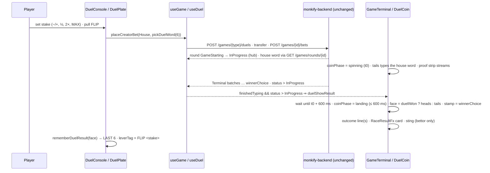

# SpaceStroker — "Monkey Duel quick flip" — Implementation Spec

> **Status: Ready for implementation** — refined via Trello card
> [#219 Monkey Duel quick flip — stake, pull, the $STROKE coin spins (design 2c)](https://trello.com/c/eQ4Dzxj8)
> (refined 2026-11-10, short mode).
> Repos affected: `monkify-front` (the feature), `monkify-backend` (round 3: the seed-settled House duel, §0),
> `monkify-lp` (one blurb), and this doc in `monkify-meta`.
> Branch / worktree: `feature/duel-quick-flip` → `.worktrees/duel-quick-flip/<repo>` (`monkify-lp` is based on
> `master`, the others on `main`).
> Change level: **Feature** since round 3 (2026-11-10; it was `Minor change` while front-only) ⇒ a mandatory
> happy-path integration test (§0) and a `features/duel-quick-flip.md` at ship; the existing
> [`../features/monkey-duel.md`](../features/monkey-duel.md) and [`../features/frontend-ux.md`](../features/frontend-ux.md)
> are corrected at ship too. Builds on the shipped duel in [`../features/monkey-duel.md`](../features/monkey-duel.md).
> ⚠️ **Read §0 first: round 3 supersedes §1, §3 (decisions 1, 3, 5, 6), §6, §7.2, §7.5, §10.1, §11.1 and ACs 2–4 and
> 11 where they differ.** The rest of the document is the round-1/2 design as implemented.
> Design: canvas option **1c THE COIN** and playable mock **2c** in the Claude Design project
> <https://claude.ai/design/p/a7ae74b1-fd17-4d79-936f-8fd9df1a6d74> (`Quick Flip Directions.dc.html`, `PlayCoin.dc.html`).
> ⚠️ The mock draws a generic orange coin; the real thing uses the **$STROKE coin** art (§7.4).
>
> **Purpose:** VS HOUSE on Monkey Duel still asks the player to think (type a word or not, read two race
> lanes) for what is a 50/50 bet settled in about 3 s. This card makes it play like a SolPump coinflip:
> **set a stake, pull, watch one $STROKE coin spin and land.** Nothing to type, nothing to pick. The round
> underneath is unchanged (Edson races two 6-letter words, the house word is drawn from the seed at the
> pull, the winner is paid `S × (2 − rate)` by the treasury, the verifier reproduces the draw). Only the
> screen and the plate change, and only on the **VS HOUSE** tab.

---

## 0. Round 3 (2026-11-10): the seed-settled flip

The owner tested the round-2 build (coin over the typed proof strip, random words) and asked for three changes:
**no "Edson is typing" part** (only the coin and the two words), **the words are PLAYER (the player) and STROKE
(the house)**, and **each round lasts at most 2 seconds**. Mocked as turn `t3` of the Claude Design project
(`Quick Flip Round 3.dc.html`: storyboard `OptionCoinV2`, playable `PlayCoinV2`). The owner then chose
**option A** (backend settles VS HOUSE from the seed) over B (front-only cap, cannot guarantee 2 s) and C (keep).

### 0.1 Decisions 14–17 (short mode)

| # | Decision |
| --- | --- |
| 14 | **The server settles a House duel from the seed the instant the bet lands.** `SpaceStrokerTyper.IsHouseDuel` (a House duel with a drawn house word, `Game.HasDrawnHouseWord`) decides the winner at construction through the existing fallback draw (`ProvablyFair.FallbackIndex` over the ordinal-sorted {creator word, house word}, one-bet prefix), with `MaxCharacters = 0` and `CharactersTyped = 0`; `GameService.RunGame` types nothing and emits no terminal batch for it. Open rooms race exactly as before. **The verifier is unchanged**: `WinnerDecidedByFallback = CharactersTyped >= MaxCharacters` (0 ≥ 0), `verify.html` / `provablyFair.ts` replay zero characters and draw the fallback. Why: a 2 s cap is only honest if the server decides in 0 s; the fallback draw is already a verifiable 50/50 over two words. |
| 15 | **Fixed words.** The front bets the literal word `player` on VS HOUSE (`DUEL_HOUSE_PLAYER_WORD`, six letters, outside the house pool and the quick list); the arena labels are PLAYER (heads, you) and STROKE (tails, the house). The house word is still drawn and published on the fairness page; the cabinet never shows either word. `pickDuelWord` stays for open rooms and for a type whose word is not six letters. |
| 16 | **Screen = `DuelFlipArena.vue`** (pure view): PLAYER (HEADS · WINS payout) \| `DuelCoin` + a 2 s clock bar \| STROKE (TAILS · KEEPS stake). `DuelCoin` is a real 3D flip of the two PNG faces (`monk-coin-main.png` / `monk-coin-tails.png`, 0.28 s rotateY while spinning, 0.45 s land onto the reported face; the spin GIF stays with `DuelVsSplash`). Header `> FLIP · PLAYER vs STROKE` + POT; status line `> HEADS IS PLAYER. TAILS IS STROKE. THE ROUND SEED DECIDES.`; verdict `HEADS. PLAYER WINS.` / `TAILS. STROKE TAKES IT.` (+ `STROKE TOOK IT. -x` on a loss); idle prompt `> SET A STAKE AND PULL. HEADS IS PLAYER, TAILS IS STROKE.`; placing line `> THE ROUND SEED DECIDES THE FLIP.` No proof strip, no `GameTyper`, no outcome sentences, no stamp. The winner's side goes hazard yellow, the loser's dims. `DuelCard` stays for the board and other callers. |
| 17 | **Timing** (`src/constants/duelCoin.ts`): spin ≥ 1400 ms, land 450 ms, clock 2000 ms. The coin lands when the Ended frame has brought `winnerChoice` **and** the minimum spin has passed (1850 ms on a prompt server; a late frame keeps it in the air). A House round is "settled on screen" when `status > InProgress && winnerChoice` (no `finishedTyping`); result lines and `RaceResultFx` wait for `landed`. **Practice**: timings `{opponentBetMs 0, countdownMs 0, runMs 1400, endedMs 450}`, no VS splash, the coin lands at `Ended` and the result shows at `RewardForWinnersCompleted`, house label `STROKE`, four reworded bubbles. |

### 0.2 Backend (replaces §6)

- `SpaceStroker.Domain/Games/Services/SpaceStrokerTyper.cs`: `IsHouseDuel`; after `CalculatePacing()` →
  `SettleFromTheSeed()` (`MaxCharacters = 0`, `_targetMsPerChar = 0`, `DecideFallbackWinner()`).
- `SpaceStroker.Infrastructure/Services/Games/GameService.cs` `RunGame`: the final "type the winner" batch is skipped
  for `IsHouseDuel`.
- Nothing else: no entity, migration, config, DTO, SignalR or money-path change. `RegisterDuelBet`, the duel lock, the
  house word draw, coverage, `S × (2 − rate)`, Orbit auto-play and the verifier endpoint are untouched. The Ended
  frame still carries `result.firstChoiceTyped`.
- Round length now = the message hops (BetPlaced → RunGame → Ended broadcast); the typer part is 0 ms.

### 0.3 Tests (replaces §11.1)

- Unit (`SpaceStrokerTyperTests`): new `HouseDuel_SettlesFromTheSeedAtConstruction_NothingIsTyped`,
  `HouseDuel_IsAFairCoin_AcrossSeeds` (4000 fixed-Random seeds, 46–54%), `OpenRoomDuel_StillRacesItsStream`;
  adjusted `ADuel_PacesToItsOwnWindow…` (open room), `HouseDuel_KeystreamPrefix…` (asserts the draw),
  `HouseDuel_WithoutAHouseWordYet…` (still types).
- Integration (mandatory, Level Feature): `MonkeyDuelFlowTests.HouseDuel_SettlesFromTheSeedAtThePull_NothingIsTyped`
  (bet `player`, no steering: `CharactersTyped` 0, `MaxCharacters` 0, `EndDate − StartDate < 1.5 s`, winner = the
  fallback oracle, verification fallback-decided, money path unchanged either way).
- `MonkeyDuelCoverageTests.SharedExposure…` loses its "while the House duel is unsettled" step: there is no in-flight
  window any more; the duel row in the shared book is pinned by `HouseEdgeCoverageServiceTests`.
- Front: `scripts/smoke-duel-coin.mjs` asserts the verdict line matches the face, PLAYER/STROKE on screen, no typed
  copy, and spinning → landed ≤ 2600 ms.

### 0.4 Acceptance criteria 16–19 (added to the card; 3, 4 and 11 are superseded, 2's 0.6 s figures by 17)

16. Given a House round, when the bet lands, then the server settles it with no character typed (`charactersTyped` 0, `maxCharacters` 0, `winnerDecidedByFallback` true) and the fairness page reproduces the winner from the revealed seed and the one-bet prefix.
17. Given a House round on screen, when it runs, then the only words on the arena are PLAYER and STROKE, no typed stream or Edson copy is shown, and the coin spins at least 1.4 s then lands in 0.45 s on heads if the player won and tails otherwise; on a prompt server the flip reads done in about 1.85 s.
18. Given a landed coin, when the result shows, then it reads HEADS. PLAYER WINS. or TAILS. STROKE TAKES IT., the winning side lights up and the other dims, and the lever returns to FLIP.
19. Given the practice duel, when it runs, then there is no VS splash, no bubble mentions typing or a proof strip, and the coin lands heads about 1.85 s after bubble 2 is dismissed.

### 0.5 File checklist additions

| Repo | File | Change |
| --- | --- | --- |
| backend | `SpaceStrokerTyper.cs`, `GameService.cs` | §0.2 |
| backend | `SpaceStrokerTyperTests.cs`, `MonkeyDuelFlowTests.cs`, `MonkeyDuelCoverageTests.cs` | §0.3 |
| front | `src/constants/duelCoin.ts` (new), `src/components/game/DuelFlipArena.vue` (new), `DuelCoin.vue` (rewrite: 3D flip, no stamp), `GameTerminal.vue`, `DuelConsole.vue`, `src/utils/duelQuickWord.ts` | §0.1 |
| front | `src/constants/practiceGame.ts`, `src/hooks/usePracticeDuel.ts`, `src/components/practice/PracticeDuelScreen.vue` | practice |
| front | `src/components/guide/sections/GuideCoinflip.vue` (+ re-cut `coinflip-coin.png`), `scripts/smoke-duel-coin.mjs` | guide, smoke |
| lp | `src/components/GameModes.vue` | blurb: *"Flip the $STROKE coin against the house on the spot: heads is PLAYER, tails is STROKE, settled from the round seed in two seconds. Or take another player's open duel, where the first word Edson types takes both stakes."* |
| meta | this spec, `INDEX.md`, `docs/superpowers/plans/2026-11-10-duel-quick-flip-round3.md`; at ship `features/duel-quick-flip.md` (new), `features/monkey-duel.md`, `features/frontend-ux.md` | |

---

## 1. Summary

| | VS HOUSE today | **VS HOUSE after this card** | OPEN DUELS (unchanged) |
|---|---|---|---|
| Word | Word LCD: type 6 letters, or empty = picked at the pull; typed word carries over per wallet | **No word LCD.** Every pull picks a quick-play word (`utils/duelQuickWord.ts`); an Orbit enrolment word still wins | Word LCD + `?`, typed word carries over |
| Left well row 1 | Word LCD + `?` HELP | **½ · 2× · MAX** stake keys (sprites from `assets/game/stake/`) | Word LCD + `?` HELP |
| Left well row 2 | − / stake LCD / + (step 0.001, `lastStake` carry-over) | same | same |
| Right well | Slide switch + UP / DOWN; SORT / OK / CLEAR | **Slide switch + LAST 6 strip + `?` HELP** | Slide switch + UP / DOWN; SORT / OK / CLEAR |
| Race on screen | Reveal beat (`DuelVsSplash`, 1.2 s) → `RaceLanes` racing both words over the stream | **One spinning $STROKE coin** (heads = you, tails = house) over the typed stream as a proof strip; **no reveal beat, no lanes** | Reveal-less VS splash countdown → `RaceLanes` (as today) |
| Result | Lanes give way to outcome lines → `RaceResultFx` card | **Coin lands on the server's winner with the winning word stamped** → one outcome line → `RaceResultFx` card | Outcome lines → `RaceResultFx` |
| Lever tag | `PLAY <stake>` → `PLACING…` → `LIVE` → `PLAY <stake>` | **`FLIP <stake>`** → `PLACING…` → `LIVE` → `FLIP <stake>` | `READY / OPEN x / JOIN x / CANCEL / END` |
| Idle prompt | `TYPE A 6-LETTER WORD, OR JUST PULL AND WE'LL PICK ONE FOR YOU.` | `SET A STAKE AND PULL. THE $STROKE COIN DECIDES.` | board prompts |

What does **not** change: `POST /games/{type}/duels` + `RegisterDuelBet`, the duel lock, the house word draw
(`DuelHouseWordGenerator`), coverage/ceiling quote (`BetAvailabilityDto.maxStake`), `S × (2 − rate)` payout,
Orbit auto-play of the house duel, streamer play money, OPEN DUELS board and PvP rooms, the provably-fair
verifier, `GET /games/rounds/{id}` re-read for the house word (`refreshDuelHouseWord`), the result card
(`RaceResultFx`), the victory/lose sting, the typed stream (`GameTyper`), the mode entrance (`useModeIntro`).

---

## 2. Constraints (MANDATORY)

From [`../constraints.md`](../constraints.md) and [`../AGENTS.md`](../AGENTS.md):

- **Worktree-first:** `feature/duel-quick-flip` lives in `.worktrees/duel-quick-flip/<repo>` for `monkify-front`,
  `monkify-lp` (base `master`) and `monkify-meta`; the hubs stay on `main`/`master`. Push after every commit.
- **Backend untouched:** no `.cs` change, no migration, no config. `SpaceStroker.Tests` does not change; the
  ship report says so explicitly.
- **Coin art:** heads `src/assets/game/duel/monk-coin-main.png`, spin `src/assets/game/duel/monk-coin-spin.gif`.
  **NEVER `monk-coin.png`** (retired red-rim art; it must not be referenced anywhere after this card).
- **The face is the server's.** The coin lands only on `winnerChoice` from the round; a timer never decides a
  face. Fair-draw rounds (`winnerWasTyped === false`) never claim a word was typed (`constraints.md` §6 spirit:
  the screen never lies about what decided the money).
- **Player copy:** no em dashes, no litotes, no figures that go stale in the guide (`conventions/general.md`);
  payout copy reads the live `commissionPercentage` through `utils/duel.ts`, never a literal.
- **Vague messaging** stays: bet refusals surface the backend's sentence via `duel.lastRefusal` / the toast, as today.
- **Mock-only secrets**; nothing here touches config.
- **Front worktree gotchas** (memory): copy the hub `yarn.lock` into the worktree before a Docker build, junction
  the hub `node_modules` to run the dev server, mind CRLF + prettier (`endOfLine: lf`).
- **Guide + LP rule** (`conventions/general.md`): this is a change to an existing mode, so no new section or card,
  but the existing `HOW MONKEY DUEL WORKS` section and the LP duel blurb must stop describing typing on VS HOUSE.
  Terms untouched (payout unchanged).

---

## 3. Resolved product decisions

| # | Decision (short mode; one-line why) |
| --- | --- |
| 1 | **No word choice on VS HOUSE.** Every pull picks a quick-play word; the word LCD and the typed-word carry-over (`utils/duelWord.ts`) exist only on OPEN DUELS. An Orbit enrolment word still wins and is stamped on the coin. Why: zero decisions is the point; the word reads on the coin face and in the proof strip anyway. |
| 2 | **The slide switch stays the tab control on both tabs.** VS HOUSE right well = switch + LAST 6 strip + `?`; OPEN DUELS plate = today's. Why: the switch is already the tab control everywhere (practice included); a key means new sprites for no gain. |
| 3 | **The coin replaces the reveal beat + `RaceLanes` on VS HOUSE; the outcome line stays.** Pull → spin → land with the winning word stamped → one outcome line under the proof strip → `RaceResultFx`. PvP rounds untouched. Why: ~40% of rounds are fair draws and the sentence is where "never claim a word was typed" lives. |
| 4 | **½ · 2× · MAX keys in the freed left-well row 1** (owner's call). Clamped to `[RequiredAmount, current tab ceiling]`; **MAX = the live coverage quote** (`BetAvailabilityDto.maxStake`, may be below 0.5 SOL on a thin treasury; a streamer's quote is `MaximumStake`). Row 2 keeps − / stake LCD / + and `lastStake`. Keys inert while Orbit locks the console or a bet is in flight. |
| 5 | **CRT layout:** the two `DuelCard` corners stay (YOU red / HOUSE blue, label + stake); the coin takes the VS badge's place in the centre. Idle = heads, no word yet, tails `??????`, prompt `SET A STAKE AND PULL. THE $STROKE COIN DECIDES.` Mode entrance unchanged. |
| 6 | **Spin timing is server-driven:** starts on the pull; the house word types itself onto tails once known; spins until the round is settled on screen (minimum **0.6 s**); lands in **≤ 0.6 s** on the server's winner; then outcome line + `RaceResultFx` + sting. `prefers-reduced-motion`: neutral `?` face while running, instant land. **No new audio.** |
| 7 | **Lever tag** on VS HOUSE: `FLIP <stake>` → `PLACING…` → `LIVE` (blink) → `FLIP <stake>`; Orbit-locked `···`/`LIVE` as today. Board tags unchanged. |
| 8 | **LAST 6:** device-local per wallet and type (`localStorage` `space-stroker.duel-last.<gameTypeId>.<wallet>`), heads/tails only, newest left, records every House round this console saw settle (wallet, Orbit auto, streamer, local free bets), capped at 6, survives reload. |
| 9 | **Orbit auto-play:** coin spins for each auto round with lever/keys locked and the Orbit line; stake LCD quotes Orbit's stake. **Streamers:** identical to wallet play. |
| 10 | **Tails art:** one still frame derived from `monk-coin-main.png` (same palette and pixel grid, cyan rim, `HOUSE` stamp) with a documented, re-runnable recipe so hand-drawn art can replace it later without code changes. |
| 11 | **Practice duel** gets the coin on the same components (fixed win → heads); its four bubbles are reworded. |
| 12 | **Guide + LP:** guide step 2 `TYPE A WORD, OR DON'T` → `NOTHING TO TYPE`; step art re-cropped from a live local round; LP blurb → *"Flip the $STROKE coin against the house on the spot, or take another player's open duel. First word Edson types takes both stakes."* Terms untouched. |
| 13 | **Mobile:** coin scales to the CRT height; proof strip and outcome line one row each (ellipsis, never wrap); ½ · 2× · MAX and LAST 6 fit the phone wells at ≥ 16 px type. |

---

## 4. Data model

**None.** No entity, column, EF mapping or migration changes. The only persisted state is device-local
(`localStorage`, §7.6).

---

## 5. Configuration

**None.** No `GeneralSettings`, env var or seed change. No new `VUE_APP_*` flag: the coin is the VS HOUSE
screen for every player once deployed.

---

## 6. Backend behaviour

**No change.** For the implementer's orientation, the server events the front consumes are exactly today's:

1. Pull → `useDuel.placeCreatorBet(DuelKind.House, word, isFree)`: `POST /games/{type}/duels { kind: 1 }`,
   the wallet transfer (or free / Orbit wager / streamer play), `POST /games/{id}/bets`. The house word is
   drawn under the duel lock inside `RegisterDuelBet` and written to `Game.HouseWord`.
2. `DuelHouseTimeUntilGameStarts = 0`: the round goes `GameStarting` → `InProgress` at once; `…/Status` and
   `…/Terminal` batches arrive on the existing hub group. `useGame` re-reads `GET /games/rounds/{id}` once
   (`refreshDuelHouseWord`) so `gameInstance.houseWord` fills in.
3. The round ends on a typed word or on the character cap (then the provably-fair fallback draw picks the
   winner); `winnerChoice` arrives, `winnerWasTyped = streamEndsWith(winnerChoice)`.
4. Payout `S × (2 − rate)` by the treasury (or to Orbit custody / the play ledger). The front shows
   `RaceResultFx` and plays the sting for the bettor, as today.

---

## 7. Frontend behaviour (`monkify-front`)

### 7.1 Where the code is today (read before touching)

- `src/components/game/DuelConsole.vue` — the live machine behind the plate: word state (`userWord`,
  `wordForPull`, `rememberedWord`, `pickedWord`), stake (`useDuel.setStake/bumpStake`, `lastStake`), lever
  (`pullLever`, `leverTag`), tabs. ⚠️ Its header says *"Quick-stake chips are OUT OF SCOPE (cut with the
  two-row plate) — do not add them back."* **Decision 4 reverses that for VS HOUSE: update the comment.**
- `src/components/game/DuelPlate.vue` — pure view on `ConsolePlate` (left/right slots), both tabs render the
  same wells today. Props: `word`, `wordLength`, `wordDisabled`, `orbitLocked`, `helpEnabled`, `stakeText`,
  `stakeDisabled`, `stakeStep`, `leverSrc`, `leverTag`, `boardTab`, `switchDisabled`, `browseDisabled`,
  `clearDisabled`, `okHeld`, `sortLabel`. Mounted by `DuelConsole` and by
  `src/components/practice/PracticeDuelConsole.vue` (which may import no hooks — `specs/practice-mode.md` §7.2).
- `src/components/game/GameTerminal.vue` — the duel branch (`v-else-if="isDuel"`, class `duel-screen`):
  - **race / result block** (round past `GameStarting`, or a House round at `GameStarting`): header
    `> DUEL · <mine> vs <rival>` + POT, `<race-lanes v-show="!duelShowResult" :lanes="duelLanes">` with
    `<game-typer />` in its `#stream` slot, the **reveal beat** (`duelRevealing`, `DUEL_REVEAL_MS = 1200`,
    `<duel-vs-splash>` in a transition — **house rounds only**, see line ~369 `isHouseDuelRound && !!duelMyBet`),
    then under `duelShowResult` the outcome lines (`duelOutcomeLines`), `DUEL WON!` / `TOOK IT` lines, the
    server seed, `> ROUND OVER. PULL THE LEVER TO PLAY AGAIN.`;
  - **idle block** (no round / dismissed): `<duel-tabs />`, house tab = header `> INSTANT DUEL · NOBODY TO
    WAIT FOR`, `<duel-card :your-word="userWord" rival-word="">`, prompt `> PULL THE LEVER: PLAY x, WIN y` +
    `> TYPE A 6-LETTER WORD, OR JUST PULL AND WE'LL PICK ONE FOR YOU.`;
  - the mount of `<race-result-fx :lines="duelCardLines" :dismiss-on-clear="isDuel">`.
  - `duelShowResult = finishedTyping && status > InProgress && !duelRevealing`,
    `duelOutcomeLines`, `duelIWon`, `winnerWasTyped` (from `useGame`), `duelMyBet`, `duelRivalWord`
    (`gameInstance.houseWord` for House rounds).
- `src/components/game/DuelCard.vue` — corner | `VS` | corner, `.duel-card__vs`, foot line
  `> HOUSE WORD DRAWN FROM THE SEED AT THE PULL.` + `WINNER TAKES …`. Pure props; also mounted by
  `src/components/practice/PracticeDuelScreen.vue`.
- `src/components/game/HyperRollModeDial.vue` — already renders **½ · 2× · MAX** with the sprites
  `assets/game/stake/key-half.png`, `key-double.png`, `key-max.png` and engravings `label-half.png`,
  `label-x2.png`, `label-max.png` (events `half` / `double` / `max`, dimming at the bounds via flags). The
  duel plate **reuses these sprites**, not the component (that one carries the Hyper Roll mode dial).
- `src/hooks/useGame.ts` — `scaleStake` / `setStake` / `setMaxStake` are **`isHouseEdge`-only** (early
  return): the duel cannot call them. The duel's clamp is `useDuel.setStake` → `utils/duel.clampDuelStake`
  with `stakeCeiling` (= `maxStake` quote on the house tab).
- `src/hooks/useDuel.ts` — `tab`, `stake`, `setStake`, `bumpStake`, `maxStake` (the quote), `minStake`,
  `stakeCeiling`, `isHouseTabAvailable`, `isStreamer`, `placeCreatorBet`, `dismissResult`.
- `src/utils/lastStake.ts` — the per-wallet `localStorage` pattern LAST 6 copies.
- `src/hooks/usePracticeDuel.ts` + `src/constants/practiceGame.ts` (`PRACTICE_DUEL_TUTORIAL_LINES`, four
  lines; line 1 says *"Type a 6-letter word or leave it empty…"*). ⚠️ `usePracticeDuel.ts` ~line 392 says
  *"Word Lines only: the duel cabinet has no ½ / 2× keys."* — that changes.
- `src/components/guide/sections/GuideCoinflip.vue` — five steps; art `assets/guide/coinflip-screen.png`,
  `coinflip-word.png`, `coinflip-stake.png`, `coinflip-lever.png`, `won.gif`.
- `src/components/game/DuelVsSplash.vue` — already imports `monk-coin-spin.gif` (its header carries the
  "never `monk-coin.png`" warning). Still used for the PvP `GameStarting` countdown.

### 7.2 New component `src/components/game/DuelCoin.vue` (pure view)

Props:

```ts
defineProps<{
  /** idle = heads, no stamp · spinning · landing (short land animation) · landed */
  phase: 'idle' | 'spinning' | 'landing' | 'landed';
  /** Which face is up once landed: 'heads' (you) | 'tails' (house). Ignored before `landed`/`landing`. */
  face: 'heads' | 'tails' | null;
  /** The word stamped under the face: your word while spinning (if known), the winning word once landed. */
  stamp: string;
  /** The house word, once drawn — typed onto the tails side while spinning; '' = still `??????`. */
  houseWord: string;
  mobile?: boolean;
  reducedMotion?: boolean;
}>();
```

Faces: heads = `monk-coin-main.png`; spin = `monk-coin-spin.gif` (restart the GIF on each `spinning` entry by
re-keying the `` with the round id so the animation starts from frame 0); tails = the new
`monk-coin-tails.png` (§7.4); `?` = a CSS-drawn neutral disc in the coin's rim colour with a `?` glyph
(reduced motion only). Sizing: `width: clamp(96px, 34cqi, 220px)` inside the card's centre column
(`DuelCard` is `container-type: inline-size` after this card — see §7.3); on `mobile` the coin is capped by
the CRT height (`max-height: 38cqb`). `image-rendering: pixelated`. Landing: `landing` plays a 0.5 s
`steps(4)` squash-and-settle (transform + opacity only, as every entrance in `frontend-ux.md`); under
`reducedMotion` or `html.light-graphics` no glow and no animation (instant swap to the face). The stamp is
a one-line Press Start 2P label under the coin (`white-space: nowrap; text-overflow: ellipsis`), red for
heads, blue for tails, matching `DuelCard`'s corner colours.

### 7.3 `DuelCard.vue` — a centre slot

Replace the hard-coded `<span class="duel-card__vs">VS</span>` with `<slot name="centre"><span
class="duel-card__vs">VS</span></slot>`; the grid stays `minmax(0,1fr) auto minmax(0,1fr)`. Add
`container-type: inline-size` on `.duel-card` so the coin sizes off the card. The foot line
(`> HOUSE WORD DRAWN FROM THE SEED AT THE PULL.` + `WINNER TAKES …`) stays on both tabs. The rival corner
on the house tab shows `??????` until `houseWord` is known, then the drawn word — unchanged.

### 7.4 Coin art

- Heads: `src/assets/game/duel/monk-coin-main.png` (exists). Spin: `src/assets/game/duel/monk-coin-spin.gif`
  (exists, used by `DuelVsSplash`).
- **Tails (new) `src/assets/game/duel/monk-coin-tails.png`:** derived from `monk-coin-main.png` at the same
  pixel size: keep the disc and rim geometry, recolour the rim and highlight to the duel blue/cyan
  (`#3d8cff` / `#78adff`, the rival corner colours), replace the face with a flat disc carrying a pixel
  `HOUSE` stamp in the same glyph grid as the plate labels. **Recipe committed** as
  `monkify-front/scripts/coin-tails.md` (source file, palette swap table old → new, stamp glyph grid and
  position, export settings) plus, if a PNG library is already in `devDependencies`, a one-off
  `scripts/coin-tails.mjs` that regenerates it; otherwise the markdown recipe alone is the deliverable.
  Hand-drawn art later replaces the file, not the code.
- ⚠️ After this card `grep -rn "monk-coin.png" src/` must return nothing (the retired red-rim art).

### 7.5 `GameTerminal.vue` — the VS HOUSE screen

All of this is gated on `isHouseDuelRound` (round) or `duelTab === 'house'` (idle). PvP paths keep every line
they have today.

**Idle block (house tab):**

```vue
<duel-card :your-word="''" rival-label="THE HOUSE" rival-word="" :stake="duelStake" …>
  <template #centre>
    <duel-coin phase="idle" :face="null" stamp="" house-word="" :mobile="mobile" :reduced-motion="reducedMotion" />
  </template>
</duel-card>
<div class="prompt">
  <p v-if="orbitAutoPlaysSoloGame">{{ ORBIT_AUTO_IDLE_LINE }}</p>
  <p v-else-if="isDuelPlacing" class="dim">> HOUSE WORD DRAWN FROM THE SEED AT THE PULL.</p>
  <template v-else>
    <p class="glow">> PULL THE LEVER: FLIP {{ formatPayout(duelStake) }}, WIN {{ duelMoneyOrDash(duelPayoutValue) }}</p>
    <p>> SET A STAKE AND PULL. THE $STROKE COIN DECIDES.<span class="cursor">_</span></p>
  </template>
</div>
```

The `TYPE A 6-LETTER WORD…` lines and `DUEL_PICK_HINT` are no longer rendered on the house tab (they stay
for the board's `+ OPEN YOUR OWN DUEL` and JOIN prompts).

**Race / result block (House round):**

- Header unchanged (`> DUEL · <mine> vs <house|??????>` + POT): the typed stream header is the proof the
  words are real.
- Replace the `<race-lanes>` + reveal pair with:

```vue
<duel-card :your-word="duelMyBet?.choice ?? ''" rival-label="THE HOUSE" :rival-word="duelRivalWord" …>
  <template #centre>
    <duel-coin :phase="coinPhase" :face="coinFace" :stamp="coinStamp" :house-word="duelRivalWord" … />
  </template>
</duel-card>
<div class="duel-proof"><game-typer :max-chars="mobile ? 40 : 70" /></div>   <!-- the proof strip, one row -->
```

- `coinPhase`: `'spinning'` from the moment the block mounts for a House round (`GameStarting` /
  `InProgress`), `'landing'` once **`duelShowResult`** becomes true (= `finishedTyping && status >
  InProgress`, i.e. the proof strip has already shown the end of the stream) **and** at least 600 ms have
  passed since the spin began (`coinSpinStartedAt` per round id), `'landed'` 500 ms after that (0 ms under
  reduced motion). Reload onto a finished round: straight to `'landed'`.
- `coinFace`: `duelIWon ? 'heads' : 'tails'` — `duelIWon` is `winnerChoice === duelMyBet.choice`, the server's
  verdict. Never computed from the GIF or a timer.
- `coinStamp`: while spinning, `duelMyBet.choice` (uppercase); landed, `winnerChoice` (uppercase).
- Under the proof strip, once `duelShowResult`: the **first** line of `duelOutcomeLines` only, one row
  (`> EDSON TYPED YOUR WORD: X.` / `> EDSON TYPED THE HOUSE'S WORD: X.` / `> NEITHER WORD CAME UP BEFORE
  THE LIMIT.`), followed on the next row by the second line when there is one (`> YOU WON THE FAIR DRAW.` /
  `> THE FAIR DRAW WENT TO THE HOUSE.` / `> NOT YOURS (Y).`). The `DUEL WON!`, `PAID`, `POT · HOUSE CUT`,
  server seed and `> ROUND OVER. PULL THE LEVER TO FLIP AGAIN.` lines stay as today (`PLAY AGAIN` → `FLIP
  AGAIN` for House rounds). `RaceResultFx` keeps `:lines="duelCardLines"` and plays over the coin.
- **The reveal beat is removed.** It only ever ran for House rounds (`isHouseDuelRound && !!duelMyBet`), so
  `duelRevealing`, `DUEL_REVEAL_MS`, `DUEL_REVEAL_TYPE_MS`, `duelRevealTyped`, `duelRevealRivalWord`,
  `stopDuelReveal`, the `.duel-race--behind` class and the `duel-reveal` transition go. `duelShowResult`
  drops the `!duelRevealing` term. The PvP `GameStarting` `<duel-vs-splash>` countdown stays.
- `duelLanes` / `reseedLanesFromInstance` stay (PvP races still use `RaceLanes`).
- Mobile (`duel-screen--mobile`): the coin's `max-height` keeps the header, card, proof strip and one outcome
  row inside the 430 px terminal; the stamp and the outcome row use `text-overflow: ellipsis`.

### 7.6 `DuelPlate.vue` — tab-aware wells

Left well:

- `boardTab === false` (VS HOUSE): **row 1 = `½` · `2×` · `MAX`** (7 : 17 : 7 would misfit three keys; use the
  eight-key grid's three-key row `.cp-row--kkk` if it exists, else a `.cp-row--mkk`-style row with the MAX key
  wide — follow `HyperRollModeDial.vue`'s key sizes so the keys match every other plate), engravings
  `label-half.png` (w 11), `label-x2.png` (w 11), `label-max.png` (w 15). Events `half`, `double`, `max`.
  Dim `½` at the minimum and `2×`/`MAX` at the ceiling via new props `halfDisabled`, `doubleDisabled`,
  `maxDisabled`. Row 2 unchanged (− / stake LCD / +).
- `boardTab === true` (OPEN DUELS): rows exactly as today (word LCD + `?`, stake row).

Right well:

- `boardTab === false`: **row 1 = slide switch (wide module) + `?` HELP key** (the HELP key moves here from
  the left well; same `key-rnd.png` sprite + `label-help.png`), **row 2 = the LAST 6 strip**: a `.cp-row--full`
  cell holding six 22 px mini coins (`monk-coin-main.png` for heads, `monk-coin-tails.png` for tails,
  `image-rendering: pixelated`), newest left, empty slots as dark discs, engraving `LAST 6` (new
  `label-last.png`, w 15, cut in the plate font like `label-step-up.png`). Prop `lastResults: ('heads' | 'tails')[]`.
- `boardTab === true`: switch + UP / DOWN, SORT / OK / CLEAR as today.

Props added: `lastResults`, `halfDisabled`, `doubleDisabled`, `maxDisabled`. Events added: `half`, `double`,
`max`. The component stays hook-free (practice imports it). `word*` props become optional (unused on the
house tab).

### 7.7 `DuelConsole.vue` — the house tab without a word

- **Word state is board-only.** `fillRememberedWord`, `rememberDuelWord`, `autoFilledWord`, `wordPlayable` and
  the `userWord` watchers apply only when `isBoardTab`. On the house tab `placeCreatorBet(DuelKind.House)`
  always calls `pickDuelWord(wordLength)` (the picked word is still written to `userWord` for the round so
  `GameTerminal`'s header and `duelMyBet` fallback read it, and released after the round as today via
  `releasePickedWord`). An Orbit enrolment word is Orbit's business (`attachRound`), not this console's.
- **Lever:** `pullLever` house branch no longer checks `wordPlayable`; the result-screen pull plays again
  when `duelKind === House && isHouseTabAvailable`. `leverTag`: `PLAY ${stake}` → **`FLIP ${stake}`** (both
  sites); everything else unchanged.
- **Quick-stake handlers** (house tab only; no-ops otherwise or when `orbitLocked || inFlight`):
  `onHalf = () => setStake(roundToGrid(stake * 0.5))`, `onDouble = () => setStake(roundToGrid(stake * 2))`,
  `onMax = () => setStake(duel.maxStake ?? duel.minStake)` where `roundToGrid = v => Math.round(v * 1000) / 1000`
  (the 0.001 SOL grid the backend validates; `clampDuelStake` then clamps to `[minStake, stakeCeiling]`).
  Each press plays `buttonPress`. `halfDisabled = stake <= minStake`, `doubleDisabled = maxDisabled =
  stake >= stakeCeiling`. A MAX press marks the stake as the player's (`autoFilledStake = null`) so
  `fillRememberedStake` does not overwrite it.
- **LAST 6:** `watch(atResult)` — when a House round of mine reaches its result (status > `InProgress`,
  `winnerChoice` known, round id not yet recorded), push `heads` if my bet's choice is the winner else
  `tails` via `rememberDuelResult(wallet, gameTypeId, face)` (§7.8). Orbit auto rounds reach `atResult` too
  (`attachRound` loads them), so they are recorded. Read on mount / wallet change / type change into
  `lastResults` for the plate.
- Header comment: replace the "quick-stake chips are OUT OF SCOPE" warning with the decision-4 pointer.

### 7.8 `src/utils/duelLastResults.ts` (new)

```ts
const KEY = (gameTypeId: string, wallet: string) => `space-stroker.duel-last.${gameTypeId}.${wallet}`;
export type DuelFace = 'heads' | 'tails';
export const readDuelResults = (wallet, gameTypeId): DuelFace[] => { /* try/catch, JSON array, filter to faces, slice(0, 6) */ };
export const rememberDuelResult = (wallet, gameTypeId, face: DuelFace): DuelFace[] => { /* unshift, slice(0, 6), try/catch set */ };
```

Keyed by wallet and type like `lastStake.ts`; a missing wallet (anonymous free bet) uses the key `anon`.
Storage failures return `[]` / the in-memory list and never throw.

### 7.9 Practice duel

- `usePracticeDuel.ts`: the pull picks the word (`pickDuelWord`) when the field is empty — keep — but the
  practice console no longer shows a word field on the house tab, so the field is always empty: every
  practice pull picks. The fixed outcome stays a player win (`PRACTICE_DUEL_*`), so the coin lands on
  **heads**. Remove the "no ½ / 2× keys" note and wire `half` / `double` / `max` to the practice stake
  (`PRACTICE_DUEL_MIN_STAKE` … `PRACTICE_DUEL_MAX_STAKE`). LAST 6 in practice is in-memory only (never
  written to `localStorage`).
- `PracticeDuelScreen.vue`: mount `<duel-coin>` in `DuelCard`'s centre slot with the same phase rules
  (spinning from `GameStarting`, landing when the practice round reports its result, 600 ms minimum).
- `PRACTICE_DUEL_TUTORIAL_LINES` (four bubbles, no em dashes):
  1. `This is a duel against the house. Set your stake with the keys, then pull the lever. I pick your word at the pull, there is nothing to type.`
  2. `The house drew its word the moment you pulled. Heads is you, tails is the house. I type one stream for both words and the coin spins until one of them lands.`
  3. `Here we go! Watch the proof strip under the coin: that is the real stream, and the first word I finish decides the flip.`
  4. `Heads! That is your word, so you took the house stake as well. In a real duel it would already be in your wallet. Pull the lever to flip again.`

### 7.10 Guide (`GuideCoinflip.vue`)

- Step 2 → `title: 'NOTHING TO TYPE'`, body: `Against the house there is no word to type: one is picked for
  you at the pull, and the coin shows it. Heads is you, tails is the house. On the board you still type six
  letters, and a word you typed is kept for the next room. The question key opens a practice round.`
- Step 3 body adds the keys: `Step it with the minus and plus keys, or jump with half, double and max.
  Against the house the stake has a ceiling, shown on the screen before you pull. Against another player
  there is none: whoever takes your room matches your stake exactly.`
- Step 4 body: `Against the house the coin spins at once and the house draws its word from the round seed.
  On the board, the lever posts your room or takes the one you locked with OK. While your room waits for a
  challenger, pulling again cancels it and your stake comes back.`
- Step 5 body: `Edson types until one of the two words shows up, and the coin lands on the side that won.
  The winner takes both stakes, less a small cut on the winnings, paid back to the wallet or Orbit balance
  that bet.`
- Closing line: keep, it already says it is a coin flip by design. Tip: `Flip the switch to pick an
  opponent, set your stake, pull the lever. Against the house the coin decides; on the board the first
  word typed wins both stakes.`
- Art: re-crop from a live local round at 2x nearest-neighbour with dev controls hidden
  (`VUE_APP_ALLOW_FREE_BETS=false` for the capture): `coinflip-word.png` → **`coinflip-coin.png`** (the coin
  mid-spin over the proof strip), `coinflip-stake.png` (the new ½ · 2× · MAX row + stake row),
  `coinflip-lever.png` (tag `FLIP 0.01`), `coinflip-screen.png` (switch + LAST 6) — no drawn stand-ins.

### 7.11 Copy (all player-facing strings this card adds or changes)

| Where | Copy |
| --- | --- |
| Idle prompt, house tab | `> PULL THE LEVER: FLIP <stake>, WIN <payout>` / `> SET A STAKE AND PULL. THE $STROKE COIN DECIDES.` |
| Lever tag | `FLIP <stake>` |
| Result, house round | `> ROUND OVER. PULL THE LEVER TO FLIP AGAIN.` |
| Outcome lines | unchanged shipped sentences (`EDSON TYPED YOUR WORD: X.` / `EDSON TYPED THE HOUSE'S WORD: X.` + `NOT YOURS (Y).` / `NEITHER WORD CAME UP BEFORE THE LIMIT.` + `YOU WON THE FAIR DRAW.` / `THE FAIR DRAW WENT TO THE HOUSE.`) |
| Plate engravings | `½`, `2×`, `MAX` (existing sprites), `LAST 6` (new sprite) |
| Coin stamp | the word in uppercase, nothing else |

No em dashes anywhere in the above.

---

## 8. Flow diagram



---

## 9. Out of scope

- Auto-bet runs (direction 2b), let-it-ride (2d), public live-flips feed (2e).
- Any backend, contract, config or SignalR change; any change to payout, ceiling, coverage or terms.
- New audio or SFX (the existing lever pull, typing audio and stings stay).
- Hand-drawn tails art (the recipe-derived frame ships; art can be swapped later).
- Amounts or USD in the LAST 6 strip; a server-side history.
- Any change to OPEN DUELS (plate, board, reveal-less splash, race lanes, END lever).
- A word-choice affordance on VS HOUSE.

---

## 10. File checklist

### 10.1 Backend (`monkify-backend`)

| # | File | Change |
| --- | --- | --- |
| — | — | **None.** |

### 10.2 Frontend (`monkify-front`)

| # | File | Change |
| --- | --- | --- |
| 1 | `src/components/game/DuelCoin.vue` | **New.** Pure coin view: heads / spin / tails / `?` faces, stamp, land animation, reduced-motion and light-graphics branches (§7.2). |
| 2 | `src/assets/game/duel/monk-coin-tails.png` | **New.** Tails frame derived from `monk-coin-main.png` (§7.4). |
| 3 | `scripts/coin-tails.md` (+ optional `scripts/coin-tails.mjs`) | **New.** The re-runnable tails recipe (§7.4). |
| 4 | `src/assets/game/duel/label-last.png` | **New.** `LAST 6` engraving in the plate font (§7.6). |
| 5 | `src/components/game/DuelCard.vue` | `#centre` slot (default `VS`), `container-type: inline-size` (§7.3). |
| 6 | `src/components/game/DuelPlate.vue` | Tab-aware wells: house tab ½ · 2× · MAX + stake row; switch + `?` + LAST 6; board tab unchanged; new props/events (§7.6). |
| 7 | `src/components/game/DuelConsole.vue` | House tab without word state, `FLIP` tag, quick-stake handlers, LAST 6 write/read, header comment (§7.7). |
| 8 | `src/components/game/GameTerminal.vue` | House idle prompt, coin in the race/result block, proof strip, reveal beat removed, `FLIP AGAIN` (§7.5). |
| 9 | `src/utils/duelLastResults.ts` | **New.** Device-local LAST 6 (§7.8). |
| 10 | `src/hooks/usePracticeDuel.ts` | Pull always picks; ½ / 2× / MAX wired; in-memory LAST 6; stale comment removed (§7.9). |
| 11 | `src/constants/practiceGame.ts` | `PRACTICE_DUEL_TUTORIAL_LINES` reworded (§7.9). |
| 12 | `src/components/practice/PracticeDuelConsole.vue` | Pass the new plate props/events; no word field on the house face (§7.9). |
| 13 | `src/components/practice/PracticeDuelScreen.vue` | Mount `DuelCoin` in the card's centre slot (§7.9). |
| 14 | `src/components/guide/sections/GuideCoinflip.vue` | Steps 2–5 + tip copy; art imports (§7.10). |
| 15 | `src/assets/guide/coinflip-coin.png`, `coinflip-stake.png`, `coinflip-lever.png`, `coinflip-screen.png` | Re-crops from the live cabinet; `coinflip-word.png` deleted (§7.10). |

### 10.3 Landing page (`monkify-lp`, base `master`)

| # | File | Change |
| --- | --- | --- |
| 1 | `src/components/GameModes.vue` | Duel `blurb` → *"Flip the $STROKE coin against the house on the spot, or take another player's open duel. First word Edson types takes both stakes."* Nothing else (same order, same poster, terms untouched). |

### 10.4 Meta (`monkify-meta`, at ship via `/monkify-ship-feature`)

| # | File | Change |
| --- | --- | --- |
| 1 | `specs/duel-quick-flip.md` | This spec (status → Shipped, revision log). |
| 2 | `features/monkey-duel.md` | Frontend section: VS HOUSE = coin screen, no word LCD, ½ · 2× · MAX, LAST 6, `FLIP` tag, reveal beat gone; quick-play paragraph: "every house pull picks". |
| 3 | `features/frontend-ux.md` | "The game console": the duel plate is tab-aware (house vs board wells). |
| 4 | `INDEX.md` | Map row + "Feature currently in flight" entry. |

---

## 11. Tests

### 11.1 Backend

**None change.** `SpaceStroker.Tests` and `SpaceStroker.Tests.Integration` are untouched; the ship report
states "no backend tests changed" explicitly (Level `Minor change`, front-only).

### 11.2 Frontend

`monkify-front` has no unit-test runner (no `test` script, no spec files), so the gates are:

| Gate | What it proves |
| --- | --- |
| `yarn lint` + `yarn build` in the worktree (hub `yarn.lock` copied in; CRLF/prettier clean) | Types, templates and the removed reveal code compile; no dead imports. |
| `grep -rn "monk-coin.png" src/` → empty | The retired art is never referenced. |
| Playwright smoke on the local stack (§13) | Pull → spin → land → `FLIP` again, no console errors, no failed requests. |
| Manual QA (§13) | Fair-draw copy, LAST 6, ½ · 2× · MAX clamping incl. a thin-treasury quote, Orbit lock, reduced motion, phone layout, practice, guide, LP. |

---

## 12. Acceptance criteria

(= the card's **Acceptance Criteria** checklist, 15 items.)

1. Given a connected player on VS HOUSE with no word typed anywhere, when they set a stake and pull, then a bet is placed with a quick-play word and the coin starts spinning at once; no word LCD, UP/DOWN, SORT, OK or CLEAR key is rendered on the house tab.
2. Given a house round in progress, when the server reports the result, then the coin lands on heads if the player's bet won and on tails otherwise, stamped with the winning word, at least 0.6 s after the pull and within 0.6 s of the status change; the face is never decided by a timer.
3. Given a house round that ended on the character cap (`winnerWasTyped` false), when the coin lands, then the outcome line reads "NEITHER WORD CAME UP BEFORE THE LIMIT." plus the fair-draw sentence for the winner, and no copy claims a word was typed.
4. Given any house round, when it runs and after it ends, then Edson's typed stream is visible as the proof strip under the coin, the winning word lights up in it at the end, and the `RaceResultFx` card, sting, payout line and balance behave exactly as before this card.
5. Given the house tab with stake 0.01 and a ceiling quote of 0.5, when the player presses ½, 2× and MAX in turn, then the stake LCD reads 0.005, 0.01 and 0.5; given a coverage quote of 0.12, when MAX is pressed, then the stake reads 0.12; a result below 0.002 clamps to 0.002.
6. Given a finished house round, when the lever shows `FLIP <stake>` and is pulled, then a new house round is placed with the same stake and a freshly picked word, and the tag cycles FLIP → PLACING… → LIVE → FLIP.
7. Given three settled house rounds on this device and wallet, when the page is reloaded, then the LAST 6 strip shows those three heads/tails coins newest first; after seven rounds it shows exactly six; with localStorage blocked it renders empty without errors.
8. Given the slide switch flipped to OPEN DUELS, when the board tab renders, then the plate is unchanged from today (word LCD + ?, stake keys, UP/DOWN, SORT/OK/CLEAR) and the player can still type a word, post, join and cancel a room, with the VS countdown splash and race lanes on a PvP round.
9. Given a player enrolled in Orbit auto-play for the duel, when an auto round runs, then the lever, ½/2×/MAX and −/+ are locked with the Orbit line, the coin spins and lands for that round, and the stake LCD quotes Orbit's stake.
10. Given `prefers-reduced-motion` is on, when a house round runs and ends, then the coin shows the neutral `?` face with no spin frames and lands instantly on the result.
11. Given the shipped assets, when the coin renders, then heads uses `monk-coin-main.png`, the spin uses `monk-coin-spin.gif`, tails is the derived HOUSE frame with its recipe documented in the repo, and `monk-coin.png` is not referenced anywhere.
12. Given a 390x844 phone viewport, when the house tab renders idle, spinning and landed, then the coin fits the CRT, the proof strip and outcome line take one row each with no wrap, the ½/2×/MAX and LAST 6 fit their wells at ≥ 16 px type, and nothing overflows horizontally.
13. Given `/game/practice?mode=duel`, when the tutorial runs, then it uses the coin on the same `DuelPlate`, the player wins on heads, and no bubble asks the player to type a word.
14. Given the player guide and the landing page, when HOW MONKEY DUEL WORKS and the LP mode card render, then step 2 is NOTHING TO TYPE with re-cropped art from the live cabinet, no copy mentions typing a word on VS HOUSE, the LP blurb reads "Flip the $STROKE coin against the house...", and the terms page is unchanged.
15. Given the local Docker stack with a free bet, when the Playwright smoke pulls the lever on VS HOUSE, then the coin spins, lands, the result card shows, the lever returns to FLIP and the browser console logs no errors or failed requests.

---

## 13. Manual QA

Local stack (`docker compose` from the front worktree with the hub `.env` copied in; the local API must carry
the current `main` backend — a stale local API has mimicked front regressions before).

1. **Smoke (Playwright, no wallet):** worktree dev server (junction hub `node_modules`, copy hub
   `.env.development.local`), `playwright-core` with `channel: 'msedge'` or the installed
   `ms-playwright/chromium-1234`, cookies `ss_terms=v1` / `ss_consent=denied`, open `/game/play?type=<duel
   type id>`, tick `label:has-text("FREE BET MODE") input`, click `getByRole('button', { name: /^Pull the
   lever/ })`, assert the coin's `data-phase` goes `spinning` → `landed`, the result card appears, the lever
   tag returns to `FLIP`, and `console`/`requestfailed` logs are empty. Run 10 rounds; at least one should be a
   fair draw (~40%) — assert the two fair-draw lines and that the stamp equals the round's `winnerChoice`.
2. **Face = server:** for each of the 10 rounds compare the landed face with `GET /games/rounds/{id}`
   (`winner` vs my bet). Zero mismatches.
3. **½ · 2× · MAX:** from 0.01 press ½ → 0.005, 2× → 0.01, 2× ×6 → 0.5 (ceiling), MAX → ceiling; lower the
   local treasury quote (or stub `availability.maxStake` in devtools) and confirm MAX follows it; ½ from 0.002
   stays 0.002 and the key is dimmed.
4. **LAST 6:** play 7 rounds, reload, 6 coins newest left; block storage (DevTools → Application → clear +
   deny) and confirm an empty strip with no console error.
5. **Orbit:** enrol the duel in Orbit auto-play on the local stack; coin spins per auto round, keys locked,
   stake LCD = Orbit's stake, LAST 6 records them.
6. **OPEN DUELS:** flip the switch; type, post, join (second browser), cancel; VS countdown splash + race lanes
   unchanged; END lever on a PvP result.
7. **Reduced motion:** DevTools rendering → emulate `prefers-reduced-motion: reduce`; `?` face, instant land.
   Also `html.light-graphics`: no glow on the coin.
8. **Phone 390x844:** idle / spinning / landed; no horizontal scroll; stamp and outcome ellipsis; keys ≥ 16 px.
9. **Practice:** `/game/practice?mode=duel` four bubbles, coin lands heads, FLIP again restarts.
10. **Guide + LP:** `/how-to-play` section; `astro build` in the LP worktree and a browser check of `#modes`
    desktop + phone; terms unchanged.
11. **Retired art:** `grep -rn "monk-coin.png" src/` → nothing.

---

## 14. Trello / pipeline

- **Source card:** [#219](https://trello.com/c/eQ4Dzxj8) — list **Specs created**; the **Implementation** block on
  the card lists worktree, branch, spec, repos and Level `Minor change`.
- **Next:** `/monkify-implement-feature Monkey Duel quick flip` (front + LP in their worktrees, local Docker
  deploy for the owner to test), then `/monkify-ship-feature Monkey Duel quick flip` (KB sync on the branch →
  merge `feature/duel-quick-flip` → `main` in `monkify-front` / `monkify-meta` and → `master` in `monkify-lp`).

---

## 15. Revision log

| Date | Change |
| --- | --- |
| 2026-11-10 | Initial spec from refined card #219 (short-mode refinement 2026-11-09/10; design 2c THE COIN with the $STROKE coin). |
| 2026-11-10 | **Round 3 (§0)** after the owner tested the implemented build: no typing strip, fixed words PLAYER / STROKE, ≤ 2 s. Option A: the backend settles a House duel from the seed at the pull (`SpaceStrokerTyper.IsHouseDuel`), Level → **Feature**, integration test added, `monkify-backend` joins the branch. Design turn `t3` (`Quick Flip Round 3.dc.html`). |
