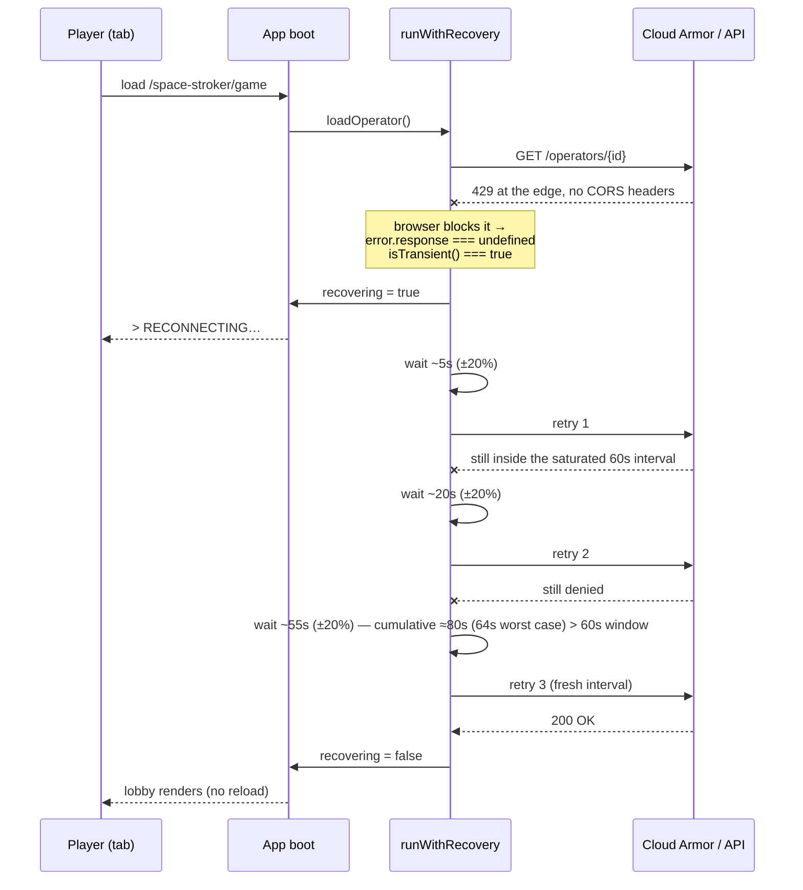

# SpaceStroker — "Entry-path recovery" Feature — Implementation Spec

> **Status: Implemented** (2026-07-27) — refined via Trello card
> [A transient failure on any boot call dead-ends the player on a static error page](https://trello.com/c/KvfUl6ff)
> (**#110**, refined 2026-07-27).
> Repos affected: `monkify-front`, and this doc + the edge Terraform in `monkify-meta`.
> **No `monkify-backend`** — the backend half of the original incident moved to #112.
>
> **Purpose:** A transient API failure during app boot currently strands a standalone player on
> `/error`, a page whose entire body is `<p>This game is unavailable.</p>` — no retry, no reload, no
> link. This spec makes the entry path *recover on the player's behalf*: classify transient vs
> terminal failures, absorb the transient ones behind a bounded jittered back-off that outlives Cloud
> Armor's enforcement window, and make `/error` non-terminal for everything that gets there anyway.

---

## 1. Summary

On 2026-07-26 Cloud Armor (then `rate_based_ban`, 100/60 s, 300 s ban) banned a shared VPN exit.
`GET /operators/{id}` was denied five times; `useOperator.ts:56` catches **any** error and calls
`failAuth()` → `router.replace('/error')`; the tab was dead until a manual reload. Because Armor's
`throttle` enforces its rate across the **whole 60 s interval**, that manual reload re-failed *and*
spent another request.

| | Today | After this spec |
| --- | --- | --- |
| Transient boot failure | `/error`, terminal, no way back | Stays on route; `> RECONNECTING…`; 3 jittered retries spanning ≈80 s |
| Transient failure that recovers | never happens (never retried) | Overlay clears, lobby renders, no reload |
| Transient failure that never recovers | `/error`, terminal | `/error` **with a RETRY control** |
| Terminal failure (401 real token, 404) | `/error`, terminal | `/error` immediately, no retries, **with RETRY**; copy unchanged |
| Embedded transient failure | posts `token-expired` → casino re-launches (spends more requests) | in-frame recovery state, **no** postMessage |
| Embedded terminal failure | `token-expired` + relaunching | unchanged |
| Throttled `/games/active-types` | lobby renders empty | joins the same back-off |
| `/health`, `/Hubs/*` at the edge | share the general 600/60 s per-IP bucket | dedicated looser rule (~3000/60 s) |

**Level: `Minor change`** — restores intended behaviour on a path that was already supposed to work.
No new capability, no backend code, no schema, no migration, no API surface ⇒ **no mandatory
integration test and no `features/entry-path-recovery.md`**. Existing KB docs are still corrected
(§10.3).

---

## 2. Constraints (MANDATORY)

From `monkify-meta/constraints.md` (full list there):

- **Worktree-per-repo:** `feature/entry-path-recovery` in `monkify-front` + `monkify-meta`, each in
  `.worktrees/entry-path-recovery/<repo>`. The shared checkouts stay on `main`.
- **Push after branch work:** both branches are already pushed to `origin`.
- **§6 — Operator messaging stays vague.** `/error` copy must never reveal contract status.
  Distinguishing *transient* from *terminal* must not leak **why** a terminal failure is terminal:
  every terminal cause (expired operator, inactive operator, 404, bad admin token) renders the same
  page with the same words.
- **§5 — `terraform apply` / `plan` and production log reads are operator steps.** This spec's
  Terraform is written and validated locally only; the apply is handed to the user.
- **Secrets/config:** mock-only values in committed files. This spec adds none.
- **Unit tests:** `monkify-front` has **no test runner** and this card does not add one (#110 D13).
  The two pure functions must still be written so a future runner can pin them (§11).
- **No backend change** ⇒ `scripts/run_tests.bat` is not expected to run. If a backend change does
  appear, `AGENTS.md` rule 3 applies.

---

## 3. Resolved product decisions

Carried verbatim in substance from the card's `## Decisions (from refinement)` (short mode).

| # | Decision |
| --- | --- |
| 1 | **Classify and recover in place**, *and* give `/error` a retry — not a retry button alone. Armor's `throttle` enforces across the whole 60 s interval, so only the app can wait it out. |
| 2 | **Back-off = 3 retries at ~5 s / ~20 s / ~55 s, ±20 % jitter (≈80 s nominal, **64 s worst case**), then `/error`.** The budget must outlive the 60 s enforcement window **at the jitter floor**, not merely on average — see the correction note under §6.2. Jitter is load-bearing — everyone behind one VPN exit is throttled simultaneously. Indefinite retry rejected. |
| 3 | **A full-screen arcade boot state (`> RECONNECTING…`)** — one line, **no countdown, no attempt counter** (a visible "attempt 2 of 3" invites the reload we are preventing). Copy generic; never mentions the operator. |
| 4 | **Route 3: classify the re-mint failure *and* replace `window.location.assign`** with a router navigation (a full reload wipes in-flight back-off state and re-spends the boot budget). |
| 5 | **Embedded: same classification, no new postMessage.** `token-expired` is the wrong signal for a 429. Terminal keeps today's `token-expired` + relaunching exactly. |
| 6 | **Scope = the three dead-end routes + `getGamesTypes`.** Prefs and FX rates deliberately excluded — they degrade to a default display name and currency symbol and strand nobody. |
| 7 | **All three work items stay on this card** (frontend recovery + Armor rule + doc corrections). Knowingly accepted: the Terraform half cannot be verified by the implementation. |
| 8 | **Armor whitelist = a dedicated *looser throttle* (~3000/60 s, priority 800), not a blanket `allow`.** An exemption would leave `/Hubs/*/negotiate` with no ceiling anywhere while #112 has the in-app limiter under suspicion. |
| 9 | **`/error` always shows RETRY**, regardless of how the player got there. |
| 10 | **Mobile wallet hop: the back-off applies uniformly.** Today's behaviour is strictly worse — the resume never runs at all. |
| 11 | **Level = `Minor change`.** |
| 12 | **⚠️ Classification: transient = _no response at all_, or 429 / 5xx / 408.** Terminal = any other 4xx that *has* a response, plus a malformed/absent token. See §6.1 — this is the decision the whole card turns on. |
| 13 | **Verification = manual QA**, but `isTransient` and the delay schedule must be **pure exported functions** with no Vue/axios coupling. |

---

## 4. Data model

**None.** No entity, column, EF mapping, or migration — this card touches no backend and no database.

---

## 5. Configuration

### 5.1 Frontend

**No new environment variable.** The back-off schedule is a compile-time constant in the new pure
module (§6.2). This is deliberate: #96 introduced `VUE_APP_IDLE_DISCONNECT_*` because those timeouts
are a product-tuning knob, whereas this schedule is derived from a fixed infrastructure fact — Cloud
Armor's `rate_limit_interval_sec`, which is `60` and is *never overridden in any tfvars*
(`modules/edge/variables.tf:58-61`). A knob would invite someone to tune it below the window it
exists to cross.

### 5.2 Edge (Terraform)

Two new variables in `deploy/terraform/workload/modules/edge/variables.tf`, mirroring the naming of
the existing `rate_limit_count` / `rate_limit_interval_sec`:

```hcl
# Infrastructure paths (`/health`, `/Hubs/*`) get their own, much looser bucket than the general
# per-IP rule. NOT an exemption: a blanket `allow` would leave POST /Hubs/Games/negotiate with no
# ceiling anywhere, and the in-app limiter that would normally backstop it is under suspicion (#112).
# 3000/60s is ~5x the general rule — far above any real client, low enough to bound an abuser.
variable "infra_rate_limit_count" {
  type    = number
  default = 3000
}

variable "infra_rate_limit_interval_sec" {
  type    = number
  default = 60
}
```

---

## 6. Frontend behaviour (`monkify-front`)

### 6.1 The classifier — `src/utils/transientError.ts` (new, pure)

> ⚠️ **This is the single most important detail in the spec.** The 429 this card exists to fix
> **does not arrive as a status code.** Cloud Armor denies at the edge, *before the app runs*, so the
> response carries **no CORS headers**; the browser blocks it and axios reports a network error with
> **`error.response === undefined`**. `modules/edge/main.tf:46-47` already records exactly this
> mechanism for the WAF rule, and it is why the original incident was reported as "a CORS error".
>
> **A classifier written as `status === 429 || status >= 500` would never fire on the incident.**

```ts
// Pure. No Vue, no axios import — takes `unknown` and reads defensively, so a test runner can call it
// with a hand-built object. See specs/entry-path-recovery.md §6.1.
export const isTransient = (error: unknown): boolean => {
  const status = (error as { response?: { status?: number } })?.response?.status;

  // No response at all: Cloud Armor's CORS-less 429 (the incident), offline, DNS/TLS failure, or an
  // aborted request. Indistinguishable from each other in the browser, and all worth retrying.
  if (status === undefined || status === null) return true;

  return status === 429 || status === 408 || status >= 500;
};
```

Everything else — any 4xx that *has* a response (401 on a real operator token, 403, 404), and a
malformed or absent launch token — is **terminal**.

**Knowingly accepted:** "no response" also covers a player who is simply offline. They will retry for
≈80 s and then land on `/error` with RETRY. `navigator.onLine` was rejected as too unreliable to act
on — it reports "online" for a machine attached to a network with no route to the internet, so acting
on it would add a wrong answer rather than a right one.

### 6.2 The schedule — `src/utils/retrySchedule.ts` (new, pure)

```ts
// Delays in ms before retry attempts 1, 2 and 3. The cumulative total deliberately EXCEEDS
// Cloud Armor's 60s enforcement interval, so at least one attempt lands in a fresh interval — a
// conventional 1/2/4s back-off would spend all three retries inside the same saturated window and
// fail identically. See specs/entry-path-recovery.md §3 decision 2.
export const RETRY_BASE_DELAYS_MS = [5_000, 20_000, 55_000] as const;
export const RETRY_JITTER_RATIO = 0.2;

// Pure given `rand`. The default is Math.random; a test passes a stub. Jitter is NOT cosmetic: every
// player behind a shared VPN exit is throttled at the same instant, so an un-jittered schedule would
// have them all retry in lockstep and re-saturate the next interval together.
export const buildRetrySchedule = (rand: () => number = Math.random): number[] =>
  RETRY_BASE_DELAYS_MS.map((base) => {
    const swing = base * RETRY_JITTER_RATIO;          // ±20%
    return Math.round(base - swing + rand() * 2 * swing);
  });
```

> ⚠️ **Correction made during implementation (2026-07-27).** This spec originally specified
> `[5_000, 20_000, 45_000]`. Those numbers **fail the invariant they exist to satisfy.** The guarantee
> has to hold at the **jitter floor**, not at the nominal values: with `rand() → 0` on every call the
> delays become `4 000 + 16 000 + 36 000 = 56 000 ms` — **under** the 60 s enforcement window, so a
> player unlucky in the jitter (roughly 1 run in 8) would spend all three retries inside the same
> saturated interval and fail exactly as if nothing had been retried. Raising the last base delay to
> **55 s** puts the floor at `4 000 + 16 000 + 44 000 = 64 000 ms` ✅. Totals are now ~80 s nominal,
> 64 s worst case, 96 s best case. **When changing these constants, check the floor, not the mean.**

### 6.3 The recovery runner — `src/hooks/useBootRecovery.ts` (new)

A module-level singleton in the shape of `useEmbed` (`hooks/useEmbed.ts:15-25`) — one shared
`recovering` ref so any caller going through the runner drives the same overlay.

```ts
const recovering = ref(false);

// Runs `task`, absorbing transient failures behind the jittered back-off. Resolves with the task's
// value on success, or rethrows the LAST error once the budget is exhausted (the caller then does
// whatever it does for a terminal failure). A terminal error is rethrown immediately — no retries.
const runWithRecovery = async <T>(task: () => Promise<T>): Promise<T> => { … };
```

Behaviour:

1. `await task()`. On success, clear `recovering` and return.
2. On failure, `isTransient(error)`?
   - **No** → clear `recovering`, rethrow immediately.
   - **Yes** → set `recovering = true`, wait `schedule[attempt]`, retry.
3. After the 3rd retry fails, clear `recovering` and rethrow the last error.

⚠️ **The runner must mark every absorbed error `handled = true`** — see §6.7.

### 6.4 The overlay — `src/components/BootRecovering.vue` (new)

Mirrors `components/EmbedRelaunching.vue` (which is four lines) rather than the heavier
`GameIdleOverlay.vue`, because there is nothing to click:

```vue
<template>
  <div class="min-h-screen flex items-center justify-center text-white">
    <p class="blink press-start-2p-regular">&gt; RECONNECTING…</p>
  </div>
</template>
```

Rendered from `App.vue` alongside the existing embed state (`App.vue:245`):

```html
<embed-relaunching v-if="isEmbedded && relaunching" />
<boot-recovering v-else-if="recovering" />
<main v-else id="main-container" class="flex-1 z-1"> … </main>
```

This ordering satisfies decision 5 for free: when embedded, a **terminal** failure still sets
`relaunching` and wins the `v-if`; a **transient** failure sets only `recovering`, posts nothing, and
shows the same in-frame state as standalone.

### 6.5 Route 1 — `src/hooks/useOperator.ts`

Replace the bare `catch` at `:56-59`. `loadOperator` keeps its `Promise<OperatorBranding | null>`
contract, so `App.vue:156-161` is unchanged:

```ts
try {
  const response = await runWithRecovery(() => mainService.getOperator(id));
  const branding = response?.data;
  if (!branding) { await failAuth(); return null; }   // 200 with an empty body — terminal, unchanged
  applyOperatorTheme(branding.color ?? null);
  return branding;
} catch {
  // Terminal, or transient with the budget exhausted. Either way the player has waited as long as
  // we are willing to wait. failAuth() is unchanged: /error standalone, token-expired when embedded.
  await failAuth();
  return null;
}
```

`failAuth()` itself (`:19-26`) is **not modified** — its embedded branch is exactly the terminal
behaviour decision 5 preserves.

### 6.6 Route 2 — `src/main.ts`

The `router.beforeEach` guard (`:83-94`) must not return `{ name: 'Error' }` for a transient
`ensureLaunchToken()` failure. `ensureLaunchToken` returns `null` for **both** causes today
(`hooks/useLaunch.ts:62-65`), so the fix is in `getDefaultLaunchToken` (§6.7) — once it distinguishes
them, the guard wraps its call:

```ts
try {
  const token = await runWithRecovery(() => ensureLaunchToken());
  if (token) return true;
} catch { /* budget exhausted — fall through to the terminal branch below */ }

const { isEmbedded } = useEmbed();
return isEmbedded ? true : { name: 'Error' };
```

> ⚠️ **Ordering note the implementer must not trip on:** this guard runs *before* `app.mount()`
> (`main.ts:153` gates on `router.isReady()`), so `BootRecovering` is **not yet rendered** during
> route 2's back-off — the player sees the pre-mount blank page. That is acceptable and must not be
> "fixed" by mounting earlier: mounting before the token resolves is exactly the cold-boot race the
> guard's own comment (`:76-80`) exists to prevent. Route 1's back-off, which runs in
> `App.vue onMounted`, is the one the overlay covers, and it is the path that actually fired.

### 6.7 Route 3 — `src/services/mainService.ts`

**Three changes.**

**(a) `getDefaultLaunchToken` must stop flattening every failure to `null`** (`:87-96`). Today a 429
on `POST /launch-token/default` is indistinguishable from a genuinely rejected mint. Rethrow instead
of swallowing, and let the two callers decide:

```ts
const getDefaultLaunchToken = async (): Promise<string | null> => {
  const { data } = await singleFlight(flightKey('POST', '/launch-token/default'), () =>
    mainAPI.post<{ token?: string }>('/launch-token/default', null)
  );
  return data?.token ?? null;   // a 200 with no token is TERMINAL and still returns null
};
```

⚠️ **This is a contract change on an exported function** — `mainService.getDefaultLaunchToken` is in
the default export (`:248`) and is called from `useLaunch.ts:62`. Both call sites must be updated in
the same commit; `useLaunch.ensureLaunchToken` no longer catches, letting the error reach
`runWithRecovery` in §6.6.

**(b) The 401 interceptor's re-mint** (`:115-124`) now runs inside the runner, so a transient mint
failure is retried instead of dead-ending:

```ts
} else if (isAutoMintedLaunch() && original && !original._retriedDefaultMint) {
  try {
    const fresh = await runWithRecovery(() => getDefaultLaunchToken());
    if (fresh) { /* … retry the original request, unchanged … */ }
  } catch { /* fall through to the terminal navigation below */ }
  navigateToError();
}
```

**(c) Both `window.location.assign('/error')` calls** (`:124`, `:126`) become a router navigation, so
a concurrent 401 cannot destroy an in-flight back-off with a full document reload.

⚠️ **The router is created at `main.ts:55` and never exported**, so the interceptor has no handle on
it. Add a tiny module — `src/services/navigation.ts` — holding a settable router reference, set once
from `main.ts` right after `createRouter`, and used by both `mainService.ts` and `adminService.ts:36`:

```ts
let router: Router | null = null;
export const setNavigationRouter = (r: Router) => { router = r; };
export const navigateToError = () => {
  if (window.location.pathname === '/error') return;
  if (router) router.replace({ name: 'Error' });
  else window.location.assign('/error');   // pre-mount fallback; must never be the normal path
};
```

Do **not** import the router from `main.ts` directly — `main.ts` imports `mainService` transitively,
so that would create an import cycle.

**(d) ⚠️ The global toast interceptor.** `services/handlers.ts:10-25` registers a second response
interceptor that toasts **every** rejected request 200 ms later unless the caller sets
`error.handled = true`. Without care, each absorbed retry fires its own red "Network Error" toast
*behind* the RECONNECTING overlay — three toasts for a failure the player is being told is being
handled. **`runWithRecovery` must set `handled = true` on every error it absorbs**, and leave it
unset on the final rethrown error so genuine terminal failures still surface as they do today.

This interceptor is registered in `App.vue onMounted` (`:137`), i.e. *after* route 2's guard has run —
so route 2's back-off produces no toasts either way, and only route 1 and `getGamesTypes` need this.

### 6.8 The lobby list — `getGamesTypes` (decision 6)

`getGamesTypes` has four call sites: `GameTypes.vue:25` (the lobby), `GamePage.vue:58`,
`GameHistoryPage.vue:130`, `GameStatsPage.vue:93`. Wrap it **inside `mainService.getGamesTypes`**, so
all four inherit the back-off and no call site changes:

```ts
const getGamesTypes = async () => {
  const { data } = await runWithRecovery(() =>
    singleFlight(flightKey('GET', '/games/active-types'), () =>
      mainAPI.get<DefaultResponse<ActiveGame[]>>('/games/active-types')
    )
  );
  return data;
};
```

⚠️ **Order matters: `runWithRecovery` goes *outside* `singleFlight`, not inside.** `singleFlight`
deletes its map entry in `finally` (`:61-63`), so a retry issued from inside would find a settled
(rejected) entry already removed and correctly start a fresh request — but every *concurrent* caller
would still be holding the original rejected promise and would fail while the retry succeeds.
Wrapping outside means each caller runs its own recovery loop over a correctly-deduped request.

`GameTypes.vue`'s existing `try/catch` + toast stays as the terminal path — it now only fires once the
budget is exhausted.

### 6.9 `/error` gains RETRY — `src/pages/ErrorPage.vue` (decision 9)

The page is currently three lines. It gains a RETRY control that re-runs the boot path, using the
existing `PrimaryButton` (`components/ui/PrimaryButton.vue`, which wraps `.btn-arcade`) and the panel
styling of `GameIdleOverlay.vue`:

```vue
<script setup lang="ts">
  // Reload rather than router-navigate: the failure could be anywhere in the boot path (token mint,
  // operator fetch, interceptor), and a full re-boot is the only thing guaranteed to redo all of it.
  // This page is a dead end by definition, so there is no state worth preserving.
  const retry = () => window.location.assign('/space-stroker/game');
</script>
```

Copy stays exactly as vague as today — "This game is unavailable." — plus a neutral second line and
the button. **No** wording that distinguishes a rate limit from an expired operator (§6 / decision 9).

---

## 7. Edge behaviour (`monkify-meta` Terraform)

### 7.1 The infrastructure-paths rule

A **new** rule in `deploy/terraform/workload/modules/edge/main.tf`, at **priority 800** — above the
general per-IP rule at 1000, below nothing else that matters (the WAF preview rule sits at 900 and is
non-enforcing):

```hcl
  # /health and /Hubs/* get their own, much looser per-IP bucket. A throttled health probe makes Cloud
  # Run recycle the instance; a mass SignalR reconnect behind one NAT would blank an operator's
  # realtime for everyone on that exit. Deliberately a LOOSER THROTTLE, not an `allow` exemption: an
  # exemption would leave POST /Hubs/Games/negotiate with no ceiling anywhere, and the in-app limiter
  # that would normally backstop it is under suspicion of bucketing every player together (#112).
  # See monkify-meta/specs/entry-path-recovery.md §7.
  rule {
    action   = "throttle"
    priority = 800
    match {
      expr {
        expression = "request.path.startsWith('/Hubs/') || request.path == '/health'"
      }
    }
    rate_limit_options {
      conform_action = "allow"
      exceed_action  = "deny(429)"
      enforce_on_key = "IP"
      rate_limit_threshold {
        count        = var.infra_rate_limit_count
        interval_sec = var.infra_rate_limit_interval_sec
      }
    }
    description = "Looser per-IP throttle for /health + /Hubs/* (infrastructure paths)."
  }
```

Note the `match` uses **`expr`**, not `versioned_expr = "SRC_IPS_V1"` — the existing rules match on
source IP, this one matches on path, and the two forms are mutually exclusive within a `match` block.

⚠️ **`/health` is hygiene, not an incident fix.** Cloud Run's own probes are **internal**
(`modules/cloud_run_api/main.tf:66,76`) and never traverse the LB, so the only thing being throttled
at `/health` today is an unidentified third-party poller (`189.6.251.135`, ~140/min) — which at
600/60 s no longer trips anyway. The rule is worth landing so a future uptime monitor on the real
hostname cannot be banned; do not describe it as fixing the reported incident. **`/Hubs/*` is the half
with a real player-facing failure mode.**

### 7.2 The `patchRule` comment (doc correction)

Add to the same file, above the priority-1000 rule:

```hcl
  # ⚠️ A rule's `action` CANNOT be changed in place. The provider updates rules via patchRule, which
  # MERGES rather than replaces, so leftover fields from the old action survive and collide: #104's
  # rate_based_ban → throttle change failed with "Ban threshold or duration can only be specified if
  # the action is 'rate_based_ban'" because banDurationSec: 300 outlived the patch. To change an
  # action, delete the live rule first (gcloud compute security-policies rules delete <priority>
  # --security-policy <policy>) or bump the rule's priority for an atomic remove+add. Adding a NEW
  # rule at a NEW priority — as the /health + /Hubs rule above does — is unaffected.
```

### 7.3 `deploy/README.md:117` (doc correction)

`production.auto.tfvars.json` → `production.tfvars.json`. The `.auto.` name was dropped by
`terraform-development-deploy` because it cross-contaminates environments; the README was not updated.

### 7.4 Applying it

**`terraform apply` is an operator step (`constraints.md` §5).** The implementation stops at
`terraform fmt -check` + `terraform init -backend=false` + `terraform validate`, all runnable locally
with no credentials and no contact with production (confirmed by #104 — Terraform 1.13.4 *is*
installed; the older "no terraform binary here" note in INDEX was wrong).

⚠️ Note what `validate` does **not** do: it accepts a deliberately bogus `action` string, so it checks
structure and attribute existence, **not** enum values — those are rejected server-side at `apply`.
The `throttle` action itself is already proven valid in production by #104.

---

## 8. Flow diagram



---

## 9. Out of scope

- **Cloud Armor keying / thresholds** → #111. **The in-app AspNetCoreRateLimit limiter** → #112.
- Anything from #104 already shipped — the `singleFlight` helper and its allow-list. Do not re-open it.
- **Retrying `getPlayerPreferences` / `getFxRates`** (decision 6) — they degrade gracefully.
- **A new postMessage type for the embedded transient state** (decision 5) — the shipped
  `{source:'space-stroker', type, payload}` contract stays untouched.
- **Distinguishing offline from rate-limited** (decision 12) — `navigator.onLine` is too unreliable.
- **Introducing a test framework to `monkify-front`** (decision 13) — its own card. §11's
  pure-function requirement is what makes that card cheap later.
- Restricting Cloud Run ingress to LB-only. Own card.
- Making a rejected paid bet refundable. Own card.
- `setup_local_environment.bat` exiting 255 on success (`monkify-backend`, line 93).

---

## 10. File checklist

### 10.1 Backend (`monkify-backend`)

**None.** No files change in this repo.

### 10.2 Frontend (`monkify-front`)

| # | File | Change |
| --- | --- | --- |
| 1 | `src/utils/transientError.ts` | **New.** Pure `isTransient(error)` — §6.1. No Vue, no axios import. |
| 2 | `src/utils/retrySchedule.ts` | **New.** Pure `buildRetrySchedule(rand)` + the base-delay/jitter constants — §6.2. |
| 3 | `src/hooks/useBootRecovery.ts` | **New.** Module-singleton `recovering` ref + `runWithRecovery(task)`; marks absorbed errors `handled = true` — §6.3, §6.7(d). |
| 4 | `src/components/BootRecovering.vue` | **New.** Four-line `> RECONNECTING…` state, modelled on `EmbedRelaunching.vue` — §6.4. |
| 5 | `src/services/navigation.ts` | **New.** Settable router ref + `navigateToError()`, to avoid an import cycle with `main.ts` — §6.7(c). |
| 6 | `src/hooks/useOperator.ts` | Wrap `getOperator` in `runWithRecovery`; `failAuth()` untouched — §6.5. |
| 7 | `src/main.ts` | Call `setNavigationRouter(router)` after `createRouter`; wrap the `beforeEach` `ensureLaunchToken()` call — §6.6. |
| 8 | `src/hooks/useLaunch.ts` | `ensureLaunchToken` stops swallowing the mint failure so the runner can see it — §6.7(a). |
| 9 | `src/services/mainService.ts` | `getDefaultLaunchToken` rethrows; 401 re-mint runs in the runner; both `window.location.assign` → `navigateToError()`; `getGamesTypes` wrapped **outside** `singleFlight` — §6.7, §6.8. |
| 10 | `src/services/adminService.ts` | `:36` `window.location.assign('/error')` → `navigateToError()` for consistency (admin is terminal-only; no retry). |
| 11 | `src/pages/ErrorPage.vue` | Add the RETRY control + neutral second line; copy stays vague — §6.9. |
| 12 | `src/App.vue` | Import + render `<boot-recovering>` in the `v-else-if` slot between the embed state and `<main>` — §6.4. |

### 10.3 Meta (`monkify-meta`)

| # | File | Change |
| --- | --- | --- |
| 1 | `specs/entry-path-recovery.md` | **New.** This spec. |
| 2 | `INDEX.md` | Spec row + "Feature currently in flight". |
| 3 | `deploy/terraform/workload/modules/edge/main.tf` | New priority-800 infra-paths throttle rule + the `patchRule` comment — §7.1, §7.2. |
| 4 | `deploy/terraform/workload/modules/edge/variables.tf` | `infra_rate_limit_count` (3000) + `infra_rate_limit_interval_sec` (60) — §5.2. |
| 5 | `deploy/README.md` | Line 117: `production.auto.tfvars.json` → `production.tfvars.json` — §7.3. |
| 6 | `features/terraform-gcp-deploy.md` | KB sync at ship: the new Armor rule. |
| 7 | `conventions/frontend.md` | KB sync at ship: the transient-vs-terminal convention (next to `useClickOutside` from #109). |
| 8 | `architecture.md` | KB sync at ship: Edge section, if the rule shape warrants it. |

---

## 11. Unit tests

**No test project exists in `monkify-front`** — `package.json` exposes `serve` / `build` / `lint` /
`lint:fix` only, and this card deliberately does not add one (decision 13, and "introducing a test
framework" is in §9). There are therefore **no automated tests in this spec**, and **no backend tests**
(no backend change).

What the spec requires instead is that the two decision-bearing functions be **written so a future
runner can pin them with no refactor** — pure, exported, no Vue and no axios import, callable with a
hand-built object:

| Function | Cases a future test must be able to express | Expected |
| --- | --- | --- |
| `isTransient` | `{}` (no `response`) | `true` — the incident case |
| `isTransient` | `{ response: { status: 429 } }` / `500` / `503` / `408` | `true` |
| `isTransient` | `{ response: { status: 401 } }` / `403` / `404` / `400` | `false` |
| `buildRetrySchedule` | `rand: () => 0.5` (no jitter) | exactly `[5000, 20000, 55000]` |
| `buildRetrySchedule` | `rand: () => 0` and `rand: () => 1` | each delay within ±20 % of its base |
| `buildRetrySchedule` | any `rand` | **`sum > 60_000`** — the property the whole design rests on |

That last row is the one that matters: it is the invariant a future refactor could silently break,
and the reason the schedule is a pure function rather than inline `setTimeout` calls.

---

## 12. Acceptance criteria

Mapped 1:1 from the Trello **Acceptance Criteria** checklist (22 items).

1. Given a standalone player booting the lobby and `GET /operators/{id}` fails with NO response at all (a Cloud Armor 429 blocked by the browser for missing CORS headers), when the boot path runs, then the player stays on the current route showing the reconnecting state and is NOT navigated to `/error`.
2. Given a transient boot failure, when the back-off runs, then at most 3 retries are issued at approximately 5 s, 20 s and 55 s (each ±20 % jitter), and the cumulative elapsed time from the first failure to the last attempt exceeds 60 s **even at the jitter floor** (see the §6.2 correction — the originally-specified 45 s failed this).
3. Given two browser sessions whose boot fails transiently at the same instant, when both back off, then their retry timestamps differ (jitter is applied per session, not a shared fixed schedule).
4. Given a transient boot failure that recovers on any retry, when that retry succeeds, then the reconnecting state is dismissed and the lobby renders normally with no page reload.
5. Given the reconnecting state is showing, when the player looks at it, then it displays a single generic line (e.g. `> RECONNECTING…`) with no countdown, no attempt counter, and no mention of the operator.
6. Given a transient boot failure that never recovers, when the 3rd retry fails, then the player is navigated to `/error` and that page displays a working RETRY control.
7. Given the player is on `/error` for ANY reason (transient exhausted or terminal), when they press RETRY, then the boot path re-runs from the start.
8. Given a terminal failure (a 401 on a REAL operator launch token, or a 404), when the boot path runs, then NO retries are issued and the player lands on `/error` immediately with the existing vague copy, revealing nothing about contract status (`constraints.md` §6).
9. Given `main.ts`'s `router.beforeEach` guard and `ensureLaunchToken()` fails transiently, when the guard resolves, then it does NOT return `{ name: 'Error' }`; the transient path is taken instead.
10. Given `POST /launch-token/default` fails with no response or a 429, when the 401 interceptor attempts its re-mint, then the failure is classified transient and joins the back-off instead of navigating to `/error`.
11. Given a terminal 401 that must route to `/error`, when the interceptor navigates, then it uses a router navigation (no `window.location.assign`, no full document reload), so an in-flight back-off is not destroyed.
12. Given the app is embedded in an iframe and a TRANSIENT failure occurs, when the back-off runs, then NO `token-expired` message is posted to the parent and the in-frame reconnecting state is shown instead.
13. Given the app is embedded and a TERMINAL failure occurs, when it is classified, then `token-expired` + the relaunching state behave exactly as they do today, and no new postMessage type is introduced anywhere.
14. Given `GET /games/active-types` fails transiently, when the lobby loads, then the same back-off applies and the game list is not left silently empty.
15. Given `GET /players/preferences` or `GET /fx/rates` fails, when the boot path runs, then their behavior is unchanged from today (no retry; existing toast or silent degradation).
16. Given a pending mobile-wallet deeplink return and a transient boot failure, when the back-off completes, then `handleMobileDeeplinkReturn()` still runs; and if the round rolled over during the wait, the existing round-changed guard aborts BEFORE any on-chain broadcast (verified in code, not assumed) — see §13.1.
17. Given the player's device is offline at boot, when the boot path runs, then the reconnecting state shows, the back-off runs to exhaustion, and they land on `/error` with RETRY (no `navigator.onLine` special-casing).
18. Given the transient/terminal classifier and the delay-schedule generator, when the code is reviewed, then both are pure exported functions with no Vue and no axios coupling (callable from a plain test runner with a hand-built error object).
19. Given the Cloud Armor policy on `main`, when it is reviewed, then `/health` and `/Hubs/*` match a NEW dedicated rate-limit rule at a lower priority number than 1000 with a threshold far above the general 600/60 s, and NO existing rule's `action` was modified.
20. Given the Terraform changes, when `terraform fmt -check` and `terraform init -backend=false && terraform validate` are run locally, then both pass. (The real `terraform apply` is an ops step per `constraints.md` §5 and is explicitly NOT part of this card's verification.)
21. Given `deploy/README.md`, when line 117 is read, then it names `production.tfvars.json`; and `modules/edge/main.tf` carries a comment recording that a rule's `action` cannot be changed via `patchRule` (the provider merges).
22. Given the finished branch, when `yarn lint` and `yarn build` are run in `monkify-front`, then both pass, and the manual QA matrix (§13) has been executed and its results recorded on the card.

---

## 13. Manual QA

`monkify-front` has no test runner, so this matrix **is** the verification. Record results on the card.

**Simulating the failure.** Cloud Armor cannot be reproduced locally, and its defining property — a
response with no CORS headers, blocked by the browser — cannot be faked with devtools' offline mode
alone. Use one of:

- **Preferred:** DevTools → Network → **Block request URL** on `*/operators/*`. A blocked request
  surfaces to axios with `error.response === undefined` — the same shape as the incident.
- Point `VUE_APP_API_BASE_URL` at a closed port for a connection-refused variant.
- For the *terminal* cases, stop the container and hand-craft a 401/404 via a local proxy or by
  temporarily returning one from the API.

| # | Scenario | Expect |
| --- | --- | --- |
| 1 | Block `/operators/*`, load the lobby | `> RECONNECTING…`, no `/error`, **no red toast** (§6.7(d)) |
| 2 | Unblock during the ~80 s window | Overlay clears, lobby renders, no reload |
| 3 | Leave blocked past the 3rd retry | `/error` **with RETRY**; pressing it re-boots |
| 4 | Block `/games/active-types` only | Lobby back-off, then the existing toast — never an empty silent list |
| 5 | Terminal 401 on a real operator token | Straight to `/error`, no delay, vague copy |
| 6 | Same as 1 with `?embed=1` | In-frame state; **no `token-expired`** in the parent's message log |
| 7 | Terminal failure with `?embed=1` | `token-expired` + relaunching, exactly as today |
| 8 | Scenario 1 with hardware acceleration off (`html.light-graphics`) | Overlay legible; `blink` is stripped by `arcade.css` under light graphics — confirm it does not render invisible |
| 9 | Scenario 1 on a phone (`< lg`) | Overlay legible and centred |
| 10 | Two tabs, both blocked, opened together | Retry timestamps visibly differ (jitter) |
| 11 | Offline (devtools) at boot | Overlay → `/error` with RETRY |

### 13.1 ⚠️ The one money-adjacent check

`App.vue:167` runs `handleMobileDeeplinkReturn()` **after** `loadOperator()` — deliberately (`:165`),
so a resumed bet POST carries a valid launch token. A ~80 s back-off therefore delays a player who
just approved in Phantom and navigated back.

**Before implementing, read `useMobileWallet`'s resume path and confirm in code that the
round-changed guard aborts *before* the on-chain broadcast, not after.** `features/mobile-wallet-connect.md`
describes a "round-changed guard before broadcast", but this spec does not treat a KB summary as
proof for a money path. If the guard fires *after* the transfer is signed and sent, a player could pay
into a rolled-over round — in which case raise it with the user before proceeding; do **not** silently
shorten the back-off for this path (decision 10 rejected a second timing regime).

---

## 14. Trello / pipeline

- **Source card:** [#110 — A transient failure on any boot call dead-ends the player on a static error page](https://trello.com/c/KvfUl6ff)
  — list **Specs created**; the **Implementation** section on the card carries branch, worktree, spec
  path and Level.
- **Siblings:** #111 ([gkY5CLnT](https://trello.com/c/gkY5CLnT)) Armor keying, #112
  ([h27WZeQC](https://trello.com/c/h27WZeQC)) in-app limiter. Neither is a dependency; #112's spec
  branch (`feature/rate-limiter-keying`) touches `INDEX.md`, so expect a merge contention there.
- **Next:** `/monkify-implement-feature` → then `/monkify-ship-feature`.
- **Level `Minor change`** ⇒ implement-feature writes **no** integration test; ship-feature writes
  **no** `features/entry-path-recovery.md`, but still corrects the docs in §10.3 rows 6-8.

---

## 15. Revision log

| Date | Change |
| --- | --- |
| 2026-07-27 | Initial spec from refined card #110 (13 decisions, 22 acceptance criteria). Adds two code-exploration findings the card did not have: the global toast interceptor in `services/handlers.ts` would fire a red toast per absorbed retry (§6.7(d)), and the un-exported router forces a small `navigation.ts` shim to avoid an import cycle (§6.7(c)). Also records that route 2's back-off runs pre-mount, so the overlay does not cover it (§6.6). |
| 2026-07-27 | **Implemented.** One correction to this spec's own design, made before any code: the retry schedule's last delay moved **45 s → 55 s**, because `[5,20,45]` ±20 % bottoms out at 56 s and so failed the >60 s invariant at the jitter floor (§6.2). Also verified and discharged §13.1: `useGame.ts:754-759` places the round-changed guard **before** `broadcastSignedTransaction` at `:761`, so a back-off that outlives the round cannot make a player pay into a dead one. |
