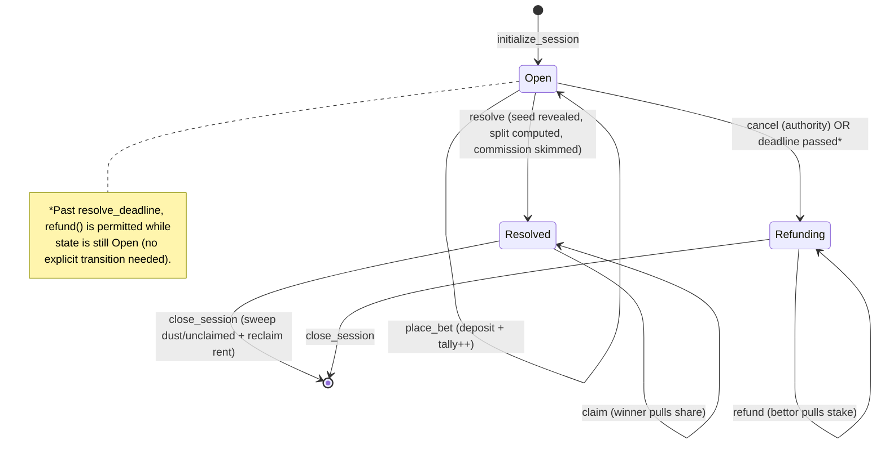

# Monkify — "Escrow Phase 0 — non-custodial SolanaToken escrow Anchor program" — Implementation Spec

> **Status: Ready for implementation** — refined via Trello card
> [#54 Escrow Phase 0 — non-custodial SolanaToken escrow Anchor program](https://trello.com/c/YlxonX59) (2026-07-14).
> Repos affected: **`monkify-backend`** (hosts the new Anchor program under `program/` — **no `.NET` code in this phase**)
> and this doc in **`monkify-meta`**. **No `monkify-front`.**
>
> **Purpose:** Build the foundation of the non-custodial SolanaToken escrow: a new **Rust/Anchor Solana
> program** in which each paid `SolanaToken` session's pot lives in a **program-owned PDA vault** (no
> keypair). Monkify holds only a **non-spendable resolver authority** that asserts the winning *choice*
> and reveals the provably-fair seed — it can never move, divert, or over-pay funds. Winners **`claim`**
> their share; a **permissionless timeout `refund`** guarantees funds can never be locked. This phase
> ships **only** the program + its `anchor test` suite + a **devnet** deploy. The `.NET` backend
> rewiring is Phase 1 (**#55**); the frontend is Phase 2 (**#56**).
>
> This spec is a **child of the umbrella design** [`specs/non-custodial-escrow.md`](./non-custodial-escrow.md)
> (Trello epic [#46](https://trello.com/c/SX7avQTT)). Where the umbrella §14 lists "a Monkify commission"
> as out of scope, **that is superseded by epic #46's later decision**: this program implements a **0.5%
> commission at `resolve`** (see §3 / §7). Follow this spec, not umbrella §14, on commission.

---

## 1. Summary

Today, paid `SolanaToken` settlement (shipped in `payment-methods-refactor.md`) is a **custodial,
commingled treasury float**: the operator must hand Monkify the token treasury's **signing private key**
(`OperatorToken.TokenOwnerPrivateKey`, AES-GCM-encrypted but still custodial) so Monkify can sign winner
payouts and refunds. The private key exists **only** to sign outbound transfers.

Phase 0 builds the on-chain artifact that removes that custody. It does **not** touch the `.NET` app yet.

| Concern | Before (custodial float) | After (this program) |
| --- | --- | --- |
| Where the pot lives | operator treasury (commingled) | **per-session PDA `Vault` ATA**, authority = Session PDA (no keypair) |
| Who signs payouts | Monkify, using the operator treasury **private key** | nobody "sends" — **winners `claim`** by program rule |
| Key Monkify holds | treasury signing key (can drain) | **resolver authority** only — asserts the winning *choice* + reveals the seed; cannot drain/divert/over-pay |
| Refund safety | Monkify-signed refund | **permissionless timeout `refund`** — any bettor reclaims their stake if unresolved past a bounded deadline |
| Winner split | computed off-chain | **computed on-chain** from a per-`(session,choice)` `Tally` (authority cannot set amounts) |
| Commission | none (removed in the payment refactor) | **0.5%** skimmed at `resolve`, only when the session token is the Monkify settings token |

The accounting fits cleanly: payout is already **pot-funded and zero-sum** (`pot = Σ bets`, each winner
gets `pot / winnerCount`, every paid bet equals `SessionParameters.RequiredAmount`), so a session's pot
is exactly the sum of its own bets — no operator pre-funding for a normal session. The typer produces
**one** winning sequence, so there is exactly **one winning choice**; "winner" ≡ "a bet whose recorded
choice equals the session's `winning_choice`". The program never trusts an enumerated winner list.

**Deliverable:** an Anchor workspace at `monkify-backend/program/`, a passing `anchor test` suite against a
local `solana-test-validator`, and a **devnet** deployment whose program id is recorded for Phase 1 config.

---

## 2. Constraints (MANDATORY)

From `monkify-meta/constraints.md` and `AGENTS.md` (full lists there):

- **Worktree-per-repo:** work lives in `.worktrees/escrow-phase-0/<repo>`; the hub stays on `main`.
  Branch `feature/escrow-phase-0` in **`monkify-backend`** and **`monkify-meta`** (created + pushed by
  `/monkify-create-spec`). No `monkify-front` worktree (no frontend in this phase).
- **On-chain logic gets its own Rust/Anchor test suite** (`anchor test` against a local validator). The
  `.NET` unit/integration-test discipline (`Monkify.Tests` + the mandatory `Monkify.Tests.Integration`
  happy-path + refund-timeout tests) attaches to **Phase 1 / #55**, not this card.
- **No `.NET` code, no EF mapping, no migration, no endpoints** in this phase. This card adds only the
  `program/` Anchor folder + a recorded devnet program id.
- **Secrets/config:** the **resolver authority** and **program admin/upgrade** keypairs are real signing
  secrets — kept out of source, never logged, never committed. Any committed keypair/config uses
  **mock/placeholder values only** (Anchor's generated `target/deploy/*-keypair.json` is git-ignored).
  There is **no operator private key** anymore.
- **Develop/test on devnet / `solana-test-validator` only.** Mainnet is real money and is gated on the
  **#59 security audit** — not part of this phase.
- **Money movement stays in `Monkify.Consumers`** (Phase 1): `initialize_session`/`resolve` are outbound
  calls from Consumers; `place_bet` is client-side; `claim`/`refund` are client-side / permissionless.
  Phase 0 only defines the program these calls target.
- **Operator messaging stays vague** for operator/contract-status errors (Phase 1 surface). Program-level
  errors are specific, low-level Anchor errors (see §8) — they are developer/tx-facing, not player copy.

---

## 3. Resolved product decisions

From the refined card [#54](https://trello.com/c/YlxonX59) (Decisions + the 2026-07-14 refinement
dialogue) and umbrella [#46](https://trello.com/c/SX7avQTT):

| # | Decision |
| --- | --- |
| 1 | **Artifact location:** the Anchor program lives in a **`program/` folder inside `monkify-backend`** — **not** a new sibling repo. (Supersedes the card's original "new `monkify-escrow-program` repo (name TBD)".) |
| 2 | **Scope:** program + `anchor test` suite + **devnet** deploy **only**. No `.NET`/frontend code (Phase 1 = #55, Phase 2 = #56). |
| 3 | **Model = program-owned escrow PDA + non-spendable resolver authority + claim-based payout.** Funds leave the `Vault` **only** via `claim` (to a real winning bettor) or `refund` (to a real bettor). |
| 4 | **Winner split computed on-chain** from a per-`(session,choice)` **`Tally` PDA**: `amount_per_winner = (total_deposited − commission) / Tally[winning_choice].count`. The resolver authority asserts **only** the winning choice — never amounts, never payees (closes umbrella §12 **L1**). |
| 5 | **Resolution is provably-fair-bound.** `resolve` requires the **revealed server seed** whose SHA-256 matches the `server_seed_hash` frozen at init. See §5 for the exact preimage contract. |
| 6 | **Tally seed = raw choice bytes** (`["tally", session_id, <choice bytes>]`). Choices are ≤20 bytes (`MaxChoiceLength = 20`) ≤ the 32-byte PDA-seed limit, so **no `hash(choice)`** → the collision/domain-separation concern (umbrella O2) cannot occur. |
| 7 | **Seed timing (umbrella O6):** `initialize_session` takes the **final `server_seed_hash` and freezes it**; the backend (Phase 1) calls `initialize_session` **lazily, right before the first bet** — the moment the provably-fair seed is committed. **No separate `commit_seed` instruction.** |
| 8 | **Commission = 0.5% (default `50` basis points), frozen in the `Session` PDA at init**, floor rounding, applied **only** when the session `mint == config.commission_mint` (the Monkify settings-token mint). All other operator tokens pay **no** commission. |
| 9 | **Commission destination + mint gating are program-level, not authority-settable.** A **`Config` PDA** (admin-set at deploy) holds `commission_mint` + `commission_wallet` (the fixed Monkify house owner). The per-session `commission_bps` is passed at init (frozen) but **capped** at `MAX_COMMISSION_BPS`; the **destination is never chosen by the resolver authority** — it is always `config.commission_wallet`'s ATA. This is the mechanism that realizes #46's "neither rate nor destination is authority-settable / non-custody preserved". |
| 10 | **Permissionless timeout `refund` is mandatory.** After a **bounded, init-validated** `resolve_deadline`, any bettor `refund`s their own stake with no authority. The authority may `cancel` early (→ `Refunding`) for invalid/aborted rounds. |
| 11 | **`resolve_deadline` is bounded at init** (`created_at < deadline ≤ created_at + MAX_SESSION_LIFETIME + BUFFER`, `BUFFER` = 1h) so funds can never be locked forever (umbrella §12 **L6**). |
| 12 | **`close_session` + dust/unclaimed sweep are in scope for Phase 0.** Division **dust** + winnings still **unclaimed after a grace period** (`GRACE_SECONDS`, default **30 days**) sweep to the **Monkify house account** (`config.commission_wallet`'s ATA); PDA/vault **rent** is then reclaimed. |
| 13 | **Free / amount-0 sessions never touch the program** (umbrella O4). `place_bet` requires `amount == required_amount > 0`; free SolanaToken sessions settle off-chain as today. |
| 14 | **Upgrade authority (umbrella L5):** **single dev key on devnet** for fast iteration; a **timelocked/multisig** upgrade authority is a **recorded mandatory requirement for the #59 mainnet cutover** — the program is **not** shipped immutable (an immutable program couldn't patch a stuck-funds bug). |
| 15 | **Toolchain:** latest stable **Anchor** + **Agave/Solana** CLI, pinned in the program's `Anchor.toml` / `rust-toolchain.toml` / `Cargo.toml`; exact versions fixed at implementation time (see §6). |
| 16 | **Winner has no ATA (umbrella L4):** `claim` **creates the winner's ATA** if missing (payer = claimant) — recoverable, never a permanent failure. |

---

## 4. On-chain accounts (the "data model")

All PDAs are owned by this program. Byte budgets below include the 8-byte Anchor discriminator. Sizes are
guidance for `#[account(space = …)]`; the implementer confirms exact `INIT_SPACE`.

### 4.1 `Config` PDA — seeds `["config"]` (singleton)

Set once at deploy by the program **admin** (not the resolver authority). Makes the commission mint +
destination non-authority-settable.

| Field | Type | Notes |
| --- | --- | --- |
| `admin` | `Pubkey` | May `update_config`. Single dev key on devnet; mainnet → multisig (#59). |
| `commission_mint` | `Pubkey` | The Monkify settings-token mint (`GeneralSettings.Token.MintAddress`). Commission applies **iff** `session.mint == commission_mint`. |
| `commission_wallet` | `Pubkey` | Owner of the fixed Monkify house account. Commission (for the settings mint) **and** all sweeps (any mint) go to **its ATA for the relevant mint**. |
| `bump` | `u8` | |

### 4.2 `Session` PDA — seeds `["session", session_id]`

`session_id` is the session's `Guid` as **16 raw bytes in RFC-4122 / big-endian (string) order** — **not**
.NET `Guid.ToByteArray()`'s mixed-endian layout (interop gotcha; Phase 1 must convert — see §5.4).

| Field | Type | Notes |
| --- | --- | --- |
| `resolver_authority` | `Pubkey` | The only signer of `resolve`/`cancel`/`close_session`. Non-spendable. |
| `mint` | `Pubkey` | The session token mint (the operator's registered token, or the settings token). |
| `required_amount` | `u64` | Bet stake, **token base units** (scaled by `decimals`). |
| `decimals` | `u8` | The session token's decimals (Phase-1 decimals-fix source). |
| `server_seed_hash` | `[u8; 32]` | SHA-256 of the provably-fair seed preimage (see §5.1). Frozen at init. |
| `state` | `u8` (`SessionState`) | `Open = 0`, `Resolved = 1`, `Refunding = 2`. |
| `resolve_deadline` | `i64` | Unix seconds. Bounded at init (§decision 11). |
| `created_at` | `i64` | `Clock::unix_timestamp` at init. |
| `commission_bps` | `u16` | Frozen at init; ≤ `MAX_COMMISSION_BPS`. |
| `winning_choice` | `String` (≤20) | Empty until resolved. Bounded length. |
| `amount_per_winner` | `u64` | Computed on-chain at `resolve`. |
| `revealed_seed` | `[u8; 64]` | The 64-byte seed preimage revealed at `resolve` (audit trail). |
| `total_deposited` | `u64` | Σ deposits (gross pot). |
| `bet_count` | `u32` | Number of `BetRecord`s created. |
| `settled_count` | `u32` | Number of `BetRecord`s claimed **or** refunded (drives close-ability). |
| `bump` | `u8` | |

### 4.3 `Vault` — the SPL **associated token account** for `mint`, **authority = `Session` PDA**

Not a custom account; it is `get_associated_token_address(session_pda, mint)`. Holds the pot. Tokens move
out **only** via `claim`/`refund`/`close_session` sweep, each gated on a real `BetRecord` (or the grace
timeout), with the `Session` PDA signing as vault authority via seeds. No keypair exists for it.

### 4.4 `BetRecord` PDA — seeds `["bet", session_id, bettor, nonce_le]`

`nonce` (the provably-fair per-bet `Bet.Nonce`, a `long` in `.NET`) is serialized as **`u64` little-endian**
in the seed, so one bettor may place multiple distinct bets.

| Field | Type | Notes |
| --- | --- | --- |
| `bettor` | `Pubkey` | Deposit signer; the only account that may `claim`/`refund` this record. |
| `choice` | `String` (≤20) | The bet's choice, **already lowercased/trimmed** by the client to match `Bet.Choice` (§5.2). |
| `nonce` | `u64` | Provably-fair per-bet nonce. |
| `amount` | `u64` | Stake in base units (== `session.required_amount`). |
| `settled` | `bool` | True once claimed or refunded. |
| `bump` | `u8` | |

### 4.5 `Tally` PDA — seeds `["tally", session_id, choice_bytes]`

Created on the first bet for a `(session, choice)` and incremented on each subsequent one. Read at `resolve`
to compute the split on-chain. `choice_bytes` are the raw ≤20 ASCII bytes of the (lowercased) choice.

| Field | Type | Notes |
| --- | --- | --- |
| `count` | `u32` | Number of bets on this choice. |
| `bump` | `u8` | |

### 4.6 State machine



---

## 5. Cross-boundary contracts (the precise interop the program MUST honor)

These are the exact byte-level agreements between this program and the existing `.NET` backend, verified
against live code. Phase 1 (#55) depends on them; get them right in Phase 0.

### 5.1 Provably-fair commit-reveal (verified against `ProvablyFair.cs`)

- `ProvablyFair.GenerateServerSeed()` = lowercase hex of 32 CSPRNG bytes → a **64-character ASCII hex
  string**.
- `ProvablyFair.HashServerSeed(serverSeed)` = `SHA256(UTF8(serverSeed))` — **the hash of the 64-char hex
  STRING's UTF-8 bytes**, i.e. `SHA256` over a **64-byte** preimage — stored as lowercase hex (`Session.ServerSeedHash`).
- **On-chain contract:**
  - `Session.server_seed_hash: [u8; 32]` = the **raw 32 bytes** of that SHA-256 digest (backend passes
    the digest bytes, not the hex string, at init).
  - `resolve(revealed_server_seed)` receives the **64-byte UTF-8 hex preimage** (`revealed_seed: [u8; 64]`)
    and must check `sha256(revealed_server_seed) == session.server_seed_hash`. Because the backend committed
    to `SHA256(UTF8(hexString))`, the on-chain check is **byte-identical** — do **not** hash the raw 32
    seed bytes; hash the 64-byte hex preimage.
- Store `revealed_server_seed` in `Session.revealed_seed` for public verifiability.

### 5.2 Choice (verified against `SessionCharacterType.cs`, `Bet.Choice`, `SessionParametersValidation.cs`)

- Charset by `SessionParameters.AllowedCharacters`: `Number` = `0123456789`, `Letters` =
  `abcdefghijklmnopqrstuvwxyz`, `NumbersAndLetters` = `abcdefghijklmnopqrstuvwxyz0123456789`.
- `Bet.Choice` is stored **trimmed and lowercased** (the entity getter/setter lowercases). So on-chain the
  choice is **ASCII `[a-z0-9]`, one byte per char**, length `== SessionParameters.ChoiceRequiredLength`
  (1–20; `MaxChoiceLength = 20`).
- **On-chain validation in `place_bet`:** reject `choice` if `len == 0` or `len > MAX_CHOICE_LEN (20)` or any
  byte ∉ `[a-z0-9]`. The program does **not** need the per-session required length (that stays a backend
  concern); it enforces the ≤20 ASCII-lowercase bound so the `Tally`/`BetRecord` sizes and seeds are safe.

### 5.3 Amounts & nonce (verified against `SessionParameters.cs`, `Bet.cs`, `TokenSettings.cs`)

- `SessionParameters.RequiredAmount` and `Bet.Amount` are `.NET` **`decimal`**. On-chain everything is
  **`u64` base units**. The backend converts `decimal → u64` by scaling with the **session token's**
  `OperatorToken.Decimals` (the Phase-1 "decimals-leak fix", umbrella §9). Phase 0 only receives/stores the
  already-scaled `u64` `required_amount` + `decimals`.
- `Bet.Nonce` is a `.NET` **`long`** (non-negative in practice) → **`u64`** on-chain.

### 5.4 `session_id` bytes (interop gotcha)

`session_id` is a `.NET` `Guid`. .NET `Guid.ToByteArray()` uses a **mixed-endian** layout (first three
groups little-endian). To keep PDAs deterministic and human-verifiable, this program treats `session_id` as
the **16 bytes in RFC-4122 / big-endian string order** (the order shown by `Guid.ToString("D")`). **Phase 1
must convert** the `Guid` to big-endian bytes before every program call. Document this loudly in the Phase-1
`SolanaService`.

### 5.5 Commission mint gating

The program cannot read backend config, so the settings-token mint lives on-chain in `Config.commission_mint`
(set by the admin at deploy). `resolve` applies commission **iff** `session.mint == config.commission_mint`.
The rate (`commission_bps`) is per-session-frozen (from `GeneralSettings.Commission.Rate`, Phase 1) but the
**destination** is always `config.commission_wallet`'s ATA — never an authority-chosen account.

---

## 6. Program layout & toolchain (`monkify-backend/program/`)

Anchor workspace. `declare_id!` starts as the Anchor-generated keypair id; the **devnet** program id is
recorded after deploy (§13, §14).

```
monkify-backend/program/
  Anchor.toml                      # [programs.localnet]/[programs.devnet], test validator cfg
  Cargo.toml                       # workspace
  rust-toolchain.toml              # pin rustc
  package.json / tsconfig.json     # anchor test (mocha/ts) deps
  programs/monkify-escrow/
    Cargo.toml                     # anchor-lang, anchor-spl
    src/
      lib.rs                       # #[program] mod: instruction entrypoints, declare_id!
      constants.rs                 # SEED_* literals, MAX_COMMISSION_BPS, GRACE_SECONDS, BUFFER_SECONDS, MAX_CHOICE_LEN
      errors.rs                    # #[error_code] EscrowError
      state.rs                     # Config, Session, BetRecord, Tally, SessionState
      instructions/
        initialize_config.rs
        update_config.rs
        initialize_session.rs
        place_bet.rs
        resolve.rs
        claim.rs
        refund.rs
        cancel.rs
        close_session.rs
        close_bet.rs               # permissionless orphan-BetRecord rent reclaim (L3)
  tests/
    monkify-escrow.ts              # anchor test suite (see §11)
  migrations/deploy.ts
```

- **Anchor / Agave-Solana:** latest stable at implementation time (Anchor `≥ 0.30`, Agave/Solana `≥ 2.x`),
  pinned in `Anchor.toml` `[toolchain]` + `rust-toolchain.toml`. `anchor-spl` for the token CPIs / ATA
  helpers. Record the exact versions in the program `README.md`.
- **Constants:** `MAX_COMMISSION_BPS = 1000` (10% hard cap), `GRACE_SECONDS = 2_592_000` (30 days),
  `BUFFER_SECONDS = 3_600` (1h), `MAX_CHOICE_LEN = 20`.

---

## 7. Instructions (behaviour, signer, checks, effects, errors)

Order = execution order in a session's life. All token moves are SPL CPIs; the `Vault` authority is the
`Session` PDA (signed via seeds). Every failed check returns a specific `EscrowError` (§8).

### 7.1 `initialize_config(commission_mint, commission_wallet)` — signer: **admin (payer)**
- Creates the singleton `Config` PDA (`["config"]`). Sets `admin = signer`, `commission_mint`,
  `commission_wallet`. Idempotency: fails if `Config` already exists (use `update_config` to change).
- `update_config(new_commission_mint?, new_commission_wallet?, new_admin?)` — signer: **current `admin`**.
  Admin-only maintenance (not the resolver authority). Out of the money path.

### 7.2 `initialize_session(session_id, mint, required_amount, decimals, server_seed_hash, commission_bps, resolve_deadline)` — signer/fee-payer: **resolver authority**
- Creates the `Session` PDA + the `Vault` ATA (authority = Session PDA). Rejects a **duplicate** session id
  (PDA already initialized → `SessionAlreadyExists`).
- **Freezes** `server_seed_hash` and `commission_bps` (reject `commission_bps > MAX_COMMISSION_BPS` →
  `CommissionTooHigh`).
- **Validates the deadline** (`ClockNow < resolve_deadline ≤ ClockNow + MAX_SESSION_LIFETIME + BUFFER_SECONDS`
  → else `InvalidDeadline`). `MAX_SESSION_LIFETIME` is a program constant sized generously above the longest
  lottery (e.g. 7 days).
- Sets `state = Open`, `created_at = now`, counters = 0, `resolver_authority = signer`.
- **Note (Phase 1):** the backend calls this **lazily, right before the first bet** (when the provably-fair
  seed is committed), so `server_seed_hash` is already final.

### 7.3 `place_bet(choice, nonce, amount)` — signer: **bettor (payer of BetRecord/Tally rent)**
- Requires `session.state == Open` (else `SessionNotOpen`).
- Requires `amount == session.required_amount` and `amount > 0` (else `WrongAmount`) — **amount-0/free
  sessions never engage the program** (they settle off-chain).
- Validates `choice` per §5.2 (else `InvalidChoice`).
- **CPI SPL transfer** `amount`: bettor ATA → `Vault`.
- Creates `BetRecord` (`["bet", session_id, bettor, nonce_le]`; rejects a duplicate `(bettor, nonce)` →
  `BetAlreadyExists`). `init_if_needed` the `(session, choice)` `Tally` and `count += 1`.
- `total_deposited += amount`; `bet_count += 1`.

### 7.4 `resolve(winning_choice, revealed_server_seed)` — signer: **resolver authority**
- Requires `session.state == Open` (else `SessionNotOpen`).
- **Commit-reveal:** require `sha256(revealed_server_seed) == session.server_seed_hash` (else
  `SeedMismatch`). Store `revealed_server_seed` → `session.revealed_seed`.
- Require the `Tally` PDA for `winning_choice` exists with `count ≥ 1` (else `NoWinningTally` — the authority
  should `cancel` a round nobody can win).
- **Commission:** if `session.mint == config.commission_mint`:
  `commission = (u128(total_deposited) * commission_bps / 10_000) as u64` (**floor**); CPI-transfer
  `commission` `Vault → ATA(config.commission_wallet, session.mint)` (**`init_if_needed`** that ATA, payer =
  resolver authority). Else `commission = 0`.
- Compute **on-chain**: `net = total_deposited − commission`;
  `amount_per_winner = net / Tally[winning_choice].count` (**floor**, integer division). Store
  `winning_choice`, `amount_per_winner`. The remainder `net − amount_per_winner * count` (**dust**) stays in
  the vault for the §7.9 sweep.
- Set `state = Resolved`. The authority named a **choice**, not payees or amounts; it transferred only the
  fixed-destination commission; a claim can never exceed the vault.

### 7.5 `claim()` — signer: **winner**
- Requires `session.state == Resolved`, `bet_record.bettor == signer`,
  `bet_record.choice == session.winning_choice`, `!bet_record.settled` (else `NotAWinner` / `AlreadySettled`).
- **CPI transfer** `session.amount_per_winner`: `Vault → winner ATA` (Session PDA signs via seeds).
  **`init_if_needed`** the winner ATA (payer = claimant) so a missing ATA is not a permanent failure (L4).
- `bet_record.settled = true`; `session.settled_count += 1`; **close the `BetRecord`** (rent → bettor).

### 7.6 `refund()` — signer: **bettor, permissionless**
- Requires `!bet_record.settled` and (`session.state == Open && now > session.resolve_deadline`) **or**
  `session.state == Refunding` (else `RefundNotAllowed`).
- **CPI transfer** `bet_record.amount`: `Vault → bettor ATA` (Session PDA signs). `settled = true`;
  `settled_count += 1`; **close the `BetRecord`** (rent → bettor). No authority involved — the liveness
  guarantee.

### 7.7 `cancel()` — signer: **resolver authority**
- Requires `session.state == Open`. Sets `state = Refunding` (maps to today's `RefundInvalidBet`). Opens
  `refund` immediately. Idempotent-safe: reject if already terminal.

### 7.8 `close_bet(bet_record)` — signer: **permissionless**
- After the owning session is closed/gone **or** the bet is `settled`, closes an orphan/settled `BetRecord`
  and its `(session,choice)` `Tally` if empty, reclaiming rent → `config.commission_wallet` (house).
  Realizes umbrella §12 **L3** ("accounts close" for no-show winners). Settled records already self-close in
  §7.5/§7.6; this covers no-show-winner records after the grace sweep.

### 7.9 `close_session()` — signer: **resolver authority**
- Requires `session.state ∈ {Resolved, Refunding}` and (`session.settled_count == session.bet_count`
  **or** `now > session.resolve_deadline + GRACE_SECONDS`) — else `CloseTooEarly`.
- **Sweep:** transfer the **entire remaining `Vault` balance** (division dust + winnings unclaimed by
  no-shows past the grace period) → `ATA(config.commission_wallet, session.mint)` (`init_if_needed`).
- **Close** the `Vault` (rent → resolver authority) and the `Session` PDA (rent → resolver authority).
- Any still-open no-show `BetRecord`s / empty `Tally`s are reclaimed via §7.8 `close_bet` (permissionless).

---

## 8. Errors (`errors.rs`)

`#[error_code] enum EscrowError`: `ConfigAlreadyExists`, `Unauthorized`, `SessionAlreadyExists`,
`InvalidDeadline`, `CommissionTooHigh`, `SessionNotOpen`, `WrongAmount`, `InvalidChoice`, `BetAlreadyExists`,
`SeedMismatch`, `NoWinningTally`, `NotAWinner`, `AlreadySettled`, `RefundNotAllowed`, `CloseTooEarly`,
`VaultNotEmptyEnough`, `MathOverflow`. Use checked math (`u128` intermediate for commission/split) → `MathOverflow`.

---

## 9. Liveness / stuck-funds mapping (umbrella §12)

| # | Scenario | Handling in this program |
| --- | --- | --- |
| L1 | Over-high `amount_per_winner` strands late winners | **Split computed on-chain** from `Tally` (§7.4) — authority cannot set it. Collapsed to zero. |
| L2 | Integer-division dust | Swept to the house account in `close_session` (§7.9). |
| L3 | Winner never claims | Winnings swept after `GRACE_SECONDS` (§7.9); orphan `BetRecord` rent reclaimed via `close_bet` (§7.8). |
| L4 | Winner has no ATA | `claim` `init_if_needed`s the winner ATA (payer = claimant) (§7.5). |
| L5 | Program-logic bug (if immutable) | Ship **upgradable** (single devnet key now; multisig/timelock before mainnet — #59). |
| L6 | `resolve_deadline` unbounded/misconfigured | **Validated/capped at init** (§7.2). |

With L1 fixed on-chain and L2–L4/L6 handled, no scenario causes fund **loss**; the only residual "stuck"
value is no-show winnings that the grace-period sweep frees.

---

## 10. Fund-flow diagram

```mermaid
sequenceDiagram
    participant Auth as Resolver authority (Consumers, Phase 1)
    participant Prog as Escrow program
    participant Vault as Vault ATA (auth = Session PDA)
    participant Bettor as Bettor wallet
    participant Winner as Winning bettor
    participant House as Monkify house ATA

    Auth->>Prog: initialize_session(seed_hash, commission_bps, deadline)  %% lazy, at first bet
    Prog->>Vault: create (authority = Session PDA)
    Bettor->>Prog: place_bet(choice, nonce, amount)
    Prog->>Vault: SPL transfer amount (bettor -> vault)
    Prog->>Prog: BetRecord + Tally[choice]++ ; total_deposited += amount
    Note over Auth,Prog: typer runs off-chain; winner decided (provably-fair)
    Auth->>Prog: resolve(winning_choice, revealed_seed)
    Prog->>Prog: require sha256(revealed_seed)==seed_hash
    alt mint == config.commission_mint
      Prog->>House: SPL transfer commission (floor)
    end
    Prog->>Prog: amount_per_winner = (total - commission) / Tally[win].count
    Winner->>Prog: claim()
    Prog->>Winner: SPL transfer amount_per_winner (vault -> winner; ATA init-if-needed)
    Note over Bettor,Prog: OR, if unresolved past deadline / cancelled:
    Bettor->>Prog: refund()  %% permissionless
    Prog->>Bettor: SPL transfer stake (vault -> bettor)
    Auth->>Prog: close_session()  %% after all settled OR grace
    Prog->>House: sweep dust + unclaimed
    Prog->>Auth: reclaim rent (vault + session)
```

---

## 11. Tests (`anchor test` against a local `solana-test-validator`)

Suite in `tests/monkify-escrow.ts` (mocha/TS via `anchor test`), plus optional Rust unit tests for the pure
commission/split math. Each case maps to an acceptance criterion (§13).

| # | Test case | Asserts |
| --- | --- | --- |
| 1 | Happy path: init_config → init_session → 3 bets (2 on the winning choice, 1 on another) → resolve → both winners claim | Each winner ATA += `amount_per_winner`; vault drained to dust; `BetRecord`s closed; AC #3/#7/#10 |
| 2 | Vault authority | The `Vault`'s authority == Session PDA; no external keypair can move it; AC #2 |
| 3 | `place_bet` rejections | `amount != required` (incl. 0) → `WrongAmount`; choice >20 / non-`[a-z0-9]` → `InvalidChoice`; non-Open → `SessionNotOpen`; duplicate `(bettor,nonce)` → `BetAlreadyExists`; AC #4 |
| 4 | Commit-reveal | `resolve` with wrong seed → `SeedMismatch`; correct seed → success + `revealed_seed` stored; AC #6 |
| 5 | On-chain split | `amount_per_winner` == `(total−commission)/tally` regardless of any value the authority might wish; AC #7 |
| 6 | Commission on/off | mint == `commission_mint` → floor commission to house ATA, winners split net; mint != → no commission, winners split gross; AC #8 |
| 7 | Claim rejections | second `claim` → `AlreadySettled`; wrong-choice bettor → `NotAWinner`; non-bettor signer → `NotAWinner`/constraint; total claims ≤ vault; AC #11 |
| 8 | Permissionless refund | past `resolve_deadline` (warp clock) any bettor refunds exact stake, no authority; also after `cancel`; AC #3(refund)/#12 |
| 9 | Bounded deadline / duplicate | init with `deadline ≤ now` or `> now + max + buffer` → `InvalidDeadline`; duplicate `session_id` → `SessionAlreadyExists`; `commission_bps > MAX` → `CommissionTooHigh`; AC #13 |
| 10 | Cancel → refund | authority `cancel` → `Refunding`; bettors refund immediately; AC #14 |
| 11 | close_session sweep + rent | after all claimed: dust swept to house, vault+session closed, rent returned; and the grace-timeout path (warp) sweeps no-show winnings; AC #15 |

Use Anchor's `BankrunProvider`/clock-warp (or `solana-test-validator` with a warpable clock) to test the
deadline/grace paths deterministically.

---

## 12. Out of scope

- Backend rewiring — `ISolanaService` (`InitializeSession`/`ValidateBetDeposit`/`Resolve`), public-only
  `OperatorToken`, `RegisterBetHandler` deposit validation, `RewardSessionConsumer`→`Resolve`,
  `RefundInvalidBetConsumer`→`cancel()`, ledger refs, the decimals-leak fix, EF/migration, and the mandatory
  `Monkify.Tests.Integration` happy-path + refund-timeout tests — **Phase 1 / #55**.
- Frontend `place_bet`/`claim`/`refund` UI — **Phase 2 / #56**.
- `GeneralSettings.Commission.Rate` config + on-chain `Config` provisioning wiring from the backend — **#55**.
- Refund cranker, monitoring, **security audit**, devnet→**mainnet** cutover, program-id config swap,
  upgrade-authority multisig/timelock stand-up — **Phase 3 / #59**.
- `Standard` (off-chain USD) sessions; cross-token / SOL↔token conversion or price oracles.
- Fully-trustless on-chain outcome recomputation / multisig resolver (umbrella O1) — deferred.

---

## 13. File checklist

### 13.1 Backend — the Anchor program (`monkify-backend/program/`)

| # | File | Change |
| --- | --- | --- |
| 1 | `program/Anchor.toml` | New. Workspace + `[toolchain]`, `[programs.localnet/devnet]`, test-validator cfg. |
| 2 | `program/Cargo.toml`, `program/rust-toolchain.toml` | New. Pin Rust; workspace members. |
| 3 | `program/package.json`, `program/tsconfig.json` | New. `anchor test` (mocha/ts) deps. |
| 4 | `program/programs/monkify-escrow/Cargo.toml` | New. `anchor-lang`, `anchor-spl`. |
| 5 | `.../src/lib.rs` | New. `declare_id!` + `#[program]` entrypoints for all §7 instructions. |
| 6 | `.../src/constants.rs` | New. Seed literals, `MAX_COMMISSION_BPS`, `GRACE_SECONDS`, `BUFFER_SECONDS`, `MAX_SESSION_LIFETIME`, `MAX_CHOICE_LEN`. |
| 7 | `.../src/errors.rs` | New. `EscrowError` (§8). |
| 8 | `.../src/state.rs` | New. `Config`, `Session`, `BetRecord`, `Tally`, `SessionState` (§4). |
| 9 | `.../src/instructions/*.rs` | New. One module per instruction (§7), accounts contexts + handlers. |
| 10 | `program/tests/monkify-escrow.ts` | New. The §11 suite. |
| 11 | `program/migrations/deploy.ts` | New. Anchor deploy script. |
| 12 | `program/README.md` | New. Toolchain versions, build/test/`anchor deploy --provider.cluster devnet`, recorded **devnet program id**, the §5 interop contracts, and the L5 mainnet-upgrade-authority note. |
| 13 | `monkify-backend/.gitignore` | Ensure Anchor `target/`, `.anchor/`, `node_modules/`, and `program/target/deploy/*-keypair.json` are ignored (no committed keypairs/secrets). |

> **No `.NET` files change in this phase.** The program id + interop contracts are consumed by Phase 1 (#55).

### 13.2 Frontend (`monkify-front`)

None — Phase 2 (#56).

### 13.3 Meta (`monkify-meta`)

| # | File | Change |
| --- | --- | --- |
| 1 | `specs/escrow-phase-0.md` | New — this spec. |
| 2 | `specs/non-custodial-escrow.md` | Committed into the repo (was untracked in the hub) — the umbrella design this spec derives from. |
| 3 | `INDEX.md` | Add the spec row (status **Ready**) + update "Feature currently in flight". |

---

## 14. Acceptance criteria

Mapped 1:1 from the Trello **Acceptance Criteria** checklist on [#54](https://trello.com/c/YlxonX59):

1. Given a SolanaToken session's pot in the program-owned vault, when the resolver authority acts, then it can only assert the winning choice + reveal the seed and can never transfer, divert, or over-pay vault funds — funds leave only via `claim` (real winner) or `refund` (real bettor).
2. Given an initialized session, when the Vault ATA is created, then its authority is the Session PDA (no private key), so no external keypair can sign a vault transfer.
3. Given an Open session, when a bettor calls `place_bet(choice, nonce, amount)` with `amount == required_amount`, then tokens move bettor → Vault, a `BetRecord` PDA (`["bet", session_id, bettor, nonce]`) is created, and the `(session, choice)` Tally, `total_deposited` and `bet_count` all increment.
4. Given `place_bet` with `amount != required_amount` (incl. 0), a choice >20 bytes or outside the charset, or a non-Open session, when it runs, then it is rejected — so amount-0/free sessions never engage the program.
5. Given a session with a frozen `server_seed_hash`, when `resolve` is called with a seed whose `sha256` ≠ the commitment, then it is rejected; with the correct seed it succeeds and stores the revealed seed on-chain.
6. Given `resolve`, when it computes the payout, then `amount_per_winner = floor((total_deposited − commission) / Tally[winning_choice].count)` is computed on-chain — the authority cannot set/influence the amount.
7. Given a session whose mint == the Monkify settings-token mint, when `resolve` runs, then `commission = floor(total_deposited * commission_bps / 10000)` is transferred to the fixed Monkify commission ATA and winners split the net pot; given any other mint, then no commission is taken.
8. Given a Resolved session, when a winning bettor (choice == winning_choice, not settled, signer == bettor) `claim`s, then their ATA increases by exactly `amount_per_winner` (ATA created if missing) and the `BetRecord` is marked settled.
9. Given a settled BetRecord, a wrong-choice BetRecord, or a non-bettor signer, when `claim` is called, then it is rejected; and total claims can never exceed the vault balance.
10. Given a session still Open past its `resolve_deadline` (or Refunding after cancel), when any bettor `refund`s their unsettled BetRecord, then the exact stake returns to them with no authority/Monkify involvement, and the BetRecord is marked settled.
11. Given `initialize_session` with a `resolve_deadline` ≤ created_at or beyond created_at + max_session_lifetime + buffer, or an already-initialized session_id, when it runs, then it is rejected.
12. Given the resolver authority calls `cancel` on an Open session, then the state becomes Refunding and every bettor can immediately refund.
13. Given all BetRecords settled, when `close_session` runs, then dust + winnings unclaimed past the grace period (default 30 days) sweep to the Monkify house/commission account, and Session/Vault/BetRecord/Tally rent is reclaimed and the vault closed.
14. Given the program, when `anchor test` runs against a local validator, then a passing suite covers: happy path; commit-reveal rejection; over/double/non-bettor/wrong-choice claim rejection; permissionless refund after deadline; cancel→refund; commission math (settings vs non-settings mint); on-chain split + dust; and close_session rent-reclaim + sweep.
15. Given Phase 0 is complete, when deployed to devnet, then a program id is recorded (for #55 config), the upgrade authority is a single dev key, and the card notes a timelocked/multisig upgrade authority is mandatory before the #59 mainnet cutover.
16. Given this card is delivered, then it contains only the Anchor program (in `monkify-backend/program/`) + Rust/anchor tests + the devnet deploy — no `.NET` or frontend code, and no `Standard` session behavior changes.

---

## 15. Manual QA (devnet)

1. `cd monkify-backend/program && anchor build` — builds; note the generated program id (`anchor keys list`).
2. `anchor test` — the §11 suite passes against a local validator.
3. `solana config set --url devnet`; fund the deploy keypair (`solana airdrop`); `anchor deploy --provider.cluster devnet`.
4. Run `initialize_config` on devnet with a mock `commission_mint` + `commission_wallet`; run a full
   init → bet → resolve → claim round against devnet with a devnet SPL token; confirm balances via
   `spl-token accounts`.
5. Record the **devnet program id** in `program/README.md` (Phase 1 config input).

---

## 16. Trello / pipeline

- **Source card:** [#54 Escrow Phase 0](https://trello.com/c/YlxonX59) — list **Specs created**;
  the **Implementation** section on the card carries branch + spec + worktree.
- **Umbrella:** [#46 refactor solana wallet flow](https://trello.com/c/SX7avQTT); design
  [`specs/non-custodial-escrow.md`](./non-custodial-escrow.md).
- **Next:** `/monkify-implement-feature Escrow Phase 0` to build the program (in the
  `.worktrees/escrow-phase-0/monkify-backend` worktree), then `/monkify-ship-feature Escrow Phase 0` to
  sync the KB and merge to `main`.
- **Then Phase 1 (#55)** consumes the recorded program id + the §5 interop contracts.

---

## 17. Revision log

| Date | Change |
| --- | --- |
| 2026-07-14 | Initial spec from refined card #54 + the same-session refinement dialogue. Grounded against `ProvablyFair.cs`, `SessionCharacterType.cs`, `SessionParameters.cs`, `Bet.cs`, `TokenSettings.cs`. Adds a `Config` PDA (§4.1, §5.5, §7.1) as the mechanism making the commission mint/destination non-authority-settable, and a permissionless `close_bet` (§7.8) for L3 orphan-rent reclaim. |
