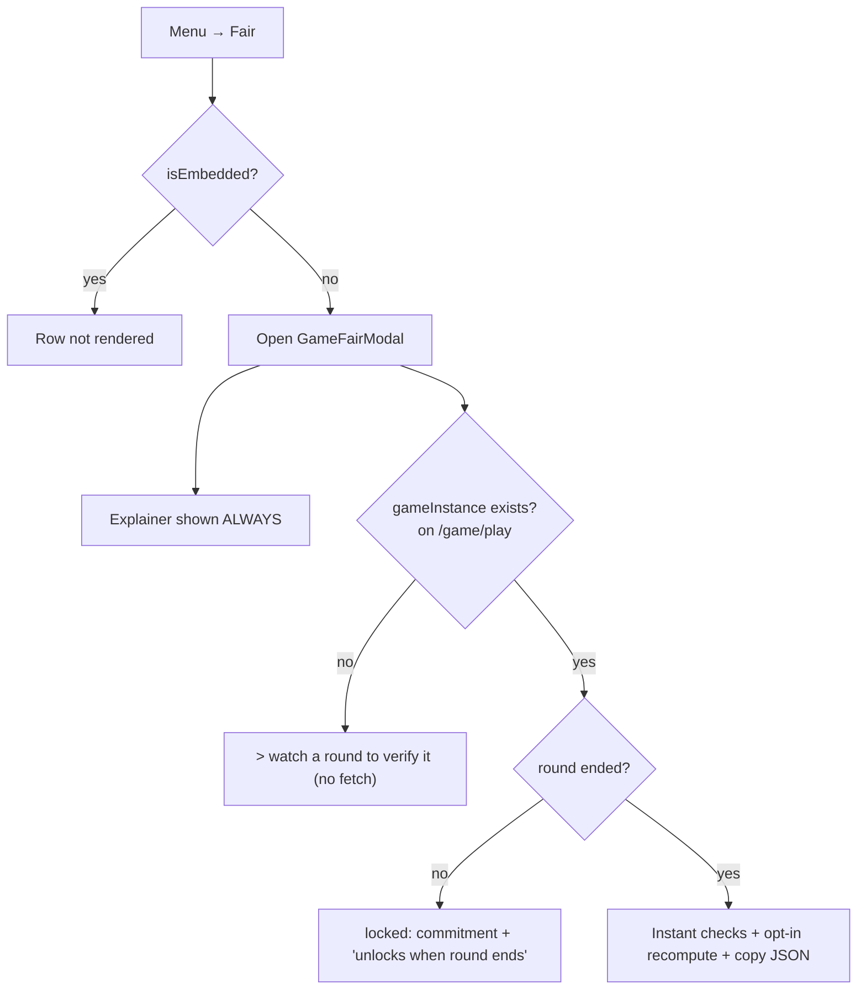

# SpaceStroker — "Fair & Stats to the menu; chat-only side panel" — Implementation Spec

> **Status: Shipped** — merged via `feature/fair-stats-menu` on 2026-07-24. Distilled summary:
> `../features/fair-stats-menu.md`. Refined via Trello card
> [Set "fair" and "stats" as an session on menu icon](https://trello.com/c/w9jCXK0N/89-set-fair-and-stats-as-an-session-on-menu-icon) (2026-07-24).
> Repos affected: `monkify-backend`, `monkify-front`, and this doc in `monkify-meta`.
>
> **Purpose:** Give the **Stats** and **Fair** surfaces first-class homes reachable from the header
> menu, freeing the right-docked side panel to be **chat only**. Stats becomes a dedicated page with
> a **global** section (new) plus the existing **per-game-type** stats; Fair becomes a full-screen
> **modal + overlay** that also teaches players *how to verify a game*. The only new backend surface
> is a global-stats endpoint; everything else is a frontend reorganization of shipped features.

---

## 1. Summary

Today three lazily-loaded tabs live inside one right-docked arcade-cabinet on `/space-stroker/game/play`
(`GameSidePanel` → **CHAT · STATS · FAIR**). This feature pulls STATS and FAIR **out** of that panel:

| Surface | Today | After this feature |
| --- | --- | --- |
| **Chat** | Tab in `GameSidePanel` | The **only** content of `GameSidePanel` (cabinet chrome kept, tab bar removed) |
| **Stats** | `GameStatsPanel` tab (per-type, current game) | Dedicated **Stats page** (`/space-stroker/game/stats`) — a new **global** section + the existing per-type stats behind a game-type **dropdown** |
| **Fair** | `GameFairPanel` tab (current round) | Full-screen **modal + overlay** opened from the header menu — a *how-to-verify* explainer (always) + the existing current-round checks (contextual) |
| **Menu** | Settings · History | Settings · **Stats** · **Fair** · History (Stats/Fair **hidden when embedded**) |

Backend adds exactly one read: `GET /games/stats` → operator-scoped, single-currency **global**
aggregates (on-demand + Redis cached, **no new entity/migration**), mirroring the shipped
`GameStatsService`. Per-game stats (`GET /games/{parametersId}/stats`) and verification
(`GET /games/{id}/verification`) are reused **unchanged**.

---

## 2. Constraints (MANDATORY)

From `monkify-meta/constraints.md` (full list there):

- **Branch/worktree-per-repo:** `feature/fair-stats-menu` in each affected repo; work lives in
  `.worktrees/fair-stats-menu/<repo>`; hub stays on `main`.
- **New feature → mandatory integration test:** `SpaceStroker.Tests.Integration` (Testcontainers) must
  contain a happy-path test that drives `GET /games/stats` end to end and asserts the aggregates
  (AGENTS.md rule 8). Plus unit tests in `SpaceStroker.Tests`; **report changed/added tests** at the end.
- **EF mapping:** inline in `SpaceStrokerDbContext.OnModelCreating` — **N/A here (no schema change)**.
- **Migrations:** **none** — global stats are computed on-demand from existing rows.
- **Secrets/config:** mock-only values in any committed config.
- **Operator messaging:** vague errors only; never reveal existence/contract status. The global read
  **never leaks** — an operator with no active types resolves to zeroed/empty stats (mirrors
  `GetActiveParameters` returning `[]`), never an existence-revealing error.
- **Stateless API owns it:** the endpoint is a read on `SpaceStroker.Api`; no Consumers/typer change.

---

## 3. Resolved product decisions

| # | Decision |
| --- | --- |
| 1 | **Menu placement.** `Stats` and `Fair` become rows in the existing `GameHeader` menu (final order **Settings · Stats · Fair · History**). Audio + wallet cluster stay on the header bar. |
| 2 | **Embed.** Neither `Stats` nor `Fair` appears when embedded (`useEmbed().isEmbedded`), preserving the shipped "no in-frame fairness panel" rule. `Settings`/`History` are unchanged. |
| 3 | **Fair is reachable everywhere (not embed); it only *verifies* on `/game`.** The modal always renders the *how-to-verify* explainer. The live current-round checks populate only when a game instance exists (`useGame().gameInstance`, i.e. on `/game/play`) and the round has ended; off-game it shows the explainer + a "watch a round to verify it" empty state and fetches nothing. Locked-until-ended and no-bets states are unchanged. |
| 4 | **Side panel = chat only.** `GameSidePanel` keeps its arcade-cabinet chrome (collapse/dock-rail/maximize) but drops the tab bar and the STATS/FAIR bodies. |
| 5 | **Mobile.** The `GAME | CHAT·STATS` segmented control becomes **`GAME | CHAT`**; the mobile side panel is chat-only; Stats page and Fair modal are reached from the mobile header menu. |
| 6 | **Stats page — per-game section.** Reuses `GET /games/{parametersId}/stats` with a game-type **dropdown** (defaults to the first active type), exactly like `GameHistoryPage`. Existing tiles + house-cut badge unchanged. |
| 7 | **Stats page — global section (new).** Operator-scoped, **single-currency = the operator's dominant currency** (PaymentMethod + token). For the production **Main** operator that dominant currency **is** the SolanaToken (**USDC**) — the product intent ("only care about our crypto token right now, which will be actual USDC"). The logic is currency-agnostic (an all-`Standard` operator gets its USD), which keeps it testable. Only `RewardForWinnersCompleted` rounds count for money; free bets (`Amount == 0`) are excluded from money but counted in participation counts. |
| 8 | **Global scope = the operator's *active* game types of the dominant currency.** Deactivated/recreated types drop out of the global aggregate — consistent with the per-type "recreation resets stats" behavior and keeping currency resolution unambiguous. |
| 9 | **Global tiles.** Today's headline tiles aggregated across types (**biggest pot**, **biggest single payout**, **total paid out**, **rounds played**, **house-cut** badge) **plus six new tiles**: total volume wagered, unique players, total bets placed, winners paid, biggest win multiplier, most-played game type. No cross-type "hottest choice" (kept per-game only). |
| 10 | **No new entity/migration.** Global stats aggregate existing `Game`/`GameBets`/`TransactionLogs` rows on demand; Redis-cached per operator (120 s, mirrors per-type). |

---

## 4. Data model

**No schema change. No migration. No new entity.** Global stats are computed on-demand from existing
tables:

- `Games` (`ParametersId`, `Status`, `CreatedDate`) — completed rounds (`RewardForWinnersCompleted`).
- `GameBets` (`GameId`, `OperatorPlayerId`, `Choice`, `Amount`, `Id`) — pot, volume, participation, players.
- `TransactionLogs` (`Type == Credit`, `BetId`, `Amount`) — payouts, winners, multipliers.
- `GameParameters` (`OperatorId`, `Active`, `PaymentMethod`, `OperatorTokenId`, `Name`,
  `LotteryParameters.LotteryPot`) + `OperatorToken` (`Label`, `Decimals`) — the operator's active
  type set, currency descriptor, and per-type lottery base.

These are the exact rows `GameStatsService` already reads for per-type stats (§ shipped
`game-type-stats`), so the aggregation code is a direct generalization from one type to a set of types.

---

## 5. Configuration

None. No new `GeneralSettings`, env var, or seed. The house-cut percentage shown on the global badge
reuses `GeneralSettings.Token.CommissionPercentage` (the same value the per-type panel already shows
for SolanaToken types).

---

## 6. Backend behaviour (`monkify-backend`)

### 6.1 New endpoint — `GET /games/stats`

`GamesController` (`[Route("games")]`) gains an action **before** the `{gameTypeId}` action:

```csharp
/// <summary>
/// All-time GLOBAL stats for the caller's operator, aggregated across the operator's active game
/// types that share its dominant currency (single-currency; no cross-currency summing). On-demand +
/// Redis cached. Operator-scoped via the launch token; never leaks operator existence/contract state.
/// </summary>
[HttpGet("stats")]
public async Task<IActionResult> GetGlobalStats()
    => await ProcessRequest(new GetGlobalStatsRequest(_launchContext.OperatorId));
```

**Routing guard.** `stats` is a literal segment and ASP.NET ranks literals above route parameters, so
`GET /games/stats` already binds here rather than to `[HttpGet("{gameTypeId}")]`. To make it
unambiguous defensively, **add a `:guid` constraint** to the single-segment id route:

```csharp
[HttpGet("{gameTypeId:guid}")]                 // was "{gameTypeId}"
public async Task<IActionResult> GetActiveGameForParameter(Guid gameTypeId) ...
```

(The two-segment routes `{parametersId}/stats`, `{parametersId}/history`, `{id}/verification` cannot
collide with the single-segment `stats`; leaving them as-is is fine, though adding `:guid` there too
is harmless and encouraged for consistency.)

### 6.2 Request + handler

`SpaceStroker.Infrastructure/Handlers/Games/GetGlobalStats/`:

```csharp
// GetGlobalStatsRequest.cs
public record GetGlobalStatsRequest(Guid OperatorId) : IRequest<GlobalStatsDto>;
```

```csharp
// GetGlobalStatsHandler.cs  (mirrors GetGameTypeStatsHandler)
public override async Task<GlobalStatsDto> HandleRequest(GetGlobalStatsRequest request, CancellationToken ct)
{
    // Operator's ACTIVE, contract-checked types (already filters expired/unknown to an empty set —
    // no existence leak, exactly like GetActiveParameters).
    var active = await _gameService.GetAllActiveGameParameters(request.OperatorId);

    // Dominant-currency group: the (PaymentMethod, OperatorTokenId) with the most active types.
    // Deterministic tiebreak so a fixed set always resolves the same currency. In prod (Main) there
    // is exactly one group. Empty operator → GlobalStats.Empty → zeroed DTO ("No rounds yet").
    var stats = await _statsService.GetGlobalStats(active.Values);
    return GlobalStatsDto.From(stats);
}
```

No vague-error throw is needed: an unknown/expired/cross-operator caller collapses to an empty active
set → zeroed stats. (Cross-operator is unreachable anyway — `OperatorId` comes from the caller's own
validated token.)

### 6.3 `IGlobalStatsService` / `GlobalStatsService`

`SpaceStroker.Infrastructure/Services/Games/GlobalStatsService.cs` (+ `IGlobalStatsService`), modeled on
`GameStatsService`:

```csharp
public async Task<GlobalStats> GetGlobalStats(IEnumerable<GameParameters> operatorActiveTypes)
{
    var types = operatorActiveTypes?.ToList() ?? new();
    if (types.Count == 0) return GlobalStats.Empty;

    // Dominant currency group (single-currency invariant): group by (PaymentMethod, OperatorTokenId),
    // pick the largest group; deterministic tiebreak by PaymentMethod then OperatorTokenId. Only this
    // group's types are aggregated; the group's OperatorToken is the currency descriptor.
    var group = types
        .GroupBy(t => new { t.PaymentMethod, t.OperatorTokenId })
        .OrderByDescending(g => g.Count()).ThenBy(g => (int)g.Key.PaymentMethod).ThenBy(g => g.Key.OperatorTokenId)
        .First();
    var groupTypes = group.ToList();
    var typeIds = groupTypes.Select(t => t.Id).ToList();
    var currencyType = groupTypes[0];                          // PaymentMethod + OperatorToken descriptor
    var lotteryBaseByType = groupTypes.ToDictionary(t => t.Id, t => t.LotteryParameters?.LotteryPot ?? 0m);

    var cacheSettings = CacheHelper.GenerateGlobalStatsCacheSettings(currencyType.OperatorId);
    if (_cache.TryGet<GlobalStats>(cacheSettings, out var cached) && cached != null) return cached;

    // Completed reward rounds of the group's types (round → its type, for pot's lottery base).
    var completed = await _context.Games
        .Where(g => typeIds.Contains(g.ParametersId) && g.Status == GameStatus.RewardForWinnersCompleted)
        .Select(g => new { g.Id, g.ParametersId })
        .ToListAsync();

    var result = new GlobalStats { CurrencyType = currencyType, RoundsPlayed = completed.Count };
    if (completed.Count == 0) { _cache.Set(cacheSettings, result); return result; }

    var completedIds = completed.Select(x => x.Id).ToList();

    // ALL bets of completed rounds → participation counts (free bets included).
    var allBets = await _context.GameBets
        .Where(b => completedIds.Contains(b.GameId))
        .Select(b => new { b.Id, b.GameId, b.OperatorPlayerId, b.Amount })
        .ToListAsync();
    result.TotalBetsPlaced   = allBets.Count;
    result.UniquePlayers     = allBets.Select(b => b.OperatorPlayerId).Distinct().Count();

    // PAID bets → money (free bets excluded).
    var paid = allBets.Where(b => b.Amount > 0m).ToList();
    result.TotalVolumeWagered = paid.Sum(b => b.Amount);
    result.BiggestPot = completed
        .Select(c => paid.Where(b => b.GameId == c.Id).Sum(b => b.Amount) + lotteryBaseByType[c.ParametersId])
        .DefaultIfEmpty(0m).Max();

    // Credit ledger of completed rounds' bets → payouts / winners / biggest multiplier.
    var creditByBet = await _context.TransactionLogs
        .Where(t => t.Type == TransactionLogType.Credit && completedBetIds.Contains(t.BetId))   // completedBetIds = allBets.Select(b => b.Id)
        .GroupBy(t => t.BetId).Select(g => new { BetId = g.Key, Sum = g.Sum(x => x.Amount) })
        .ToListAsync();
    result.TotalPaidOut        = creditByBet.Sum(c => c.Sum);
    result.BiggestSinglePayout = creditByBet.Count == 0 ? 0m : creditByBet.Max(c => c.Sum);
    result.WinnersPaid         = creditByBet.Count;                          // # of winning bets
    // Biggest single-bet multiplier (payout ÷ stake), paid bets only.
    var stakeByBet = paid.ToDictionary(b => b.Id, b => b.Amount);
    result.BiggestWinMultiplier = creditByBet
        .Where(c => stakeByBet.ContainsKey(c.BetId) && stakeByBet[c.BetId] > 0m)
        .Select(c => c.Sum / stakeByBet[c.BetId]).DefaultIfEmpty(0m).Max();

    // Most-played type (by completed rounds) → name + count.
    var top = completed.GroupBy(c => c.ParametersId)
        .Select(g => new { Id = g.Key, Count = g.Count() }).OrderByDescending(x => x.Count).First();
    result.MostPlayedTypeName   = groupTypes.First(t => t.Id == top.Id).Name;
    result.MostPlayedTypeRounds = top.Count;

    _cache.Set(cacheSettings, result);
    return result;
}
```

> Notes: the code above is the intended shape, not copy-paste — `completedBetIds` is
> `allBets.Select(b => b.Id).ToList()`; keep the credit query server-side (grouped) as shown. This is a
> faithful generalization of `GameStatsService`; reuse its idioms (`AsNoTracking` not needed on read-only
> aggregates that don't `ToList` entities, `DefaultIfEmpty(0m).Max()` guards, decimal math).

### 6.4 DTO

`SpaceStroker.Infrastructure/Contracts/Games/GlobalStatsDto.cs`:

```csharp
public class GlobalStatsDto
{
    // Money (dominant currency).
    public decimal BiggestPot { get; set; }
    public decimal BiggestSinglePayout { get; set; }
    public decimal TotalPaidOut { get; set; }
    public decimal TotalVolumeWagered { get; set; }
    public decimal BiggestWinMultiplier { get; set; }
    // Activity.
    public long RoundsPlayed { get; set; }
    public long TotalBetsPlaced { get; set; }   // free bets included
    public long UniquePlayers { get; set; }
    public long WinnersPaid { get; set; }
    public string? MostPlayedTypeName { get; set; }
    public long MostPlayedTypeRounds { get; set; }
    // Currency descriptor + house cut (mirrors GameTypeStatsDto so the client formats amounts).
    public PaymentMethod PaymentMethod { get; set; }
    public string? TokenSymbol { get; set; }     // OperatorToken.Label — SolanaToken only
    public int? TokenDecimals { get; set; }       // OperatorToken.Decimals — SolanaToken only
    public decimal CommissionPercentage { get; set; }   // GeneralSettings.Token.CommissionPercentage for SolanaToken; 0 for Standard

    public static GlobalStatsDto From(GlobalStats s) => new() { /* map; CurrencyType null → zeroed + PaymentMethod default */ };
}
```

`GlobalStats` (service result model, plain class with `CurrencyType : GameParameters?` and a static
`Empty`) lives beside `GameTypeStats`. `From` takes the commission from settings (inject
`GeneralSettings` into the DTO mapping via the handler, as `GetActiveParametersHandler` already does
with `_settings.Token.CommissionPercentage`).

### 6.5 Cache

`CacheHelper` gains:

```csharp
// Operator-wide global stats. Same short TTL rationale as per-type stats (on-demand, not a fan-out).
public static CacheSettings GenerateGlobalStatsCacheSettings(Guid operatorId)
    => new($"GlobalStats:{operatorId}", TimeSpan.FromSeconds(120));
```

### 6.6 DI registration

Register `IGlobalStatsService → GlobalStatsService` where `IGameStatsService` is registered (search
the Infrastructure DI module for `GameStatsService`). MediatR auto-discovers the new handler.

---

## 7. Frontend behaviour (`monkify-front`)

### 7.1 Header menu + Fair modal — `src/components/GameHeader.vue`

- Import `useEmbed`; add `const { isEmbedded } = useEmbed()` and `const isFairOpen = ref(false)`.
- In the menu dropdown, **after `Settings` and before `History`**, add two rows **wrapped in
  `v-if="!isEmbedded"`**:
  - **Stats** → `<RouterLink :to="{ name: 'GameStats' }" @click="menuOpen = false">`.
  - **Fair** → `<button @click="() => { isFairOpen = true; menuOpen = false }">`.
- Mount the modal next to `PlayerCustomizationModal`:
  `<GameFairModal v-if="!isEmbedded" :open="isFairOpen" @close="isFairOpen = false" />`.
- Copy the existing menu-row classes verbatim (`flex w-full items-center gap-2 rounded-sm px-3 py-2
  vt323-regular text-[16px] text-terminal-light hover:bg-primary/10 hover:text-primary`).

### 7.2 Fair modal — new `src/components/game/GameFairModal.vue`

- Full-screen fixed overlay (`fixed inset-0 z-[60]` backdrop + centered panel; match
  `PlayerCustomizationModal`'s overlay pattern) with a close button and backdrop click-to-close.
- **Body top: "How to verify a game" explainer** (always shown) — a short arcade-styled section:
  commit-reveal (`serverSeedHash` committed on the first bet, `serverSeed` revealed after the round
  ends), HMAC-SHA256 keystream RNG, your client seed + `Bet.Nonce`, and the 4-step offline
  `verify.html` flow. Reuse the copy already in `GameFairPanel`'s "Verify offline" block.
- **Body bottom: live current-round verification** — render the existing `<GameFairPanel :active="open" />`
  **unchanged** (it already keys off `useGame().gameInstance`: locked-until-ended, no-bets, instant
  checks, opt-in Web-Worker recompute, COPY JSON, retention). `active = props.open` drives its lazy
  fetch.
- **Off-`/game` empty state:** add to `GameFairPanel` a computed `hasLiveGame = computed(() => !!liveGameId.value)`
  and, when `false`, render a single line "&gt; watch a round to verify it" instead of the
  locked-commitment block (guard the `loadCommitment`/`loadVerification` watchers with
  `liveGameId.value` — they already early-return on a null id, so no fetch fires). Everything else in
  the panel is unchanged.

### 7.3 Side panel → chat only — `src/components/game/GameSidePanel.vue`

- Remove imports/usages of `GameStatsPanel` and `GameFairPanel`; remove `useEmbed` gating of the FAIR
  tab; remove `activeTab`, `openTab`, and the FAIR `watch`.
- **Desktop cabinet:** drop the tab strip's STATS/FAIR buttons and the dock-rail STATS/FAIR buttons;
  the remaining CHAT can render as a single static label (or drop the strip and keep just the
  maximize/collapse controls). Keep collapse/dock-rail/maximize and the cabinet chrome. Render only
  `<game-chat-panel :maximized="isMaximized" :visible="true" />`.
- **Mobile variant (`mobile` prop):** drop the CHAT|STATS sub-tabs; render only
  `<game-chat-panel :maximized="true" :visible="visible" />`.
- Keep the collapsed dock rail (single CHAT label expands the cabinet).

### 7.4 Mobile segmented control — `src/components/game/GameMobileTabs.vue`

- Relabel the second segment **`CHAT·STATS` → `CHAT`** (the `modelValue` values `'game' | 'chat'`
  and the unread dot are unchanged).

### 7.5 Game page — `src/pages/GamePage.vue`

- Update the stale comments referencing "CHAT·STATS"/stats lazy-fetch (now chat-only). No structural
  change; the mobile `<game-side-panel mobile :visible="mobileTab === 'chat'">` mount stays.

### 7.6 Stats page — new `src/pages/GameStatsPage.vue`

- Arcade-panel page mirroring `GameHistoryPage.vue` (`arcade-panel`, `max-w-5xl`, headings).
- **Global section (top):** on mount, `mainService.getGlobalStats()` → render tiles. Money via
  `useDisplayCurrency().formatGameAmount(descriptor, amount)` where `descriptor = { paymentMethod,
  tokenSymbol, tokenDecimals }` from the response (token-native / display-currency exactly like the
  per-type panel). House-cut badge reuses the `GameStatsPanel` badge logic
  (`commissionPercentage` → "0% HOUSE CUT" / "{n}% HOUSE CUT" + blurb). Tiles:
  biggest pot · biggest single payout · total paid out · total volume wagered · rounds played ·
  total bets placed · unique players · winners paid · biggest win multiplier (`×{n}`) ·
  most-played type (name + rounds). Empty (`roundsPlayed === 0`) → "No rounds yet".
- **Per-game section (below):** a game-type **dropdown** (from `mainService.getGamesTypes()`,
  default first) → `mainService.getGameTypeStats(id)`; render the same tiles as `GameStatsPanel`
  (extract the tile markup into a small shared child, or inline — reuse is preferred). A request-
  sequence guard like `GameHistoryPage` prevents stale dropdown responses.
- Lives inside the app shell (header + background from `App.vue`).

### 7.7 Service + types

- `src/services/mainService.ts`: add
  ```ts
  const getGlobalStats = async () => {
    const { data } = await mainAPI.get<DefaultResponse<GlobalStats>>('/games/stats');
    return data;
  };
  ```
  and export it.
- `src/types/index.ts`: add `GlobalStats` mirroring `GameTypeStats` + the six new fields
  (`totalVolumeWagered`, `totalBetsPlaced`, `uniquePlayers`, `winnersPaid`, `biggestWinMultiplier`,
  `mostPlayedTypeName`, `mostPlayedTypeRounds`) + `commissionPercentage` + the currency descriptor
  (`paymentMethod`, `tokenSymbol?`, `tokenDecimals?`).

### 7.8 Routing + boot

- `src/routes.ts`: add `{ name: 'GameStats', path: '/space-stroker/game/stats', component:
  require('@/pages/GameStatsPage.vue').default }`.
- `src/App.vue`: include `'GameStats'` in the two route-name guards that boot operator context (the
  `onMounted` `loadOperator` block and the `watch` for prefs) alongside `GameLobby | Game | GameHistory`.

---

## 8. Flow diagram — Fair menu item across contexts



---

## 9. Out of scope

- No change to chat behavior/persistence/identity/limits.
- No change to the provably-fair algorithm, `GET /games/{id}/verification`, or `public/verify.html`.
- No cross-currency normalization / token→USD FX. Global is single-currency (operator's dominant currency).
- No per-round "stats" (that is the Games History page); no cross-type "hottest choice".
- No new entity/table/migration; no Consumers/typer change.
- Deactivated/recreated game types are not back-filled into the global aggregate (decision #8).

---

## 10. File checklist

### 10.1 Backend (`monkify-backend`)

| # | File | Change |
| --- | --- | --- |
| 1 | `src/SpaceStroker.Api/Controllers/GamesController.cs` | Add `[HttpGet("stats")] GetGlobalStats` (before `{gameTypeId}`); add `:guid` to `[HttpGet("{gameTypeId:guid}")]` |
| 2 | `src/SpaceStroker.Infrastructure/Handlers/Games/GetGlobalStats/GetGlobalStatsRequest.cs` | New request record `(Guid OperatorId)` |
| 3 | `src/SpaceStroker.Infrastructure/Handlers/Games/GetGlobalStats/GetGlobalStatsHandler.cs` | New handler: active types → dominant-currency group → service → DTO; inject `GeneralSettings` for commission |
| 4 | `src/SpaceStroker.Infrastructure/Services/Games/IGlobalStatsService.cs` | New interface `Task<GlobalStats> GetGlobalStats(IEnumerable<GameParameters>)` |
| 5 | `src/SpaceStroker.Infrastructure/Services/Games/GlobalStatsService.cs` | New service (aggregation per §6.3); add `GlobalStats` result model (beside `GameTypeStats`) |
| 6 | `src/SpaceStroker.Infrastructure/Contracts/Games/GlobalStatsDto.cs` | New DTO + `From(GlobalStats, commissionPct)` |
| 7 | `src/SpaceStroker.Infrastructure/Services/Cache/CacheHelper.cs` | Add `GenerateGlobalStatsCacheSettings(operatorId)` (120 s) |
| 8 | Infrastructure DI module (where `GameStatsService` is registered) | Register `IGlobalStatsService → GlobalStatsService` |

### 10.2 Frontend (`monkify-front`)

| # | File | Change |
| --- | --- | --- |
| 1 | `src/components/GameHeader.vue` | Add Stats + Fair menu rows (`v-if="!isEmbedded"`); mount `GameFairModal` |
| 2 | `src/components/game/GameFairModal.vue` | **New** — overlay + explainer + reused `<GameFairPanel :active="open"/>` |
| 3 | `src/components/game/GameFairPanel.vue` | Add off-game empty state (`hasLiveGame`); no behavior change on `/game` |
| 4 | `src/components/game/GameSidePanel.vue` | Remove STATS/FAIR tabs + bodies (desktop cabinet, dock rail, mobile sub-tabs); chat-only; keep chrome |
| 5 | `src/components/game/GameMobileTabs.vue` | Relabel `CHAT·STATS` → `CHAT` |
| 6 | `src/pages/GamePage.vue` | Comment updates (chat-only mobile panel) |
| 7 | `src/pages/GameStatsPage.vue` | **New** — global section + per-game dropdown section |
| 8 | `src/services/mainService.ts` | Add `getGlobalStats()` → `GET /games/stats` |
| 9 | `src/types/index.ts` | Add `GlobalStats` type |
| 10 | `src/routes.ts` | Add `GameStats` route `/space-stroker/game/stats` |
| 11 | `src/App.vue` | Boot operator context for `GameStats` route (both guards) |

> Optional cleanup: if the STATS tile markup is extracted from `GameStatsPanel` into a shared
> presentational child used by both `GameStatsPage` (per-game) and (via a light wrapper) the removed
> panel, prefer that over duplicating tile markup. `GameStatsPanel.vue` itself is no longer mounted
> after this change — remove it, or keep it only if reused by the extraction.

### 10.3 Meta (`monkify-meta`)

| # | File | Change |
| --- | --- | --- |
| 1 | `specs/fair-stats-menu.md` | This spec |
| 2 | `INDEX.md` | New spec row (Ready) + "Feature currently in flight" |

---

## 11. Unit tests

Project: `monkify-backend/src/SpaceStroker.Tests`.

| Test file | Test cases | Expected |
| --- | --- | --- |
| `UnitTests/Services/GlobalStatsServiceTests.cs` (new) | Operator with 2 active same-currency types, several `RewardForWinnersCompleted` rounds with paid + free bets and `Credit` logs | `RoundsPlayed`, `TotalBetsPlaced` (incl free), `UniquePlayers`, `TotalVolumeWagered` (paid only), `BiggestPot` (max round Σpaid + lottery base), `TotalPaidOut`/`BiggestSinglePayout` (Σ/max Credit), `WinnersPaid` (# credited bets), `BiggestWinMultiplier` (max payout÷stake), `MostPlayedTypeName/Rounds` all correct |
| " | Only free-bet completed round | Round counted, money all 0, `WinnersPaid`/multiplier 0 |
| " | Empty type set / no completed rounds | `GlobalStats.Empty` / zeroed; `CurrencyType` null → DTO `PaymentMethod` default |
| " | Mixed-currency operator (Standard + SolanaToken types) | Only the **dominant** (larger) currency group aggregated; descriptor is that group's currency |
| `UnitTests/Handlers/GetGlobalStatsHandlerTests.cs` (new) | Active types present | Returns mapped DTO with currency descriptor + commission from settings |
| " | `GetAllActiveGameParameters` returns empty (expired/unknown operator) | Zeroed DTO, **no throw / no leak** |
| `UnitTests/Contracts/GlobalStatsDtoTests.cs` (optional) | `From` mapping incl. null `CurrencyType` | Fields map; SolanaToken carries symbol/decimals, Standard nulls |

Run the full `SpaceStroker.Tests` suite; **report changed/added tests** at the end of implementation.

### Integration (mandatory — AGENTS.md rule 8)

`monkify-backend/src/SpaceStroker.Tests.Integration/GlobalStatsFlowTests.cs` (new), following
`GameStatsFlowTests`:

- **Isolation:** global stats aggregate across *all* of an operator's types, so seed a **dedicated
  operator** (its own `Operator` with an active contract + `LaunchPublicKey =
  settings.LaunchTokens.DevOperatorPublicKeyPem`) with a **single dedicated `Standard` preset type**,
  so the aggregate is deterministic under the shared once-per-suite fixture. (Mirror
  `EnsureOperatorAsync`/`SeedDedicatedPresetTypeAsync`; add a small public fixture helper
  `SeedIsolatedOperatorAsync(name)` if convenient — test-harness code only.) A `Standard` type keeps
  the payout path deterministic (like `GameStatsFlowTests`); crypto settlement is already covered
  elsewhere and the aggregation is currency-agnostic.
- **Drive:** seed one WaitingBets game, place paid bets across ≥2 players (a clear single winner so
  the multiplier/winner asserts are deterministic; one free bet to prove free-vs-paid handling),
  `WaitForStatusAsync(RewardForWinnersCompleted)`.
- **Assert `GET /games/stats`** (token for the dedicated operator): `RoundsPlayed == 1`,
  `TotalVolumeWagered == Σ paid stakes`, `BiggestPot == that pot`, `TotalBetsPlaced ==` all bets incl
  free, `UniquePlayers ==` distinct bettors, `WinnersPaid >= 1`, `TotalPaidOut >= pot` (use `>=` per
  the documented multi-winner idempotency caveat), `BiggestWinMultiplier > 0`,
  `MostPlayedTypeName ==` the seeded type, `PaymentMethod == Standard`, `TokenSymbol == null`.

Run via `scripts/run_integration_tests.bat` (Docker required).

---

## 12. Acceptance criteria

Mapped from the Trello **Acceptance Criteria** checklist. AC10 is refined here: the accurate,
code-consistent behavior for the param-free global read is **zeroed/empty (non-leaking)**, not a
thrown error (mirrors `GetActiveParameters` returning `[]`); it still never reveals existence/contract
status.

1. Given a player with operator context on any non-embedded page, when they open the header menu, then it lists **Settings, Stats, Fair, History**, while audio and wallet remain on the header bar.
2. Given the game is embedded in a regulated iframe, when the player opens the header menu, then **neither Stats nor Fair** appears and the menu keeps only its current embedded contents.
3. Given a player on `/game/play`, when they view the right-docked side panel, then it shows **only chat** (no CHAT/STATS/FAIR tab bar) while keeping the arcade-cabinet collapse/dock-rail/maximize chrome.
4. Given a mobile player on `/game/play`, when they use the segmented control, then it offers only **GAME | CHAT**, and Stats and Fair are reached from the mobile header menu.
5. Given a player selects **Stats**, when the page opens, then it renders a **global** section and a **per-game** section whose game-type dropdown defaults to the first active type.
6. Given the per-game section with a type selected, when it loads, then it calls `GET /games/{parametersId}/stats` and renders the existing tiles (biggest pot, biggest single payout, rounds played, total paid out, hottest choice for preset types, house-cut badge).
7. Given an operator with completed reward rounds, when the global section loads, then it calls `GET /games/stats` and shows the token-denominated tiles: **total volume wagered, unique players, total bets placed, winners paid, biggest win multiplier, most-played game type**, plus today's headline tiles aggregated across types.
8. Given free bets and non-completed rounds exist, when global money stats are computed, then only `RewardForWinnersCompleted` rounds in the operator's dominant currency count toward money and free bets (`Amount == 0`) are excluded from money aggregates while still counting in participation counts.
9. Given an operator with zero completed reward rounds, when the global section loads, then it shows a zeroed / "No rounds yet" empty state and no error.
10. Given a cross-operator, expired, unknown, or deactivated operator context, when `GET /games/stats` is called, then it returns **zeroed/empty** global stats and never reveals existence or contract status.
11. Given a player selects **Fair**, when the modal opens, then it is a full-screen modal with overlay that **always** shows the "how to verify a game" explainer.
12. Given the player is on `/game/play` and the current round has ended, when they open the Fair modal, then the live current-round verification runs (commitment + own-bet-seed instant checks, opt-in recompute, COPY VERIFICATION JSON, offline `verify.html` link), exactly as the former FAIR tab.
13. Given the player is on `/game/play` while the round is still running, when they open the Fair modal, then the verification section is **locked** ("unlocks when this round ends") and only the committed `serverSeedHash` plus the explainer are shown.
14. Given the player opens the Fair modal off `/game/play` (no active round), when the modal renders, then it shows the explainer plus a **"watch a round to verify it"** empty state and performs no verification fetch.
15. Given a round nobody bet on, when the player opens the Fair modal on `/game/play` after it ends, then it shows **"no bets this round — nothing to verify"** and offers no recompute.
16. Given the global-stats feature is new, when it ships, then `SpaceStroker.Tests.Integration` contains at least one happy-path test that drives `GET /games/stats` end to end and asserts the aggregates are correct.

---

## 13. Manual QA (local Docker stack)

1. Boot the stack (`docker compose up -d --build`) and open `http://localhost:8080` (auto-mints a Main token).
2. Header menu shows **Settings · Stats · Fair · History**. Side panel on `/game/play` is chat-only (cabinet chrome intact).
3. Play a round to completion; open **Fair** → explainer + instant checks + recompute; open Fair from the lobby → explainer + "watch a round to verify it".
4. Open **Stats** → global tiles populate (USDC on the Main crypto operator) + per-game dropdown shows per-type tiles.
5. Resize to mobile (`< lg`): segmented control reads **GAME | CHAT**; Stats/Fair open from the ☰ menu.
6. Console: **0 errors**; `GET /games/stats → 200`.

---

## 14. Trello / pipeline

- **Source card:** [#89](https://trello.com/c/w9jCXK0N/89-set-fair-and-stats-as-an-session-on-menu-icon) — moving to **Specs created**; the **Implementation** section on the card lists branch + spec + worktree.
- **Next:** `/monkify-implement-feature` to build it, then `/monkify-ship-feature` to sync the KB and merge to `main`.

---

## 15. Revision log

| Date | Change |
| --- | --- |
| 2026-07-24 | Initial spec from refined card #89 (grounded in live `SpaceStroker.*` / `monkify-front` code). |
