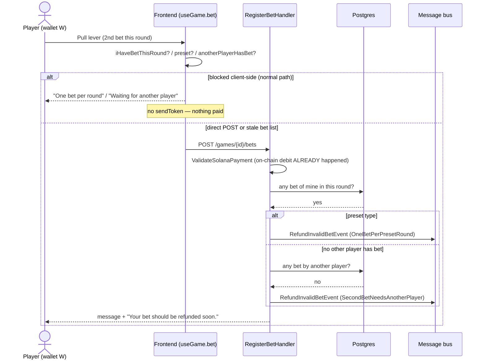

# SpaceStroker — "Fix bets logic" (per-round bet limits) — Implementation Spec

> **Status: SHIPPED** — merged via `feature/fix-bets-logic` on **2026-07-29** (`monkify-backend` +
> `monkify-front` + `monkify-meta`). 540 unit tests green (10 added); integration **81/81** green
> (**0 added** — `Minor change` exemption), with one existing test adapted:
> `OperatorPlayerIdentityTests.CryptoBets_ResolveAndReuse_SameOperatorPlayerByWallet` placed two paid
> bets from one wallet while it was the round's only bettor, which Rule 2 now rejects, so a second
> player's bet was inserted between them. **Implemented as specified**, with one deliberate deviation:
> Rule 2's query is written as the explicit `x.OperatorPlayerId == null || x.OperatorPlayerId != …`
> (§6.2 relied on EF's null-semantics expansion of `!=`) so the in-memory and Npgsql providers agree
> without depending on a translation the `Minor change` exemption leaves untested end to end.
> `Minor change` ⇒ **no `features/fix-bets-logic.md`**; distilled into `features/games.md` §9,
> `features/choice-exclusivity.md`, `features/free-bet-mode.md` and `glossary.md`.
>
> Originally refined via Trello card
> [Fix bets logic (#126)](https://trello.com/c/wF5zmsss) (2026-07-29).
> Repos affected: `monkify-backend`, `monkify-front`, and this doc in `monkify-meta`.
>
> **Purpose:** stop a single player from holding a disproportionate share of one round's choice
> space. Two new per-round limits: (1) a game type with **preset choices** accepts **at most one bet
> per player per round**, and (2) the **only bettor in a round** cannot place a second bet until a bet
> from **another player** exists. Both are enforced in `RegisterBetHandler`, with a pre-payment guard
> in the UI so a crypto player is never charged for a bet the backend will reject.

---

## 1. Summary

Today `RegisterBetHandler.ValidateBetParameters` enforces only two per-round bet rules:

| Rule shipped today | Scope | Where |
| --- | --- | --- |
| **Duplicate bet** — same player + same choice | all types | `ValidateBetParameters`, first block |
| **Choice exclusivity** — a *different* player taking a taken sequence | free-text only (`PresetChoices` empty) | `ValidateBetParameters` + unique index `(GameId, ExclusiveChoice)` |

Neither limits **how many** bets one player holds. Consequences:

- **Beast Mode** (preset, 8 beasts, min 2 players): one wallet can back all 8 choices. The round
  cannot start alone (the start gate counts *distinct* players), but the moment a second player
  joins, that wallet holds 8 of the 9 bets.
- **Any type**: the first bettor of an empty round can stack bets before anyone can compete for the
  remaining sequences.

This spec adds two checks, both **application-level only** (no schema change):

| # | New rule | Applies to | Message |
| --- | --- | --- | --- |
| **1** | One bet per player per round | types with **non-empty** `PresetChoices` (race *or* lottery) | `ErrorMessages.OneBetPerPresetRound` |
| **2** | While you are the **only** bettor, no second bet | **all** types | `ErrorMessages.SecondBetNeedsAnotherPlayer` |

Both apply **only to paid, identified bets**. Rule 1 is strictly stronger than Rule 2, so Rule 2
never fires in a preset type. Blocked bets ride the existing `RefundInvalidBet` path: a paid
`SolanaToken` bet is auto-refunded (the on-chain debit precedes validation), a `Standard` bet is
rejected *before* its wallet debit, a free bet is log-only.

**Before / after, one wallet in one Beast Mode round:**

| | Today | After |
| --- | --- | --- |
| 1st bet on `monkey` | accepted | accepted |
| 2nd bet on `jaguar` | **accepted** | **rejected** (`OneBetPerPresetRound`, refunded if paid crypto) |
| 2nd bet on `monkey` | rejected (`DuplicateBet`) | rejected (`DuplicateBet` — unchanged, checked first) |
| another player's bet on `monkey` | accepted | accepted (unchanged) |

**Before / after, one wallet in an empty Cosmic Sprint round:**

| | Today | After |
| --- | --- | --- |
| 1st bet `abcdef` | accepted | accepted |
| 2nd bet `ghijkl`, still sole bettor | **accepted** | **rejected** (`SecondBetNeedsAnotherPlayer`) |
| 2nd bet `ghijkl`, after player B bet | accepted | accepted |
| 3rd, 4th … bet after player B bet | accepted | accepted (**no rolling cap**) |

---

## 2. Constraints (MANDATORY)

From `monkify-meta/constraints.md` (full list there):

- **Worktree per repo:** work lives in `.worktrees/fix-bets-logic/<repo>`; each hub stays on `main`.
  Branch `feature/fix-bets-logic` in `monkify-backend`, `monkify-front`, `monkify-meta` — all three
  already created and pushed.
- **Unit tests:** update/add in `SpaceStroker.Tests`; run via `scripts/run_tests.bat` (never the full
  `dotnet test` — `ProductionSessions` is a slow Monte Carlo suite); **report changed tests at the end**.
- **Level = `Minor change`** ⇒ **no** mandatory happy-path integration test and **no** new
  `features/fix-bets-logic.md`. Existing KB docs are still corrected at ship (§10.3).
- **EF mapping:** inline in `SpaceStrokerDbContext.OnModelCreating` — **not needed here**, no mapping change.
- **Migrations:** none. This feature adds **no column, no index, no migration** (§4).
- **Secrets/config:** no config change; mock-only values everywhere regardless.
- **Operator messaging:** the two new messages describe the **bet rule only** — they must never
  reveal operator or contract state. The existing vague `GameNotValidForBets` path is untouched.

---

## 3. Resolved product decisions

From the refined card's `## Decisions` block plus the spec-time code findings in §3.1.

| # | Decision |
| --- | --- |
| 1 | **Rule 1 scope = preset types only** — any type whose `PresetChoices` is non-empty, race or lottery. Free-text types are already covered by choice exclusivity; a global 1-bet cap would remove the shipped free-text behaviour of holding several sequences. |
| 2 | **Rule 2 = "a bet from a different player unlocks you"** — not a rolling cap. Once any other player has bet, **no further limit** applies for the rest of the round. |
| 3 | **Rule 2 reach = every game type.** In preset types Rule 1 is stronger and fires first, so Rule 2 is unreachable there. |
| 4 | **Both rules apply to paid, identified bets only.** Gate = `!_isFreeBet && _bet.OperatorPlayerId != null`. **Not** a bare null check — see §3.1 finding A. |
| 5 | **"Per wallet" = per `OperatorPlayer`** — the connected wallet for `SolanaToken` types, the launch-token `sub` for `Standard`. Same identity the prefs handlers and `Bet.OperatorPlayerId` already use. |
| 6 | **Blocked bets reuse `RefundInvalidBet`** — paid `SolanaToken` publishes `RefundInvalidBetEvent` and returns the message + `RefundWarning`; `Standard` is rejected before `DebitStandard`; free bets are log-only (and exempt anyway per #4). |
| 7 | **Every persisted `Bet` row counts, whatever its `Status`.** An admin-refunded bet still consumes your preset slot and still counts as the other player's bet that unlocks someone. Mirrors choice exclusivity, where a refunded bet keeps its choice reserved. |
| 8 | **"Another player's bet" = any row in the round whose `OperatorPlayerId` differs from the bettor's, including `NULL`** (an anonymous free bet by someone else unlocks you). |
| 9 | **Per round.** Both counters are scoped to the current `Game` and reset on rollover. |
| 10 | **Application-level check only** — no DB unique index, no shadow column, no migration. Two simultaneous same-wallet bets can both pass Rule 1; worst case is one extra same-wallet bet, **no money lost**. Knowingly accepted (see §6.4). |
| 11 | **Orbit (#121–#123, not built): no exemption.** An Orbit-funded bet is an ordinary bet by that player and consumes their preset slot; their manual Beast Mode bet that round is rejected. Recorded as a constraint for #122's refinement — its UI must say "Orbit already bet for you this round". |
| 12 | **Frontend blocks before payment**, backend stays authoritative. |

### 3.1 Spec-time code findings (hidden blockers — read before implementing)

**A. A free bet CAN carry an `OperatorPlayerId`, so a bare null check is the wrong gate.**
In `RegisterBetHandler.HandleRequest`, `resolvedExternalId` is taken from the request wallet for
`SolanaToken` games *regardless of amount*, and `monkify-front`'s free-bet branch sends the wallet:

```ts
// monkify-front/src/hooks/useGame.ts — bet(), free-bet branch
if (isFree) {
  await submitBet(gameId, choice, { amount: 0, choice, paymentSignature: '', wallet, seed, nonce }, ...)
}
```

So a free bet on a `SolanaToken` type **does** upsert an `OperatorPlayer` and set
`_bet.OperatorPlayerId`. Gating on `_bet.OperatorPlayerId != null` alone would therefore limit free
bets and make it impossible to fill a round solo in local/dev QA — the exact outcome the card's
exemption exists to prevent. **The gate must be `!_isFreeBet && _bet.OperatorPlayerId != null`.**
This matches `BetPlacedConsumer`, which already counts free bets individually "regardless of any
resolved player identity".

**B. No new index is needed.** `SpaceStrokerDbContext.OnModelCreating` already declares
`builder.HasIndex(x => new { x.GameId, x.OperatorPlayerId, x.Choice })` on `Bet`. Both new queries
filter on `GameId` (+ `OperatorPlayerId`), so they are served by that index's leading columns.
There is also a standalone `HasIndex(x => x.GameId)`. **No migration.**

**C. `RefundInvalidBet` never returns to its caller.** It ends in
`Messaging.ReturnValidationFailureMessage`, which throws `ValidationFailureException`
(`SpaceStroker.Common/Messaging/Messaging.cs`). The new blocks therefore need **no** `return` after
`await RefundInvalidBet(...)`, exactly like the shipped exclusivity block above them.

**D. The frontend already has everything both guards need.** `useGame` exports `currentPlayerId`
(wallet for `SolanaToken`, prefs/`sub` otherwise) and `gameInstance.bets`, whose `AppliedBet` type
carries `externalPlayerId: string | null`. The live `{gameId}/Bets` handler (`onBets`) pushes
`externalPlayerId` onto `gameInstance.bets`, so both guards **re-evaluate reactively** as other
players bet — no polling, no new endpoint, no DTO change.

**E. `GameConsole.placeBet()` already owns a pre-lever exclusivity check** (the
`!isPresetGame && gameInstance.bets.some(...)` block). The two new UI guards belong beside it, in the
same shape, so the lever behaviour stays consistent.

---

## 4. Data model

**No change.** No new entity, property, column, EF mapping, index or migration.

Both rules are read-only queries over the existing `Bet` rows of the current `Game`, served by the
existing `(GameId, OperatorPlayerId, Choice)` index (§3.1 finding B).

---

## 5. Configuration

**No change.** No `GeneralSettings` key, no env var, no seed-data change. The rules are unconditional
for paid identified bets — deliberately **not** behind a feature flag or a per-`GameParameters`
toggle (nothing on the card asks for one, and an admin-visible switch would need a migration and an
admin-portal field).

---

## 6. Backend behaviour

All changes are in one method. Host: **`SpaceStroker.Api`** (bet registration).
**`SpaceStroker.Consumers` is untouched** — a blocked crypto bet's refund rides the shipped
`RefundInvalidBetEvent` → `RefundInvalidBetConsumer` path (`features/refund-safeguards.md`), which
already flips the bet to `Refunded` on success.

### 6.1 Where the checks go

`SpaceStroker.Infrastructure/Handlers/Games/RegisterBet/RegisterBetHandler.cs` →
`ValidateBetParameters(RegisterBetRequest request, Game betGame)`.

Insert the new block **after** the existing per-player duplicate check and **before** the free-text
choice-exclusivity block. Order matters for the message the player sees, and this order is the
correct one:

```
1. duplicate (same player + same choice)      → DuplicateBetError / DuplicateBetRefundedError   [unchanged]
2. NEW Rule 1 (preset, one bet per player)    → OneBetPerPresetRound
3. NEW Rule 2 (sole bettor, no second bet)    → SecondBetNeedsAnotherPlayer
4. choice exclusivity (free-text)             → ChoiceAlreadyTaken                              [unchanged]
5. free-bet allowed / operator / choice valid                                                   [unchanged]
```

Being *inside* `ValidateBetParameters` places both checks **after** `ValidateSolanaPayment` (the
on-chain debit already happened ⇒ refund required) and **before** `RunPreBetCheck` (a blocked bet
never reaches the operator's RG provider) and **before** `DebitStandard` (a `Standard` bet is never
debited for a bet we reject). That is exactly the placement the card requires.

### 6.2 The code

```csharp
// Per-round bet limits (paid, identified bets only). Free bets are exempt even when they resolve an
// OperatorPlayer — in a SolanaToken game the client sends the wallet on a free bet too, and free bets
// are QA-only (BetPlacedConsumer likewise counts them individually). Preset games are capped at one
// bet per player per round; every type blocks a second bet while the bettor is the round's only one.
// Routed through RefundInvalidBet → a paid SolanaToken bet is refunded (it already paid on-chain),
// Standard is rejected before its debit, free is log-only. RefundInvalidBet throws, so no return.
if (!_isFreeBet && _bet.OperatorPlayerId != null)
{
    var iAlreadyBet = await _spacestrokerDbContext.GameBets
        .AnyAsync(x => x.GameId == request.GameId && x.OperatorPlayerId == _bet.OperatorPlayerId);

    if (iAlreadyBet)
    {
        // Rule 1 — preset types: one bet per player per round, whatever the choice.
        var isPresetGame = !(betGame?.Parameters?.PresetChoices).IsNullOrEmpty();
        if (isPresetGame)
            await RefundInvalidBet(ErrorMessages.OneBetPerPresetRound);

        // Rule 2 — any type: while nobody else has bet this round, no second bet. A NULL
        // OperatorPlayerId (anonymous free bet by someone else) counts as another player.
        var anotherPlayerBet = await _spacestrokerDbContext.GameBets
            .AnyAsync(x => x.GameId == request.GameId && x.OperatorPlayerId != _bet.OperatorPlayerId);

        if (!anotherPlayerBet)
            await RefundInvalidBet(ErrorMessages.SecondBetNeedsAnotherPlayer);
    }
}
```

Notes for the implementer:

- **Two separate `AnyAsync` calls, deliberately.** Do **not** "optimise" this into a single
  `GroupBy(x => 1)` projection: the unit tests run on the **in-memory EF provider**, and keeping the
  queries as plain `AnyAsync` predicates keeps behaviour identical across the in-memory and Npgsql
  providers. Both are index-served (§3.1 finding B) and the second one only runs when the first is
  true, so the common path (a player's first bet in a round) costs exactly **one** extra query.
- `IsNullOrEmpty()` is the existing `SpaceStroker.Common.Extensions` helper already used two lines
  below for `ExclusiveChoice` — reuse it rather than writing a new null/count check.
- `x.OperatorPlayerId != _bet.OperatorPlayerId` with a non-null right-hand side translates to
  `"OperatorPlayerId" IS DISTINCT FROM @p` semantics in EF Core/Npgsql, so **NULL rows are included**
  — which is what decision #8 requires. Assert this explicitly in a unit test (§11, case 8) so a
  future EF upgrade cannot silently change it.

### 6.3 New error messages

`SpaceStroker.Common/Resources/ErrorMessages.resx` — add two entries next to `ChoiceAlreadyTaken`,
and the matching properties in `ErrorMessages.Designer.cs` (follow the existing generated shape:
`ResourceManager.GetString("<Name>", resourceCulture)`).

| Key | Value |
| --- | --- |
| `OneBetPerPresetRound` | `You can only place one bet per round in this game. Wait for the next round.` |
| `SecondBetNeedsAnotherPlayer` | `You're the only player so far — wait for another player to bet before placing another one.` |

Both describe the bet rule only — no operator or contract state (`constraints.md` §6). For a paid
`SolanaToken` bet the returned text is `"<message> " + ErrorMessages.RefundWarning`, produced by
`RefundInvalidBet` — the same concatenation the exclusivity tests already assert.

### 6.4 Concurrency (accepted limitation)

Rule 1 is **not** race-proof the way choice exclusivity is. Two simultaneous bets from one wallet can
both observe `iAlreadyBet == false` and both persist, leaving that wallet with two bets in a preset
round. This is accepted (decision #10):

- Each paid `SolanaToken` bet needs its own wallet approval + confirmed SPL transfer, so same-wallet
  submits largely serialise in practice; the frontend also holds `isLoadingBet` / `processing`.
- Rule 2 is **count-based** and cannot be expressed as a unique index at all, so an index would only
  half-solve the problem while costing a migration on a `Minor change`.
- The failure mode is one extra same-wallet bet — **no money is lost or mispaid**; reward math is
  unaffected.

If this ever needs hardening, the shape is known: a nullable shadow column (player id for preset
rounds, `NULL` otherwise) + a unique `(GameId, <column>)` index, mirroring `Bet.ExclusiveChoice`, with
`GameService.InsertBet` mapping the 23505 to a new exception. **Out of scope here.**

---

## 7. Frontend behaviour

Frontend guards are **best-effort UX** — they exist so a `SolanaToken` player is never charged for a
bet the backend will reject. The live bet list can lag; the backend is authoritative.

### 7.1 `src/hooks/useGame.ts` — two computed guards + `bet()` refusals

Add two computeds next to the existing `currentPlayerId` computed, and export both:

```ts
// The player's own bets in this round, and whether anyone else has bet. Both re-evaluate as the live
// {gameId}/Bets stream pushes rows (onBets carries externalPlayerId), so the UI unblocks by itself.
const iHaveBetThisRound = computed(() => {
  const me = currentPlayerId.value;
  if (!me) return false;
  return !!gameInstance.value?.bets?.some((b) => b.externalPlayerId === me);
});

const anotherPlayerHasBet = computed(() => {
  const me = currentPlayerId.value;
  if (!me) return false;
  return !!gameInstance.value?.bets?.some((b) => b.externalPlayerId !== me);
});
```

In `bet()`, extend the existing pre-payment guard block (the one that already refuses a taken
free-text sequence) — **before** `isLoadingBet.value = true` and before any `sendToken` call:

```ts
// Per-round bet limits: refuse before payment so the player never pays for a bet the backend will
// reject. Free bets are exempt (they are exempt server-side too). Best-effort — backend authoritative.
if (!isFree && iHaveBetThisRound.value) {
  if (isPreset) {
    betOutput.value = 'One bet per round in this game.';
    if (onBetFail) onBetFail();
    return;
  }
  if (!anotherPlayerHasBet.value) {
    betOutput.value = 'Waiting for another player before you can bet again.';
    if (onBetFail) onBetFail();
    return;
  }
}
```

`isPreset` and `isFree` are already computed at the top of `bet()`; reuse them, do not re-derive.

Add `iHaveBetThisRound` and `anotherPlayerHasBet` to the object `useGame` returns (beside
`currentPlayerId`, `ownBetChoices`).

**Ownership after a refresh is already solved:** `reseedOwnBetsFromInstance` re-derives own bets from
`gameInstance.bets` via `externalPlayerId`, and a `watch(currentPlayerId, …)` re-runs it once a
`SolanaToken` wallet reconnects. Because the guards read `gameInstance.bets` directly (not
`ownBetChoices`), they are correct from the moment the round is loaded and the identity resolves.

### 7.2 `src/components/game/GameConsole.vue` — lever + button gating

1. Pull the two new computeds from `useGame()` alongside the existing destructure.
2. In `placeBet()`, add a guard beside the existing exclusivity block (same shape, same
   `leverError()` treatment), so the lever refuses to drop:

```ts
// Per-round bet limits — mirror useGame.bet()'s pre-payment refusal so the lever never drops on a bet
// that cannot be placed. useGame.bet() owns the authoritative block + the message.
if (!isFreeBetActive.value && iHaveBetThisRound.value &&
    (isPresetGame.value || !anotherPlayerHasBet.value)) {
  leverError();
  return;
}
```

3. Extend `canPlaceBet` (the mobile bet-button enable computed) with the same condition so the mobile
   PLACE BET button is visibly disabled rather than silently dead:

```ts
const canPlaceBet = computed(() => {
  if (gameInstance.value?.status === GameStatus.RewardForWinnersCompleted) return true;
  if (!allowBets.value) return false;
  if (!isFreeBetActive.value && iHaveBetThisRound.value &&
      (isPresetGame.value || !anotherPlayerHasBet.value)) return false;
  if (isPresetGame.value) return !!userWord.value;
  return true;
});
```

Keep the `RewardForWinnersCompleted` early-return **first** — that state repurposes the button as
"NEXT ROUND" and must never be disabled by a bet limit.

### 7.3 Copy

| Situation | Copy (`betOutput`) |
| --- | --- |
| Preset type, own bet already in this round | `One bet per round in this game.` |
| Any type, own bet exists and nobody else has bet | `Waiting for another player before you can bet again.` |

No new toast, no new component, no i18n file (the app has no translation layer — these sit alongside
the existing literal strings in `useGame.ts`).

### 7.4 Not changed

`src/types/index.ts` (`AppliedBet` already carries `externalPlayerId`), `mainService.ts`, the SignalR
contract, and the `{gameId}/Bets` payload. **No new API call and no new header.**

---

## 8. Flow diagram



---

## 9. Out of scope

- Any DB unique index, shadow column or migration for Rule 1 (explicitly rejected — §6.4).
- A rolling cap on how many free-text sequences a player may hold once another player has bet.
- Changing the start gate (`BetPlacedConsumer` distinct-player counting), the reward math, choice
  exclusivity, or the duplicate-bet path.
- Orbit's own behaviour — only the constraint is recorded (decision #11); #122 owns its UI.
- Any change to free-bet mode beyond exempting free bets from these two rules.
- A per-`GameParameters` admin toggle for either rule (§5).
- Retro-invalidating bets placed before deploy.

---

## 10. File checklist

### 10.1 Backend (`monkify-backend`)

| # | File | Change |
| --- | --- | --- |
| 1 | `src/SpaceStroker.Infrastructure/Handlers/Games/RegisterBet/RegisterBetHandler.cs` | In `ValidateBetParameters`, after the duplicate block and before the exclusivity block, add the paid+identified-gated Rule 1 / Rule 2 checks (§6.2). |
| 2 | `src/SpaceStroker.Common/Resources/ErrorMessages.resx` | Add `OneBetPerPresetRound` and `SecondBetNeedsAnotherPlayer` (§6.3). |
| 3 | `src/SpaceStroker.Common/Resources/ErrorMessages.Designer.cs` | Add the two matching generated properties, following the existing shape. |
| 4 | `src/SpaceStroker.Tests/UnitTests/Handlers/RegisterBetHandlerTests.cs` | Add the 10 cases in §11. |

No entity, DbContext, migration, consumer, controller, DTO or config file changes.

### 10.2 Frontend (`monkify-front`)

| # | File | Change |
| --- | --- | --- |
| 1 | `src/hooks/useGame.ts` | Add `iHaveBetThisRound` + `anotherPlayerHasBet` computeds; extend the `bet()` pre-payment guard; export both (§7.1). |
| 2 | `src/components/game/GameConsole.vue` | Consume both computeds; add the `placeBet()` lever guard; extend `canPlaceBet` (§7.2). |

No type, service, router or env change.

### 10.3 Meta (`monkify-meta`)

| # | File | Change |
| --- | --- | --- |
| 1 | `specs/fix-bets-logic.md` | This spec (new). |
| 2 | `INDEX.md` | Spec row + "Feature currently in flight". |
| 3 | `features/games.md` §9 | **At ship:** add both rules to "Other guards in `RegisterBetHandler`". |
| 4 | `features/choice-exclusivity.md` | **At ship:** note that in preset types a player is now capped at one bet per round, and that free-text same-player multi-sequence betting is now gated by Rule 2 while they are the sole bettor. |

`Minor change` ⇒ **no** `features/fix-bets-logic.md`.

---

## 11. Unit tests

Project: `monkify-backend/src/SpaceStroker.Tests`, file
`UnitTests/Handlers/RegisterBetHandlerTests.cs`. Follow the existing arrange helpers used by the
`ChoiceTakenByAnotherPlayer` tests (seed a game + a prior `Bet` into the in-memory context, then call
`CreateHandler(context).HandleRequest(...)`). Run with `scripts/run_tests.bat`.

| # | Test case | Expected |
| --- | --- | --- |
| 1 | `RegisterBet_PresetGame_SamePlayerDifferentChoice_ShouldRefund` — preset type, `SolanaToken`, my bet on `monkey` exists, I bet `jaguar` | Validation failure `OneBetPerPresetRound + " " + RefundWarning`; `RefundInvalidBetEvent` published; no second bet persisted |
| 2 | `RegisterBet_PresetGame_Standard_SamePlayerDifferentChoice_ShouldRejectWithoutDebit` — same, `Standard` | Validation failure `OneBetPerPresetRound` (no refund warning); **no** `RefundInvalidBetEvent`; payment resolver `Debit` **never called**; nothing persisted |
| 3 | `RegisterBet_PresetGame_DifferentPlayerSameChoice_ShouldSucceed` — player A holds `monkey`, player B bets `monkey` | Succeeds and persists (guards the "Rule 1 is per player, not per choice" invariant) |
| 4 | `RegisterBet_SoleBettor_SecondBet_ShouldRefund` — free-text type, only my bet in the round, I bet a new sequence | Validation failure `SecondBetNeedsAnotherPlayer` (+ `RefundWarning` for `SolanaToken`); refund event published; nothing persisted |
| 5 | `RegisterBet_SecondBet_AfterAnotherPlayerBet_ShouldSucceed` — free-text, my bet + player B's bet exist, I bet a third sequence | Succeeds and persists (no rolling cap) |
| 6 | `RegisterBet_FreeBet_WithResolvedWallet_ShouldBeExemptFromBothRules` — **free** bet (`amount: 0`) on a preset `SolanaToken` type, with a wallet, where I already hold a bet | Succeeds — pins §3.1 finding A so a later refactor to a bare `OperatorPlayerId != null` gate fails loudly |
| 7 | `RegisterBet_PriorBetRefunded_StillConsumesPresetSlot` — my only prior bet has `Status = Refunded` | Still `OneBetPerPresetRound` (decision #7) |
| 8 | `RegisterBet_AnonymousFreeBetByAnother_UnlocksSecondBet` — my bet + one bet with `OperatorPlayerId == null` | My second bet succeeds — pins the `!=` / NULL semantics of decision #8 |
| 9 | `RegisterBet_FreeTextGame_SamePlayerDifferentChoice_NotBlockedByRule1` — free-text, my bet exists, another player has bet, I bet a new sequence | Succeeds (Rule 1 must not leak into free-text types) |
| 10 | `RegisterBet_SamePlayerSameChoice_StillHitsDuplicatePath` — **extend the existing test** to a preset type | `DuplicateBetError` / `DuplicateBetRefundedError`, **not** `OneBetPerPresetRound` — pins the check ordering |

Existing tests expected to still pass unchanged: the whole `ChoiceAlreadyTaken` family, the RG
family, the `Standard` debit family, and `RegisterBet_PresetGame_SameChoiceDifferentPlayer_ShouldSucceedAndNullExclusiveChoice`.

**No integration test** — `Minor change` (`constraints.md` §3). This does not alter game flow: no
status transition, typer, reward or refund-consumer behaviour changes.

---

## 12. Acceptance criteria

Mapped 1:1 from the Trello **Acceptance Criteria** checklist (15 items).

1. Given a preset game type (non-empty `PresetChoices`) where I already have a bet in the current round, when I place a second bet on a **different** preset choice, then the bet is rejected with `ErrorMessages.OneBetPerPresetRound` and no second `Bet` row is persisted.
2. Given a preset `SolanaToken` game where I already have a bet in the round, when I POST a second paid bet directly to `/games/{id}/bets` (bypassing the UI), then a `RefundInvalidBetEvent` is published for that bet and the response carries `OneBetPerPresetRound` plus the `RefundWarning` text.
3. Given a preset `Standard` game where I already have a bet in the round, when I place a second bet, then it is rejected **before** `DebitStandard` runs, so no operator-wallet debit and no `TransactionLog` row is created.
4. Given a preset game round where player A already bet on `monkey`, when a **different** player B bets on `monkey` (or any preset choice), then B's bet is accepted — Rule 1 is per player, and preset choices stay shareable.
5. Given a round with no bets at all, when I place my first bet and then immediately attempt a second one, then the second bet is rejected with `ErrorMessages.SecondBetNeedsAnotherPlayer` (and refunded when the game is `SolanaToken` and paid).
6. Given a free-text round where I placed the only bet and then player B places a bet, when I place a second bet on a different sequence, then it is accepted, and any further bets of mine that round are also accepted (no rolling cap).
7. Given a free-text lottery (Space Jackpot) round where I hold the only ticket, when I buy a second ticket before anyone else has bet, then it is rejected with `SecondBetNeedsAnotherPlayer`; and given another player has since bet, when I buy again, then it is accepted.
8. Given free-bet mode is on and bets carry no resolved `OperatorPlayer`, when a single tester places several free bets in the same round (preset or free-text), then every bet is accepted — free/anonymous bets are exempt from both rules and can still fill a round solo.
9. Given my only bet in a preset round was later marked `NeedsRefunding` or `Refunded`, when I place another bet in that same round, then it is still rejected — every persisted `Bet` row counts regardless of status.
10. Given I hit either limit in the previous round, when the round rolls over to a new `Game`, then I can bet again immediately — both limits are scoped to the current round only.
11. Given I re-bet my **own** existing choice, when the bet is submitted, then the pre-existing duplicate behaviour is unchanged — `DuplicateBetError`, or `DuplicateBetRefundedError` plus a refund when the `SolanaToken` signature differs — not one of the two new messages.
12. Given I am on the game screen of a preset game and my own bet is already in the round's live bet list, when I look at the bet console, then PLACE BET / the lever is disabled with "One bet per round in this game", and no on-chain `sendToken` call can be triggered.
13. Given I am the only bettor in the round, when I attempt a second bet in the UI, then it is refused before any payment with "Waiting for another player before you can bet again"; and given another player's bet then arrives over `{gameId}/Bets`, then the control re-enables without a page reload.
14. Given I placed a bet in a preset round and then refresh the page (`SolanaToken`: after the wallet reconnects), when the game screen finishes loading, then the guard still recognises my bet from `gameInstance.bets` and the control stays blocked.
15. Given the backend change is complete, when `SpaceStroker.Tests` runs via `scripts/run_tests.bat`, then the suite is green and includes new `RegisterBetHandlerTests` cases for both rules, and the changed/added tests are reported at the end of the work.

---

## 13. Manual QA

Local stack, two browsers (or one normal + one private window) so you have two identities.

1. **Rule 1, preset.** Open **Beast Mode**, connect wallet A, bet `monkey`. Try to bet `jaguar` →
   the lever refuses and the console reads "One bet per round in this game"; no wallet approval is
   requested. (AC 1, 12)
2. **Rule 1, backend authority.** With wallet A still holding its bet, POST a second paid bet with
   curl/Postman against `/games/{id}/bets`. Expect the `OneBetPerPresetRound` + refund-warning
   response, and confirm the refund lands (or the bet sits `NeedsRefunding` for the 12h sweep). (AC 2)
3. **Rule 1 is per player.** From wallet B, bet `monkey` in the same round → accepted. (AC 4)
4. **Rule 2.** Wait for a fresh **Cosmic Sprint** round. From wallet A bet one sequence, then try a
   second → refused with "Waiting for another player before you can bet again". From wallet B place
   any bet; **without reloading**, wallet A's control re-enables and a second bet succeeds. (AC 5, 6, 13)
5. **Refresh.** With a bet placed in Beast Mode, hard-refresh; after the wallet reconnects the
   control is still blocked. (AC 14)
6. **Free bets still fill a round solo.** Toggle free-bet mode on and place several free bets from a
   single browser in one round — all accepted, the round reaches its minimum players and starts.
   (AC 8) This is the check that catches a regression to the bare-null gate (§3.1 finding A).
7. **Rollover.** Let the round finish; on the next round both controls are enabled again. (AC 10)

---

## 14. Trello / pipeline

- **Source card:** [Fix bets logic (#126)](https://trello.com/c/wF5zmsss) — list **Specs created**;
  the card's **Implementation** section carries branch, worktree, spec path and Level.
- **Level:** `Minor change` ⇒ no mandatory integration test, no `features/fix-bets-logic.md`.
- **Next:** `/monkify-implement-feature Fix bets logic`, then `/monkify-ship-feature Fix bets logic`.

---

## 15. Revision log

| Date | Change |
| --- | --- |
| 2026-07-29 | Initial spec from the refined card (#126). Added §3.1 code findings — notably that a free bet resolves an `OperatorPlayerId` in `SolanaToken` games, so the gate is `!_isFreeBet && OperatorPlayerId != null`, not a bare null check. |
