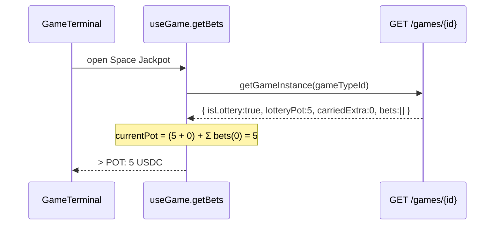

# SpaceStroker — "Fix pricing" — Implementation Spec

> **Status: Ready for implementation** — refined via Trello card
> [Fix pricing](https://trello.com/c/IJRNPqAs/88-fix-pricing) (2026-07-24).
> Repos affected: `monkify-backend`, `monkify-front`, and this doc in `monkify-meta`.
>
> **Purpose:** Set the seeded Main game-type bet prices for launch (Cosmic Sprint = 1 USDC,
> Beast Mode = 1 USDC, Space Jackpot = 2 USDC) and fix the Space Jackpot lottery terminal showing
> `POT: 0 USDC` instead of its base pot (5). Player-facing correctness for the live crypto casino.

---

## 1. Summary

Two independent fixes on one card, both **Minor change** (no new capability):

| # | Area | Change |
| --- | --- | --- |
| A | **Prices** (backend seed) | Give the three seeded **Main** game types explicit per-type `RequiredAmount`: **Cosmic Sprint = 1**, **Beast Mode = 1**, **Space Jackpot = 2**. Today all three inherit `DefaultGameParameters.Base` → `RequiredAmount = 2`, so the real change is **Cosmic Sprint 2→1** and **Beast Mode 2→1**; Space Jackpot stays 2. Space Jackpot's `LotteryPot` base **stays 5**. |
| B | **`POT: 0` bug** (backend DTO + frontend seed) | The lottery `> POT:` line must always reflect `LotteryPot (5) + carriedExtra + Σ bets` — including a fresh round with zero bets (should read `POT: 5 USDC`, not `0`). Make the pot seed **self-sufficient from the game-instance DTO** (which currently omits the base pot) so it no longer silently drops the base when the separately-fetched game-type object isn't in sync. |

**Delivery of the price change:** edit the seed constants only. The seed is create-if-missing, so
this does **not** mutate rows already in the dev/prod databases. The user applies the new prices to
existing environments via a **teardown + reseed** (their explicit choice) — there is **no**
reconciliation code, no SQL/ops patch, and **no EF migration** in this card.

---

## 2. Constraints (MANDATORY)

From `monkify-meta/constraints.md` (full list there):

- **Worktree-per-repo, hub stays on `main`:** work in `.worktrees/fix-pricing/<repo>`; branch
  `feature/fix-pricing` in each affected repo (the merge/PR ref). Never switch/commit on a hub.
- **Unit tests:** update/add in `SpaceStroker.Tests`; report changed tests at end of implementation.
  Run via `scripts/run_tests.bat` (never the full `dotnet test` — `ProductionSessions` is a slow
  Monte Carlo suite).
- **EF mapping:** inline in `SpaceStrokerDbContext.OnModelCreating`; no `IEntityTypeConfiguration`.
  **N/A here** — no entity/column change.
- **Migrations:** under `SpaceStroker.Infrastructure/Migrations/`, applied only by `SpaceStroker.Consumers`.
  **N/A here** — no schema change, no migration.
- **Secrets/config:** mock-only values in committed files. Untouched here.
- **Operator messaging:** vague errors only; never reveal contract status. Not affected.
- **No new integration test:** this card is a **Minor change** (bug fix + config value tweak, no
  game-flow change), so `SpaceStroker.Tests.Integration` is **not** extended (see `constraints.md` §3).

---

## 3. Resolved product decisions

| # | Decision |
| --- | --- |
| 1 | "Price" = `GameParameters.RequiredAmount` (per-bet ticket cost, token-native USDC). Targets: Cosmic Sprint = **1**, Beast Mode = **1**, Space Jackpot = **2**. |
| 2 | Verified current seed: all three inherit `Base.RequiredAmount = 2`. Real change is Sprint 2→1 and Beast 2→1; Space Jackpot already 2 (keep, but set explicitly per-type). |
| 3 | Space Jackpot `LotteryParameters.LotteryPot` **stays 5** (unchanged). |
| 4 | Only the three **Main** types change. The broad dev catalogue (`GenerateDefaultParameters`) and the crypto catalogue (`GenerateCryptoDefaultParameters`) keep `RequiredAmount = 2`. |
| 5 | Prices reach existing dev/prod via the user's **teardown + reseed**. Change **seed constants only** — no reconciliation, no SQL patch, **no migration**. |
| 6 | `GenerateMainDefaultParameters` seeds **both** the Main operator (all envs) and, since 2026-07-23, the **dev operator** (non-prod), so both operators' copies get the new prices on reseed — dev and prod stay consistent. |
| 7 | **POT expected behavior:** lottery `> POT:` = `LotteryPot (5) + carriedExtra + Σ bets` at all times (before/during/after), including zero bets. Display-only; settlement/payout math untouched. |
| 8 | **POT fix approach:** make the pot seed deterministic by carrying the lottery **base pot on the game-instance DTO** and seeding from the instance alone, removing the dependency on the separately-fetched `selectedGame.lotteryParameters`. |
| 9 | **Level: Minor change** → no new integration test, no new `features/<slug>.md` doc. Existing KB docs corrected at ship. Unit tests still required. |

---

## 4. Data model

No entity, column, EF-mapping, or migration change. `Game.CarriedExtra` and
`LotteryParameters.LotteryPot` already exist; this card only surfaces the existing base pot on a DTO
and changes seed constant values.

---

## 5. Configuration / seed data (Part A — prices)

**File:** `monkify-backend/src/SpaceStroker.Consumers/DefaultGameParameters.cs`

Current shape (all three Main types inherit `Base.RequiredAmount = 2` via `MainBase` → `Base`):

```csharp
public static List<GameParameters> GenerateMainDefaultParameters(Guid operatorTokenId) =>
[
    MainRace("Cosmic Sprint",  "...", operatorTokenId),
    MainPreset("Beast Mode",   "...", operatorTokenId, /* 8 beasts */),
    MainLottery("Space Jackpot","...", operatorTokenId, TimeSpan.FromHours(24)),
];

private static GameParameters MainBase(string name, string description, Guid operatorTokenId)
{
    var parameters = Base(name, description, GameCharacterType.Letters, 6); // Base sets RequiredAmount = 2
    parameters.PaymentMethod = PaymentMethod.SolanaToken;
    parameters.OperatorTokenId = operatorTokenId;
    parameters.AllowFreeBet = false;
    return parameters;
}
```

**Change:** thread a per-type `requiredAmount` through the Main factories and set it explicitly.
`Base` (and therefore the whole dev/crypto catalogue) stays at `RequiredAmount = 2`. Suggested shape:

```csharp
public static List<GameParameters> GenerateMainDefaultParameters(Guid operatorTokenId) =>
[
    MainRace("Cosmic Sprint",   "...", operatorTokenId, requiredAmount: 1),
    MainPreset("Beast Mode",    "...", operatorTokenId, requiredAmount: 1, /* 8 beasts */),
    MainLottery("Space Jackpot","...", operatorTokenId, TimeSpan.FromHours(24), requiredAmount: 2),
];

private static GameParameters MainBase(string name, string description, Guid operatorTokenId, decimal requiredAmount)
{
    var parameters = Base(name, description, GameCharacterType.Letters, 6);
    parameters.PaymentMethod = PaymentMethod.SolanaToken;
    parameters.OperatorTokenId = operatorTokenId;
    parameters.AllowFreeBet = false;
    parameters.RequiredAmount = requiredAmount;   // Cosmic Sprint/Beast Mode = 1, Space Jackpot = 2
    return parameters;
}
// MainRace / MainPreset / MainLottery forward requiredAmount to MainBase.
// MainLottery keeps: parameters.LotteryParameters = new LotteryParameters { LotteryPot = 5, Frequency = frequency };
```

**Do not** touch `Base`, `Game`, `Crypto`, `Preset`, `Lottery`, or `PresetLottery` — the broad dev
catalogue and crypto catalogue must stay at `RequiredAmount = 2`.

> Delivery: seed constants only. No startup reconciliation of existing rows — the user runs a
> teardown + reseed. No migration (seed is data, not schema).

---

## 6. Backend behaviour (Part B — surface the lottery base pot on the instance DTO)

**Root-cause context (verified against current source):** the whole POT data path already looks
correct on paper —

- `GetActiveParametersHandler` → `GameService.GetAllActiveGameParameters` **includes**
  `LotteryParameters` (`GameService.cs:71`), so `/games/active-types` → `GameParametersDto.LotteryParameters.LotteryPot`
  is populated (= 5) for Space Jackpot.
- `GetActiveGameForParameterHandler` **includes** `Parameters.LotteryParameters`
  (`GetActiveGameForParameterHandler.cs:36-37`), so `ActiveGameDto.IsLottery` is `true` and
  `CarriedExtra` is set.
- The frontend template renders `formatAmount(currentPot)` ungated (`GameTerminal.vue`), and
  `formatGameAmount` for SolanaToken is `${amount} ${symbol}` — no decimal division.

The seed nonetheless reads `POT: 0` in the live game. The pot seed in `useGame.getBets` depends on
**two separate fetches** being in sync — the game-**type** object (`selectedGame`, from
`/games/active-types`, carries `lotteryParameters.lotteryPot`) **and** the game-**instance**
(`gameData`, from `/games/{id}`, carries `isLottery` + `carriedExtra`). If `selectedGame` is missing
`lotteryParameters` on the code path that ran (stale/rehydrated selection, mismatch, or seed drift
where the deployed row's `LotteryPot` isn't 5), the base is silently dropped and the pot falls to
`Σ bets` = 0.

**Fix — make the instance self-sufficient.** Add the base pot to the game-instance DTO so the pot can
be seeded entirely from `gameData` (no cross-fetch dependency):

**File:** `monkify-backend/src/SpaceStroker.Infrastructure/Contracts/Games/ActiveGameDto.cs`

```csharp
public ActiveGameDto(Game game)
{
    ...
    IsLottery  = game.Parameters?.LotteryParameters != null;
    LotteryPot = game.Parameters?.LotteryParameters?.LotteryPot ?? 0m;   // NEW — base pot (0 for non-lottery)
    CarriedExtra = game.CarriedExtra;
    ...
}

// Base lottery pot from config (LotteryParameters.LotteryPot); 0 for non-lottery games. The frontend
// seeds the > POT: line as LotteryPot + CarriedExtra + Σ bets without a second game-type fetch.
public decimal LotteryPot { get; set; }
```

No query change needed — `GetActiveGameForParameterHandler` already includes
`Parameters.LotteryParameters`. No new endpoint, header, or migration.

---

## 7. Frontend behaviour (Part B)

**File:** `monkify-front/src/types/index.ts` — add the base pot to `GameInstance`:

```ts
export interface GameInstance {
  ...
  isLottery?: boolean;
  lotteryPot?: number;   // NEW — base lottery pot (from ActiveGameDto.LotteryPot); 0/undefined for non-lottery
  carriedExtra?: number;
  ...
}
```

**File:** `monkify-front/src/hooks/useGame.ts` — seed the pot from the instance alone
(`getBets`, ~line 160-165):

```ts
const totalBetsAmount = gameData.bets.reduce((sum, bet) => sum + bet.amount, 0);
// Lottery base comes from the instance DTO itself, so it no longer depends on the separately-fetched
// game-type (selectedGame). isLottery is authoritative from the instance.
const lotteryBase = gameData.isLottery
  ? (gameData.lotteryPot ?? 0) + (gameData.carriedExtra ?? 0)
  : 0;
currentPot.value = lotteryBase + totalBetsAmount;
```

**File:** `monkify-front/src/hooks/useGame.ts` — **the actual `POT: 0` root cause** (found during
QA on the running stack). `updateNewGame` is the initial-load path (called from `GamePage.vue`,
`GameTypes.vue`, and on rollover), and it did:

```ts
await getBets(ignoreInitialBets);   // seeds currentPot = lotteryBase + Σ bets  ✅
...
currentPot.value = 0;               // ❌ ran AFTER getBets, clobbering the seed to 0
```

The comment claimed "reseeded by getBets above", but `getBets` runs *before* this line, so the reset
always won — the lottery base was zeroed on **every load and rollover** (→ `POT: 0` on a fresh Space
Jackpot). **Fix: delete that `currentPot.value = 0;` line.** `getBets` is the single source of truth
for `currentPot` (it already sets `0` for a fresh non-lottery race), so the explicit reset is both
redundant and harmful. This is the change that actually fixes the reported bug; the §6/§7 instance-DTO
seeding is a correctness/robustness improvement that makes `getBets` authoritative from the instance.

The `/Bets` handler still increments `currentPot` per new bet, and both `> POT:` template lines render
`formatAmount(currentPot)` (`GameTerminal.vue`). No template or `formatGameAmount` change.

### 7.1 Lottery FREQUENCY display (added during QA)

**File:** `monkify-front/src/components/game/GameTerminal.vue` — `formatLotteryFrequency` split the
`.NET` TimeSpan string on `:` and read `parseInt(parts[0])` as hours. A 24h (daily) lottery serializes
**with a day component** as `"1.00:00:00"`, so `parseInt("1.00") === 1` rendered Space Jackpot's daily
draw as **"1 HOUR"**. Fix: parse the optional `d.` days prefix and fold it into the hour count
(`hours += days * 24`), so `"1.00:00:00"` → **"24 HOURS"**. Sub-day frequencies (`"04:00:00"`,
`"00:01:00"`) are unchanged.

---

## 8. Flow diagram (POT seed, after fix)



---

## 9. Out of scope

- Any live-DB reconciliation / SQL patch / migration (handled by the user's teardown + reseed).
- Changing the lottery base pot value (stays 5), settlement/payout math, or the set of game types.
- Prices of the broad dev catalogue or crypto catalogue types (stay 2).
- Admin "edit game type" capability (does not exist; not being added).
- Any new integration test (Minor change; no game-flow change).

---

## 10. File checklist

### 10.1 Backend (`monkify-backend`)

| # | File | Change |
| --- | --- | --- |
| 1 | `src/SpaceStroker.Consumers/DefaultGameParameters.cs` | Thread per-type `requiredAmount` through `MainBase`/`MainRace`/`MainPreset`/`MainLottery`; set Cosmic Sprint = 1, Beast Mode = 1, Space Jackpot = 2. `MainLottery.LotteryPot` stays 5. `Base` and the broad/crypto catalogues unchanged. |
| 2 | `src/SpaceStroker.Infrastructure/Contracts/Games/ActiveGameDto.cs` | Add `decimal LotteryPot` property, set to `game.Parameters?.LotteryParameters?.LotteryPot ?? 0m`. |
| 3 | `src/SpaceStroker.Tests/UnitTests/Consumers/DefaultGameParametersTests.cs` | Split the shared `RequiredAmount.ShouldBe(2m)` assertion into per-type checks (Sprint = 1, Beast = 1, Space Jackpot = 2); keep `LotteryPot.ShouldBe(5m)`. |
| 4 | `src/SpaceStroker.Tests/UnitTests/Handlers/GetActiveGameForParameterHandlerTests.cs` | Add/extend a case asserting `ActiveGameDto.LotteryPot` maps the lottery base for a lottery game and is `0` for a non-lottery game. |

### 10.2 Frontend (`monkify-front`)

| # | File | Change |
| --- | --- | --- |
| 1 | `src/types/index.ts` | Add `lotteryPot?: number` to `GameInstance`. |
| 2 | `src/hooks/useGame.ts` | (a) Seed `currentPot` lottery base from the instance (`gameData.isLottery ? (gameData.lotteryPot ?? 0) + (gameData.carriedExtra ?? 0) : 0`), dropping the `selectedGame.lotteryParameters` dependency. (b) **Delete the `currentPot.value = 0;` line in `updateNewGame`** that ran after `getBets` and clobbered the seed to 0 — the actual `POT: 0` root cause. |
| 3 | `src/components/game/GameTerminal.vue` | `formatLotteryFrequency`: parse the `d.` days prefix of the TimeSpan string and fold into hours (`hours += days*24`) so a 24h lottery (`"1.00:00:00"`) renders "24 HOURS" not "1 HOUR". |

### 10.3 Meta (`monkify-meta`)

| # | File | Change |
| --- | --- | --- |
| 1 | `specs/fix-pricing.md` | This spec. |
| 2 | `INDEX.md` | Add the spec row (status Ready); set "Feature currently in flight". |
| 3 | (at ship) `features/main-production-operator.md`, `features/game-pot-display.md` | Correct seeded prices (Sprint/Beast = 1, Jackpot = 2) and note the instance-DTO base-pot seed. Done in `/monkify-ship-feature`, not now. |

---

## 11. Unit tests

Project: `monkify-backend/src/SpaceStroker.Tests` (run via `scripts/run_tests.bat`).

| Test file | Test cases | Expected |
| --- | --- | --- |
| `DefaultGameParametersTests.cs` | `GenerateMainDefaultParameters` per-type `RequiredAmount` | Cosmic Sprint = 1, Beast Mode = 1, Space Jackpot = 2 |
| `DefaultGameParametersTests.cs` | Space Jackpot lottery base | `LotteryParameters.LotteryPot == 5m` (unchanged) |
| `DefaultGameParametersTests.cs` | Catalogue isolation (optional guard) | Broad `GenerateDefaultParameters` / `GenerateCryptoDefaultParameters` still `RequiredAmount == 2m` |
| `GetActiveGameForParameterHandlerTests.cs` | Lottery game → DTO | `ActiveGameDto.LotteryPot == 5m`, `IsLottery == true`, `CarriedExtra` mapped |
| `GetActiveGameForParameterHandlerTests.cs` | Non-lottery game → DTO | `ActiveGameDto.LotteryPot == 0m`, `IsLottery == false` |

> Frontend has no JS unit-test suite; Part B frontend verification is manual (§13).

---

## 12. Acceptance criteria

From the Trello **Acceptance Criteria** checklist:

1. Given a freshly seeded environment, when the Cosmic Sprint game type is seeded, then its `RequiredAmount` is 1.
2. Given a freshly seeded environment, when the Beast Mode game type is seeded, then its `RequiredAmount` is 1.
3. Given a freshly seeded environment, when the Space Jackpot game type is seeded, then its `RequiredAmount` is 2 and its `LotteryPot` base is 5.
4. Given a freshly seeded environment, when the broad dev catalogue and crypto catalogue types are seeded, then their `RequiredAmount` remains 2 (unchanged by this card).
5. Given a fresh Space Jackpot lottery round with zero bets, when a player opens the terminal, then the `> POT:` line shows `5 USDC` (base), not `0`.
6. Given a Space Jackpot round carrying a stacked jackpot (`carriedExtra > 0`), when a player opens the terminal, then `> POT:` shows `LotteryPot (5) + carriedExtra + Σ bets`.
7. Given a lottery round showing its base pot, when a new bet arrives on the `/Bets` stream, then `> POT:` increments live by the bet amount (base still included).
8. Given a non-lottery race (Cosmic Sprint / Beast Mode), when a player opens the terminal, then `> POT:` reflects `Σ bets` only and is unaffected by this change.
9. Given the price change is delivered only via seed constants, when the backend starts against an already-seeded database, then it does not mutate existing game-type rows and no EF migration is introduced (application is via the user's teardown + reseed).
10. Given the daily (24h) Space Jackpot lottery, when a player opens the terminal, then `> FREQUENCY:` shows `24 HOURS`, not `1 HOUR`.

---

## 13. Manual QA

1. Fresh local stack (reseed). Open **Space Jackpot** with no bets → terminal reads `> POT: 5 USDC` **and** `> FREQUENCY: 24 HOURS`.
2. Place a paid bet → `> POT:` increments live by the bet amount, base still included.
3. Open **Cosmic Sprint** / **Beast Mode** → `> BET: 1 USDC`; `> POT:` reads `Σ bets` (0 before bets).
4. Confirm Space Jackpot `> BET: 2 USDC`.
5. (Regression) A non-lottery race pot never shows the lottery base; re-select / roll over a lottery and confirm the pot stays at its base (not reset to 0).

---

## 14. Trello / pipeline

- **Source card:** [Fix pricing](https://trello.com/c/IJRNPqAs/88-fix-pricing) — **Implementation**
  section on the card lists worktree + branch + spec.
- **Next:** `/monkify-implement-feature Fix pricing` to build it (Minor change → no integration test,
  unit tests only), then `/monkify-ship-feature Fix pricing` to sync the KB and merge to `main`.

---

## 15. Revision log

| Date | Change |
| --- | --- |
| 2026-07-24 | Initial spec from refined card #88. |
| 2026-07-24 | QA correction: real `POT: 0` root cause is the `currentPot.value = 0;` reset in `useGame.updateNewGame` running after `getBets` (clobbers the seed on every load/rollover) — delete it. Added lottery FREQUENCY fix (`formatLotteryFrequency` days parsing: 24h → "24 HOURS"). Merged `origin/main` (main-only-player-entry: DEV Cassino removed, so the change now targets Main only). |
