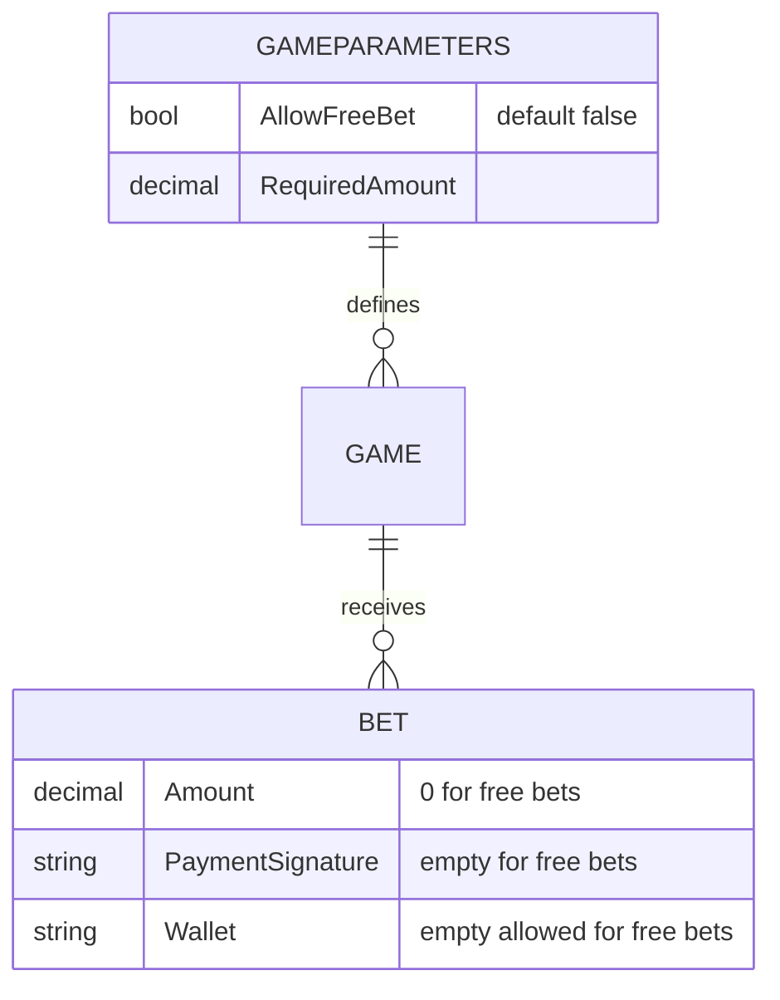
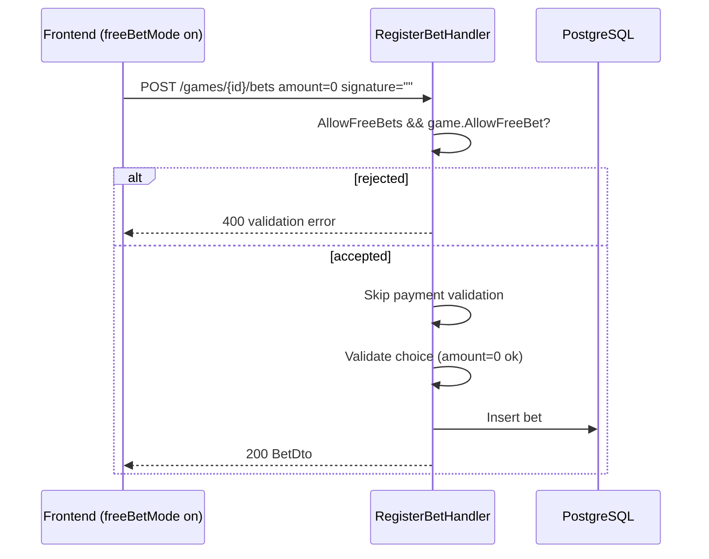
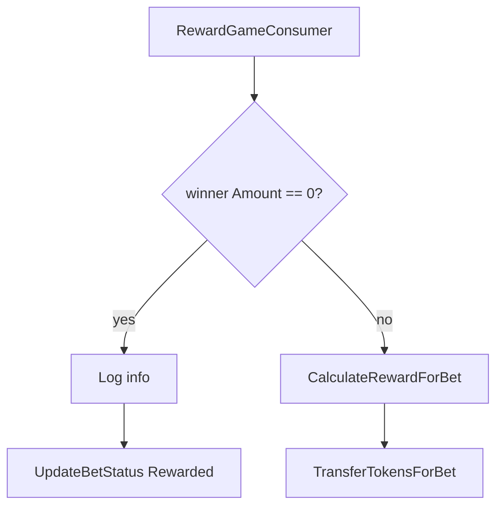

# ChimpOut — "Free Bet Mode" Feature — Implementation Spec

> **Status: Shipped** — merged to `main` via branch `feature/free-bet-mode` on 2026-06-26.
> Refined via Trello card [Add Free bet mode](https://trello.com/c/lFsFhIgR/16-add-free-bet-mode).
> Repos affected: `monkify-backend`, `monkify-front`, and this doc in `monkify-meta`.
>
> **Purpose:** Dev/QA testing only. Players (developers) can place bets without Solana wallet
> connect or on-chain payment when enabled. **Must never appear in production UI** and **must be
> rejected by the production API** even if requests are crafted manually.

---

## 1. Summary

Add a **free bet** path parallel to the existing paid (Solana SPL) path:

| Aspect | Paid bet (unchanged) | Free bet (new) |
| --- | --- | --- |
| **When allowed** | Always (existing behaviour) | Game `AllowFreeBet = true` **and** backend `AllowFreeBets` env flag **and** (frontend) dev toggle |
| **Detection** | `amount > 0` + valid `paymentSignature` | `amount == 0` **and** missing/empty `paymentSignature` |
| **Wallet** | Required (connected) | Optional — store `""` when absent |
| **On-chain payment** | Validated via `ISolanaService.ValidateBetPayment` | Skipped |
| **Pot contribution** | `Amount` summed into pot | `Amount = 0` — excluded from pot sum |
| **Reward** | Solana `TransferTokensForBet` | Mark `Rewarded`; log info only |
| **Invalid-bet refund** | `RefundInvalidBetEvent` → Solana refund | Log info only; **do not** publish refund event |
| **Lottery min players** | Distinct player identity (see §6.4) | Each free bet counts as one player |

**Production guard (dual flag):**

- **Backend:** `GeneralSettings.Games.AllowFreeBets` — default `false`. When `false`, reject any
  request detected as a free bet before persisting.
- **Frontend:** `VUE_APP_ALLOW_FREE_BETS` — when not `"true"`, do not render the free-bet toggle
  (production builds).

**Per game type:** new column `GameParameters.AllowFreeBet` (default `false`). Enable manually
in dev/local DB or seed for the game types you want to test.

**Removed from scope:** `MaxAllowedFreeBets`.

---

## 2. Constraints (MANDATORY)

From `monkify-meta/constraints.md` (full list there):

- **Branch-per-repo:** create `feature/free-bet-mode` in **both** `monkify-backend` and
  `monkify-front`.
- **Unit tests:** update affected tests; add tests for all new behaviour; **report which tests
  changed/added** at end of work. Run full `ChimpOut.Tests` suite before declaring done.
- **EF mapping:** inline in `ChimpOutDbContext.OnModelCreating` — no `IEntityTypeConfiguration`.
- **Migrations:** add under `ChimpOut.Infrastructure/Migrations/`; applied only by
  `ChimpOut.Consumers` at startup. Do not hand-edit the snapshot.
- **Secrets/config:** only mock/placeholder values in committed config (e.g. `AllowFreeBets: true`
  in Development overlay is fine; use obvious mock values in shared JSON if needed).
- **Operator messaging:** unchanged — vague errors for inactive operators; never reveal contract
  status.

---

## 3. Resolved product decisions

| # | Decision |
| --- | --- |
| 1 | Dev/QA only — not player-facing, not operator promos |
| 2 | Dual env flags (backend + frontend); API hard-rejects when backend flag off |
| 3 | `AllowFreeBet` on `GameParameters` only; DB default `false`; manual enable in dev DB/seed |
| 4 | Free bet inferred from `amount: 0` + empty `paymentSignature` (no `isFreeBet` request field) |
| 5 | Dev UI: **"Free bet mode"** toggle on game screen, **off by default**; when on, skip wallet/payment even if wallet connected |
| 6 | Free bets allowed on **all** game types (race + lottery) |
| 7 | Free bets count toward lottery **min-player** threshold |
| 8 | Duplicate bets without wallet: block `(gameId, choice)` only |
| 9 | Mixed free + paid in one game: pot from paid bets only; free bets still participate in typer |
| 10 | No Solana payout/refund for free bets — informational log only |

---

## 4. Data model

### 4.1 `GameParameters` — new column

File: `monkify-backend/src/ChimpOut.Domain/Games/Entities/GameParameters.cs`

```csharp
public bool AllowFreeBet { get; set; }  // default false
```

### 4.2 EF configuration (inline)

File: `monkify-backend/src/ChimpOut.Infrastructure/Data/Context/ChimpOutDbContext.cs`

Inside the existing `GameParameters` entity block, add:

```csharp
builder.Property(x => x.AllowFreeBet).IsRequired().HasDefaultValue(false);
```

No new column on `Bet` — infer free bets at runtime: `bet.Amount == 0 &&
string.IsNullOrWhiteSpace(bet.PaymentSignature)`.

**Persisted values for free bets:**

| Field | Value |
| --- | --- |
| `Amount` | `0` |
| `PaymentSignature` | `""` (empty string — column stays required) |
| `Wallet` | `""` when not connected (column stays required) |

### 4.3 Migration

```bash
# from monkify-backend/src/ChimpOut.Infrastructure
dotnet ef migrations add AddAllowFreeBetToGameParameters \
  --startup-project ../ChimpOut.Consumers/ChimpOut.Consumers.csproj \
  --context ChimpOutDbContext
```

Migration adds non-nullable `AllowFreeBet` with default `false` on `GameParameters`.

### 4.4 ER (delta)



---

## 5. Configuration

### 5.1 Backend — `GameSettings`

File: `monkify-backend/src/ChimpOut.Domain/Configs/Entities/GameSettings.cs`

```csharp
public bool AllowFreeBets { get; set; }  // default false
```

Bind from `GeneralSettings.Games` in `chimpoutsettings.json`:

```json
"Games": {
  "AllowFreeBets": false,
  ...
}
```

**Development:** set `AllowFreeBets: true` in `appsettings.Development.json` (or environment-specific
overlay) — mock-only; never enable in production deployment config.

### 5.2 Frontend — env flag

File: `monkify-front/.env.example` — document:

```
# Dev/QA only — show free bet mode toggle when "true"
VUE_APP_ALLOW_FREE_BETS=false
```

Set `VUE_APP_ALLOW_FREE_BETS=true` in `.env.development.local` only.

> The codebase uses **`VUE_APP_*`** (Vue CLI), not `VITE_*`.

---

## 6. Backend behaviour

### 6.1 Free-bet detection helper

Add a small static helper (location: `RegisterBetHandler` private method or
`ChimpOut.Domain/Bets/Services/BetExtensions.cs` — keep minimal):

```csharp
static bool IsFreeBetRequest(decimal amount, string? paymentSignature)
    => amount == 0 && string.IsNullOrWhiteSpace(paymentSignature);

static bool IsFreeBet(Bet bet)
    => bet.Amount == 0 && string.IsNullOrWhiteSpace(bet.PaymentSignature);
```

### 6.2 `RegisterBetHandler` — revised flow

File: `monkify-backend/src/ChimpOut.Infrastructure/Handlers/Games/RegisterBet/RegisterBetHandler.cs`

**Current order:** construct bet → `ValidateBetSignature` → `ValidateBetParameters` →
`RegisterBet`.

**New order:**

1. **Construct bet** from request body (same constructor).
2. **Classify** `isFreeBet = IsFreeBetRequest(body.Amount, body.PaymentSignature)`.
3. **Gate free bets:**
   - If `isFreeBet && !_settings.Games.AllowFreeBets` →
     `ReturnValidationFailureMessage` (generic; no refund).
   - Load game early (or after duplicate check) — if `isFreeBet &&
     !game.Parameters.AllowFreeBet` → validation failure (no refund).
4. **`ValidateBetSignature`** — when `isFreeBet`:
   - **Skip** duplicate-`PaymentSignature` check (many free bets share `""`).
   - **Skip** `ValidateBetPayment`.
   - Otherwise unchanged.
5. **`ValidateBetParameters`**:
   - **Duplicate bet logic:**
     - Paid: existing `(gameId, wallet, choice)`.
     - Free without wallet (`string.IsNullOrWhiteSpace(wallet)`): `(gameId, choice)` only.
     - Free with wallet present (toggle on but wallet connected): use `(gameId, wallet, choice)`.
   - Game/operator/status checks unchanged.
   - **`ChoiceIsValidForGame`** — pass `allowFreeBet: isFreeBet` (see §6.3).
6. **`RegisterBet`** — unchanged.
7. **`RefundInvalidBet`** — when `IsFreeBet(_bet)`:
   - **Do not** publish `RefundInvalidBetEvent`.
   - Log: `"Free bet {BetId} invalid: {errorMessage} — no refund needed"`.
   - Return validation failure **without** appending `ErrorMessages.RefundWarning`.
   - Paid path unchanged.

**Edge:** `amount == 0` with non-empty signature, or `amount > 0` with empty signature → treat as
**invalid** (validation failure, not free bet). Do not partially apply free-bet rules.

### 6.3 `BetDomainService.ChoiceIsValidForGame`

File: `monkify-backend/src/ChimpOut.Domain/Bets/Services/BetDomainService.cs`

Change signature to accept optional free-bet flag:

```csharp
public static BetValidationResult ChoiceIsValidForGame(
    Bet bet, Game game, bool isFreeBet = false)
```

**Amount rule (L46–47 today):**

```csharp
if (!isFreeBet && bet.Amount != game.Parameters.RequiredAmount)
    return BetValidationResult.InvalidAmount;

if (isFreeBet && bet.Amount != 0)
    return BetValidationResult.InvalidAmount;
```

All other validation rules unchanged.

**Pot math (`SetPotAmount`):** no change required — `Sum(x => x.Amount)` already excludes zero-amount
bets.

**Reward math (`CalculateRewardForBet`):** free-bet winners must be handled **before** calling this
(see §6.5) — a winner with `Amount == 0` could otherwise receive a positive Solana payout when the
pot is funded by paid bets.

### 6.4 `BetPlacedConsumer` — player count fix

File: `monkify-backend/src/ChimpOut.Infrastructure/Consumers/BetPlaced/BetPlacedConsumer.cs`

**Problem:** current logic:

```csharp
var playerCount = gameBets.DistinctBy(x => x.Choice).DistinctBy(x => x.Wallet).Count();
```

Multiple free bets with empty `Wallet` collapse to **one** player — breaks the refined requirement.

**Replace with:**

```csharp
var playerCount = gameBets
    .Select(b => string.IsNullOrWhiteSpace(b.Wallet)
        ? $"free:{b.Id}"   // each free bet without wallet = one player
        : b.Wallet)
    .Distinct()
    .Count();
```

**Lottery under-subscribed refund loop (L56–59):** for each bet where `IsFreeBet(bet)`:

- Log: `"Free bet {bet.Id} — lottery under-subscribed, no refund needed"`.
- **Do not** publish `RefundInvalidBetEvent`.

Paid bets: publish event unchanged.

### 6.5 `RewardGameConsumer`

File: `monkify-backend/src/ChimpOut.Infrastructure/Consumers/RewardGame/RewardGameConsumer.cs`

Inside the per-winner loop (L87–108), **before** `CalculateRewardForBet`:

```csharp
if (IsFreeBet(winner))
{
    Log.Information("Free bet {BetId} won — no Solana payout needed", winner.Id);
    await gameService.UpdateBetStatus(winner, BetStatus.Rewarded);
    continue;
}
```

**Blockhash pre-check (L76–83):** if **all** winners are free bets, skip failing the game for
Solana blockhash errors — either check upfront or tolerate empty paid-winner set. Simplest: only
call `GetLatestBlockhashForTokenTransfer` when at least one paid winner exists.

### 6.6 `RefundInvalidBetConsumer`

File: `monkify-backend/src/ChimpOut.Infrastructure/Consumers/RefundInvalidBet/RefundInvalidBetConsumer.cs`

At start of `ProcessMessage`:

```csharp
if (message.Value == 0)
{
    Log.Information("Refund skipped for free bet (amount 0). Reason: {Reason}", message.Reason);
    return;
}
```

Defence in depth — handler should not publish events for free bets, but consumer must not call
Solana when `Value == 0`.

### 6.7 API — request body validation

File: `monkify-backend/src/ChimpOut.Infrastructure/Handlers/Games/RegisterBet/RegisterBetRequestBody.cs`

Today `[Required]` on `PaymentSignature` and `Wallet` blocks free bets at model binding.

**Change:**

- Remove `[Required]` from `PaymentSignature` and `Wallet`.
- Keep `[Required]` on `Amount`, `Choice`, `Seed`.
- Enforce paid-bet requirements inside `RegisterBetHandler`:
  - If **not** free bet → `Wallet` and `PaymentSignature` must be non-empty; else validation failure.

Consider a `[Range]` attribute or handler check: paid bets must have `Amount > 0`.

### 6.8 DTO — expose `allowFreeBet`

File: `monkify-backend/src/ChimpOut.Infrastructure/Contracts/Games/GameParametersDto.cs`

```csharp
public bool AllowFreeBet { get; set; } = parameters.AllowFreeBet;
```

Returned from `GET /games/active-types` regardless of env flag (it is game config). Frontend
only **shows UI** when its own env flag is true.

---

## 7. Frontend behaviour

### 7.1 Types

File: `monkify-front/src/types/index.ts`

```typescript
export interface ActiveGame {
  ...
  allowFreeBet?: boolean;
}

export interface BodyGameBet {
  paymentSignature: string;
  wallet: string;
  amount: number;
  choice: string;
  seed: any;
}
```

For free bets: `amount: 0`, `paymentSignature: ""`, `wallet: ""` (or connected wallet string if
present — backend accepts either).

### 7.2 Env helper

```typescript
// e.g. src/constants/featureFlags.ts
export const allowFreeBets =
  process.env.VUE_APP_ALLOW_FREE_BETS === 'true';
```

### 7.3 `useGame` composable

File: `monkify-front/src/hooks/useGame.ts`

Add reactive state:

```typescript
const freeBetMode = ref(false);
```

Export `freeBetMode` from the composable.

**`bet()` changes:**

```typescript
const bet = async (seed: string, onBetFail?: () => void) => {
  const gameId = gameInstance.value?.gameId as string;
  const choice = userWord.value;
  const isFree =
    allowFreeBets &&
    freeBetMode.value &&
    selectedGame.value?.allowFreeBet;

  isLoadingBet.value = true;
  let signature = '';
  let wallet = publicKey.value?.toString() ?? '';

  if (!isFree) {
    const amount = selectedGame.value?.requiredAmount || 1;
    try {
      signature = await sendToken(..., amount);
    } catch { ... return; }
    // body with amount, signature, wallet
  } else {
    // skip sendToken entirely
    const body: BodyGameBet = {
      amount: 0,
      choice,
      paymentSignature: '',
      wallet,
      seed,
    };
    await mainService.applyBet(gameId, body);
  }
};
```

### 7.4 UI — free bet toggle

**When to show:** `allowFreeBets && selectedGame?.allowFreeBet`.

**Where:** `GameTerminal.vue` and/or `GameConsole.vue` (whichever owns bet submission UX — update
both if wallet gate exists in both).

- Render a checkbox/toggle labelled **"Free bet mode"**, default **unchecked**.
- When checked, bypass `connected` wallet requirement for placing bets and status copy that says
  "CONNECT WALLET TO PLAY".

**Status labels** (`gameStatusLabel` in `GameTerminal.vue` L144–177): when free bet mode active,
use the "ready to bet" copy even if `!connected.value`.

**`GameConsole.placeBet` (L43–49):** add condition — allow proceed when
`allowFreeBets && freeBetMode && selectedGame.allowFreeBet` even if `!connected.value`.

### 7.5 Player count display (dev accuracy)

`GameTerminal.vue` `playerCountInfo` / `hasEnoughPlayers` (L121–141) count distinct `wallet`
strings — empty wallets under-count free bettors.

When `allowFreeBets && freeBetMode`, adjust display logic to match backend (each bet with empty
wallet counts separately, or show count from bets length for dev). Minimum: do not block QA; exact
UI parity with backend player count is nice-to-have but document if simplified.

---

## 8. Flow diagrams

### 8.1 Register bet (free path)



### 8.2 Reward (free winner)



---

## 9. Out of scope

- `MaxAllowedFreeBets`
- Production UI or operator-facing free-bet promos
- Admin API to toggle `AllowFreeBet`
- Solana payout/refund for free bets
- `IsFreeBet` persisted column (infer at runtime)
- B2B / operator wallet integration changes
- Knowledge-base `features/` update (handled by `/monkify-ship-feature` after merge)

---

## 10. File checklist

### 10.1 Backend (`monkify-backend`)

| # | File | Change |
| --- | --- | --- |
| 1 | `ChimpOut.Domain/Games/Entities/GameParameters.cs` | `AllowFreeBet` property |
| 2 | `ChimpOut.Domain/Configs/Entities/GameSettings.cs` | `AllowFreeBets` property |
| 3 | `ChimpOut.Infrastructure/Data/Context/ChimpOutDbContext.cs` | EF mapping + default |
| 4 | `ChimpOut.Infrastructure/Migrations/*_AddAllowFreeBetToGameParameters.*` | New migration |
| 5 | `ChimpOut.Common/chimpoutsettings.json` | `AllowFreeBets: false` |
| 6 | `ChimpOut.Infrastructure/Contracts/Games/GameParametersDto.cs` | `AllowFreeBet` |
| 7 | `ChimpOut.Infrastructure/Handlers/Games/RegisterBet/RegisterBetRequestBody.cs` | Relax Required on wallet/signature |
| 8 | `ChimpOut.Infrastructure/Handlers/Games/RegisterBet/RegisterBetHandler.cs` | Full free-bet flow |
| 9 | `ChimpOut.Domain/Bets/Services/BetDomainService.cs` | `isFreeBet` amount rules |
| 10 | `ChimpOut.Infrastructure/Consumers/BetPlaced/BetPlacedConsumer.cs` | Player count + lottery refund skip |
| 11 | `ChimpOut.Infrastructure/Consumers/RewardGame/RewardGameConsumer.cs` | Skip Solana for free winners |
| 12 | `ChimpOut.Infrastructure/Consumers/RefundInvalidBet/RefundInvalidBetConsumer.cs` | Skip when Value == 0 |

### 10.2 Frontend (`monkify-front`)

| # | File | Change |
| --- | --- | --- |
| 1 | `.env.example` | `VUE_APP_ALLOW_FREE_BETS` |
| 2 | `src/types/index.ts` | `allowFreeBet` on `ActiveGame` |
| 3 | `src/constants/featureFlags.ts` (new, optional) | `allowFreeBets` helper |
| 4 | `src/hooks/useGame.ts` | `freeBetMode`, branch in `bet()` |
| 5 | `src/components/game/GameTerminal.vue` | Toggle + status label bypass |
| 6 | `src/components/game/GameConsole.vue` | Wallet gate bypass when free mode |

---

## 11. Unit tests

Project: `monkify-backend/src/ChimpOut.Tests`. **Report all changed/added tests at end.**

### 11.1 `RegisterBetHandlerTests`

File: `UnitTests/Handlers/RegisterBetHandlerTests.cs`

| Test case | Expect |
| --- | --- |
| Free bet, `AllowFreeBets=true`, game `AllowFreeBet=true` | Success; `ValidateBetPayment` **not** called |
| Free bet, `AllowFreeBets=false` | Validation failure; no refund event |
| Free bet, game `AllowFreeBet=false` | Validation failure; no refund event |
| Free bet, invalid choice | Validation failure; **no** `RefundInvalidBetEvent` |
| Free bet, duplicate `(gameId, choice)` no wallet | Validation failure; no refund event |
| Paid bet unchanged | Existing tests still pass |
| `amount=0` + non-empty signature | Validation failure (not free) |

### 11.2 `BetDomainServiceTests`

| Test case | Expect |
| --- | --- |
| `isFreeBet=true`, `amount=0` | Valid (with valid choice) |
| `isFreeBet=true`, `amount=1` | `InvalidAmount` |
| `isFreeBet=false`, `amount=0` | `InvalidAmount` |
| Pot sum with mixed bets | Only paid amounts in pot |

### 11.3 `BetPlacedEventConsumerTests`

| Test case | Expect |
| --- | --- |
| Lottery, N free bets (empty wallets), meets min players | Game starts; **no** refund events |
| Lottery under-subscribed with free bets only | No refund events; log path |
| Player count with 3 free bets (empty wallets) | `playerCount == 3` |

### 11.4 `RewardGameConsumerTests`

File: `UnitTests/Background/RewardWinnersHandlerTests.cs`

| Test case | Expect |
| --- | --- |
| Free bet winner | Status `Rewarded`; `TransferTokensForBet` **not** called |
| Mixed free + paid winners | Paid get transfer; free get log-only reward |

### 11.5 `RefundInvalidBetConsumerTests` (add if missing)

| Test case | Expect |
| --- | --- |
| Event with `Value=0` | No Solana call; early return |

---

## 12. Acceptance criteria

Mapped from Trello checklist — implement until all pass:

1. Given backend `AllowFreeBets` is false, when POST with `amount=0` and empty signature, then
   validation error and no bet persisted.
2. Given `AllowFreeBets` true and game `AllowFreeBet` false, when free bet posted, then rejected.
3. Given both flags/game allow, when valid free bet without wallet, then bet persisted with
   `Amount=0` and no payment validation.
4. Given free bet without wallet, when same choice reposted, then duplicate rejected.
5. Given mixed free and paid bets, when pot calculated, then only paid amounts count.
6. Given free bet wins race, when `RewardGameConsumer` runs, then `Rewarded`, no Solana, info log.
7. Given invalid free bet, when handler rejects, then no refund event and no `RefundWarning` suffix.
8. Given lottery with enough free bets for min players, when draw runs, then game starts.
9. Given lottery under-subscribed with free bets, when refunded, then no Solana for free bets.
10. Given `VUE_APP_ALLOW_FREE_BETS` false, when game loads with `allowFreeBet` true, then no toggle.
11. Given frontend flag true and toggle on, when bet placed, then no `sendToken`; POST uses
    `amount=0`, empty signature.
12. Given toggle off, when bet placed, then existing paid flow unchanged.

---

## 13. Manual QA (dev)

1. Set `AllowFreeBets: true` in backend Development config.
2. Set `VUE_APP_ALLOW_FREE_BETS=true` in `.env.development.local`.
3. `UPDATE "GameParameters" SET "AllowFreeBet" = true WHERE "Name" = '<your test game>';`
4. Open `/chimpout/game/<dev-operator-id>/play?type=<gameTypeId>`.
5. Enable **Free bet mode** — place bet without wallet → success.
6. Disable toggle — connect wallet → paid bet still works.
7. Win a round with free bet → bet rewarded, no Solana tx.
8. Repeat with lottery type — min-player threshold includes free bettors.

---

## 14. Trello / pipeline

- **Source card:** [Add Free bet mode](https://trello.com/c/lFsFhIgR/16-add-free-bet-mode) — list
  **Refined**
- **After merge:** run `/monkify-ship-feature` to sync `features/games.md` and move card to
  **Implemented**

---

## 15. Revision log

| Date | Change |
| --- | --- |
| 2026-06-26 | Initial spec from refinement game (Trello card #16) |
