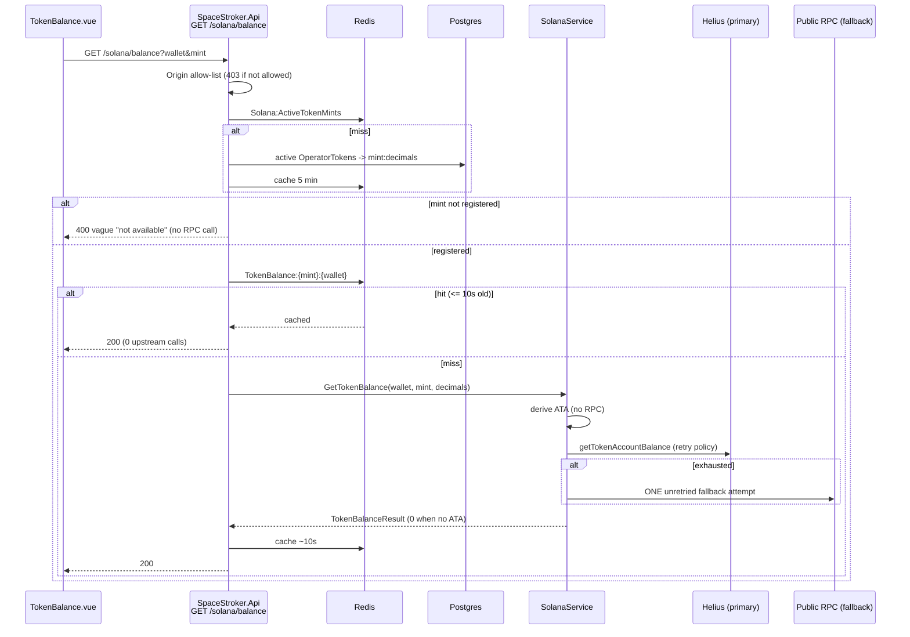
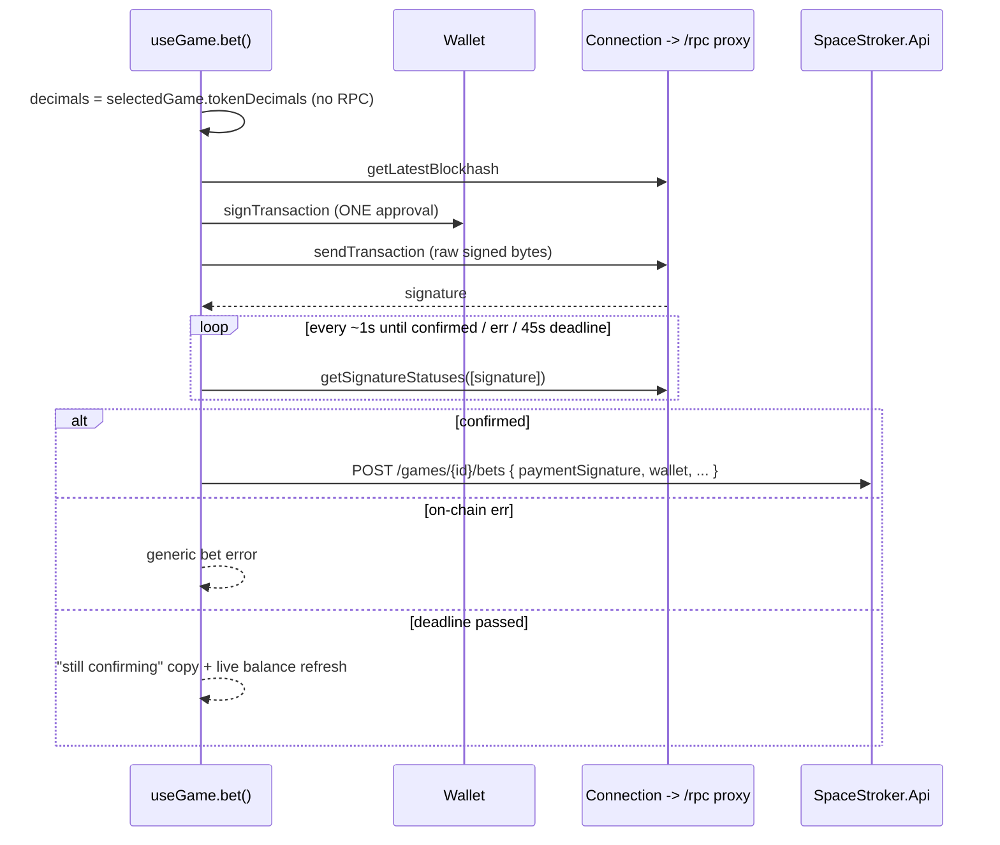

# SpaceStroker — "Migrate the frontend off the public Solana RPC onto the Helius gateway" — Implementation Spec

> **Status: Shipped** — merged to `main` on **2026-07-26** via `feature/frontend-helius-gateway`
> (`monkify-backend` + `monkify-front` + `monkify-meta`). 498 unit tests green (32 added/changed) and
> 69 integration tests green (10 added in `SolanaBalanceTests`, 6 added/changed in `RpcProxyTests`).
> Distilled into `features/frontend-helius-gateway.md`; `features/solana-connection-rpc.md` marked
> superseded; `architecture.md` + `glossary.md` corrected. **See §15 — three things diverged from this
> spec during implementation, including a latent money bug this feature exposed.**
>
> **Original status: Ready for implementation** — refined via Trello card
> [Migrate frontend usage of mainnet solana api to helius gateway](https://trello.com/c/8JhYpx52) (#99, 2026-07-26).
> Repos affected: `monkify-backend`, `monkify-front`, and this doc + the deploy stack in `monkify-meta`.
>
> **Level: Feature** — new public API surface (`GET /solana/balance`), a new caching layer, and a
> substantive change to how every paid crypto bet is transported and confirmed (money path). A
> happy-path **integration test is mandatory** (§11.2) and `/monkify-ship-feature` creates a dedicated
> `features/frontend-helius-gateway.md`.
>
> **Purpose:** The public Solana mainnet RPC (`api.mainnet-beta.solana.com`) is not usable from a
> production browser. Today the SPA calls it directly for **everything** a paid `SolanaToken` bet
> needs — token balance, mint decimals, blockhash, send, and a confirmation WebSocket — so on mainnet
> the crypto path is broken end to end, not merely the header balance. This card moves the SPA's
> wallet-info reads behind a purpose-built, cached backend endpoint, moves the transaction path onto
> the **already-shipped** `/rpc` proxy as its **primary** transport, replaces the confirmation
> WebSocket with a proxied status poll, and removes three redundant or dead RPC round-trips so
> routing player traffic through Helius does not burn credits linearly with player count.

---

## 1. Summary

Four things change. Only the first is net-new surface; the rest are re-pointing and deletion.

| # | Change | Why |
| --- | --- | --- |
| 1 | **New `GET /solana/balance`** (+ `/solana/balance/live`) on `SpaceStroker.Api` — the player's SPL token balance, Redis-cached, mint-restricted, gated exactly like `/rpc`. | The card's core ask. The 10s balance poll is by far the highest-volume RPC caller, and it is the one the user actually reported broken. |
| 2 | **`/rpc` becomes the primary transport** for `getLatestBlockhash` + `sendTransaction`, and gains `getSignatureStatuses`, which **replaces `confirmTransaction`'s WebSocket**. | The proxy already exists and is already wired to Helius — it was simply never enabled in production (§1.1 finding 2). A socket cannot be proxied, so confirmation had to become a poll. |
| 3 | **Three RPC calls deleted outright** — mint decimals (already in the game DTO), the SOL balance read, and the token-account lookup (the ATA is derivable). | "Optimize the calls" — these cost Helius credits for information we already have or never use. |
| 4 | **Deploy config gains `VUE_APP_SOLANA_PROXY_URL`** + the new tunables, for `development` and `production`. | Without it the whole feature is inert in the deployed SPA, exactly as `/rpc` is today. |

Before / after, per RPC operation the frontend performs today:

| Frontend operation | Today (mainnet) | After |
| --- | --- | --- |
| Token balance (`getTokenAccountsByOwner` → `getTokenAccountBalance`) | 2 calls to public RPC, every 10s per connected player | **1** upstream call behind `GET /solana/balance`, Redis-cached ~10s, poll slowed to 30s and idle-gated |
| Mint decimals (`getParsedAccountInfo`) | 1 call **per bet** | **0** — read from `ActiveGame.tokenDecimals`, already shipped |
| SOL balance (`getBalance`) | 1 call per wallet connect | **0** — deleted; `userSOLBalance` is read by no component |
| `getLatestBlockhash` | public RPC | `/rpc` proxy (primary) |
| `sendRawTransaction` → `sendTransaction` | public RPC | `/rpc` proxy (primary) |
| `confirmTransaction` | **WebSocket** to public RPC | bounded `getSignatureStatuses` poll through `/rpc` |
| `sendSol` | never called | **deleted** |
| 429 failover (`withFailover`, cooldown) | public primary, proxy on 429 only | **removed** — proxy is simply the transport when configured |

Net effect on a connected player, per minute, at steady state: **6 upstream RPC calls → ~2**, and those 2 are shared across every tab and device on the same wallet.

### 1.1 Findings from refinement that shaped this spec

1. **A `/rpc` proxy already exists** — `RpcController` (`solana-connection-rpc`, #87): a JSON-RPC
   passthrough to the key-bearing `GeneralSettings:Token:ClusterUrl` (Helius since #62), gated by an
   environment-independent server-side Origin allow-list + a 7-method allow-list + a per-IP rate rule,
   deliberately **not** launch-token gated so the wallet-bridge popup works.
2. **It is inert in production.** `VUE_APP_SOLANA_PROXY_URL` is **absent** from the deploy tool's
   `frontBuild` block (`deploy/README.md:202`, `deploy/secrets.example.json:51` region), so the built
   SPA has no proxy connection at all and `withFailover` is a pure pass-through to public mainnet.
   Even when set it is **429-failover only** — public stays primary. This is the direct cause of the
   reported symptom.
3. **Decimals are redundant, not merely cacheable.** `OperatorToken.Decimals` is persisted and already
   shipped to the SPA as `GameParametersDto.TokenDecimals` → `ActiveGame.tokenDecimals`
   (`monkify-front/src/types/index.ts:41`). `useConnection.getNumberDecimals` is pure waste.
4. **Two dead RPC paths.** `startConnection` (`useConnection.ts:171`) fires a SOL `getBalance` on every
   wallet connect — including inside the wallet-bridge popup — but `userSOLBalance` is read by **no**
   component. `sendSol` (`useConnection.ts:206`) is never called.
5. **The balance read is 2 RPC calls where 1 suffices.** `getTokenAccountsByOwner` then
   `getTokenAccountBalance`; the associated token account address is derivable with zero RPC on both
   sides (`getAssociatedTokenAddress` in the browser, `AssociatedTokenAccountProgram.DeriveAssociatedTokenAccount`
   in Solnet 6.1.0, already referenced by `SpaceStroker.Infrastructure`).
6. **The balance poll ignores idle-disconnect.** `TokenBalance.vue:107` polls on its own `setInterval`
   and, unlike the two SignalR hubs, is **not** stopped by `useIdleDisconnect` (#96) — an abandoned
   tab keeps reading the chain forever.

---

## 2. Constraints (MANDATORY)

From `monkify-meta/constraints.md` (full list there):

- **Secrets (§1) — the sharp edge of this card.** The Helius key rides inside
  `GeneralSettings:Token:ClusterUrl` and lives **only** in the unversioned `deploy/secrets.<env>.json`
  → Secret Manager. **The frontend must never receive a keyed URL**: the browser only ever learns
  `VUE_APP_SOLANA_PROXY_URL` (our own `https://api.spacestroker.com/rpc`) and
  `VUE_APP_API_BASE_URL`. Committed files keep keyless public devnet values. Never log an RPC URL
  verbatim — masking already exists (`SolanaRpcClientProvider.MaskRpcUrl`) and must be used for any
  new log line.
- **Worktree-per-repo (§2 / `AGENTS.md` rule 6):** work lives in
  `.worktrees/frontend-helius-gateway/{monkify-backend,monkify-front,monkify-meta}`; each hub stays on
  `main` (never `git checkout -b` in a hub). Branch `feature/frontend-helius-gateway` in all three
  repos is the merge/PR ref; push after every commit; never force-push.
- **Unit tests (§3):** update/add in `SpaceStroker.Tests`; run via **`scripts/run_tests.bat`** (not a
  bare `dotnet test` — `ProductionSessions` is a slow Monte Carlo suite) and **report exactly which
  tests changed** at the end.
- **Integration test (§3 "Integration tests" + card `## Level`): MANDATORY.** `Level = Feature`, and
  unlike #62 the excuse does not apply — a new HTTP endpoint *is* testable in
  `SpaceStroker.Tests.Integration`. See §11.2; the design in §6.2 exists specifically so the harness's
  existing `ISolanaService` → `FakeSolanaService` swap covers it.
- **EF / migrations (§4): N/A.** No entity, no mapping change, no migration. `OperatorToken` already
  carries `MintAddress` + `Decimals`.
- **Production data & external APIs (§5):** do **not** point tools at the production Helius endpoint
  and do not spend the user's credits from an agent session. Real-key verification is the user's step
  (§13).
- **Hosts (§8):** everything new lives on the **stateless `SpaceStroker.Api`**. `SpaceStroker.Consumers`
  and the backend's own payout/refund RPC path are untouched.
- **Operator messaging (§6):** an unregistered/unknown mint yields a vague "not available" — never a
  hint about which operator registered what, or any contract status.

---

## 3. Resolved product decisions

| # | Decision |
| --- | --- |
| 1 | **Split transport.** Wallet-info **reads** move to a purpose-built REST endpoint; the **transaction path** stays JSON-RPC over the existing `/rpc` proxy. We do **not** re-implement send/confirm as typed backend endpoints — the money path keeps the transport that is already shipped and tested. |
| 2 | **`/rpc` flips from 429-failover to primary.** When `VUE_APP_SOLANA_PROXY_URL` is set, the proxy is *the* transport for reads/sends. The 429-detection machinery (`RpcRateLimitError`, `rateLimitAwareFetch`, `proxyUntil`, `VUE_APP_SOLANA_RPC_PROXY_COOLDOWN_MS`) is **deleted**, not rewired. |
| 3 | **`confirmTransaction`'s WebSocket is replaced** by a bounded `getSignatureStatuses` poll through `/rpc`. #87 pinned confirmation to the public socket assuming public was merely rate-limited; it is unusable on mainnet, and a socket cannot be proxied. One confirmation path now serves desktop, the embedded popup and the mobile deeplink return alike. |
| 4 | **No public-RPC fallback in a mainnet build.** Falling back to an endpoint we know does not work only delays the error. Failure surfaces as a normal retryable error. |
| 5 | **Local dev and devnet keep hitting public directly** when `VUE_APP_SOLANA_PROXY_URL` is unset — the Docker stack, `fill-crypto-clash` and paid-devnet-bet QA need no Helius key and burn no credits. Preserves #62's decision that committed config stays on the keyless public devnet URL. |
| 6 | **Gating = `/rpc`'s exact gate**: environment-independent server-side Origin allow-list (`CorsOriginResolver`) + a per-IP `AspNetCoreRateLimit` rule. Stated plainly: a public HTTPS endpoint **cannot** be truly restricted to a browser — `Origin` is self-reported and forgeable. The card's constraint is satisfied by the strongest practical gate, not by a guarantee. |
| 7 | **Launch-token gating rejected.** `POST /launch-token/default` anonymously mints a Main-scoped token to any caller in one request (`main-only-player-entry`), so it adds almost no real barrier — while breaking the same-origin wallet-bridge popup, which by design carries no launch token. |
| 8 | **Registered mints only.** `mint` must match an **active `OperatorToken.MintAddress`** (any operator — there is no operator context without a launch token). An arbitrary-mint endpoint was rejected: it would turn our Helius credits into a free public balance API for all of Solana. |
| 9 | **Balance cached in Redis ~10s**, keyed `mint + wallet`, with an explicit uncached path for the moments that matter (own-bet reconcile, post-win settle read, refund settlement). |
| 10 | **The uncached path is a distinct route, not a query flag** — `GET /solana/balance/live`. *Corrects the refined card's `?fresh=true`.* `AspNetCoreRateLimit` matches on `{verb}:{path}` and **cannot** key a rule on a query-string value, so `?fresh=true` could not carry the stricter budget the card requires. A path segment can. Intent unchanged; AC #7 is restated accordingly (§12). |
| 11 | **Mint decimals are deleted, not cached** — they already reach the SPA on `ActiveGame.tokenDecimals` (finding 3). `getNumberDecimals` / `getParsedAccountInfo` leave the frontend entirely. |
| 12 | **`getLatestBlockhash` is never cached** — a stale blockhash gets the transaction rejected. |
| 13 | **The active-mint set is Redis-cached** (mint → decimals, 5 min) so the §8 check costs no DB round-trip per request. |
| 14 | **The balance read derives the ATA** and issues one `getTokenAccountBalance`. Accepted behaviour change: a wallet holding the token in a **non-ATA** token account reads `0`. Our own `buildTransferTransaction` creates and funds precisely the ATA, and this is vanishingly rare for USDC in a consumer wallet. |
| 15 | **The dead SOL balance read and `sendSol` are deleted** (finding 4), along with `userSOLBalance` / `fetchingBalance` / the `connection` compatibility ref once nothing reads them. |
| 16 | **The balance poll is slowed (env-tunable, default 30s) and gated on `useIdleDisconnect`**, resuming on the same `RECONNECT` click. The event-driven refreshes already cover every moment a player looks at the number, so the poll is only a safety net. |
| 17 | **The balance read goes through a new `ISolanaService` method**, not a bare `ISolanaRpcClientProvider` call. *Refines the card's "reuses `ISolanaRpcClientProvider`/`SolanaService`".* It still inherits #62's retry + one-shot public fallback + masked logging (that is what `SolanaService` is), **and** it makes the mandatory integration test possible: the harness already swaps `ISolanaService` → `FakeSolanaService` (`IntegrationTestFixture.cs:150-151`) and never constructs an `IRpcClient`. |
| 18 | **The `/rpc` method allow-list is narrowed, not just extended** — from 7 to exactly the 3 the SPA still calls (§6.4). Every removed method's only caller is deleted by this card. |
| 19 | **Confirmation timeout does not claim the payment failed.** The abort path is the same as today (no bet submitted), but the copy is neutral and a `live` balance refresh fires. The deeper "paid but no bet" gap is pre-existing and stays out of scope (§9). |
| 20 | **No entity, no EF mapping, no migration.** |

---

## 4. Data model

**N/A.** No entity, no column, no EF mapping, no migration. Nothing in
`SpaceStrokerDbContext.OnModelCreating` changes and `SpaceStroker.Infrastructure/Migrations/` gains no
file. The endpoint reads `OperatorToken.MintAddress` + `OperatorToken.Decimals`, both of which already
exist and are already mapped (`SpaceStrokerDbContext.cs:224`).

---

## 5. Configuration

### 5.1 Backend — `TokenSettings` cache TTLs

`monkify-backend/src/SpaceStroker.Domain/Configs/Entities/TokenSettings.cs`:

```csharp
// How long a per-wallet SPL balance may be served from Redis (seconds). 0 disables caching.
// The uncached route (/solana/balance/live) always bypasses this.
public int BalanceCacheSeconds { get; set; }
// How long the active registered-mint set is cached (seconds). Mints change only when an operator
// registers/deactivates a token via the admin portal, so a few minutes of staleness is harmless.
public int ActiveMintsCacheSeconds { get; set; }
```

### 5.2 Backend — `spacestrokersettings.json` (committed, mock/keyless values only)

`monkify-backend/src/SpaceStroker.Common/spacestrokersettings.json`:

```jsonc
"IpRateLimiting": {
  "EnableEndpointRateLimiting": true,
  "StackBlockedRequests": false,
  "GeneralRules": [
    { "Endpoint": "api/*",                   "Period": "1m", "Limit": 100 },
    { "Endpoint": "*:/rpc",                  "Period": "1m", "Limit": 120 },
    // Cached read path: one poll per 30s per tab plus event-driven refreshes leaves ample headroom.
    { "Endpoint": "*:/solana/*",             "Period": "1m", "Limit": 120 },
    // Uncached path — every hit costs a real upstream RPC call, so it gets its own tighter budget.
    // This rule is IN ADDITION to the one above (both counters tick); the tighter one bites first.
    { "Endpoint": "*:/solana/balance/live",  "Period": "1m", "Limit": 20  }
  ]
},
"GeneralSettings": {
  "Token": {
    // ... existing keys unchanged (ClusterUrl stays the KEYLESS public devnet URL) ...
    "BalanceCacheSeconds": 10,
    "ActiveMintsCacheSeconds": 300
  }
}
```

> `EnableEndpointRateLimiting: true` is already on, and forwarded headers already expose the real
> client IP behind the LB (#61) — no new plumbing.

### 5.3 Frontend — `.env.example`

`monkify-front/.env.example`:

```bash
# Backend /rpc proxy. When set it is the PRIMARY transport for getLatestBlockhash / sendTransaction /
# getSignatureStatuses — the browser never talks to a public RPC. Empty => the public endpoint below is
# used directly (the local/devnet default: no key needed, no Helius credits spent).
# production: https://api.spacestroker.com/rpc
VUE_APP_SOLANA_PROXY_URL=

# Transaction confirmation (getSignatureStatuses poll through the proxy; replaces the WebSocket).
# How long to keep polling before giving up (ms). production: 45000
VUE_APP_SOLANA_CONFIRM_TIMEOUT_MS=45000
# How often to poll (ms). production: 1000
VUE_APP_SOLANA_CONFIRM_POLL_INTERVAL_MS=1000

# Header token-balance poll interval (ms). The event-driven refreshes (own bet / win / refund) cover
# the moments that matter, so this is only a safety net. production: 30000
VUE_APP_BALANCE_POLL_INTERVAL_MS=30000
```

**Removed:** `VUE_APP_SOLANA_RPC_PROXY_COOLDOWN_MS` (the 429-failover cooldown no longer exists —
decision 2). `VUE_APP_SOLANA_RPC_URL`, `VUE_APP_SOLANA_NETWORK`, `VUE_APP_TRANSACTION_CONFIRMATION_TIMEOUT`
and `VUE_APP_SOLANA_PRIORITY_FEE_MICROLAMPORTS` are **kept** and unchanged.

### 5.4 Deploy stack (`monkify-meta/deploy`)

`frontBuild` is the block whose absence makes this feature inert (finding 2). All of these are
**public, non-secret** build values — they belong in `frontBuild`, never in `secrets`:

1. `deploy/secrets.example.json` → `frontBuild` gains:

   ```jsonc
   "VUE_APP_SOLANA_PROXY_URL": "https://api.spacestroker.com/rpc",
   "VUE_APP_SOLANA_CONFIRM_TIMEOUT_MS": "45000",
   "VUE_APP_SOLANA_CONFIRM_POLL_INTERVAL_MS": "1000",
   "VUE_APP_BALANCE_POLL_INTERVAL_MS": "30000"
   ```

2. `deploy/README.md` — update the `frontBuild` inventory row (`README.md:202`) so the documented set
   matches reality.

3. **Operator action (not an agent action — document it in the README and the final report):** each
   existing unversioned `deploy/secrets.<env>.json` must gain the four `frontBuild` keys above, with
   `VUE_APP_SOLANA_PROXY_URL` pointing at that environment's API host
   (`https://api.dev.spacestroker.com/rpc` for development). Those files are the user's — the
   implementer must not create or edit them.

> **No Terraform change.** Unlike #62, nothing here becomes a Secret Manager value, so
> `deploy/terraform/workload/main.tf`'s two hard-coded secret lists are untouched.

---

## 6. Backend behaviour

### 6.1 Shared Origin allow-list helper (extraction)

`RpcController.IsOriginAllowed()` (`RpcController.cs:118-138`) is currently private. Extract it
verbatim — same semantics, same localhost/127.0.0.1 escape hatch, same "no `Origin` header ⇒ allow"
rule — into `SpaceStroker.Common/Cors/OriginAllowList.cs`:

```csharp
public static class OriginAllowList
{
    /// True when the request's Origin is allow-listed, is a localhost/127.0.0.1 origin (any
    /// scheme/port), or is absent entirely (same-origin / non-browser caller). Enforced SERVER-side
    /// and independent of the browser CORS middleware, which allows any origin in Development and is
    /// therefore useless as a guard on a server-side relay.
    public static bool IsAllowed(IConfiguration configuration, string? origin);
}
```

`RpcController` then calls it instead of its private copy (**behaviour must be byte-for-byte
identical** — `RpcProxyTests` covers this and must stay green unchanged), and `SolanaController` uses
the same helper. One gate, one place.

### 6.2 `ISolanaService.GetTokenBalance` (new)

`monkify-backend/src/SpaceStroker.Infrastructure/Services/Solana/ISolanaService.cs`:

```csharp
/// Read-only SPL balance for a wallet + mint. Derives the associated token account locally
/// (zero RPC) and issues exactly ONE upstream call — getTokenAccountBalance — under the same
/// retry + single-fallback + masked-logging discipline as every other operation here.
/// Returns 0 when the ATA does not exist (a wallet that never held the token), and null only on
/// transport failure after retries AND the fallback attempt.
Task<TokenBalanceResult?> GetTokenBalance(string walletAddress, string mintAddress, int decimals);
```

New value object `monkify-backend/src/SpaceStroker.Domain/Games/ValueObjects/TokenBalanceResult.cs`:

```csharp
/// A wallet's SPL balance for one mint. RawAmount is base units; UiAmount is RawAmount / 10^Decimals.
public record TokenBalanceResult(string Wallet, string MintAddress, decimal UiAmount, ulong RawAmount, int Decimals);
```

Implementation in `SolanaService` (`SpaceStroker.Infrastructure/Services/Solana/SolanaService.cs`),
following the existing shape exactly:

1. New policy field `_getTokenBalancePolicy`, built in the constructor via the existing
   `BuildPolicy<ResponseValue<TokenBalance>>("getTokenAccountBalance", _settings.Polly.GetTokenAccountsRetryCount, TokenBalanceFailed, applyRateLimitMultiplier: false)`.
   - **`applyRateLimitMultiplier: false`** — this runs on the **API request path** serving a player's
     header, exactly like `_getTransactionPolicy`. Multiplying the backoff would stall a UI read for
     ~10s. Document that rationale in a comment next to the existing one at `SolanaService.cs:35-37`.
   - Predicate `TokenBalanceFailed(x) => x is null || !x.WasSuccessful;` — **transport failures only**.
     A successful response for a non-existent account is a *business fact*, not a failure, and must
     not be retried (this is the same lesson recorded in #62's revision log for
     `getTokenAccountsByOwner`).
   - Reuse `Polly.GetTokenAccountsRetryCount` rather than adding a new knob — same class of call.
2. `GetTokenBalance` body:
   - Derive the ATA with
     `AssociatedTokenAccountProgram.DeriveAssociatedTokenAccount(new PublicKey(walletAddress), new PublicKey(mintAddress))`
     (`Solnet.Programs` 6.1.0, already referenced and already `using`-imported at `SolanaService.cs:13`).
     A malformed wallet/mint throws → caught by the `try/catch` and returned as `null`.
   - `var result = await ExecuteRpcAsync("getTokenAccountBalance", _getTokenBalancePolicy, TokenBalanceFailed, client => client.GetTokenAccountBalanceAsync(ata, Commitment.Confirmed));`
   - **Account-not-found ⇒ zero, not failure.** Solnet surfaces a missing account as a non-successful
     `RequestResult` whose error text names an invalid/unknown account rather than a transport fault.
     Treat "could not find account" / RPC error code `-32602` as **`TokenBalanceResult(wallet, mint, 0, 0, decimals)`**;
     everything else non-successful returns `null`. Implement this as one small private predicate
     `IsAccountNotFound(RequestResult<...>)` with a comment, and pin it with a unit test (§11.1) — this
     is the one place where the shape of Solnet's error matters.
   - On success, map `result.Result.Value` → `RawAmount = ulong.Parse(Amount)`,
     `UiAmount = RawAmount / 10^decimals` computed with **decimal** math (never `double`), and
     `Decimals` taken from the **registered token**, not the RPC response — the DB is the authority for
     what we settle in.
   - Wrap the whole body in the same `try/catch` + `Serilog.Log.Error` shape used by the other four
     operations. **Never log the wallet address at Error together with a balance** (it is a
     pseudonymous identifier plus a financial fact) — log the mint and the masked endpoint only.

`FakeSolanaService` (`SpaceStroker.Tests.Integration/Harness/TestDoubles.cs`) implements the new
member; see §11.2 for its controllable shape.

### 6.3 `GET /solana/balance` + `GET /solana/balance/live`

**Controller** — `monkify-backend/src/SpaceStroker.Api/Controllers/SolanaController.cs`, following the
`FxController` pattern (`BaseController` + MediatR + `ProcessRequest`), **not** `RpcController`'s raw
passthrough shape:

```csharp
[Route("solana")]
[Produces("application/json")]
public class SolanaController(IMediator mediador, IMessaging messaging, IConfiguration configuration)
    : BaseController(mediador, messaging)
{
    [HttpOptions("balance")]          // + [HttpOptions("balance/live")] — CORS preflight, mirrors FxController
    public IActionResult GetOptions() { HttpContext.Response.Headers.Append("Allow", "GET,OPTIONS"); return Ok(); }

    [HttpGet("balance")]
    public Task<IActionResult> GetBalance([FromQuery] string wallet, [FromQuery] string mint)
        => Guarded(() => ProcessRequest(new GetTokenBalanceRequest(wallet, mint, BypassCache: false)));

    /// Uncached read. Same payload; skips the Redis entry and refreshes it. Separate ROUTE (not a query
    /// flag) so AspNetCoreRateLimit — which matches on {verb}:{path} only — can give it a tighter budget.
    [HttpGet("balance/live")]
    public Task<IActionResult> GetBalanceLive([FromQuery] string wallet, [FromQuery] string mint)
        => Guarded(() => ProcessRequest(new GetTokenBalanceRequest(wallet, mint, BypassCache: true)));
}
```

`Guarded(...)` applies the §6.1 Origin check **before** the mediator runs and returns bare `403` (no
envelope, matching `RpcController`) when it fails. Keep it as a tiny private helper on the controller.

**Routing / middleware:**

- `/solana` is **not** added to `LaunchTokenValidationMiddleware.ProtectedPrefixes`
  (`LaunchTokenValidationMiddleware.cs:21`) — decision 7. Leave that array exactly as it is.
- The route sits outside `/games|/operators|/players|/fx`, so no middleware change is needed at all.

**Handler** — `SpaceStroker.Infrastructure/Handlers/Solana/GetTokenBalance/`
(`GetTokenBalanceRequest.cs` + `GetTokenBalanceHandler.cs`), extending
`BaseRequestHandler<GetTokenBalanceRequest, TokenBalanceDto>`:

1. **Validate shape.** `wallet` and `mint` must be present and parse as base58 public keys. Invalid ⇒
   `Messaging.AddValidationFailure(ErrorMessages.TokenNotAvailable)` → `BaseController` maps that to
   **400** with the standard envelope. Same vague message for every rejection below — the caller can
   never distinguish "bad wallet" from "unregistered mint".
2. **Resolve the mint** against the cached active-mint map (§6.5). Not present ⇒ same vague 400,
   **and no RPC call is made**.
3. **Cache read** (skipped when `BypassCache`): `CacheHelper.GenerateTokenBalanceCacheSettings(mint, wallet)`.
   Hit ⇒ return it.
4. **Read the chain** via `ISolanaService.GetTokenBalance(wallet, mint, decimals)` where `decimals`
   comes from the registered token (step 2), never from the caller.
5. `null` (transport failure after retries + fallback) ⇒ `Messaging.AddError(...)` → **500**. Do **not**
   cache a failure; `TokenBalance.vue` keeps its last-known value and retries.
6. Non-null ⇒ write the cache entry (both routes write; only the cached route reads) and return.

**DTO** — `SpaceStroker.Infrastructure/Contracts/Solana/TokenBalanceDto.cs`:

```csharp
public class TokenBalanceDto
{
    public string Wallet { get; set; }
    public string Mint { get; set; }
    public decimal UiAmount { get; set; }
    public string RawAmount { get; set; }   // string: base units can exceed JS Number.MAX_SAFE_INTEGER
    public int Decimals { get; set; }
}
```

**New resource string** — add `TokenNotAvailable` to
`SpaceStroker.Common/Resources/ErrorMessages.resx` (the `.Designer.cs` regenerates; never hand-edit it)
with deliberately vague wording, e.g. *"This token is not available."* — no operator, no contract, no
token identity (`constraints.md` §6).

### 6.4 `/rpc` method allow-list — narrowed to 3

`SpaceStroker.Api/Rpc/RpcProxyOptions.cs`. After this card the SPA's `Connection` issues exactly three
JSON-RPC methods through the proxy; every removed method's only caller is deleted here:

```csharp
public static readonly IReadOnlySet<string> AllowedMethods = new HashSet<string>(StringComparer.Ordinal)
{
    "getLatestBlockhash",    // buildTransferTransaction
    "sendTransaction",       // sendRawTransaction (web3.js maps it to this method)
    "getSignatureStatuses",  // NEW — replaces the confirmTransaction WebSocket
};
// REMOVED, because their only callers are deleted by frontend-helius-gateway:
//   getBalance                (dead SOL read)
//   getTokenAccountsByOwner   } balance now served by GET /solana/balance
//   getTokenAccountBalance    }
//   getParsedAccountInfo      (decimals now come from ActiveGame.tokenDecimals)
//   getTransaction            (never called by the SPA)
```

Update the XML doc comment ("Exactly the seven…" → three) and the class summary.

> **Implementation gate.** This narrowing is deliberate but is the one change that could bite at
> runtime if `@solana/web3.js` emits a method we did not anticipate. Before committing, run the full
> paid-bet flow against the local stack **with the proxy enabled** (§13 step 4) and confirm no `403`
> appears. If a genuine additional method shows up, add **that exact method** with a comment naming its
> caller — never widen to a wildcard.

### 6.5 Cache entries

`SpaceStroker.Infrastructure/Services/Cache/CacheHelper.cs` gains two factories, in the existing style
(each with a comment explaining its TTL, like every neighbour):

```csharp
// Per-wallet SPL balance. Very short TTL: it is money-visible, so it only exists to collapse bursts
// (the post-win settle read racing the poll, a visibilitychange refresh, the same wallet in two tabs).
// The uncached route (/solana/balance/live) bypasses this and rewrites it.
public static CacheSettings GenerateTokenBalanceCacheSettings(string mint, string wallet, int ttlSeconds)
    => new($"TokenBalance:{mint}:{wallet}", TimeSpan.FromSeconds(ttlSeconds));

// The set of mints the balance endpoint will serve (mint -> decimals), across all active operators.
// Changes only when an operator registers/deactivates a token in the admin portal, so a few minutes
// of staleness is harmless — and it keeps the per-request mint check off the database.
public static CacheSettings GenerateActiveTokenMintsCacheSettings(int ttlSeconds)
    => new("Solana:ActiveTokenMints", TimeSpan.FromSeconds(ttlSeconds));
```

The active-mint map is `Dictionary<string, int>` (mint → decimals), built from
`OperatorTokens.Where(t => t.Active)`. A mint registered by two operators yields one entry — decimals
for a given mint are a chain fact, so they agree; take the first and do not treat a duplicate as an
error.

> **Invalidation:** none, by design. `ttlSeconds` bounds staleness on both. A newly registered token
> becomes usable within `ActiveMintsCacheSeconds` — call that out in the admin-portal-facing note of
> the `features/` doc at ship time.

---

## 7. Frontend behaviour

### 7.1 `src/hooks/useConnection.ts` — the bulk of the change

**Deleted outright:**

| Symbol | Reason |
| --- | --- |
| `RpcRateLimitError`, `rateLimitAwareFetch`, `proxyUntil`, `cooldownMs`, `withFailover` | The proxy is the transport, not a fallback (decision 2). |
| `getTokenBalance`, `getTokenAccount` | Balance is served by `mainService` (§7.2); `TokenBalance.vue` is the only caller. |
| `getNumberDecimals` | Decimals come from `ActiveGame.tokenDecimals` (finding 3). |
| `startConnection`'s `getBalance` call, `userSOLBalance`, `fetchingBalance` | Dead — nothing reads them (finding 4). |
| `sendSol` | Never called (finding 4). |
| `connection` ref | Kept only "for backward compatibility" per its own comment (`useConnection.ts:25-27`); `TokenBalance.vue` no longer reads it. Delete once §7.3 lands. |

`startConnection` shrinks to setting up whatever the wallet adapter still needs; if it becomes empty,
delete it and drop the call sites in `App.vue:170` and `WalletBridgePage.vue:37`.

**New transport resolution** — replaces `getPrimaryConnection` / `getProxyConnection` / `withFailover`:

```ts
// ONE transport. When VUE_APP_SOLANA_PROXY_URL is set (every deployed env) the browser talks only to
// our backend /rpc proxy, which forwards to the key-bearing Helius endpoint. When it is unset
// (local/devnet) we talk to the public endpoint directly — no key, no Helius credits. There is no
// fallback between them: on mainnet the public endpoint does not work, so failing over to it would
// only delay the error.
const getConnection = (): Connection => { /* lazily built singleton */ };
```

Built with `{ confirmTransactionInitialTimeout: confirmTimeout() }` and **no custom `fetch`** (the 429
interception went with `withFailover`). `disableRetryOnRateLimit: true` is kept — a retry storm against
our own proxy is worse than surfacing the error.

**New: `confirmSignature`** — replaces every `confirmTransaction` call:

```ts
/**
 * Confirm a broadcast transaction by POLLING getSignatureStatuses through the same transport. This
 * deliberately replaces Connection.confirmTransaction, whose WebSocket subscription cannot be proxied
 * and whose public-RPC socket is unusable on mainnet. Resolves on 'confirmed' | 'finalized'; throws
 * TransactionFailedError when the status carries an on-chain err; throws
 * TransactionConfirmationTimeoutError when the deadline passes with no terminal status.
 */
const confirmSignature = async (signature: string): Promise<void>;
```

- Interval `VUE_APP_SOLANA_CONFIRM_POLL_INTERVAL_MS` (default 1000), deadline
  `VUE_APP_SOLANA_CONFIRM_TIMEOUT_MS` (default 45000 — the old 5s
  `VUE_APP_TRANSACTION_CONFIRMATION_TIMEOUT` is far too short for mainnet and stays used only for the
  `Connection` constructor).
- `getSignatureStatuses([signature], { searchTransactionHistory: false })`; a `null` entry simply means
  "not yet" — keep polling. Never treat a transient RPC error as failure; log and continue until the
  deadline.
- **Two distinct error types** so callers can word the copy correctly (decision 19).

**Rewritten signatures** (decimals become an explicit argument — no RPC, no guessing):

```ts
buildTransferTransaction(toPubkey, tokenAddress, value, feePayer, decimals: number)
sendToken(toPubkey, tokenAddress, value, decimals: number)
broadcastSignedTransaction(signedTxBase58)   // unchanged shape, now on getConnection()
confirmSignatureOnPrimary(signature)         // → delegates to confirmSignature; rename to confirmSignature and update callers
```

`sendToken` keeps its single-approval sign-once + `sendRawTransaction` shape, its
`preflightCommitment: 'confirmed'` pin, its ComputeBudget priority fee, and `toBaseUnits` integer math
**unchanged** — only the transport and the confirmation step change.

### 7.2 `src/services/mainService.ts` — the balance client

```ts
// The player's SPL balance for a game's registered token. Served by our backend (which holds the paid
// RPC key); the browser never calls a Solana RPC for this. `live: true` hits the uncached route — use it
// only for the moments that matter (own bet, post-win settle, refund), never for the background poll.
export const getTokenBalance = async (
  wallet: string,
  mint: string,
  opts: { live?: boolean } = {}
): Promise<TokenBalance>;
```

`GET /solana/balance` or `/solana/balance/live` on `mainAPI`. The request interceptor attaches
`X-Launch-Token` when one exists; the endpoint ignores it, and the wallet-bridge popup (which has none)
is unaffected. Add `TokenBalance` to `src/types/index.ts` mirroring `TokenBalanceDto`
(`rawAmount` typed `string`).

### 7.3 `src/components/TokenBalance.vue`

- Reads `mainService.getTokenBalance(effectivePublicKey, props.tokenAddress)`; `useConnection` is no
  longer imported. The `callbackConnect` fallback goes away with `startConnection`.
- `BALANCE_POLL_INTERVAL_MS` → `VUE_APP_BALANCE_POLL_INTERVAL_MS` (default 30000), parsed with the same
  defensive `readMs` shape `useIdleDisconnect.ts:7-12` uses (0/empty/NaN/negative ⇒ default, never
  "disabled").
- `pollTick` additionally returns early when `useIdleDisconnect().isIdleDisconnected` is true; a
  `watch` on that ref fires one `live` read and restarts the timer when it flips back to false (the
  `RECONNECT` click).
- `live: true` on exactly three paths — the `updateBalanceCallback` reconcile, the `WINNER_SETTLE_DELAY_MS`
  post-`Ended` read, and the `RewardForWinnersCompleted` / `ErrorWhenProcessingRewards` /
  `NotEnoughPlayersToStart` settlement read. The background poll, the `visibilitychange` refresh, the
  token-switch watch and the mount read all use the **cached** route.
- Unchanged: the optimistic stake decrement, keep-last-known-on-failure, silent background failures,
  toast only on a user-driven read.

### 7.4 Decimals plumbing

| Site | Change |
| --- | --- |
| `useGame.ts:517-521` | Resolve `const decimals = selectedGame.value?.tokenDecimals`. **Guard:** null/undefined on a `SolanaToken` game ⇒ abort the bet with the existing generic copy and a `console` warning — never fall back to a hard-coded 6/9, which would silently transfer the wrong amount. |
| `useGame.ts:531` (mobile deeplink) | Pass `decimals` into `buildTransferTransaction`. |
| `useGame.ts:588` (embedded popup) | Include `decimals` in the `requestSignatureFromPopup` payload. |
| `useGame.ts:602` (in-page) | Pass `decimals` into `sendToken`. |
| `useGame.ts:734-736` (deeplink return) | `broadcastSignedTransaction` then `confirmSignature` (was `confirmSignatureOnPrimary`). |
| `utils/walletBridge.ts` | `SignRequestPayload` gains `decimals: number`. **Same-origin internal contract only** — the public `postMessage` embedding contract in `EMBEDDING.md` / `utils/embed.ts` is untouched. |
| `hooks/useEmbeddedWallet.ts` | Thread `decimals` through `requestSignatureFromPopup`. |
| `pages/WalletBridgePage.vue:38` | `sendToken(receiver, mint, amount, req.decimals)`. |
| `hooks/useGame.ts` `pendingCryptoBet` | Stash `decimals` so the popup-blocked retry path (`retryWalletConnect`) still has it. |

### 7.5 Error copy

Only one new user-visible string, for the confirmation timeout — and it must never imply the payment
failed (decision 19):

> `Your transfer is still confirming. Check your balance before trying again.`

Every other failure keeps today's generic `There was an error processing your bet`. Operator/contract
status is never revealed (`constraints.md` §6).

---

## 8. Flow diagrams

Balance read (steady state, production):



Paid crypto bet (production — the browser never touches a public RPC):



---

## 9. Out of scope

- **The backend's own payout/refund RPC usage** in `SpaceStroker.Consumers` — #62's primary+fallback
  path is unchanged.
- **Helius enhanced APIs** — DAS, parsed-transaction, priority-fee, webhooks. Staying on plain JSON-RPC
  is what keeps the provider swappable.
- **Any WebSocket / streaming RPC to Helius** — it would require exposing the key to the browser.
- **Making `/rpc` launch-token gated**, or any change to `LaunchTokenValidationMiddleware`'s existing
  protected prefixes.
- **The pre-existing "paid but no bet" gap** — if confirmation fails the transfer has already landed
  and no bet is submitted. This card makes it much rarer (5s → 45s, on a transport that works) and
  fixes the copy, but does not close it. Same gap #62 deferred ("signature confirmation after
  `sendTransaction`"); it needs its own card because the fix changes bet-submission flow.
- **Standard/USD payment method, free-bet mode, reward maths, commission** — none of them touch RPC.
- **The public `postMessage` embedding contract** (`EMBEDDING.md`, `embed-example.html`).
- **Server-side rendering of balances into any other surface** (stats, history) — those are DB reads
  and are unaffected.
- **Running `terraform apply` / deploying** — an ops step.

---

## 10. File checklist

### 10.1 Backend (`monkify-backend`, worktree `.worktrees/frontend-helius-gateway/monkify-backend`)

| # | File | Change |
| --- | --- | --- |
| 1 | `src/SpaceStroker.Common/Cors/OriginAllowList.cs` | **New** — extracted server-side Origin check (§6.1) |
| 2 | `src/SpaceStroker.Api/Controllers/RpcController.cs` | Use `OriginAllowList`; delete the private copy (behaviour identical) |
| 3 | `src/SpaceStroker.Api/Rpc/RpcProxyOptions.cs` | Allow-list narrowed to 3 methods (+`getSignatureStatuses`); update doc comments (§6.4) |
| 4 | `src/SpaceStroker.Api/Controllers/SolanaController.cs` | **New** — `GET /solana/balance`, `GET /solana/balance/live`, OPTIONS, Origin guard (§6.3) |
| 5 | `src/SpaceStroker.Infrastructure/Handlers/Solana/GetTokenBalance/GetTokenBalanceRequest.cs` | **New** — `(Wallet, Mint, BypassCache)` |
| 6 | `src/SpaceStroker.Infrastructure/Handlers/Solana/GetTokenBalance/GetTokenBalanceHandler.cs` | **New** — validate → mint check → cache → `ISolanaService` → cache write (§6.3) |
| 7 | `src/SpaceStroker.Infrastructure/Contracts/Solana/TokenBalanceDto.cs` | **New** — response DTO (`rawAmount` as string) |
| 8 | `src/SpaceStroker.Domain/Games/ValueObjects/TokenBalanceResult.cs` | **New** — service-level result record |
| 9 | `src/SpaceStroker.Infrastructure/Services/Solana/ISolanaService.cs` | Add `GetTokenBalance` (§6.2) |
| 10 | `src/SpaceStroker.Infrastructure/Services/Solana/SolanaService.cs` | New policy + `GetTokenBalance` via `ExecuteRpcAsync`; ATA derivation; not-found ⇒ 0 (§6.2) |
| 11 | `src/SpaceStroker.Infrastructure/Services/Cache/CacheHelper.cs` | Two new cache-settings factories (§6.5) |
| 12 | `src/SpaceStroker.Domain/Configs/Entities/TokenSettings.cs` | `BalanceCacheSeconds`, `ActiveMintsCacheSeconds` (§5.1) |
| 13 | `src/SpaceStroker.Common/spacestrokersettings.json` | Two rate-limit rules + the two TTLs (§5.2) — mock/keyless values only |
| 14 | `src/SpaceStroker.Common/Resources/ErrorMessages.resx` | Add vague `TokenNotAvailable` (Designer regenerates) |
| 15 | `src/SpaceStroker.Tests/UnitTests/Services/SolanaServiceTests.cs` | New `GetTokenBalance` cases (§11.1) |
| 16 | `src/SpaceStroker.Tests/UnitTests/Handlers/GetTokenBalanceHandlerTests.cs` | **New** — validation / mint gate / cache / failure (§11.1) |
| 17 | `src/SpaceStroker.Tests/UnitTests/Api/RpcMethodAllowlistTests.cs` | Update to the 3-method list; assert the 5 removed methods are rejected |
| 18 | `src/SpaceStroker.Tests/UnitTests/Common/OriginAllowListTests.cs` | **New** — allowed / localhost / absent / disallowed |
| 19 | `src/SpaceStroker.Tests.Integration/Harness/TestDoubles.cs` | `FakeSolanaService.GetTokenBalance` + controllable knobs (§11.2) |
| 20 | `src/SpaceStroker.Tests.Integration/Harness/IntegrationTestFixture.cs` | Expose the seeded mint + a `FakeSolanaService` handle for the balance test |
| 21 | `src/SpaceStroker.Tests.Integration/SolanaBalanceTests.cs` | **New** — mandatory happy path + guards (§11.2) |

### 10.2 Frontend (`monkify-front`, worktree `.worktrees/frontend-helius-gateway/monkify-front`)

| # | File | Change |
| --- | --- | --- |
| 1 | `src/hooks/useConnection.ts` | Single transport; delete failover + dead reads + `getNumberDecimals`; add `confirmSignature`; decimals params (§7.1) |
| 2 | `src/services/mainService.ts` | `getTokenBalance(wallet, mint, { live })` (§7.2) |
| 3 | `src/types/index.ts` | Add `TokenBalance` |
| 4 | `src/components/TokenBalance.vue` | Service-backed read; env-tunable poll; idle-gated; `live` on the three settlement paths (§7.3) |
| 5 | `src/hooks/useGame.ts` | Resolve + guard `tokenDecimals`; thread it through all four bet paths; `confirmSignature` on the deeplink return (§7.4) |
| 6 | `src/utils/walletBridge.ts` | `SignRequestPayload.decimals` |
| 7 | `src/hooks/useEmbeddedWallet.ts` | Thread `decimals` through the popup request |
| 8 | `src/pages/WalletBridgePage.vue` | Pass `req.decimals` to `sendToken`; drop `startConnection` if it is emptied |
| 9 | `src/App.vue` | Drop the `startConnection()` call if it is emptied |
| 10 | `.env.example` | Add the four vars; remove `VUE_APP_SOLANA_RPC_PROXY_COOLDOWN_MS` (§5.3) |

### 10.3 Meta (`monkify-meta`, worktree `.worktrees/frontend-helius-gateway/monkify-meta`)

| # | File | Change |
| --- | --- | --- |
| 1 | `specs/frontend-helius-gateway.md` | This spec |
| 2 | `INDEX.md` | Spec row + "Feature currently in flight" |
| 3 | `deploy/secrets.example.json` | Four new `frontBuild` keys (§5.4) |
| 4 | `deploy/README.md` | Update the `frontBuild` inventory row (`:202`) |
| 5 | `features/frontend-helius-gateway.md` | **At ship time** (`/monkify-ship-feature`) — `Level = Feature` |
| 6 | `features/solana-connection-rpc.md` | **At ship time** — the 429-failover model it documents is superseded |
| 7 | `architecture.md` | **At ship time** — the frontend now reaches Solana only through the backend |

---

## 11. Tests

### 11.1 Unit tests — `monkify-backend/src/SpaceStroker.Tests` (run `scripts/run_tests.bat`)

| Test file | Test case | Expected |
| --- | --- | --- |
| `SolanaServiceTests` (new) | `GetTokenBalance_DerivesAta_IssuesSingleCall` | `GetTokenAccountBalanceAsync` called **once**; `GetTokenAccountsByOwnerAsync` **never** |
| `SolanaServiceTests` (new) | `GetTokenBalance_Success_MapsUiAmountWithDecimalMath` | raw `1234567` @ 6 decimals ⇒ `UiAmount == 1.234567m`; `Decimals` is the argument, not the RPC's |
| `SolanaServiceTests` (new) | `GetTokenBalance_AccountNotFound_ReturnsZero` | Not-found response ⇒ `UiAmount == 0`, `RawAmount == 0`, **not** null, **not retried** |
| `SolanaServiceTests` (new) | `GetTokenBalance_TransportFailure_RetriesThenFallsBackOnce` | Primary fails every attempt ⇒ primary called `retryCount + 1`×, fallback exactly **1**× |
| `SolanaServiceTests` (new) | `GetTokenBalance_BothEndpointsFail_ReturnsNull` | `null` (handler then 500s) |
| `SolanaServiceTests` (new) | `GetTokenBalance_MalformedWallet_ReturnsNull_NoRpcCall` | No RPC call issued |
| `GetTokenBalanceHandlerTests` (new) | `UnregisteredMint_ReturnsVagueValidationFailure_AndNoRpcCall` | `ISolanaService` never invoked; message is the vague `TokenNotAvailable`; nothing operator-specific |
| `GetTokenBalanceHandlerTests` (new) | `InactiveOperatorToken_IsTreatedAsUnregistered` | Same vague failure |
| `GetTokenBalanceHandlerTests` (new) | `MalformedWalletOrMint_ReturnsSameVagueFailure` | Indistinguishable from the unregistered-mint response |
| `GetTokenBalanceHandlerTests` (new) | `CacheHit_ReturnsCached_AndSkipsRpc` | `ISolanaService` verified `Times.Never` |
| `GetTokenBalanceHandlerTests` (new) | `CacheMiss_ReadsChain_AndWritesCache` | `Set` called with key `TokenBalance:{mint}:{wallet}` and the configured TTL |
| `GetTokenBalanceHandlerTests` (new) | `BypassCache_SkipsRead_ButStillWrites` | `TryGet` not consulted; `Set` still called |
| `GetTokenBalanceHandlerTests` (new) | `ServiceReturnsNull_SurfacesError_AndDoesNotCache` | Error message added; `Set` verified `Times.Never` |
| `GetTokenBalanceHandlerTests` (new) | `DecimalsComeFromRegisteredToken_NotTheCaller` | Service invoked with the DB's decimals |
| `RpcMethodAllowlistTests` (**update**) | `AllowedMethods_AreExactlyTheThreeTheSpaUses` | `getLatestBlockhash`, `sendTransaction`, `getSignatureStatuses` allowed |
| `RpcMethodAllowlistTests` (**update**) | `RemovedMethods_AreRejected` | The 5 removed methods now return false. **Call this out in the changed-tests report.** |
| `OriginAllowListTests` (new) | allowed / localhost / 127.0.0.1 / absent ⇒ true; `https://evil.example` ⇒ false | Byte-for-byte the semantics `RpcController` had |

### 11.2 Integration test — `SpaceStroker.Tests.Integration` (MANDATORY, `scripts/run_integration_tests.bat`)

`Level = Feature` ⇒ a happy-path test is required. It is feasible **because** of decision 17: the
harness already swaps `ISolanaService` → `FakeSolanaService` (`IntegrationTestFixture.cs:150-151`), so
the balance endpoint is exercised end to end through the real API host, the real Origin guard, the real
handler, the real mint lookup and **real Redis** (a Testcontainer), with only the chain faked.

Harness additions:

- `FakeSolanaService.GetTokenBalance` returns a **controllable** value and **counts calls** (mirroring
  `RecordingRpcHandler`'s shape) so cache hit/miss is observable. Keep it a shared instance the fixture
  exposes, and `Clear()` it per test.
- The fixture already seeds `CryptoTokenId` with `MintAddress = settings.Token.MintAddress`
  (`IntegrationTestFixture.cs:242`) — expose that mint (and a known-unregistered mint) for the tests.

`SolanaBalanceTests.cs` (`[Collection(IntegrationCollection.Name)]`, following `RpcProxyTests`):

| Test | Asserts |
| --- | --- |
| `Balance_ForRegisteredMint_FromAllowedOrigin_NoLaunchToken_ReturnsBalance` | **The mandatory happy path.** 200; `uiAmount`/`decimals` match the seeded token; the fake was called exactly once; no launch token was sent |
| `Balance_SecondCallWithinTtl_IsServedFromCache` | Second call returns the same payload with the fake's call count still **1** |
| `Balance_LiveRoute_BypassesCache` | `/solana/balance/live` after a cached read ⇒ call count **2**, and the cached route then returns the refreshed value |
| `Balance_UnregisteredMint_IsRejected_AndNotForwarded` | 400 vague; fake call count **0**; the response body names no operator or token |
| `Balance_DisallowedOrigin_IsRejected` | 403; fake call count **0** |
| `Balance_NoOriginHeader_IsAllowed` | 200 (same-origin / non-browser caller), mirroring `RpcProxyTests` |
| `Balance_WalletWithNoTokenAccount_ReturnsZero` | 200 with `uiAmount == 0`, not an error |
| `Rpc_GetSignatureStatuses_IsForwarded` | Extends `RpcProxyTests`: the new method is allow-listed and forwarded |
| `Rpc_RemovedMethod_IsRejected` | e.g. `getTokenAccountsByOwner` now 403 and not forwarded |

Existing suites must stay green: `RpcProxyTests` unchanged in behaviour (only the two method tests
above are added), `GameFlowTests` untouched.

### 11.3 Frontend

`monkify-front` has **no test runner** — verification is the manual QA in §13. Do not add one in this
card.

---

## 12. Acceptance criteria

Copied from the Trello **Acceptance Criteria** checklist, with **#7 restated** per decision 10 (the
uncached path is a route, not a query flag — `AspNetCoreRateLimit` cannot budget a query-string value).

1. Given a mainnet production build, when the SPA reads the player's token balance, then it calls `GET /solana/balance` on our API and issues no request to any public Solana RPC endpoint for that read.
2. Given a valid wallet and a mint matching an active `OperatorToken.MintAddress`, when `GET /solana/balance` is called and the wallet holds that token in its associated token account, then the response is 200 with `{ wallet, mint, uiAmount, rawAmount, decimals }` matching the on-chain balance.
3. Given a wallet that has never held the token (no associated token account), when `GET /solana/balance` is called, then the response is 200 with `uiAmount: 0` and no error is surfaced to the player.
4. Given a mint that is not an active registered `OperatorToken`, when `GET /solana/balance` is called, then the response is a vague 400 revealing no operator, contract status or token detail, and no upstream RPC call is made.
5. Given a request whose `Origin` is neither in `CorsOriginResolver.ResolveAllowedOrigins` nor a localhost/127.0.0.1 origin, when it reaches `GET /solana/balance`, then it is rejected with 403 before any upstream RPC call, in every environment including Development.
6. Given the same wallet+mint is requested twice inside the cache TTL, when the second request arrives on the cached route, then it is served from Redis and exactly one upstream RPC call was made in total.
7. **(restated)** Given a request to the uncached route `GET /solana/balance/live`, when it is served, then the Redis entry is bypassed and refreshed, and the request counts against a per-IP rate-limit rule stricter than the cached route's.
8. Given a caller exceeds the per-IP rate limit for `/solana/*`, when the next request arrives, then it is rejected with 429 by the limiter and no upstream RPC call is made.
9. Given a balance read executes, when it resolves the token account, then it derives the associated token account address locally and issues exactly ONE upstream RPC call (`getTokenAccountBalance`) — `getTokenAccountsByOwner` is never called.
10. Given a paid `SolanaToken` bet is placed, when the transfer transaction is built, then the token decimals come from `GameParametersDto.tokenDecimals` and no `getParsedAccountInfo` call is made anywhere in the frontend.
11. Given a mainnet build with the proxy configured, when `getLatestBlockhash` or `sendRawTransaction` runs, then it is issued against the backend `/rpc` proxy as the PRIMARY transport, not as a 429 fallback.
12. Given a transaction has been broadcast, when the frontend confirms it, then confirmation is a bounded `getSignatureStatuses` poll through `/rpc` and no WebSocket subscription to a public RPC endpoint is opened.
13. Given `getSignatureStatuses` is requested through `/rpc`, when the method allow-list is checked, then it is permitted; and given any method outside the allow-list, then the request is rejected with 403 before any forward.
14. Given the wallet-bridge popup in an embedded iframe, when a paid crypto bet is signed, then it completes end to end using the same balance endpoint, `/rpc` transport and confirmation poll, carrying no launch token and needing no popup-specific transport.
15. Given a mobile deeplink return where the wallet already broadcast the transaction, when the frontend resumes, then the signature is confirmed through the `/rpc` poll path and the bet is submitted as before.
16. Given the primary Helius endpoint exhausts its retries, when `GET /solana/balance` runs, then it inherits `ISolanaRpcClientProvider`'s single fallback attempt and logs at Error with a host-only masked endpoint (no api-key in any output).
17. Given the balance endpoint returns 5xx, when a background poll receives it, then `TokenBalance.vue` keeps the last-known number, shows no toast, and retries on the next tick.
18. Given `useIdleDisconnect` has stopped the SignalR hubs, when the balance poll would next fire, then it does not fire; and when the player clicks RECONNECT, then the poll resumes.
19. Given a wallet connects (in the app or the wallet-bridge popup), when `startConnection` runs, then no SOL `getBalance` RPC call is made — the dead read and the never-called `sendSol` are gone.
20. Given a local/devnet build with no proxy configured, when a paid devnet SolanaToken bet is placed end to end on the Docker stack, then it succeeds against the public devnet endpoint with no Helius key present and no Helius credits spent.
21. Given the whole repository is searched after the change, when looking for a Helius api-key or a keyed RPC URL, then no committed file contains one and no keyed URL is ever sent to the browser.
22. Given a `Standard` (USD) game or a free bet, when it is placed and settled, then the behaviour is unchanged and no Solana RPC or `/solana/*` call occurs.
23. Given the deploy tool generates the frontend build config, when `frontBuild` is emitted for development and production, then it includes `VUE_APP_SOLANA_PROXY_URL` and the new tunables, and `deploy/README.md`'s config inventory matches.
24. Given the change is complete, when `scripts/run_tests.bat` and `scripts/run_integration_tests.bat` are run, then both suites are green, a new happy-path integration test exercises `GET /solana/balance` end to end against a fake upstream RPC, and the changed/added tests are reported.

---

## 13. Manual QA

**Agent-runnable (no key, no credits):**

1. `scripts/run_tests.bat` — unit suite green; report changed/added tests (AC 24).
2. `scripts/run_integration_tests.bat` — green, including the new `SolanaBalanceTests` (AC 24).
3. Local Docker stack (`setup_local_environment.bat`) with `VUE_APP_SOLANA_PROXY_URL` **unset** — place a
   paid **devnet** `SolanaToken` bet end to end (the `fill-crypto-clash` skill is the fastest route).
   Proves the keyless public-devnet path still works (AC 20).
4. **The allow-list gate (§6.4).** Rebuild the frontend with `VUE_APP_SOLANA_PROXY_URL=http://localhost:6001/rpc`
   and repeat step 3. Watch the network tab and the API log: every RPC request must go to `/rpc`, and
   **no `403` may appear**. This is the check that the 7→3 narrowing did not cut a method
   `@solana/web3.js` actually needs (AC 11, 12, 13).
5. Header balance: confirm it loads, updates optimistically on your own bet, refreshes ~5s after a win,
   and that the background poll fires on the configured interval (AC 1, 17).
6. Idle: set `VUE_APP_IDLE_DISCONNECT_INACTIVE_MS` low, leave the tab alone, confirm the poll **stops**
   with the hubs and resumes on `RECONNECT` (AC 18).
7. `curl` the endpoint directly — allowed Origin, disallowed Origin, unregistered mint, `live` route,
   and a burst past the rate limit (AC 4, 5, 7, 8).
8. Repo-wide grep for `helius`, `api-key`, and any keyed URL — hits only in `deploy/secrets.example.json`
   (placeholder), specs and comments (AC 21).
9. `git diff main` on `monkify-front` — confirm no `VUE_APP_*` variable carries a secret.

**User steps (needs a real key / deployed env — do not attempt from an agent session):**

10. Add the four `frontBuild` keys to `deploy/secrets.development.json`, deploy the dev env, and verify
    on `app.dev.spacestroker.com`: balance loads, a paid mainnet-shaped bet completes, and the browser
    makes **zero** requests to `api.mainnet-beta.solana.com`.
11. Mobile (deeplink) and embedded-iframe (popup) paid bets on the dev env (AC 14, 15).

---

## 14. Trello / pipeline

- **Source card:** [Migrate frontend usage of mainnet solana api to helius gateway](https://trello.com/c/8JhYpx52)
  (#99) — list **Specs created**; the `## Implementation` block carries branch, worktree, spec path and
  **Level**.
- **Branch:** `feature/frontend-helius-gateway` in `monkify-backend`, `monkify-front` and
  `monkify-meta`; worktrees at `.worktrees/frontend-helius-gateway/<repo>`.
- **Next:** `/monkify-implement-feature Migrate frontend usage of mainnet solana api to helius gateway`,
  then `/monkify-ship-feature …`.
- **Level: Feature** ⇒ implement-feature adds the mandatory integration test (§11.2) and ship-feature
  creates `features/frontend-helius-gateway.md` **and** corrects
  `features/solana-connection-rpc.md` + `architecture.md`.

---

## 15. Revision log

| Date | Change |
| --- | --- |
| 2026-07-26 | **Shipped. §1.1 finding 3 was WRONG, and the reason was a latent money bug.** The spec claimed mint decimals "already ship to the SPA as `GameParametersDto.TokenDecimals`". The DTO field and the frontend type both existed — but the value was **null in practice**. `SpaceStroker.Consumers/Program.cs` seeded Main's game types on a fresh database and then cached **the objects it had just constructed in memory**; those carry `OperatorTokenId` but no hydrated `OperatorToken` navigation, so `/games/active-types` served a fully null token block (`tokenSymbol`, `tokenDecimals`, `tokenMintAddress`, `tokenReceiverPublicKey`) for the entire 12h TTL after any fresh seed. It stayed invisible because every consumer had a fallback — the SPA defaulted mint and receiver to `VUE_APP_*` env vars and read decimals off-chain — which means **for 12h after a fresh production seed a paid bet would have transferred to the env defaults rather than the operator's registered token and receiver**. Removing the decimals chain-read is what surfaced it (the new guard aborts the bet rather than guessing an exponent). Fixed by removing the cache key instead of setting it; verified against the exact repro (wiped DB → first read returns the real token block). |
| 2026-07-26 | **Implementation deviations.** (a) `GET /solana/balance`'s query parameters are **nullable**: with non-nullable strings ASP.NET's model validation rejected a missing `wallet` with "The wallet field is required" *before* the handler ran, leaking which field was wrong and defeating §6.3's uniform vague rejection. (b) `scripts/setup_local_environment.bat` now emits `VUE_APP_SOLANA_PROXY_URL=http://localhost:6001/rpc` — without it the local stack silently used the public endpoint, leaving the proxy-primary transport, the confirmation poll and the narrowed allow-list untested until deploy. It costs nothing locally (the container's `ClusterUrl` is the keyless public devnet URL). |
| 2026-07-26 | **Two pre-existing red tests fixed en route, unrelated to this card.** `DefaultGameParametersTests` asserted the seeded Main lottery's `LotteryPot == 5`, but commit `bca27e9` on `main` had set it to 0 — the **unit suite had been red on `main`**, blocking every feature branch. `ChoiceExclusivityFlowTests.FreeTextChoice_TakenByAnotherPlayer_IsCaseInsensitive` bet `"ABCDEF"` expecting an already-taken rejection, but `bet-choice-casing` (#93) made uppercase fail earlier as `InvalidCharacters`; retargeted to whitespace, with the uppercase path given its own test. |
| 2026-07-26 | **Known issue, NOT fixed — worth its own card.** `setup_local_environment.bat`'s stale-bundle guard is inoperative: the `\"` escapes inside its verification PowerShell break cmd's quote parity, so the `\|` is read as a cmd pipe and the check never runs — **while the script still exits 0**. That is precisely the failure the guard was added to catch (a stale frontend image passing as a successful deploy). The bundle was verified by hand for this ship. |
| 2026-07-26 | Initial spec from refined card #99 + code exploration. Three decisions were **refined against the code** and differ from the card: (a) the uncached read is a **route** (`/solana/balance/live`), not `?fresh=true` — `AspNetCoreRateLimit` matches `{verb}:{path}` and cannot budget a query-string value, so the card's "tighter rule on the bypass" was unimplementable as written (§3 decision 10, AC #7 restated); (b) the balance read goes through a new **`ISolanaService`** method rather than a bare `ISolanaRpcClientProvider` call, because the integration harness swaps `ISolanaService` and that is what makes the **mandatory** integration test possible (§3 decision 17); (c) the `/rpc` allow-list is **narrowed 7 → 3**, not merely extended, since this card deletes the only caller of five of the seven methods (§6.4, gated by QA step 4). Also recorded: `getParsedAccountInfo` is redundant rather than cacheable (`ActiveGame.tokenDecimals` already ships), and no Terraform change is needed because every new deploy value is a public `frontBuild` var, not a secret. |
