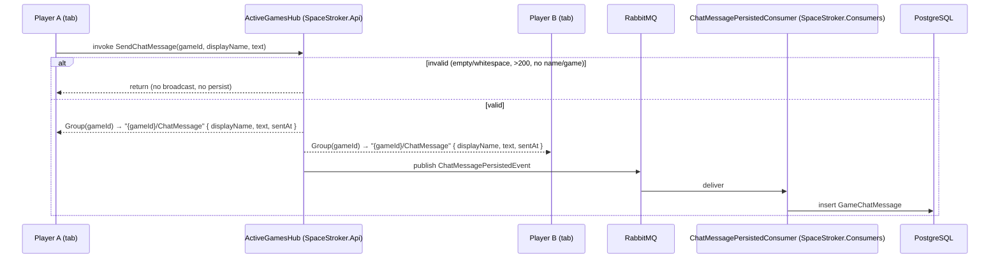
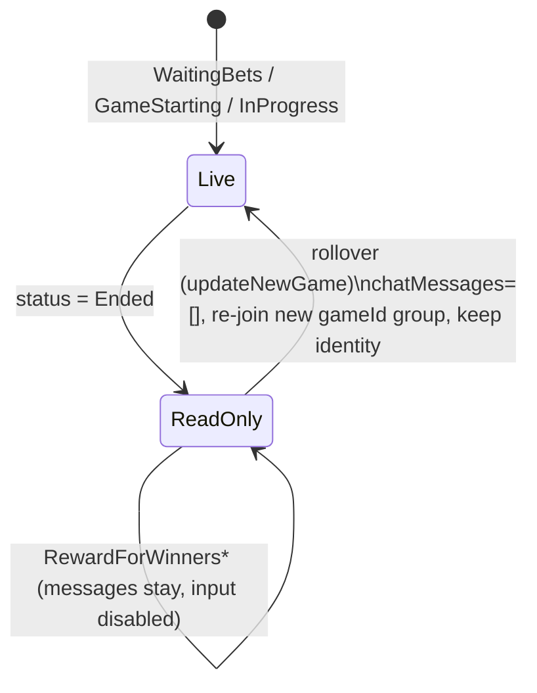
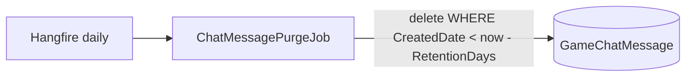

# SpaceStroker — "Add chat" Feature — Implementation Spec

> **Status: Shipped (v2)** — merged `feature/game-chat` → `main` on 2026-07-03.
> Trello: [Add chat](https://trello.com/c/7UnjEOom/4-add-chat). Distilled rules:
> `../features/game-chat.md`.

---

## 1. Summary

Add a realtime chat scoped to **one active game instance**. It reuses the existing
`ActiveGamesHub` (the `Games` hub), its per-game SignalR group, and its Redis backplane —
**no new hub, no new hub connection**. The frontend already opens one `ActiveGamesHub` connection
per game (`wsGamesConnection` in `useGame`) and joins the game group via
`JoinGame(gameId)`; chat piggybacks on that same connection and group.

| Aspect | Behaviour |
| --- | --- |
| **Scope** | One chat room per **active game instance** = the existing SignalR group keyed by `gameId`. |
| **Identity** | The player's **display name** — resolved client-side exactly like bet/winner rows: `displayName` if set, else a **truncated identifier** (last-4 of wallet / token `sub`). No auto-generated nicknames, no `sessionStorage`. |
| **Send eligibility** | Regulated players always have a token identity → can send. **Crypto players must connect a wallet to send** (input disabled + "connect a wallet to chat" prompt until then); they can still **read**. |
| **Persistence** | Every broadcast message is **persisted** to `GameChatMessage` for audit/retention. Persistence is **backend-only** — it does **not** surface to players. |
| **History** | **Late joiners see no prior messages** (unchanged from v1). There is **no** history-load endpoint; persistence is for audit/retention, not replay. |
| **Retention / purge** | A daily job deletes messages older than `GeneralSettings.Chat.RetentionDays` (**default 7**). |
| **Transport** | Hub method `SendChatMessage`; server broadcasts `ChatMessage` to the game group **and** publishes a `ChatMessagePersistedEvent` that a consumer writes to the DB. |
| **Content** | Plain text only (keyboard emoji OK). No linkify, no emoji picker, no markdown. |
| **Limits** | **Client-side:** 200 chars max, **1 message / 1 s**, inline validation. Server enforces **length (≤200) + non-empty** as a hard guard; **no** server rate limiting. |
| **Lifecycle** | Visible the whole time on `/game`. After the game ends (`Ended`), messages stay visible and the input goes **read-only**. On game rollover (auto-advance to the next instance), the message list clears, input re-enables, the same identity is kept, and chat re-joins the new game group. |
| **UI** | Right sidebar, absolutely positioned, **open by default**, hide/show toggle (not persisted). |
| **Hosts** | `SpaceStroker.Api` (hub + broadcast + publish); `SpaceStroker.Consumers` (persistence consumer + purge job + migration). |

There is **no REST API** for chat. Sending is over SignalR; persistence is over RabbitMQ.

---

## 2. Constraints (MANDATORY)

From `monkify-meta/constraints.md` (full list there):

- **Branch-per-repo:** `feature/game-chat` in **both** `monkify-backend` and `monkify-front`
  (and this doc in `monkify-meta`).
- **Unit tests:** add/update tests in `SpaceStroker.Tests` for the hub guard + publish, the persistence
  consumer, and the purge job; **report which tests changed/added** at end of work. Run the full
  suite via `scripts/run_tests.bat`. **This feature does not change the game lifecycle**, so the
  integration suite is not required.
- **EF mapping:** the new `GameChatMessage` mapping is **inline** in
  `SpaceStrokerDbContext.OnModelCreating` — no `IEntityTypeConfiguration`.
- **Migrations:** add one under `SpaceStroker.Infrastructure/Migrations/`; applied only by
  `SpaceStroker.Consumers` at startup. Do not hand-edit the snapshot; regenerate via `dotnet ef`.
- **Secrets/config:** only mock/placeholder values in committed config. The new settings
  (`GameChatEndpoint`, `Chat.RetentionDays`) are non-secret.
- **Operator messaging:** unchanged — chat adds **no** operator-specific messaging; operator scoping
  is implicit via the per-game group and the game row.
- **Host responsibilities intact:** the API broadcasts and publishes but **does not** write chat to
  the DB on the realtime path; persistence + migration + purge live in `SpaceStroker.Consumers`.

---

## 3. Resolved product decisions

| # | Decision |
| --- | --- |
| 1 | Chat is per **active game instance** — one room per game, reusing the existing `gameId` SignalR group on `ActiveGamesHub`. |
| 2 | Extend `ActiveGamesHub` with `SendChatMessage` — **do not** add a third hub or a third client connection. |
| 3 | **Nickname = the player's display name**, not an auto-generated one. Resolved **client-side** from the already-loaded `useDisplayCurrency` state (`displayName`, `externalPlayerId`) — **no per-message server/DB lookup**, so SignalR throughput is unaffected. |
| 4 | Name resolution **mirrors bet/winner rows**: `displayName` if set, else a truncated identifier (last-4 of wallet / token `sub`). |
| 5 | **Crypto players must connect a wallet to send** (no identity ⇒ input disabled with a connect prompt); they can still read. Regulated players always have token identity and can always send. |
| 6 | The auto-generated `Player-XXXX` nickname and its `sessionStorage` persistence are **removed**. |
| 7 | Messages are **persisted** to the DB (`GameChatMessage`) for audit/retention. |
| 8 | Persistence is **backend-only**: **late joiners still see no prior messages**; there is **no** history-load endpoint or replay. |
| 9 | Retention is configurable — `GeneralSettings.Chat.RetentionDays` (**default 7**); a daily job purges older messages. |
| 10 | **Ephemeral display** unchanged: the message list lives in tab memory; cleared on rollover. Persistence runs in parallel and is invisible to players. |
| 11 | Chat is visible the whole time on `/game`; read-only after `Ended`; **full reset** on rollover (clear list, re-enable input, keep identity, join new room). |
| 12 | **UI:** right sidebar, absolutely positioned, **open by default**, hide/show toggle (not persisted). |
| 13 | **Content:** plain text only (keyboard emoji OK). No linkify, no emoji picker, no markdown. |
| 14 | **Limits (client-side):** 200 chars max, **1 message / 1 second**, inline validation. |
| 15 | **Server guard:** reject empty/whitespace and messages > 200 chars — no broadcast, no persist. **No** server-side rate limiting, profanity filter, or moderation in v1. |
| 16 | v1 **trusts the client-sent display name** (anonymous-MVP tradeoff; a crafted client could send a name it doesn't own). Acceptable and documented. |
| 17 | Broadcast payload shape: `{ displayName, text, sentAt }`, where `sentAt` is a **server** UTC timestamp. |
| 18 | Persistence path is **async via event → consumer** (mirrors `BetNotification`): the hub broadcasts first, then publishes; the realtime path never touches the DB. |

---

## 4. Data model

### 4.1 Entity

New `GameChatMessage : TableEntity` (base gives `Id: Guid` + `CreatedDate: DateTime` — the latter
**is** the `sentAt` and the purge key).

`SpaceStroker.Domain/Games/Entities/GameChatMessage.cs`:

```csharp
public class GameChatMessage : TableEntity
{
    public GameChatMessage() { }

    public GameChatMessage(Guid gameId, string displayName, string text)
    {
        GameId = gameId;
        DisplayName = displayName;
        Text = text;
    }

    public Guid GameId { get; set; }
    public string DisplayName { get; set; }
    public string Text { get; set; }
}
```

> No `ExternalPlayerId` column in v1 — game + display name is sufficient audit for this scope, and
> we avoid persisting extra spoofable PII. (A future moderation story can add it.)

### 4.2 EF configuration (inline)

`SpaceStrokerDbContext`: add `public DbSet<GameChatMessage> GameChatMessages { get; set; }` and a
mapping block in `OnModelCreating` following the existing style:

```csharp
modelBuilder.Entity<GameChatMessage>(builder =>
{
    builder.Property(x => x.GameId).IsRequired();
    builder.Property(x => x.DisplayName).IsRequired().HasMaxLength(100);
    builder.Property(x => x.Text).IsRequired().HasMaxLength(200);

    // Purge scans by age; the group read path (if ever added) is by game.
    builder.HasIndex(x => new { x.GameId, x.CreatedDate });
    builder.HasIndex(x => x.CreatedDate);
});
```

### 4.3 Migration

```bash
# from monkify-backend/src
dotnet ef migrations add AddGameChatMessages \
  --project SpaceStroker.Infrastructure --startup-project SpaceStroker.Consumers
```

Applied automatically by `SpaceStroker.Consumers` at startup (`Database.Migrate()`). Do not hand-edit the
snapshot.

---

## 5. Configuration

### 5.1 Backend

- **`SpaceStroker.Domain/Configs/Entities/GameSettings.cs`** — `GameChatEndpoint` (already present
  from v1; keep): the per-game broadcast method template.

- **New `SpaceStroker.Domain/Configs/Entities/ChatSettings.cs`** and a `Chat` property on
  `GeneralSettings`:

  ```csharp
  public class ChatSettings
  {
      public int RetentionDays { get; set; } = 7;
  }
  // GeneralSettings: public ChatSettings Chat { get; set; }
  ```

- **`SpaceStroker.Common/spacestrokersettings.json`**:
  - `GeneralSettings.Games.GameChatEndpoint` = `"{0}/ChatMessage"` (already present).
  - `GeneralSettings.Chat` = `{ "RetentionDays": 7 }` (new).

### 5.2 Frontend — client limits (no new env var)

Rate/length limits are constants in the composable: `MAX_CHAT_LENGTH = 200`,
`CHAT_MIN_INTERVAL_MS = 1000` (**1 msg/s**). `VUE_APP_WEBSOCKET_BASE_URL` is reused unchanged.

---

## 6. Backend behaviour

### 6.1 `ActiveGamesHub.SendChatMessage` (`SpaceStroker.Api` via `SpaceStroker.Infrastructure/Hubs`)

The hub already injects `GeneralSettings` (v1). Add `IRabbitMQService` (already registered; used by
`GameService` for `BetPlaced`/`BetNotification`) so the hub can publish the persist event.

```csharp
public async Task SendChatMessage(string gameId, string displayName, string text)
{
    if (string.IsNullOrWhiteSpace(gameId)) return;
    if (string.IsNullOrWhiteSpace(text) || text.Length > MaxChatMessageLength) return;
    if (string.IsNullOrWhiteSpace(displayName)) return; // client always resolves a name before sending

    var name = displayName.Trim();
    var body = text.Trim();
    var sentAt = DateTime.UtcNow;

    // 1) Broadcast immediately — the realtime path never touches the DB.
    var chatEndpoint = string.Format(_settings.Games.GameChatEndpoint, gameId);
    var payload = new { displayName = name, text = body, sentAt }.AsJson();
    await Clients.Group(gameId).SendAsync(chatEndpoint, payload);

    // 2) Persist asynchronously via the existing event→consumer pattern.
    if (Guid.TryParse(gameId, out var gameGuid))
        await _rabbitMQService.PublishEventAsync(new ChatMessagePersistedEvent(gameGuid, name, body));
}
```

- **Guard:** empty/whitespace text, > 200 chars, empty game, or empty display name ⇒ **return**
  (no broadcast, no publish).
- **Name is client-supplied** and trusted in v1 (decision #16). The hub does **not** resolve identity
  (it has no launch token — hubs are unauthenticated here), which is what keeps it fast.
- **`sentAt`** is a server UTC timestamp.

### 6.2 Persist event + consumer (`SpaceStroker.Consumers`)

- **`ChatMessagePersistedEvent`** (`SpaceStroker.Infrastructure/Events/ChatMessage/…` or alongside
  `BetNotificationEvent`): `record ChatMessagePersistedEvent(Guid GameId, string DisplayName, string Text)`.
- **`ChatMessagePersistedConsumer : BaseConsumer<ChatMessagePersistedEvent>`** (mirror
  `BetNotificationConsumer`): resolves `SpaceStrokerDbContext` from a scope and inserts a
  `GameChatMessage(GameId, DisplayName, Text)` (its `CreatedDate` = persist time).
- Register in **`SpaceStroker.Consumers/Program.cs`**: `x.AddConsumer<ChatMessagePersistedConsumer>()` and a
  `cfg.ReceiveEndpoint(nameof(ChatMessagePersistedConsumer), …)` block, following the existing
  consumers.

> `CreatedDate` is set when the consumer builds the entity, so it lags the broadcast `sentAt` by the
> queue latency (sub-second). That's acceptable — persistence is audit-only and never shown to
> players, so the two timestamps need not be identical.

### 6.3 Purge job (`SpaceStroker.Consumers`)

- A daily **Hangfire recurring job** registered at startup (Hangfire is already configured with a
  dashboard in `SpaceStroker.Consumers/Program.cs`):

  ```csharp
  RecurringJob.AddOrUpdate<ChatMessagePurgeJob>(
      "game-chat-purge", job => job.Purge(), Cron.Daily());
  ```

- **`ChatMessagePurgeJob`** resolves `SpaceStrokerDbContext` + `GeneralSettings` and deletes rows older
  than retention:

  ```csharp
  var cutoff = DateTime.UtcNow.AddDays(-settings.Chat.RetentionDays);
  await context.GameChatMessages.Where(x => x.CreatedDate < cutoff).ExecuteDeleteAsync();
  ```

  (`ExecuteDeleteAsync` is a set-based delete — no entity load.)

### 6.4 What does NOT change

- No new hub, no new `MapHub` (chat uses `/Hubs/Games`, already mapped).
- `RecentBetsHub`, `GameService`, the game lifecycle, and all REST controllers are untouched.

---

## 7. Frontend behaviour (`monkify-front`)

Transport stays centralised in `useGame` (single `ActiveGamesHub` connection); identity + limits
live in `useGameChat`; the panel is `GameChatPanel`.

### 7.1 `useGame.ts` — transport wiring (unchanged from v1 except the payload field)

- Register `${gameId}/ChatMessage` receive in `initalizeWebsocketConnections`, `off` it in
  `disconnectAllPreviousConnections`, clear `chatMessages` in `updateNewGame` (rollover reset) —
  all as already implemented.
- `sendChatMessage(displayName, text)` invokes `SendChatMessage(gameId, displayName, text)`.
- The parsed payload is now `{ displayName, text, sentAt }` (was `guestName`). Update the `ChatMessage`
  type accordingly (§7.5).

### 7.2 `useGameChat.ts` — identity + client limits + read-only state

- **Nickname (decisions #3–#6):** `displayName` if set, else a **truncated identifier**
  (`first4…last4`). The identity `ownId` is the **wallet** for crypto (`publicKey`) and the
  **launch-token `sub`** for regulated. Read the regulated id straight from the token
  (`getPlayerIdFromToken()` in `utils/launchToken.ts`, mirroring `getOperatorIdFromToken`) so it does
  **not** depend on the async `GET /players/preferences` load — fall back to the loaded
  `externalPlayerId` only if present. **Remove** the `sessionStorage` guest-name code.
- **Send eligibility (decision #5):** `canSend = isRegulatedOperator() || !!ownId`. Regulated players
  can **always** send (the token always carries their `sub`); crypto players need a **connected
  wallet**. `resolvedName` must be **non-null whenever `canSend` is true** — regulated falls back to
  `'ANON'` (mirroring bet/winner rows) if no id resolves, so a regulated player with no display name is
  never wrongly blocked. Only crypto-with-no-wallet yields `canSend = false` / a null name, disabling
  the input with a "connect a wallet to chat" prompt.
- **Client limits (decision #14):** `MAX_CHAT_LENGTH = 200`, `CHAT_MIN_INTERVAL_MS = 1000`. `send`
  blocks + shows inline validation when text is empty/whitespace, > 200 chars, or within 1 s of the
  last send; otherwise calls `useGame().sendChatMessage(name, text)`.
- **Read-only after end (decision #11):** `isReadOnly = status >= GameStatus.Ended`.

### 7.3 `GameChatPanel.vue` — sidebar (mostly as v1)

- Right sidebar, absolutely positioned, open by default; local `isOpen` toggle (not persisted).
- Scrollable message list rendering `displayName`, `text`, `sentAt`; auto-scroll on new message.
- Plain-text input with char counter, inline validation, `@keyup.enter` to send.
- Input **disabled** when `isReadOnly` **or** `!canSend`; when `!canSend`, show the connect prompt.
  Messages stay visible while disabled.

### 7.4 `GamePage.vue`

Mount `<game-chat-panel />` inside the existing `relative` container (already done in v1).

### 7.5 Types (`src/types/index.ts`)

```ts
export interface ChatMessage {
  displayName: string;
  text: string;
  sentAt: string; // ISO 8601, server UTC
}
```

### 7.6 What does NOT change / is removed

- **Removed:** auto-generated `Player-XXXX` nickname + `sessionStorage` persistence (v1 AC #9 is
  dropped).
- No history load on join (late joiners still see nothing — v1 AC #3 retained).
- No new service in `src/services` (no REST), no new env var.

---

## 8. Flow diagrams

### 8.1 Send / broadcast / persist



### 8.2 Lifecycle / rollover (unchanged from v1)



### 8.3 Purge (daily)



---

## 9. Out of scope

- **History replay / load-on-join** (explicitly out — persistence is audit-only).
- Server-side rate limiting, profanity filter, moderation / reporting / muting.
- Persisting `ExternalPlayerId` or other identity PII beyond the display-name string.
- Emoji picker, linkify, markdown.
- Mobile layout polish (separate card: "(DESIGN) Mobile layout for the game screen", #5).
- Global / lobby / cross-game chat.

---

## 10. File checklist

### 10.1 Backend (`monkify-backend`)

| # | File | Change |
| --- | --- | --- |
| 1 | `SpaceStroker.Domain/Games/Entities/GameChatMessage.cs` | **New** entity (`: TableEntity`). |
| 2 | `SpaceStroker.Domain/Configs/Entities/ChatSettings.cs` | **New** — `RetentionDays` (default 7). |
| 3 | `SpaceStroker.Domain/Configs/Entities/GeneralSettings.cs` | Add `Chat` property. |
| 4 | `SpaceStroker.Domain/Configs/Entities/GameSettings.cs` | `GameChatEndpoint` (already added in v1). |
| 5 | `SpaceStroker.Common/spacestrokersettings.json` | `Games.GameChatEndpoint` (present) + new `Chat.RetentionDays: 7`. |
| 6 | `SpaceStroker.Infrastructure/Data/Context/SpaceStrokerDbContext.cs` | Add `DbSet<GameChatMessage>` + inline mapping. |
| 7 | `SpaceStroker.Infrastructure/Migrations/*_AddGameChatMessages.cs` | **New** migration (generated). |
| 8 | `SpaceStroker.Infrastructure/Events/.../ChatMessagePersistedEvent.cs` | **New** event record. |
| 9 | `SpaceStroker.Infrastructure/Consumers/.../ChatMessagePersistedConsumer.cs` | **New** `BaseConsumer<>` persisting the row. |
| 10 | `SpaceStroker.Infrastructure/.../ChatMessagePurgeJob.cs` | **New** purge job (`ExecuteDeleteAsync`). |
| 11 | `SpaceStroker.Infrastructure/Hubs/ActiveGamesHub.cs` | Inject `IRabbitMQService`; broadcast `{displayName,text,sentAt}` + publish persist event. |
| 12 | `SpaceStroker.Consumers/Program.cs` | Register the consumer (`AddConsumer` + receive endpoint) and the daily `RecurringJob`. |
| 13 | `SpaceStroker.Tests/UnitTests/Hubs/ActiveGamesHubTests.cs` | Update: assert publish on valid, no publish/broadcast on invalid, `displayName` in payload. |
| 14 | `SpaceStroker.Tests/UnitTests/.../ChatMessagePersistedConsumerTests.cs` | **New** — inserts the row. |
| 15 | `SpaceStroker.Tests/UnitTests/.../ChatMessagePurgeJobTests.cs` | **New** — deletes only rows older than retention. |

### 10.2 Frontend (`monkify-front`)

| # | File | Change |
| --- | --- | --- |
| 1 | `src/types/index.ts` | `ChatMessage.displayName` (rename from `guestName`). |
| 2 | `src/hooks/useGame.ts` | Payload field `displayName`; `sendChatMessage(displayName, text)`. |
| 3 | `src/hooks/useGameChat.ts` | Source name from `useDisplayCurrency` (+truncation); `canSend`; **remove** sessionStorage; `CHAT_MIN_INTERVAL_MS = 1000`. |
| 4 | `src/components/game/GameChatPanel.vue` | Render `displayName`; disable + connect-prompt when `!canSend`. |
| 5 | `src/pages/GamePage.vue` | `<game-chat-panel />` (already mounted). |

### 10.3 Meta (`monkify-meta`)

| # | File | Change |
| --- | --- | --- |
| 1 | `specs/game-chat.md` | This spec (v2). |
| 2 | `INDEX.md` | Update spec row + in-flight blurb. |
| 3 | `features/game-chat.md` | Distilled summary — **on ship** (`/monkify-ship-feature`). |

---

## 11. Unit tests

Project: `monkify-backend/src/SpaceStroker.Tests`.

| Test file | Test cases | Expected |
| --- | --- | --- |
| `ActiveGamesHubTests` | valid message | broadcasts to `{gameId}/ChatMessage` with `displayName`+`text`+`sentAt` **and** publishes one `ChatMessagePersistedEvent`. |
| `ActiveGamesHubTests` | empty/whitespace text, >200 chars, empty gameId, empty displayName | **no** broadcast **and** **no** publish. |
| `ActiveGamesHubTests` | exactly 200 chars | broadcasts + publishes. |
| `ChatMessagePersistedConsumerTests` | valid event | inserts one `GameChatMessage` with the game/name/text. |
| `ChatMessagePurgeJobTests` | rows older + newer than `RetentionDays` | deletes only rows with `CreatedDate < now - RetentionDays`; keeps newer. |

> Frontend has no unit-test harness in this repo; validate identity/limits/read-only/rollover via
> Manual QA (§13).

---

## 12. Acceptance criteria

1. **Realtime delivery** — Given two players in the same game, when one sends a message, the other
   receives it in realtime with `displayName`, `text`, and `sentAt`.
2. **Name is the display name** — Given a player with a set display name, when they send a message, it
   is attributed to that display name; given no display name, it falls back to the same truncated
   identifier shown on their bet/winner rows.
3. **Crypto must connect to send** — Given a crypto-operator player with no connected wallet, when they
   open chat, they can read but the input is disabled with a connect prompt; after connecting, they can
   send under their resolved name. Regulated players can always send.
4. **Persistence (audit)** — Given a valid message is broadcast, then a `GameChatMessage` row is
   persisted with the game id, display name, text, and timestamp.
5. **No history / late joiner** — Given a player joins a game mid-run, when they open chat, they see
   no messages sent before they joined (persistence does not replay).
6. **Read-only after end** — Given the game transitions to `Ended`, messages stay visible and the
   input is disabled.
7. **Full reset on rollover** — Given the game auto-advances to a new instance, the list clears, input
   re-enables, the same identity is kept, and chat joins the new game group.
8. **Hide toggle, no persistence** — Given the panel is open by default, clicking hide collapses it
   without persisting the preference across reload.
9. **Server guard** — Given an empty/whitespace or >200-char message reaches `SendChatMessage`, the hub
   neither broadcasts nor persists it.
10. **Client guard** — Given a player sends >200 chars or faster than 1/second, the client blocks the
    send and shows inline validation.
11. **Retention / purge** — Given messages older than `Chat.RetentionDays` (default 7), when the daily
    purge runs, those rows are deleted and newer ones are kept; the retention value is configurable.

---

## 13. Manual QA

1. `docker-compose` the backend; `yarn serve` the front.
2. Two tabs on the same game. Confirm each shows the sender's **display name** (set one via the
   customization modal; verify fallback truncation when unset). Send A→B in realtime (AC #1/#2).
3. Crypto operator, no wallet: chat readable, input disabled + connect prompt; connect → can send
   (AC #3). Regulated: can always send.
4. After sending, query `GameChatMessages` (ask the user to run it — no prod data) → rows present
   with game/name/text (AC #4).
5. Join a third tab mid-run → no prior messages (AC #5).
6. Spam / 201 chars → client blocks with inline feedback at 1/s (AC #10). Force an invalid `invoke`
   from console → no broadcast, no row (AC #9).
7. Reach `Ended` → messages stay, input disabled (AC #6). Rollover → list clears, input re-enables,
   identity unchanged (AC #7).
8. Toggle hidden, reload → back to open-by-default (AC #8).
9. Set `Chat.RetentionDays` low, insert an old-dated row, trigger the purge (Hangfire dashboard) →
   old row gone, recent kept (AC #11).

---

## 14. Trello / pipeline

- **Source card:** [Add chat](https://trello.com/c/7UnjEOom/4-add-chat) — the **Implementation**
  section records branch (`feature/game-chat`) + spec. The card's Decisions/ACs should be updated
  to v2 alongside this spec.
- **After merge:** run `/monkify-ship-feature Add chat` — it creates the distilled
  `features/game-chat.md`.

---

## 15. Revision log

| Date | Change |
| --- | --- |
| 2026-07-03 | Initial spec from refined card #4 "Add chat" (v1 — ephemeral, anonymous, 1 msg/2 s). |
| 2026-07-03 | **v2 re-refinement:** nickname = player display name (client-resolved, crypto must connect to send); DB persistence (`GameChatMessage`) via event→consumer + daily purge (`Chat.RetentionDays`, default 7); rate limit → **1 msg/s**; **no** history load (late joiners still see nothing). |
| 2026-07-03 | **Fix:** regulated players with no display name were wrongly blocked ("connect a wallet") — `resolvedName` could be null while `canSend` was true. Regulated identity now read from the launch-token `sub` (`getPlayerIdFromToken`), independent of the async preferences load, with an `'ANON'` fallback so `canSend ⟹ resolvedName != null`. |

---

## 16. v1 → v2 delta (for the re-implementer)

The branch already contains the v1 implementation. To reach v2:

**Backend**
- **Add** `GameChatMessage` entity, `DbSet`, inline mapping, and a migration.
- **Add** `ChatSettings` + `GeneralSettings.Chat` + `Chat.RetentionDays: 7` in settings JSON.
- **Add** `ChatMessagePersistedEvent`, `ChatMessagePersistedConsumer` (+ register in Consumers), and
  `ChatMessagePurgeJob` (+ daily `RecurringJob`).
- **Change** `ActiveGamesHub.SendChatMessage`: inject `IRabbitMQService`; rename payload
  `guestName → displayName`; require non-empty display name; publish the persist event after
  broadcasting.
- **Update** `ActiveGamesHubTests` (publish assertions) and **add** consumer + purge tests.

**Frontend**
- **Change** `useGameChat`: remove `sessionStorage` guest-name generation; source the name from
  `useDisplayCurrency` (`displayName` ?? truncated `externalPlayerId`); add `canSend`; set
  `CHAT_MIN_INTERVAL_MS = 1000`.
- **Change** `ChatMessage`/`useGame`/`GameChatPanel` field `guestName → displayName`; disable input
  + connect prompt when `!canSend`.
