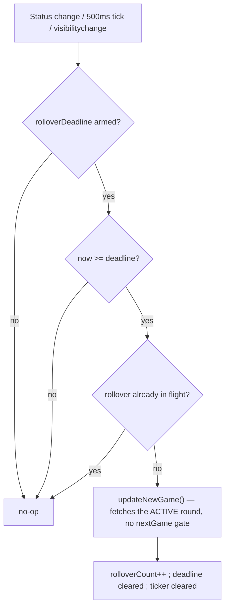

# SpaceStroker — "Improve UX in game mode" — Implementation Spec

> **Status: SHIPPED 2026-08-24** — merged to `main` via `feature/game-mode-ux` in `monkify-backend`,
> `monkify-front` and `monkify-meta`. Distilled into [`../features/game-mode-ux.md`](../features/game-mode-ux.md),
> which is the doc to read on an ordinary task; this spec stays the deep design archive.
>
> ⚠️ **Two things below are stale as shipped** — see §16:
> 1. §14 AC #9's worked example assumes a **2%** house cut. The live rate is **5%**, so that round pays
>    **0.029**, not `0.0296`. Nothing in the code hardcodes a rate.
> 2. AC #14 was **amended at ship time**: the **header balance pills are 3dp**. Global `DP` is still 2.
>
> Originally refined via Trello card
> [Improve UX in game mode #180](https://trello.com/c/GAVPRzf1/180-improve-ux-in-game-mode) (2026-08-23).
> Repos affected: `monkify-backend`, `monkify-front`, and this doc + the deploy config in `monkify-meta`.
>
> **Purpose:** make a *second* round on `/game/play` playable. Today the front rolls the player onto the
> next round **30 s** after `Ended`, but the backend opens that round the instant the previous one ends and
> starts it ~25 s later — so the player arrives ~5 s after the race is already running, and on a table that
> reaches its 2-player minimum on its own they can never bet on a rolling round at all. This spec shortens
> and *re-bases* that hold, replaces the un-retried one-shot that strands a tab on a dead view, fixes the
> per-round state that is never cleared, and makes the money the player is shown both precise and complete.

---

## 1. Summary

Six symptoms, four root causes, one round-lifecycle change. Three of the six had a **different** cause than
the card originally assumed; those diagnoses are settled and must not be re-derived.

| # | Symptom | Real cause (established in refinement) | Fix |
| --- | --- | --- | --- |
| 1 | The player rolls over onto an already-running race | `GameConsole.vue:213` waits `newGameDelay` (30 000 ms) from `Ended`; the backend's next round is `InProgress` by t≈25 s (15 s `MinimumWaitPeriodForBets` + 10 s `TimeUntilGameStarts`) | Hold **9 000 ms measured from `Ended`**, event-driven, and that hold is also the **cap** |
| 2 | Tab stuck on an old view until reload | `fetchNewGame()` is one `setTimeout`, gated on `nextGame` **and** `status === RewardForWinnersCompleted`. A late payout, `ErrorWhenProcessingRewards`, or a missed `GameReceived` ⇒ **nothing ever retries** | Deadline + repeating re-evaluation + `visibilitychange` catch-up; terminal on `RewardForWinnersCompleted` **or** `ErrorWhenProcessingRewards`; rolls over at the cap regardless |
| 3 | Previous round's result/animation not cleared | `finishedTyping` is set `true` in `GameTyper.vue` and **never set back to `false` anywhere in the repo**; `winnerChoice` / `winners` are never cleared; `GameMonkey.updateAnimation` has **no branch** for 5 statuses and leaves **two nested uncancelled `setTimeout`s** (3200 ms → 1250 ms) | Reset the three refs in `updateNewGame()`; give `GameMonkey` the 5 branches + cancel its chain; stamp the speed-reset deadline with its round |
| 4 | "Won 0.02" on a 0.0296 credit | `formatSol` **truncates to 2 dp** (`utils/money.ts`). `useOrbitNotifications.onWin` prints the server's already-correct `win.amount` | New **payout-only 4 dp formatter**; global `DP` stays **2** |
| 5 | The player is never told what was actually paid | `GameResult` carries **no amounts at all** — only `Winners`, `NumberOfWinners`, `FirstChoiceTyped` | Backend publishes a **nullable per-winner NET reward** on the reward-completed Status event; new `> PAID:` terminal line + a **manual-winner win toast** (none exists today) |
| 6 | Mobile ended screen hides the winner | Auto-scroll lands on `scrollHeight`; the SERVER SEED block sits between the result and `ROUND OVER.` | **Mobile-only** reorder: SERVER SEED moves **above** `> COMPLETE!` |

**Side effect of #3 that this also closes:** because `finishedTyping` is never reset, from round 2 onward the
result block renders at `Ended` instead of at `RewardForWinnersCompleted` — round 1 and rounds 2+ behave
differently today.

**Timeline, before and after** (t measured from `Ended`):

| t | Backend | Front today | Front after |
| --- | --- | --- | --- |
| 0 s | round N `Ended`; successor N+1 already created (`RunGameConsumer.cs:60`, before `RewardGameEvent` at :66); N+1 opens `WaitingBets` | result block renders | result block renders |
| ~1–3 s | N → `RewardForWinnersInProgress` → `RewardForWinnersCompleted` | `> REWARDS SENT` | `> REWARDS SENT` + `> PAID:` + win toast |
| **9 s** | N+1 still `WaitingBets` (~6 s of its 15 s window left) | — | **rollover** → player can bet, then sees the full 10 s countdown |
| ~15 s | N+1 → `GameStarting` (10 s countdown) | — | countdown visible |
| ~25 s | N+1 → `InProgress` | — | race visible from the start |
| **30 s** | N+1 mid-race | **rollover** → lands ~5 s into a running race | — |

---

## 2. Constraints (MANDATORY)

From `monkify-meta/constraints.md` (full list there):

- **Worktree per repo (§2):** `feature/game-mode-ux` at `.worktrees/game-mode-ux/{monkify-backend,monkify-front,monkify-meta}`,
  each branched off `origin/main` and pushed to `origin`. All three hubs stay on `main` — never
  `git checkout -b` in a hub.
- **Unit tests (§3):** update/add in `SpaceStroker.Tests`; run via **`scripts/run_tests.bat`** (a bare
  `dotnet test` also runs the `ProductionGames` Monte Carlo suite the script excludes by design and
  "fails" ~156 tests meaninglessly). **Report exactly which tests changed or were added.**
- **Integration tests (§3):** this is a **game-flow contract change**, so the existing Testcontainers happy
  path is **extended** — no new suite. Run via `scripts/run_integration_tests.bat` (Docker required).
- **EF mapping / migrations (§4):** **N/A** — no entity, no column, no migration. Say so explicitly at
  hand-off rather than silently omitting it.
- **Secrets/config (§1):** `.env.*` and `deploy/secrets.example.json` get **mock/placeholder values only**.
  `.env.production` still carries `https://your-production-api.com/...` placeholders — **do not "fix" those
  here**.
- **Host split (§8):** the new figure is computed and published by **`SpaceStroker.Consumers`**; the API
  stays stateless and gains nothing.
- **Money-shaped claim:** the `PAID` line and the toasts state what was **actually paid**. Any figure the
  front cannot source authoritatively is **omitted, never approximated** — never `0`, never a re-derivation.
- **No test runner in `monkify-front`:** DoD there is `yarn lint` + `yarn build` + verification on the local
  Docker stack.

---

## 3. Resolved product decisions

| # | Decision |
| --- | --- |
| 1 | **Rollover is event-driven, not a fixed timer.** Re-evaluated on **every** status change, on a repeating tick, and on `visibilitychange`. |
| 2 | **The hold is measured from `Ended` and is also the cap.** Default **9 000 ms** (owner's range 8–10 s; midpoint). At the cap the front rolls over **whether or not rewards finished**. |
| 3 | **Accepted cost of #2:** on a slow payout the player may never see `> REWARDS SENT`. Payout confirmation falls to the balance chip and the win toast. |
| 4 | **Terminal states for the rollover are `RewardForWinnersCompleted` OR `ErrorWhenProcessingRewards`.** Reaching either before the cap does *not* roll over early — the hold still runs to 9 s. |
| 5 | **One rollover path for every game type, lottery included.** No mode branch. On Space Jackpot the only effect is landing on the next draw's countdown ~20 s sooner. |
| 6 | **Practice mode keeps the coupling.** `constants/practiceGame.ts` deliberately reads the same env var, so practice's hold becomes 9 s too. Sanity-check the tutorial bubble pacing once at the new rhythm. |
| 7 | **Fix the real state leaks; no blanket periodic reset.** A blind timer would not fix the monkey's timers or the unhandled statuses, and can wipe state the next round already set. |
| 8 | **The net paid amount comes from the backend**, as a **nullable per-winner NET reward** on `GameResult`, published on the transition to `RewardForWinnersCompleted`. Identical for every paid winner, so a single figure on a group-wide broadcast leaks nothing. |
| 9 | **Rejected:** re-deriving the payout in TypeScript from pot/winners/`commissionPercentage` — that duplicates `BetDomainService` (free-bet `PayableWinnerCount`, lottery `houseFundedShare`, 9-dp truncation) and drifts silently the next time payout math changes. |
| 10 | **New `> PAID:` line, shown to everyone**, directly under `> PAID TO:`. **Omitted entirely** when there is no paid winner. Never prints `0`. |
| 11 | **Payout figures use a new payout-only formatter at 4 dp**, exported from `utils/money.ts`, used **only** by the PAID line and the win toasts. 4 dp not 3: at 3 dp truncation still turns `0.0296` into `0.029`. **Global `DP` stays 2** — raising it reopens the `0.5656`-in-the-header bug that module exists to fix. |
| 12 | **Orbit keeps ONE toast**, precision fixed. **Rejected:** a second "Orbit placed a new bet" toast — on a rolling table that is two toasts every ~40 s forever, and the balance chip already animates the re-stake. |
| 13 | **New win toast for manual (non-Orbit) winners**, which does not exist today. Same 4 dp formatter, same number as the PAID line. Orbit and manual toasts must **never both fire** for one bet. |
| 14 | **`> YOU WON! CONGRATS!` turns yellow**, reusing the existing `N AWAY` amber token (`#fde047`) — no new colour enters the palette. That line only. |
| 15 | **Mobile-only reorder** (below `lg`): `SERVER SEED → COMPLETE → WINNER → PAID TO → PAID → YOU WON → ROUND OVER`. Desktop keeps today's order exactly. The seed stays on screen; the near-miss dock stays sticky below everything. |
| 16 | **The dead `VUE_APP_NEW_GAME_DELAY` knob is fixed at its real root** — see §5. The name mismatch in `.env.production` is only half the story. |

---

## 4. Data model

**N/A — no entity, no column, no EF mapping, no migration.** The only persisted-state touch is the existing
`Game.WinningChoice` / `Game.Bets`, both already written by the time the reward path runs. State the N/A
explicitly at hand-off; do not silently omit §4.

---

## 5. Configuration

### 5.1 The rollover hold — and why the env knob is dead in production

The card recorded that `.env.production` sets `VUE_APP_NEW_SESSION_DELAY` while the code reads
`VUE_APP_NEW_GAME_DELAY`. **Code exploration found that is not the whole cause, and fixing only the name
would not make the knob live.** The real chain:

1. `monkify-front/.gitignore` ignores **`.env.production`, `.env.local` and `.env.*.local`** — the **only
   tracked env file in the repo is `.env.example`** (`git ls-files | grep env` returns exactly one path). A
   CI/deploy clone therefore has **no `.env.production` at all**.
2. The production build's env comes from `SpaceStroker.Deploy`: `Deployer.WriteFrontEnv` writes
   **`.env.production.local`** (Vue CLI's highest-priority file) from the `frontBuild` block of
   `deploy/secrets.<env>.json`.
3. That `frontBuild` block **does not contain `VUE_APP_NEW_GAME_DELAY` under either name**
   (`deploy/secrets.example.json` §`frontBuild`).

⇒ **Production has always run the hardcoded `|| 30000` fallback.** Renaming a key in an untracked file that
CI never sees changes nothing.

**The fix therefore has three parts, in order of load-bearing weight:**

| Part | File | Change | Why |
| --- | --- | --- | --- |
| **A (load-bearing)** | `monkify-front/src/constants/gameTiming.ts` **(new)** | `export const RESULT_HOLD_MS = parseInt(process.env.VUE_APP_NEW_GAME_DELAY!) || 9000;` | This is the value production actually uses. One module, two consumers (`useGame`, `practiceGame`) — replacing two independent `parseInt(...) || 30000` copies that must never drift (decision 6). |
| **B** | `monkify-front/.env.example` | `VUE_APP_NEW_GAME_DELAY=30000` → `9000` | The only tracked env file; it is the documentation of the knob. |
| **C** | `monkify-meta/deploy/secrets.example.json` → `frontBuild` | add `"VUE_APP_NEW_GAME_DELAY": "9000"` | Makes the knob *reachable* in production for the first time. ⚠️ `secrets.production.json` / `secrets.development.json` are **operator-held and untracked** — the operator must copy the key across. Part A means the build is correct even if they never do. |

**Also update, but note they cannot be committed:** the working-tree `.env.local` (`30000` → `9000`) and
`.env.production` (rename `VUE_APP_NEW_SESSION_DELAY` → `VUE_APP_NEW_GAME_DELAY=9000`). Both are
git-ignored; the rename is still worth doing so the next person reading the file is not misled. Say so in
the hand-off rather than reporting AC #23 as a committed change.

### 5.2 Backend timings — unchanged, and deliberately so

`GeneralSettings.Games.MinimumWaitPeriodForBets` (15) and `TimeUntilGameStarts` (10) in
`SpaceStroker.Common/spacestrokersettings.json` are **out of scope**. The fix is on the front's side of the
clock. `GeneralSettings.Games.DelayBetweenGames` (= 20) is referenced nowhere — recorded as a finding
(§12), cleaned up on a separate card.

---

## 6. Backend behaviour (`monkify-backend`)

### 6.1 The contract

`src/SpaceStroker.Infrastructure/Contracts/Games/GameStatusUpdatedEvent.cs`:

```csharp
public record GameStatusUpdatedEvent(GameStatus Status, DateTime? StartDate, GameResult? Result = null);

public record GameResult(
    IEnumerable<string> Winners,
    int NumberOfWinners,
    string FirstChoiceTyped,
    // The NET amount a single PAID winner received, after the house cut — exactly what moved on-chain
    // (or into Orbit custody). Uniform across paid winners by construction (same RequiredAmount stake,
    // same PayableWinnerCount divisor, same houseFundedShare), so publishing it to the whole game group
    // leaks nothing about any individual. NULL whenever nothing was paid.
    decimal? NetRewardPerWinner = null);
```

⚠️ **Nullable is the whole backward-compatibility story and it is free:** `JsonConvertExtensions.JsonSettings`
sets `NullValueHandling.Ignore`, so a null field is **absent from the JSON**. An older client sees exactly
today's payload. (Serialization is `CamelCaseNamingStrategy` ⇒ the wire name is **`netRewardPerWinner`**.)

### 6.2 Today's shape (read this before changing `GameService`)

`GameService.UpdateGameStatus` builds a `GameResult` **only when `monkey != null`**
(`GameService.cs:257-287`). `RewardGameConsumer` calls `UpdateGameStatus(game, status)` with **no monkey**,
so **today the reward-completed Status event carries `result: null` entirely** — the front's
`statusData.result` is undefined on that event. The new figure therefore needs the `GameResult` to be
*constructed* on the reward path, not merely extended.

`RewardForWinnersCompleted` and `ErrorWhenProcessingRewards` are both already in `Game.GameEndedStatus`
(`Game.cs:86`), so `game.EndDate` is already re-stamped on those transitions today. **That is pre-existing
and stays** — do not "fix" it in this card.

### 6.3 `IGameService` / `GameService`

`src/SpaceStroker.Infrastructure/Services/Games/IGameService.cs`:

```csharp
Task UpdateGameStatus(Game game, GameStatus status, SpaceStrokerTyper? monkey = null, decimal? netRewardPerWinner = null);
```

`GameService.UpdateGameStatus` — inside the existing `if (Game.GameEndedStatus.Contains(status))` block,
add a second arm **beside** the `monkey != null` arm (never replacing it):

```csharp
if (monkey != null)
{
    // ... unchanged: WinningChoice, CharactersTyped, winners, result = new GameResult(...)
}
else if (netRewardPerWinner.HasValue && !string.IsNullOrEmpty(game.WinningChoice))
{
    // The reward path has no typer. Everything the result needs is already persisted: WinningChoice
    // and CharactersTyped were written in the SAME SaveChanges as the Ended transition, and the
    // consumer loads the game with its Bets. Nothing is re-decided here — only re-read.
    var winners = game.Bets
        .Where(x => x.Choice == game.WinningChoice)
        .Select(x => x.GetWalletAddress())
        .Where(x => !string.IsNullOrWhiteSpace(x))
        .Select(x => x!)
        .Distinct();

    result = new GameResult(winners, game.Bets.Count(x => x.Choice == game.WinningChoice),
                            game.WinningChoice, netRewardPerWinner);
}
```

⚠️ Use the **same** `GetWalletAddress()` + `Distinct()` derivation as the monkey arm — the front matches
`winners[]` against `currentPlayerId`, and a second derivation that differs by one normalisation step
silently breaks `userWon` on the reward event only.

⚠️ `NumberOfWinners` here counts winning **bets** (matching `SpaceStrokerTyper.NumberOfWinners`, which sums
`amountOfPlayers` per matching choice), not distinct wallets. Keep the two consistent — the front reads only
`winners[]` today, but the field is on the wire and must not mean two things.

### 6.4 `RewardGameConsumer` — capture the figure, never re-derive it

`src/SpaceStroker.Infrastructure/Consumers/RewardGame/RewardGameConsumer.cs`:

```csharp
decimal? netRewardPerWinner = null;
```

declared before the payout loop; inside the loop, on a **successful credit only**:

```csharp
if (creditResult.IsSuccess)
{
    // FIRST successful paid credit wins. This is not an estimate: it is the exact decimal
    // CalculateRewardForBet produced and ITokenSettlementService/IOrbitBetSettlementService moved —
    // already commission-applied and already Math.Round(..., Decimals, ToZero) onto the lamport grid.
    netRewardPerWinner ??= rewardResult.Value;
    await gameService.UpdateBetStatus(winner, BetStatus.Rewarded);
}
```

and at the status transition:

```csharp
await gameService.UpdateGameStatus(
    game, newGameStatus,
    netRewardPerWinner: newGameStatus == GameStatus.RewardForWinnersCompleted ? netRewardPerWinner : null);
```

**Why capture rather than compute:**

- Free-bet winners `continue` **before** `CalculateRewardForBet`, and pre-`SettlementCutoverUtc` winners
  `continue` at `NeedsManualAnalysis` — so neither can ever set the value. The "no paid winner ⇒ null"
  rule falls out of the control flow instead of needing its own guard.
- The `game.Bets.Any(x => x.Status == NeedsRewarding)` early return (a round nobody won) calls
  `UpdateGameStatus(game, RewardForWinnersCompleted)` with no net ⇒ null ⇒ no `GameResult` ⇒ no PAID line.
  Correct with no change to that branch.
- `CalculateRewardForBet` subtracts prior `Credit` rows for idempotency, so a *re-run* would yield a
  smaller figure — but a re-run finds no `NeedsRewarding` bets and takes the early return, so it never
  reaches here.

⚠️ **`ErrorWhenProcessingRewards` publishes `null` even when one winner was actually paid.** That is
deliberate (AC #5: an error round prints no PAID line and fires no toast). The money still moved and is
still in the ledger; the round simply does not make a payout *claim* it cannot make for every winner.
Record this in the ship-time KB note — it is a knowing trade, not an oversight.

### 6.5 The uniformity premise

The single figure is only safe because every paid winner receives the same amount. That holds because
`CalculateRewardForBet` divides by a frozen `PayableWinnerCount`, every paid bet's `Amount` equals the
type's `RequiredAmount`, and `CommissionForWinner` uses the same `houseFundedShare` for each. **Pin it with
a unit test** (§11) — if a future change makes payouts non-uniform, that test fails before the wire
contract starts lying.

`GameHistoryDto.MyPayout` (`GameHistoryService.cs:253`) already derives the true net by summing
`Credit`-type `TransactionLog` rows. Reuse that derivation's *shape* as the reference for what "net" means;
do not invent a second definition.

---

## 7. Frontend behaviour (`monkify-front`)

### 7.1 Rollover — moved into `useGame`, register-once

**Where it must live.** Today the rollover is a `watch` inside `GameConsole.vue`. `GameConsole` is mounted
by `GameTerminal` on desktop and by `GamePage` on mobile (twice in that branch — the phone cabinet and the
`wide` three-plate console), so the timer's cardinality is a property of the layout. Move the **decision**
into `useGame.ts` module scope behind a **register-once flag**, exactly like the existing `moneyWiringDone`
/ `idleWiringDone` blocks. `GameConsole` keeps only the lever animation.

**Why a deadline and not a `setTimeout`.** Chrome throttles and eventually freezes `setTimeout` in a hidden
tab — this is the same failure `useGame`'s speed reset already documents (`SPEED_RESET_MS`,
`speedResetDeadline`, the `visibilitychange` catch-up at `useGame.ts:144`). A 9 s timer armed in a
backgrounded tab is exactly the "stuck on an old view" bug wearing new clothes. **Reuse the established
idiom**: a wall-clock deadline is the correctness mechanism; the timer is only the fast path.

```ts
// Module scope, next to the speed-reset deadline it deliberately mirrors.
let rolloverWiringDone = false;
let rolloverDeadline: number | null = null;      // wall-clock target, set once on Ended
let rolloverTicker: ReturnType<typeof setInterval> | undefined;
let rolloverForGameId: string | null = null;     // the round the deadline belongs to
let rolloverInFlight = false;                    // updateNewGame() is async — never re-enter it
const rolloverCount = ref(0);                    // bumped after each successful rollover (lever cue)
```

**Arming.** In the `Ended` branch of the status watcher (or a dedicated register-once watcher):

```ts
rolloverDeadline = Date.now() + RESULT_HOLD_MS;
rolloverForGameId = gameInstance.value?.gameId ?? null;
```

Set on the **first** `Ended` for a round only (guard on `rolloverForGameId !== gameId`) — a duplicate
`Ended` frame must not push the deadline out.

**Evaluating** — `evaluateRollover()` runs from **three** sources, all of which must be wired:

1. the status watcher, on **every** status change (not just `Ended`);
2. a repeating `setInterval` (**500 ms**) started when the deadline is armed and cleared when it fires;
3. `document.addEventListener('visibilitychange', …)` — the catch-up for a throttled tab.

```ts
const evaluateRollover = async () => {
  if (rolloverDeadline === null || rolloverInFlight) return;
  if (Date.now() < rolloverDeadline) return;          // the hold is also the cap

  rolloverInFlight = true;
  rolloverDeadline = null;
  if (rolloverTicker) { clearInterval(rolloverTicker); rolloverTicker = undefined; }
  try {
    await updateNewGame();                             // does NOT need nextGame — see below
    rolloverCount.value++;
  } finally {
    rolloverInFlight = false;
    rolloverForGameId = null;
  }
};
```

**⚠️ `nextGame` is no longer a gate.** `updateNewGame()` → `getBets()` fetches the type's **currently
active** round from the API; `nextGame` was only ever the `GameReceived` broadcast's signal that one exists.
Dropping it as a precondition is what fixes the "`GameReceived` never arrived (missed frame, backgrounded
tab)" edge case *without* an unbounded retry loop: there is nothing to wait for. Keep `nextGame` itself —
it is still cleared in `updateNewGame()` and still read elsewhere.

**⚠️ The successor always exists by t=9 s.** `RunGameConsumer` creates it at line 60, **before** publishing
`RewardGameEvent` at line 66 — i.e. before the reward path even starts. So the fetch at 9 s cannot race an
unopened round.

**⚠️ Terminal states are informational, not accelerators.** `RewardForWinnersCompleted` and
`ErrorWhenProcessingRewards` arriving early must **not** roll over before the deadline — the player has to
see the result. They matter only in that the deadline fires regardless of them.

**Teardown.** Clear `rolloverTicker` and null the deadline in `updateNewGame()` (belt-and-braces if a
rollover is triggered another way) and when the player leaves the game page. The `visibilitychange`
listener is registered once at module scope, like the speed reset's.

**Manual lever.** `GameConsole.fetchNewGame()` becomes a thin wrapper that calls the same rollover, and its
gate widens from `status === RewardForWinnersCompleted` to **either terminal state** — a player on an
errored round can still pull the lever. Both lever click handlers (mobile plate and desktop image) use the
same predicate.

**Lever animation.** `GameConsole` watches `rolloverCount` and plays `leverDownAnimation()` +
`leverUpAnimation()` after 500 ms — the visual that used to live inside `fetchNewGame()`.

### 7.2 State reset (`useGame.updateNewGame`)

Add to the existing reset block, beside `terminalOutput` / `ownBetChoices` / `nearMiss.reset()`:

```ts
winnerChoice.value = '';
winners.value = [];
finishedTyping.value = false;   // set true in GameTyper.vue and never set false anywhere in the repo
netRewardPerWinner.value = null;
winToastFiredForGame = null;    // re-arm the manual win toast, like endAudioFiredForGame above it
```

⚠️ **`currentPot` stays untouched.** `getBets()` (which runs first) is its single source of truth and has
already seeded it to `lotteryBase + Σ bets`. Zeroing it here is the shipped `POT: 0` regression on Space
Jackpot — the existing comment says so; do not remove it.

⚠️ Because `updateNewGame()` is what `resumeFromIdle()` calls, this same reset is what satisfies AC #25
(a resumed tab must never show the previous round's winner or PAID line).

### 7.3 Cross-round speed-reset guard

`gradualSpeedReset()` steps `typingSpeed` 3→2 immediately and 2→1 after `SPEED_RESET_MS` (1500 ms) /
`SPEED_RESET_FROM_3_MS` (2000 ms). It is called from **both** `onGameReceived` and the `Ended` branch. With
a 9 s hold those steps land inside the old round, but the deadline can also be evaluated late (throttled
tab) and apply a step-down **into a round that has already started** — which drives `GameMonkey`'s
`typingSpeed` watcher onto the wrong typing GIF.

Fix at the source, not at the watcher: stamp the round when arming and drop a stale application.

```ts
let speedResetGameId: string | null = null;
// in gradualSpeedReset(): speedResetGameId = gameInstance.value?.gameId ?? null;
// in evaluateSpeedReset(): if (speedResetGameId && speedResetGameId !== gameInstance.value?.gameId) {
//   speedResetDeadline = null; speedResetGameId = null; return;  // the round it belonged to is gone
// }
```

`GameMonkey`'s `typingSpeed` watcher keeps its existing `status === InProgress` guard — one fix at the
source is enough, and duplicating it in the watcher would hide a future regression in the source.

### 7.4 `GameMonkey.vue` — five branches and a cancellable chain

**The chain.** `updateAnimation`'s `Ended` branch starts `setTimeout(3200) → setTimeout(1250)` (4.45 s
total) and **cancels neither**. At a 30 s hold that never mattered; at 9 s it races the next round.

```ts
let endedChainA: ReturnType<typeof setTimeout> | null = null;
let endedChainB: ReturnType<typeof setTimeout> | null = null;
const clearEndedChain = () => { /* clearTimeout both, null both */ };
const endedChainRunning = () => endedChainA !== null || endedChainB !== null;
```

- Call `clearEndedChain()` at the **top of every** `updateAnimation(status)` call except the `Ended` branch
  itself (which clears, then re-arms).
- Each timeout nulls its own handle when it runs, so `endedChainRunning()` is honest.
- Call `clearEndedChain()` in `onUnmounted`, beside the existing `clearGlassesTimeout()`.

**The five missing branches.** `updateAnimation` today handles only `WaitingBets`, `GameStarting`,
`InProgress`, `Ended`. Add:

| Status | Behaviour | Why |
| --- | --- | --- |
| `RewardForWinnersInProgress` | If `endedChainRunning()` → **leave the chain alone** (it owns the frame, and it lands on `idle` at 4.45 s). Else → `idle`. | This arrives ~1 s after `Ended`; cutting the finale short there is the regression, not the fix. The branch exists so the outcome is **defined**, not a fall-through. |
| `RewardForWinnersCompleted` | Same rule as above. | Same. |
| `NotEnoughPlayersToStart` | `clearEndedChain()`; `resetBetAnimationState()`; `clearGlassesTimeout()`; `currentAnimation = idle`. | The under-subscription refund state — nothing is running, so rest. |
| `ErrorWhenProcessingRewards` | Same as `NotEnoughPlayersToStart`. | |
| `GameEndedAbruptely` | Same as `NotEnoughPlayersToStart`. | |

### 7.5 Money formatting (`utils/money.ts`)

One new export. `DP`, `formatSol` and `formatCompact` are **unchanged**.

```ts
/**
 * ⚠️ THE PAYOUT FORMATTER — the ONLY surface allowed more than DP places, and only two callers may
 * use it (the terminal's `> PAID:` line and the two win toasts). Everything else keeps `formatSol`.
 *
 * ⚠️ 4dp, NOT 3. `formatSol`'s 2dp turns the 0.0296 a winner takes from a 0.03 pot into `0.02`; 3dp
 * still truncates it to `0.029`. This is the ONE place where "the number is a claim about what we
 * paid you" outranks "every column is 2dp".
 *
 * ⚠️ DP STAYS 2 GLOBALLY. Raising it is what put `0.5656` in the header — the bug this module was
 * written to fix (see the DP comment above). Widening the payout alone is the narrow fix.
 *
 * ⚠️ TRUNCATED like everything here, and the SIGNIFICANT escape is retained below 0.0001 so a real
 * but tiny payout never renders `0.0000`.
 */
const PAYOUT_DP = 4;
const PAYOUT_FLOOR = 0.0001;

export const formatPayout = (n: number | null | undefined): string => {
  if (n === undefined || n === null || Number.isNaN(n)) return AT_DP.format(0);

  const abs = Math.abs(n);
  if (abs === 0) return AT_DP.format(0);

  if (abs >= PAYOUT_FLOOR) return atPlaces(PAYOUT_DP).format(truncateTo(n, PAYOUT_DP));

  const exponent = Math.floor(Math.log10(abs));
  const places = Math.min(MAX_DP, Math.max(PAYOUT_DP, SIGNIFICANT - 1 - exponent));
  return atPlaces(places).format(truncateTo(n, places));
};
```

`atPlaces(dp)` already pins `minimumFractionDigits: DP` (2) and lets `Intl` trim trailing zeros beyond
that, so `0.0296 → "0.0296"`, `0.03 → "0.03"`, `2 → "2.00"`. Nothing new is needed for that.

### 7.6 Types (`src/types/index.ts`)

`onStatus` currently does a bare `JSON.parse(data)` with no type at all. Introduce the shape:

```ts
export interface GameResultPayload {
  winners: string[];
  numberOfWinners: number;
  firstChoiceTyped: string;
  /** NET per PAID winner, after the house cut. Absent when nothing was paid (see spec §6.4). */
  netRewardPerWinner?: number | null;
}

export interface GameStatusEvent {
  status: GameStatus;
  startDate?: string | null;
  /** ⚠️ Never actually sent today — see spec §12, finding 2. Typed optional so the existing read
   *  (which already falls back to the loaded instance) stays honest rather than being deleted here. */
  serverSeedHash?: string;
  result?: GameResultPayload;
}
```

⚠️ Also fix the unguarded access at `useGame.ts:556` (`statusData.result.firstChoiceTyped` — no `?.`,
unlike the four guarded reads above it). It is safe today only because `Ended` always carries a result;
typing the payload makes the inconsistency a compile error.

### 7.7 `useGame.onStatus` — surfacing the figure and the manual win toast

New module-scope state:

```ts
const netRewardPerWinner = ref<number | null>(null);
let winToastFiredForGame: string | null = null;
```

In `onStatus`, a new branch (the reward-completed event is the **only** carrier):

```ts
if (statusData.status === GameStatus.RewardForWinnersCompleted && statusData.result) {
  // The reward event now carries a result of its own (it carried none before this card), so it is
  // also the first chance a client that joined AFTER Ended has to learn the winner. Fill the two
  // result refs only if they are still empty — never overwrite what the Ended event set.
  if (!winnerChoice.value && statusData.result.firstChoiceTyped) {
    winnerChoice.value = statusData.result.firstChoiceTyped;
    winners.value = statusData.result.winners;
  }
  netRewardPerWinner.value = statusData.result.netRewardPerWinner ?? null;
  maybeFireWinToast();
}
```

**The manual-winner toast.** The only win toast in the app today is Orbit's (`useOrbitNotifications`);
`useTokenBalance`'s `'win'` attribution drives a `MoneyValue` chip, not a toast.

```ts
/**
 * The winning bet this player placed FROM THEIR OWN WALLET, if any.
 *
 * ⚠️ Derived from the LOADED BETS, not from the bet() call path. `ownBetWasPaid` is only set by
 * bet() and is re-armed per round, so a player who refreshes mid-round and then wins would get no
 * toast. The instance survives a reload; the call path does not.
 *
 * ⚠️ `amount > 0` excludes free-bet winners (marked Rewarded, paid nothing) and `!viaOrbit` excludes
 * the Orbit path, which has its own toast — the two must never both fire for one bet.
 */
const myWinningWalletBet = computed(() => {
  const me = currentPlayerId.value;
  const choice = winnerChoice.value;
  if (!me || !choice) return null;
  return gameInstance.value?.bets.find(
    (b) => b.externalPlayerId === me && b.choice === choice && b.amount > 0 && !b.viaOrbit
  ) ?? null;
});

const maybeFireWinToast = () => {
  const gameId = gameInstance.value?.gameId ?? null;
  const net = netRewardPerWinner.value;
  if (!gameId || !net || winToastFiredForGame === gameId) return;   // never toast a null/zero figure
  if (!myWinningWalletBet.value) return;
  winToastFiredForGame = gameId;
  toast.success(`You won ${formatPayout(net)} ${selectedGame.value?.tokenSymbol ?? 'SOL'}!`);
};
```

Export `netRewardPerWinner` as a `computed` from `useGame()`, next to `winnerChoice` / `winners`.

`useOrbitNotifications.onWin`: `formatSol(win.amount)` → `formatPayout(win.amount)`. That one-token change
is the whole of decision 12; the toast text, the single-toast rule and the `refreshQuietly` sequencing are
untouched.

### 7.8 `GameTerminal.vue` — the PAID line, the amber win line, the mobile reorder

**Where the result block lives.** The outer gate is
`status > GameStatus.GameStarting && status < GameStatus.ErrorWhenProcessingRewards`, i.e. statuses **4–7**.
⚠️ **`ErrorWhenProcessingRewards` (8) falls through to the `v-else` pre-game block**, which renders
`gameStatusLabel[8]` = `> ERROR SENDING REWARDS. CONTACT SUPPORT.`. That is where AC #5's copy comes from
and **it is unchanged** — no result block, so "no PAID line, no toast" on an error round is already
structurally true. Do not add a PAID line to that branch.

**1. The `> PAID:` line**, directly under the `PAID TO` single/multi block and above `YOU WON`:

```html
<!-- What a single winner actually received, net of the house cut — the number the backend moved,
     never a figure this component derives. Absent (not `0`) whenever nothing was paid: a free-bet-only
     round, an errored payout, or a pre-deploy round whose event carries no amount. -->
<p v-if="netRewardPerWinner">
  > PAID: {{ formatPayout(netRewardPerWinner) }} {{ selectedGame?.tokenSymbol ?? 'SOL' }}
</p>
```

⚠️ `v-if="netRewardPerWinner"` (truthy) not `!= null` — a `0` from any future source must also print
nothing, per the money-shaped-claim constraint.

⚠️ Use `formatPayout` **directly**, not the component's local `formatAmount` (`formatGameAmount`) wrapper —
that one is the shared 2 dp lobby/pot formatter and routing the payout through it re-introduces `0.02`.

**2. Amber `YOU WON`:**

```html
<p v-if="userWon" class="result-win">> YOU WON! CONGRATS!</p>
```

```css
/* The win line borrows the near-miss dock's HOT token — the same #fde047 + glow `[data-away='1']`
   already uses for "1 away (or a win)". Deliberately the existing colour, not a new one: the palette
   has exactly one amber and this is it. `> WINNER:` and the PAID amount stay terminal-green. */
.result-win {
  color: #fde047;
  text-shadow: 0 0 8px rgba(253, 224, 71, 0.85);
}
```

**3. Mobile-only reorder.** Switch on the existing **`props.mobile`**, not a `lg:` utility class.
`useIsMobile` is `matchMedia('(max-width: 1023px)')` — *exactly* the `lg` boundary the card names — and
`GamePage` renders `<game-terminal mobile>` under it and `<game-terminal>` above it via `v-if`/`v-else`. So
`props.mobile` **is** the `< lg` switch, expressed once in JS instead of duplicated across CSS.

Render the seed block in one of two positions, never both:

```html
<!-- Mobile: the seed leads, so the auto-scroll to scrollHeight lands on the RESULT rather than past
     it. Desktop is untouched — this is a v-if/v-else pair, so exactly one node exists at a time and
     the desktop DOM is byte-identical to today's. -->
<div v-if="mobile && revealedServerSeed" class="fairness-verify">
  <p class="break-all">> SERVER SEED: {{ revealedServerSeed }}</p>
  <br />
</div>

<p>> COMPLETE!</p>
<p>> WINNER: {{ winnerChoice }}</p>
<!-- PAID TO … / PAID / YOU WON … -->

<br /><br />

<div v-if="!mobile" class="fairness-verify">
  <p v-if="revealedServerSeed" class="break-all">> SERVER SEED: {{ revealedServerSeed }}</p>
</div>

<br /><br />
<!-- ROUND OVER … unchanged -->
```

⚠️ **Rejected: `flex` + `order` on the result block.** The block's spacing is carried by bare `<br/>`
elements, which would become flex items and change the desktop rhythm — and AC #18 requires the desktop
order and look to be unchanged. ⚠️ **Rejected: rendering the seed twice with `lg:hidden` / `hidden lg:block`
** — two nodes with the same 64-char seed in the DOM, one always hidden, for no gain over the `v-if` pair.

The near-miss dock is *outside* this block and stays sticky at the bottom — unchanged.

### 7.9 Practice mode

`src/constants/practiceGame.ts` swaps its local `parseInt(process.env.VUE_APP_NEW_GAME_DELAY!) || 30000`
for the shared `RESULT_HOLD_MS` from §5.1 part A. `resultHoldMs: RESULT_HOLD_MS` — the coupling the file
deliberately documents stays intact, and practice's hold becomes 9 s. **No other practice change is
expected**; verify the tutorial bubbles still read comfortably at the new pace (`usePracticeGame.ts:119`
sums the phase timings, so the whole tutorial round shortens by 21 s).

---

## 8. Flow diagrams

```mermaid
sequenceDiagram
    autonumber
    participant BE as Consumers
    participant Hub as SignalR (game group)
    participant UG as useGame (module scope)
    participant UI as Terminal / Monkey / Console

    BE->>Hub: Status Ended (result: winners, choice)
    Hub->>UG: onStatus(Ended)
    UG->>UG: rolloverDeadline = now + 9000ms; start 500ms ticker
    UG->>UI: winnerChoice / winners set; GameMonkey starts finale chain
    BE->>BE: CreateGame(successor)  %% RunGameConsumer:60, BEFORE RewardGameEvent
    BE->>Hub: Status RewardForWinnersInProgress
    Hub->>UG: onStatus -> evaluateRollover() (deadline not reached -> no-op)
    BE->>Hub: Status RewardForWinnersCompleted (result + netRewardPerWinner)
    Hub->>UG: onStatus -> netRewardPerWinner set -> maybeFireWinToast()
    UG->>UI: "> PAID: 0.0296 SOL" + win toast
    Note over UG: t = 9s (ticker, status change, or visibilitychange — whichever lands first)
    UG->>UG: evaluateRollover() -> deadline reached
    UG->>UG: updateNewGame(): detach, getBets, reset winnerChoice/winners/finishedTyping/net
    UG->>UI: rolloverCount++ -> GameConsole plays the lever
```



---

## 9. Out of scope

- Changing the backend's own timings (`MinimumWaitPeriodForBets` 15 s, `TimeUntilGameStarts` 10 s).
- Removing the unused `GeneralSettings.Games.DelayBetweenGames` (= 20, referenced nowhere) — recorded as a
  finding, cleaned up on a separate card.
- Sending `serverSeedHash` on the Status event (see §12, finding 2) — the front already falls back
  correctly; fixing it is a separate, unrelated contract change.
- Re-stamping `Game.EndDate` on reward transitions (pre-existing; `GameEndedStatus` includes them).
- Any redesign of the win modal, the near-miss dock, the chat panel or the side panel.
- A second "Orbit placed a new bet" toast — explicitly rejected (decision 12).
- Raising the app-wide money precision (`DP` in `utils/money.ts` stays 2).
- Beast Mode / `ComingSoon` behaviour, and anything in the Orbit engine itself.
- Filling in `.env.production`'s `https://your-production-api.com/...` placeholders.

---

## 10. File checklist

### 10.1 Backend (`monkify-backend`)

| # | File | Change |
| --- | --- | --- |
| 1 | `src/SpaceStroker.Infrastructure/Contracts/Games/GameStatusUpdatedEvent.cs` | `GameResult` gains `decimal? NetRewardPerWinner = null` + the leak/uniformity comment (§6.1) |
| 2 | `src/SpaceStroker.Infrastructure/Services/Games/IGameService.cs` | `UpdateGameStatus` gains `decimal? netRewardPerWinner = null` |
| 3 | `src/SpaceStroker.Infrastructure/Services/Games/GameService.cs` | Second arm in the `GameEndedStatus` block building `GameResult` from persisted state when a net is supplied and there is no typer (§6.3) |
| 4 | `src/SpaceStroker.Infrastructure/Consumers/RewardGame/RewardGameConsumer.cs` | Capture `netRewardPerWinner ??= rewardResult.Value` on the first successful **paid** credit; pass it only when the final status is `RewardForWinnersCompleted` (§6.4) |
| 5 | `src/SpaceStroker.Tests/UnitTests/Consumers/RewardGameConsumerTests.cs` | New paid-path fixtures + mocks (`ISolanaService`, `ITokenSettlementService`); tests §11 rows 1-5 |
| 6 | `src/SpaceStroker.Tests/UnitTests/Domain/Games/BetDomainServiceTests.cs` | Uniformity test (§11 row 6) |
| 7 | `src/SpaceStroker.Tests.Integration/GameFlowTests.cs` | Extend `PaidCryptoRace_AppliesCommission_CreditsPotMinusCut` with a `{gameId}/Status` hub assertion (§11.2) |

### 10.2 Frontend (`monkify-front`)

| # | File | Change |
| --- | --- | --- |
| 1 | `src/constants/gameTiming.ts` **(new)** | `RESULT_HOLD_MS` — one owner of the env read, default **9000** |
| 2 | `src/hooks/useGame.ts` | Register-once rollover (deadline + ticker + `visibilitychange`); reset `winnerChoice`/`winners`/`finishedTyping`/`netRewardPerWinner`/`winToastFiredForGame` in `updateNewGame()`; `netRewardPerWinner` ref + export; `myWinningWalletBet` + `maybeFireWinToast()`; `speedResetGameId` guard; typed `onStatus` + `?.` fix at :556 |
| 3 | `src/components/game/GameConsole.vue` | Drop the local `newGameDelay` + `setTimeout` watcher; `fetchNewGame()` delegates to the shared rollover; lever gate widens to both terminal states; watch `rolloverCount` for the lever animation |
| 4 | `src/components/game/GameMonkey.vue` | Cancellable `Ended` chain (`clearEndedChain`, also on unmount); branches for the five unhandled statuses (§7.4) |
| 5 | `src/components/game/GameTerminal.vue` | `> PAID:` line; `.result-win` amber class on `YOU WON`; mobile-only seed reorder via `props.mobile`; import `formatPayout` + `netRewardPerWinner` |
| 6 | `src/utils/money.ts` | One new export `formatPayout` at 4 dp. `DP` / `formatSol` / `formatCompact` unchanged |
| 7 | `src/hooks/useOrbitNotifications.ts` | `formatSol(win.amount)` → `formatPayout(win.amount)` |
| 8 | `src/types/index.ts` | `GameResultPayload` + `GameStatusEvent` |
| 9 | `src/constants/practiceGame.ts` | `NEW_GAME_DELAY_MS` → import `RESULT_HOLD_MS` |
| 10 | `.env.example` | `VUE_APP_NEW_GAME_DELAY=30000` → `9000` |
| — | `.env.local`, `.env.production` | Update locally (`9000`; rename the stale `VUE_APP_NEW_SESSION_DELAY`). ⚠️ **Both are git-ignored — not committable.** Report as such. |

### 10.3 Meta (`monkify-meta`)

| # | File | Change |
| --- | --- | --- |
| 1 | `specs/game-mode-ux.md` | This spec |
| 2 | `INDEX.md` | Map row + "Feature currently in flight" entry |
| 3 | `deploy/secrets.example.json` | `frontBuild` gains `"VUE_APP_NEW_GAME_DELAY": "9000"` (mock/placeholder value; §5.1 part C) |

---

## 11. Tests

### 11.1 Unit — `monkify-backend/src/SpaceStroker.Tests` (run `scripts/run_tests.bat`)

| # | Test file | Test case | Expected |
| --- | --- | --- | --- |
| 1 | `UnitTests/Consumers/RewardGameConsumerTests.cs` | `SinglePaidWinner_PublishesNetRewardPerWinner` — 2 paid bets, 1 winner | `UpdateGameStatus(game, RewardForWinnersCompleted, null, net)` verified via Moq with `net == pot − rate×(pot/1 − stake)` truncated to `Decimals` |
| 2 | same | `MultiplePaidWinners_PublishesThePerWinnerFigureNotThePot` — 4 paid bets, 2 winners on the same choice | the value is `pot/2 − commission`, strictly less than the pot |
| 3 | same | `LotteryRound_ExcludesTheHouseFundedShareFromTheCut` — `LotteryPot` + `CarriedExtra` set | net matches `winnerReward − rate×max(0, winnerReward − stake − houseFundedShare)` (the house-funded slice is untaxed) |
| 4 | same | `FreeBetOnlyWinners_PublishNoNetReward` — every winner has `Amount == 0` | `UpdateGameStatus` called with `netRewardPerWinner == null` |
| 5 | same | `ErrorWhenProcessingRewards_PublishesNoNetReward` — one credit fails so not all winners reach `Rewarded` | status is `ErrorWhenProcessingRewards` **and** the net argument is `null`, even though one winner was paid (§6.4) |
| 6 | same (extend existing) | `ARoundNobodyWon_StillEvaluatesTheOrbitStopRules_ForEveryOrbitBettor` | add: `UpdateGameStatus` on the no-winners early return is called with `netRewardPerWinner == null` |
| 7 | `UnitTests/Domain/Games/BetDomainServiceTests.cs` | `EveryPaidWinnerInARound_ReceivesTheIdenticalNetAmount` — 3 paid + 1 free winner | all three `CalculateRewardForBet` values are equal; the free winner does not dilute `PayableWinnerCount`. **This is the invariant the single wire figure rests on** |

⚠️ `RewardGameConsumerTests` today deliberately covers only the no-winners path ("the paid path moves real
money through Solana and belongs to `SpaceStroker.Tests.Integration`"). Rows 1-5 need `ISolanaService`
(returning a non-empty blockhash), `ITokenSettlementService.Credit` and `IOrbitBetSettlementService`
registered on the existing mocked `IServiceProvider`. **Update that class's doc-comment** — it will no
longer be true that only the no-winners path is exercised.

### 11.2 Integration — `SpaceStroker.Tests.Integration` (run `scripts/run_integration_tests.bat`)

Extend **`GameFlowTests.PaidCryptoRace_AppliesCommission_CreditsPotMinusCut`** — it already derives
`expectedNet` from the type's `RequiredAmount` and `_fixture.CommissionPercentage`, so the new assertion is
the same number arriving on the wire.

1. `_fixture.CreateGamesHubConnection()`; `connection.On<string>($"{gameId}/Status", …)` capturing every
   payload into a list; `StartAsync()`; `InvokeAsync("JoinGame", gameId.ToString())` — **before** the
   second bet is placed (the second bet is what starts the round).
2. Run the round as today, `WaitForStatusAsync(RewardForWinnersCompleted)`.
3. Assert the captured `RewardForWinnersCompleted` payload deserializes with
   `result.netRewardPerWinner == expectedNet`, and that it equals the single `Credit` `TransactionLog`
   amount already asserted — one number, two independent observations.
4. `AssertNoErrorLogs()` as today; dispose the connection in a `finally`.

⚠️ The endpoint suffix is `{0}/Status` (`GeneralSettings.Games.GameStatusEndpoint`) and the JSON is
camelCase with nulls omitted — assert on the **presence** of `netRewardPerWinner`, so a regression that
publishes `null` fails loudly rather than deserializing to a default.

### 11.3 Frontend

No test runner exists in `monkify-front`. DoD: `yarn lint`, `yarn build`, and the §13 manual QA on the
local Docker stack.

---

## 12. Code-exploration findings (blockers the card did not have)

1. **`GameResult` is never built on the reward path today.** `GameService.UpdateGameStatus` constructs it
   only when `monkey != null`, and `RewardGameConsumer` passes no typer — so the reward-completed Status
   event currently carries `result: null` entirely. Adding a field to the record is **not** sufficient; the
   result must be constructed from persisted state (§6.3). Without this the front would receive
   `netRewardPerWinner` on an object that is never sent.
2. **`statusData.serverSeedHash` is dead.** `useGame.onStatus:481` reads it, but `GameStatusUpdatedEvent`
   has no such member and `GameStatusEndpoint` has exactly two publishers, both sending that record. The
   read always falls back to the loaded instance, so nothing is broken — but the line implies a live
   channel that does not exist. Recorded, **not fixed here** (§9).
3. **`.env.production` is not the reason the knob is dead** — the front repo tracks only `.env.example`, and
   the deploy tool's `frontBuild` block never carried the key under either name. Production has always run
   the hardcoded 30 000. See §5.1; the load-bearing fix is the **code default**, not a file rename.
4. **`ErrorWhenProcessingRewards` never renders the result block.** The terminal's gate is
   `status < GameStatus.ErrorWhenProcessingRewards`, so status 8 falls to the `v-else` pre-game branch
   which prints the existing error copy. AC #5's "no PAID line, no toast" is structurally satisfied — do
   not add a branch that would break it.
5. **`useIsMobile` is `max-width: 1023px`** — the `lg` boundary the card names — and `GamePage` switches
   `<game-terminal mobile>` on it with `v-if`/`v-else`. `props.mobile` is therefore the exact, single-node
   switch for the mobile reorder; no `lg:` utility duplication is needed (§7.8).
6. **`GameConsole` can be mounted more than once** (desktop via `GameTerminal`; mobile via `GamePage`, in
   two breakpoint-gated places). Any rollover timer living in that component is per-mount. This is why the
   rollover moves to `useGame` module scope behind a register-once flag (§7.1).
7. **A `setTimeout`-based hold is wrong for a hidden tab.** Chrome throttles and freezes timers in
   background tabs — the exact failure `useGame`'s speed-reset deadline + `visibilitychange` catch-up was
   built for. The rollover must reuse that idiom, not a bare timer (§7.1).
8. **The successor round always exists before the hold expires.** `RunGameConsumer` calls `CreateGame` at
   line 60, before publishing `RewardGameEvent` at line 66 — so dropping the `nextGame` precondition cannot
   race an unopened round (§7.1).
9. **`CalculateRewardForBet` subtracts prior `Credit` rows**, so it is not a pure function of the round. Not
   a problem here (a re-run takes the no-winners early return), but it is why the value must be **captured
   from the payout loop** and not recomputed later (§6.4).
10. **`NullValueHandling.Ignore` + `CamelCaseNamingStrategy`** on the shared `AsJson` settings give the
    backward-compatibility requirement (AC #20) for free — a null field is simply absent from the payload.
11. **`formatSol` already has a significant-digit escape**, but only **below 0.01**; `0.0296` is above the
    floor and so renders `0.02`. The payout formatter must therefore raise the floor to `0.0001` *and*
    retain the escape below it (§7.5), or AC #15 fails.
12. **`ownBetWasPaid` does not survive a reload** (it is only set inside `bet()` and re-armed per round), so
    the win toast must gate on the loaded bets instead (§7.7).

---

## 13. Manual QA (local Docker stack)

Prereqs: Docker up, backend on `:6001`, front served with **`yarn serve` on `:8080`** — ⚠️ **never** the
`:6003` container, which builds in production mode and would point at `mainnet-beta` (real money after the
SOL cutover).

1. **Rollover, ordinary round.** `/game/play?type=<race>`, place a bet, let it settle. Stopwatch from
   `> RACE COMPLETE.` → the next round appears at ~9 s, in `WaitingBets`, with betting time left; then the
   full `> RACE STARTS IN N SECONDS...` countdown runs 10 → 1 before the typer starts.
2. **Rollover, self-filling table.** With the house seed bet + one Orbit bet reaching the 2-player minimum
   on its own, confirm a human can still place a bet on the round after rollover.
3. **PAID line.** A 2-player 0.01 SOL race (pot 0.03 with the seed bet) prints `> PAID: 0.0296 SOL` under
   `> PAID TO:`, and the same figure appears in the win toast.
4. **No paid winner.** Free-bet round (`VUE_APP_ALLOW_FREE_BETS=true`) → no PAID line, no toast, no `0`.
5. **Stale-state soak.** Leave the tab on one game type for **10+ consecutive rounds**. Every round shows
   only its own winner; no leftover finale/regen frame appears once the next round is `InProgress`.
6. **Backgrounded tab.** Switch to another tab as a round ends; come back after ~30 s → the tab is on a
   live round, not stranded (this is the throttled-timer path, §7.1).
7. **Idle resume.** Trigger the idle overlay, resume → the terminal shows the live round only.
8. **Mobile, true 360 px.** ⚠️ **CDP device emulation**, not `resize_page` — Chrome will not size below
   ~500 px, where these blocks are a line shorter and the collision does not reproduce. Portrait **and**
   landscape, plus the iframe embed. Assert `WINNER` / `PAID TO` / `PAID` visible without scrolling, seed
   still present above `COMPLETE`, near-miss dock still sticky.
9. **Desktop ≥ 1024 px.** Terminal order unchanged from today; `YOU WON! CONGRATS!` amber, everything else
   green.
10. **Practice.** `/game/practice` full tutorial round — the result hold is 9 s and the bubbles still read.
11. **Lottery.** Space Jackpot round end → same rollover, next draw's countdown, no stale state.

---

## 14. Acceptance criteria

Copied 1:1 from the Trello **Acceptance Criteria** checklist (26 items).

1. Given a round on any game type reaches Ended, when 9s have elapsed since Ended, then the front has switched to the next round — regardless of whether the payout reached RewardForWinnersCompleted.
2. Given the payout reaches RewardForWinnersCompleted before the 9s hold expires, when the hold expires, then the front rolls over having shown the settled result (WINNER, PAID TO, PAID, ROUND OVER).
3. Given a table that fills to MinimumNumberOfPlayers on its own (house seed bet + one Orbit bet), when the round rolls over, then the player sees the next round in WaitingBets with betting time remaining AND the full 10s "RACE STARTS IN N SECONDS" countdown before InProgress.
4. Given a round ends and its payout takes longer than the hold, when RewardForWinnersCompleted finally arrives, then the tab is already on the next round and is not stuck on the old view (the pre-fix single-setTimeout dead end must not reproduce).
5. Given a round lands on ErrorWhenProcessingRewards, when the hold expires, then the front still rolls over to the next round, shows the existing "> ERROR SENDING REWARDS. CONTACT SUPPORT." copy, prints no PAID line and fires no win toast.
6. Given a tab has played 100+ consecutive rounds, when any round ends, then winnerChoice, winners and finishedTyping all carry that round's values only — no line, winner name or result block from an earlier round is ever displayed.
7. Given the rollover happens 9s after Ended, when the next round reaches InProgress, then GameMonkey shows the typing animation and no leftover finale/regen frame from the previous round's uncancelled timeout chain appears.
8. Given a round enters RewardForWinnersInProgress, RewardForWinnersCompleted, NotEnoughPlayersToStart, ErrorWhenProcessingRewards or GameEndedAbruptely, when GameMonkey handles that status, then it lands on a defined animation instead of holding whatever frame was last set.
9. Given a paid race round settles (pot 0.03 SOL, stake 0.01, 2% cut), when RewardForWinnersCompleted arrives, then the terminal prints "> PAID: 0.0296 SOL" under "> PAID TO:" and every viewer of the round sees the same figure.
10. Given a round with no paid winner (free-bet-only round, or ErrorWhenProcessingRewards), when the result renders, then the PAID line is absent entirely — it never prints "0" or "0.0000".
11. Given a round with multiple paid winners, when the result renders, then PAID shows the per-winner net amount (pot / payableWinnerCount, minus commission), not the pot — and payableWinnerCount excludes free-bet winners.
12. Given an Orbit player wins 0.0296 SOL, when the Orbit win toast fires, then it reads 0.0296 (not 0.02), exactly one toast fires, and no separate "new bet placed" toast follows.
13. Given a player who bet from their own wallet wins, when RewardForWinnersCompleted arrives, then a win toast fires showing the same amount as the terminal PAID line — and for an Orbit-funded bet only the Orbit toast fires, never both.
14. Given the new 4dp payout formatter is used, when any other surface renders money (header balance, pot, lobby card price, Orbit balance), then it still renders at 2dp — global DP in utils/money.ts is unchanged.
15. Given a non-zero payout smaller than 0.0001 SOL, when the payout formatter renders it, then it never prints "0.0000" — the significant-digit escape still applies.
16. Given a player who bet the winning word, when the round result renders, then "> YOU WON! CONGRATS!" is rendered in the same amber as the "N AWAY" near-miss token, on both desktop and mobile, and no other result line changes colour.
17. Given a 360px-wide viewport under CDP device emulation (portrait and landscape), when a round ends, then WINNER, PAID TO and PAID are visible without scrolling — the mobile order is SERVER SEED, COMPLETE, WINNER, PAID TO, PAID, YOU WON, ROUND OVER, and the seed line is still present.
18. Given a viewport at or above lg (1024px), when a round ends, then the terminal order is unchanged from today (COMPLETE, WINNER, PAID TO, PAID, YOU WON, SERVER SEED, ROUND OVER) — the reorder is mobile-only.
19. Given a Space Jackpot lottery round ends, when the hold expires, then the same rollover path runs (no lottery branch) and the terminal shows the next draw's countdown with no stale state from the previous draw.
20. Given a client built before this change (or a round settled before deploy), when the reward-completed Status event carries no net-reward field, then the terminal renders no PAID line and no toast fires — the field is nullable and its absence is not an error.
21. Given the SpaceStroker.Tests.Integration GameFlowTests happy path runs, when a paid race settles, then the reward-completed Status event is asserted to carry the correct net-per-winner amount (pot / payableWinnerCount minus the configured commission), and the run is green via scripts/run_integration_tests.bat.
22. Given the backend unit suite runs via scripts/run_tests.bat, when the net-reward field is populated, then unit tests assert it for a race, a multi-winner round, a lottery round (untaxed houseFundedShare) and a no-paid-winner round, and the whole suite is green.
23. Given .env.production is inspected after the change, when the rollover hold is read at runtime, then it comes from VUE_APP_NEW_GAME_DELAY (the stale VUE_APP_NEW_SESSION_DELAY name is gone) and .env.local / .env.example carry the same key.
24. Given /game/practice is played through a full tutorial round, when the result hold expires, then it uses the same 9s value as the real screen (the shared env var coupling is intact) and the tutorial bubbles still read comfortably at the new pace.
25. Given a player resumes from the idle overlay after 30+ minutes, when resumeFromIdle re-runs the join path, then the terminal shows the live round only — never the winner, PAID line or result block of the round that was on screen when the tab went idle.
26. Given monkify-front is the DoD gate, when the work is complete, then yarn lint and yarn build both pass and the change is verified on the local Docker stack (no test runner exists in that repo).

> ⚠️ **AC #23 cannot be fully satisfied by a commit.** `.env.production` and `.env.local` are **git-ignored**
> in `monkify-front` (§5.1 / §12 finding 3). The committable equivalents are `.env.example`, the
> `RESULT_HOLD_MS` default and the new `deploy/secrets.example.json` key; the two ignored files are updated
> in the working tree and reported as non-committable. Verify the *runtime* half of the AC (the hold is 9 s
> and comes from `VUE_APP_NEW_GAME_DELAY` when set) on the local stack.

---

## 15. Trello / pipeline

- **Source card:** [Improve UX in game mode #180](https://trello.com/c/GAVPRzf1/180-improve-ux-in-game-mode)
  — list **Specs created**; the **Implementation** section on the card carries branch, worktree and spec path.
- **Worktrees:** `.worktrees/game-mode-ux/{monkify-backend,monkify-front,monkify-meta}`, branch
  `feature/game-mode-ux` in all three, pushed to `origin`.
- **Next:** `/monkify-implement-feature Improve UX in game mode`, then
  `/monkify-ship-feature Improve UX in game mode`.

---

## 16. Revision log

| Date | Change |
| --- | --- |
| 2026-08-23 | Initial spec from refined card #180 + code exploration (12 findings in §12) |
| 2026-08-24 | **Shipped.** Deviations from this spec, all deliberate: (1) the house cut is **5%**, not the 2% §14 assumes — every test derives from the configured rate, so only the worked example was wrong; (2) the consumer unit tests went into `UnitTests/Background/RewardWinnersHandlerTests.cs`, which already owned the paid-path harness §11.1 proposed building from scratch in `UnitTests/Consumers/`; (3) C# forbids optional arguments in expression trees, so ~25 existing Moq `Setup`/`Verify` sites needed the 4th argument spelled out — §6.3 implied they would keep matching; (4) `GameStatus.GameEndedAbruptely` (9) was missing from the **front** enum entirely and was added, which §7.4 assumed already existed; (5) `GameStatusEvent.startDate` is nullable on the wire but `GameInstance.startDate` is `string \| undefined`, so the read coerces with `?? undefined` — the untyped `JSON.parse` had been writing `null` straight in; (6) **header balance pills moved to 3dp** (owner's call at ship time, amending AC #14) via `formatCompact`, whose only callers are those pills — global `DP` stays 2. |
