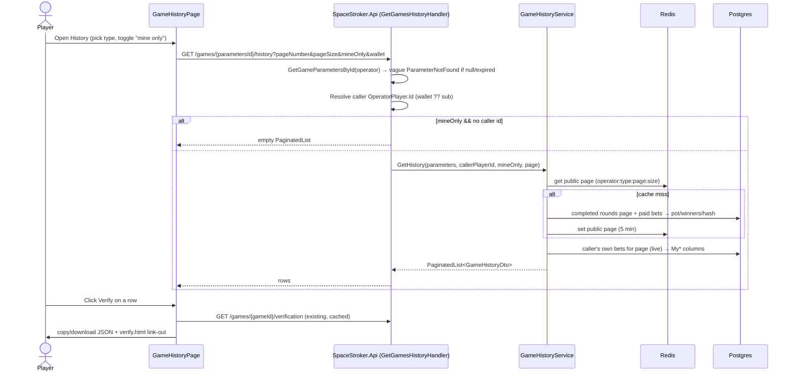

# SpaceStroker — "Games history" Feature — Implementation Spec

> **Status: Ready for implementation** — refined via Trello card
> [Games history](https://trello.com/c/mg3naq8d/84-games-history) (2026-07-23).
> Repos affected: `monkify-backend`, `monkify-front`, and this doc in `monkify-meta`.
>
> **Purpose:** Give a player a way to look back at rounds they've played. Provably-fair verification
> (shipped 2026-07-23, `feature/provably-fair-final`) only covers the **current** round in the live
> FAIR tab — its own doc says "there is no round history… re-checking an older round needs a
> follow-up card." This is that follow-up: a standalone **Games History** page where a player browses
> the completed rounds of one game type, sees their own bet/outcome on rounds they played, and can
> grab any round's verification payload to check it offline.

---

## 1. Summary

A new **read-only** endpoint `GET /games/{parametersId}/history` returns a **paginated** list of
**completed** rounds for one game type, newest first. Each row carries the round's public facts (when
it ended, winning choice, pot, winner count, a short server-seed fingerprint) plus — **only when the
caller bet in that round** — the caller's own bet columns (choice, stake, won/lost, payout). A new
frontend **History page** at `/space-stroker/game/history` (reached from a new header **menu button**)
renders it with a game-type dropdown, a **"mine only"** toggle, pagination, and a per-row **Verify**
action that link-outs to the offline `verify.html`.

There is **no new entity and no migration** — every field is already persisted (`Game`, `Bet`,
`TransactionLog`, `OperatorPlayer`). The design mirrors the shipped **game-type-stats** feature
(on-demand aggregate + Redis cache, same money rules, same operator scoping).

| Row field | Source (per completed round) |
| --- | --- |
| Round id | `Game.Id` (used by the Verify link-out; short form shown as the seed fingerprint sibling) |
| Ended date/time | `Game.EndDate` (fallback `Game.CreatedDate` if null) |
| Game-type name | `GameParameters.Name` (the page is single-type, so constant per page) |
| Winning choice | `Game.WinningChoice` |
| Pot | `Σ paid Bet.Amount` (+ `LotteryParameters.LotteryPot` + `Game.CarriedExtra` for lottery types) |
| Winner count | `COUNT(Bet)` where `Bet.Choice == Game.WinningChoice` (paid bets) |
| Server-seed fingerprint | first 12 chars of `Game.ServerSeedHash` |
| **My** choice / stake / won / payout | caller's `Bet` in that round (see §6.3); `null` when the caller didn't bet |

**Which rounds appear:** only `GameStatus.RewardForWinnersCompleted` — identical to the STATS rule
(a real winner was paid). Refunded/under-subscribed (`NotEnoughPlayersToStart`),
`ErrorWhenProcessingRewards`, and `GameEndedAbruptely` rounds are **excluded entirely**.

**Caching:** the **public** page (everything except the "my" columns) is cached in Redis per
`(operator, parametersId, pageNumber, pageSize)` for **5 minutes**, no invalidation (completed rounds
are immutable). The caller's **own-bet columns are looked up fresh** on every request and merged onto
the cached rows, so `mineOnly` results and personal columns never go stale and are never cached under
another player's key. Accepted trade: a just-completed round can lag on page 1 by up to the 5-min TTL.

---

## 2. Constraints (MANDATORY)

From `monkify-meta/constraints.md` (full list there):

- **Worktree-per-repo:** `feature/games-history` in an isolated worktree in each affected repo
  (`monkify-backend`, `monkify-front`, `monkify-meta`); the hub stays on `main`. Push after branch work.
- **Unit tests:** add/update in `SpaceStroker.Tests`; **report changed tests** at end of implementation.
- **Integration test (mandatory — new feature):** at least one happy-path test in
  `SpaceStroker.Tests.Integration` (Testcontainers) that drives a round to
  `RewardForWinnersCompleted` and asserts `/history` returns it with correct pot/winners and the
  bettor's own columns (see §11.2, `constraints.md` §3 + `AGENTS.md` rule 8).
- **EF mapping:** N/A — **no entity/column change** (read-only feature). Do not add
  `IEntityTypeConfiguration`.
- **Migrations:** **None** — no schema change.
- **Secrets/config:** mock-only values in committed files (no secrets touched here).
- **Operator messaging:** vague errors only — a cross-operator / unknown / expired / deactivated
  `parametersId` collapses to the same `ErrorMessages.ParameterNotFound`; never reveal existence or
  contract status.
- **API stays stateless:** the endpoint is a read on `SpaceStroker.Api`; no Consumers/typer/migration
  change.

---

## 3. Resolved product decisions

| # | Decision |
| --- | --- |
| 1 | **Scope:** one **public feed of completed rounds** per game type, with a **"mine only"** toggle that narrows it to rounds the caller bet in. Not a cross-type view. |
| 2 | **Placement:** a **dedicated route** `/space-stroker/game/history` (route name `GameHistory`) inside the normal app shell (header + background), with a mobile layout — not a side-panel tab or modal. |
| 3 | **Header collapse:** a new **menu button** in `GameHeader` holds **Settings** (opens the existing `PlayerCustomizationModal`) + a **History** link. **Audio** (mute/volume) and the **wallet cluster** (balance + connect) stay directly on the header. Dev-admin button stays dev-only. Menu shows whenever there's operator context (same `hasOperatorContext` gate as today's gear). |
| 4 | **One type at a time:** the page is always scoped to a single game type via a **dropdown** (defaults to the first / most-recent active type from `getGamesTypes`). No mixed "all types" view. |
| 5 | **Which rounds appear:** only `RewardForWinnersCompleted`. Refunded/under-subscribed/errored/abrupt rounds are excluded entirely (a player whose lottery bet was refunded sees nothing for it here — accepted). |
| 6 | **Paging:** paginated full history — `pageNumber` + `pageSize` (**cap 30**), `PaginatedList<GameHistoryDto>`, newest first. |
| 7 | **Row fields:** ended date/time · type name · winning choice · pot · winner count · short `serverSeedHash` · **your** bet (choice, stake, won/lost, payout, populated only when you bet, else null). **The full typed character stream is NOT returned/shown.** |
| 8 | **Money rules = STATS rules:** free bets (`Amount == 0`) excluded from pot/payout; single currency per type; the DTO carries the currency descriptor (`PaymentMethod` + token symbol/decimals) so the client renders `Standard` in the player's display currency and `SolanaToken` token-native. |
| 9 | **"Mine" identity:** resolve the caller exactly as the prefs handlers do — `wallet` (when provided, SolanaToken) **takes precedence** over the launch-token `sub` (`ExternalPlayerId`); look up the `OperatorPlayer` by `(OperatorId, ExternalPlayerId)`, then filter bets by `Bet.OperatorPlayerId`. |
| 10 | **Verify = link-out only:** a per-row **Verify** button fetches the round's payload from the **existing** `GET /games/{id}/verification`, copies/downloads the JSON, and points the player at `public/verify.html`. **No in-app FAIR panel / in-browser replay on the history page.** Zero new verification logic. |
| 11 | **Caching:** cache the **public** page in Redis per `(operator, parametersId, pageNumber, pageSize)`, **TTL 5 min**, no invalidation; join the caller's own-bet columns **live**. |

---

## 4. Data model

**No entity, column, EF-mapping, or migration change.** Every field the endpoint needs already
exists and is persisted:

- `Game` (`SpaceStroker.Domain/Games/Entities/Game.cs`): `Id`, `ParametersId`, `Status`, `EndDate`,
  `CreatedDate` (from `TableEntity`), `WinningChoice`, `ServerSeedHash`, `CarriedExtra`.
- `Bet` (`SpaceStroker.Domain/Bets/Entities/Bet.cs`): `GameId`, `OperatorPlayerId`, `Choice`,
  `Amount`, `Status`, `TransactionLogs`.
- `OperatorPlayer` (`SpaceStroker.Domain/Games/Entities/OperatorPlayer.cs`): `OperatorId`,
  `ExternalPlayerId`.
- `TransactionLog` (`Type == Credit`) for the caller's payout on a won round.
- `GameParameters`: `Name`, `PaymentMethod`, `OperatorToken` (Label/Decimals), `LotteryParameters`.

DbSets used (matching `GameStatsService`): `_context.Games`, `_context.GameBets`,
`_context.TransactionLogs`, `_context.OperatorPlayers`.

> **Code finding (identity):** `Bet` does **not** carry a raw wallet or `ExternalPlayerId` string — it
> links to a player via `Bet.OperatorPlayerId` → `OperatorPlayer`. The wallet address for a
> SolanaToken player is stored **as** `OperatorPlayer.ExternalPlayerId` (see
> `RegisterBetHandler.UpsertOperatorPlayerAsync`, and the wallet-preferring resolution in
> `GetPlayerPreferencesHandler`). The "mine" filter therefore resolves an `OperatorPlayer.Id` first,
> then filters `GameBets` by it — it never matches a wallet string directly on `Bet`.

---

## 5. Configuration

None. No `GeneralSettings`, env var, or seed-data change. (`VUE_APP_API_BASE_URL` is already the API
base used by `mainService`.)

---

## 6. Backend behaviour

New MediatR request/handler under
`SpaceStroker.Infrastructure/Handlers/Games/GetGamesHistory/`, a new service method on
`IGameHistoryService`/`GameHistoryService` (mirroring `IGameStatsService`/`GameStatsService`), a new
DTO, a new `CacheHelper` factory, and a new controller action. Read-only; no events, no consumer.

### 6.1 Controller action (`GamesController.cs`)

Add alongside `GetGameTypeStats` / `GetGameVerification`:

```csharp
/// <summary>
/// Paginated history of completed rounds for a game type (newest first). Public round facts plus,
/// when mineOnly or when the caller bet in a round, the caller's own bet/outcome. Operator-scoped.
/// </summary>
[HttpGet("{parametersId}/history")]
public async Task<IActionResult> GetGamesHistory(
    Guid parametersId, [FromQuery] int pageNumber = 1, [FromQuery] int pageSize = 30,
    [FromQuery] bool mineOnly = false, [FromQuery] string? wallet = null)
{
    return await ProcessRequest(new GetGamesHistoryRequest(
        parametersId, _launchContext.OperatorId, _launchContext.ExternalPlayerId, wallet,
        pageNumber, pageSize, mineOnly));
}
```

### 6.2 Handler (`GetGamesHistoryHandler.cs`)

Order of operations (mirror `GetGameTypeStatsHandler` for scoping):

1. **Operator scoping / vague not-found.** `parameters = await _gameService.GetGameParametersById(request.ParametersId, request.OperatorId)`. If `parameters == null || !parameters.Active` → `Messaging.ReturnValidationFailureMessage(ErrorMessages.ParameterNotFound)`. This filters by operator **and** requires an active contract — cross-operator/expired/unknown/deactivated all collapse to the same message.
2. **Clamp paging.** `pageSize = Math.Clamp(pageSize, 1, 30); pageNumber = Math.Max(1, pageNumber)`.
3. **Resolve the caller's `OperatorPlayer.Id`** (see §6.3). May be `null` (spectator / no wallet / unknown player).
4. **`mineOnly && callerPlayerId == null`** → return an **empty** `PaginatedList<GameHistoryDto>` (page N, 0 records) immediately — no cache read/write. (The public list still loads when `mineOnly` is false.)
5. **Fetch the page of rounds** via `_historyService.GetHistory(parameters, callerPlayerId, mineOnly, pageNumber, pageSize)` (see §6.4).
6. Return the `PaginatedList<GameHistoryDto>`.

### 6.3 Caller identity resolution (`OperatorPlayer.Id`)

Copy the prefs precedence exactly (`GetPlayerPreferencesHandler` lines 27-36):

```csharp
var externalPlayerId = !string.IsNullOrWhiteSpace(request.Wallet)
    ? request.Wallet!
    : request.ExternalPlayerId;               // token sub; null/empty for pure crypto

if (string.IsNullOrWhiteSpace(externalPlayerId)) return null;   // no identity

var player = await _context.OperatorPlayers.AsNoTracking()
    .FirstOrDefaultAsync(x => x.OperatorId == request.OperatorId
                           && x.ExternalPlayerId == externalPlayerId, ct);
return player?.Id;                             // null => caller has no bets under this operator
```

### 6.4 `GameHistoryService.GetHistory` (aggregation + cache)

Mirror `GameStatsService` structure (`ICacheService`, `SpaceStrokerDbContext`):

1. **Public page (cached).** Key = `CacheHelper.GenerateGamesHistoryCacheSettings(parameters.OperatorId!.Value, parameters.Id, pageNumber, pageSize)`. On miss, build it:
   - `completedGames = _context.Games.Where(g => g.ParametersId == parameters.Id && g.Status == RewardForWinnersCompleted).OrderByDescending(g => g.EndDate).ThenByDescending(g => g.CreatedDate)` — take the page with `PaginatedList<Game>.CreateAsync(query.Select(projection), pageNumber, pageSize)` **or** compute `totalCount` + `Skip/Take` the ids, then aggregate. (Project to a lightweight row first; don't materialize `Bet` graphs.)
   - For the page's game ids, load **paid** bets once: `_context.GameBets.Where(b => pageGameIds.Contains(b.GameId) && b.Amount > 0m).Select(b => new { b.GameId, b.Choice, b.Amount })`. Per round: `pot = Σ Amount (+ LotteryPot + CarriedExtra if lottery)`, `winnerCount = COUNT(Choice == WinningChoice)`. (Reconstruct the pot exactly as `GameStatsService`/`BetDomainService.SetPotAmount` does; free bets excluded.)
   - `serverSeedFingerprint = game.ServerSeedHash?[..12]`.
   - Cache the resulting public `List<GameHistoryDto>` + paging metadata (the **public** projection only — `My*` fields left null). **Never cache the mine-only variant or the joined personal columns.**
2. **`mineOnly` filtering.** When `mineOnly`, the round set is restricted to rounds the caller bet in. Because that set is player-specific it is **not** served from the public cache — run a dedicated query: page over `completedGames` joined to `GameBets` where `b.OperatorPlayerId == callerPlayerId`, `Distinct` on `GameId`. (Same projection/pot/winner aggregation as above, uncached.)
3. **Join the caller's own columns (live, always).** For the page's game ids, if `callerPlayerId != null`, load the caller's own bets: `_context.GameBets.Where(b => pageGameIds.Contains(b.GameId) && b.OperatorPlayerId == callerPlayerId)` selecting `GameId, Choice, Amount, Id, WinningChoice-of-game`. For each, set on the matching row:
   - `MyChoice = bet.Choice`, `MyStake = bet.Amount`.
   - `MyWon = string.Equals(bet.Choice, game.WinningChoice, OrdinalIgnoreCase)`.
   - `MyPayout = Σ TransactionLogs(Credit).Amount for that bet.Id` (0 when lost; a free-bet win is `MyWon = true`, `MyPayout = 0`).
   - A round where the caller placed **multiple** bets: surface the winning bet if any, else the first by `CreatedDate` (documented; one row per round). Stake shown is that bet's stake.
4. Return `PaginatedList<GameHistoryDto>`.

> **Note on cache key:** `parameters.OperatorId` is non-null for any real type (types are operator-owned;
> the seed sets Main/DEV operators). Guard with `parameters.OperatorId ?? Guid.Empty` for safety.

### 6.5 DTO (`Contracts/Games/GameHistoryDto.cs`)

```csharp
public class GameHistoryDto
{
    public Guid GameId { get; set; }
    public DateTime EndedAt { get; set; }
    public string GameTypeName { get; set; }
    public string? WinningChoice { get; set; }
    public decimal Pot { get; set; }
    public int WinnerCount { get; set; }
    public string? ServerSeedFingerprint { get; set; }   // first 12 chars of ServerSeedHash

    // Currency descriptor — a game type is single-currency (PaymentMethod is per GameParameters).
    public PaymentMethod PaymentMethod { get; set; }
    public string? TokenSymbol { get; set; }   // OperatorToken.Label — SolanaToken only
    public int? TokenDecimals { get; set; }     // OperatorToken.Decimals — SolanaToken only

    // Caller's own bet in this round — all null when the caller didn't bet.
    public string? MyChoice { get; set; }
    public decimal? MyStake { get; set; }
    public bool? MyWon { get; set; }
    public decimal? MyPayout { get; set; }
}
```

### 6.6 `CacheHelper` factory

```csharp
// Per-type paginated history page (public facts only; the caller's own columns are joined live and
// never cached). 5-min TTL bounds how long a just-completed round can lag on page 1; completed rounds
// are immutable so no invalidation exists. See specs/games-history.md.
public static CacheSettings GenerateGamesHistoryCacheSettings(Guid operatorId, Guid parametersId, int pageNumber, int pageSize)
    => new($"GamesHistory:{operatorId}:{parametersId}:{pageNumber}:{pageSize}", TimeSpan.FromMinutes(5));
```

---

## 7. Frontend behaviour

### 7.1 Route (`src/routes.ts`)

Add (registered in production too, like the other `/space-stroker/*` routes):

```ts
{ name: 'GameHistory', path: '/space-stroker/game/history',
  component: require('@/pages/GameHistoryPage.vue').default },
```

### 7.2 Header menu (`src/components/GameHeader.vue`)

- Add a **menu button** (dropdown/popover) gated by `hasOperatorContext`, containing:
  - **Settings** — triggers the existing `isSettingsOpen = true` (moves the gear into the menu).
  - **History** — a `RouterLink` to `{ name: 'GameHistory' }`.
- **Keep** the audio control and the `showWallet` cluster (`TokenBalance` + `WalletButtons`) directly
  on the header. Dev-admin button stays dev-only.
- The standalone gear `<button>` is removed from the header row; its behaviour lives in the menu.

### 7.3 Service + types

`src/services/mainService.ts` — add:

```ts
const getGamesHistory = async (
  parametersId: string,
  opts: { pageNumber?: number; pageSize?: number; mineOnly?: boolean; wallet?: string } = {}
) => {
  const { data } = await mainAPI.get<DefaultResponse<PaginatedList<GameHistoryRow>>>(
    `/games/${parametersId}/history`,
    { params: { pageNumber: opts.pageNumber ?? 1, pageSize: opts.pageSize ?? 30,
                mineOnly: opts.mineOnly ?? false, wallet: opts.wallet } }
  );
  return data;
};
```
(export it in the default object). `src/types/index.ts` — add `GameHistoryRow` (matching the DTO) and,
if not present, a `PaginatedList<T>` shape (`items`, `currentPage`, `totalNumberOfRecords`,
`totalNumberOfPages`).

### 7.4 Page (`src/pages/GameHistoryPage.vue`)

- **Game-type dropdown** — populated from `mainService.getGamesTypes()` (`ActiveGame[]`), default the
  first entry. Changing it refetches page 1.
- **"Mine only" toggle** — refetches page 1. Pass `wallet` when in a SolanaToken context (the
  connected wallet, same source the prefs modal uses); otherwise omit (server falls back to token sub).
- **Paginated list/table** of rows. Reuse the shared money formatter
  `useDisplayCurrency().formatGameAmount(selectedType, amount)` (same one `GameStatsPanel` uses) for
  pot / stake / payout. Render `My*` columns only when present; show a compact "you: <choice> ·
  <stake> · WON/LOST · <payout>" cell otherwise blank.
- **Per-row Verify** — on click, `mainService.getGameVerification(row.gameId)`, then copy/download the
  JSON and show the `verify.html` link-out (reuse the copy/download + `/verify.html` `download` pattern
  already in `GameFairPanel.vue`; extract a tiny helper if convenient, but **do not** run any in-app
  replay).
- **Empty state** — "No rounds yet" when `items` is empty.
- **Mobile layout** — use `useIsMobile()` (from `hooks/useIsMobile.ts`) to switch the table to stacked
  cards under `lg`, consistent with the rest of the mobile work.

> **Code finding (formatter name):** the shared formatter is
> `useDisplayCurrency().formatGameAmount(game, amount)` (used by `GameStatsPanel.vue`), **not**
> `useAmountFormatter` as the refined card guessed. `GameTerminal.vue` has a local `formatAmount`; do
> not duplicate it — reuse `useDisplayCurrency`.

---

## 8. Flow diagram



---

## 9. Out of scope

- Cross-type "all my rounds" global view (one type at a time only).
- In-app FAIR panel / in-browser full replay from the history page (link-out to `verify.html` only).
- Verifying non-completed rounds (refunded/errored/abrupt rounds don't appear).
- Showing the full typed character stream.
- Any change to the live FAIR tab, the `/verification` endpoint, or the provably-fair algorithm.
- Folding audio or the wallet cluster into the menu (they stay on the header).

---

## 10. File checklist

### 10.1 Backend (`monkify-backend`)

| # | File | Change |
| --- | --- | --- |
| 1 | `src/SpaceStroker.Api/Controllers/GamesController.cs` | Add `GET {parametersId}/history` action (paging + mineOnly + wallet query). |
| 2 | `src/SpaceStroker.Infrastructure/Handlers/Games/GetGamesHistory/GetGamesHistoryRequest.cs` | New request record (`ParametersId, OperatorId, ExternalPlayerId, Wallet, PageNumber, PageSize, MineOnly`) → `PaginatedList<GameHistoryDto>`. |
| 3 | `.../GetGamesHistory/GetGamesHistoryHandler.cs` | Operator scoping + vague not-found, clamp paging, resolve caller `OperatorPlayer.Id`, empty short-circuit for `mineOnly` w/o identity, call service. |
| 4 | `src/SpaceStroker.Infrastructure/Services/Games/IGameHistoryService.cs` | New interface `GetHistory(parameters, callerPlayerId, mineOnly, page, size)`. |
| 5 | `src/SpaceStroker.Infrastructure/Services/Games/GameHistoryService.cs` | Aggregation + Redis cache of the public page; live join of caller columns; pot/winner reconstruction (mirror `GameStatsService`). |
| 6 | `src/SpaceStroker.Infrastructure/Contracts/Games/GameHistoryDto.cs` | New DTO (public facts + currency descriptor + nullable `My*` block) + `From(...)` mapper. |
| 7 | `src/SpaceStroker.Infrastructure/Services/Cache/CacheHelper.cs` | Add `GenerateGamesHistoryCacheSettings(operatorId, parametersId, pageNumber, pageSize)` (5-min TTL). |
| 8 | DI registration (wherever `IGameStatsService`/`GameStatsService` is registered — `SpaceStroker.Infrastructure` service registration) | Register `IGameHistoryService`/`GameHistoryService`. |

### 10.2 Frontend (`monkify-front`)

| # | File | Change |
| --- | --- | --- |
| 1 | `src/routes.ts` | Add `GameHistory` route at `/space-stroker/game/history`. |
| 2 | `src/components/GameHeader.vue` | Add menu button (Settings + History); move the gear into it; keep audio + wallet on the header. |
| 3 | `src/pages/GameHistoryPage.vue` | **New** — type dropdown, mine-only toggle, paginated list, per-row Verify link-out, empty state, mobile layout. |
| 4 | `src/services/mainService.ts` | Add `getGamesHistory(parametersId, opts)` + export. |
| 5 | `src/types/index.ts` | Add `GameHistoryRow` (+ `PaginatedList<T>` if missing). |

### 10.3 Meta (`monkify-meta`)

| # | File | Change |
| --- | --- | --- |
| 1 | `specs/games-history.md` | This spec. |
| 2 | `INDEX.md` | Add the spec row (status Ready) + update "Feature currently in flight". |
| 3 | `features/games-history.md` | Distilled feature doc — **written at ship time** by `/monkify-ship-feature`, not now. |

---

## 11. Tests

### 11.1 Unit tests (`SpaceStroker.Tests`)

Project: `monkify-backend/src/SpaceStroker.Tests` (xUnit + Shouldly + Moq + Bogus; in-memory EF).
Model on `GameStatsServiceTests` / `GetGameTypeStatsHandlerTests`.

| Test file | Test cases | Expected |
| --- | --- | --- |
| `UnitTests/Services/GameHistoryServiceTests.cs` | Only `RewardForWinnersCompleted` rounds returned (others excluded) | non-completed rounds absent |
| | Pot = Σ paid bets (+ lottery base + carried extra); free bets (`Amount==0`) excluded | correct pot per row |
| | Winner count = bets whose choice == winning choice | correct count |
| | Newest-first ordering + paging (`pageNumber`/`pageSize`, `pageSize` clamped ≤30) | correct page + `TotalNumberOfRecords`/`Pages` |
| | `mineOnly=true` returns only rounds the caller bet in | filtered set |
| | Caller own columns populated on bet rounds, null otherwise; `MyPayout` from Credit logs; free-bet win = won + payout 0 | correct `My*` |
| | Public page cache hit skips re-aggregation; own columns still recomputed live | second call reads cache, personal columns fresh |
| `UnitTests/Handlers/GetGamesHistoryHandlerTests.cs` | Cross-operator/unknown/expired/deactivated type → `ParameterNotFound` (vague), no data | validation failure raised |
| | `mineOnly=true` with no resolvable player → empty `PaginatedList`, public list unaffected when `mineOnly=false` | empty page / public loads |
| | `wallet` takes precedence over token `sub` when resolving identity | player resolved by wallet |

### 11.2 Integration test (`SpaceStroker.Tests.Integration`) — MANDATORY

Project: `monkify-backend/src/SpaceStroker.Tests.Integration` (Testcontainers; follow
`GameStatsFlowTests` / `GameFlowTests`).

- `GamesHistoryFlowTests.HappyPath_CompletedRound_AppearsInHistoryWithPotWinnersAndOwnColumns`:
  drive a game end-to-end to `RewardForWinnersCompleted` (real API + Consumers against
  Postgres/RabbitMQ/Redis), then `GET /games/{parametersId}/history` and assert: the round is present,
  `Pot`/`WinnerCount`/`WinningChoice`/`ServerSeedFingerprint` are correct, and the bettor's own
  columns (`MyChoice`, `MyStake`, `MyWon`, `MyPayout`) are populated for the wallet/sub that bet.
- (Complementary, optional) `MineOnly_ReturnsOnlyCallersRounds` — a second identity that didn't bet
  gets an empty `mineOnly` page while the public page still lists the round.

---

## 12. Acceptance criteria

Mapped 1:1 from the Trello **Acceptance Criteria** checklist:

1. Given a game type with completed rounds, when the player opens History for that type, then a
   paginated list (newest first, `pageSize` ≤ 30) of only `RewardForWinnersCompleted` rounds is returned.
2. Given a round in the list, when it is rendered, then it shows ended date/time, game-type name,
   winning choice, pot, winner count, and a short `serverSeedHash` — and never the full typed
   character stream.
3. Given the player bet in a listed round, when the row renders, then its own-bet columns (choice,
   stake, won/lost, payout) are populated; given the player did not bet in it, then those columns are
   null/blank.
4. Given `mineOnly=true`, when an identified player (`ExternalPlayerId`, or connected wallet for
   SolanaToken) requests History, then only rounds they bet in are returned; given no identifiable
   player, then an empty list is returned while the public list still loads.
5. Given a round's pot/payout is computed, when free bets (`Amount == 0`) are present, then they are
   excluded from the pot and payout totals, and amounts render single-currency per type (Standard in
   display currency, SolanaToken token-native).
6. Given a cross-operator, unknown, expired, or deactivated `parametersId`, when History is requested,
   then the vague `ParameterNotFound` is returned and the type's existence/contract status is never
   revealed.
7. Given the same public page is requested twice within 5 minutes, when the second request arrives,
   then the round list is served from the Redis cache (key per operator+parametersId+pageNumber+pageSize)
   while the caller's own-bet columns are still looked up fresh.
8. Given a history row, when the player clicks Verify, then the round's payload is fetched from
   `GET /games/{id}/verification`, offered as copy/download JSON, and the player is pointed to
   `public/verify.html` — with no in-app replay on the history page.
9. Given operator context, when the player opens the header menu button, then it shows Settings
   (opens `PlayerCustomizationModal`) and a History link to `/space-stroker/game/history`, while audio
   and the wallet cluster remain directly on the header.
10. Given a game type with zero completed rounds, when History is opened, then a "No rounds yet"
    empty state is shown instead of an error.
11. Given the new endpoint, when the feature is implemented, then `SpaceStroker.Tests.Integration` has
    a happy-path test and unit tests cover paging, `mineOnly`, operator scoping, money rules, and caching.

---

## 13. Manual QA (local)

1. Bring up the local stack (`monkify-backend` docker compose; `yarn serve` front). Seed types load.
2. Play a round to completion on a race type (2 dev players / free bets if enabled).
3. Open the header **menu → History**; confirm the type dropdown, the just-played round appearing,
   correct pot/winner/winning-choice, and your own columns on the round you bet.
4. Toggle **Mine only** — only rounds you bet in remain; toggle off to see the public feed.
5. Click **Verify** on a row → JSON copies/downloads and the `verify.html` link works; no in-app replay.
6. Confirm audio + wallet controls still sit on the header; the gear now lives in the menu.
7. Narrow the viewport (< lg) — the list becomes stacked cards.

---

## 14. Trello / pipeline

- **Source card:** [Games history](https://trello.com/c/mg3naq8d/84-games-history) — moved to
  **Specs created**; **Implementation** section on the card lists branch + spec + worktree.
- **Next:** `/monkify-implement-feature Games history` to build it (writes the `features/games-history.md`
  distilled doc at ship time), then `/monkify-ship-feature Games history` to sync the KB and merge to `main`.

---

## 15. Revision log

| Date | Change |
| --- | --- |
| 2026-07-23 | Initial spec from refined card #84 (conversation-refined same session). |
