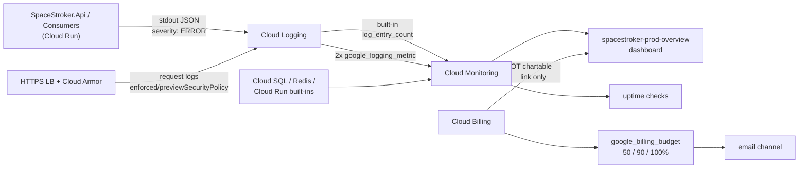

# SpaceStroker — "GCP Dashboards" — Implementation Spec

> **Status: Shipped** — merged via `feature/gcp-dashboards` on **2026-07-28** (`monkify-meta` +
> `monkify-backend`; `monkify-front` untouched). Distilled into
> `features/terraform-gcp-deploy.md` → Observability and `conventions/backend.md` → Logging;
> **no `features/gcp-dashboards.md`** (Level `Minor change`).
>
> ⚠️ **Shipped committed-but-NOT-applied.** No `terraform apply` has run and the dashboard JSON was
> never `terraform validate`-ed (no terraform binary in the authoring environment). The Cloud SQL and
> Redis `metric.type` strings are unverified and fail as **empty charts, not apply errors**. Joins
> #102/#103/#105/#110 in the pending-apply queue. Acceptance criteria **1** and **13** are therefore
> unverified; every other criterion was checked by test or by inspection.
>
> **Post-ship notes vs this spec:** (1) added **`EnvNamingTests`** (5 tests) beyond the spec — §12.1
> required the six ids to reach `DerivedIds()`, and a test is what stops that regressing. (2) The
> formatter was verified **in the real API host**, not only in unit tests: booting with
> `ASPNETCORE_ENVIRONMENT=Production` produced a genuine `severity: ERROR` entry from ASP.NET's own
> SignalR logger, with message and stack trace in **one** entry — which also proves `ClearProviders()`
> routing still holds with the formatter attached.
>
> _Original header:_ **Ready for implementation** — refined via Trello card
> [Setup GCP Dashboards](https://trello.com/c/SIfSHGs9) (#114, refined 2026-07-28).
> Repos affected: `monkify-meta` (primary) and `monkify-backend`. **No `monkify-front` / `monkify-lp`
> change.**
>
> **Purpose:** give ops one production dashboard, two uptime checks and a spend alert — all as
> Terraform — so "is it up, is it erroring, is it costing me money" stops being a tour of console
> tabs. Along the way it fixes the reason error counts are currently impossible: the backend logs
> plain text, so Cloud Logging files every line at severity `DEFAULT`.

---

## 1. Summary

Two halves that only make sense together.

| Half | Repo | What |
| --- | --- | --- |
| **Observability IaC** | `monkify-meta` | A tenth workload module, `modules/monitoring`, gated on a new `enable_dashboards` variable (production only): one dashboard, two uptime checks, one email notification channel, one billing budget, two Cloud Armor log-based metrics. |
| **Severity-bearing logs** | `monkify-backend` | `AddLogs` emits structured JSON in Production so Cloud Run parses real severities. Without this the dashboard's error/warning panels have nothing to count. |

**Why the backend half is not optional.** `SpaceStroker.Infrastructure/DependencyInjection.cs:126-147`
writes Serilog's default plain-text template to stdout. Cloud Run captures stdout and files every
line as `textPayload` at severity **`DEFAULT`** — a Serilog `Error` and a `Warning` are
indistinguishable in Cloud Logging today. Once entries carry a real `severity`, the built-in
`logging.googleapis.com/log_entry_count` metric (which has a `severity` label) supplies the
error/warning panels with **no log-based metric at all**.

**What the card deliberately does not build:** per-endpoint request breakdown, a `/rpc` Helius-burn
panel, alert policies beyond the budget, cost inside the dashboard, distinct-user counts, dev
dashboards. See §9.

---

## 2. Constraints (MANDATORY)

From `monkify-meta/constraints.md` (full list there):

- **Worktree-per-repo:** `feature/gcp-dashboards` in `monkify-meta` + `monkify-backend`, work inside
  `.worktrees/gcp-dashboards/<repo>`. Hubs stay clean on `main`.
- **Unit tests (§3):** update/add in `SpaceStroker.Tests`; **report exactly which tests changed** at the
  end. Level is **Minor change** ⇒ **no** `SpaceStroker.Tests.Integration` addition.
- **Secrets/config (§1):** `secrets.example.json` gets **placeholder values only**. The billing account
  id and alert email are plain config, not credentials — but they still never land in a committed file
  with a real value.
- **Production data / external APIs (§5):** `terraform plan`/`apply`, `gcloud services enable`, the
  billing-account IAM grant and any production log read are **operator steps**. Do not run them.
- **§8:** the API stays stateless and does not migrate; background work stays in
  `SpaceStroker.Consumers`. Nothing here changes that.
- **No EF/migration work at all** — this card touches no entity, no `OnModelCreating`, no
  `Migrations/`.

---

## 3. Resolved product decisions

| # | Decision |
| --- | --- |
| 1 | Delivery is **Terraform**, a new `modules/monitoring` in the **workload** layer — not Console-built. Keeps it reviewable in git and correct under teardown. |
| 2 | **Expenses are a link + a budget alert, never a panel.** Cloud Monitoring has no cost data source and no embed widget. A text widget links to Billing → Reports (which already is the requested "biggest cost desc" view); a `google_billing_budget` supplies the thing Reports cannot — being *told*. |
| 3 | **Production only**, behind `enable_dashboards` (default `false`). |
| 4 | `enable_dashboards` is **derived by the deploy tool** from `environment == "production"`, not authored in `secrets.<env>.json`. |
| 5 | **Structured JSON logging in Production**, plain text everywhere else. Root fix, not a `[ERR]`/`[WRN]` regex over `textPayload`. |
| 6 | **Requests = totals + response-code class only.** No per-endpoint label; `run.googleapis.com/request_count` has no path label and the `api` path matcher has only a `default_service`. |
| 7 | **Armor gets both** a log-based metric (attribution by rule priority + action) **and** the `429`/`403` response-code chart (volume). Neither alone is enough — the in-app limiter also emits 429. |
| 8 | A **second** log-based metric reads `previewSecurityPolicy` so the preview WAF's would-be blocks are visible. |
| 9 | "How many **users**" is not deliverable — log-based metrics cannot do distinct counts. Denied *requests* + a documented top-denied-IPs Log Analytics query instead. |
| 10 | **Extras:** Cloud SQL health (incl. connections vs `max_connections`), Redis health (incl. evictions), request latency, uptime checks. |
| 11 | **Alerts = the budget only.** The notification channel is still created; alert policies on the silent failures are explicitly deferred. |
| 12 | **One dashboard**, `spacestroker-prod-overview`, sectioned with headers + collapsible groups. |
| 13 | *(new, this spec)* The dashboard JSON lives in a separate **`dashboard.json.tftpl`** rendered by `templatefile()`, not inline in `main.tf` — it keeps the accepted "one ~600-line blob" reviewable in a diff. |
| 14 | *(new, this spec)* The budget and notification channel are **skipped when their inputs are empty** rather than failing the apply, so an operator without billing IAM still gets the dashboard. |

---

## 4. Data model

**N/A.** No entity, enum, EF mapping or migration. This card adds no schema surface of any kind.

---

## 5. Configuration

### 5.1 New `secrets.<env>.json` fields (plain config)

Added to `GcpSection` in `deploy/tools/SpaceStroker.Deploy/SecretsFile.cs`:

```jsonc
"gcp": {
  // …existing…
  "billingAccountId": "",          // e.g. "01A2B3-C4D5E6-F7G8H9" — empty disables the budget
  "alertEmail": ""                 // e.g. "ops@example.com"      — empty disables the channel
}
```

```csharp
[JsonPropertyName("billingAccountId")] public string BillingAccountId { get; set; } = "";
[JsonPropertyName("alertEmail")] public string AlertEmail { get; set; } = "";
```

`secrets.example.json` documents both with **empty strings** plus a `_comment_monitoring` explaining
that the budget needs a billing-account-level IAM grant the project-scoped deploy credentials do not
have (see §7.2).

### 5.2 New Terraform variables (`terraform/workload/variables.tf`)

```hcl
variable "enable_dashboards" {
  type        = bool
  description = <<-EOT
    Create the monitoring module (dashboard, uptime checks, budget, Armor log-based metrics).
    Derived by the deploy tool from the environment — true for production only. Development and
    production share one GCP project, so a dev copy would only clutter the dashboard list; the
    module must contribute ZERO resources to development state.
  EOT
  default     = false
}

variable "billing_account_id" {
  type        = string
  description = "Billing account id for the budget. Empty ⇒ no budget (the apply still succeeds)."
  default     = ""
}

variable "alert_email" {
  type        = string
  description = "Destination for budget threshold mail. Empty ⇒ no notification channel, no budget."
  default     = ""
}
```

### 5.3 Deploy-tool emission

`Deployer.EmitTfvars` (`Deployer.cs:148-192`) gains three entries in the `vars` dictionary:

```csharp
["enable_dashboards"]   = string.Equals(_s.Environment, "production", StringComparison.OrdinalIgnoreCase),
["billing_account_id"]  = _s.Gcp.BillingAccountId,
["alert_email"]         = _s.Gcp.AlertEmail,
```

> Derive from `_s.Environment`, **not** from `_naming.EnvCode` — `ToEnvCode` maps anything unknown to
> its first four alphanumerics, so a typo'd environment must fall through to `false`, never to a
> production dashboard pointed at nothing.

### 5.4 Operator prerequisites (documented, not automated)

Both `deploy/docs/FIRST-DEV-DEPLOY.human.md:98-102` and `.agent.md:75-78` list ten
`gcloud services enable` targets. **Two are missing** and must be added:

```bash
gcloud services enable monitoring.googleapis.com billingbudgets.googleapis.com --project <PROJECT>
```

Plus, on the **billing account** (not the project): `roles/billing.costsManager` or
`roles/billing.admin` for the deploying principal. No project-level role can grant this.

---

## 6. Backend behaviour (`monkify-backend`)

### 6.1 The formatter

New file **`src/SpaceStroker.Common/Logging/GoogleCloudJsonFormatter.cs`** implementing
`Serilog.Formatting.ITextFormatter`.

`SpaceStroker.Common` already references **Serilog 4.0.0**, which is all an `ITextFormatter` needs, and
`SpaceStroker.Infrastructure` (where `AddLogs` lives) already references it. **No new NuGet package.**

One JSON object per line, written with `System.Text.Json`:

| Field | Value |
| --- | --- |
| `severity` | `Verbose`/`Debug` → `DEBUG`, `Information` → `INFO`, `Warning` → `WARNING`, `Error` → `ERROR`, `Fatal` → `CRITICAL` |
| `message` | Rendered message; **when an exception is present, its `ToString()` is appended after a newline** |
| `timestamp` | ISO-8601 with offset |
| `logging.googleapis.com/sourceLocation` | `{ "file": <SourceContext> }` when `SourceContext` is present |

Two things carry real weight:

1. **The exception must be in the same entry as its message.** Today a stack trace is emitted as N
   separate stdout lines, so Cloud Logging files N separate entries: error counts inflate and the
   trace is orphaned from its message. Appending `ex.ToString()` into `message` fixes both **and** is
   what lets Error Reporting recognise a stack trace.
2. **`severity` is a top-level string.** `Serilog.Formatting.Compact` writes `@l`, which Cloud Run does
   not read — do not reach for `CompactJsonFormatter` here.

Serilog properties beyond `SourceContext` are **not** serialized in this pass; the message is already
rendered. (Structured property export is a possible follow-up, not scope.)

### 6.2 Wiring it in

`src/SpaceStroker.Infrastructure/DependencyInjection.cs:126-147` — only the sink line changes:

```csharp
// Structured JSON in Production so Cloud Run parses a real `severity` (plain text lands at
// DEFAULT, which makes "count the errors" impossible). Plain text everywhere else — a developer
// tailing docker-compose should not read JSON.
logBuilder = builder.Environment.IsProduction()
    ? logBuilder.WriteTo.Console(new GoogleCloudJsonFormatter())
    : logBuilder.WriteTo.Console();
```

Everything else in `AddLogs` is untouched: the `MinimumLevel` split (Production `Warning`, otherwise
`Information`), `Log.Logger` assignment, and — importantly — the existing
`builder.Logging.ClearProviders()` + `AddSerilog(Log.Logger)` pair, which
`AddLogsProviderTests` already pins.

`Serilog.Sinks.Console` **5.0.1** (already referenced by `SpaceStroker.Infrastructure`) exposes the
`WriteTo.Console(ITextFormatter)` overload — no package change.

### 6.3 Blast radius — verified, not assumed

- **Both hosts** pick this up: `SpaceStroker.Api/Program.cs:75` and
  `SpaceStroker.Consumers/Program.cs:38` both call `builder.AddLogs()`.
- **The integration suite is unaffected.** `SpaceStroker.Tests.Integration/Harness/IntegrationTestFixture.cs:136-143`
  **replaces `Log.Logger` after the hosts build** with its own capturing logger, so the C2 "no error
  logs" assertion never sees this formatter regardless of environment.
- **No log level, no log content, no call site changes.** Serialization and environment gating only.

---

## 7. Infra behaviour (`monkify-meta/deploy`)

### 7.1 Module shape

New `terraform/workload/modules/monitoring/` — `main.tf`, `variables.tf`, `outputs.tf`,
`dashboard.json.tftpl`. Wired in `terraform/workload/main.tf` alongside the existing nine:

```hcl
module "monitoring" {
  count  = var.enable_dashboards ? 1 : 0
  source = "./modules/monitoring"

  project_id         = var.project_id
  name_prefix        = local.name_prefix
  billing_account_id = var.billing_account_id
  alert_email        = var.alert_email
  domain_api         = var.domain_api
  domain_app         = var.domain_app
  sql_instance_id    = module.data.instance_connection_name
  labels             = var.labels
}
```

**Module-level `count`** (not per-resource `count`) is what guarantees the module contributes zero
addresses to development state — the acceptance criterion in §12.2.

Inside the module:

```hcl
locals {
  # Both are needed: a budget must notify somewhere, and neither can be created without operator
  # action outside Terraform's project-scoped reach. Skipping beats failing the whole apply.
  enable_channel = var.alert_email != ""
  enable_budget  = var.alert_email != "" && var.billing_account_id != ""
}
```

Provider is `hashicorp/google ~> 6.0`, Terraform `>= 1.6` (unchanged, `versions.tf`).

### 7.2 Resources

| Resource | Name | Notes |
| --- | --- | --- |
| `google_monitoring_notification_channel` | `${name_prefix}-ops-email` | `type = "email"`, `labels.email_address = var.alert_email`. `count = local.enable_channel ? 1 : 0` |
| `google_monitoring_uptime_check_config` | `${name_prefix}-uptime-api` | `http_check { path = "/health", port = 443, use_ssl = true }`, `monitored_resource` type `uptime_url`, host `var.domain_api`, `period = "300s"` |
| `google_monitoring_uptime_check_config` | `${name_prefix}-uptime-app` | Same shape, host `var.domain_app`, path `/`, `period = "300s"` |
| `google_logging_metric` | `${name_prefix}-armor-denied` | Enforced Armor denials, labelled by priority + action |
| `google_logging_metric` | `${name_prefix}-armor-preview` | Preview-rule would-be denials |
| `google_billing_budget` | `${name_prefix}-budget` | `count = local.enable_budget ? 1 : 0` |
| `google_monitoring_dashboard` | `${name_prefix}-overview` | `dashboard_json = templatefile("${path.module}/dashboard.json.tftpl", {...})` |

**Uptime `period = "300s"` is deliberate.** Checks originate outside the VPC and traverse the public
LB, consuming the priority-800 Armor bucket (3000/60s, shared with `/Hubs/*`). Google probes from
multiple regions per period; 300s keeps that a rounding error against the bucket.

### 7.3 The two log-based metrics

Env-scoping comes from `resource.labels.url_map_name`, which is `${var.name_prefix}-urlmap`
(`modules/edge/main.tf:143`). LB request logging is already on at full sample rate
(`modules/edge/main.tf:136-139`), so **no edge change is needed**.

```hcl
resource "google_logging_metric" "armor_denied" {
  name    = "${var.name_prefix}-armor-denied"
  project = var.project_id
  filter  = <<-EOT
    resource.type="http_load_balancer"
    resource.labels.url_map_name="${var.name_prefix}-urlmap"
    jsonPayload.enforcedSecurityPolicy.outcome="DENY"
  EOT

  metric_descriptor {
    metric_kind = "DELTA"
    value_type  = "INT64"
    labels { key = "priority"         value_type = "STRING" }
    labels { key = "configured_action" value_type = "STRING" }
  }

  label_extractors = {
    "priority"          = "EXTRACT(jsonPayload.enforcedSecurityPolicy.priority)"
    "configured_action" = "EXTRACT(jsonPayload.enforcedSecurityPolicy.configuredAction)"
  }
}
```

`armor_preview` is identical except it reads **`jsonPayload.previewSecurityPolicy`** in both the
filter and the extractors.

> ⚠️ **Getting this field wrong is silent.** A `preview = true` rule populates
> `previewSecurityPolicy`, **not** `enforcedSecurityPolicy`. Pointing the preview metric at the
> enforced field yields a permanently-zero panel that reads as "the WAF never false-positives" — when
> the priority-900 OWASP rule is in preview precisely because it *does*, on Solana base58 bet
> payloads.

> ⚠️ **Cardinality is bounded on purpose.** Only three rules exist (800/900/1000), so `priority` and
> `configured_action` are small closed sets. Do not add a path or IP label here — that is the
> unbounded-label trap that killed the per-endpoint idea (§9).

### 7.4 The budget

```hcl
resource "google_billing_budget" "spend" {
  count           = local.enable_budget ? 1 : 0
  billing_account = var.billing_account_id
  display_name    = "${var.name_prefix}-budget"

  budget_filter { projects = ["projects/${var.project_id}"] }
  amount { specified_amount { currency_code = "USD" units = tostring(var.budget_amount_usd) } }

  dynamic "threshold_rules" {
    for_each = [0.5, 0.9, 1.0]
    content { threshold_percent = threshold_rules.value }
  }

  all_updates_rule {
    monitoring_notification_channels = [google_monitoring_notification_channel.ops[0].id]
    disable_default_iam_recipients   = true
  }
}
```

`budget_amount_usd` is a module variable (default `100`) surfaced as a workload variable so it is
tunable without editing the module.

> **The budget covers the whole project, dev spend included.** Dev and prod share one GCP project and
> cost attribution keys off **labels**, not names — `name_prefix` scopes resource *names* and does
> nothing for billing. `EmitTfvars` does already stamp `labels = { app, environment, managed_by }`
> (`Deployer.cs:181-186`), but **per-module label coverage is unverified**: confirm every module
> actually threads `var.labels` onto its billable resources before making any per-environment cost
> claim. Until then, do not add a `labels` filter to `budget_filter` — a partial filter would
> under-report spend, which is worse than a project-wide budget that over-reports.

### 7.5 Dashboard panels

`dashboard.json.tftpl` — a `mosaicLayout` with `sectionHeader` widgets and `collapsibleGroup`s.
Every Cloud Run filter carries `resource.labels.service_name = "${name_prefix}-api"` or
`"${name_prefix}-consumers"`, so no `spacestroker-dev-*` series can appear.

| Section | Widgets |
| --- | --- |
| **Expenses** | One `text` widget (markdown): a link to Billing → Reports for the project, plus one line stating cost cannot be charted in Cloud Monitoring and that the budget is what alerts. **No empty cost chart.** |
| **API** | Instance count (`run.googleapis.com/container/instance_count`, by `state`) · request count (`run.googleapis.com/request_count`, grouped by `response_code_class`) · latency p50/p95/p99 (`run.googleapis.com/request_latencies`, `ALIGN_PERCENTILE_*`) · error + warning counts (`logging.googleapis.com/log_entry_count` filtered `resource.type="cloud_run_revision"`, grouped by `severity`) |
| **Consumers** | Instance count · error + warning counts (same `log_entry_count` metric, service filtered) |
| **Edge / Armor** | Armor denials from `logging.googleapis.com/user/${name_prefix}-armor-denied` grouped by `priority` · preview would-be blocks from `…-armor-preview` · LB `429`/`403` volume from `loadbalancing.googleapis.com/https/request_count` by `response_code` |
| **Data** | Cloud SQL CPU / memory / disk utilization · **connections vs `max_connections`** (`cloudsql.googleapis.com/database/postgresql/num_backends`, with a threshold line at `var.max_connections`) · Redis memory usage ratio · **evicted keys** · connected clients |
| **Uptime** | An uptime scorecard per check (`monitoring.googleapis.com/uptime_check/check_passed`) |

> ⚠️ **Metric type strings must be confirmed in Metrics Explorer during implementation.** There is no
> `terraform` binary and no GCP access in the authoring environment (`constraints.md` §5), so the
> exact `metric.type` strings above — particularly the Cloud SQL and Redis ones — are written from
> the documented names and have **not** been validated against the live project. A wrong string
> produces an empty chart, not an apply error, so check each panel renders after the first apply.

### 7.6 Documented, not built: top denied IPs

`deploy/README.md` gains a short "Investigating denials" note with the Log Analytics SQL for
distinct denied IPs — the thing a log-based metric cannot express. It must carry the #111 caveat:
**one IP is not one user**; a VPN exit is one Armor bucket for everyone behind it, and this player
base is crypto-oriented, so shared exits are the norm.

---

## 8. Flow diagram



---

## 9. Out of scope

- **Per-endpoint request breakdown.** No curated log-based metric with a normalized `endpoint` label,
  and no path rules added to the `api` url-map (`modules/edge/main.tf:161-164` has `default_service`
  only, so `matched_url_path_rule` reports one constant value for all API traffic).
- **`/rpc` + `/solana/*` request-volume panel as a Helius-burn proxy.** ⚠️ This leaves **#112's
  explicitly accepted Helius cost increase unmonitored** — that card shipped with an open "watch the
  credit burn after the prod deploy" action. Worth its own card.
- **Alert policies** beyond the budget (Consumers at 0, SQL connections near max, Redis evictions,
  uptime failing). The notification channel exists, so adding them later is small.
- **Cost inside the dashboard** — no BigQuery billing export, no Looker Studio page, no
  cost-to-custom-metric job.
- **Distinct-user / distinct-IP counts** as panels — the Log Analytics query in §7.6 instead.
- **Development-environment dashboards.**
- **Hangfire job observability** (12h refund sweep, daily chat purge) — no metric exists; it needs app
  instrumentation.
- **Serilog structured-property export** — the formatter renders the message; it does not serialize
  arbitrary properties.
- **Running `terraform apply`**, enabling the two APIs, granting billing IAM — operator steps.

---

## 10. File checklist

### 10.1 Backend (`monkify-backend`)

| # | File | Change |
| --- | --- | --- |
| 1 | `src/SpaceStroker.Common/Logging/GoogleCloudJsonFormatter.cs` | **New.** `ITextFormatter` emitting `severity` / `message` / `timestamp` / sourceLocation; exception appended into `message`. |
| 2 | `src/SpaceStroker.Infrastructure/DependencyInjection.cs` | `AddLogs` (line ~136): Production ⇒ `WriteTo.Console(new GoogleCloudJsonFormatter())`, else unchanged. Comment why. |
| 3 | `src/SpaceStroker.Tests/UnitTests/Common/GoogleCloudJsonFormatterTests.cs` | **New.** See §11. |
| 4 | `src/SpaceStroker.Tests/UnitTests/Common/AddLogsProviderTests.cs` | **Extend** (do not rewrite) with the formatter-selection cases. |

### 10.2 Frontend (`monkify-front`)

**None.**

### 10.3 Meta (`monkify-meta`)

| # | File | Change |
| --- | --- | --- |
| 1 | `deploy/terraform/workload/modules/monitoring/main.tf` | **New.** Channel, 2 uptime checks, 2 log-based metrics, budget, dashboard. |
| 2 | `deploy/terraform/workload/modules/monitoring/variables.tf` | **New.** `project_id`, `name_prefix`, `billing_account_id`, `alert_email`, `domain_api`, `domain_app`, `budget_amount_usd`, `max_connections`, `labels`. |
| 3 | `deploy/terraform/workload/modules/monitoring/outputs.tf` | **New.** Dashboard id + notification-channel id. |
| 4 | `deploy/terraform/workload/modules/monitoring/dashboard.json.tftpl` | **New.** The panel layout (§7.5). |
| 5 | `deploy/terraform/workload/main.tf` | Add the `module "monitoring"` block with `count`. |
| 6 | `deploy/terraform/workload/variables.tf` | Add `enable_dashboards`, `billing_account_id`, `alert_email`, `budget_amount_usd`. |
| 7 | `deploy/tools/SpaceStroker.Deploy/SecretsFile.cs` | `GcpSection` += `BillingAccountId`, `AlertEmail`. |
| 8 | `deploy/tools/SpaceStroker.Deploy/Deployer.cs` | `EmitTfvars` (~line 157) += the three vars; derive `enable_dashboards` from `_s.Environment`. |
| 9 | `deploy/secrets.example.json` | New `gcp.billingAccountId` + `gcp.alertEmail` (empty) + `_comment_monitoring`. |
| 10 | `deploy/README.md` | Monitoring section: what the dashboard shows, the two API enables, the billing IAM grant, the §7.6 Log Analytics query + #111 caveat. |
| 11 | `deploy/docs/FIRST-DEV-DEPLOY.human.md` / `.agent.md` | Add `monitoring.googleapis.com` + `billingbudgets.googleapis.com` to the `gcloud services enable` line. |
| 12 | `specs/gcp-dashboards.md` | This spec. |
| 13 | `INDEX.md` | Spec row + "Feature currently in flight". |

**KB at ship time (not now):** `features/terraform-gcp-deploy.md` gains the monitoring module,
budget and log-based metrics; `conventions/backend.md` gains the structured-logging convention
(a third `##` section after "Middleware ordering and client-IP keying"). **No
`features/gcp-dashboards.md`** — Minor change.

---

## 11. Unit tests

Project: `monkify-backend/src/SpaceStroker.Tests`. **No integration test** (Minor change; the
Testcontainers suite cannot assert anything about a GCP dashboard).

| Test file | Test cases | Expected |
| --- | --- | --- |
| `UnitTests/Common/GoogleCloudJsonFormatterTests.cs` | `Format_MapsEveryLevelToItsCloudLoggingSeverity` (Theory over all 6 Serilog levels) | `Verbose`/`Debug`→`DEBUG`, `Information`→`INFO`, `Warning`→`WARNING`, `Error`→`ERROR`, `Fatal`→`CRITICAL` |
| | `Format_EmitsOneJsonObjectPerEvent` | Output is a single line, parses as JSON, ends with exactly one newline |
| | `Format_PutsExceptionInTheSameEntryAsTheMessage` | With an exception, `message` contains **both** the rendered text and the stack trace; output is still **one** entry |
| | `Format_WithoutException_OmitsStackTrace` | `message` equals the rendered message; no trailing newline noise |
| | `Format_IncludesSourceContextAsSourceLocation` | `logging.googleapis.com/sourceLocation.file` = the `SourceContext` value; absent when the property is absent |
| | `Format_EscapesQuotesAndNewlinesInMessage` | A message containing `"` and `\n` still yields parseable JSON — guards the whole pipeline against one bad log line |
| `UnitTests/Common/AddLogsProviderTests.cs` (**extend**) | `AddLogs_LeavesSerilogAsTheOnlyProvider` | **Unchanged** — must still pass for Production/Development/Staging |
| | `AddLogs_UsesJsonFormatter_OnlyInProduction` | Production writes parseable JSON to stdout; Development/Staging write the plain-text template |

> The formatter is a pure `ITextFormatter` — test it by calling `Format(logEvent, new StringWriter())`
> and asserting on the string. No host, no capture sink.

---

## 12. Acceptance criteria

Mapped 1:1 from the Trello **Acceptance Criteria** checklist (19 items).

1. Given the production environment, when `spacestroker-deploy deploy --env production` runs `terraform apply`, then a single Cloud Monitoring dashboard named `spacestroker-prod-overview` exists in the project.
2. Given the development environment, when `terraform apply` runs with `enable_dashboards = false`, then the monitoring module contributes zero resources to development state and no `spacestroker-dev-*` dashboard, uptime check, budget, notification channel or log-based metric is created.
3. Given the deploy tool emits `<environment>.tfvars.json`, when the environment is `production`, then `enable_dashboards` is `true`; when the environment is anything else, then it is `false` — without any new hand-set field in `secrets.<env>.json`.
4. Given the dashboard is open, when the API section is read, then it shows Cloud Run instance count, request count and response-code class breakdown, and p50/p95/p99 latency for `spacestroker-prod-api` only — no `spacestroker-dev-*` series appear in any panel.
5. Given the dashboard is open, when the Consumers section is read, then it shows the instance count for `spacestroker-prod-consumers` alongside its error and warning counts.
6. Given `ASPNETCORE_ENVIRONMENT=Production`, when the backend logs a Serilog `Warning`, `Error` and `Fatal`, then Cloud Logging records them at severity `WARNING`, `ERROR` and `CRITICAL` respectively — not all at `DEFAULT` as today.
7. Given a logged exception in Production, when the entry reaches Cloud Logging, then the message and the full stack trace are in a **single** entry — not split across N single-line entries.
8. Given any non-Production environment (local, Docker, `Development`), when the app logs, then console output remains the existing plain-text Serilog format and is byte-for-byte unaffected by this card.
9. Given Cloud Armor denies a request at priority 1000, when the LB log is processed, then the denial log-based metric increments with a label identifying rule priority `1000` and action `throttle`, distinguishable from priority 800 and 900 denials.
10. Given the priority-900 WAF rule is at `preview = true`, when it matches a request, then the preview log-based metric reads `jsonPayload.previewSecurityPolicy` (not `enforcedSecurityPolicy`) and increments — so would-be blocks on Solana base58 payloads are visible without the rule enforcing.
11. Given the dashboard is open, when the edge section is read, then it shows both the Armor denial metric (attributed by rule) and the LB `429`/`403` response-code volume, so a 429 spike can be traced to Armor rather than the in-app limiter.
12. Given the dashboard is open, when the infrastructure section is read, then Cloud SQL CPU, memory, disk and **connection count against `max_connections`** are charted, and Redis memory, **evictions** and connected clients are charted.
13. Given the uptime checks are applied, when `api.spacestroker.com/health` or `app.spacestroker.com` stops responding, then the corresponding check reports failure and its status is visible on the dashboard.
14. Given `gcp.billingAccountId` and the alert email are set, when the budget is applied, then a `google_billing_budget` exists with 50/90/100% thresholds wired to the email notification channel, and crossing a threshold sends mail.
15. Given the dashboard is open, when the expenses section is read, then a text widget links to the project's Billing → Reports view and states that cost cannot be charted in Cloud Monitoring — no empty or fabricated cost panel is present.
16. Given `secrets.example.json` and the committed docs, when they are reviewed, then `gcp.billingAccountId` and the alert email carry **placeholder values only**, and `deploy/README.md` + `docs/FIRST-DEV-DEPLOY.*` list `monitoring.googleapis.com`, `billingbudgets.googleapis.com` and the billing-account IAM grant as operator prerequisites.
17. Given `spacestroker-deploy validate --env production`, when it runs, then every derived monitoring id (dashboard, uptime checks, notification channel, budget, log-based metrics) is printed and passes its GCP length cap.
18. Given the backend change is complete, when `SpaceStroker.Tests` runs, then the full suite is green, new formatter tests cover severity mapping / single-entry exceptions / Production-vs-non-Production selection, and the changed + added tests are reported.
19. Given the card ships, when the KB is reviewed, then `features/terraform-gcp-deploy.md` documents the monitoring module / budget / log-based metrics, `conventions/backend.md` records the structured-logging convention, no `features/gcp-dashboards.md` was created, and the "committed but not applied" status is stated explicitly.

### 12.1 Note on AC #17

`EnvNaming.DerivedIds()` (`EnvNaming.cs:106-128`) is the list `validate` prints. The five new ids must
be **added there** with their caps, or AC #17 passes vacuously:

| Id | Property | GCP cap |
| --- | --- | --- |
| `${NamePrefix}-overview` | `DashboardName` | display name — charset only, no length cap |
| `${NamePrefix}-uptime-api` / `-uptime-app` | `UptimeCheckApi` / `UptimeCheckApp` | uptime check id ≤ 63 |
| `${NamePrefix}-ops-email` | `NotificationChannel` | display name — charset only, no length cap |
| `${NamePrefix}-armor-denied` / `-armor-preview` | `ArmorDeniedMetric` / `ArmorPreviewMetric` | log-based metric name ≤ 100 |

Dashboards are addressed by a generated id, so `${NamePrefix}-overview` is a **display name** — check
charset, not length. Confirm each cap against current GCP docs when adding them; do not invent a
number.

### 12.2 Note on AC #2

Verify with `terraform plan` for development and confirm **no `module.monitoring` address appears at
all** — not merely that resources are zero-count. Module-level `count` (§7.1) is what makes this true.

---

## 13. Manual QA

Local (no GCP needed):

1. `cd monkify-backend && scripts/run_tests.bat` — full unit suite green.
2. Run the API locally with `ASPNETCORE_ENVIRONMENT=Development` → console output is the familiar
   `[HH:mm:ss LVL] message` format, unchanged.
3. Run with `ASPNETCORE_ENVIRONMENT=Production` → each line is a JSON object with `severity`; pipe
   through `jq .` to confirm it parses.
4. Force an exception on the Production run → **one** entry whose `message` holds both the message and
   the stack trace.

Operator steps (yours, not the agent's):

5. `gcloud services enable monitoring.googleapis.com billingbudgets.googleapis.com`.
6. Grant `roles/billing.costsManager` on the billing account; set `gcp.billingAccountId` +
   `gcp.alertEmail` in `secrets.production.json`.
7. `spacestroker-deploy validate --env production`, then `plan`, then `apply`.
8. Open the dashboard and confirm **every panel renders data** — an unrecognised `metric.type` shows an
   empty chart rather than failing the apply (§7.5).
9. `plan` for development and confirm no `module.monitoring` address appears.

---

## 14. Trello / pipeline

- **Source card:** [Setup GCP Dashboards](https://trello.com/c/SIfSHGs9) (#114) — list **Specs created**;
  the **Implementation** section on the card carries branch, spec path, worktree and Level.
- **Level:** `Minor change` ⇒ no integration test, no `features/<slug>.md`.
- **Next:** `/monkify-implement-feature Setup GCP Dashboards`, then
  `/monkify-ship-feature Setup GCP Dashboards`.

> ⚠️ **This will merge "committed but not applied."** There is no `terraform` binary in the authoring
> environment, so nothing here is `terraform validate`-ed and no dashboard has been rendered. It joins
> #102 / #103 / #105 / #110 in the pending-apply queue. Say so at ship time.

---

## 15. Revision log

| Date | Change |
| --- | --- |
| 2026-07-28 | Initial spec from refined card #114. Five additions the card did not carry, all recorded as §3 decisions 13-14 or spec-level notes: module-level `count` so dev state holds no `module.monitoring` address at all (§7.1); the dashboard JSON extracted to `dashboard.json.tftpl` via `templatefile()` so the accepted ~600-line blob stays diff-reviewable (§3.13); budget + notification channel skipped on empty inputs rather than failing the apply (§3.14, §7.1); the five new ids must be added to `EnvNaming.DerivedIds()` or AC #17 passes vacuously (§12.1); and the warning that Cloud SQL/Redis `metric.type` strings are unvalidated here and fail as empty charts, not apply errors (§7.5). Also records that the integration suite is provably unaffected (`IntegrationTestFixture.cs:136-143` replaces `Log.Logger` post-build) and that no new NuGet package is needed. |
