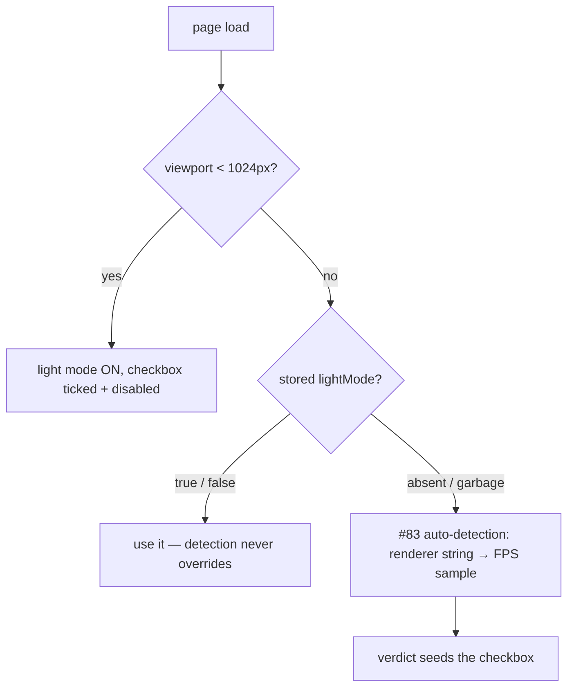

# SpaceStroker — "Graphics settings controls" — Implementation Spec

> **Status: Ready for implementation** — refined via Trello card
> [Add in settings menu, the light mode UI switch and max elements bg slider](https://trello.com/c/FX5TpF6l)
> (2026-08-09).
> Repos affected: `monkify-front` and this doc in `monkify-meta`. **No `monkify-backend` branch.**
>
> **Purpose:** give the player the two graphics knobs the app currently decides for them — the
> light-graphics switch (#83) and the starfield density (#149's `BG_DENSITY`) — as real controls in
> the SETTINGS modal, persisted per browser in `localStorage`.

---

## 1. Summary

Two controls in `PlayerCustomizationModal.vue`, in one new labelled `GRAPHICS` group between
`IDENTITY` and `PROVABLY FAIR`:

| Control | Type | Range | Default | Persisted as |
| --- | --- | --- | --- | --- |
| Light graphics mode | checkbox + info `i` | on / off | the #83 auto-detected verdict | `space-stroker.graphics.lightMode` (absent = never touched) |
| Sky density | range slider | `0–100%`, 5% steps | `45%` | `space-stroker.graphics.density` (stored `0..1`) |

Both apply **instantly** and are **not** reverted by `CANCEL`. Nothing is sent to the backend.

This is a **QOL / small frontend change**, not a new feature: it exposes two knobs that #83 and #149
already built. `AGENTS.md` rule 8's mandatory integration test does **not** apply (zero backend
surface, and `monkify-front` has no test runner at all).

### 1.1 What changes for whom

| Player | Today | After |
| --- | --- | --- |
| Weak-but-not-software GPU (old laptop, thermal throttle, remote desktop) | full skin, bad frame rate, **no escape** | ticks the box, gets light mode permanently |
| Strong GPU who liked the pre-#149 busy sky | stuck at `BG_DENSITY = 0.45` | drags to 100% → 64/layer, 12 torpedoes |
| Wants no sky at all | not possible | 0% → no sprites, no spawns, no torpedoes, idle rAF |
| Phone (< 1024px) | locked light, silently | locked light, **shown** as ticked + disabled with a note |

---

## 2. Constraints (MANDATORY)

From `monkify-meta/constraints.md`:

- **Worktree-first (§2):** work in `.worktrees/graphics-settings-controls/monkify-front`; the shared
  checkout stays on `main`. Branch `feature/graphics-settings-controls`, pushed after every commit.
- **No backend (§3):** no entity, endpoint, handler, consumer, EF mapping, migration, SignalR or
  header change. `SpaceStroker.Tests` is untouched; **rule 8's integration test does not apply.**
- **No test runner in `monkify-front`:** the automated bar is **`yarn lint` + `yarn build`**, plus the
  manual pass in §11.
- **Lint needs uniform CRLF** (`autocrlf=true`). `sed -i` mangles files to LF and produces
  `Insert ␍` failures — use an editor write or `unix2dos`.
- **Fresh worktrees carry no gitignored files:** copy `.env.local` and `yarn.lock` from the hub before
  `yarn serve`, or every API call 404s against the dev server's own origin.
- **Mock/placeholder values only** in any config file touched.

### 2.1 Rules from the KB this change must not break

These are load-bearing and are quoted in `features/light-graphics-mode.md` and
`features/background-lifecycle-hardening.md`:

1. **Light mode is a `Math.min` FLOOR over the density, never a competing knob.** Nothing the slider
   does may make light mode heavier. That `min` stays a `min`.
2. **`MAX_ELEMENTS = 64` must not be lowered** — it is the `density = 1` reference point and the
   slider's full range.
3. **`usePerfMode.ts` must not become density-aware.** It publishes the `lightMode` verdict only; the
   floor composition stays in `GameBackground.vue`. (It *does* learn the manual override — that is a
   light-mode concern, not a density one.)
4. **Every viewport below 1024px stays permanently light-graphics** — the frozen backdrop drift, the
   disabled torpedoes, the unreachable tile-seam path and the `.money-value*` exception all depend on
   it.
5. **Do not re-add the two documented light-mode exceptions** (the animated mascot image and
   `.money-value*`) to the strip list.
6. **Timestamps, not timers** (`useIdleDisconnect.ts`): cancel any in-flight `animationFrameId` before
   requesting a new frame; never leave two rAF loops or two spawn intervals running.
7. **New light-mode CSS goes in `arcade.css`**, never inside a `<style scoped>` block
   (`GameTypes.vue`, `GameTypeCard.vue`, `GameMonkey.vue` are scoped and a rule written there will not
   match).

---

## 3. Resolved product decisions

From the card's **Decisions** block and the refinement comment (2026-08-09).

| # | Decision |
| --- | --- |
| 1 | "Light mode" is the existing light **graphics** mode (#83), **not** a light colour theme. A bright skin is a separate project and is out of scope. |
| 2 | **Manual choice wins permanently.** Auto-detection only *seeds* the state on a browser that never touched the control. Once set, the stored value applies on every load and detection never overrides it. Rejected: tri-state Auto/On/Off; rejected: one-way force-ON. |
| 3 | **Phones stay locked light.** Below `1024px` the checkbox renders **ticked and disabled** with a short note — shown, not hidden, so a player who set it on desktop understands why it is not editable. |
| 4 | Density is a **percentage, `0–100%`, default `45%`, 5% steps** — the multiplier, not a raw element count. Rejected: raw `1–64`; rejected: named steps. |
| 5 | **`0%` is genuinely off:** no sprites, no spawning, no torpedoes, idle rAF loop. The static backdrop tile, `.section-vignette` and `--color-void` stay. |
| 6 | The slider keeps driving **all three** #149 consumers together: element cap, spawn cadence, torpedo cap. |
| 7 | Light mode composes as `min(LIGHT_MAX_ELEMENTS, scaled)` — a floor, never a competing knob. Both controls stay **live and enabled**; a note explains the flat range while light mode is on. |
| 8 | **`localStorage` only, zero backend.** A hardware/display setting belongs to the device, not the account, and it must work with no wallet connected. |
| 9 | **Instant apply**, and `CANCEL` does **not** revert — same contract as the client seed's SET / ROTATE rows. `SAVE` only renders with a wallet connected and prompts a signature; routing graphics through it would leave a wallet-less player unable to save at all. |
| 10 | Placement: one labelled group between `IDENTITY` and `PROVABLY FAIR`, rendered **outside** the wallet `v-if / v-else` so it always shows. |
| 11 | **`/background` renders the canonical defaults** — it ignores both stored settings, so the capture asset cannot drift with a player-local knob. Auto-detection on that route is unchanged. *(Agent decision, flagged at refinement.)* |
| 12 | **No "reset to defaults" button** (YAGNI). |

---

## 4. Code exploration findings (things the card did not have)

Read these before writing code — each one changes an implementation detail.

**F1 — `lightMode` has far more consumers than the starfield.** Beyond `GameBackground` and the
`torpedo-spawner` gate, `usePerfMode().lightMode` is read by `GuideLeverArt.vue`,
`GuideTerminalArt.vue`, `GuideWalletArt.vue`, and referenced by `GameTypeCard.vue`,
`GameMobileTabs.vue` and `OrbitTabBar.vue`. A manual override therefore changes guide art and
scroll behaviour too. That is **correct** — it is the same light-graphics mode — but the manual pass
must check `/how-to-play`, not only the game screen.

**F2 — `/background` cannot be handled with a route-local prop.** Both `GameBackground` layers and
`TorpedoSpawner` live globally in `App.vue` behind every route (that is exactly *why* the capture page
can't drift). So the canonical override has to live in the settings module, not on the page.
⚠️ **Boot-order hazard:** `App.vue` mounts before the initial navigation has necessarily populated
`route.meta`, so a route-watcher alone would paint one or more frames at the *stored* density before
flipping. Seed the flag **synchronously at module load** from `window.location.pathname`, and keep a
route watcher for in-SPA navigation. There is no `publicPath` in `vue.config.js`, so the router base
is `/` and the path is literally `/background` — match with `endsWith('/background')` so a future base
path does not silently break it.

**F3 — the "~13%" boundary is really 10% on a 5% grid.** Light mode's cap binds while
`round(64 × d) ≥ 8`, i.e. `d ≥ 0.1171875`. On the shipped 5% steps that means **15% and above are
flat at 8**, and only **10% (→ 6)** and **5% (→ 3)** actually bite. The AC's "~13%" is satisfied; the
note copy must not promise a boundary the step grid cannot land on.

**F4 — idling the rAF loop at 0% also freezes the backdrop drift.** `animate()` is the only thing that
advances `bgPosition` (`GameBackground.vue:224-227`). Stopping the loop therefore stops the parallax
scroll as well as the sprites. This is consistent with decision 5 ("the *static* backdrop tile …
stays") and with what light mode already does today, but the card did not spell it out — **it is
intended behaviour, not a bug.**

**F5 — two degenerate-value guards need a zero carve-out.** `maxElements` has
`Math.max(1, Math.round(MAX_ELEMENTS * BG_DENSITY))` and `spawnDelay` has
`base / Math.max(BG_DENSITY, 0.01)`. Both were written so a near-zero constant still left a
starfield. At exactly `0` the floor must not apply, and spawning must be **disabled**, not merely
slowed to the 0.01 divisor.

**F6 — the loop restart must obey the #149 rules.** `onMounted` starts the loop only
`if (isPageVisible)`, and `restartSpawning` reads `document.hidden` directly. A density watcher that
resumes from 0% must do both: cancel any in-flight `animationFrameId` before requesting a new frame,
and re-arm spawning through `restartSpawning` (never a bare `setInterval`).

**F7 — the accessible info `i` already exists, in the wrong namespace.**
`src/components/orbit/OrbitInfoTip.vue` is a real `<button>` with `aria-label` + `aria-expanded`,
click-to-toggle (works on a phone), `useClickOutside` dismissal and Escape — exactly what the card
asks for, and it is documented as deliberately *not* a `title`. But it hovers/focuses in
`--color-orbit`, and SETTINGS is a grey panel whose focus ring is cyan.
**Decision:** move it to `src/components/ui/ArcadeInfoTip.vue` with a `tone?: 'default' | 'orbit'`
prop (default `'default'` = ink-mute → primary hover, cyan `:focus-visible`), and update the four
Orbit call sites to pass `tone="orbit"`. Renamed, **not aliased** — the same call `.input-arcade`
made in #135, and the alternative is a second copy of a component this codebase explicitly shares.
*Flagged for spec review: this is the one file this card touches outside its own surface.*

**F8 — there is no dialog-level checkbox class.** The only styled checkbox is `.orbit-autopick` /
`.orbit-autopick__box`, declared in `OrbitGameTab.vue`'s **`<style scoped>`** block (page-only, violet
accent) — not reusable from the modal. A new `.dialog-check` / `.dialog-check__box` pair goes in
`arcade.css`, and `.dialog-check__box` must join the **"ONE focus treatment"** selector list at
`arcade.css:1196-1207`. The slider follows the existing precedent in `GameHeader.vue:256` — a native
`<input type="range">` with `accent-primary cursor-pointer` and an `aria-label`.

**F9 — the placement warning is confirmed in code.** `PlayerCustomizationModal.vue:137-157` is a
`v-if="needsWalletToCustomize" / v-else` pair, and the `v-if` branch renders the connect gate
*instead of* the name input. The graphics group must sit **after** that `template` pair and before the
`PROVABLY FAIR` eyebrow, outside both branches.

**F10 — no import cycle.** `useDisplaySettings.ts` imports the default constant only;
`usePerfMode.ts` imports `useDisplaySettings`. `useDisplaySettings` must **never** import
`usePerfMode` (it would cycle, and `usePerfMode` runs `detect()` at module import time).

---

## 5. Persistence

`localStorage`, wrapped in `try/catch` on every read and write, following `useClientSeed.ts`'s exact
pattern (module-scope singleton refs hydrated once on first import).

| Key | Value | Absent / unparseable |
| --- | --- | --- |
| `space-stroker.graphics.lightMode` | `'true'` \| `'false'` | → `null` = "never touched" ⇒ fall back to auto-detection |
| `space-stroker.graphics.density` | stringified `0..1`, e.g. `'0.45'` | → default `0.45` |

Rules:

- Density is **clamped to `0..1`** on read; `NaN` / out-of-range / garbage → the default. A bad stored
  value must never break boot or log an error.
- Light mode accepts **only** the two literals; anything else is treated as never-touched. A value of
  `'false'` is a real choice and must not be confused with absent.
- `localStorage` unavailable (private mode, blocked storage): reads return the fallbacks, writes
  no-op, the settings still apply **for the session**, and nothing throws.

---

## 6. Backend behaviour

**None.** No entity, enum, handler, consumer, EF mapping, migration, endpoint, header or SignalR
change, and no `monkify-backend` branch for this card.

---

## 7. Frontend behaviour

### 7.1 `src/constants/background.ts`

`BG_DENSITY` becomes **`BG_DENSITY_DEFAULT`** (same value, `0.45`). Update the file's comment: the
"future user-facing slider" it was built for is now this card, so the constant is the **default and
the `/background` canonical value**, and the live value lives in `useDisplaySettings`. `MAX_ELEMENTS`
(in `GameBackground.vue`) stays `64` and must not be lowered.

### 7.2 `src/hooks/useDisplaySettings.ts` (new)

Module-scope singleton, same shape as `useClientSeed` / `usePerfMode`.

```ts
// Raw stored state (module refs, hydrated once)
storedDensity: Ref<number>            // 0..1, clamped, default BG_DENSITY_DEFAULT
storedLightMode: Ref<boolean | null>  // null = never touched

// Canonical-route flag: seeded synchronously from window.location.pathname (F2),
// kept in sync by App.vue's route watcher.
canonicalGraphics: Ref<boolean>

// EFFECTIVE values — what the renderer reads
density         = computed(() => canonicalGraphics.value ? BG_DENSITY_DEFAULT : storedDensity.value)
lightModeChoice = computed(() => canonicalGraphics.value ? null : storedLightMode.value)

export function useDisplaySettings() {
  return {
    density, densityPercent,        // densityPercent = round(density * 100), for the slider
    lightModeChoice,                // the override usePerfMode consumes
    storedLightMode,                // raw, for the modal's checkbox state if needed
    setDensityPercent,              // (p: number) => clamp 0..100, /100, persist
    setLightModeOverride,           // (v: boolean) => persist
    setCanonicalGraphics,           // (on: boolean) => void
  };
}
```

### 7.3 `src/hooks/usePerfMode.ts`

Learns the override — and **only** the override:

```ts
const { lightModeChoice } = useDisplaySettings();

// Mobile still forces light unconditionally (rule 4). Otherwise a manual choice wins over the
// detection verdict; with no choice stored, detection decides exactly as it does today.
const lightMode = computed(() =>
  isMobile.value || (lightModeChoice.value !== null ? lightModeChoice.value : weakRenderer.value)
);
```

`detect()`, the renderer strings, the FPS sample, the thresholds and `detectionSettled` are
**unchanged**. The composable stays **not density-aware** (rule 3).



### 7.4 `src/components/background/GameBackground.vue`

- Import `useDisplaySettings` instead of the raw constant; `maxElements` and `spawnDelay` read the
  **reactive** density.
- `maxElements`: keep the `Math.min` floor composition, add the zero carve-out (F5):

  ```ts
  const scaled = density.value === 0 ? 0 : Math.max(1, Math.round(MAX_ELEMENTS * density.value));
  return lightMode.value ? Math.min(LIGHT_MAX_ELEMENTS, scaled) : scaled;
  ```

- `spawnElement` returns early when `maxElements.value === 0` (it already guards
  `elements.length >= maxElements`, which covers it — verify, don't assume).
- `restartSpawning` **does not arm the interval** when the density is 0.
- The rAF loop is **idle** at 0%: don't request a frame, and cancel the live one. Accept that the
  backdrop drift freezes with it (F4).
- **Extend the existing `watch(lightMode, …)` trim to the density** so lowering the slider removes
  excess sprites on the spot instead of waiting for them to drift off:

  ```ts
  watch([lightMode, maxElements], () => {
    if (elements.value.length > maxElements.value) elements.value.splice(maxElements.value);
    restartSpawning(currentSpeed);
    // resume / idle the loop for the 0% boundary, honouring document.hidden and cancelling any
    // in-flight animationFrameId first (F6).
  });
  ```

### 7.5 `src/components/background/TorpedoSpawner.vue`

`MAX_TORPEDOES` becomes a reactive `computed(() => Math.max(1, Math.round(12 * density.value)))`. The
`Math.max(1, …)` is harmless because the component is `v-if`-gated off at 0% (§7.6) — keep it so the
cap can never be zero while the component is mounted.

### 7.6 `src/App.vue`

- `<torpedo-spawner v-if="!lightMode" />` → also off at 0%: `v-if="!lightMode && density > 0"`.
- The `light-graphics` class mirror already follows `lightMode`, so it picks up the override for free.
- Add the canonical-route sync:

  ```ts
  watch(() => route.meta?.canonicalGraphics === true, setCanonicalGraphics, { immediate: true });
  ```

### 7.7 `src/routes.ts`

Add `canonicalGraphics: true` to the `Background` route's `meta` (alongside `chromeless`), with a
comment saying why: the capture asset must never depend on whoever records it.

### 7.8 `src/components/header/PlayerCustomizationModal.vue`

New group, **outside** the wallet `v-if / v-else` (F9), between the `IDENTITY` block and the
`<div class="h-px bg-line">` that precedes `PROVABLY FAIR`:

```
GRAPHICS                                                        ← .dialog-eyebrow
[x] Light graphics mode (i)   Sky density [====|-----]   45%    ← one row, centre-aligned
    always on for small screens                                 ← only when isMobile
                              Light mode caps the sky at 8…     ← only when lightMode
```

⚠️ **One row, not two stacked controls.** The label sits **before** the track and the two columns
align on their **centres**: stacking `Sky density` over its slider made that column taller than the
checkbox beside it and set the height of the whole group (~72px vs ~25px). The percentage readout
takes a **fixed width** so the track does not resize as the number goes `5%` → `100%`, and the label
is **`.dialog-copy`** — the same type as the checkbox label it is a peer of.

- The two controls sit **side by side in one row** on desktop and **wrap on narrow phones**, using the
  seed row's proven `flex flex-wrap` + `basis-full sm:basis-0` pattern (and its `#135` warning: use
  `basis-0`, never `basis-auto`, against a `width: 100%` control).
- Checkbox: `:checked="lightMode"` (the effective verdict), `:disabled="isMobile"`,
  `@change` → `setLightModeOverride(...)`. Wrapped in a real `<label>`.
- Info `i` copy: *"We recommend light mode if GPU acceleration is not enabled in your browser."*
- Slider: `min="0" max="100" step="5"`, `:value="densityPercent"`, `@input` →
  `setDensityPercent(...)`, an accessible name, and an `aria-valuetext` carrying the percentage plus
  the resulting per-layer element count.
- Both controls stay **enabled** in every state, including on phones where light mode is permanent —
  the slider is then the only working graphics control the player has.
- Nothing here touches `save()`, and `close()` stays a plain emit — `CANCEL` must not revert.

### 7.9 `src/assets/styles/arcade.css`

- `.dialog-check` (flex row, `gap: 0.5rem`, `cursor: pointer`, `user-select: none`) and
  `.dialog-check__box` (15px square, `flex: none`, `accent-color: var(--color-primary)`,
  `cursor: pointer`), mirroring `.orbit-autopick`'s geometry at the app's own accent.
- Add `.dialog-check__box:focus-visible` to the shared **"ONE focus treatment"** list (F8) — an
  outline, never a box-shadow, for the reason documented at `arcade.css:1185-1195`.
- A `:disabled` treatment for the phone-locked state (dimmed, `cursor: default`).
- ⚠️ These are `arcade.css` rules, not scoped ones (rule 7).

### 7.10 `src/components/ui/ArcadeInfoTip.vue` (moved from `orbit/OrbitInfoTip.vue`)

Per F7: same behaviour, `tone?: 'default' | 'orbit'` prop driving a modifier class for the hover and
focus colours. Update the four call sites in `OrbitGameTab.vue` (×2), `OrbitStopRulesTab.vue` (×2) and
`OrbitRecoverTab.vue` (×1) to pass `tone="orbit"` — **no visual change on any Orbit surface.**

### 7.11 `src/components/guide/sections/GuidePlayerPreferences.vue`

Its copy says the modal holds *"a name and the client seed"*. Add a fourth `rows` entry for the
graphics controls (and update the intro comment). Keep the section's voice.

---

## 8. Edge cases

| Case | Required behaviour |
| --- | --- |
| Corrupt / out-of-range `localStorage` | Density clamps to `0..1` or falls back to `0.45`; an unparseable light-mode value = never touched ⇒ auto-detection. Boot normally, **no console error**. |
| `localStorage` blocked | Every read/write wrapped; settings apply for the session; nothing throws; next load falls back to detection + default. |
| Density lowered with sprites on screen | Excess trimmed **on the spot** (§7.4 watcher), spawn cadence slows in the same step. |
| `0%` | No sprites, no spawn interval, no torpedoes, **no rAF loop** — not a loop running with nothing to do. Backdrop tile, `.section-vignette` and `--color-void` still render. |
| `0%` → raised | Spawning and the loop resume with **exactly one** interval and **one** rAF loop (cancel before request). |
| Setting changed while the tab is hidden | Lands correctly on return; the #149 resync contract holds; no `setTimeout`-based deadline may be reintroduced. |
| Crossing 1024px live | Checkbox flips to ticked+disabled below and back to editable above, **with the saved desktop choice intact** (the lock is `isMobile` in the computed, never a write). |
| Mid-game change | Presentational only — never remounts the terminal, drops SignalR, loses own-bet cues or restarts audio. |
| `prefers-reduced-motion` | Untouched; keeps composing with light mode. |
| Embedded iframe | The gear is not hidden when embedded, so the group appears in-frame. Acceptable — presentational and device-local. **No new `postMessage` events.** |
| `/background` | Canonical defaults, both stored settings ignored (§7.2, §7.6, §7.7). Auto-detection on that route unchanged. |

---

## 9. Out of scope

- A light **colour theme** / bright skin.
- Any **server-side** persistence or cross-device sync.
- A **"reset to defaults"** button.
- Changing **what** light mode strips (#83's list) or the auto-detection heuristics.
- Exposing these settings to the **LP**, or any new embed `postMessage` event.
- Any change to `MAX_ELEMENTS = 64`, `LIGHT_MAX_ELEMENTS = 8`, `LIGHT_TARGET_FPS`,
  `SPAWN_DELAY_FLOOR_MS` or the `speed³` spawn coupling.

---

## 10. File checklist

### 10.1 Frontend (`monkify-front`)

| # | File | Change |
| --- | --- | --- |
| 1 | `src/hooks/useDisplaySettings.ts` | **New.** The settings singleton: storage IO, clamping, canonical flag, effective computeds, setters. |
| 2 | `src/constants/background.ts` | `BG_DENSITY` → `BG_DENSITY_DEFAULT`; comment updated (this card is the slider it was built for). |
| 3 | `src/hooks/usePerfMode.ts` | `lightMode` consumes the override; everything else unchanged. Stays non-density-aware. |
| 4 | `src/components/background/GameBackground.vue` | Reactive density in `maxElements` / `spawnDelay`; zero carve-out; trim watcher extended to density; rAF + spawn idle/resume at the 0% boundary. |
| 5 | `src/components/background/TorpedoSpawner.vue` | `MAX_TORPEDOES` becomes a reactive computed over the density. |
| 6 | `src/App.vue` | Torpedo gate also off at 0%; canonical-route watcher. |
| 7 | `src/routes.ts` | `canonicalGraphics: true` on the `Background` route meta. |
| 8 | `src/components/header/PlayerCustomizationModal.vue` | The `GRAPHICS` group, outside the wallet `v-if`. |
| 9 | `src/assets/styles/arcade.css` | `.dialog-check` / `.dialog-check__box` + the focus-treatment list entry. |
| 10 | `src/components/ui/ArcadeInfoTip.vue` | Moved from `orbit/OrbitInfoTip.vue`, gains `tone`. |
| 11 | `src/components/orbit/tabs/OrbitGameTab.vue`, `OrbitStopRulesTab.vue`, `OrbitRecoverTab.vue` | Import path + `tone="orbit"`. No visual change. |
| 12 | `src/components/guide/sections/GuidePlayerPreferences.vue` | Mention the graphics controls. |

### 10.2 Meta (`monkify-meta`)

| # | File | Change |
| --- | --- | --- |
| 1 | `specs/graphics-settings-controls.md` | This spec. |
| 2 | `INDEX.md` | KB map row + "Feature currently in flight". |
| 3 | `features/light-graphics-mode.md` | *(at ship)* the mode is no longer "no setting, nothing persisted". |
| 4 | `features/background-lifecycle-hardening.md` | *(at ship)* `BG_DENSITY` is now player-driven; the "slider not built" note retires. |
| 5 | `features/player-customization-modal.md` | *(at ship)* the modal holds a third thing. |

---

## 11. Verification

**There are no unit tests to write** — `monkify-front` has no test runner (no `.spec` / `.test` files
exist), and there is no backend surface, so `SpaceStroker.Tests` and
`SpaceStroker.Tests.Integration` are untouched. The bar is:

1. `yarn lint` — clean (watch the CRLF trap, §2).
2. `yarn build` — clean.
3. The manual pass below, on the local Docker stack.

### Manual pass

| # | Step | Expect |
| --- | --- | --- |
| 1 | Fresh browser (cleared storage), desktop ≥ 1024px, open SETTINGS | `GRAPHICS` group below the name; checkbox = auto verdict; slider at 45% |
| 2 | Disconnect the wallet, reopen SETTINGS | Group still renders, both controls usable; only the name field is replaced by the connect gate |
| 3 | Tick the checkbox mid-round | Visuals downgrade instantly; terminal, SignalR, own-bet cues and audio all survive |
| 4 | Press `CANCEL`, reopen | Change still applied and still shown; no signature prompt ever |
| 5 | Reload | Both settings restored and applied before the background draws |
| 6 | Slider → 100%, light mode off | 64/layer, 12 concurrent torpedoes (the pre-#149 look) |
| 7 | Slider 45% → 15% → 10% with light mode **on** | 15%+ flat at 8 with the note shown; 10% → 6 (F3) |
| 8 | Lower the slider on a busy sky | Excess sprites vanish immediately, cadence slows in the same step |
| 9 | Slider → 0% | No sprites, no torpedoes, no rAF loop (DevTools Performance: no frame callbacks); backdrop tile + vignette + void colour still there |
| 10 | 0% → 45% | Resumes with exactly one loop and one interval |
| 11 | Change a setting, switch tabs across a round rollover, return | Resyncs at the new setting, no speed error, no stale sprites |
| 12 | Resize below 1024px and back | Ticked+disabled below with the note; saved desktop choice intact above |
| 13 | Hand-edit `localStorage` to garbage, reload | Boots normally at the defaults, no console error |
| 14 | Open `/background` with a non-default density + stored override | Canonical defaults render |
| 15 | Keyboard + screen reader over the group | Real label, info text reachable and announced, slider announces name + percentage |
| 16 | Narrow phone viewport, SETTINGS open | Controls wrap onto separate rows; the modal still scrolls inside its 90dvh cap |
| 17 | `/how-to-play` with the override on (F1) | Guide art follows the manual verdict; the Player Preferences section mentions the graphics controls |

---

## 12. Acceptance criteria

Copied 1:1 from the Trello **Acceptance Criteria** checklist (24 items).

1. Given a desktop viewport (≥1024px) and no stored graphics settings, when the player opens SETTINGS, then a graphics group renders below the display name with a light-mode checkbox pre-set to the auto-detected verdict and a density slider at 45%.
2. Given no wallet is connected, when the player opens SETTINGS, then the graphics group still renders and both controls are fully usable — the connect-wallet gate replaces only the display-name field.
3. Given a live game screen with light mode off, when the player ticks the light-mode checkbox, then the visuals downgrade immediately with no reload, and the SignalR connection, terminal contents, own-bet cues and audio are all unaffected.
4. Given the player changed either graphics control, when they press CANCEL and reopen the modal, then the change is still applied and still shown — CANCEL does not revert graphics settings and no wallet signature is ever requested for them.
5. Given the player previously set the checkbox, when they reload on a machine whose auto-detection disagrees with that choice, then the stored choice wins and detection never overrides it.
6. Given a browser that has never touched the checkbox and a software renderer (SwiftShader / llvmpipe / ANGLE software), when the app loads, then light mode is on — the #83 detection behaviour is unchanged.
7. Given a viewport below 1024px, when the player opens SETTINGS, then the light-mode checkbox is shown ticked and disabled with a note that it is always on for small screens, and light mode is active.
8. Given a desktop player who unticked light mode, when the window is resized below 1024px and back above it, then light mode turns on below and returns to off above, with the stored desktop choice intact.
9. Given light mode is on, when the player drags the slider anywhere between ~13% and 100%, then the per-layer element cap stays at 8 and a note under the slider explains that light mode caps the sky.
10. Given light mode is on, when the player drags the slider below ~13%, then the per-layer cap drops below 8 accordingly — the slider stays enabled and effective, and light mode can never end up heavier than the density alone would give.
11. Given light mode is off, when the player sets the slider to 100%, then each background layer renders up to 64 elements and the concurrent torpedo cap is 12 (the pre-#149 look).
12. Given a busy sky already on screen, when the player lowers the slider, then the excess sprites are removed on the spot rather than lingering until they drift off screen, and the spawn cadence slows in the same step.
13. Given the slider is set to 0%, when the game screen renders, then there are no background sprites, no spawning, no torpedoes and no running rAF loop — while the static backdrop tile, the section vignette and the void background colour still render.
14. Given the slider is at 0%, when the player raises it again, then spawning and the animation loop resume cleanly with exactly one rAF loop and one spawn timer running (no duplicates).
15. Given either setting was changed while the browser tab was hidden across a round rollover, when the tab becomes visible again, then the background resyncs to the live game at the new setting with no speed error and no stale sprites (the #149 resync contract holds).
16. Given both settings were changed, when the player reloads the page, then both are restored from localStorage and applied before the background starts drawing.
17. Given a corrupt or out-of-range value in localStorage, when the app boots, then the density clamps to 0..1 or falls back to 45%, an unparseable light-mode value falls back to auto-detection, and the app boots normally with no console error.
18. Given localStorage is unavailable or blocked (private mode, storage disabled), when the app boots and the player changes a setting, then it applies for the session, nothing throws, and the app falls back to auto-detection plus the default density on the next load.
19. Given a browser with a non-default density and a stored light-mode override, when /background is opened, then it renders at the default density and ignores the stored override, so the captured asset never drifts with a player-local setting.
20. Given the app is running embedded in an iframe, when either graphics setting is changed, then the visuals update and no new postMessage event is emitted — the embed contract is unchanged.
21. Given a keyboard-only or screen-reader user, when they reach the graphics group, then the checkbox has a real label, the info text is reachable and announced (not title-only), and the slider announces its accessible name and current percentage.
22. Given a narrow phone viewport, when the SETTINGS modal is open, then the two controls wrap onto separate rows instead of overflowing, and the modal still scrolls within its 90dvh cap.
23. Given the how-to-play guide's Player Settings section, when it describes what SETTINGS contains, then it mentions the graphics controls alongside the display name and the client seed.
24. Given the feature branch is ready, when `yarn lint` and `yarn build` are run in monkify-front, then both pass — and no monkify-backend branch or migration exists for this card.

> ⚠️ **AC 9/10's "~13%" is exact only off-grid** — see F3. On the 5% step grid the cap is flat from
> **15%** up and bites at **10%** and **5%**. Both ACs are satisfied; do not add a 13% step to make the
> wording literal.

---

## 13. Trello / pipeline

- **Source card:** [#161 — Add in settings menu, the light mode UI switch and max elements bg slider](https://trello.com/c/FX5TpF6l)
  — list **Specs created**; the **Implementation** section on the card carries branch, worktree and
  spec path.
- **Worktrees:** `.worktrees/graphics-settings-controls/{monkify-front,monkify-meta}`, branch
  `feature/graphics-settings-controls`, both pushed to `origin`.
- **Next:** `/monkify-implement-feature 161`, then `/monkify-ship-feature 161`.

---

## 14. Implementation notes (2026-08-09)

Built on `feature/graphics-settings-controls` (`monkify-front` commit `e381bac`). `yarn lint` and
`yarn build` both clean; verified in-browser against the local Docker stack at 1440 and 500.

**Two deviations from §7, both deliberate:**

1. **No element-count hint in the slider readout.** §7.8 offered it as optional. Showing it would mean
   exporting `MAX_ELEMENTS` / `LIGHT_MAX_ELEMENTS` out of `GameBackground.vue` (or duplicating them),
   and the KB pins those to that file as the `density = 1` reference point. The readout is the
   percentage, and `aria-valuetext` carries the percentage alone. AC 21 is satisfied.
2. **`GuidePlayerPreferences` drops from `columns="3"` to `columns="2"`.** The new fourth row would
   otherwise orphan on its own line, and `GuideFactList`'s own rule reserves `3` for "a sequence of
   exactly three beats" — these are an unordered set, which is what `2` is for.

**One owner revision at the visual gate (2026-08-09):** the group first shipped with the slider
stacked under its label, which made the graphics group ~72px tall — "taking too much vertical space".
Rebuilt as the single centre-aligned row now drawn in §7.8 (~25px), with the label moved before the
track and set in `.dialog-copy` to match the checkbox label beside it.

**Verified in-browser** (all directly observed, not inferred): the group renders below the name and
outside the wallet gate; the checkbox seeds from the auto-detected verdict; unticking clears
`html.light-graphics` and mounts the torpedo layer; the stored override **beats detection across a
reload**; `0%` leaves **zero rAF callbacks** with the backdrop tile, vignette and void colour still
rendering; thrashing the 0% boundary twelve times leaves the frame rate **identical** (no duplicate
loops) and spawning resumes; `/background` ignores a stored `5%` + explicit-OFF and renders the
canonical defaults; garbage in `localStorage` boots clean with **no console error**; below 1024px the
checkbox is ticked + disabled with its note while the slider **stays enabled**, and the saved desktop
choice survives the round trip back above the breakpoint; `CANCEL` does not revert.

**Not verifiable in this session — left for the manual pass:** AC 3's mid-round SignalR/audio check
(toggled on the lobby, not during a live round), AC 15 (tab hidden across a round rollover), AC 20
(embedded iframe), and the screen-reader half of AC 21 (the a11y tree exposes the right names,
`aria-valuetext` and the disabled state, but no AT was driven).

---

## 15. Revision log

| Date | Change |
| --- | --- |
| 2026-08-09 | Initial spec from the refined card + code exploration (findings F1–F10). |
| 2026-08-09 | Implemented on `feature/graphics-settings-controls`; §14 records two deviations and what was verified. |
