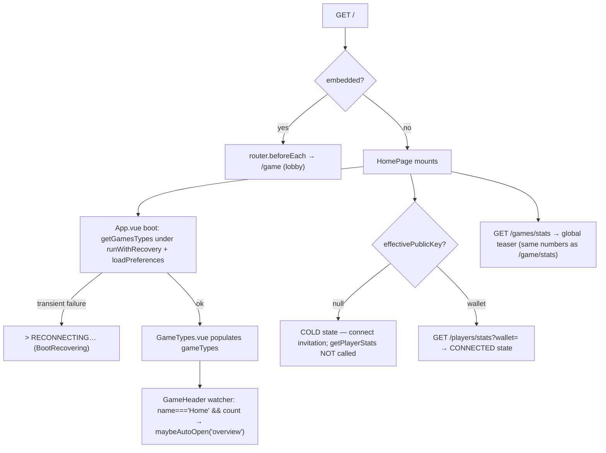
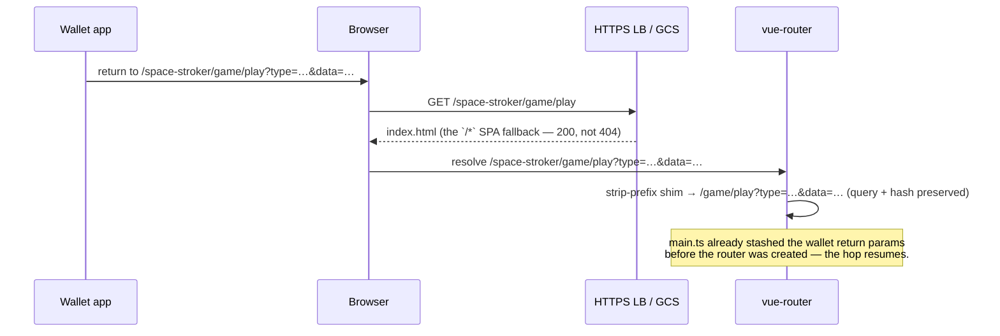

# Space Stroker — "Starting page (home dashboard) + drop the `/space-stroker` prefix" — Implementation Spec

> **Status: Shipped 2026-08-01** — merged to `main` via `feature/home-dashboard` in `monkify-backend`,
> `monkify-front` and `monkify-meta`. Distilled at `../features/home-dashboard.md`.
> Verified before the merge: **535 unit / 85 integration** green, `yarn lint` + `yarn build` clean.
> Refined via Trello card
> [Create a starting page, like a dashboard or something where we have links to other pages](https://trello.com/c/ijRUhWbX/131-create-a-starting-page-like-a-dashboard-or-something-where-we-have-links-to-other-pages)
> (2026-07-30).
> Repos affected: `monkify-backend`, `monkify-front`, and this doc in `monkify-meta`.
> Branch / worktree: `feature/home-dashboard` · `.worktrees/home-dashboard/<repo>`.
>
> **Purpose:** Give the app a **front door**. Today `/space-stroker/game` *is* the lobby — a 16-line
> wrapper around three arcade cards — and everything else the product has built (Stats, Games History,
> Provably Fair, Settings, How to play) is reachable **only** from the ☰ header menu, which a
> first-time player has no reason to open. This adds a landing page at **`/`** that carries the game
> picker, links to every surface, and shows the player their **own** numbers for the first time
> (new `GET /players/stats?wallet=`). Folded in, because it rewrites the same routes: the now-redundant
> **`/space-stroker` URL prefix is dropped** (the app is hosted at `app.spacestroker.com`), with a
> strip-prefix redirect shim and — closing a pre-existing gap — a generic catch-all → `/error`.

---

## 1. Summary

| Surface | Today | After this feature |
| --- | --- | --- |
| **Front door** | `/` → 302-style router redirect to the lobby. No landing page exists. | **`/` renders a new `HomePage`** — hero, game modes, personal stats, quick links, how-it-works entry, global-stats teaser |
| **Lobby** | `/space-stroker/game` → `GameSelectPage` (`GameTypes.vue`) | `/game` → **the same page, unchanged**. Still the documented iframe target and the `?type=` deep-link fallback |
| **URLs** | `/space-stroker/{game,game/play,game/history,game/stats,admin,wallet-bridge,background}` | The same paths **without the prefix**, plus a `/space-stroker/*` → stripped-path redirect shim and a generic catch-all → `/error` |
| **Player's own numbers** | Nothing. `GET /games/{id}/history?mineOnly&wallet` is per-type and paginated ≤30 — no honest total, no win rate | **New public read `GET /players/stats?wallet=`** → 11 aggregate metrics + the currency descriptor |
| **Quick Tour `overview@1`** | Auto-opens on the first **lobby** visit | Auto-opens on the first **`/`** visit, every guard intact |
| **Embedded (iframe)** | `/` redirects to the lobby | `/` **redirects to `/game`** — there is no embedded dashboard variant |
| **Cross-mode round feed** | Nothing. `GET /games/{id}/history` is per game type, so a cross-mode feed costs one request per mode | **New public read `GET /games/history?take=`** → the newest settled rounds across every active type, in one call |

Backend adds exactly two reads (`GET /players/stats`, `GET /games/history`), both modelled directly on
shipped services: **on-demand aggregation over existing rows + a short Redis TTL — no new entity, no
migration, no Consumers change, no SignalR change.**

Everything else is frontend: one new page, a small set of panelled section components, one new route +
two redirect rules, and a handful of prefix/comment/doc corrections.

---

## 2. Constraints (MANDATORY)

From `monkify-meta/constraints.md` (full list there):

- **Worktree-per-repo (§2):** `feature/home-dashboard` in `monkify-backend`, `monkify-front` and
  `monkify-meta`; work lives in `.worktrees/home-dashboard/<repo>`; the shared checkouts stay on
  `main` and are never switched. Push after every branch update; never force-push.
- **Unit tests (§3):** update + add in `SpaceStroker.Tests`, run the full suite via
  `scripts/run_tests.bat`, and **report the changed/added tests by name** at the end.
- **Integration test is mandatory (§3, `AGENTS.md` rule 8).** This is a **Feature** ⇒
  `SpaceStroker.Tests.Integration` gets a happy-path test that drives a real round to
  `RewardForWinnersCompleted` and asserts `GET /players/stats` returns the player's aggregate.
- **No entity, no migration (§4).** Aggregation only — nothing is added to
  `SpaceStrokerDbContext.OnModelCreating`.
- **Vague, non-leaking messaging (§6):** an unknown/never-seen wallet returns **zeroed stats with 200**
  — never a 404 and never anything that reveals whether that player exists. `/error` never says why.
- **Mock values only (§1)** in any config touched (none is expected).
- **Design workflow is blocking** (`conventions/frontend.md` → "Design workflow"): a new
  claude.ai/design project covering **both page states at desktop and phone widths**, built on the
  committed arcade tokens (`colors.css` / `arcade.css`), **before any markup**; run `impeccable`
  (skip its `NO_PRODUCT_MD` init interview); screenshot-compare at both widths. Record the project URL
  on the Trello card. **Mockups outrank this spec's prose for design; copy comes from the card's
  decisions, not from the mockup.**
- **Design system required:** build with the committed arcade primitives and `src/components/ui/`.
  `arcade.css` is plain CSS (not `@layer components`) and beats Tailwind utilities — use `.btn-arcade`
  as-is or build with plain Tailwind, never half-adopt. If a primitive is missing, add it to the
  system rather than styling in place.

---

## 3. Resolved product decisions

| # | Decision |
| --- | --- |
| 1 | The starting page is a **new route at `/`**, not a replacement for the lobby. `/game` keeps rendering today's plain lobby untouched — it is the URL `EMBEDDING.md` / `embed-example.html` point integrators at, and the `?type=` deep-link target. *(Rejected: making the lobby itself the dashboard — every embedded player would get a page whose Stats/Fair/History/How-to-play rows are all hidden by the embed gate.)* |
| 2 | **Drop the `/space-stroker` prefix**, folded into this card. New paths: `/` · `/game` · `/game/play` · `/game/history` · `/game/stats` · `/admin` · `/wallet-bridge` · `/background` · `/error`. Splitting it into a second card would rewrite the dashboard's route, the `/` redirect, the docs and the analytics twice. |
| 3 | **Keep a strip-prefix shim**: `/space-stroker/:pathMatch(.*)*` → the stripped path, **preserving query and hash**. Without it a surviving old URL renders a *blank page* (`routes.ts` has no catch-all and the LB's `/*` fallback happily serves `index.html`), and a mobile wallet deeplink hop straddling the deploy returns to the old path and strands a player mid-bet. **Also add a generic catch-all → `/error`**, closing that pre-existing blank-page gap. The shim is deletable in a later cleanup card. |
| 4 | `EMBEDDING.md` + `public/embed-example.html` are **already stale**: they document `#launch_token=<jwt>`, which no longer exists anywhere in `monkify-front` (removed with operators). Correct the URLs to the tokenless form; **do not attempt to restore the token flow** (see §7.9 for the exact bounded edit). |
| 5 | The page **contains the real game-mode cards** — `GameTypes.vue` reused **verbatim** as a section, not a new compact variant. A standalone player then never needs the lobby route, no click is added versus today, and #116 (better mode cards) + #129 (practice mode) land on both surfaces for free. |
| 6 | **Two page states, both designed.** **Cold (no wallet)** — welcome/onboarding-led: hero, connect invitation, how-it-works entry, global-stats teaser. **Connected** — stats-led: hero, modes, personal stats, quick links. The personal-stats area is **never simply hidden**; the cold state is a designed welcome (matching the shipped "Connect wallet to customize" precedent) rather than a page that reflows on connect. |
| 7 | **Sections:** hero banner → game modes → personal stats → quick links (Stats · History · Fair · Settings) → "how it works" entry → global-stats teaser. **Final ordering and the banner's content are design-pass outputs**, benchmarked against comparable game-lobby / crypto-casino landing pages. |
| 8 | **Quick links respect the embed gate.** Stats, Fair, History and How to play are hidden when embedded today; the dashboard's links follow the same rule. (Moot in practice — decision 13 means the dashboard never renders in a frame — but the rule is kept so a future embedded variant cannot regress it.) |
| 9 | **Global-stats teaser reuses `GET /games/stats`** (public, Redis-cached 120 s) — 2–3 tiles. It is what makes the page non-empty for a visitor with no wallet. Its numbers **must agree with `/game/stats`**: same endpoint, same formatter, no third set of money rules. |
| 10 | **Dropped: live pots per mode.** Would need 3 extra REST calls on the landing path *and* joining 3 SignalR groups — a direct violation of the one-connection/one-group design `useGameHub` owns. Its own card if wanted. |
| 11 | **#130 ("How to play") is NOT absorbed.** This card adds a **section/button that routes to that page**, and the design must account for it. Until #130 ships, the entry opens the existing Quick Tour `overview` modal; #130 repoints it. *(Absorbing #130 would inherit its Orbit blocker — #121 is restarted and unrefined.)* |
| 12 | **Quick Tour `overview@1` auto-open moves from the lobby to `/`**, keeping **every** existing guard (catalogue loaded, not embedded, no other tour open, key unseen, no boot-recovery / idle / relaunching overlay, terms accepted, display-name prompt closed). Leaving it on `/game` would silently stop it firing for almost everyone. **Accepted gap:** a player deep-linking straight to `/game` gets no overview. |
| 13 | **Embedded `/` redirects to `/game`.** One rule, enforced in a router guard so `HomePage` never mounts in a frame — no embedded dashboard variant to design or QA. |
| 14 | **New endpoint `GET /players/stats?wallet=…`.** *(Rejected: deriving a client-side "recent activity" strip from `?mineOnly` — it is per-game-type, paginated at ≤30, and there is no honest way to show a total or a win rate without paging the entire history.)* |
| 15 | **Public and wallet-keyed**, exactly like every sibling player read (`GET /players/preferences?wallet=`, `GET /games/{id}/history?mineOnly&wallet=`, `GET /solana/balance`). It leaks nothing new — it aggregates data already publicly readable by wallet, over bets that are public on-chain USDC transfers. *(Rejected: signature-gating the read — it would be the first gated read in the codebase, would demand a wallet signature and a mobile app-hop just to open the home page, and buys privacy that does not actually exist.)* |
| 16 | **Metrics returned:** rounds played · bets placed · most-played mode · total wagered · total won · net · win rate · biggest single win · biggest win multiplier (`×n`) · current streak · best streak. Plus the currency descriptor (`tokenSymbol`, `tokenDecimals`). |
| 17 | **Money rules mirror `fair-stats-menu` / `game-type-stats` exactly:** only `RewardForWinnersCompleted` rounds count; free bets (`Amount == 0`) are **excluded from money** but **counted in participation**; payouts come from `Credit` `TransactionLog` rows; amounts are token-native from the one configured token. |
| 18 | **Streaks (settled here, §6.4):** ordered by `Game.EndDate` (ties by `Game.CreatedDate`) over the completed rounds the player bet in; a round counts as a **win** if **any** of that player's bets in it matched the winning choice (case-insensitive, the shipped `GameHistoryService` rule); **free bets included** — it is a participation metric. `CurrentStreak` is the trailing win-run at the newest end (0 if the most recent round was a loss); `BestStreak` is the longest win-run anywhere in the sequence. |
| 19 | **Cache TTL is short — 30 seconds** (`PlayerStats:{wallet}`), a quarter of the 120 s global/per-type TTL. A player's own just-settled win going invisible behind a long TTL is exactly the complaint `wallet-balance-refresh` was filed for; 30 s still collapses the boot burst and a couple of refreshes. |
| 20 | **A new claude.ai/design project is a blocking prerequisite for markup** (see §2). Both page states, desktop **and** phone. Its URL is recorded on the card. **✅ AC22 CLOSED AT SHIP (2026-08-01):** the project is https://claude.ai/design/p/d469c44f-87b1-43ed-ab7c-e7d0a742535a, confirmed by the owner at ship time and recorded on the card. *(Historical note: the 2026-07-31 revision itself was iterated against the owner's up-front layout agreement — hero shape, section plan, panel rule, against the Bull Rush reference — and live screenshots at 1440 and 390 in both states, rather than driven from the project file. The project is the design of record; the screenshot compare is what verified the build against it.)* |
| 22 | **REVISED 2026-07-31 — the page is FRAMED, not frameless, and the frame is the MODAL system's.** The first build deliberately drew no panel on any section ("the type hierarchy is the structure"). In review it read as loose text on a starfield: the mode cards were the only objects on the page, and nothing else looked pressable. Every section below the hero is now a frame via one shared `HomeSection.vue`. **The material is `.arcade-frame`, not `.arcade-panel`** — see decision 27. **The hero stays unframed** — it is the page's title card, so a border there would be a border around everything. |
| 27 | **REVISED 2026-07-31 — new `.arcade-frame` primitive; sections mix cyan and grey.** The owner's reference is the [Space Stroker Modals design project](https://claude.ai/design/p/de972618-1d9c-4ac5-9fa2-37206d9866eb?file=Space+Stroker+Modals.dc.html): a **thin border on near-black, flat** — no bevel, no gradient, no key-drop. `.arcade-panel` is the wrong material for this page; its amber bevel is the *cabinet the machine is built from*, while these sections are screens. `QuickTourModal` had already written exactly this surface inline as `.tour-frame` ("deliberately NOT .arcade-panel … a CRT overlay — a thin cyan frame on near-black"), so it is **promoted into `arcade.css` as `.arcade-frame` / `.arcade-frame--cyan` / `.arcade-frame__rule`** and the tour modal now consumes the primitive instead of redefining it — one definition, no drift (`constraints.md`: add the missing primitive to the system rather than styling in place). **Tone alternates down the page** — cyan on the two sections that are about the player (`TRY IT FREE`, `YOUR RECORD`), the neutral line elsewhere — because five identical rectangles read as a list. Section titles take the modal's `+ TITLE +` amber marks so a section header and a modal header read as the same object. |
| 23 | **REVISED 2026-07-31 — the hero is the SHIP art, simplified and UNFRAMED.** It used to float `edson.png` (a cropped HEAD, no body, no context) beside five stacked copy blocks. It is now `edson-ship.gif` (Edson at the keyboard in his saucer — the same asset `monkify-lp` and the OG card use, so the product looks like one product), beside a headline, one two-line sub, two CTAs and one fine-print line. **No plate around it** (owner's call, 2026-07-31): a saucer in space should be *in* space, and a border turns the mascot into a product photo — it sits directly on `App.vue`'s starfield with a flat drop-shadow glow. The GIF is a 545 KB infinite loop, so `html.light-graphics` gets an extracted first-frame PNG (26 KB) — §7.10 bans infinite animation there outright, and a `drop-shadow` (not a `filter: blur` on a backdrop) survives that mode unchanged. |
| 24 | **REVISED 2026-07-31 — the quick-links row is gone; its entries became sections and a footer.** Five 9px dotted links at the foot of the page read as a chart legend, not as navigation. Now: **Provably Fair** and **Try it free** are panelled sections with copy and a button; **How to play** is a `READ THE WIKI` button on the how-a-round-goes panel; **Stats** and **History** are buttons on The Floor; **Settings**, **Responsible gaming** and **Terms** are a real footer. Terms uses the existing `TERMS_URL`; there is no Privacy route in the SPA and none was invented. |
| 25 | **REVISED 2026-07-31 — `HomeLastRounds` + `HomeGlobalTeaser` merged into `HomeFloor`.** Both rendered **nothing** when they had no data, which left a ~400px hole in the middle of the front door on a quiet backend. One section that always renders — and says the floor is quiet when it is — beats two that can vanish. |
| 26 | **REVISED 2026-07-31 — new endpoint `GET /games/history`.** `HomeLastRounds` built its cross-mode feed with one `GET /games/{id}/history` per game type (three today, more per mode added) on the app's landing path — the exact cost decision 10 rejected live pots for, and its own header comment flagged it as not ship-ready. Replaced by a single public read (§6.9). |
| 28 | **REVISED 2026-07-31 — the hero carries NO dynamic figures, and its two buttons are a matched pair.** Owner's call. Removed: the live **jackpot chip** (`HomeJackpotChip.vue`, now deleted — it had no other consumer) and the live **ticket-price line**, both read off the catalogue. Also removed the `1–2 USDC A TICKET` eyebrow above the mode cards — same dynamic figure, and already printed on every card below it. A front door's opening statement is a claim about the game, not a readout; the prices live on the cards and the jackpot on its own surface. The only fine print left is static ("Every round is seed-locked before it starts"), and the sub is one line. **Buttons:** a filled Connect beside an outlined Practice read as two unrelated controls, so `PrimaryButton` gained `variant="ghost"` and `WalletButtons` gained `variant` + `size` — both defaulting to today's header behaviour, so the sticky header is untouched. The hero renders the same real wallet cluster, outlined and full-size. **Art:** enlarged to `md:max-w-[620px]` on the larger flex basis. ⚠️ The h1 dropped to `lg:text-[32px]` because Press Start 2P advances ~1em per character — "FIRST WORD OUT" needs ~14× the font size and broke to three lines at 38px once the art took its bigger share. Re-check that if either basis changes. |
| 29 | **REVISED 2026-07-31 (third pass) — the CONNECTED hero states what is HAPPENING, not who you are.** Owner's call: the connected fold read `Welcome back / 22nv…nQ1S / CURRENT STREAK 0` — "not fun, and it does not make sense". Both halves fail for a concrete reason. An **address is an identifier, not a greeting**, and the player may already have set a name (`usePlayerPreferences().displayName`, shipped by `wallet-display-name`), so the raw key is now the **fallback**, not the label. A **zero streak with seven empty segments** is a metric that only reads once you have already played — it renders **only when `currentStreak >= 1`**, unchanged when it is alive. What takes the freed space is **one live line** off the same snapshot the cards use (§7.11): `> COSMIC SPRINT is filling — 3 in, 6 USDC pot`, or, when nothing is open, `> Floor's quiet. Be the one who starts a round.` This does **not** reintroduce the dynamic figures decision 28 removed: 28 banned *catalogue readouts* (a jackpot chip and a ticket price already printed on the cards below); this is the state of a round the player can join **right now**, and it is the only reason a returning player is on this page. |
| 30 | **REVISED 2026-07-31 (third pass) — the picker gets the loudest header on the page.** `PICK A MACHINE` was a bare `<h2>`, quieter than every panel below it — so the *least* important sections looked the most designed. It becomes a full-width header in the `+ TITLE +` idiom (`+ PICK YOUR MACHINE +`) at hero-adjacent size with a live eyebrow (`3 MACHINES · 1 ROUND FILLING NOW`). It is **not** wrapped in a `HomeSection` frame: the cards already carry their own frames, and a frame around framed things is a box in a box. |
| 31 | **REVISED 2026-07-31 (third pass) — the mode cards carry the POT, live, and it is the loudest figure on them.** Today the only number on a card is the **ticket price** — the *cost*. The prize is absent, and the three cards differ only by picture, with the one real differentiator (how many characters you call, how many players, which character set) buried in clamped 10px grey description text. The card is rebuilt around a live **POT** at display size, the ticket price demoted to a support line, a live **status pill** (`● LIVE NOW` / `FILLING n/m` / `STARTING…` / `IDLE — BE FIRST`), a hairline **meta row** that replaces the description as the differentiator, a **real `btn-arcade--primary` button** in place of the dashed blinking box (a dashed border reads as a placeholder or a disabled control — the weakest-looking element on the most important object), and a **per-archetype accent** so three cards stop being three identical rectangles. **Scope guard (owner's call):** the cards are enriched, they do **not** become the centrepiece — the hero keeps the fold and gains vertical room (§7.11), the cards gain weight underneath it. |
| 32 | **The live snapshot costs three GETs and no backend.** `GET /games/{gameTypeId}` (the shipped read the game page already makes on entry) returns status + bets + lottery pot, so pot, players-in and status are derivable **frontend-only**. One call per active type, fired in parallel **once on mount** and again **when the tab regains focus** — no interval polling (free while the tab is away, and a pot that is minutes stale is a lie), no SignalR on this page, **no new endpoint**. The page already fires four reads (`games/active-types`, `players/stats`, `games/stats`, `games/history`); this makes seven. Rejected: a new one-call snapshot endpoint — cleaner at scale, but it is a backend contract plus a mandatory integration test (rule 8) for three cards, and it can replace the fan-out later without touching this component. Because `GameTypes.vue` owns the fetch, **`/game`'s lobby gets the enriched cards too** — deliberate; §7.3 forbids the two grids drifting. **This partially supersedes decision 10** ("dropped: live pots per mode — 3 extra REST calls *and* joining 3 SignalR groups, a direct violation of the one-connection/one-group design `useGameHub` owns"). **Decision 10's SignalR objection stands in full and is not touched**: this page joins **no** hub group and opens **no** socket — `useGameHub` keeps its one-connection/one-group invariant, and the price of that is that a figure can be up to one focus-cycle stale, which is why the status pill is coarse (`FILLING`, not a per-second counter). Only the "3 extra REST calls" half is accepted, because the owner has since made the pot the *point* of the picker (decision 31), and the cards had no live signal at all. |
| 33 | **FOUND IN THE BROWSER 2026-07-31 — a card never headlines a zero.** The first build of decision 31 was verified against the local stack and every card led with **`0 USDC`**: on a floor with no bets, "lead with the prize" was advertising that there is nothing to win. With no live pot the card now shows `POT FROM {requiredAmount × minimumNumberOfPlayers}`, dimmed (`--color-ink-dim`) rather than amber, and switches to `POT {live}` in full amber the moment a round has money in it. It is a **floor, not a promise** — the round cannot start below it — and it is the figure the player is actually deciding against. A lottery type is usually already above it, because `computePot` includes the configured base and any carried jackpot. |
| 34 | **`useGamePicker` — the entry into a game is ONE handler.** There are two entry points now (a mode card, and the hero's `JOIN`/`WATCH`), and they must do the same four things in the same order — select the game, fire `game_type_selected`, route, `updateNewGame(true)`. Extracted out of `GameTypes.vue` rather than copied into the hero, or a player entering from the hero lands in a game the app never selected and that never fired its analytics event. |
| 35 | **REVISED 2026-07-31 (owner review of the built card) — the card is the OWNER'S MOCK, and it is SHORT.** Two problems with the first build of decision 31. (a) **Height:** six stacked blocks below the art (status strip, name, pot, price, spec row, copy) made each card **~530 px** — the picker ran the height of the fold. (b) **It was not the design that already existed:** the owner had a card mock — art → a row of **stat tiles** → a **highlighted title chip** → a **highlighted price chip** → copy → button. The shipped card is that mock, at **376 px**. What changed to get there: the **status pill and lottery badge OVERLAY the art** (a full-width strip cost ~38 px and said nothing the art did not); the **spec row is dropped** (the description already carries the shape, and the player count is now a tile); **pot + players share one tile row**; the **price is a chip on the title**, not its own line; the **description clamps to two lines at EVERY width** — the old rule clamped to one line on phones and ran full at `lg+`, which is precisely what made three cards three different heights. The lottery badge sits **bottom**-right: every sprite holds its sign top-right. The mock's own tiles (`PLAYING NOW`, `USDC SPENT TODAY`) are **#117 and have no endpoint**, so the tiles carry the two figures that exist — the pot and `players/minimum`. The **real USDC mark** rides the pot figure (owner's call): `src/assets/usdc.svg`, **guarded on `tokenSymbol === 'USDC'`** so a future token cannot inherit another currency's logo, and with `image-rendering: auto` set explicitly, since the card root sets `pixelated` for the sprite art and a mangled logo reads as a knock-off. |
| 36 | **REVISED 2026-07-31 — they are GAMES, not "machines".** The metaphor entered with the second pass's `PICK A MACHINE` heading and spread into the picker header, the eyebrow, and two empty states. The product, the API (`/games/*`, `gameTypeId`) and the lobby's own `GAME SELECTION` banner all say **game**; nothing else in the app calls them machines. Copy is now `+ PICK YOUR GAME +`, `{n} games · pick one`, and "Pick a game above/below…". |
| 37 | **REVISED 2026-07-31 (fourth pass) — the picker's art is the LP's, mapped by SHAPE.** Card art was picked by `gameCharacterType` out of four sprites that differ only in the text on the sign the monkey holds — and `abc-type.png` is the fallback, so **Cosmic Sprint and Space Jackpot rendered the identical image**. The art block is the largest element on the card and on two of the three shipping cards it carried no information at all. `monkify-lp/src/components/GameModes.vue` already solved this with real per-mode art — Edson hammering a keyboard through speed-lines, a red-eyed jacked chimp, Edson drowning in gold coins — each a poster PNG plus an animated GIF. Those six files are copied into `monkify-front/src/assets/types/` and chosen by the **archetype** rule the card already computes. Never by name: the LP hard-codes by mode name and the app cannot, because operators create their own types and `gameTypeId` is a fresh GUID on every teardown + reseed. `lottery → preset → race` is exhaustive, so every type — including an operator's own — gets real art and no fallback can duplicate. The four sign sprites stay on disk (still imported by `main` and the `wallet-autoconnect-mobile-only` worktree) but this component no longer references them. GIF weight (80 + 318 + 596 KB) is paid **on first hover only** and never on a phone. |
| 38 | **REVISED 2026-07-31 (fourth pass) — the card leads with the GAME, not a figure, and the player count is gone.** Owner review of decision 35's card: *"these cards UI just suck, the info in them is all bad too… we gotta make these cards APPEALING they are the most important cards in the app"*, and specifically *"the 0/2 must go, we need to show the game name and description clearly. numbers are addons, but gotta be meaningful like ticket price and highest paid pot"*. Decision 35's tile row headlined `POT FROM 2` and `PLAYERS 0/2`; on a quiet floor — most of the time before launch and every slow hour after — the card's two loudest figures both read as zero, so the most important object in the app advertised that nothing was happening. The order becomes art → **name** (the loudest text on the card) → a derived **tag line** → the **description at three lines, aligned across the row** → a quiet two-cell money row → the button. Deleted outright: the amber name chip, the magenta price chip, the floating lottery badge, the `POT FROM` tile, `PLAYERS n/m`, the `IDLE — BE FIRST` pill, and the duplicate price line — decision 35 printed the price twice in two formats (`$2` beside a USDC mark, then `1 USDC PER TICKET`) with the `2 = 1 × 2 players` relation invisible, which reads as a contradiction rather than two facts. The status pill now renders **only when there is something to say** (`LIVE NOW` / `STARTING` / `FILLING`); an idle card renders none, because a badge identical on every card is chrome, not signal. **Supersedes AC29 and the tile-row half of decision 35**; AC30's height and equal-height guarantees stand. |
| 39 | **REVISED 2026-07-31 (fourth pass) — one accent per card, on the LP's mapping, and hover stops repainting the frame.** Decisions 31/35 put up to four accents on one card at once — amber name chip, magenta price chip, cyan-or-grey frame, orange button — so nothing read as the focal point; and the accent mapping (lottery = amber, preset = cyan, race = neutral grey) disagreed with the one already published on the LP. The app adopts the LP's: **race → `--color-primary`, preset → `--color-cyan`, lottery → `--color-magenta`**, so the marketing page and the app finally give each game the same colour. The accent drives the frame, the name and the pill; nothing else on the card is coloured. Hover no longer repaints every frame amber — on an amber card that erased the accent entirely — and uses the LP's treatment instead: `translateY(-6px)`, an accent glow, a warmed border, all dropped under `prefers-reduced-motion`. |
| 40 | **REVISED 2026-07-31 (fourth pass) — `BIGGEST POT`, all-time and frontend-only, in a money cell that can never render a zero.** `GET /games/{parametersId}/stats` is already built, already Redis-cached (120 s) and already wired in `mainService.getGameTypeStats`; only `/game/stats` read it. The picker now fans it out too. ⚠️ `GameStatsService`'s own doc comment says it was built *"on-demand… never a lobby fan-out"* — **accepted on query cost, overruled on traffic**: the 120 s TTL is shared across every client through the Redis backplane, so a fan-out costs at most three cold aggregates per two minutes no matter how many people are on the page. What stays true is that the aggregate loads every paid bet of every completed round into memory and so degrades as history grows — already the case for `/game/stats`, a scaling card of its own, not a blocker here. The endpoint has **no time window**; every figure is all-time. "Biggest pot **today**" was considered and rejected: cross-repo (service change, unit tests, a rule-8 integration test), it needs a timezone decision with no right answer, and it reads **zero** on a quiet day — the exact failure this pass exists to kill. The money row is two cells: `TICKET` (one place, one format, tooltip kept) and a second cell that reads **`POT NOW {live}`** when a round has real money in it, **`BIGGEST POT {all-time}`** otherwise, and is **omitted entirely** when both are zero, with `TICKET` spanning the row. No figure on this card is ever printed as `0`. |
| 41 | **REVISED 2026-08-01 (fourth pass, owner review of the built card) — the 2-font arcade system, applied correctly.** The card put the game NAME in VT323 — the **body** face — so the loudest element read as body text, while the description inherited the browser's default sans and so matched nothing else in the app. `tailwind.config.js` has carried a deliberate 2-font system since the LP port (`font-display` = Press Start 2P for titles, `font-body` = VT323 for copy) and this card was using neither correctly. The name is now `press-start-2p-regular` at **13 px** (Press Start 2P is wide — it reads as the biggest thing on the card at a small px size) and the description is explicitly VT323 at **17 px**, which is *narrower per character* than the 11 px sans it replaces, so it fits more copy in less height. |
| 42 | **REVISED 2026-08-01 (fourth pass) — the money row becomes two chips on the tag's row.** A bordered full-width row for two figures cost ~52 px on the object that most needs to fit on a screen, and it framed the numbers as the card's conclusion when they are an aside. `TICKET` and one live chip now sit right-aligned on the same line as the tag, which was half-empty. **The second chip asks the question that fits the game:** `PLAYERS {n}` on a race or preset (who else is in), and `POT {n}` on a lottery, where nobody is "in" and the pot fattens on its own. **`BIGGEST POT` is dropped**, and with it the whole `useGameTypeStats` fan-out — the picker is back to 3 GETs, and decision 40's hook is deleted rather than left dead. Only the tag may truncate; a clipped price is worse than a clipped `PICK 1 OF 8`. |
| 43 | **REVISED 2026-08-01 (fourth pass) — art to 16:10, and the crop is aimed at the MONKEY.** 4:3 art made a 500 px card. At 16:10 it is 398 px — inside the same ballpark as decision 35's 376 px while still carrying a real illustration. The crop percentages are now where Edson actually sits in each source file, **not `center` / `top`**: Cosmic Sprint `50% 48%` (near-square scene, him mid-frame), Space Jackpot `50% 32%` (840×1190 portrait where he occupies the top third — a plain `center` shows only coins and `top` cuts his head). Beast Mode stays contained and bottom-anchored: it is a transparent bust with no background of its own. |
| 44 | **FOUND IN THE BROWSER 2026-08-01 — `loading="lazy"` NEVER FIRES inside a `clip-path` frame.** The art was copied from the LP complete with `loading="lazy"`, and every card rendered an **empty black frame**: after 4+ seconds on screen and fully scrolled into view, all three images reported `complete: false` / `naturalWidth: 0` — **including the one webpack had inlined as a `data:` URI**, which cannot fail on the network. Cause: `.pixel-border-outer` / `.pixel-border-inner` clip the card with `clip-path` polygons (the pixel bevel), and Chrome folds ancestor clips into the intersection check that drives lazy loading, so the load is deferred forever. Removing the attribute loads the same image instantly. The LP gets away with it because its cards sit far down a long marketing page in **unclipped** frames. Three above-the-fold posters are also exactly the wrong thing to defer — they are what the player came to look at. **Any future `loading="lazy"` inside these frames is the same bug.** |
| 45 | **REVISED 2026-08-01 (fourth pass, third cut) — the chips are a HUD on the ART, not a row of the card.** They moved from the tag's row into the artwork's **bottom-right corner**, opposite the status pill, which costs the card **zero height** (398 px → **387 px**) and reads them as what they are: an aside over the picture, not the card's conclusion. They carry their own `rgba(0,0,0,.78)` scrim and sit above the scanline layer — Space Jackpot's art is bright gold and a translucent chip vanished into it. |
| 46 | **REVISED 2026-08-01 — one price colour, and a green dot that only lights when it is true.** The chip value was tinted with the archetype accent, so the ticket price was amber on one card, cyan on the next and magenta on the third: **three colours for one kind of fact**, which reads as three different kinds of fact. Every chip value is now `--color-ink` on every card. The `PLAYERS` chip gains a dot on a **new semantic `--color-live` green** — deliberately outside the primary/cyan/magenta trio the cards are keyed on, so it means the same thing everywhere — and it is **lit only when `players > 0`**, falling back to `--color-ink-mute`. A green light over an empty round is the one lie this card could tell. |
| 47 | **FIXED 2026-08-01 — the Space Jackpot crop was cutting Edson's head off.** `object-position: 50% 32%` on an 840×1190 portrait scaled ~0.40 into a 16:10 frame hid **~213 px** of source at the top, straight through his head. Now **8%**, hiding ~54 px — above the hair tuft, which starts ~90 px down. The rule to keep: on this frame each 1% of `object-position` hides ~6.7 px of the original, so aim the crop with the source's own geometry rather than by eye. |
| 48 | **REVISED 2026-08-01 — the header wordmark goes to the FRONT DOOR, and unbuilt CTAs go to `/soon`.** Two leftovers from before the starting page existed. (a) `GameHeader`'s logo + wordmark was hard-coded to `{ name: 'GameLobby' }`, so the app's most obvious "take me home" control landed on the **old bare lobby** — it now resolves to `{ name: 'Home' }`, except **when embedded**, where it stays the lobby because `main.ts` redirects a framed `/` to GameLobby anyway and routing through Home would only burn a redirect and log a pageview for a page that never renders in a frame. ⚠️ The `gameHomeRoute` const had to move **below** `isEmbedded`'s declaration: `<script setup>` consts are not hoisted. (b) `PRACTICE` (#129) and `READ THE WIKI` (#130) both quietly opened the **Quick Tour overview modal** — which is not what either button says it does. A control that does something other than its label is worse than one that admits it is not ready: it teaches a first-time player that this page's buttons cannot be trusted. Both now route to a shared **`/soon?feature=`** placeholder. One page for both, because they are unbuilt for the same reason and will be replaced independently — shipping either is a one-line repoint plus deleting its entry. An unknown or missing `feature` renders a safe fallback rather than an empty heading, so a stale or hand-typed URL cannot produce a broken-looking page. `/soon` is deliberately **not** in `App.vue`'s `isPlayerRoute()`: it has no identity to render. |
| 21 | **No new rate-limit rule.** `RateLimitSettingsTests.GeneralRules_AreExactlyTheThreeQuotaProtectingPatterns` pins the rule set to `*:/rpc`, `*:/solana/*`, `*:/solana/balance/live` — every other endpoint is deliberately unlimited app-side. `/players/stats` joins `/players/preferences` and `/games/*/history` as an unlimited read behind Cloud Armor's per-IP rule. Adding a rule here would be a money-path decision, and would break that exact-set test by design. |

---

## 4. Data model

**No entity change. No migration. No `OnModelCreating` change.**

Everything the endpoint needs already exists:

| Table | Columns read |
| --- | --- |
| `Players` | `Id`, `ExternalPlayerId` (the wallet) |
| `Games` | `Id`, `ParametersId`, `Status`, `EndDate`, `CreatedDate`, `WinningChoice` |
| `GameBets` | `Id`, `GameId`, `PlayerId`, `Choice`, `Amount` |
| `TransactionLogs` | `BetId`, `Type` (`Credit`), `Amount` |
| `GameParameters` | `Id`, `Name` (for the most-played mode) |

Confirm before implementing that the query set stays inside the existing indexes
(`GameBets.PlayerId`, `GameBets.GameId`, `TransactionLogs.BetId`); if a scan shows up in local
`EXPLAIN`, **report it — do not add an index silently** (that would be a migration and is out of
scope for this card).

---

## 5. Configuration

None. No new `GeneralSettings` key, no new `VUE_APP_*` env var. The currency descriptor is read from
the already-bound `GeneralSettings.Operator.Token` (`Symbol`, `Decimals`), exactly as
`GlobalStatsDto.From` does.

---

## 6. Backend behaviour (`monkify-backend`)

### 6.1 New endpoint — `GET /players/stats`

```
GET /players/stats?wallet=<base58 address>
```

- **Public.** No auth header; identity is the `wallet` query param. Same contract as
  `GET /players/preferences`.
- **200 always.** Missing/blank `wallet`, an unknown wallet, or a wallet that has never bet all return
  the **zeroed** `PlayerStatsDto` (with the currency descriptor filled). Never 400, never 404 —
  §6 of `constraints.md`.
- Wrapped in the standard `ApiResult<T>` envelope by `BaseController.ProcessRequest`, like every other
  read.

Register it on `PlayersController` alongside the existing routes, and extend the CORS-preflight
`[HttpOptions]` coverage:

```csharp
[HttpOptions("stats")]
public IActionResult GetStatsOptions()
{
    HttpContext.Response.Headers.Append("Allow", "GET,OPTIONS");
    return Ok();
}

/// <summary>
/// All-time aggregate stats for one wallet: participation, money, streaks. Public and wallet-keyed,
/// exactly like GET /players/preferences — it aggregates facts that are already publicly readable by
/// address. An unknown wallet returns ZEROED stats, never an existence-revealing error.
/// </summary>
/// <response code="200">Returns the player's aggregate stats (zeroed when unknown).</response>
[HttpGet("stats")]
public async Task<IActionResult> GetPlayerStats([FromQuery] string? wallet)
    => await ProcessRequest(new GetPlayerStatsRequest(wallet));
```

### 6.2 Request + handler — `Handlers/Players/GetPlayerStats/`

`GetPlayerStatsRequest.cs`

```csharp
public record GetPlayerStatsRequest(string? Wallet) : IRequest<PlayerStatsDto>;
```

`GetPlayerStatsHandler.cs` — mirrors `GetGlobalStatsHandler` (resolve → aggregate → map):

```csharp
public class GetPlayerStatsHandler : BaseRequestHandler<GetPlayerStatsRequest, PlayerStatsDto>
{
    public GetPlayerStatsHandler(IPlayerStatsService statsService, SpaceStrokerDbContext context,
        IMessaging messaging, GeneralSettings settings) : base(context, messaging) { … }

    public override async Task<PlayerStatsDto> HandleRequest(GetPlayerStatsRequest request, CancellationToken ct)
    {
        var wallet = request.Wallet?.Trim();

        // No wallet, or a wallet nobody has ever bet with -> zeroed stats. Resolving to null here (not
        // throwing) is what keeps the endpoint non-leaking: "unknown player" and "player with no rounds"
        // are indistinguishable to the caller.
        var playerId = string.IsNullOrWhiteSpace(wallet)
            ? (Guid?)null
            : (await Context.Players.AsNoTracking()
                .FirstOrDefaultAsync(x => x.ExternalPlayerId == wallet, ct))?.Id;

        var stats = playerId == null
            ? PlayerStats.Empty
            : await _statsService.GetPlayerStats(playerId.Value, wallet!);

        return PlayerStatsDto.From(stats, _settings.Operator.Token);
    }
}
```

The wallet→`Player.Id` resolution is copied verbatim from
`GetGamesHistoryHandler.ResolveCallerPlayerId` — same lookup, same "null means no rows" semantics.

### 6.3 `IPlayerStatsService` / `PlayerStatsService` — `Services/Players/`

New folder `SpaceStroker.Infrastructure/Services/Players/` holding `IPlayerStatsService.cs`,
`PlayerStatsService.cs` and the plain result model `PlayerStats.cs` (the same shape
`Services/Games/` uses for `GlobalStats` / `GlobalStatsService`).

```csharp
Task<PlayerStats> GetPlayerStats(Guid playerId, string wallet);
```

Aggregation, in order (a direct re-shaping of `GlobalStatsService`, scoped to one player):

1. **Cache read.** `CacheHelper.GeneratePlayerStatsCacheSettings(wallet)`; return the hit.
2. **The player's bets** — `GameBets` where `PlayerId == playerId`, projecting
   `{ Id, GameId, Choice, Amount }`.
   Empty ⇒ cache and return `PlayerStats.Empty`.
3. **The completed rounds among them** — `Games` where `Id ∈ betGameIds` **and**
   `Status == RewardForWinnersCompleted`, projecting
   `{ Id, ParametersId, EndDate, CreatedDate, WinningChoice }`.
   Everything below is computed over **these rounds only** — a round still in flight, refunded, or
   ended in error contributes nothing, exactly as in `game-type-stats` / `fair-stats-menu`.
4. **Participation** (free bets **included**):
   - `RoundsPlayed` = completed rounds count.
   - `BetsPlaced` = the player's bets that belong to those rounds.
   - `MostPlayedTypeName` / `MostPlayedTypeRounds` = the `ParametersId` with the most completed rounds
     (ties broken by name for determinism), resolved to `GameParameters.Name`.
5. **Money** (paid bets only, `Amount > 0`):
   - `TotalWagered` = Σ stake.
   - `TotalWon` = Σ of `Credit` `TransactionLog.Amount` grouped by `BetId` over the player's bets in
     those rounds (the shipped payout source).
   - `Net` = `TotalWon - TotalWagered` (may be negative — do **not** clamp).
   - `BiggestSingleWin` = max per-bet credit sum (0 when none).
   - `BiggestWinMultiplier` = max(`credit / stake`) over paid bets with `stake > 0` (0 when none).
6. **Outcome metrics** (§6.4).
7. **Cache write** with the 30 s TTL, then return.

Every money read stays token-native; there is one configured token, so no currency grouping exists
(the same structural simplification `GlobalStatsService` documents).

### 6.4 Win, win rate and streaks (decision 18 — settled)

- A **won round** = the player has ≥1 bet in that round whose `Choice` equals the round's
  `WinningChoice`, compared with `StringComparison.OrdinalIgnoreCase` — the identical rule
  `GameHistoryService.ApplyOwnColumnsAsync` and `GlobalStatsService` use. **Free bets count**: this is
  a participation/outcome metric, not a money metric, and a free bet that matched the winner did win
  the round even though it was never credited.
- `WinRate` = `wonRounds / RoundsPlayed`, returned as a **fraction in `[0,1]`** (`decimal`), formatted
  as a percentage by the client. `0` when `RoundsPlayed == 0` — never a divide-by-zero, never `null`.
- **Ordering for streaks:** `EndDate` ascending, ties by `CreatedDate` ascending. `EndDate` is nullable
  on `Game`, but a `RewardForWinnersCompleted` round always has one; still coalesce to `CreatedDate`
  defensively rather than throwing.
- `CurrentStreak` = length of the trailing run of won rounds at the newest end; **0** when the most
  recent completed round was a loss.
- `BestStreak` = the longest run of consecutive won rounds anywhere in that sequence
  (`BestStreak >= CurrentStreak` always).

### 6.5 DTO — `Contracts/Players/PlayerStatsDto.cs`

New folder `Contracts/Players/` (the `Contracts/Games/` convention; today's `PlayerPreferencesDto`
lives beside its handler — leave it where it is, do not move it in this card).

```csharp
public class PlayerStatsDto
{
    // Participation (free bets included).
    public long RoundsPlayed { get; set; }
    public long BetsPlaced { get; set; }
    public string? MostPlayedTypeName { get; set; }
    public long MostPlayedTypeRounds { get; set; }

    // Outcomes.
    public decimal WinRate { get; set; }        // fraction in [0,1]
    public long CurrentStreak { get; set; }
    public long BestStreak { get; set; }

    // Money (token-native; free bets excluded).
    public decimal TotalWagered { get; set; }
    public decimal TotalWon { get; set; }
    public decimal Net { get; set; }
    public decimal BiggestSingleWin { get; set; }
    public decimal BiggestWinMultiplier { get; set; }

    // Currency descriptor (mirrors GlobalStatsDto so the client formats amounts identically).
    public string? TokenSymbol { get; set; }
    public int? TokenDecimals { get; set; }

    public static PlayerStatsDto From(PlayerStats stats, TokenSettings token) { … }
}
```

Plain get/set (no records) so it also deserializes in the integration tests — the same reason
`GlobalStatsDto` is written that way.

### 6.6 Cache — `CacheHelper`

```csharp
// Per-wallet all-time aggregate. DELIBERATELY SHORTER than the 120s global/per-type stats TTL: this is
// the player's OWN money, and a just-settled win that stays invisible for two minutes is the exact
// complaint specs/wallet-balance-refresh.md was filed for. 30s still collapses the boot burst (the page
// load plus a refresh or two) without ever making a player doubt their own numbers. No invalidation:
// the TTL bounds it, and there is no write path to hook.
public static CacheSettings GeneratePlayerStatsCacheSettings(string wallet)
    => new($"PlayerStats:{wallet}", TimeSpan.FromSeconds(30));
```

The zeroed result for an unknown wallet **is** cached under the same key — harmless (it reveals
nothing), and the 30 s TTL bounds any key growth from an address scan.

### 6.7 DI registration

`SpaceStroker.Infrastructure/DependencyInjection.cs`, next to the sibling stats services:

```csharp
services.AddScoped<IPlayerStatsService, PlayerStatsService>();
```

### 6.9 New endpoint — `GET /games/history` (decision 26)

```
GET /games/history?take=<1..10>
```

- **Public, wholly.** No wallet, no caller identity, no own-bet columns — which is exactly what lets one
  Redis key serve every visitor.
- `take` defaults to **6** and is clamped to **10** in the handler. The clamp is not cosmetic: `take` is
  part of the cache key, so an unclamped value would let a caller mint unbounded keys.
- **200 always**, including an empty catalogue and a deployment with nothing settled yet — an empty
  list, never a validation failure (`constraints.md` §6).
- Returns `List<GameHistoryDto>` — the **same DTO** the per-type history page returns, with the `My*`
  columns left null.

`Handlers/Games/GetRecentRounds/` resolves the active catalogue through
`IGameService.GetAllActiveGameParameters()` (the shipped, cached lookup — a deactivated type drops out
of the feed with its catalogue entry) and hands it to a new
`IGameHistoryService.GetRecentRounds(activeTypes, take)`.

The service is a re-shaping of the existing `BuildPageAsync`, not a second implementation:
**round → public row is now one private `BuildRow`** shared by the per-type page and this feed, so the
pot rule (Σ paid stakes, `+ lotteryPot + CarriedExtra` for lottery types), the free-bet rule (excluded
from money, counted in `BetCount`) and the winner rule cannot drift between the two surfaces.

Cache: `CacheHelper.GenerateRecentRoundsCacheSettings(take)` → `RecentRounds:{take}`, **30 s** —
deliberately shorter than the 5-minute per-type history TTL, because this section's whole job is to
show the game is alive and a five-minute-old "latest round" says the opposite. The empty result is
cached too, so a quiet deployment does not turn every landing-page load into a scan. Cached rows are
returned as `ClonePublic()` copies so a caller cannot mutate the cache.

### 6.8 What does **not** change

- No Consumers change, no typer/game-flow change, no SignalR contract change.
- No new rate-limit rule (decision 21).
- No change to `RegisterBetHandler`, payouts, refunds or the provably-fair path.

---

## 7. Frontend behaviour (`monkify-front`)

### 7.1 `src/routes.ts` — new `Home`, prefix dropped, shim + catch-all

Route **names are unchanged** (`GameLobby`, `Game`, `GameHistory`, `GameStats`, `Admin`,
`WalletBridge`, `Background`, `Error`) — every in-app navigation already goes through names
(verified: `App.vue`, `GameHeader.vue`, `GamePage.vue`, `GameTypes.vue`, `navigation.ts`), so the
prefix drop touches **only** this file plus the two hardcoded URLs in §7.7/§7.8.

```ts
export default [
  { name: 'Home',        path: '/',              component: require('@/pages/HomePage.vue').default },
  { name: 'GameLobby',   path: '/game',          component: require('@/pages/GameSelectPage.vue').default },
  { name: 'Game',        path: '/game/play',     component: require('@/pages/GamePage').default },
  { name: 'GameHistory', path: '/game/history',  component: require('@/pages/GameHistoryPage.vue').default },
  { name: 'GameStats',   path: '/game/stats',    component: require('@/pages/GameStatsPage.vue').default },
  { name: 'Admin',       path: '/admin',         component: require('@/pages/AdminPage.vue').default },
  { name: 'WalletBridge',path: '/wallet-bridge', component: require('@/pages/WalletBridgePage.vue').default, meta: { chromeless: true } },
  { name: 'Background',  path: '/background',    component: require('@/pages/BackgroundPage.vue').default, meta: { chromeless: true } },
  { name: 'Error',       path: '/error',         component: require('@/pages/ErrorPage.vue').default },

  // Strip-prefix shim. The app used to live under /space-stroker; it is hosted at app.spacestroker.com
  // and the segment is redundant. WITHOUT this, a surviving old URL renders a BLANK PAGE, not /error:
  // vue-router matches nothing and the LB's `/*` fallback serves index.html anyway. The money case is a
  // mobile wallet deeplink hop that straddles the deploy — the wallet returns the player to the OLD
  // path with its response params attached, and a blank page there strands a signed, paid bet.
  // Query AND hash must survive: ?type= drives the game, the wallet appends its response as query, and
  // #admin_token= is how an operator reaches the portal.
  // Deletable in a later cleanup card.
  {
    path: '/space-stroker/:pathMatch(.*)*',
    redirect: (to) => ({ path: to.path.replace(/^\/space-stroker/, '') || '/', query: to.query, hash: to.hash }),
  },

  // Generic catch-all. Closes a PRE-EXISTING gap: routes.ts had none, so any unmatched path was a blank
  // page. /error always offers RETRY and never says why (constraints.md §6).
  { path: '/:pathMatch(.*)*', redirect: { name: 'Error' } },
] as RouteRecordRaw[];
```

⚠️ Both catch-alls can coexist: vue-router 4 ranks by specificity, not declaration order, so the
static `/space-stroker/` prefix always outranks the bare `/:pathMatch(.*)*`. **Add a smoke check for
this in manual QA (§13)** rather than assuming it.

### 7.2 Embedded `/` → `/game` (decision 13)

A navigation guard in `src/main.ts`, registered **before** the `afterEach` analytics hook so the
dashboard never even counts as a pageview in a frame:

```ts
// Embedded (regulated iframe) has no dashboard variant: every quick link, the how-it-works entry and
// the Quick Tour are hidden in a frame, so the page would render as a hero over an empty column. One
// rule here means HomePage never mounts embedded — nothing downstream has to re-check it.
router.beforeEach((to) => {
  if (to.name === 'Home' && useEmbed().isEmbedded) return { name: 'GameLobby' };
});
```

`useEmbed()` resolves the framing context once at module load, so this is a constant test.

### 7.3 New `src/pages/HomePage.vue` + `src/components/home/`

⚠️ **A stale `src/pages/HomePage.vue` already exists** (12 lines, prints a wallet-connected emoji,
routed nowhere). **Overwrite it deliberately** — do not leave two home pages.

`HomePage.vue` is a thin composition shell (like `GameSelectPage.vue`): it owns the section order and
nothing else. The sections live under `src/components/home/`:

**Component inventory — REVISED 2026-07-31** (decisions 22–26). Section order is: hero → mode cards →
how a round goes → the two-up → your record (connected) → the floor → footer.

| Component | Renders | Frame | State |
| --- | --- | --- | --- |
| `HomeSection.vue` | **The shared section shell** — eyebrow, `+ title +`, body, hairline-ruled actions row. Takes `tone="line" \| "cyan"`. One place decides what a frame looks like, so sections cannot drift. `mt-auto` on the actions row aligns buttons across a side-by-side pair | — | — |
| `HomeHero.vue` | **Cold:** headline · one-line sub · CTAs · static fine print. **Connected:** name · live round line · CTAs (+ streak only when it is alive) — decisions 28–29. Beside the **free-floating saucer** in both | **None** (decisions 22–23) | Both (copy differs cold vs connected; the art is identical) |
| `HomeHowItWorks.vue` | The three beats + `READ THE WIKI` (#130) | Frame, **line** | **Both** — it used to be cold-only, which left a returning player who still did not understand the game with no way back to the explanation |
| `HomeFeatureCards.vue` | Two-up: `TRY IT FREE` → practice (#129) · `PROVABLY FAIR` → the shared Fair modal | Frames, **cyan + line** | Both; the Fair card is hidden when embedded |
| `HomePlayerStats.vue` | The 11 personal metrics; zeroed "no rounds yet" empty state | Frame, **cyan** | **Connected only** |
| `HomeFloor.vue` | Three global figures (`GET /games/stats`) **+** the cross-mode feed (`GET /games/history`) + `FULL STATS` / `ALL HISTORY` | Frame, **line** | Both. **Never renders empty** — a quiet floor says so |
| `HomeFooter.vue` | Wordmark · Settings · Responsible gaming · Terms | Rule | Both, hidden when embedded |

**Deleted:** `HomeLastRounds.vue` and `HomeGlobalTeaser.vue` (folded into `HomeFloor`),
`HomeQuickLinks.vue` (became the footer and the section buttons). `HomeConnectCta.vue` was never built —
the cold state is the hero's own copy variant plus the always-present sections.

Game modes are **`@/components/game-selection/GameTypes.vue` reused** (decision 5) — **no variant and no
copy of its fetch**; it already routes to `{ name: 'Game', query: { type } }` and already fires
`game_type_selected`. ⚠️ **Amended:** decision 5 originally said "no props" as well. It takes exactly
one, `bare`, which drops the component's own `GAME SELECTION` banner and outer padding for this page
(and, from decision 30, swaps in the picker header). That is a presentational switch on one shared
component — the opposite of the two-grids-drifting failure decision 5 exists to prevent.

**Final ordering, hero content and the exact tile set are design-pass outputs** (decision 7) — this
table is the component inventory, not the layout.

Cold vs connected keys off `useMobileWallet().effectivePublicKey` (the shipped "which wallet counts"
computed — desktop extension **or** mobile deeplink session), never `useWallet().connected` alone.

### 7.4 `HomePlayerStats.vue` — fetch, identity and the wallet-switch rule

```ts
const { effectivePublicKey } = useMobileWallet();
const { formatGameAmount } = usePlayerPreferences();

const stats = ref<PlayerStats | null>(null);
const loading = ref(false);
const failed = ref(false);

// Monotonic token so only the LATEST wallet's result is applied — the same guard GameStatsPage uses for
// its type dropdown. Without it, wallet A's slower response can land after wallet B's and paint another
// player's money onto the page (AC8).
let reqSeq = 0;

const load = async (wallet: string | null) => {
  const seq = ++reqSeq;
  stats.value = null;              // clear FIRST: no previous-wallet figure may survive the switch
  if (!wallet) { loading.value = false; failed.value = false; return; }   // cold state: no call at all (AC5)
  loading.value = true; failed.value = false;
  try {
    const response = await mainService.getPlayerStats(wallet);
    if (seq !== reqSeq) return;
    stats.value = response?.data ?? null;
  } catch {
    if (seq !== reqSeq) return;
    failed.value = true;
  } finally {
    if (seq === reqSeq) loading.value = false;
  }
};

watch(effectivePublicKey, (w) => load(w), { immediate: true });
```

- **Zeroed ≠ error.** `roundsPlayed === 0` renders the designed "no rounds yet" empty state (AC7/AC10),
  not the failure copy. A free-bet-only player gets populated participation metrics and zeroed money —
  that is a valid state, not a broken one.
- **Failure** renders the shipped inline pattern from `GameStatsPage.vue`
  (`> stats offline — retry`), **never** `/error`.
- Money goes through `usePlayerPreferences().formatGameAmount(stats, amount)` — the same formatter the
  Stats page uses, fed the DTO's own `tokenSymbol` (that is why the descriptor is on the DTO).
- `winRate` is a fraction — render as `Math.round(winRate * 100)`%. `biggestWinMultiplier` reuses the
  Stats page's `×n` formatting (integer bare, otherwise 2 dp).

### 7.5 `HomeQuickLinks.vue` and the shared modal state — ⚠️ blocker

Stats and History are pages (`RouterLink` to `{ name: 'GameStats' }` / `{ name: 'GameHistory' }`), but
**Fair and Settings are modals whose open state is a `ref` local to `GameHeader.vue`**
(`isFairOpen`, `isSettingsOpen`) — a component the dashboard cannot reach into. Mounting second
instances of `GameFairModal` / `PlayerCustomizationModal` on the page is not an option (two modals,
two Esc handlers).

**Fix:** promote that state to a module-singleton composable — the pattern already used by
`useQuickTour` (`openTour`) and `useMobileWallet` (`walletModalOpen`):

`src/hooks/useHeaderModals.ts`

```ts
// The header owns the MODAL COMPONENTS (it is mounted app-wide except on chromeless routes); this owns
// their OPEN STATE, so any surface can open one without a second instance. Module singleton, like
// useQuickTour's openTour and useMobileWallet's walletModalOpen.
const settingsOpen = ref(false);
const fairOpen = ref(false);
const responsibleGamingOpen = ref(false);
export const useHeaderModals = () => ({ settingsOpen, fairOpen, responsibleGamingOpen, … });
```

`GameHeader.vue` swaps its three local refs for these (rendering is unchanged); `HomeQuickLinks.vue`
sets them. The how-it-works entry calls `useQuickTour().open('overview', 'menu')` — the same call the
☰ `How to play` row makes off the game screen (decision 11; #130 repoints this one line).

Embed gate: the whole quick-links block is `v-if="!isEmbedded"` (decision 8).

### 7.6 Quick Tour — move the overview watcher (decision 12)

`src/components/GameHeader.vue`, the overview watcher only:

```ts
// Overview: first visit to the LANDING PAGE (was: the lobby). `/` is the front door now, so leaving it
// on /game would silently stop it firing for almost everyone. Every guard is unchanged — the catalogue
// gate still works because HomePage renders GameTypes.vue, which is what populates `gameTypes`.
watch(
  [() => route.name, () => gameTypes.value?.length, () => termsAccepted.value],
  ([name, count]) => {
    if (name === 'Home' && count) maybeAutoOpen('overview');
  },
  { immediate: true }
);
```

The mode-tour watcher, `openHowToPlay()`, `maybeAutoOpen`'s guard chain and `useQuickTour` itself are
**untouched**. `skipNextModeAutoOpen` still works: the overview auto-opens on `/`, and the mode tour
cannot fire until the player is on `/game/play`, which is strictly later.

### 7.7 `src/App.vue`

1. `isPlayerRoute()` gains `route.name === 'Home'`, so `/` boots the catalogue under
   `runWithRecovery` and loads player preferences (name prompt, display name) exactly as the lobby
   does. This is also what gives AC14 for free: a transient catalogue failure on `/` shows the shared
   `> RECONNECTING…` state, classified by `isTransient` (⚠️ **the "no response at all" arm is the
   important one** — Cloud Armor's 429 arrives CORS-blocked with `error.response === undefined`).
2. The admin hand-off keeps checking `route.name === 'GameLobby'`: the documented admin entry stays
   `<origin>/game#admin_token=<jwt>` (the prefix drop is the only change). **Do not** extend it to
   `Home` — that is a different decision and is not in this card.
3. Prefix mentions in comments (lines ~82, ~147) updated.

### 7.8 Service, types, analytics and the two hardcoded URLs

- `src/services/mainService.ts` — new read, **added to the `singleFlight` allow-list** (it is a
  boot-path read with more than one potential caller, like `getPlayerPreferences`; the key carries the
  wallet, so two wallets can never collapse onto one promise):

  ```ts
  const getPlayerStats = async (wallet: string) => {
    const params = { wallet };
    const { data } = await singleFlight(flightKey('GET', '/players/stats', params), () =>
      mainAPI.get<DefaultResponse<PlayerStats>>('/players/stats', { params })
    );
    return data;
  };
  ```

  ⚠️ `runWithRecovery` is **not** wrapped around it: personal stats are not the boot gate, and a
  failure renders inline (§7.4). Do not put it inside `singleFlight` either way — the ordering rule is
  documented at the top of `mainService.ts`.
- `src/types/index.ts` — `export interface PlayerStats { … }` mirroring §6.5 in camelCase, beside
  `GlobalStats`.
- `src/hooks/useAnalytics.ts` — one new event, no identifiers, consent-gated like the rest:

  ```ts
  // Which surface players actually reach for from the front door. A LABEL only — no wallet, no amount.
  trackHomeLinkClick: (info: { link: 'stats' | 'history' | 'fair' | 'settings' | 'how_to_play' }): void =>
    track('home_link_click', { link: info.link }),
  ```

  `page_view` already covers `/` via `router.afterEach`; `game_type_selected` already fires from the
  reused mode cards.
- `src/hooks/useEmbeddedWallet.ts:28` — `` `${window.location.origin}/wallet-bridge` ``.
- `src/pages/ErrorPage.vue:7` — `window.location.assign('/game')`. Kept pointing at the **lobby**, not
  `/`: this page exists for "the game is unavailable", and the lobby is the lightest boot path that
  proves recovery. (A full reload here is deliberate — see the comment already in the file.)
- Prefix mentions in comments: `useAdmin.ts`, `useMobileWallet.ts:70`, `main.ts:31`,
  `BackgroundPage.vue`, `WalletBridgePage.vue`, `routes.ts`.

### 7.9 Docs — `EMBEDDING.md` + `public/embed-example.html` (decision 4)

Two bounded edits, no flow changes:

1. **Paths:** `…/space-stroker/game` → `…/game`, `…/space-stroker/wallet-bridge` → `…/wallet-bridge`
   (8 occurrences across the two files).
2. **The stale token fragment:** every example URL currently reads
   `https://<GAME_HOST>/space-stroker/game#launch_token=<jwt>`. `#launch_token` does not exist anywhere
   in `monkify-front` any more (removed with operators) — embedding works **tokenless** via `useEmbed`
   iframe detection. Correcting the *path* while keeping a fragment that does nothing would leave the
   doc just as wrong, so the examples become the plain `https://<GAME_HOST>/game`, and the
   token-minting snippet in `EMBEDDING.md` is replaced by a one-line note that the launch-token flow
   was removed.
   **Explicitly out of scope:** restoring the token flow, or any other rewrite of these documents.

### 7.10 Mobile + light graphics

- Single column below `lg` via the shipped `useIsMobile()` boundary; prefer `max-lg:` / `lg:` variants
  and `dvh` over new breakpoints. **Both page states need a phone pass** in the design project.
- Under `html.light-graphics` (which every phone runs): **no `backdrop-filter`, no infinite animation,
  no `mix-blend-mode`** in any new section. A blurred hero would silently degrade to a flat box on the
  devices most likely to see it first.
- No horizontal overflow at any width — `<html>` carries the horizontal guard; a new section must not
  reintroduce one.

### 7.11 Third design pass — live picker, enriched cards, connected hero (decisions 29–32)

Added **2026-07-31**, after the owner reviewed the built connected state: *"the logged-in version of the
new main page is lame — the info there is not fun nor does it make sense"*, *"revamp the game cards, it
should have A LOT OF FOCUS, it's the main game picker"*, *"we can increase y padding in general in the
hero"*. Everything here is **frontend-only**; §6 is untouched.

#### 7.11.1 `useLiveGames.ts` — the one live snapshot (new hook)

A **module singleton**, the same shape as `usePlayerStats` and for the same reason: two surfaces read it
(the hero's live line and every card), and they must never show two snapshots or fire two bursts.

```ts
// src/hooks/useLiveGames.ts
export interface LiveGame {
  gameTypeId: string;
  status: GameStatus;
  pot: number;          // computePot(instance) — see 7.11.2
  players: number;      // distinct players — see 7.11.2, NOT bets.length
  bets: number;
  minimumPlayers: number; // from the ActiveGame catalogue entry, not the instance
}
```

- **Input is the catalogue `GameTypes` already fetched** — the hook takes the `ActiveGame[]` and does
  **not** re-request `/games/active-types`.
- Fires `mainService.getGameInstance(id)` for every type **in parallel**, `Promise.allSettled`.
- **Every failure is silent and per-card.** A rejected or empty instance leaves that entry `undefined`;
  the card renders its **IDLE** variant and the grid renders normally. A live figure is decoration on a
  picker — it must never produce a toast, a boot-recovery state or `/error` (`constraints.md` §6, and the
  same rule §7.4 applies to personal stats).
- **Refresh:** on mount, and on `visibilitychange` → visible **when the last read is older than 15 s**
  (the guard is what stops an alt-tab-happy user re-firing three GETs a second). Nothing else. No
  interval, no hub group — decision 32.
- Wallet-agnostic: this data is public and does **not** clear or refetch on a wallet switch.

#### 7.11.2 Pot and player count — extracted, never re-derived

**Both figures already exist in shipped code, and both have a nuance that a fresh implementation would
get wrong.** Extract, do not copy.

**Pot** — `useGame.getBets` owns the rule (`fix-pricing`, `lottery-pot-stacking`):

```
pot = Σ bets.amount  +  (isLottery ? (lotteryPot ?? 0) + (carriedExtra ?? 0) : 0)
```

A card pot that disagrees with the terminal by the lottery base is exactly the `POT:0` class of bug
those two specs were filed for. Move it to `src/utils/pot.ts` as
`computePot(instance: GameInstance): number` and have **`useGame` call it too**, so there is one
definition.

**Players** — `GameTerminal.countPlayers` owns the rule, and ⚠️ **`AppliedBet` has no `wallet` field**;
the identity is `externalPlayerId`, which is **nullable** (free bets carry none, so
`new Set(...).filter(Boolean)` would count every free bet as zero players):

```ts
// free-bet mode active: each null id is its own player (`free:${index}`)
// otherwise: distinct non-null externalPlayerId
```

Move it to `src/utils/players.ts` as `countPlayers(bets, { freeBets: boolean })`, called by both
`GameTerminal` and `useLiveGames`. On the picker, `freeBets` is the game's own
`allowFreeBet` — the terminal's `isFreeBetActive` additionally depends on the *player's* free-bet toggle,
which is meaningless on a card that is not about one player.

#### 7.11.3 `GameTypeCard.vue` — the enrichment (decision 31)

New optional prop `live?: LiveGame` — **optional on purpose**: the card renders completely without it
(that is the IDLE variant), so nothing breaks if the snapshot is slow, fails, or if a future caller
renders the grid without live data.

⚠️ **REVISED TWICE — do not implement from this section.** The table below is the FIRST build of this
card, kept only for its reasoning. Decision 35 replaced its layout; **§7.12 (decisions 37–40) replaces the
layout, the art source, the accent table and the status-pill table below in full.** Specifically, from
§7.12 onward: there is no `POT FROM` figure, no `PLAYERS n/m`, no meta row, no `IDLE — BE FIRST` pill and
no per-archetype accent as tabled here.

| Region | Today | After |
| --- | --- | --- |
| Top strip | Lottery badge only | **Status pill** left, lottery badge right (they no longer overlap) |
| Art | `h-40`, 150px sprite | Taller; unchanged treatment |
| Name | `text-sm font-bold` | `press-start-2p`, the second-loudest thing on the page |
| Money | Ticket price is the ONLY figure | **`POT` at display size** (`vt323`, tabular-nums) — or **`POT FROM {price × min players}`, dimmed**, when no round has money in it yet (decision 33). Ticket price demoted to the support line under it |
| Differentiator | 10px description, clamped to one line on phones | **Hairline meta row** — `{choiceRequiredLength} chars · {minimumNumberOfPlayers} players · {A–Z \| 0–9 \| A–Z 0–9}` from `gameCharacterType`. The description stays, below it, still clamped on phones |
| CTA | Dashed box, blinking text | **`btn-arcade--primary`, full width** |

**Status pill states** — derived from `live.status` + `live.players`, never invented:

| Condition | Pill | Tone |
| --- | --- | --- |
| `InProgress` | `● LIVE NOW` | cyan |
| `GameStarting` | `STARTING…` | cyan |
| `WaitingBets`, `players > 0` | `FILLING {players}/{minimumPlayers}` | amber |
| `WaitingBets`, `players == 0`, or **no snapshot at all** | `IDLE — BE FIRST` | mute |

`Ended` / `RewardForWinners*` / error statuses fall through to **`IDLE — BE FIRST`**: a settled round is
not a state a picker can act on, and the next round opens within `VUE_APP_NEW_GAME_DELAY` (30 s).
`NotEnoughPlayersToStart` and `ErrorWhenProcessingRewards` land there too — a picker never narrates a
failure it cannot explain (`constraints.md` §6). Never surface a raw status enum.

**Per-archetype accent** — matched by SHAPE, reusing the archetype rule `quick-tour-modals` already
settled (never by `gameTypeId`, which changes on every teardown + reseed, and never by name):

| Shape | Accent |
| --- | --- |
| lottery (`lotteryParameters.lotteryFrequency`) | `--color-primary` (amber) |
| preset (`presetChoices.length > 0`) | `--color-cyan` |
| free-text | neutral `--color-line`, amber on hover (today's behaviour) |

The accent tints **the frame and the pill only** — not the art, not the button. Hover stays amber for
every card, so "this one is hoverable" never competes with "this one is a lottery".

**Light-graphics obligations (§7.10, and the `.blink` precedent):** the pill must not animate infinitely
— if it pulses, register the class in the `html.light-graphics … { animation: none !important }` block in
`arcade.css` alongside `.blink` / `.lottery-badge`. Removing `.blink` from the CTA **removes** one
infinite animation from the page. No new `backdrop-filter` (`.card-content`'s existing one is already
neutralised centrally).

#### 7.11.4 `GameTypes.vue` — owns the fetch and the louder header (decision 30)

- After the catalogue resolves, hand it to `useLiveGames()` and pass `:live="liveByType[game.gameTypeId]"`
  into each card. **Both surfaces get it** — the lobby at `/game` and the picker on `/` — because §7.3
  forbids the two grids drifting, and the lobby wants a live pot at least as much.
- **`bare` mode grows a header** instead of the caller printing an `<h2>`: `+ PICK YOUR GAME +` in the
  `HomeSection` title idiom at hero-adjacent size, with the live eyebrow `{n} GAMES · {k} ROUNDS
  FILLING NOW` (the count comes from the same snapshot; with `k == 0` it reads `{n} GAMES · PICK ONE`).
  Not wrapped in a frame — the cards are already framed (decision 30). `HomePage.vue` drops its own `h2`.
- The non-`bare` lobby banner (`GAME SELECTION`) is unchanged.

#### 7.11.5 `HomeHero.vue` — padding, and the connected rebuild (decision 29)

> **⚠️ Post-ship note (2026-08-03) — partly REVERSED by Trello #138 (`specs/home-hero-trim.md`).**
> The historical decisions below are left intact as the record of what shipped on 2026-08-01; they are
> **no longer current behaviour**. What #138 undid, and why:
> - **The padding raise in this section is reversed.** `pt-10 pb-14 md:pt-20 md:pb-24` (176 px) →
>   `pt-6 pb-10 md:pb-12 2xl:pb-16` (72 px, deliberately **bottom-weighted** — the hero is frameless,
>   so its `pb-*` *is* the gap to the picker, while its total is capped by a height budget).
> - **Decisions 23 + 28's large saucer is reversed** — *"the saucer … should dominate the fold"* and
>   the `md:max-w-[620px]` enlargement. The art is now the 45 KB `guide/game-modes.gif`, `shrink-0`
>   and sized by **height**, and is not rendered below `sm`. Decision 23's *unframed* rule **survives**.
> - **Decision 23's `usePerfMode` still-frame swap is gone.** The new sprite loops under
>   `html.light-graphics` too — a scoped, argued exception to §7.10, not a repeal.
> - **The streak block is gone**, so decision 29's *"only when `currentStreak >= 1`"* is moot;
>   `currentStreak` no longer renders anywhere. Decision 29's **live line**, **name-not-address** and
>   **no-zero-readout** rules all survive, and the connected state now splits into a
>   first-time and a returning shape.
> - **Decision 34's one-handler entry rule survives and got stricter**: `Play again` (which only
>   scrolled to the picker) is deleted along with the `play` emit and `scrollToModes`.
>
> Reason: reach. `+ PICK YOUR GAME +` sat at or below the fold at 1366×768. See
> `features/home-dashboard.md` → "The hero band" for current behaviour.

- **Vertical room, both states:** `pt-6 pb-6 md:pt-10 md:pb-10` → `pt-10 pb-14 md:pt-20 md:pb-24`. Art
  size, flex bases and the `lg:text-[32px]` headline ceiling are **untouched** — decision 28's warning
  about Press Start 2P breaking `FIRST WORD OUT` onto three lines still stands.
- **Connected stack becomes:** `Welcome back` → **`displayName || shortAddress`** → **live line** →
  buttons → **streak, only when `currentStreak >= 1`**.
  - The name comes from `usePlayerPreferences().displayName`; the short address stays as the fallback.
    Both render in the same slot, so a player who never named themselves sees exactly today's label.
  - The **live line** reads `useLiveGames()` and picks **the most ACTIONABLE game, not the most
    advanced one** — priority `WaitingBets with players > 0` > `GameStarting` > `InProgress`. A round
    still taking bets is one the player can *join*; a round already typing can only be watched, and
    offering it first would send them to a screen where the only control is disabled. Copy per state:

    | State | Line | CTA |
    | --- | --- | --- |
    | `WaitingBets`, `players > 0` | `> {NAME} is filling — {n} in, {pot} {sym} pot.` | `JOIN {NAME}` |
    | `GameStarting` | `> {NAME} is starting — {pot} {sym} pot.` | `WATCH {NAME}` |
    | `InProgress` | `> {NAME} is live right now — {pot} {sym} on the line.` | `WATCH {NAME}` |
    | nothing live / still loading / snapshot failed | `> Floor's quiet. Be the one who starts a round.` | `PLAY AGAIN` (scrolls to the picker) |

    Amounts go through `formatGameAmount`, never raw. **There is no error state and no spinner** — the
    quiet line is true in all three of its cases.
  - The CTA routes `{ name: 'Game', query: { type } }` exactly as a card does and fires the same
    `game_type_selected` analytics. `PRACTICE` is unchanged.
  - The streak block keeps its current markup verbatim; it is only wrapped in `v-if="streak >= 1"`.

#### 7.11.6 Housekeeping found while specifying this

- `arcade.css`'s light-graphics block still names **`.hero-mascot`**, a class no component renders any
  more (the hero art is `.hero-ship`, decision 23). Dead selector — either repoint it or delete it, but
  do not leave a rule that looks like it protects the hero and does not.

### 7.12 Fourth design pass — the picker card, rebuilt on the LP's art (decisions 37–40)

Added **2026-07-31**, after the owner reviewed decision 35's shipped card: *"these cards UI just suck,
the info in them is all bad too… we gotta make these cards APPEALING they are the most important cards
in the app"*, and *"the 0/2 must go, we need to show the game name and description clearly. numbers are
addons, but gotta be meaningful like ticket price and highest paid pot"*. Everything here is
**frontend-only**; §6 is untouched and no endpoint is added.

The seven concrete defects this pass answers, all visible in the owner's screenshot at 1440:

1. **Two of the three cards are the same picture** — `abc-type.png` is the `gameCharacterType` fallback,
   so Cosmic Sprint and Space Jackpot render identical art (decision 37).
2. **The card leads with its weakest number** — `POT FROM 2` and `PLAYERS 0/2`, both in the dim
   treatment, are the loudest readout on a quiet floor (decisions 38, 40).
3. **The same money, twice, in two formats** — `$2` beside a USDC mark and `1 USDC PER TICKET`, with the
   `2 = 1 × 2 players` relation invisible (decision 38).
4. **Every description truncates mid-sentence** at the two-line clamp — the one field that could say what
   the game *is* says nothing (decision 38).
5. **Nothing says how you win.** `gameCharacterType`, `presetChoices` and `choiceRequiredLength` are all
   on the card object and none of them reach the screen (§7.12.3).
6. **Four accents per card** — amber chip, magenta chip, cyan/grey frame, orange button — so there is no
   focal point, and the mapping disagrees with the LP's (decision 39).
7. **`BE FIRST` renders on all three cards**, i.e. a badge that is always the same is chrome (decision 38).

#### 7.12.1 `src/utils/gameArt.ts` — art by archetype (new)

```ts
export type GameArt = { poster: string; gif: string; fit: 'cover-center' | 'cover-top' | 'contain-bottom' };
export const artFor = (game: ActiveGame): GameArt => { /* lottery → preset → race */ };
```

Six files copied from `monkify-lp/src/assets/cards/` into `monkify-front/src/assets/types/`:

| archetype | rule | poster + gif | fit | why |
| --- | --- | --- | --- | --- |
| `lottery` | `lotteryParameters.lotteryFrequency` | `spacejackpot-*` | `cover-top` | tall scene (840×1190) — a centre crop loses Edson's face |
| `preset` | `presetChoices.length > 1` | `beastmode-*` | `contain-bottom` | transparent portrait, no background of its own |
| `race` | everything else | `cosmicsprint-*` | `cover-center` | near-square scene (1320×1290) carrying its own starfield |

**Matched by SHAPE, never by name or `gameTypeId`** — the same rule `quick-tour-modals` settled and
§7.11.3 already uses for the accent. The LP can hard-code by mode name because its three cards are
marketing copy; the app cannot, because operators create their own types and the GUID is fresh after
every teardown + reseed. The three branches are **exhaustive**, so there is no fallback art and no way
for two shipping cards to collide again.

`GameTypes.vue` stops assigning `img` / `imgClass` from `gameCharacterType`; `ActiveGameCard`'s `img` /
`imgClass` fields go with it (this component was their only consumer). The four sign sprites
(`abc-type`, `123-type`, `a9-type`, `horse-type`) **stay on disk** — `main` and the
`wallet-autoconnect-mobile-only` worktree still import them, and deleting them here would conflict on
merge.

**The GIF is lazy and desktop-only.** The LP preloads all three on mount; the app must not — that is
~994 KB on the front door. The poster renders always; on a card's first `mouseenter` the GIF is fetched
with `new Image()` and swapped **only once decoded**, so there is no decode flash and no layout shift.
Gated on `matchMedia('(hover: hover)')` **and** `!prefers-reduced-motion` **and**
`!document.documentElement.classList.contains('light-graphics')` — a phone is always `light-graphics`
(`usePerfMode` short-circuits below `lg`) and has no hover, so it downloads none of it.

#### 7.12.2 `src/hooks/useGameTypeStats.ts` — the all-time snapshot (new)

A **module singleton, deliberately the same shape as `useLiveGames`** (§7.11.1) and for the same reasons:

- **Input is the catalogue `GameTypes.vue` already fetched** — it does not re-request `/games/active-types`.
- Fires `mainService.getGameTypeStats(id)` per type **in parallel**, `Promise.allSettled`.
- **Every failure is silent and per-card.** A rejected entry stays `undefined` and that card simply omits
  its pot cell. A picker figure must never produce a toast, boot-recovery or `/error` (`constraints.md` §6).
- **Never gates paint.** `GameTypes.vue` fires it un-awaited, exactly as it does `refreshLive`.
- **Staleness guard 60 s** (vs `useLiveGames`' 15 s): these are all-time aggregates behind a 120 s
  server-side Redis TTL, so a tighter client guard would only ever re-fetch the same cached bytes.
- Wallet-agnostic — public data, no clear/refetch on a wallet switch.

Server cost is bounded by the **shared** 120 s Redis TTL, not by traffic: at most three cold aggregates
per two minutes across all clients (decision 40). This takes the page from seven reads to ten, all
parallel, all fail-silent, none blocking.

#### 7.12.3 `GameTypeCard.vue` — the rebuild

Order, top to bottom: **art → name → tag → description → money row → button.**

| Region | Decision 35 (today) | Fourth pass |
| --- | --- | --- |
| Art | `h-36`, 140px sign sprite, status pill + lottery badge overlaid | `aspect-[4/3]` LP art, per-archetype `fit`, GIF on hover; **status pill only when live** |
| Name | amber `.name-chip` (solid block, black text) | plain text, **accent-coloured, the loudest thing on the card** |
| Tag | — | **new** — the derived one-liner below |
| Description | 2-line clamp, `min-height: 2.6em` | **3-line clamp**, `min-height` fixed so all cards in a row align, full text in `title` |
| Money | tile row: `POT FROM {n}` + `PLAYERS {n}/{m}`, plus a magenta `.price-chip` | **two quiet cells**: `TICKET` + adaptive `POT NOW` / `BIGGEST POT`, or one full-width `TICKET` |
| CTA | `btn-arcade--primary` full width | unchanged |

**The tag line** — derived, never hard-coded, so it stays true for an operator's own type:

| archetype | reads | source |
| --- | --- | --- |
| lottery | `DAILY DRAW · 22:00 UTC` · `DRAW EVERY 3 DAYS` · `DRAW EVERY 30 MIN` | `formatLotteryFrequencyCompact(lotteryFrequency)` + `formatDrawTime(drawTimeUtc)` — the shared helpers, so it cannot drift from the terminal or the quick tour |
| preset | `PICK 1 OF 8` | `presetChoices.length` |
| race | `6 CHARS · A–Z + 0–9` | `choiceRequiredLength` + `gameCharacterType` (`1 → 0–9`, `2 → A–Z`, `3 → A–Z + 0–9`); with no `choiceRequiredLength`, the charset alone |

⚠️ The compact formatter returns a **noun phrase** (`DAILY`, `EVERY 3 DAYS`, `30 MIN`), so the preposition
has to bend around it — a naive `` `DRAW EVERY ${compact}` `` renders **"DRAW EVERY DAILY"** on the one
lottery that actually ships. `DAILY` → `DAILY DRAW`; anything already starting `EVERY ` → `DRAW {compact}`;
otherwise → `DRAW EVERY {compact}`.

**An anchored lottery appends its slot** — `DAILY DRAW · 22:00 UTC`. `lottery-draw-time` (#132) shipped
`LotteryParameters.DrawTimeUtc` and put the anchor on the lobby badge's third line and in the terminal;
this card deletes that badge (decision 38), so without the suffix the picker would become the one surface
that knows the draw is daily but not **when** — the question a player choosing this game is actually
asking. Null anchor ⇒ no suffix. The tag is the one field allowed to truncate (decision 42), so it can
afford the words.

This is what replaces the floating `LOTTERY / EVERY 24 DAYS` badge — the frequency is now a sentence in
the reading order instead of a pulsing chip over the art, which also removes one infinite animation from
the page.

⚠️ **SUPERSEDED BY DECISIONS 42 + 45–46** — the bordered money row below became **two chips floating over
the artwork's bottom-right corner**, and `BIGGEST POT` was dropped for a live figure. The shipped money
block is:

| Chip | Value | Mark | Absent when |
| --- | --- | --- | --- |
| `TICKET` | `formatGameAmount(game, requiredAmount)` — one place, one format | USDC coin (guarded on `tokenSymbol`) | never |
| `PLAYERS` (race · preset) | `live.players` | dot, `--color-live` when `> 0`, else `--color-ink-mute` | no live snapshot at all |
| `POT` (lottery) | `formatGameAmount(game, live.pot)` — `computePot` folds in the configured base | USDC coin | no live snapshot at all |

Every chip **value** is `--color-ink` on every card — never the archetype accent (decision 46). With **no
snapshot at all** the chip is omitted entirely: an absent chip says nothing, a fabricated one says
something false.

⚠️ **A zero can still reach these chips, and it is seed data, not a card bug.** On the local stack
`PLAYERS 0` is honest (no open rounds) and `POT 0` is real: `spacestrokersettings.json` seeds Space
Jackpot with **`"LotteryPot": 0`**, though `fix-pricing` records the intent as **5**. That one is still
open and belongs to its own card.

✅ **The 24-day frequency defect this section originally reported is FIXED on `main`** — by
`lottery-draw-time` (#132, shipped 2026-07-30), not by this card. `"LotteryFrequency": "24:00:00"` parsed
as **24 DAYS** (a 3-part TimeSpan whose first field exceeds 23 is read as `d:hh:mm`; 24 hours is
`"1.00:00:00"`), so the card truthfully rendered `DRAW EVERY 24 DAYS` over a lottery that genuinely drew
monthly. #132 corrected the seed to a daily frequency anchored at **22:00 UTC**, with a startup self-heal
for rows that already exist, so the tag now reads **`DAILY DRAW · 22:00 UTC`**. Verified at merge time:
this branch was integrated with `origin/main` before shipping and the tag was re-derived against the
corrected seed.

<details><summary>Superseded — decision 40's money row, kept for its reasoning</summary>

**The money row** — two cells, hairline-separated, `vt323`, tabular-nums, deliberately quieter than the
name:

Since the display-currency feature was removed, `formatGameAmount` returns `{ text }` with **no `title`** —
the tooltip decision 35's card passed through is dead code and is dropped rather than carried. Both cells
render the **USDC mark + a bare figure** when `tokenSymbol` is USDC, and the **spelled-out symbol** when it
is not, so a non-USDC game never shows a bare number with no unit.

| Cell | Value | Absent when |
| --- | --- | --- |
| `TICKET` | `formatGameAmount(game, requiredAmount)` — **one place, one format** | never |
| `POT NOW` | `formatGameAmount(game, live.pot)` when `live.pot > 0` | no live money |
| `BIGGEST POT` | `formatGameAmount(stats, stats.biggestPot)` when `> 0` — `GameTypeStats` satisfies the formatter's currency descriptor (`usePlayerPreferences.ts:15`), so it formats in the type's own token | no completed round yet |

`POT NOW` wins over `BIGGEST POT` when both exist: a record is worth less than money on the table right
now. When neither exists the cell is **omitted** and `TICKET` spans the row — **no figure on this card is
ever rendered as `0`** (decision 33's rule, now applied by omission rather than by a `POT FROM` floor).

</details>

**The USDC mark** keeps decision 35's guard verbatim: rendered only when `tokenSymbol.toUpperCase() ===
'USDC'`, with `image-rendering: auto` set explicitly against the card root's `pixelated`.

**Status pill** — reduced to the three states that say something:

| Condition | Pill | Tone |
| --- | --- | --- |
| `InProgress` | `● LIVE NOW` | accent |
| `GameStarting` | `STARTING` | accent |
| `WaitingBets` and `players > 0` | `● FILLING` | accent |
| anything else, or **no snapshot at all** | **no pill** | — |

`FILLING` no longer prints `n/m` — the count is the figure the owner cut. `live.players` is still read
(it is what distinguishes `FILLING` from an untouched round) but is **never displayed**. Settled, errored
and `Ended` rounds fall through to no pill, as before: a picker never narrates a failure it cannot
explain (`constraints.md` §6), and never surfaces a raw status enum.

⚠️ **HEIGHT — settled at 398 px (decisions 41–43).** The first build of this pass measured **500 px** and
the owner rejected it ("the height is too big"), as they had rejected decision 31's ~530 px. Three changes
took it to **398 px** at 1440 (card width 351 px), all three cards equal: art `4/3 → 16/10` (−51 px), the
bordered money row folded into two chips on the tag's row (−52 px), and the title moved to a 13 px
Press Start 2P line instead of a 26 px VT323 one. That is within a rounding error of decision 35's 376 px
**while carrying a real illustration**, which is what this pass exists for, so **AC30 is met in spirit and
its number is relaxed to ≤ 400 px**.

**Accent (decision 39)** — one per card, replacing §7.11.3's table:

| archetype | accent | matches LP |
| --- | --- | --- |
| `race` | `--color-primary` | `cosmicsprint` |
| `preset` | `--color-cyan` | `beastmode` |
| `lottery` | `--color-magenta` | `spacejackpot` |

Drives the frame, the name and the pill — nothing else. Hover is `translateY(-6px)` + accent glow +
warmed border (the LP's `.mode-card` treatment), **not** the old repaint-to-amber, which erased the
accent on the amber card.

**Light-graphics obligations (§7.10):** no new `backdrop-filter` — `.card-content` keeps its class name
so `arcade.css`'s existing `html.light-graphics .card-content` rule keeps neutralising it. The lottery
badge's `pulse` goes away with the badge. The hover lift is behind `(hover: hover)` and
`prefers-reduced-motion`, so it never runs on a phone. **Net effect: two infinite animations removed
(`.blink` went with decision 31, `pulse` goes here) and none added.**

#### 7.12.4 `GameTypes.vue` — the second fan-out

Alongside `refreshLive(data)`, call `refreshStats(data)` — same catalogue, same un-awaited call, same
silent failure. Drop the `img` / `imgClass` mapping and the four sprite imports. The `bare` header, the
eyebrow and the non-`bare` `GAME SELECTION` banner are untouched.

---

## 8. Flow diagrams

### 8.1 Landing on `/`



### 8.2 An old prefixed URL after the deploy



---

## 9. Out of scope

- **Card #130 (How to play)** — the how-it-works page itself. This card only adds the entry point.
- ⚠️ **SUPERSEDED IN PART 2026-07-31 (decision 32).** This read "live pots / live round status on the
  dashboard (decision 10) — needs `useGameHub` rearchitected". Live pot + status **are now in scope**,
  fetched over REST (§7.11). What stays out of scope is the part that actually required the
  rearchitecture: **push updates**. `/` opens no socket and joins no hub group, so the figures are a
  snapshot refreshed on mount and on tab-refocus — never a live-ticking counter.
- **Leaderboards** or any cross-player ranking.
- **Card #116** (better mode-card art) and **#129** (practice mode) — they land here automatically via
  the reused `GameTypes.vue`, but neither is built here.
- **Restoring the `#launch_token` embed flow** — it is gone; only the docs are corrected (§7.9).
- **Deleting the strip-prefix shim** — a later cleanup card.
- **Backend/infra rename or any LB change.** Verified: the GCP path rules are
  `["/js/*","/css/*","/img/*","/media/*"]` plus the `/*` SPA fallback
  (`deploy/terraform/workload/modules/edge/main.tf`) — prefix-agnostic. `nginx.conf` is
  `try_files $uri /index.html`. `public/robots.txt` is `Disallow: /`. Nothing to change.
- **Extending the `#admin_token=` hand-off to `/`** (§7.7).
- **Adding a DB index for the new aggregate** — report it if local `EXPLAIN` shows a scan; do not add
  a migration.
- Any change to the typer, bet, payout, refund or provably-fair paths.

---

## 10. File checklist

### 10.1 Backend (`monkify-backend`)

| # | File | Change |
| --- | --- | --- |
| 1 | `src/SpaceStroker.Api/Controllers/PlayersController.cs` | Add `GET stats` + its `[HttpOptions("stats")]` preflight |
| 2 | `src/SpaceStroker.Infrastructure/Handlers/Players/GetPlayerStats/GetPlayerStatsRequest.cs` | **New** — `record GetPlayerStatsRequest(string? Wallet)` |
| 3 | `src/SpaceStroker.Infrastructure/Handlers/Players/GetPlayerStats/GetPlayerStatsHandler.cs` | **New** — wallet→`Player.Id`, aggregate, map; unknown ⇒ zeroed |
| 4 | `src/SpaceStroker.Infrastructure/Services/Players/IPlayerStatsService.cs` | **New** |
| 5 | `src/SpaceStroker.Infrastructure/Services/Players/PlayerStatsService.cs` | **New** — on-demand aggregate + Redis, §6.3/§6.4 |
| 6 | `src/SpaceStroker.Infrastructure/Services/Players/PlayerStats.cs` | **New** — plain result model + `Empty` |
| 7 | `src/SpaceStroker.Infrastructure/Contracts/Players/PlayerStatsDto.cs` | **New** — DTO + `From(stats, token)` |
| 8 | `src/SpaceStroker.Infrastructure/Services/Cache/CacheHelper.cs` | Add `GeneratePlayerStatsCacheSettings(wallet)` (30 s) **and `GenerateRecentRoundsCacheSettings(take)` (30 s)** |
| 9 | `src/SpaceStroker.Infrastructure/DependencyInjection.cs` | Register `IPlayerStatsService` |
| 10 | `src/SpaceStroker.Api/Controllers/GamesController.cs` | Add `GET history` (cross-mode feed, §6.9) |
| 11 | `src/SpaceStroker.Infrastructure/Handlers/Games/GetRecentRounds/GetRecentRoundsRequest.cs` | **New** — `record GetRecentRoundsRequest(int Take)` |
| 12 | `src/SpaceStroker.Infrastructure/Handlers/Games/GetRecentRounds/GetRecentRoundsHandler.cs` | **New** — clamp `take`, resolve the active catalogue, delegate |
| 13 | `src/SpaceStroker.Infrastructure/Services/Games/IGameHistoryService.cs` · `GameHistoryService.cs` | Add `GetRecentRounds`; extract the shared `BuildRow` + `LoadBetsAsync` so both surfaces share one money rule |

### 10.2 Frontend (`monkify-front`)

| # | File | Change |
| --- | --- | --- |
| 1 | `src/routes.ts` | `Home` at `/`; drop the prefix everywhere; strip-prefix shim; generic catch-all → `/error` |
| 2 | `src/main.ts` | `beforeEach`: embedded `Home` → `GameLobby`; comment prefix fix |
| 3 | `src/pages/HomePage.vue` | **Overwrite the stale stub** — the dashboard shell; panelled section order (decision 22) |
| 4 | `src/components/home/HomeSection.vue` | **New** — the shared panel shell |
| 5 | `src/components/home/HomeHero.vue` | **New** — frameless, saucer art plate, GIF/still swap |
| 6 | `src/components/home/HomePlayerStats.vue` | **New** — fetch + seq guard + zeroed/failed states, in a panel |
| 7 | `src/components/home/HomeHowItWorks.vue` | **New** — the three beats + `READ THE WIKI` |
| 8 | `src/components/home/HomeFeatureCards.vue` | **New** — `TRY IT FREE` + `PROVABLY FAIR` two-up |
| 9 | `src/components/home/HomeFloor.vue` | **New** — global figures + the cross-mode feed + Stats/History |
| 10 | `src/components/home/HomeFooter.vue` | **New** — wordmark, Settings, Responsible gaming, Terms |
| 11 | `src/assets/edson-ship.gif` · `edson-ship.png` | **New** — the saucer art (copied from `monkify-lp`) plus its extracted first frame for `html.light-graphics` |
| 12 | `src/assets/styles/arcade.css` | **New primitive** `.arcade-frame` / `--cyan` / `__rule` (decision 27) |
| 13 | `src/components/game/QuickTourModal.vue` | Consume `.arcade-frame arcade-frame--cyan`; drop the duplicated local surface (`.tour-frame` survives only as the transition hook) |
| 14 | `src/components/ui/PrimaryButton.vue` | Add `variant="primary" \| "ghost"` (default `primary` — no existing caller changes) |
| 15 | `src/components/header/WalletButtons.vue` | Add `variant` + `size` passthrough (defaults keep the header exactly as-is) |
| 16 | `src/components/home/HomeJackpotChip.vue` | **Deleted** (decision 28) — the hero was its only consumer |
| 9 | `src/hooks/useHeaderModals.ts` | **New** — shared open state for Settings / Fair / Responsible Gaming |
| 10 | `src/components/GameHeader.vue` | Use `useHeaderModals`; move the overview watcher `GameLobby` → `Home` |
| 11 | `src/App.vue` | `isPlayerRoute()` += `Home`; comment prefix fixes |
| 12 | `src/services/mainService.ts` | `getPlayerStats(wallet)` **and `getRecentRounds(take)`** + `singleFlight` allow-list entries + exports |
| 13 | `src/types/index.ts` | `PlayerStats` interface |
| 14 | `src/hooks/useAnalytics.ts` | `trackHomeLinkClick` (label set gains `practice`) |
| 15 | `src/hooks/useEmbeddedWallet.ts` | Wallet-bridge popup URL → `/wallet-bridge` |
| 16 | `src/pages/ErrorPage.vue` | RETRY target → `/game` |
| 17 | `src/hooks/useAdmin.ts`, `src/hooks/useMobileWallet.ts`, `src/pages/BackgroundPage.vue`, `src/pages/WalletBridgePage.vue` | Comment prefix fixes |

**Third pass — decisions 29–32 (§7.11), all frontend:**

| # | File | Change |
| --- | --- | --- |
| 18 | `src/hooks/useLiveGames.ts` | **New** — the shared live snapshot: one `GET /games/{id}` per active type, parallel, `allSettled`, silent per-card failure, refresh on mount + guarded tab-refocus |
| 18b | `src/hooks/useGamePicker.ts` | **New** (decision 34) — selection + `game_type_selected` + route + `updateNewGame`, extracted from `GameTypes` so the hero's `JOIN` cannot drift from a card click |
| 19 | `src/utils/pot.ts` | **New** — `computePot(instance)` extracted from `useGame.getBets`; `useGame` calls it |
| 20 | `src/utils/players.ts` | **New** — `countPlayers(bets, { freeBets })` extracted from `GameTerminal`; `GameTerminal` calls it |
| 21 | `src/components/game-selection/GameTypeCard.vue` | Status pill · live POT as the headline figure · price demoted · meta row · real `btn-arcade--primary` (drops `.blink`) · per-archetype accent · optional `live` prop |
| 22 | `src/components/game-selection/GameTypes.vue` | Own `useLiveGames`, pass `:live` per card; `bare` grows the `+ PICK YOUR MACHINE +` header + live eyebrow |
| 23 | `src/pages/HomePage.vue` | Drop the local `PICK A MACHINE` `<h2>` (moved into `GameTypes`) |
| 24 | `src/components/home/HomeHero.vue` | Hero y-padding up (both states); connected: `displayName` fallback address, live round line, `JOIN {NAME}` / `PLAY AGAIN`, streak only when `>= 1` |
| 25 | `src/components/game/GameTerminal.vue` | Call the extracted `countPlayers` |
| 26 | `src/hooks/useGame.ts` | Call the extracted `computePot` |
| 27 | `src/assets/styles/arcade.css` | Register any new infinitely-animated class in the `html.light-graphics` kill block; fix the dead `.hero-mascot` selector (§7.11.6) |
| 18 | `EMBEDDING.md`, `public/embed-example.html` | Paths + the stale `#launch_token` examples (§7.9) |

**Fourth pass — decisions 37–40 (§7.12), all frontend:**

| # | File | Change |
| --- | --- | --- |
| 28 | `src/assets/types/cosmicsprint-poster.png` · `cosmicsprint.gif` · `beastmode-poster.png` · `beastmode.gif` · `spacejackpot-poster.png` · `spacejackpot.gif` | **New** — copied verbatim from `monkify-lp/src/assets/cards/` (decision 37) |
| 29 | `src/utils/gameArt.ts` | **New** — `artFor(game) → { poster, gif, fit }`, keyed on the archetype rule; exhaustive, no fallback art |
| 30 | ~~`src/hooks/useGameTypeStats.ts`~~ | **Built, then deleted by decision 42** — with `BIGGEST POT` dropped for a live chip it had no consumer, and the picker is back to 3 GETs. Recoverable from this spec if the all-time figure is ever wanted again |
| 31 | `src/components/game-selection/GameTypeCard.vue` | **Rewrite** — 16:10 LP art (monkey-aimed `object-position`, **no `loading="lazy"`** — decision 44) + hover GIF · Press Start 2P name · derived tag line sharing its row with a `TICKET` chip and a live `PLAYERS`/`POT` chip · VT323 description · pill only when live · one accent on the LP mapping · LP hover treatment. Drops the name chip, price chip, lottery badge, `POT FROM` tile, `PLAYERS n/m` tile, `BE FIRST` and the duplicate price line |
| 32 | `src/components/game-selection/GameTypes.vue` | Drop the `img`/`imgClass` mapping and the four sprite imports |
| 33 | `src/types/index.ts` | `ActiveGameCard` loses `img` / `imgClass` (this card was their only consumer) |
| 35 | `src/pages/ComingSoonPage.vue` | **New** (decision 48) — the shared `/soon?feature=` placeholder for practice (#129) and the wiki (#130); unknown/missing `feature` falls back safely |
| 36 | `src/routes.ts` | New `ComingSoon` route at `/soon` |
| 37 | `src/pages/HomePage.vue` | `startPractice` / `openWiki` route to `/soon` instead of opening the Quick Tour overview; drops the now-unused `useQuickTour` import |
| 38 | `src/components/GameHeader.vue` | `gameHomeRoute` → `Home` (lobby only when embedded); moved below `isEmbedded` since `<script setup>` consts are not hoisted |
| 39 | `src/assets/styles/colors.css` | New semantic `--color-live` green (decision 46) |
| 34 | `src/assets/types/abc-type.png` · `123-type.png` · `a9-type.png` · `horse-type.png` | **Kept on disk, no longer imported** — `main` and the `wallet-autoconnect-mobile-only` worktree still reference them |

### 10.3 Meta (`monkify-meta`)

| # | File | Change |
| --- | --- | --- |
| 1 | `specs/home-dashboard.md` | **This spec** |
| 2 | `INDEX.md` | KB map row + "Feature currently in flight" |
| 3 | `features/home-dashboard.md` | **At ship** — the distilled `features/` doc (Feature ⇒ required) |
| 4 | `conventions/frontend.md` | **At ship** — the "Routing" bullet is **already stale** (it says `/space-stroker/game/games`, a dev-launch landing gated by `VUE_APP_DEV_LAUNCH`, and `/` → `/error`); rewrite it for the new prefix-free map |
| 5 | `features/quick-tour-modals.md`, `features/games-history.md`, `features/fair-stats-menu.md`, `features/iframe-embedding.md`, `features/mobile-layout.md` | **At ship** — every `/space-stroker/...` path reference |

---

## 11. Tests

### 11.1 Unit — `monkify-backend/src/SpaceStroker.Tests`

| Test file | Test cases | Expected |
| --- | --- | --- |
| `UnitTests/Services/PlayerStatsServiceTests.cs` **(new)** | Player with no bets | `PlayerStats.Empty` — all zeros, no throw |
| | Bets only in non-`RewardForWinnersCompleted` rounds | Everything zero (completed-rounds-only rule) |
| | Mixed paid + free bets in completed rounds | `BetsPlaced`/`RoundsPlayed` count both; `TotalWagered` counts paid only |
| | Free-bet-only player whose free bet matched the winner | Participation + `WinRate`/streaks populated; every money metric `0` |
| | Credits present on winning bets | `TotalWon` = Σ `Credit`; `Net` = won − wagered (negative allowed); `BiggestSingleWin` = max per-bet credit |
| | Paid win with stake > 0 | `BiggestWinMultiplier` = max(credit/stake); stake-0 bets never divide |
| | Rounds W,L,W,W ordered by `EndDate` | `RoundsPlayed`=4, `WinRate`=0.75, `CurrentStreak`=2, `BestStreak`=2 |
| | Most recent round lost | `CurrentStreak`=0, `BestStreak` unchanged |
| | Two bets in one round, one matching | The round counts as **one** win, `BetsPlaced` counts **two** |
| | Bets spread over two game types | `MostPlayedTypeName`/`MostPlayedTypeRounds` = the type with more completed rounds |
| | Second call for the same wallet | Served from cache (mocked `ICacheService` `TryGet` hit; no second DB pass) |
| `UnitTests/Handlers/GetPlayerStatsHandlerTests.cs` **(new)** | Null / whitespace `wallet` | Zeroed DTO, 200, service never called |
| | Wallet with no `Player` row | Zeroed DTO, 200 — no thrown validation message |
| | Known wallet | Service result mapped 1:1; `TokenSymbol`/`TokenDecimals` from `GeneralSettings.Operator.Token` |
| `UnitTests/Api/RateLimitSettingsTests.cs` | **Unchanged — must still pass.** | The exact-set assertion proves no rate-limit rule was added for `/players/stats` or `/games/history` (decision 21) |
| `UnitTests/Services/GameHistoryServiceTests.cs` **(extended)** | Rounds interleaved in time across two types | `GetRecentRounds` spans both, newest first, completed only; each row names its own type |
| | `take` honoured; a type outside the passed catalogue | Clamped count; deactivated types never appear |
| | Paid + free bets on a lottery type | Same pot/free-bet/winner rules as the per-type page (this is what pins the shared `BuildRow`) |
| | A player's bet and credit present in the DB | Every `My*` column stays null — the read is wholly public |
| | Empty catalogue | Empty list, cache never written |
| | Cache hit with a newer round in the DB | Served from cache; DB not consulted; returned rows are copies, so a caller mutating one cannot poison the cache |
| `UnitTests/Handlers/GetRecentRoundsHandlerTests.cs` **(new)** | The live catalogue is passed through | Service receives every active type |
| | `take` = 0 / negative / in-range / over the cap | 6 / 6 / honoured / 10 — the clamp bounds cache-key growth |
| | Empty catalogue | Empty list, no validation failure (§6 non-leaking) |

### 11.2 Integration (mandatory — `AGENTS.md` rule 8)

⚠️ **AS BUILT 2026-08-01 (decision 49) — two deviations from the design below, both forced by the code.**

1. **No pre-read of the wallet under test.** The design's step 1 snapshots a fresh wallet's stats *before*
   the round. That cannot work: `GeneratePlayerStatsCacheSettings(wallet)` caches the **zeroed** result
   under the **same key** for 30 s, so the pre-read would pin zeros across the round and step 5 would read
   them back. `InvalidateGlobalCaches()` does not clear per-wallet keys (it clears active-parameters,
   global-stats and `RecentRounds:{1..10}`), so there is no bypass to reach for. The unknown-wallet arm it
   was proving is instead its **own test** — `UnknownOrMissingWallet_ReturnsZeroedStats`, over a wallet
   that never bets, plus the `wallet` omitted entirely. Same coverage, no cache trap, no 30 s sleep.
2. **The free bet belongs to a THIRD wallet, not the wallet under test.** A free bet on the *other*
   choice would make that wallet win whichever way the typer landed (its paid choice **or** its free one),
   and a free bet on its *own* choice is rejected by the duplicate guard `(GameId, PlayerId, Choice)`.
   Either way the winner/loser pair stops being deterministic. A dedicated `free` wallet proves the same
   thing more cleanly: `RoundsPlayed == 1`, `BetsPlaced == 1`, **`TotalWagered == 0`**, `TotalWon == 0`,
   `Net == 0`. Its win/streak fields are deliberately **not** asserted — a free bet still counts as an
   outcome, so they turn on the typer's coin-flip.

Note for anyone extending this: a free bet **may** carry a wallet. `RegisterBetHandler` only rejects
`Amount == 0` when a payment signature is also present, and it resolves a `PlayerId` from any non-empty
wallet — which is the only reason a free bet can land in a per-wallet aggregate at all.

`SpaceStroker.Tests.Integration/PlayerStatsFlowTests.cs` **(new)**, following `GlobalStatsFlowTests`:

1. Snapshot `GET /players/stats?wallet=<fresh wallet>` → **all zeros** (proves the non-leaking unknown-wallet arm).
2. `SeedIsolatedTypeAsync("IT Player Stats")` + `SeedWaitingBetsGameAsync`.
3. Place two **paid** bets on distinct winning-eligible choices (`rabbit` / `monkey`) from two fresh
   wallets, so a paid winner exists whichever the typer lands on, plus one **free** bet from the wallet
   under test (proves free-vs-paid handling).
4. `WaitForStatusAsync(gameId, RewardForWinnersCompleted, 120s)`.
5. Re-read past the 30 s cache (the fixture's cache-bypass/wait helper, as `GlobalStatsFlowTests` does
   for its 120 s key) and assert for the wallet under test: `RoundsPlayed == 1`, `BetsPlaced` matches,
   `TotalWagered` counts paid only, `MostPlayedTypeName` is the seeded type, and — on the winning arm —
   `TotalWon > 0`, `Net`, `BiggestSingleWin`, `CurrentStreak == 1`, `BestStreak == 1`, `WinRate == 1`.
   `TokenSymbol`/`TokenDecimals` equal the fixture's.

`SpaceStroker.Tests.Integration/RecentRoundsFlowTests.cs` **(new)** — the mandatory happy path for
`GET /games/history`:

1. `CompletedRound_AppearsInTheCrossModeFeed` — seed an isolated type, drive one round to
   `RewardForWinnersCompleted` with two paid bets on distinct winning-eligible choices plus one free
   bet, then assert the round is in the feed with `Pot == 2` (free excluded), `BetCount == 3` (free
   counted), `WinnerCount == 1`, the seeded type name, the fixture's token descriptor — and **every
   `My*` column null**.
2. `Feed_IsNewestFirst_AndHonoursTake` — two rounds on one isolated type, completed in order; the newer
   one ranks ahead of the older, and `take=500` / `take=1` are clamped server-side.

`IntegrationTestFixture.InvalidateGlobalCaches()` now also clears `RecentRounds:{1..10}` — the full
clamp range, so the invalidation is complete rather than a guess at which page a test asked for.

Run with `scripts/run_integration_tests.bat` (Docker required). Unit suite: `scripts/run_tests.bat`
— **not** a bare `dotnet test`, which pulls in the `ProductionGames` Monte Carlo suite the script
excludes by design.

### 11.3 Frontend

No test framework exists in `monkify-front` (no `.spec`/`.test` files). Verification is `yarn lint`
plus the manual QA in §13 and the design-project screenshot compare.

---

## 12. Acceptance criteria

Copied 1:1 from the Trello **Acceptance Criteria** checklist.

1. **AC1** — Given the app is deployed, when a player loads `/`, then the starting page renders (no redirect to the lobby) and `/game` still renders today's plain lobby unchanged.
2. **AC2** — Given any old `/space-stroker/<path>` URL, when it is loaded, then the player is redirected to the same path without the prefix and the destination renders normally.
3. **AC3** — Given a URL that matches no route, when it is loaded, then the player lands on `/error` with a RETRY button and no indication of why (never a blank page).
4. **AC4** — Given a mobile wallet deeplink hop that started before the deploy, when the wallet returns the player to an old prefixed URL, then the redirect resolves it to the new path and the pending bet flow resumes (no stranded bet).
5. **AC5** — Given no wallet is connected, when `/` renders, then the cold welcome/onboarding state is shown with a connect invitation, and `GET /players/stats` is not called at all.
6. **AC6** — Given a wallet is connected, when `/` renders, then the connected state is shown with the player's personal stats populated from `GET /players/stats?wallet=`.
7. **AC7** — Given a connected wallet that has never bet, when `/` renders, then the personal stats section shows a zeroed empty state ("no rounds yet"), not an error or a broken layout.
8. **AC8** — Given the player switches or disconnects their wallet while on `/`, when the change lands, then the personal stats refetch for the new identity and no value from the previous wallet remains on screen.
9. **AC9** — Given a player bets in a round that reaches `RewardForWinnersCompleted`, when they open `/` after at most the cache TTL (30 s), then rounds played, bets placed and total wagered include it, and on a win total won / net / biggest win reflect the payout.
10. **AC10** — Given a player whose only bets are free bets (`Amount == 0`), when their stats are read, then participation metrics (rounds played, bets placed, most-played mode, win rate, streaks) count them and every money metric is zero.
11. **AC11** — Given an unknown or never-seen wallet address, when `GET /players/stats` is called, then zeroed stats are returned with 200 and nothing reveals whether that player exists.
12. **AC12** — Given rounds a player bet in ordered by `Game.EndDate`, when streaks are computed, then a round counts as a win if any of that player's bets won, and current + best streak reflect that sequence.
13. **AC13** — Given the game catalogue has loaded, when `/` renders, then the same game-mode cards the lobby shows are rendered, and selecting one routes to `/game/play?type=<id>`.
14. **AC14** — Given the catalogue fetch fails transiently on the landing path, when `/` loads, then the shared `> RECONNECTING…` boot-recovery state is shown (including the CORS-blocked no-response 429 case), not `/error`.
15. **AC15** — Given the app is embedded in an iframe, when `/` is loaded, then the player is redirected to `/game` and no dashboard section renders; and the embedded lobby behaves exactly as it does today.
16. **AC16** — Given the player is on `/` standalone, when they use the quick links, then Stats / History / Fair / Settings open the same surfaces the ☰ menu opens; and given the app is embedded, those links are not rendered.
17. **AC17** — Given card #130's how-it-works page has not shipped yet, when the player uses the "how it works" entry on `/`, then the existing Quick Tour overview modal opens (and the entry is built so #130 can repoint it to the new page).
18. **AC18** — Given a first-time player and a loaded catalogue, when they land on `/`, then the Quick Tour overview auto-opens exactly once; and when they return to `/` after dismissing it, it does not reopen.
19. **AC19** — Given the 18+/Terms gate, the display-name prompt, boot-recovery or the idle overlay is up, when `/` loads for a first-time player, then the Quick Tour overview stays closed until that overlay clears; and when embedded it never opens.
20. **AC20** — Given the global stats teaser on `/` and the global section of `/game/stats`, when both are open, then the shared figures match exactly (same completed-round and free-bet rules, same token-native formatting).
21. **AC21** — Given a phone viewport (`< lg`), when `/` renders in either state, then sections stack to a single column with no horizontal overflow; and under `html.light-graphics` no new section uses `backdrop-filter`, an infinite animation or `mix-blend-mode`.
22. **AC22** — Given implementation is starting, when any markup for this page is written, then a new claude.ai/design project covering BOTH page states at desktop and phone widths exists, is built on the committed arcade tokens, and its URL is recorded on this card.
23. **AC23** — Given the backend change ships, when the suites run, then `SpaceStroker.Tests.Integration` contains a happy-path test (bet → round completes → `GET /players/stats` returns the aggregate) and the `SpaceStroker.Tests` unit suite is green, with changed/added tests reported by name.

**Added 2026-07-31 with the third design pass (§7.11, decisions 29–32) — frontend-only, no backend AC:**

24. **AC24** — *(amended by §7.12: the card no longer prints a player count, so `FILLING` carries no `n/m`)* Given a game type whose round is open with bets on it, when the picker renders (on `/` **and** on `/game`), then that card shows the live pot as `POT NOW` and a `FILLING` pill, and the pot equals what the game terminal shows for the same round to the last decimal (lottery base included).
25. **AC25** — *(amended by §7.12: an idle card renders no pill at all)* Given `GET /games/{id}` fails, returns nothing, or the type has no open round, when the picker renders, then that card renders with its static content intact and no status pill, the other cards are unaffected, and no toast, boot-recovery state or `/error` appears. The same holds independently for `GET /games/{id}/stats`.
26. **AC26** — Given a connected player, when `/` renders, then the hero shows their display name (or short address if they never set one), shows a streak **only** when it is at least 1, and shows one live round line — `JOIN {NAME}` routing into that machine when a round is joinable, `PLAY AGAIN` scrolling to the picker when none is.
27. **AC27** — Given the player leaves the tab and returns after more than 15 s, when `/` regains visibility, then the live figures refresh exactly once; and given they alt-tab repeatedly inside 15 s, then no additional request is made; and at no point does `/` open a SignalR connection or join a hub group.
28. **AC28** — Given a phone viewport and `html.light-graphics`, when the enriched cards render, then no card element animates infinitely (the CTA no longer blinks) and no new `backdrop-filter` is introduced.
29. **AC29** — ~~Given a game type with no money in its round, when its card renders, then the pot figure reads `POT FROM {ticket price × minimum players}` in the dim treatment — never `POT 0` — and switches to `POT {live}` in the amber treatment as soon as the round has a pot.~~ **Superseded by AC34** (§7.12): the `POT FROM` floor is dropped and the zero case is handled by omitting the cell. The underlying rule — *never headline a zero* — is unchanged.
30. **AC30** — Given the picker renders on any surface, when a card is measured, then it is no taller than ~380 px at desktop width, all three cards in the row are the same height regardless of description length, and the status pill and lottery badge sit over the art rather than adding a strip.
31. **AC31** — Given any surface of the app, when copy refers to the things a player picks between, then it calls them **games** — no "machine" anywhere in player-facing text.
32. **AC32** — Given a game whose `tokenSymbol` is not `USDC`, when its card renders, then the USDC logo is not shown next to its amounts.

**Added 2026-07-31 with the fourth design pass (§7.12, decisions 37–40) — frontend-only, no backend AC.
AC29 is superseded by AC34:**

33. **AC33** — Given the three seeded game types, when the picker renders on `/` and on `/game`, then each card shows a **different** artwork (Cosmic Sprint at a keyboard, Beast Mode's chimp, Space Jackpot's coins), the artwork is chosen by game shape rather than by name or id, and a game type created by an operator still gets one of the three rather than a blank or duplicated frame.
34. **AC34** — Given a game type with no live round and no completed round, when its card renders, then **no `0` appears anywhere on it**: the pot cell is omitted entirely and `TICKET` spans the money row; given the type has completed rounds, the cell reads `BIGGEST POT {all-time}`; and given its round currently holds money, the cell reads `POT NOW {live}` in preference to the record.
35. **AC35** — Given any card, when it renders, then the game **name and full description are legible without truncation mid-word**, a tag line states how the game is played (`{n} CHARS · {charset}` / `PICK 1 OF {n}` / `DAILY DRAW`) derived from the catalogue rather than hard-coded, **no player count is shown anywhere**, and the price appears exactly once.
36. **AC36** — Given a phone viewport and `html.light-graphics`, when the picker renders, then **no GIF is requested at all** (posters only), no card element animates infinitely, and no new `backdrop-filter` is introduced; and given a desktop pointer, when a card is hovered, then its GIF is fetched once, swapped only after it decodes, and the card lifts rather than repainting its frame amber.

**Added 2026-08-01 with decisions 41–44 — frontend-only:**

37. **AC37** — Given any card, when it renders, then the game name is set in **Press Start 2P** and the description in **VT323**; no card text falls back to the browser's default sans.
38. **AC38** — Given any card, when it renders, then the two chips float over the **artwork's bottom-right corner** (no bordered money row, no card height spent on them), the second chip reads `PLAYERS` on a race or preset and `POT` on a lottery, it is **omitted entirely** when there is no live snapshot, and both chip values use the same neutral colour on every card rather than the archetype accent.
38b. **AC38b** — Given a race or preset card, when its round has at least one player, then the `PLAYERS` dot is green; and when the round is empty, the dot is muted — never green.
39. **AC39** — Given the picker on any surface, when a card is measured, then it is **no taller than 400 px** at desktop width and all cards in the row are equal (relaxes AC30's 380 px).
41. **AC41** — Given a player loads `/` cold, when the app boots, then the **starting page** renders (hero, picker, panels) and never the bare `GAME SELECTION` lobby; and given they load `/game`, then the old lobby still renders unchanged, because that is the URL `EMBEDDING.md` points integrators at.
42. **AC42** — Given the player is anywhere in the app, when they click the header logo or wordmark, then they land on `/`; and when the app is embedded, then it goes to the lobby instead (a framed `/` never renders).
43. **AC43** — Given `PRACTICE` or `READ THE WIKI`, when either is clicked, then the player lands on `/soon?feature=…` naming that feature — **not** the Quick Tour modal — and `Back to the games` returns them to `/`; and given `/soon` with a missing or unknown `feature`, then a generic placeholder renders rather than an empty or broken page.
40. **AC40** — Given a cold load, when the picker paints, then **every card's artwork is visibly rendered** — `complete === true` and `naturalWidth > 0` on all three — with no `loading="lazy"` on any image inside a `clip-path` frame (decision 44).

**Verification status (2026-07-31, local Docker stack + `yarn lint`):**

| AC | Status |
| --- | --- |
| AC25 (silent per-card failure) | ✅ verified — the local floor has no open rounds, so all three cards rendered the IDLE variant with no toast and no `/error` |
| AC26 (name / no zero streak / quiet line) | ✅ verified connected — hero reads `Welcome back / 22nv…nQ1S / > Floor's quiet…`, no streak block at 0 |
| AC27 (3 GETs, no socket) | ✅ verified — exactly three `GET /games/{id}` 200s, **zero** WebSocket requests on `/` |
| AC28 (phone + light graphics) | ✅ verified at 390 px — single column, no horizontal overflow, no blinking CTA |
| AC29 (`POT FROM`) | ✅ verified — `POT FROM 2/2/4` across the three types |
| AC30 (card height) | ✅ verified — measured **376 px** at 1440 and at 390, equal across all three cards (was ~530 px) |
| AC31 (no "machine") | ✅ verified — `grep -i machine` over `src/` leaves only unrelated prose ("recomputes the round on your machine") |
| AC32 (logo guard) | ⚠️ **not exercisable today** — Main is all-USDC, so no non-USDC game exists to render. The guard is `symbol.toUpperCase() === 'USDC'` on one `v-if` |
| AC33 (different art per shape) | ✅ verified — `cosmicsprint` / `beastmode` (inlined as a data URI, it is under webpack's 8 KB threshold) / `spacejackpot`, each with its own `fit`, selected by archetype |
| AC34 (no zero) | ✅ verified — empty floor, all three cards read `TICKET 1/1/2` + `BIGGEST POT 2`; no `0` anywhere on the grid. ⚠️ The `POT NOW` branch is **not** exercised — it needs a funded wallet, same gap as AC24 |
| AC35 (name/description/tag, no player count) | ✅ verified — `6 CHARS · A–Z`, `PICK 1 OF 8`, `DRAW EVERY 24 DAYS` (⚠️ read against the **pre-#132** seed; after the merge with `origin/main` the same tag derives to `DAILY DRAW · 22:00 UTC` from the corrected frequency + anchor — same code path, corrected input); descriptions render in full (`scrollHeight == clientHeight` on all three), no name or tag clipped at 390 or 1440, price appears once |
| AC36 (mobile + hover) | ✅ verified — at a true 390×844 mobile emulation `(hover: hover)` is false and a cold reload requests **zero** `.gif`; on desktop a single `mouseenter` fetches **one** GIF (only the hovered card's), swaps after decode, and reverts on leave |
| AC37 (fonts) | ✅ verified — computed `font-family` is `"Press Start 2P"` on all three names and `VT323` on all three descriptions |
| AC38 (chips) | ✅ verified — every `.chips` node resolves inside `.art`; all three chip values compute to the same `oklch(0.975 0.012 85)` (`--color-ink`), not the accent; `TICKET 1 / PLAYERS 0`, `TICKET 1 / PLAYERS 0`, `TICKET 2 / POT 0`. ⚠️ The zero-value path is the only one exercisable locally — see the seed-data note above |
| AC38b (green dot) | ⚠️ **half verified** — the muted state is confirmed (both dots compute to `--color-ink-mute` on empty rounds). The **green** state needs a funded round, same gap as AC24 |
| AC39 (height ≤ 400 px) | ✅ verified — **387 px**, identical across all three cards at 351 px card width |
| AC41 (`/` is the front door) | ✅ verified — a cold `/` renders `FIRST WORD OUT… / + PICK YOUR GAME + / HOW A ROUND GOES / TRY IT FREE / PROVABLY FAIR / THE FLOOR` with 3 cards and **no** `GAME SELECTION` banner; `/game` polled for 6 s stays on `/game` and still renders `GAME SELECTION` |
| AC42 (wordmark → `/`) | ✅ verified — `href="/"`, and clicking it from `/game` lands on `/` with the dashboard rendered. ⚠️ The embedded branch is **not** exercisable locally (needs a real frame) |
| AC43 (`/soon`) | ✅ verified — `PRACTICE` → `/soon?feature=practice` ("PRACTICE ROUND"), `READ THE WIKI` → `/soon?feature=wiki` ("THE WIKI"), bare `/soon` → the "THIS PAGE / It is on the way." fallback, and `Back to the games` returns to `/` |
| AC47 (Jackpot crop) | ✅ verified — `object-position: 50% 8%` hides **54 px** of source at the top (was 213 px at 32%); Edson's full head is inside the frame, confirmed by zoomed screenshot |
| AC40 (art actually paints) | ✅ verified — after the `loading="lazy"` removal all three report `complete: true` with real `naturalWidth`, and the crop lands on Edson in each (zoomed screenshot) |
| ~~AC30 (card height ≤ ~380 px)~~ | ➖ **Relaxed to ≤ 400 px by AC39** (decisions 41–43). The 500 px first build of this pass was rejected by the owner; the shipped card is 398 px |
| **AC24 (live pot == terminal pot)** | ⚠️ **NOT verified against real bets.** The FILLING / LIVE NOW / `JOIN {NAME}` variants and the header's live eyebrow were exercised with a **temporary local stub** (reverted; `git status` clean) and render correctly, and the pot arithmetic is the shipped `computePot` the terminal itself now calls — but no real bet has been placed through this build, so the card-vs-terminal comparison is still owed. Needs a funded wallet on the local stack (`SpaceStroker.Seeder` cannot run without one). |

---

## 13. Manual QA (local Docker stack)

1. `docker compose up -d --build` in `monkify-backend`; `yarn serve` in the front worktree (copy the
   hub's `.env.local` + `yarn.lock` into the worktree first — see the workspace notes).
2. `curl 'http://localhost:6001/players/stats?wallet=NEVER_SEEN'` → 200, all zeros (**AC11**).
3. Load `http://localhost:8080/` with no wallet → cold state; DevTools Network shows **no**
   `/players/stats` call (**AC5**), and the Quick Tour overview auto-opens once (**AC18**).
4. Reload → the overview does **not** reopen. Clear `space-stroker.tour.seen` and reload with the
   18+/Terms gate unaccepted → the tour stays closed until ACCEPT (**AC19**).
5. Connect a wallet → connected state, personal stats populate (**AC6**); a wallet that has never bet
   shows the zeroed empty state (**AC7**).
6. Place a free bet, let the round settle, wait ~30 s, reload `/` → participation counts moved, money
   stayed 0 (**AC9/AC10**).
7. Switch wallets in the extension → figures clear and refetch; no previous-wallet number is ever
   visible (**AC8**).
8. Compare the `/` teaser tiles against `/game/stats` GLOBAL → identical (**AC20**).
9. Visit `http://localhost:8080/space-stroker/game/stats?x=1#y` → lands on `/game/stats?x=1#y`
   (**AC2**, and the shim-vs-catch-all ranking check from §7.1). Visit
   `http://localhost:8080/nope/nope` → `/error` with RETRY (**AC3**).
10. Open `public/embed-example.html` (or any page with `?embed=1`) pointing at `/` → redirected to
    `/game`, no dashboard section, quick links absent (**AC15/AC16**).
11. DevTools device toolbar at 390×844 → single column, no horizontal scroll, both states (**AC21**);
    force `html.light-graphics` and confirm no blur/infinite animation/blend in the new sections
    (including the cards — the CTA must not blink, **AC28**).

**Third pass (§7.11):**

12. With a round open and at least one bet on it, compare the card's POT against the terminal's
    `> POT:` for the same type — identical, lottery base included — and the pill's `n` against the
    terminal's player count (**AC24**). Repeat on `/game`'s lobby: same cards, same figures.
13. Stop the API (or block `/games/*` in DevTools) and reload `/` → every card renders
    `IDLE — BE FIRST`, no toast, no `/error` (**AC25**).
14. Connected, having never set a display name → the hero shows the short address; set one via the
    player-customization modal and reload → the hero shows the name (**AC26**).
15. With **no** round joinable → hero reads `PLAY AGAIN` and scrolls to the picker; with one filling →
    it reads `JOIN {NAME}` and enters that machine (**AC26**). Confirm the streak block is absent at 0
    and present at 1.
16. Network tab: exactly **three** `/games/{id}` calls on load, **zero** WebSocket/SignalR connections
    on `/`; alt-tab away and back inside 15 s → no new calls; after 15 s → exactly three more
    (**AC27**). Since §7.12 there are also exactly **three** `/games/{id}/stats` calls on load, on
    their own 60 s guard — so a refocus inside 15 s adds none, and between 15 s and 60 s adds only the
    three instance calls.
17. **Fourth pass (§7.12).** All three cards show different art and the same height; no `0` anywhere on
    the grid with an empty floor (**AC33**, **AC34**); every name and description is fully legible and
    no player count appears (**AC35**). Throttle to Slow 3G and confirm the posters paint without the
    GIFs; hover one card and confirm exactly **one** `.gif` request, after which it animates
    (**AC36**). At 390 px, filter the network tab by `gif` → **zero** requests.

---

## 14. Trello / pipeline

- **Source card:** [#131 — Create a starting page…](https://trello.com/c/ijRUhWbX) — list
  **Specs created**; the `## Implementation` block on the card carries branch, worktree and this spec's
  path.
- **Next:** `/monkify-implement-feature` (its Step 6b runs the blocking design pass), then
  `/monkify-ship-feature`.

---

## 15. Revision log

| Date | Change |
| --- | --- |
| 2026-08-01 | **Shipped.** `origin/main` was merged **into** the feature branch first, because `main` had moved 6 backend / 3 front / 2 meta commits ahead with `lottery-draw-time` (#132) — testing the branch on its old base would have tested a stale world. Two conflicts, both real rather than textual. **`GameTypeCard.vue`:** #132 added an anchored-draw-time line to the floating lottery badge that decision 38 had just deleted, so the anchor was re-homed onto the **tag** (`DAILY DRAW · 22:00 UTC`) rather than dropped — otherwise the picker would have been the only surface knowing the draw is daily but not when. **`INDEX.md`:** additive, both feature rows kept. Also resolved: a prettier violation in `walletDeepLink.ts` surfaced by the merge. The **24-day Space Jackpot** this spec reported as an open defect is fixed by #132, so `DRAW EVERY 24 DAYS` in the AC35 verification is now historical. **AC22 closed** with the design project recorded (see decision 20). Verified after integration: **535 unit / 85 integration** green, `yarn lint` + `yarn build` clean. |
| 2026-08-01 | **Entry routing + a placeholder for the two unbuilt CTAs** (decision 48, AC41–AC43). Owner: *"make sure routing is going to this page and not the old game-select one — this is our default route upon entering the app"*, *"create a placeholder page with a coming soon message for both read the wiki and practice round"*, *"upon clicking on space stroker in the header (logo + name) it should send to new home page"*. `/` already resolved to the starting page and `/game` still holds the old lobby for embedding — both re-verified in-browser. What was actually wrong: **`GameHeader`'s logo/wordmark was hard-coded to `GameLobby`**, so the app's most obvious "home" control landed on the bare lobby; it now goes to `Home`, staying the lobby only when embedded (a framed `/` is redirected anyway). New **`/soon?feature=`** page replaces the Quick Tour modal that `PRACTICE` (#129) and `READ THE WIKI` (#130) were both quietly opening — a control that does something other than its label teaches players the page's buttons cannot be trusted. One page for both, keyed by query, with a safe fallback for an unknown/missing `feature`. Verified: `yarn lint` + `yarn build` clean; every route, both CTAs, the fallback and the wordmark click exercised in-browser. |
| 2026-08-01 | **Fourth pass, third cut — chips onto the art, one price colour, Jackpot crop** (decisions 45–47, AC38/38b/39/47). Owner review: *"the jackpot image the monkey is cut, gotta move it down so the head is fully showing"*, *"I don't like the badges, I feel like they could even be floating at the bottom right corner in the image container"*, *"for live players it could be something with a green dot, and for ticket something that indicates price and not a different color for every card"*. The chips became a **HUD in the artwork's bottom-right corner** (opposite the status pill) with their own dark scrim — zero card height, **398 px → 387 px**. Chip values are now `--color-ink` on every card: tinting a ticket price with the archetype accent made one fact wear three colours. `PLAYERS` gains a dot on a new semantic **`--color-live`** green, lit **only** when the round actually has players. The Space Jackpot crop went `32% → 8%`: on an 840×1190 portrait scaled ~0.40 into a 16:10 frame, 32% hid ~213 px of source and cut through Edson's head; 8% hides ~54 px, above the hair tuft. Verified: `yarn lint` + `yarn build` clean, measured in-browser at 1440. |
| 2026-08-01 | **Fourth pass, second cut — height, fonts, chips, and a lazy-loading trap** (decisions 41–44, AC37–AC40). Owner review of the built card: *"the height is too big"*, *"you reverted the fonts for title and descriptions — press start is for big titles, vt for longer descs"*, *"the whole line for ticket and pot could simply be 2 badges or chips in the same row as something else"*, *"we can make the images a bit smaller too, but always keep the monkey centralized"*. **500 px → 398 px**, from three changes: art `4/3 → 16/10`, the bordered money row folded into two chips riding the tag's row, and the title moved from 26 px VT323 to 13 px Press Start 2P. The fonts now follow the repo's own 2-font system (`font-display` / `font-body`) — the name had been set in the *body* face and the description in the browser's default sans. **`BIGGEST POT` is dropped** for a live chip that asks the question fitting the game (`PLAYERS` on a race/preset, `POT` on a lottery), which also deletes `useGameTypeStats` and returns the picker to 3 GETs. Crops are aimed at Edson per-asset (`50% 48%` / `50% 32%`), not at the image box. **One real bug found in the browser:** `loading="lazy"`, copied from the LP, **never fires inside the card's `clip-path` frame** — all three images sat at `complete: false` / `naturalWidth: 0` indefinitely (including one inlined as a `data:` URI), rendering empty black frames; removing the attribute fixes it, and any future `lazy` in these frames is the same bug. **Two backend seed defects surfaced and NOT fixed here** (own card): Space Jackpot seeds `"LotteryPot": 0` where `fix-pricing` records the intent as 5, and `"LotteryFrequency": "24:00:00"` which .NET reads as **24 days**, not 24 hours — so the lottery genuinely draws monthly and the card truthfully says so. Verified: `yarn lint` and `yarn build` clean, browser at 1440. |
| 2026-07-31 | **Fourth design pass — the picker card rebuilt on the LP's art** (decisions 37–40, §7.12, AC33–AC36). Owner review of decision 35's shipped card: *"these cards UI just suck, the info in them is all bad too… they are the most important cards in the app"*, and *"the 0/2 must go, we need to show the game name and description clearly. numbers are addons, but gotta be meaningful like ticket price and highest paid pot"*. Root cause of "they look bad" was that **two of the three cards rendered the identical sprite** — `abc-type.png` is the `gameCharacterType` fallback — so the largest element on the card carried no information on 2/3 of the grid. Fixed by porting the LP's real per-mode art (poster + hover GIF, six files from `monkify-lp/src/assets/cards/`) and selecting it by **archetype**, which is exhaustive and survives the GUID churn the LP's name-keyed mapping could not. Root cause of "the info is bad" was an inverted hierarchy: `POT FROM 2` / `PLAYERS 0/2` were the loudest figures and both read as zero on a quiet floor, the price was printed twice in two formats, and the description truncated mid-word. The order is now art → **name** → a **derived tag line** (`6 CHARS · A–Z + 0–9` / `PICK 1 OF 8` / `DAILY DRAW`, the "how do I win" the card never said) → a **3-line aligned description** → a quiet `TICKET` + adaptive `POT NOW`/`BIGGEST POT` row → button. The player count, the name chip, the price chip, the lottery badge, the `POT FROM` tile, the `BE FIRST` pill and the duplicate price line are all deleted. New `useGameTypeStats` singleton fans `GET /games/{id}/stats` — already built, already Redis-cached at 120 s, previously read only by `/game/stats` — so the card can headline a real all-time figure; **"biggest pot today" was rejected** as cross-repo, timezone-ambiguous and zero on a quiet day. Accents adopt the LP's mapping (race amber / preset cyan / lottery magenta) so the two properties finally agree, one accent per card instead of four, and hover lifts instead of repainting the frame. **Net: two infinite animations removed, none added; GIFs cost 0 bytes to a phone or a non-hovering visitor.** Frontend-only — no backend, no endpoint, no test change. |
| 2026-07-31 | **Card revision after the owner reviewed the built picker** (decisions 35–36, AC30–AC32). Two rejections: the cards were "way too long" (~530 px, six stacked blocks below the art), and nothing in the product calls a game a "machine" — that metaphor entered with the second pass's `PICK A MACHINE` heading and had spread into the header, the eyebrow and two empty states. The card is now the **owner's own mock** (art → stat tiles → highlighted title chip → highlighted price chip → copy → button) at **376 px**: the status pill and lottery badge overlay the art, the spec row is dropped, pot and player count share a tile row, the price is a chip, and the description clamps to two lines at every width (the old one-line-on-phones rule was what made three cards three heights). The mock's own `PLAYING NOW` / `USDC SPENT TODAY` tiles are #117 and have no endpoint, so the tiles carry the pot and `players/minimum` instead. The **real USDC mark** now rides the pot figure, guarded on `tokenSymbol`. All copy says **game**. |
| 2026-07-31 | **Third design pass — live picker, enriched cards, connected hero** (decisions 29–32, §7.11, AC24–AC28). Owner review of the built connected state: the fold read `Welcome back / <address> / CURRENT STREAK 0`, the picker was a bare `<h2>` above cards whose only figure was the ticket price, and the hero was vertically cramped. Changes, all **frontend-only**: new `useLiveGames` singleton reads `GET /games/{id}` per active type (3 calls, on mount + guarded tab-refocus, **no SignalR** — decision 10's hub objection stands); the cards gain a live **POT** as their headline figure, a status pill, a meta row that replaces the description as the differentiator, a real button in place of the dashed blinking box, and a per-archetype accent; `GameTypes` grows the `+ PICK YOUR MACHINE +` header with a live eyebrow; the connected hero swaps the address for `displayName`, hides a zero streak, and carries one live round line whose CTA joins that machine; hero y-padding roughly doubles in both states. `computePot` and `countPlayers` are **extracted** from `useGame`/`GameTerminal` rather than re-derived (the lottery base and the nullable `externalPlayerId` are the two things a fresh copy gets wrong). Enrichment lands on `/game`'s lobby too — same component, by design. **Two decisions came out of building it:** 33 (a card never headlines `POT 0` — found by looking at the real page) and 34 (`useGamePicker`, so the hero's `JOIN` is the same handler as a card click). Verified: `yarn lint` clean, browser at 1440 and 390 in both states, 3 GETs and no socket — with AC24 (card pot vs terminal pot on a real bet) still owed, see §12. |
| 2026-07-31 | **Design revision after review of the first build** (decisions 22–26). The page was rejected as reading like loose text on a starfield with a footnote row for navigation. Changes: every section below the hero is an `.arcade-panel` via a new shared `HomeSection.vue`; the hero is simplified and now uses the **saucer art** in a labelled plate (with a first-frame PNG for `html.light-graphics`) instead of the cropped mascot head; the five-link footnote row became two panelled sections, buttons on two other panels, and a real footer; `HomeLastRounds` + `HomeGlobalTeaser` merged into `HomeFloor`, which never renders empty. Backend: **new `GET /games/history`** (§6.9) replaces the per-type fan-out `HomeLastRounds` was wired to and that its own comment flagged as not ship-ready; `BuildRow`/`LoadBetsAsync` extracted so both history surfaces share one money rule. Verified: unit suite 519 green, integration suite 79 green, `yarn lint` clean, screenshots at 1440 and 390 in both states. **Second pass the same day** (decisions 22/23/27, owner review against the Space Stroker Modals design project): sections moved off `.arcade-panel` onto the new shared `.arcade-frame` primitive with alternating cyan/line tones, `QuickTourModal` repointed at the same primitive (verified visually unchanged), and the hero art unframed. |
| 2026-07-30 | Initial spec from the refined card (#131, refined 2026-07-30). Settled decision 18 (streak semantics, §6.4) and decision 19 (30 s TTL, §6.6). Code findings added: the shared-modal-state blocker for Fair/Settings (§7.5), the stale `HomePage.vue` stub (§7.3), the rate-limit exact-set constraint (decision 21), the shim/catch-all ranking caveat (§7.1), and the verified "LB path rules are prefix-agnostic" claim (§9). |
