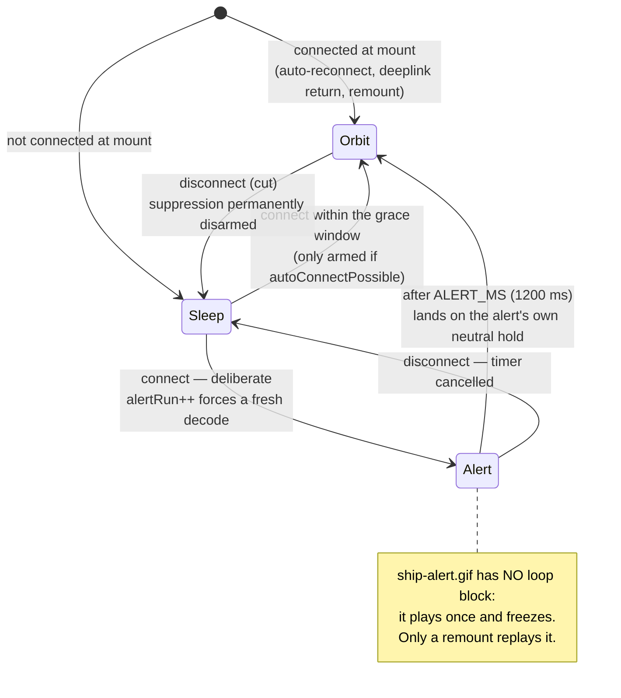

# Space Stroker — "Home hero sprite + wallet-connected animation" — Implementation Spec

> **Status: Ready for implementation** — refined via Trello card
> [#145 — Replace the temp home-hero sprite with the real art + wallet-connected animation](https://trello.com/c/6T053xnq)
> (refined 2026-08-04).
> Repos affected: `monkify-front`, and this doc + `features/home-dashboard.md` in `monkify-meta`.
> **`monkify-backend` is untouched — no branch, no worktree, zero diff.**
>
> **Purpose:** the home hero currently borrows `guide/game-modes.gif` — a real, shipped asset that
> `/how-to-play` renders for **PICK A MODE** — so the front door and the guide show the same picture.
> #138 shipped it as an explicit placeholder. The real art has now been delivered: a static coin plus
> three ship states that react to the wallet. This replaces the borrowed sprite with purpose-drawn art
> and gives the saucer a **sleep → alert → orbit** state machine driven by the player's wallet.

---

## 1. Summary

One component, four new assets, three deleted ones, and one stylesheet comment.

| | Today (#138) | After |
| --- | --- | --- |
| Art | `guide/game-modes.gif` — 45 KB, 570×520, **shared with `/how-to-play`** | `hero/coin.png` + one of three ship GIFs — **27 KB total**, 740×500, exclusive to the hero |
| Layers | one `` | **two** — a static coin, and one ship `` whose `src` swaps |
| Reacts to the wallet | no | **yes** — sleep / alert / orbit |
| Art height at `md` | 140 px (sprite 153 px wide) | **176 px** (coin 155 px wide) — see §7.4 |
| GIFs decoding at any moment | 1 | **1** (the coin is a static PNG) |
| `html.light-graphics` | GIF plays (scoped exception, #138 decision 9) | GIF plays (**exception extended**, decision 6) |
| Art below 640 px | not rendered | **not rendered** (unchanged) |
| Band height @ 1366×768 | cold ~250 px / connected 223 px | cold ~250 px / connected ~248 px — both **≤ 265 px** |
| `edson-ship.gif` / `.png` / `assets/coin.png` | on disk, unimported | **deleted** |

Everything else on `/` — the copy, the CTAs, both connected shapes, the picker, `HomePage.vue` — is
untouched. This card changes **what the art is and how it behaves**, nothing about the band's
content model.

### 1.1 The assets are already on the branch

The four delivered files are **committed on `feature/home-hero-sprite` in `monkify-front`**
(`src/assets/hero/`, commit `6a3705a`), copied from the owner's machine and verified byte-for-byte
through git storage (md5 identical to source). The implementer does **not** need to source them from
a download folder or from Trello. They are also attached to the card as a secondary record.

| repo path | source name | bytes | md5 |
| --- | --- | --- | --- |
| `src/assets/hero/coin.png` | `coin.png` | 5 118 | `1593383a1b54306094ecdd9cf62fd968` |
| `src/assets/hero/ship-sleep.gif` | `ShipSleep.gif` | 6 587 | `70fb059271d07b594620e1aa6709de47` |
| `src/assets/hero/ship-alert.gif` | `ShipAlert.gif` | 5 689 | `5b854437a75d39c0ff509d3c72c8252c` |
| `src/assets/hero/ship-orbit.gif` | `ShipOrbit.gif` | 9 936 | `00e283ad8f317477c0a97f075880471a` |

---

## 2. Constraints (MANDATORY)

From `monkify-meta/constraints.md` (full list there):

- **Worktree-per-repo (§2 / `AGENTS.md` rule 6):** `.worktrees/home-hero-sprite/monkify-front` and
  `.worktrees/home-hero-sprite/monkify-meta`, branch `feature/home-hero-sprite` in both, cut from
  `origin/main`. Both hubs stay on `main`. **Both worktrees and branches already exist** (created
  2026-08-04, pushed, registered on the card). ⚠️ The slug is **`home-hero-sprite`**, not
  `home-hero-art` — that path was already occupied by an unrelated local `test/home-hero-art`
  worktree with uncommitted work, which this card must not disturb.
- **No integration test, no unit test (§3).** Level is **Minor change, frontend-only**: no entity,
  migration, handler, consumer, endpoint, DTO or SignalR contract changes, so `AGENTS.md` rule 8's
  "every new feature ships an integration test" mandate does not apply. `monkify-front` has no test
  runner.
- **Gates:** `yarn lint` **and** `yarn build` must both pass, plus the manual QA in §13.
- ⚠️ **`yarn lint` needs uniform CRLF.** `monkify-front` is checked out with `core.autocrlf=true`;
  editing with an LF-writing tool produces `Insert ␍` on every line. Fix with `unix2dos` before
  committing, verify with `od -c <file> | head`. **Never `sed -i`** on a file in this repo.
- **EF / migrations / secrets / operator messaging:** not applicable — nothing here touches config,
  the database, or a user-facing error path.
- **#138's shipped ACs are regressions if broken**, not trade-offs. All of these still hold:
  the art is `shrink-0` and **sized by height, never a width cap**; the band is **frameless**; the
  art is **not rendered below 640 px**; the band is **≤ 265 px at 1366×768 in both states**; the art
  stays **pixel-art** (`pixelated`).
- **`html.light-graphics` rules** (`specs/light-graphics-mode.md` §7.10): no `backdrop-filter`, no
  `blur()`, no `mix-blend-mode`, no infinite **CSS** animation in the band. The GIF exception is
  decision 6 below and is scoped to these four assets.

---

## 3. Resolved product decisions

Decisions **1–10** are the card's, carried verbatim in substance. **11–16** are this spec's design
pass on the mechanism the card explicitly delegated (*"The requirement here is behavioural; the spec
picks the mechanism"*).

| # | Decision |
| --- | --- |
| 1 | **Two layers, not a baked composite.** A static `coin.png` underneath and **one** ship `` on top whose `src` swaps between three states. Rejected: baking the coin into each GIF (triples the coin's pixels, forfeits a static coin), and stacking all three ship states with visibility toggles (**hidden GIFs still decode in every major browser** — 3× the cost to show one). |
| 2 | **The state machine.** Disconnected → `ship-sleep` (loops). Deliberate connect → `ship-alert` once → at **1200 ms** → `ship-orbit` (loops). Already connected / auto-reconnect at boot → `ship-orbit` **immediately**. Disconnect → `ship-sleep` immediately, cancelling any pending alert timer. |
| 3 | **The alert fires ONLY on a player-initiated connect.** A returning player's page load must land **already orbiting** — no sleeping-ship flash, no 1.2 s alert as boot furniture. ⚠️ A naive `watch(connected)` does exactly the rejected thing. Mechanism: decision 11. |
| 4 | **One connected animation.** `NEW HERE` and `WELCOME BACK` get the same art — the saucer reacts to the **wallet**, not to the player's history. |
| 5 | **Disconnect CUTS to sleep.** No reverse animation was delivered and none is being asked for. |
| 6 | **The animation keeps running under `html.light-graphics`** — an argued **extension** of #138's scoped §7.10 exception. The case is stronger than the one it extends: **27 KB vs 45 KB**, and because the coin is a static PNG **exactly one GIF is ever decoding — the same count as today**. Only the file changes. Exposed range is narrow: 640–1023 px, or a desktop with hardware acceleration off (§7.7). Rejected: freezing to a still (needs a static export that does not exist, adds the `usePerfMode` branch #138 deliberately kept out of this file, and kills the only feedback that the wallet connected on those devices). |
| 7 | **No `prefers-reduced-motion` branch.** Same missing static export; today's GIF does not honour it either. Recorded so it is not re-litigated. |
| 8 | **Sizing is a MEASURED constraint, not a guess.** Bounded by: art height 140–178 px at `md`; coin ≥ 153 px wide; band ≤ 265 px at 1366×768 in **both** states; headline measure re-verified at 640 px. §7.4 resolves these to a **5 px window**. |
| 9 | **The glow moves to the coin only.** `.hero-art`'s two flat drop-shadows apply to the **static** layer, so the browser computes the shadow once instead of re-deriving it per GIF frame — on exactly the CPU-rasterizing devices light-graphics exists for. The ship flies clean over it. Rejected: the glow on the wrapper (per-frame recompute, and the halo's silhouette visibly changes shape as the ship travels). |
| 10 | **Assets live in `src/assets/hero/`**, kebab-case. The `hero/` folder is what keeps `coin.png` from colliding with the **existing** `src/assets/coin.png` — which this card deletes anyway (§7.6.2), but the folder is still the right home. |
| 11 | **The "deliberate connect" gate is a MOUNT-TIME CAPABILITY CHECK, not a timer alone.** At mount, ask *can an automatic connect even happen in this page session?* — see §7.3.2. When the answer is no (the common desktop cold visit), the very next `false → true` is **provably** deliberate and the alert fires with **no timing dependency at all**. Only when an auto-connect is genuinely possible does a bounded grace window apply. Rejected: a bare mount-time grace window (misreads a fast manual connect on a first visit as auto-reconnect), and a flag set by the connect handler (more precise on desktop, but it must reach into `WalletButtons.vue` + `useMobileWallet.ts` — a shared header component and the wallet layer — to serve one decoration on one page, and it still cannot cover the deeplink return). |
| 12 | **The alert must be REMOUNTED to replay, not re-`src`-ed.** `ship-alert.gif` carries **no NETSCAPE application block at all** (verified, §4.2), so browsers play it exactly once and hold the last frame. Pointing `src` back at an already-played URL renders that frozen frame. A `:key` bump destroys and recreates the ``, and a fresh `HTMLImageElement` restarts GIF animation from frame 0. |
| 13 | **The suppression is permanently disarmed by the first disconnect.** An auto-connect can only ever fire during boot, so once the player has disconnected, every subsequent connect in that page session is deliberate by construction. This is what makes AC5 (connect → disconnect → connect) exact rather than timing-dependent. |
| 14 | **The mobile-deeplink connect lands already-connected, and that is accepted.** The deeplink hop is a full page navigation; the return is a **fresh load** where `useMobileWallet`'s `hydrate()` restores the session **synchronously** before first render. So `connected` is already `true` at mount and the hero opens in **orbit** — no alert. Making the alert fire there would need a one-shot "just connected" flag persisted across the navigation, i.e. exactly the persisted-state-for-a-decoration the card rejected. §7.3.4. |
| 15 | **The state machine is gated on the art actually being rendered**, reactively. Below 640 px it allocates no timer and preloads nothing (AC11); crossing 640 px on a tablet rotation starts it. |
| 16 | **Level: Minor change, frontend-only** ⇒ no integration test, no unit test. |

---

## 4. The assets — measured, not assumed

Everything in this section was **decoded from the delivered files**, not taken from the card. Where a
number here differs from the card's prose, this section wins.

### 4.1 Shared canvas

All four files are **740×500** with a fully transparent background (`coin.png` is `colorType 6`
RGBA, non-interlaced; corner alpha = 0). They are pre-registered on **one canvas**, so stacking them
needs **no positioning math** — same box, same origin.

### 4.2 Timing and loop behaviour

| file | frames | delays (ms) | total | NETSCAPE loop block | plays |
| --- | --- | --- | --- | --- | --- |
| `ship-sleep.gif` | 4 | 200, 200, 200, 200 | 800 ms | `loopCount = 0` | **forever** |
| `ship-alert.gif` | 3 | 100, 100, **1000** | **1200 ms** | **ABSENT** | **exactly once** |
| `ship-orbit.gif` | 9 | 100 ×7, **700**, 100 | 1500 ms | `loopCount = 0` | **forever** |

⚠️ **`ship-alert.gif` has no application-extension block whatsoever** — this is *stronger* than the
card's "authored `loopCount 1`". There is no loop count to honour, so every browser plays it once and
freezes on frame 2. Decision 12 exists because of this row.

**Every frame of all three GIFs uses disposal method 2** (*restore to background*). Browsers
implement "background" as **transparent**, not as the logical background colour — which is precisely
what makes the two-layer stack work: each frame clears to transparency, the coin below shows
through, and no ship frame ever ghosts into the next.

### 4.3 Geometry

`coin.png` alpha bounding box: **x 100–539, y 20–479** ⇒ the coin is **440 px of the 740 px canvas
width (59.46 %)** and 460 px of its 500 px height. The remaining ~40 % of the width is the ship's
travel space. **This ratio is the entire basis of §7.4** — the coin is *not* the full canvas, so a
naive "keep the old height" swap renders the coin ~20 % *smaller* than the sprite it replaces.

Per-frame dirty rects (image-descriptor bounds):

| file | frame rects |
| --- | --- |
| `ship-sleep` | f0 full canvas · f1 `550–709 × 110–279` · f2–f3 `550–739 × 20–269` (the Z's rising) |
| `ship-alert` | f0 full canvas · f1 `530–729 × 20–309` (the `!` and its sparkle rays) · **f2 `550–709 × 180–279`** |
| `ship-orbit` | f0 full canvas · f1 `340–629` → f6 `20–99` (right→left across the coin, shrinking) · **f7 and f8 share `520–649 × 120–219`** |

Two properties follow, and they are the ones the implementation leans on:

1. **The neutral pose is identical across states.** `ship-alert` **f2** — the 1000 ms hold — occupies
   `550–709 × 180–279`, the same box the ship parks in for `ship-sleep` f1 and where `ship-orbit`
   re-enters. **The alert's final 1 s hold IS the seam**: swapping to orbit at 1200 ms is invisible.
2. **`ship-orbit` f7 is the 700 ms frame and reads as empty.** Its dirty rect is *identical* to f8's
   — the shape an encoder emits for a transparent frame at the position where the subject reappears.
   With disposal 2 clearing the canvas first, f7 renders the **coin alone**, which is the artist
   drawing "behind the coin" by hiding the ship. **This makes the coin layer load-bearing, not
   decoration**: without it, f7 reads as the ship vanishing for 700 ms. ⚠️ f7's emptiness is inferred
   from its rect, not from a pixel decode — **AC10 must be verified visually**, not assumed.

---

## 5. Data model / Configuration

**Nothing.** No entity, no column, no `OnModelCreating` change, no migration, no `GeneralSettings`
key, no `VUE_APP_*` env var, no seed data.

## 6. Backend behaviour (`monkify-backend`)

**Nothing changes.** No endpoint, DTO, entity, migration, consumer, SignalR contract, cache key,
rate-limit rule or analytics event. `monkify-backend` must show a **zero diff against `main`**
(AC21). It gets no branch and no worktree.

---

## 7. Frontend behaviour (`monkify-front`)

### 7.1 What `connected` actually is, and why that is the whole problem

`HomePage.vue:36` passes the hero a single prop:

```ts
const connected = computed(() => !!effectivePublicKey.value);
```

and `useMobileWallet.ts:160`:

```ts
const effectivePublicKey = computed(
  () => publicKey.value?.toString() ?? mobilePublicKey.value ?? null
);
```

That value goes `false → true` in **four** distinct situations, and only the first is a player
reacting to the page:

| # | Situation | Timing | Deliberate? |
| --- | --- | --- | --- |
| A | Player clicks **Connect** (desktop extension picker) | any time after boot | **YES → alert** |
| B | `solana-wallets-vue` **auto-connects** (`main.ts:132` `autoConnect: true`) using the persisted `localStorage['walletName']` | ~0.3–1 s **after boot** | no → straight to orbit |
| C | `App.vue:97` `autoConnectInWalletBrowser()` selects + connects an injected adapter inside a wallet's in-app browser | within its **2500 ms** deadline after mount | no → straight to orbit |
| D | Mobile **deeplink** session restored by `hydrate()` from `localStorage['swMobileWalletSession']` | **synchronously, before first render** | n/a — never a flip (§7.3.4) |

A bare `watch(connected)` cannot tell A from B or C, which is exactly the failure decision 3 forbids:
a returning player would get a sleeping-ship flash and a 1.2 s alert as page-load furniture.

### 7.2 The three states

| State | Ship layer | Trigger |
| --- | --- | --- |
| `sleep` | `ship-sleep.gif`, loops forever | disconnected — and the initial state whenever the wallet is absent at mount |
| `alert` | `ship-alert.gif`, plays once (1200 ms) | a **deliberate** connect (§7.3) |
| `orbit` | `ship-orbit.gif`, loops forever | 1200 ms after `alert` begins; **or immediately** when the wallet is already/automatically connected |

### 7.3 The mechanism (decision 11)

#### 7.3.1 Initial state — synchronous, at setup

```ts
// Already connected when the hero first renders? Then this player never watched a connect happen —
// they arrived connected. Open in orbit. Covers situation D and any remount while connected.
const shipState = ref<'sleep' | 'alert' | 'orbit'>(props.connected ? 'orbit' : 'sleep');
```

This alone satisfies AC3's *"NEITHER the sleeping ship NOR the alert is displayed at any point"* for
every path where the wallet is present before first paint.

#### 7.3.2 The capability check — can an automatic connect even happen?

Read **synchronously at setup**, before any auto-connect has had time to resolve:

```ts
import { WALLET_NAME_STORAGE_KEY } from '@/utils/wallet';
import { isMobileBrowser } from '@/utils/walletDeepLink';

// Situation B needs a persisted wallet selection; situation C only ever runs on a mobile UA.
// If NEITHER is true, no automatic connect is possible in this page session — so the next
// false→true is provably the player's own click, and the alert fires with no timing guess at all.
const autoConnectPossible =
  !!localStorage.getItem(WALLET_NAME_STORAGE_KEY) || isMobileBrowser();
let suppressAlertUntil = autoConnectPossible ? Date.now() + AUTO_CONNECT_GRACE_MS : 0;
```

- `WALLET_NAME_STORAGE_KEY` is **already exported** from `src/utils/wallet.ts:16` (`'walletName'`,
  the key `solana-wallets-vue` persists its selection under). It is read, never written.
  `pruneStoredWalletName()` has already cleared it by this point if it pointed at a blocked wallet,
  so a stale MetaMask selection cannot arm the suppression.
- `isMobileBrowser()` is **already exported** from `src/utils/walletDeepLink.ts:13`.
- `AUTO_CONNECT_GRACE_MS = 2500` — matched to `App.vue`'s own `autoConnectInWalletBrowser` deadline
  (`App.vue:99`), which is the slowest automatic path in the app.
- ⚠️ **Wrap the `localStorage` read in `try/catch`.** Every other `localStorage` access in this
  codebase does (`useMobileWallet.ts`), because private-mode Safari throws. A throw here must
  degrade to `autoConnectPossible = true` (suppress), never crash the hero.

**Why this is not just a grace window.** On the dominant case — a visitor with no persisted wallet on
a desktop — `autoConnectPossible` is `false`, so `suppressAlertUntil` is `0` and *any* connect, at
any time including 200 ms after load, correctly fires the alert. The window only exists where an
automatic connect is genuinely on the table.

#### 7.3.3 The transition

```ts
watch(
  () => props.connected,
  (isConnected) => {
    clearAlertTimer();                      // single-flight: AC8

    if (!isConnected) {
      shipState.value = 'sleep';            // AC4, AC6 — a cut, no intermediate state
      suppressAlertUntil = 0;               // decision 13: auto-connect can never fire again
      return;
    }

    if (Date.now() < suppressAlertUntil) {  // situation B or C — no alert, no sleep flash
      shipState.value = 'orbit';            // AC3
      return;
    }

    alertRun.value += 1;                    // decision 12 — force a fresh decode
    shipState.value = 'alert';              // AC2, AC5
    alertTimer = window.setTimeout(() => {
      alertTimer = null;
      shipState.value = 'orbit';
    }, ALERT_MS);                           // ALERT_MS = 1200, the asset's exact duration
  }
);
```

- `clearAlertTimer()` runs on **every** transition and in `onBeforeUnmount` — AC6, AC7, AC8.
- The timer handle is a single module-local `let`, never an array: two overlapping timers are the
  one way the ship ends up orbiting while disconnected (AC8).
- `ALERT_MS` **must** be 1200, matching §4.2's measured total. It is the seam described in §4.3 —
  the swap lands on the alert's own neutral-pose hold, so there is no visible jump (AC2).

#### 7.3.4 What this deliberately does not cover

**The mobile-deeplink connect (situation D) shows no alert** (decision 14). `connectMobileWallet()`
calls `window.location.replace(...)`; the player leaves the page entirely and the wallet returns them
to a **fresh load** where `hydrate()` has already restored `mobilePublicKey` before Vue mounts. There
is no `false → true` to watch — the hero opens in orbit.

This is accepted, and the exposure is small: the deeplink flow requires `isMobileBrowser()`, and the
art is not rendered below 640 px, so only a **tablet** using the deeplink path is affected — and it
lands on the correct *final* state (orbit), just without the 1.2 s reaction. **AC2 is scoped to the
desktop-extension connect.** Record it; do not "fix" it with a persisted flag.

#### 7.3.5 The gate on the art being rendered (decision 15, AC11)

The state machine must not allocate timers or preload on a viewport that never renders the art. The
existing `useIsMobile` composable is **not** usable here — its query is `max-width: 1023px`, the
light-graphics boundary, not the 640 px art boundary. Use a local matcher in the same idiom:

```ts
const ART_QUERY = '(min-width: 640px)';          // the `sm` breakpoint the wrapper uses
```

Reactive (a tablet rotating portrait → landscape crosses 640 px), with the listener removed on
unmount. When it is `false`: no preload, no timer; `shipState` may still track the wallet, but
nothing is scheduled.

#### 7.3.6 Preloading (AC18)

27 KB total makes eager preload trivially cheap, and without it the first `src` swap shows a gap.
On mount — **and only when the art is rendered** — warm the two files the cold state does not use:

```ts
[alertGif, orbitGif].forEach((src) => { new Image().src = src; });
```

`ship-sleep.gif` needs no preload: it is the initial `src` in the disconnected state, and in the
connected-at-boot state the initial `src` is `ship-orbit.gif`, which this call warms anyway.

### 7.4 Sizing — the arithmetic, and the 5 px window it leaves

This is decision 8 resolved. **The numbers below are derived from §4.3's measured bounding box, and
they leave far less freedom than the card's "the implementer picks the number" implies.**

Let `H` = the art's rendered height in px.

```
canvas width  = H × (740 / 500)            = 1.480 × H
coin width    = canvas width × (440 / 740) = 0.880 × H
```

Now apply the card's four bounds:

| Bound | Source | Resolves to |
| --- | --- | --- |
| coin renders **≥ 153 px** wide (at least the presence of the sprite it replaces) | AC13 | `H ≥ 153 / 0.880` ⇒ **H ≥ 174** |
| art height **≤ 178 px** at `md` | AC13 | **H ≤ 178** |
| art height **≥ 140 px** at `md` | AC13 | subsumed by the coin floor |
| band **≤ 265 px** at 1366×768 in **both** states | AC12 / #138 AC2 | satisfied across 174–178 — see below |

⇒ **H ∈ [174, 178].** A 5 px window. **Recommended starting value: `md:h-[176px]`** (coin = 154.9 px,
2 px of headroom under the AC13 ceiling and ~2 px over its floor).

**Why the band still clears 265 px.** Padding is 72 px (`pt-6 pb-10`, unchanged). The copy column is
~178 px cold and ~151 px connected (`specs/home-hero-trim.md` §7.7, re-measured at ship):

| State | Copy | Art @ 176 | Band |
| --- | --- | --- | --- |
| Cold | 178 px | 176 px | 72 + **178** = **250 px** ✅ (unchanged from today) |
| Connected | 151 px | 176 px | 72 + **176** = **248 px** ✅ (up from 223 px) |
| Connected, 2-line live line | 178 px | 176 px | 72 + **178** = **250 px** ✅ |

⚠️ **The art now drives the band in the connected state** (176 px > 151 px), where under #138 the copy
always drove it. This does **not** break #138's AC8 — that AC is scoped to the cold state and to the
1366×768 measurement, both of which still hold — but it does mean **AC12 is no longer true by
construction**. It must be **measured in both states**, and the cold state is no longer the worst
case.

**The `sm` step (640–767 px).** Today's `h-[110px]` would render the coin **96.8 px** wide — well
below the 121 px the sprite it replaces occupies there. Scale it the same way:
`121 / 0.880 = 137.5` ⇒ **`h-[138px]`** (coin 121.4 px, canvas 204 px wide).

**AC14 check at 640 px.** Container is `px-3.5` ⇒ 612 px of content. Minus the art (204 px) minus
`gap-6` (24 px) leaves the copy column **384 px**. `FIRST WORD OUT` is 14 characters and Press Start
2P advances ~1 em per character, so at 19 px it needs **~266 px** — 118 px of margin, two lines
hold. (For comparison: today's art is 163 px wide there, so this change costs the copy column 41 px.)
⚠️ The headline-measure table in `HomeHero.vue`'s comment above the `h1` **must be updated** — it is
written against the old art width and §7.6.4 of `specs/home-hero-trim.md` explicitly says to
recompute it if the art is ever re-widened. This card re-widens it.

### 7.5 The markup

The art column becomes a two-layer stack. **The coin stays in normal flow and is the sizing layer;
the ship is absolutely positioned over it.** Because both files share one 740×500 canvas (§4.1),
`inset-0` is the whole of the positioning — no offsets, no `object-position`, no scale.

```html
<!-- THE ART — two layers on ONE shared 740x500 canvas, so the ship needs no positioning math.
     The COIN is the sizing layer and stays in flow: `h-[…] w-auto`, never a width cap, so the art
     column's width is a function of its height and the art can still never drive the band's width.
     The SHIP is absolute over it; `inset-0` is exact because the two files are pre-registered.
     `:key` is load-bearing — see the alert-replay note in the script. -->
<div class="relative hidden shrink-0 justify-center sm:flex">
  
  
</div>
```

- **`:key` includes `alertRun`** (decision 12). Keying on `shipState` alone would not remount for a
  second alert, because the state string is unchanged from the previous alert — and `ship-alert.gif`
  would render its frozen last frame. **This is AC5 and it is the single most likely thing to be got
  wrong**; it fails silently and looks like a broken wallet, not broken art.
- **The coin carries `.hero-art`, the ship carries no filter** (decision 9 / AC16). Keeping the class
  name on the coin also keeps `arcade.css`'s light-graphics exception comment pointing at a class
  that still exists (§7.6.3).
- **Alt text on the ship only.** The coin is decorative once the ship carries the description, so it
  takes `alt="" aria-hidden="true"` — two images with two descriptions of one picture is worse for a
  screen reader than one. Suggested ship alt: *"Edson's saucer asleep beside a giant coin"* /
  *"…reacting"* / *"…orbiting the coin"*, switched with the state.
- **No `loading="lazy"`** — above-the-fold art (`specs/home-hero-trim.md` §7.5.1).
- ⚠️ **Do NOT copy `/how-to-play`'s `object-contain scale-[0.78] -translate-y-[4%]`.** Those numbers
  exist only because `GuideRail` drops its sprite into a fixed 4:3, 172 px slot.

### 7.6 Removals and orphans

#### 7.6.1 The mode-sprite import

```ts
import modeSprite from '@/assets/guide/game-modes.gif';   // delete
```

Replaced by four static imports from `@/assets/hero/`. `yarn lint` fails on `no-unused-vars` if the
old one survives.

#### 7.6.2 Three deleted files (AC19) — all three verified unreferenced

Repo-wide grep run against the live tree on 2026-08-04:

| File | Size | Status |
| --- | --- | --- |
| `src/assets/edson-ship.gif` | 533 KB | **zero imports.** Named only in `HomeHero.vue`'s header comment (line 29), which this card rewrites anyway |
| `src/assets/edson-ship.png` | 25.5 KB | same |
| `src/assets/coin.png` | 4.5 KB, 480×500 | **zero references anywhere in `src/` or `public/`** — confirmed. A **different file** from the delivered `hero/coin.png` |

#138 kept the two `edson-ship.*` files so the swap back stayed a two-line revert — a path that dies
here. Webpack already emits none of the three, so deleting them is a **repo-size win only, not a
bundle change**. Do not claim a wire-size saving for them.

#### 7.6.3 `arcade.css` — comment only

`src/assets/styles/arcade.css:1106–1111`. The selector list (`.character-img`) is **correct and must
not change**; what is stale is the comment, which describes `.hero-art` as *"the mode sprite in the
trimmed HomeHero band, Trello #138"*. Rewrite it to name the new art and the **extended** exception
(decision 6): the glow now applies to the **static coin layer**, and the ship GIF is the one animated
element the rule deliberately spares. Do **not** add a `html.light-graphics .hero-art` rule — the
whole point is that this class is *excluded* from the `filter: none` kill.

#### 7.6.4 The file's header comment

`HomeHero.vue`'s long header comment documents the temp sprite, its provenance from `/how-to-play`,
the "TEMP — the swap back is a two-line revert" framing, and the §7.10 exception as scoped to a
45 KB borrowed asset. **Every one of those statements becomes false with this card.** Rewrite that
block; leaving it is the exact failure `specs/home-hero-trim.md` §7.6.5 warned about — a comment that
looks like it protects the design and describes something that no longer exists.

### 7.7 Where `light-graphics` and the art actually overlap

`usePerfMode.lightMode = isMobile || weakRenderer`, and `useIsMobile`'s query is
**`max-width: 1023px`**. The art renders from **640 px**. So the band is visible with
`html.light-graphics` active in exactly two situations:

1. a **640–1023 px** viewport (tablets, small laptop windows, landscape phones ≥ 640 px), or
2. **any width** on a desktop where `weakRenderer` resolved true (hardware acceleration off, or the
   rAF sample came in under 25 fps).

Case 1 is the one QA skips. **AC15 must be checked at a width in 640–1023 px**, not only by forcing
the class on a desktop.

### 7.8 Edge cases

| Case | Behaviour | AC |
| --- | --- | --- |
| Connect → disconnect → connect | Second alert plays **in full** — `alertRun` bumps, the `` remounts, a fresh element decodes from frame 0 | AC5 |
| Disconnect mid-alert | Pending 1200 ms swap cancelled; ship cuts to sleep. Never reaches orbit while disconnected | AC6 |
| Rapid connect/disconnect churn | `clearAlertTimer()` on **every** transition; single timer handle. Final state always matches the final wallet state | AC8 |
| Unmount during the alert (navigating off `/` within 1.2 s) | `onBeforeUnmount` clears the timer; no callback against a dead component, no console error | AC7 |
| Below 640 px | No art rendered (unchanged), no timer allocated, nothing preloaded | AC11 |
| 640–1023 px | Art **is** rendered and light-graphics **is** on — the range most likely to be skipped in QA | AC15 |
| Mobile deeplink return | Lands already-connected ⇒ opens in orbit, no alert. Accepted (§7.3.4) | — |
| Transparency lost in the build pipeline | Coin hidden behind the ship layer; orbit f7 shows a white box. **Verify visually** — webpack copies these byte-for-byte, but a future image-optimisation loader would not | AC9 |
| Coin layer fails to load | Orbit f7 reads as the ship disappearing for 700 ms. The coin is load-bearing (§4.3) | AC10 |
| Embedded (`iframe`) | `/` redirects to `/game` before `HomePage` mounts — the hero is unreachable. Nothing to do; recorded so it is not re-checked | — |

---

## 8. Flow diagram



---

## 9. Out of scope

- **All backend work.** `monkify-backend` shows a zero diff.
- **`/how-to-play`** — `GuideHowTheGameWorks.vue:7` keeps `guide/game-modes.gif`. Only the hero stops
  sharing it (AC20). *(The card's own correction stands: the importer is `GuideHowTheGameWorks.vue`,
  not `GuideWhereToStart.vue` — verified.)*
- The hero's **copy, CTAs, layout, padding, the two connected shapes and the `sm` visibility rule** —
  all settled in #138.
- A **reverse (wake → sleep) animation**, a `prefers-reduced-motion` variant, and a static
  light-graphics export — all three declined (decisions 5, 6, 7).
- An alert on the **mobile-deeplink** connect (decision 14 / §7.3.4).
- The `/game` lobby, the picker cards, and every section below the hero.
- Any **new** animation beyond the delivered three states.

---

## 10. File checklist

### 10.1 Backend (`monkify-backend`)

**None.** No worktree, no branch, no commit. AC21 requires a zero diff against `main`.

### 10.2 Frontend (`monkify-front`) — branch `feature/home-hero-sprite`

| # | File | Change |
| --- | --- | --- |
| 1 | `src/components/home/HomeHero.vue` | **The whole card.** Drop the `modeSprite` import; add four `@/assets/hero/*` imports. Add the state machine (§7.3): `shipState`, `alertRun`, the capability check, the `watch`, the timer + its cleanup, the 640 px gate, the preload. Art column → two layers (§7.5) at `h-[138px] md:h-[176px]`. Move `.hero-art` to the coin; ship carries no filter. **Rewrite the header comment** (§7.6.4) and **recompute the headline-measure table** above the `h1` (§7.4) |
| 2 | `src/assets/hero/coin.png` | **Already committed** (§1.1) |
| 3 | `src/assets/hero/ship-sleep.gif` | **Already committed** |
| 4 | `src/assets/hero/ship-alert.gif` | **Already committed** |
| 5 | `src/assets/hero/ship-orbit.gif` | **Already committed** |
| 6 | `src/assets/edson-ship.gif` | **Delete** (533 KB, unimported) |
| 7 | `src/assets/edson-ship.png` | **Delete** (25.5 KB, unimported) |
| 8 | `src/assets/coin.png` | **Delete** (4.5 KB, 480×500, zero references — a different file from `hero/coin.png`) |
| 9 | `src/assets/styles/arcade.css` | **Comment only**, ≈ lines 1106–1111 (§7.6.3). Do not touch the selector list |
| 10 | `src/pages/HomePage.vue` | **Expected: no change.** Listed so the implementer confirms the `connected` prop and the three emits are untouched |
| 11 | `src/utils/wallet.ts` | **Expected: no change.** `WALLET_NAME_STORAGE_KEY` is already exported (line 16); it is read, never written |
| 12 | `src/utils/walletDeepLink.ts` | **Expected: no change.** `isMobileBrowser()` is already exported (line 13) |

### 10.3 Meta (`monkify-meta`) — branch `feature/home-hero-sprite`

| # | File | Change | When |
| --- | --- | --- | --- |
| 1 | `specs/home-hero-sprite.md` | This spec | create-spec (done) |
| 2 | `INDEX.md` | Row for this spec + "Feature currently in flight" | create-spec (done) |
| 3 | `features/home-dashboard.md` | **At ship.** "The hero band" describes the art as the shared mode sprite and the light-graphics exception as scoped to it. Rewrite: purpose-drawn two-layer art, the wallet state machine, the **extended** exception, and the new connected-state band height | ship |
| 4 | `specs/home-hero-trim.md` | **At ship.** Post-ship note on decisions 7/9/10 and §7.5: the temp sprite is replaced, `edson-ship.*` deleted (the "two-line revert" path is closed), and §7.6.4's headline table recomputed. Do **not** rewrite the historical decisions | ship |
| 5 | `specs/light-graphics-mode.md` | **At ship.** §7.10's exception list gains this card's four assets — the rationale changed (one static layer + one GIF), so the note must say *why*, not just *that* | ship |
| 6 | `INDEX.md` | **At ship.** Status Ready → Shipped | ship |

---

## 11. Tests

**No unit tests and no integration tests** (`constraints.md` §3 — Minor change, frontend-only; no
backend behaviour changes and `monkify-front` has no test runner). Nothing in `SpaceStroker.Tests` or
`SpaceStroker.Tests.Integration` is touched, and there is nothing to report at the end of
implementation under `AGENTS.md` rule 3.

Verification is §12, gated by:

```bash
cd .worktrees/home-hero-sprite/monkify-front
yarn lint      # must be clean — the orphaned modeSprite import fails here
yarn build     # must succeed
```

⚠️ Run `unix2dos` on every edited file before `yarn lint` if any tool wrote LF line endings, or
prettier reports `Insert ␍` on every line of the file.

---

## 12. Acceptance criteria

Copied 1:1 from the Trello checklist (21 items).

1. **AC1** — Given a disconnected visitor on `/` at a viewport ≥ 640 px, when the hero renders, then
   the static coin is visible with `ship-sleep.gif` looping over it, and no other ship state is
   displayed.
2. **AC2** — Given a disconnected player, when they connect their wallet by their own action, then
   `ship-alert.gif` plays once in full and `ship-orbit.gif` begins looping 1200 ms later, with no
   blank frame, gap or positional jump at the swap. *(Scoped to the desktop-extension connect —
   §7.3.4.)*
3. **AC3** — Given a returning player whose wallet auto-reconnects on page load, when `/` finishes
   booting, then the hero shows `ship-orbit.gif` and NEITHER the sleeping ship NOR the alert is
   displayed at any point during boot.
4. **AC4** — Given a connected player, when they disconnect the wallet, then the ship layer returns
   to `ship-sleep.gif` immediately, with no intermediate animation.
5. **AC5** — Given a player who connects, disconnects and connects again within the same page
   session, when the second connect lands, then `ship-alert.gif` plays in full again — it must NOT
   render as a frozen last frame. *(§4.2 / decision 12 — the asset has no loop block at all.)*
6. **AC6** — Given the alert is still playing, when the player disconnects before the 1200 ms
   handoff, then the pending swap is cancelled and the ship shows sleep — it never reaches orbit
   while disconnected.
7. **AC7** — Given the player navigates away from `/` while the alert is playing, when the component
   unmounts, then the pending timer is cleared and no callback fires against the dead component (no
   console error).
8. **AC8** — Given rapid connect/disconnect churn, when the states settle, then the ship layer
   matches the final wallet state and no orphaned timer leaves it orbiting while disconnected (the
   timer is single-flight).
9. **AC9** — Given any ship state renders, when it overlaps the coin, then the ship is drawn ON TOP
   of the coin and the coin remains visible everywhere the ship's pixels are transparent (all four
   assets keep their alpha through the build).
10. **AC10** — Given `ship-orbit.gif` reaches its empty frame 7 (700 ms), when it renders, then the
    coin alone is visible — reading as the ship passing behind it — with no broken-image, placeholder
    or layout shift.
11. **AC11** — Given a viewport below 640 px, when `/` renders, then no hero art is rendered at all
    (unchanged from #138), the headline keeps its existing line breaks, and the animation state
    machine allocates no timer and preloads nothing.
12. **AC12** — Given a 1366×768 viewport, when the hero renders in the COLD state and in the
    CONNECTED state, then the band's measured height is ≤ 265 px in BOTH (#138 AC2 preserved).
    ⚠️ *No longer true by construction — the art now drives the connected band (§7.4). Measure both.*
13. **AC13** — Given the `md` breakpoint, when the hero art renders, then its height is between
    140 px and 178 px and the COIN renders at least 153 px wide — i.e. at least the on-screen
    presence of the `game-modes.gif` sprite it replaces. *(§7.4 resolves this to H ∈ [174, 178].)*
14. **AC14** — Given a 640 px viewport in the cold state, when the hero renders, then
    `FIRST WORD OUT` / `TAKES THE POT.` still occupies exactly two lines — the widened art must not
    push the headline to three.
15. **AC15** — Given `html.light-graphics` is active (a 640–1023 px viewport, or a desktop with
    hardware acceleration off), when the hero art renders, then the ship GIF still animates in every
    state, and no `usePerfMode` branch, `backdrop-filter`, `blur()`, `mix-blend-mode` or infinite CSS
    animation is introduced in the band.
16. **AC16** — Given the two layers, when the glow renders, then `.hero-art`'s two FLAT drop-shadows
    are applied to the coin layer only and the ship layer carries no `filter`.
17. **AC17** — Given any hero state, when the page is running, then exactly ONE animated GIF is
    decoding at a time — the coin is a static PNG and the two inactive ship states are not rendered
    (no stacked hidden GIFs).
18. **AC18** — Given the connect happens for the first time in a session, when the alert and orbit
    files are needed, then they are already decode-ready (preloaded) and the swap shows no flash of
    empty space.
19. **AC19** — Given the repo after this card, when `src/assets` is inspected, then
    `edson-ship.gif`, `edson-ship.png` and the unreferenced `src/assets/coin.png` are deleted and a
    repo-wide grep finds zero references to any of them.
20. **AC20** — Given `/how-to-play`, when `GuideHowTheGameWorks.vue` renders PICK A MODE, then it
    still renders `guide/game-modes.gif` unchanged — only the hero stops sharing that sprite.
21. **AC21** — Given the feature branch, when `yarn lint` and `yarn build` run, then both pass (line
    endings uniform CRLF), and `monkify-backend` shows a zero diff against `main`.

---

## 13. Manual QA

`monkify-front` alone covers everything except the connected states, which need a wallet.

1. **Cold, desktop (AC1, AC13, AC16, AC17).** `/` with **no** wallet and **no** persisted
   `walletName` (clear it in devtools → Application → Local Storage). Coin visible, ship asleep,
   looping. Devtools → Elements: the coin `` carries `.hero-art` and its two drop-shadows; the
   ship `` has **no** `filter`. Only one GIF in the DOM.
2. **Deliberate connect (AC2, AC18).** With devtools **Network** open, click Connect. The alert must
   play in full and hand off to orbit at 1200 ms with **no** blank frame. Confirm the alert/orbit
   files were fetched **before** the click (the preload), not at the swap.
3. **⚠️ Second connect (AC5) — do not skip.** Disconnect, then connect again. The alert must play
   **again, in full**. If it renders a frozen frame, the `:key` is not bumping — see decision 12.
4. **Auto-reconnect (AC3).** With a wallet already selected (so `walletName` is in localStorage),
   hard-reload `/`. Watch the first ~2 s: the hero must open **in orbit**. No sleep frame, no alert.
   Record it with devtools' screenshot filmstrip if the eye is not sure.
5. **Disconnect + interrupts (AC4, AC6, AC7, AC8).** Disconnect while orbiting → immediate cut to
   sleep. Connect, then disconnect **within 1.2 s** → sleep, never orbit. Connect and navigate to
   `/game` within 1.2 s → **no console error**. Toggle connect/disconnect rapidly ~10× → the final
   state matches the wallet.
6. **The orbit loop (AC9, AC10).** Watch a full 1500 ms orbit cycle: the ship passes **over** the
   coin, the coin stays visible through the ship's transparent pixels, and at the 700 ms frame the
   **coin alone** shows — no broken-image icon, no white box, no layout shift.
7. **Sizing (AC12, AC13, AC14).** At a **1366×768 viewport** (devtools emulation, not the OS window),
   measure the band in **both** states with the script in `specs/home-hero-trim.md` §7.1 — both must
   be ≤ 265 px, and the connected state is the one that moved. Measure the rendered coin width
   (its bounding box is 59.46 % of the `` width) — ≥ 153 px. At **640 px**, confirm the headline
   is still two lines.
8. **Light graphics (AC15).** At a width in **640–1023 px** (not just a forced class on a desktop):
   the ship still animates in all three states; computed styles show no `backdrop-filter` / `blur()`
   / `mix-blend-mode` / infinite animation in the band.
9. **Phone (AC11).** 390×844: no art at all, headline line breaks unchanged. Devtools → Performance
   or a breakpoint in the mount path: no timer allocated, no asset fetched for the hero art.
10. **Guide untouched (AC20).** `/how-to-play` → PICK A MODE still renders `game-modes.gif`.
11. **Gates (AC19, AC21).** `git grep -n "edson-ship\|assets/coin"` returns nothing; `yarn lint`
    clean; `yarn build` green; `git -C monkify-backend diff main --stat` is empty.

---

## 14. Trello / pipeline

- **Source card:** [#145 — Replace the temp home-hero sprite with the real art + wallet-connected
  animation](https://trello.com/c/6T053xnq) — moved to **Specs created**; the `## Implementation`
  block on the card carries branch, spec path, worktree and repos.
- **Worktrees:** `.worktrees/home-hero-sprite/monkify-front`,
  `.worktrees/home-hero-sprite/monkify-meta` — branch `feature/home-hero-sprite`, both pushed to
  `origin`. The front branch already carries the four assets (§1.1).
- **Next:** `/monkify-implement-feature Replace the temp home-hero sprite`, then
  `/monkify-ship-feature Replace the temp home-hero sprite` (which syncs §10.3 items 3–6 and merges).

---

## 15. Revision log

| Date | Change |
| --- | --- |
| 2026-08-04 | Initial spec from the refined card (#145) + code exploration. **All four assets decoded and verified** against the card's claims (§4): dimensions, frame counts, delays and loop behaviour match exactly; two facts are *stronger* than the card recorded — `ship-alert.gif` has **no NETSCAPE block at all** (not `loopCount 1`), and **every frame uses disposal 2**, which is what makes the two-layer stack correct. The coin's real alpha bounding box (440/740 = 59.46 %) resolves the card's open sizing range to a **5 px window** (§7.4), and reveals that the art now drives the **connected** band, so AC12 stops being true by construction. Decisions 11–16 added: the deliberate-connect gate is a mount-time **capability check** rather than a bare grace window, and the mobile-deeplink connect is recorded as a deliberate non-goal (§7.3.4). Slug is `home-hero-sprite`, not `home-hero-art` — that worktree path was occupied. |
