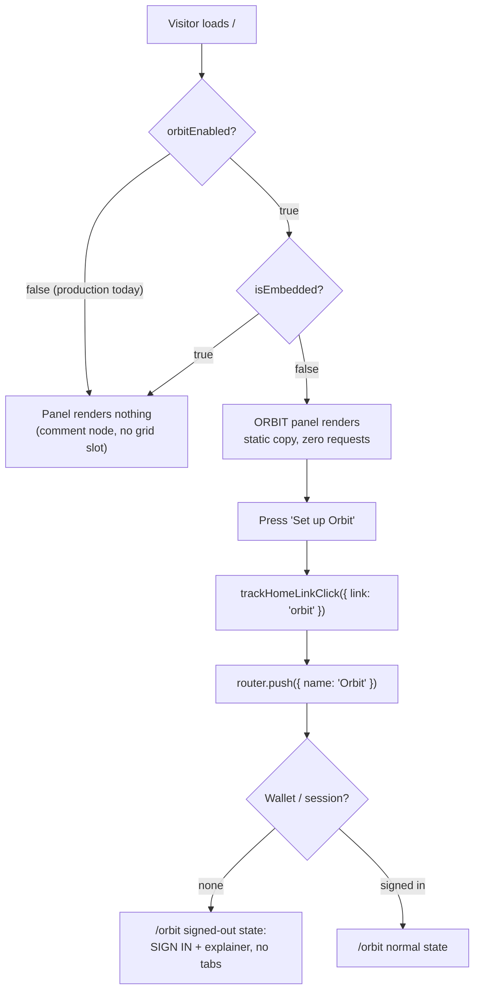

# Monkify — "Home Orbit card" Feature — Implementation Spec

> **Status: SHIPPED** — merged to `main` on **2026-08-07** via `feature/home-orbit-card`
> (`monkify-front` + `monkify-meta`; no `monkify-backend` branch ever existed). Distilled into
> [`../features/home-dashboard.md`](../features/home-dashboard.md) — this feature is one panel on an
> existing page and deliberately has **no standalone `features/` doc**. See §15 for the two copy/layout
> revisions the owner made during implementation; §7.3 and AC4 already carry them.
>
> _Originally: Ready for implementation_ — refined via Trello card
> [Add home card for orbit, focus on what it does, why its cool. and how you can OWN a word](https://trello.com/c/k9cAI4ag)
> (#156, refined 2026-08-07).
> Repos affected: `monkify-front` and this doc in `monkify-meta`. **`monkify-backend` is NOT touched
> — this feature has zero backend surface.**
>
> **Purpose:** Give the front door at `/` one panel that says what Orbit is, why it is worth having,
> and that on a free-text game you can claim a word nobody else may bet. Today `/` never mentions
> Orbit at all, and `GuideOrbit.vue` — the app's only long-form Orbit explainer — never mentions the
> word claim.

---

## 1. Summary

One new section on the starting page, plus a one-row correction to the guide.

| | Today | After |
| --- | --- | --- |
| `/` mentions Orbit | Never | One full-width `ORBIT` panel after `PROVABLY FAIR` |
| Orbit's advertisement | Header launcher (wallet-only) + `/orbit` (you must already know it exists) | + the front door |
| Word claim documented | **Nowhere in the app** | Home panel + a new `GuideOrbit` row |
| Requests from `/` | No Orbit call | **Unchanged — still no Orbit call** |
| Backend | — | **No change of any kind** |

The panel is **static copy**. It renders identically for every wallet state — cold, connected,
enrolled, running, paused, dry — because the home page opens no Orbit request today and this feature
must not change that.

### 1.1 What the panel looks like

```
┌─ .arcade-frame--orbit (void-deep fill, 2px violet-deep border) ────────────┐
│  ⟡ AUTO-PLAY                        ← .eyebrow--orbit + <OrbitMark />     │
│  + PUT YOUR MONEY IN ORBIT +        ← HomeSection's standard h2           │
│                                                                            │
│  Stop pressing the button. Park a stack, pick your word, and Orbit apes    │
│  in for you every single round — while you sleep, while the app is shut.   │
│  It changes who plays, not the odds.                                       │
│                                                                            │
│  ───────────────────  ───────────────────   ───────────────────           │
│  IT PLAYS WHILE        YOU SET WHEN          YOU CAN OWN                   │
│  YOU'RE GONE           IT STOPS              A WORD                        │
│  One bet, every        Bank a hot run at     On the type-it-yourself       │
│  round, on the game    your number, or drop  games, the word you pick      │
│  you picked — app      a floor that yanks    is locked to you while        │
│  open, app shut,       what's left out       Orbit is running — nobody     │
│  phone face-down in    before a cold one     else can bet it.              │
│  your pocket.          eats it.                                            │
│  ──────────────────────────────────────────────────────────────────────    │
│  [ Set up Orbit ]                                                          │
└────────────────────────────────────────────────────────────────────────────┘
```

---

## 2. Constraints (MANDATORY)

From `monkify-meta/constraints.md` (full list there):

- **Worktree-per-repo:** `feature/home-orbit-card`, checked out at
  `.worktrees/home-orbit-card/<repo>`. The shared checkouts stay on `main` — never `git switch` a hub.
  Push each branch after its first commit.
- **Unit tests:** **N/A for the backend** — no `SpaceStroker.Tests` file changes, because no backend
  behaviour changes. `monkify-front` has **no test runner**; the bar is `yarn lint` + `yarn build`
  clean plus the manual QA in §13.
- **Integration test (`AGENTS.md` rule 8):** **does not apply.** The rule mandates a happy-path
  integration test in `SpaceStroker.Tests.Integration` for every new feature; this feature has **no
  backend surface to exercise end to end**. Recorded deliberately on the card, not skipped silently.
- **EF mapping / migrations:** N/A — no entity, no column, no migration.
- **Secrets/config:** N/A — this feature introduces no configuration key. `VUE_APP_ORBIT_ENABLED`
  already exists and is not changed.
- **Operator messaging:** N/A — no error surface, no operator-scoped copy.
- **⚠️ `constraints.md` §6 (feature-specific):** the panel must not enumerate deposit refusal causes
  and must not name any operator or contract state.
- **⚠️ #118 Orbit invisibility (feature-specific, load-bearing):** the panel may state **that** a
  word can be claimed. It must **never** name, count, list or hint at **which** players or **which**
  words are claimed, and it must **not** introduce any "is this word reserved?" lookup.
  `orbit-feedback-adjustments.md` shipped deviation 2 refused exactly such a probe on
  `useGame.bet()`, because it is an Orbit-membership oracle for any stranger.
- **⚠️ CRLF:** `monkify-front` requires uniform CRLF line endings; a mangled ending fails `yarn lint`
  as `Insert ␍`. Do not edit these files with a tool that rewrites endings to LF.

---

## 3. Resolved product decisions

| # | Decision | Why (and what was rejected) |
| --- | --- | --- |
| 1 | The panel is gated `v-if="orbitEnabled && !isEmbedded"`, same as every other Orbit surface. | Rejected a "coming soon" tease (advertises what a prod player cannot reach) and rejected flipping Orbit on in production (custodial money + house-signed transfers — its own card). ⚠️ **Accepted consequence:** Orbit is dark in production since #146, so this panel ships with **zero production visibility** until that flag flips. |
| 2 | Placement: **full width**, in the section stack immediately after `<home-feature-cards />` (PROVABLY FAIR) and before `<home-player-stats>`. | Keeps the page's stated logic — act (picker) → learn → trust → extra capability → numbers. Rejected a 2-up grid beside PROVABLY FAIR: #143 deleted that grid wrapper deliberately, because a lone panel inside a one-column `auto-fit` grid reads as half of something. Rejected promoting it above `WANNA LEARN HOW TO PLAY?`, which would put a power-user feature above the first-timer's own question. |
| 3 | **One static pitch for everyone, always.** No balance, no status, no owned word. | Rejected a live status variant: it requires session-gated `GET /orbit` from `/`, and the home page opens **no** Orbit request today. Accepted: a running Orbit player keeps seeing the pitch. |
| 4 | The word beat states plainly that **nobody else can bet it**. | Rejected leaving the exclusivity unadvertised — that drops the exact hook the card was filed for. #118 protects **who** runs Orbit, not that the feature exists; `/orbit` and the header already advertise Orbit. ⚠️ **Accepted consequence:** a human refused with `ChoiceAlreadyTaken` can now *infer* the block may be an Orbit claim rather than another human's bet. #150 made those two byte-identical on purpose; identity stays invisible. |
| 5 | Two qualifiers in the word copy are **load-bearing, not padding**: *"type-it-yourself games"* and *"while Orbit is running"*. | Preset types (Beast Mode) are **never** claimed — an unqualified sentence is simply false beside them. And `orbit-single-control` narrowed the claim's lifetime to `Enabled` **AND** balance ≥ the enrolled game's stake, so "it's yours" without that clause overpromises a claim that a pause or a dry balance releases. |
| 6 | **One CTA**, `Set up Orbit` → the `Orbit` route. | Verified: `/orbit` has **no route guard**, so a cold visitor lands on its `signed-out` state (SIGN IN affordance + explainer, no tabs), not an error. Rejected a two-CTA panel (every other home panel has exactly one action) and rejected pointing at the guide (which does not explain the claim). |
| 7 | Orbit violet identity, reusing the **existing** `.arcade-frame--orbit` material + `<OrbitMark />`. | Rejected the neutral `line` tone (the panel would read as generic) and a bespoke panel outside `HomeSection` (the shell exists so the front-door panels can never diverge). Extends the documented Orbit-scoped violet exception onto `/`; **cyan is still not spent**. |
| 8 | Copy shape: lead paragraph + **three labelled beats**, mirroring `HomeHowItWorks`. | Gives "own a word" its own titled beat instead of competing inside one paragraph. The pattern is already proven on this page. |
| 9 | `GuideOrbit.vue` gains a matching word-claim row **in this same change**. | The panel otherwise advertises a mechanic the app's only explainer is silent on, and the CTA leads to `/orbit`, not the guide. |
| 10 | ⚠️ **Custody is deliberately NOT named on the panel** — owner's call (2026-08-07). | `GuideOrbit`'s rule 1 ("the house holds the money; burying that would be the one dishonest thing this page could do") is scoped to the guide. Custody is still disclosed at `/orbit` and in the guide **before any money moves**. Recorded knowingly: the front door pitches a custodial product without naming who holds the balance. **Do not "fix" this silently** — it is a decision, not an oversight. |

---

## 4. Data model

**None.** No entity, value object, enum, column, index or relationship is added or changed.

### 4.1 Entity / column changes

N/A.

### 4.2 EF configuration (inline)

N/A.

### 4.3 Migration

N/A — nothing to migrate. `SpaceStroker.Consumers` needs no restart for this feature.

---

## 5. Configuration

**No new configuration key.** The feature reads one flag that already exists:

| Key | File | Value | Note |
| --- | --- | --- | --- |
| `VUE_APP_ORBIT_ENABLED` | `.env.local`, `.env.example` | `true` locally | **Unchanged.** Fail-closed: a build omitting the key ships Orbit hidden, which correctly hides this panel too. |

Consumed through the existing `orbitEnabled` export in `src/constants/featureFlags.ts` — do **not**
read `process.env` directly in the component.

---

## 6. Backend behaviour (`monkify-backend`)

**None.** No controller, handler, consumer, domain service, DTO, event, SignalR hub, cache key or
rate-limit rule is added or changed.

⚠️ **AC17 asserts a zero diff**: `git diff origin/main -- .` inside `monkify-backend` must be empty
at the end of implementation. If the implementer finds themselves opening a `.cs` file, the scope has
drifted.

---

## 7. Frontend behaviour (`monkify-front`)

### 7.1 `HomeSection.vue` — a third tone

`src/components/home/HomeSection.vue` currently accepts `tone?: 'line' | 'cyan'` and
`eyebrowTone?: 'primary' | 'cyan' | 'mute'`. Both unions gain `'orbit'`:

```ts
withDefaults(
  defineProps<{
    eyebrow?: string;
    eyebrowTone?: 'primary' | 'cyan' | 'mute' | 'orbit';
    title: string;
    tone?: 'line' | 'cyan' | 'orbit';
  }>(),
  { tone: 'line', eyebrow: undefined, eyebrowTone: 'primary' }
);
```

and the root class binding gains one arm:

```html
<section
  class="arcade-frame flex h-full flex-col gap-5 p-5 md:gap-6 md:p-8"
  :class="{
    'arcade-frame--cyan': tone === 'cyan',
    'arcade-frame--orbit': tone === 'orbit',
  }"
>
```

with the eyebrow span gaining `'eyebrow--orbit': eyebrowTone === 'orbit'`.

⚠️ **The existing `line` and `cyan` panels must render byte-identically** (AC13). `tone` and
`eyebrowTone` keep their current defaults, so every existing call site is unaffected — this is an
additive union widening, not a behaviour change.

### 7.2 `arcade.css` — exactly one new rule

`.arcade-frame--orbit` **already exists** (`src/assets/styles/arcade.css` ≈ line 122: void-deep fill,
`--color-orbit-deep` border, deliberately no glow) and is reused as-is. The only new CSS goes beside
`.eyebrow--cyan` / `.eyebrow--mute`:

```css
  .eyebrow--orbit {
    color: var(--color-orbit);
  }
```

⚠️ **Full `--color-orbit` (oklch 0.72), NOT `--color-orbit-deep` (oklch 0.5).** The eyebrow is 9px
Press Start 2P on a near-black fill; `--color-orbit-deep` is a *hairline/rule* token and is unreadable
at that size. This also preserves #141's intensity split — **the frame sits deep, the content sits
full** — which is exactly how the violet/violet clash was resolved on `/orbit`. Compare
`.eyebrow--cyan`, which uses full `--color-cyan` (0.83) while `.arcade-frame--cyan`'s border does not.

### 7.3 `HomeOrbitCard.vue` — the new component

New file `src/components/home/HomeOrbitCard.vue`. Structure mirrors `HomeHowItWorks.vue` (the proven
three-beat pattern on this page) with the violet identity applied:

- Imports `HomeSection`, `OrbitMark`, `orbitEnabled` from `@/constants/featureFlags`, and
  `useEmbed`.
- `defineEmits<{ (e: 'orbit'): void }>()` — the component **never navigates and never tracks**
  (see §7.4).
- Gates itself: the whole `<home-section>` carries `v-if="orbitEnabled && !isEmbedded"`, matching
  `HomeFeatureCards.vue`'s own `v-if="!isEmbedded"` idiom. A false gate renders a comment node, which
  is **not a grid item**, so `HomePage`'s `gap-6 md:gap-10 xl:gap-12 2xl:gap-16` rhythm is untouched.
- Renders `eyebrowTone="orbit"`, `tone="orbit"`, `title="ORBIT"`, and puts the mark in the **`#eyebrow`
  slot** (`<orbit-mark :size="10" /> Auto-play`) rather than changing `HomeSection`'s title markup —
  `HomeSection` already renders `<slot name="eyebrow">` in place of the `eyebrow` prop.
- The three beats use the `auto-fit minmax(210px, 1fr)` grid and the Press Start 2P 10px heading /
  VT323 17px body on `#8e9bad` type ramp, with a violet-deep (`border-orbit-deep`) top rule per cell
  in place of `HomeHowItWorks`' `border-primary/45`.
  ⚠️ **A `<ul>`, and with NO `01/02/03` numerals** (owner, 2026-08-07, revised during implementation —
  the first build copied `HomeHowItWorks` wholesale). Two independent reasons, both load-bearing:
  the numerals are **wrong markup** here (`HomeHowItWorks`' three beats are a sequence you walk
  through; these are three unordered, independent capabilities — hence `ul`, not `ol`), and they made
  the panel a **second copy of the how-to-play look** sitting two panels above it. The per-cell top
  rule is what keeps three side-by-side cells reading as separate things on a wide screen; do not
  re-add a numeral, a step count or an ordinal of any kind.
- One `#actions` button, `class="btn-arcade btn-arcade--ghost"`, label `Set up Orbit`, emitting
  `orbit`. Ghost matches both sibling panels' action buttons; it is deliberately **not** amber —
  `/orbit` is available, not urged.

Copy is fixed by §3 decisions 4, 5 and 10 — reproduce it exactly:

| Slot | Text |
| --- | --- |
| eyebrow | `Auto-play` |
| title | `PUT YOUR MONEY IN ORBIT` (rendered by `HomeSection` as `+ PUT YOUR MONEY IN ORBIT +`) |
| lead | `Stop pressing the button. Park a stack, pick your word, and Orbit apes in for you every single round — while you sleep, while the app is shut. It changes who plays, not the odds.` |
| beat 1 | **`IT PLAYS WHILE YOU'RE GONE`** — `One bet, every round, on the game you picked — app open, app shut, phone face-down in your pocket.` |
| beat 2 | **`YOU SET WHEN IT STOPS`** — `Bank a hot run at your number, or drop a floor that yanks what's left out before a cold one eats it.` |
| beat 3 | **`YOU CAN OWN A WORD`** — `On the type-it-yourself games, the word you pick is locked to you while Orbit is running — nobody else can bet it.` |

⚠️ **Revised at implementation (owner, 2026-08-07).** The first draft above shipped as neutral product
prose and the owner rejected it on sight — *"dont like these texts. need to sound more hyped, also
something like PUT YOUR MONEY TO ORBIT"*. The rewrite moves the hype into the **title** and the lead's
first clause, matching the voice the page already speaks (`GameTypeCard` says *ape in*, *degen*,
*moons the whole pot*). What did **not** move: the three beat **headings** are unchanged (AC5 names
them verbatim), and every rule below still holds line for line — the odds clause, the floor's
asymmetry and both word-claim qualifiers survived the rewrite intact. The eyebrow stays the quiet
`Auto-play` label so the panel still scans like its siblings.

⚠️ **Consequence, accepted knowingly:** `PUT YOUR MONEY IN ORBIT` is the longest `h2` on the front
door and **wraps to two lines below ~430 px**, where every sibling panel's title is one line. This is
a deliberate trade for the hype, not a layout bug — do not "fix" it by shortening the title.
| action | `Set up Orbit` |

⚠️ Copy rules the implementer must not soften or "improve":
- **No win-rate, strategy or profitability promise.** Orbit changes **who presses the button**, not
  the odds — that clause in the lead is the guide's rule 2 and stays.
- **The floor is the rule that catches a *losing* run** (guide rule 3). Beat 2 must not imply the
  take-profit threshold protects a losing streak — the asymmetry is the single most misunderstood
  thing about Orbit and it has already cost a real player money.
- **Both qualifiers in beat 3 stay** (decision 5).

### 7.4 `HomePage.vue` — render + own the destination

Insert between `<home-feature-cards />` and `<home-player-stats>`:

```html
      <home-feature-cards />

      <home-orbit-card @orbit="openOrbit" />

      <home-player-stats v-if="connected" />
```

and add the handler beside the existing `startPractice` / `openHowToPlay` / `openHistory`:

```ts
  // Orbit's front-door entry. HomePage owns the destination AND the tracking, exactly as it does for
  // practice/history/how-to-play — the #143 lesson is that a CTA which routes without firing its
  // event silently kills the GA series, and the hero's untracked `practice` button nearly shipped
  // that way. /orbit needs no wallet: it renders its own signed-out state.
  const openOrbit = () => {
    trackHomeLinkClick({ link: 'orbit' });
    router.push({ name: 'Orbit' });
  };
```

`HomePage` already imports `useRouter`, `useAnalytics` and destructures `trackHomeLinkClick` — only
the new import of `HomeOrbitCard` is added.

### 7.5 `useAnalytics.ts` — widen a closed union

`trackHomeLinkClick`'s parameter is a **closed union** today
(`src/hooks/useAnalytics.ts` ≈ line 152):

```ts
  trackHomeLinkClick: (info: {
    link: 'stats' | 'history' | 'fair' | 'settings' | 'how_to_play' | 'practice' | 'orbit';
  }): void => track('home_link_click', { link: info.link }),
```

⚠️ **This is not optional polish — omitting `'orbit'` is a TypeScript error at the call site and the
build fails.** No other analytics change: the event name stays `home_link_click`, and no wallet,
stake or player identifier is added.

### 7.6 `GuideOrbit.vue` — the missing row

`src/components/guide/sections/GuideOrbit.vue` is the app's only long-form Orbit explainer and today
says **nothing** about the word claim. Add one entry to its `rows` array, after `IT PLAYS FOR YOU`
(the claim is about *what it plays*, so it belongs beside that, not after the money rows):

```ts
    {
      title: 'YOU CAN OWN A WORD',
      body: 'On the type-it-yourself games you can set the word Orbit plays. While Orbit is running and funded, that word is claimed on that game and nobody else can bet it — pause it or run dry and the word is released, though Orbit remembers your pick. Games with a fixed list of choices work differently: Orbit will play the one you picked, but it is never reserved.',
    },
```

⚠️ The qualifiers must match the panel's (decision 5). The preset sentence is **required here** even
though the panel only implies it — the guide is the long form and is where the exception belongs.

### 7.7 What must NOT change

- No new request, poller, SignalR group or wallet signature originates from `/`.
- `useOrbit` is **not** imported by anything on the home path.
- `useLiveGames`, `usePlayerStats` and `HomeFloor`'s IntersectionObserver read are untouched.
- No route is added; `routes.ts` and `EMBED_REDIRECT_ROUTES` are unchanged.
- No existing home panel's copy, tone or order changes.

---

## 8. Flow diagram

The only runtime behaviour worth drawing is the gate and the CTA:



---

## 9. Out of scope

- Turning Orbit on in production (`VUE_APP_ORBIT_ENABLED`) — its own decision and its own card.
- Any live Orbit data on `/`: balance, status, owned word, `GET /orbit`, SignalR.
- Any change to the word claim's behaviour, lifetime or messaging (`OrbitChoiceClaim`,
  `ErrorMessages.ChoiceAlreadyTaken`, the refund path). This spec only **describes** shipped
  behaviour.
- The `/game` lobby, the Orbit panel (`OrbitModal.vue`), `OrbitPage.vue`, the header launcher, the
  game-screen console module.
- Rewriting `GuideOrbit` beyond the single new row in §7.6.
- Naming custody on the home panel (decided against — decision 10).
- A second CTA, art/sprite treatment, or any `HomeSection` capability beyond the two widened unions.
- Any `monkify-backend` change whatsoever.

---

## 10. File checklist

### 10.1 Backend (`monkify-backend`)

**No files.** ⚠️ A non-empty diff in this repo means the scope drifted (AC17).

### 10.2 Frontend (`monkify-front`)

| # | File | Change |
| --- | --- | --- |
| 1 | `src/components/home/HomeOrbitCard.vue` | **New.** The panel: `HomeSection` (`tone="orbit"`), mark in the `#eyebrow` slot, lead paragraph, three beats, one ghost action. Self-gates on `orbitEnabled && !isEmbedded`; emits `orbit`. |
| 2 | `src/pages/HomePage.vue` | Import + render `<home-orbit-card @orbit="openOrbit" />` between `<home-feature-cards />` and `<home-player-stats>`; add the `openOrbit` handler (track then route). |
| 3 | `src/components/home/HomeSection.vue` | Widen `tone` with `'orbit'` → `.arcade-frame--orbit`, and `eyebrowTone` with `'orbit'` → `.eyebrow--orbit`. Defaults unchanged. |
| 4 | `src/assets/styles/arcade.css` | Add **one** rule, `.eyebrow--orbit { color: var(--color-orbit); }`, beside `.eyebrow--cyan` / `.eyebrow--mute`. |
| 5 | `src/hooks/useAnalytics.ts` | Add `'orbit'` to `trackHomeLinkClick`'s `link` union (closed union — build fails without it). |
| 6 | `src/components/guide/sections/GuideOrbit.vue` | Add the `YOU CAN OWN A WORD` row to `rows`, after `IT PLAYS FOR YOU`. |

Reused unchanged (do not edit): `src/constants/featureFlags.ts` (`orbitEnabled`), `src/hooks/useEmbed.ts`,
`src/components/orbit/OrbitMark.vue`, `src/assets/styles/colors.css` (`--color-orbit`,
`--color-orbit-deep`), `src/routes.ts`.

### 10.3 Meta (`monkify-meta`)

| # | File | Change |
| --- | --- | --- |
| 1 | `specs/home-orbit-card.md` | **New.** This spec. |
| 2 | `INDEX.md` | Spec-map row (status Ready) + "Feature currently in flight". |
| 3 | `features/home-dashboard.md` | *(at ship, by `/monkify-ship-feature`)* Record the new panel in the page's section list. |
| 4 | `features/orbit-feedback-adjustments.md` · `features/orbit-single-control.md` | *(at ship)* Note that the word claim is now advertised on the front door and in the guide, with the inference consequence from decision 4. |

---

## 11. Unit tests

**None.** `monkify-backend` is untouched, so no `SpaceStroker.Tests` file changes and nothing to
report under `AGENTS.md` rule 3. `monkify-front` has **no test runner** (no `.spec` / `.test` files in
the repo), so there is no frontend unit test to write either.

Verification is instead:

| Gate | Command | Expected |
| --- | --- | --- |
| Lint | `yarn lint` (in `monkify-front`) | Clean. ⚠️ Requires uniform CRLF — an LF-mangled file fails as `Insert ␍`. |
| Build | `yarn build` | Clean. Catches the `useAnalytics` union omission. |
| Backend untouched | `git -C monkify-backend diff origin/main -- .` | Empty. |
| Manual | §13 | All steps pass. |

⚠️ `yarn build` / `tsc --noEmit` do **not** type-check `.vue` script blocks (`vue-tsc` is not a
dependency in this repo). A prop-union mistake inside a `.vue` file will therefore pass every
automated gate — §13's manual pass is the only thing that catches it.

---

## 12. Acceptance criteria

Mapped 1:1 from the Trello **Acceptance Criteria** checklist (17 items).

1. Given `VUE_APP_ORBIT_ENABLED=true` and a non-embedded load of `/`, when the page renders, then an
   ORBIT panel appears in the section stack immediately after the PROVABLY FAIR panel and before
   YOUR RECORD.
2. Given `VUE_APP_ORBIT_ENABLED=false`, when `/` renders, then no ORBIT panel exists in the DOM and
   the vertical rhythm between PROVABLY FAIR and YOUR RECORD is pixel-identical to the pre-change build.
3. Given an embedded context (`isEmbedded` true), when `HomeOrbitCard` mounts, then it renders
   nothing — regardless of the value of `orbitEnabled`.
4. Given the ORBIT panel renders, when its markup is inspected, then it is a single full-width section
   with no grid wrapper of its own, carrying `.arcade-frame--orbit`, a violet eyebrow containing the
   Orbit mark, and the title `+ PUT YOUR MONEY IN ORBIT +`.
   *(Revised at implementation — the Trello checklist item still reads `+ ORBIT +`, from before the
   owner's copy call above. The title here is authoritative; the card carries a note.)*
5. Given the panel body, when it renders, then it shows the lead paragraph plus exactly three labelled
   beats — IT PLAYS WHILE YOU'RE GONE, YOU SET WHEN IT STOPS, YOU CAN OWN A WORD — and exactly one
   action button reading `Set up Orbit`.
6. Given the YOU CAN OWN A WORD beat, when it is read, then it scopes the claim to type-it-yourself
   (free-text) games AND to while Orbit is running — it never states unqualified or permanent ownership.
7. Given the panel copy, when it is reviewed, then it makes no win-rate, strategy or profitability
   promise, does not name or count any player's claimed word, and does not enumerate deposit refusal
   causes.
8. Given no wallet is connected, when the player presses `Set up Orbit`, then they arrive at `/orbit`
   in its signed-out state (SIGN IN affordance + explainer, no tabs) with no error toast and no redirect.
9. Given any wallet state, when the player presses `Set up Orbit`, then a `home_link_click` analytics
   event fires with `link: 'orbit'` before the router navigates to the `Orbit` route.
10. Given a wallet with Orbit enrolled and running, when `/` loads, then the ORBIT panel shows the
    identical static pitch — no balance, no status, no owned word — and no request to `GET /orbit` is
    issued by the home page.
11. Given `/` is loaded with the panel present, when network traffic is inspected, then the panel
    triggers no Orbit request, opens no SignalR connection and requests no wallet signature.
12. Given `/how-to-play`, when the Orbit section renders, then it contains a word-claim row whose two
    qualifiers (free-text games only, only while Orbit is running) match the home panel's wording.
13. Given `HomeSection` is rendered without `tone="orbit"`, when the existing `line` and `cyan` panels
    (HOW TO PLAY, PROVABLY FAIR, YOUR RECORD, THE FLOOR) are compared to the pre-change build, then
    they are visually unchanged.
14. Given a maximized 1366×768 window, when `/` loads with the panel present, then the picker heading
    and the first mode card are still above the fold and the hero band height is unchanged.
15. Given a 390 px-wide viewport, when the ORBIT panel renders, then the three beats stack legibly and
    the page introduces no horizontal scroll.
16. Given `html.light-graphics` is active, when the ORBIT panel renders, then it runs no animation of
    any kind and needs no `usePerfMode` branch or documented exception.
17. Given the change is complete, when `yarn lint` and `yarn build` are run in `monkify-front`, then
    both pass clean, and no file in `monkify-backend` has been modified.

---

## 13. Manual QA

Run the front dev server **from the worktree**, not the hub.

⚠️ **Worktree setup gotchas** (both are gitignored, so a fresh worktree lacks them):

```bash
cd .worktrees/home-orbit-card/monkify-front
cp ../../../monkify-front/.env.local .          # without this the app shows "game unavailable"
cp ../../../monkify-front/yarn.lock .           # keeps the pinned prettier so host lint matches
yarn install --frozen-lockfile
yarn serve --port <a verified-free port>        # 8081 is often held by ANOTHER worktree's server
```

⚠️ Confirm the port is genuinely free before trusting the result — a silently-failed `serve` leaves
you testing a different worktree's app. Grep the served bundle for `HomeOrbitCard` to be sure you are
looking at this build.

| # | Step | Expect | AC |
| --- | --- | --- | --- |
| 1 | Load `/` with `VUE_APP_ORBIT_ENABLED=true`, wallet disconnected | ORBIT panel between PROVABLY FAIR and THE FLOOR; violet frame, mark in the eyebrow, three beats, one `Set up Orbit` button | 1, 4, 5 |
| 2 | Read the three beats aloud against §7.3's table | Word-for-word match, both qualifiers present | 5, 6, 7 |
| 3 | DevTools → Network, reload `/` | No `/orbit` request, no SignalR negotiate, no signature prompt | 10, 11 |
| 4 | Press `Set up Orbit` with no wallet | Lands on `/orbit` signed-out state; no toast, no redirect | 8 |
| 5 | DevTools → console/GA debug, press the button again | `home_link_click` with `link: 'orbit'` fires **before** navigation | 9 |
| 6 | Connect a wallet, enrol Orbit, fund it, press RUN, return to `/` | Panel is byte-identical to step 1 | 10 |
| 7 | Set `VUE_APP_ORBIT_ENABLED=false`, rebuild, load `/` | No ORBIT panel in the DOM; gap between PROVABLY FAIR and the next panel unchanged | 2 |
| 8 | Compare HOW TO PLAY / PROVABLY FAIR / YOUR RECORD / THE FLOOR against `main` | Visually unchanged | 13 |
| 9 | Maximize at 1366×768, load `/` | Picker heading (~375 px) and first mode card (~430 px) still above the fold; hero band still 288 px | 14 |
| 10 | Resize to 390 px | Beats stack; no horizontal scroll anywhere on the page | 15 |
| 11 | Force `html.light-graphics` (or load at < 1024 px) | Panel renders identically; nothing animates | 16 |
| 12 | Visit `/how-to-play` → Orbit section | New `YOU CAN OWN A WORD` row present, qualifiers matching the panel | 12 |
| 13 | `git -C monkify-backend diff origin/main -- .` | Empty output | 17 |

⚠️ **Kill the dev server before removing the worktree.** Orphaned node/esbuild children make
`git worktree remove` fail on Windows.

---

## 14. Trello / pipeline

- **Source card:** [#156 — Add home card for orbit…](https://trello.com/c/k9cAI4ag) — list
  **Specs created**; the **Implementation** section on the card carries branch, worktree and spec path.
- **Worktrees:** `.worktrees/home-orbit-card/monkify-front` · `.worktrees/home-orbit-card/monkify-meta`,
  both on `feature/home-orbit-card`, both pushed to `origin`. No backend worktree.
- **Next:** `/monkify-implement-feature 156` to build it, then `/monkify-ship-feature 156` to sync the
  KB and merge to `main`.

---

## 15. Revision log

| Date | Change |
| --- | --- |
| 2026-08-07 | **Beat numerals dropped during implementation** (owner's call): the `01/02/03` VT323 numerals borrowed from `HomeHowItWorks` are gone and the list is a `<ul>`, not an `<ol>` — the beats are unordered capabilities, not steps, and the numbered look duplicated the how-to-play panel. §1.1 and §7.3 updated. |
| 2026-08-07 | **Copy revised during implementation** (owner's call): title becomes `PUT YOUR MONEY IN ORBIT`, lead and all three beat bodies rewritten in the page's own hyped voice. Beat headings, the odds clause, the floor's asymmetry and both word-claim qualifiers unchanged. §1.1, §7.3 and AC4 updated; the Trello AC4 checklist item still carries the old title. |
| 2026-08-07 | Initial spec from refined card #156 (refined the same day). Code-verified against `monkify-front` at `origin/main` `1d4f9bf`: `/orbit` has no route guard; `.arcade-frame--orbit` already exists; `trackHomeLinkClick`'s `link` is a closed union; `GuideOrbit` has no word-claim row. |
