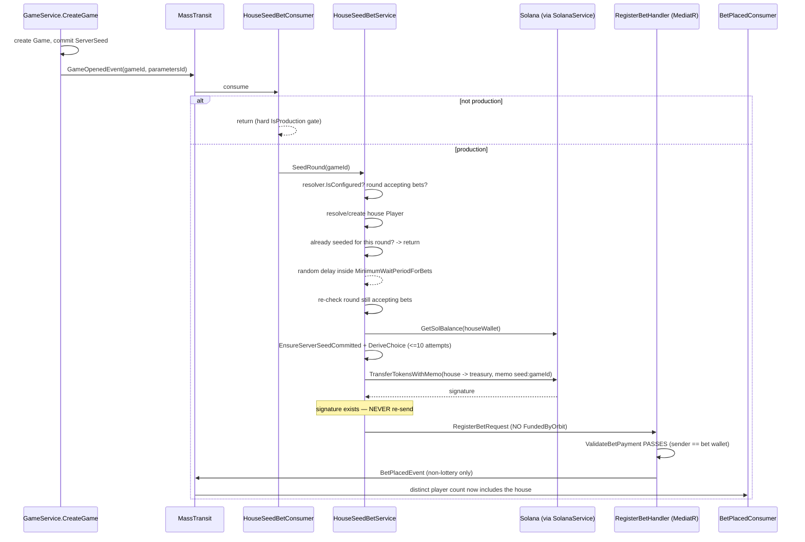

# SpaceStroker — "House Seed Bet" Feature — Implementation Spec

> ✅ **Status: SHIPPED** — merged to `main` on **2026-08-07** from `feature/house-seed-bet`
> (`monkify-backend` + `monkify-meta`; `monkify-front` untouched, zero files). Distilled summary:
> [`features/house-seed-bet.md`](../features/house-seed-bet.md).
>
> Verified before the merge, on the branch **after `origin/main` was merged into it** (the
> `orbit-new-ui` train had landed meanwhile and changed `ISolanaService`'s signature):
> **901 unit / 116 integration, all green.** 48 unit tests and 6 integration tests added; no existing
> test changed.
>
> ⚠️ **Not yet running in production.** The gate is `IsProduction()`, and the house wallet must first
> be created, funded with the game token **and** SOL, verified as neither the treasury nor the Orbit
> account, and its keypair placed in Secret Manager (`constraints.md` §5 keeps agents off production).
> Until then the resolver reports "not configured" and seeding is inert.
>
> Two §3 decisions were implemented as written and are worth knowing: the treasury/Orbit collision
> **disables seeding and logs `Fatal` without aborting the host** (decision 16), and a game type with
> `MinimumNumberOfPlayers < 2` is **refused outright** (AC 21).
>
> ---
>
> **Original status: Ready for implementation** — refined via Trello card
> [#155 Auto-place a house bet on every newly created round (all 3 game types)](https://trello.com/c/34W17kio)
> (2026-08-07).
> Repos affected: **`monkify-backend`** (the feature) and **`monkify-meta`** (this spec, the KB, and
> the retirement of `SpaceStroker.Seeder`). **`monkify-front` is not touched — zero files.**
>
> **Purpose:** on production a freshly rolled-over round frequently sits at zero bets, and an empty
> round reads as a dead game. With `MinimumNumberOfPlayers = 2` on all three seeded types, nobody
> wants to be first in, so quiet types stall. This puts **one ordinary paid bet from a house wallet**
> into every round as it opens, on **all three** game types, in **production only** — so a round is
> never empty and a **single** real player is enough to start it.

---

## 1. Summary

A new consumer in `SpaceStroker.Consumers` reacts to `GameOpenedEvent` — already published by
`GameService.CreateGame` (`GameService.cs:467`) for **all four** creation call sites (startup,
rollover, the under-subscribed lottery replacement, and a newly activated game type) — waits a
randomised interval inside the betting window, then places **one** paid bet from a dedicated house
wallet.

**The defining property: the seeded bet is an ordinary bet.** No marker column, no DTO field, no
validation bypass, no payout redirect, no branch anywhere keyed on it.

That is possible here and was not possible for Orbit, for one specific reason:

| | Who signs the transfer | Whose wallet is on the `Bet` | `ValidateBetPayment` |
| --- | --- | --- | --- |
| Human bet | the player | the player | passes |
| **Orbit bet** | the **Orbit custody account** | the **player** | **rejects** ⇒ needs `Bet.FundedByOrbit` to skip it |
| **House seed bet** | the **house wallet** | the **house wallet** | **passes** |

`SolanaService.ValidateTokenExchangeForSenderAccount` (`SolanaService.cs:613-630`) matches the
sender side on `bet.GetWalletAddress()` and the recipient side on `token.TokenOwnerPublicKey`
(`SolanaService.cs:595-611`). Because the house wallet is *both* the signer and the bet's wallet,
both lookups resolve correctly and the existing validator passes untouched. **Nothing in the money
path changes.**

Everything else follows from that: the bet counts as a distinct player in `BetPlacedConsumer`
(`b.PlayerId` — `BetPlacedConsumer.cs:55-60`), it funds the pot, it can win and is paid through
`RewardGameConsumer` with the ordinary 1% commission and `Credit` `TransactionLog` row, and it is
refunded by the existing paths when a lottery under-subscribes or a game type is deactivated.

This work also **retires `SpaceStroker.Seeder`** (`specs/auto-bet-seeder.md`) — the manual 6-hourly
console app it replaces. Running both would put **two** house wallets in a round, reaching
`MinimumNumberOfPlayers = 2` with **no humans in it**.

---

## 2. Constraints (MANDATORY)

From `monkify-meta/constraints.md` (full list there):

- **§2 Worktree-per-repo:** `feature/house-seed-bet`, worktrees at
  `.worktrees/house-seed-bet/monkify-backend` and `.worktrees/house-seed-bet/monkify-meta`. Both hubs
  stay on `main`. Push to `origin` after every commit (`AGENTS.md` rule 5).
- **§1 Secrets:** the house wallet private key is **never** committed, printed, logged or echoed.
  Committed config carries `MOCK_` placeholders only. Only the derived **public** key may be logged.
- **§3 Tests:** update/add unit tests in `SpaceStroker.Tests` and **report exactly which changed**.
  This changes game flow, so `SpaceStroker.Tests.Integration` is updated too; card **Level =
  `Feature`** ⇒ a happy-path integration test is **mandatory**. Run via `scripts/run_tests.bat` and
  `scripts/run_integration_tests.bat` — **never** a bare `dotnet test` (it drags in the `ProductionGames`
  Monte Carlo suite).
- **§4 DB:** **no migration** — decision 2 forbids a marker column, and nothing else needs schema.
- **§5 Production data:** an agent must **not** point this at production, fund the house wallet, or
  place a production bet. Funding and the first live run are **operator steps for the user**.
- **§6 Messaging:** nothing new is user-facing. No new copy, no new error message.
- **§8 Scope:** the money/background work lives in **`SpaceStroker.Consumers`**; the API host stays
  stateless and is not touched.

---

## 3. Resolved product decisions

Decisions 1–13 come from the refined card. Decisions 14–19 are **spec-level** resolutions of gaps the
card deliberately left open ("Left to the spec"), each with its reason.

| # | Decision |
| --- | --- |
| 1 | **Seeding moves into the backend.** A consumer on `GameOpenedEvent`, not a polling console app. |
| 2 | **The seeded bet is an ordinary bet in every respect.** No marker, no column, no migration, no validation bypass, no payout redirect, no special-casing in stats/history/analytics. |
| 3 | **It counts toward `MinimumNumberOfPlayers`.** One human + the house bet = 2. No code needed — `BetPlacedConsumer` counts distinct `PlayerId`s and the house has its own. |
| 4 | **All three types, Space Jackpot (lottery) included.** |
| 5 | **One dedicated house wallet + one configured display name.** A rotating pool is a later, config-only upgrade. |
| 6 | **Out-of-band placement with bounded retry.** Never blocks `CreateGame`; a failure degrades to today's empty round. |
| 7 | **The choice is derived from the round's committed `ServerSeed`**, reusing `OrbitChoiceGenerator.DeriveChoice`. Bounded attempts on collision. |
| 8 | **Ordinary settlement.** A win pays the house wallet via `RewardGameConsumer` with the standard commission and `Credit` row. |
| 9 | **A randomised delay inside `MinimumWaitPeriodForBets`, clamped.** |
| 10 | **Production only, via a hard `IsProduction()` check.** No config enable-flag. |
| 11 | **Always place, even if humans bet during the delay.** Never skipped for being non-empty or already startable. |
| 12 | **`SpaceStroker.Seeder` is retired.** |
| 13 | **Level = `Feature`** ⇒ happy-path integration test + a dedicated `features/house-seed-bet.md`. |
| 14 | **Spec decision — the house `Player` row is ensured BEFORE the choice is derived.** `OrbitChoiceGenerator.DeriveChoice` and `DeriveSeed` are keyed on a `Guid playerId`, but `RegisterBetHandler.UpsertPlayerAsync` only creates the `Player` *during* registration — after the choice is already needed. So the service resolves-or-creates the house `Player` first (§6.3 step 3). This also supplies the idempotency key in step 4. |
| 15 | **Spec decision — choice availability is checked against `OrbitChoiceClaims` as well as `GameBets`.** `RegisterBetHandler` rejects a free-text choice **reserved cross-round** by another player's Orbit claim (`RegisterBetHandler.cs:286-292`, added by #150) with `ChoiceAlreadyTaken`. Deriving without that check spends a stake that is then refunded. ⚠️ `PlaceOrbitBetConsumer.DeriveAvailableChoice` does **not** perform this check — a pre-existing gap in Orbit. **Not fixed here** (out of scope, §9); it is recorded so it is not mistaken for a new defect. |
| 16 | **Spec decision — house wallet == treasury disables seeding; it does NOT abort the host.** The card asks to "fail fast … and never place a bet". A same-ATA transfer is an on-chain no-op and the bet is rejected as underpaid *after* the money moved (`prod-bet-from-treasury-wallet`), so it must never be attempted. But throwing at boot would take down `SpaceStroker.Consumers` — the game loop, the typer and every payout — over a **seeding** misconfiguration. So the resolver reports **not configured**, logs `Fatal` once at startup, and seeding is inert while the game runs normally. The binding half of AC 14 — *never places a bet* — is fully satisfied. |
| 17 | **Spec decision — the bet `Seed` reuses `OrbitChoiceGenerator.DeriveSeed`** (`HMAC(ServerSeed, "orbit-seed\|playerId")`, `Nonce = 0`) rather than a new label. The label is never published, and nothing tells anyone which bet is the house's, so a distinct label would buy no verifiability and would add a second code path to keep in sync with `public/verify.html`. |
| 18 | **Spec decision — the transfer memo is `seed:{gameId:N}`.** One seeded bet per round means collisions are unlikely, but two rounds' transfers are otherwise identical in sender, receiver, amount and fee payer, and a Solana signature is deterministic over the message — the exact defect Orbit hit (`ISolanaService.TransferTokensWithMemo` docs). The memo is not a marker: it is on the **chain**, not on the `Bet`, and never surfaces in any API or UI payload. |
| 19 | **Spec decision — retry is phase-aware, mirroring `specs/auto-bet-seeder.md` §6.7.** Free bounded retries **before** the transfer; once a signature exists it is **never** re-sent. Only registration may repeat, and only on transport failures — a validation rejection is terminal and is logged as an orphan. |

---

## 4. Data model

**Not applicable — no entity, column, EF mapping, migration or `SpaceStrokerDbContext` change.**

This is decision 2, and it is load-bearing rather than incidental: a marker column is exactly what
would make the bet distinguishable. The only new row the feature creates is a perfectly ordinary
`Player` (the house wallet) written by the existing `RegisterBetHandler.UpsertPlayerAsync` path, and
an ordinary `Bet` + `TransactionLog` `Debit` row per round.

> ⚠️ **If an implementer finds themselves adding a column, the design has been misunderstood.** Stop
> and re-read §1.

---

## 5. Configuration

### 5.1 New settings class — `HouseSeedSettings`

Lives under `GeneralSettings:Operator:Token:HouseSeed`, alongside `Orbit`, so rotating the keypair is
a redeploy exactly as it is for the payout and Orbit keys.

```csharp
// SpaceStroker.Domain/Configs/Entities/HouseSeedSettings.cs
public class HouseSeedSettings
{
    /// The wallet that places the seeded bet. A SEPARATE keypair from TokenSettings.TokenOwner*
    /// AND from Orbit: it must not be the treasury (a same-ATA transfer is an on-chain no-op), and
    /// it must not be Orbit (that is player custody money, not house money).
    /// MOCK in committed config. Blank or MOCK_ ⇒ seeding is inert.
    public string PublicKey { get; set; }
    public string PrivateKey { get; set; }

    /// The ordinary-looking display name shown next to the seeded bet.
    public string DisplayName { get; set; }

    /// Below this SOL balance the seed bet is skipped. Mirrors OrbitSettings.MinimumSolBalance:
    /// nobody is waiting on a seed bet, so burning the last SOL on one is the wrong trade.
    public decimal MinimumSolBalance { get; set; } = 0.02m;

    /// Upper bound on the randomised placement delay, in seconds. Clamped at runtime to stay
    /// strictly inside MinimumWaitPeriodForBets — see §6.2.
    public int MaxPlacementDelaySeconds { get; set; } = 10;

    /// Bounded retry for transient failures BEFORE any transfer signature exists.
    public int RetryAttempts { get; set; } = 3;
    public int RetryBaseDelaySeconds { get; set; } = 2;

    /// Both halves are required, and a MOCK_ value counts as absent — the same fail-CLOSED discipline
    /// OrbitSettings.IsTelegramConfigured uses. Committed config must never fail open into a live
    /// money path.
    public bool IsConfigured
        => !string.IsNullOrWhiteSpace(PublicKey)
           && !PublicKey.StartsWith("MOCK_", StringComparison.OrdinalIgnoreCase)
           && !string.IsNullOrWhiteSpace(PrivateKey)
           && !PrivateKey.StartsWith("MOCK_", StringComparison.OrdinalIgnoreCase);
}
```

Add to `TokenSettings` (`SpaceStroker.Domain/Configs/Entities/TokenSettings.cs`), beside `Orbit`:

```csharp
/// The house wallet that seeds every new round with one ordinary paid bet. Deliberately separate
/// from BOTH TokenOwner* (treasury) and Orbit (player custody). See specs/house-seed-bet.md.
public HouseSeedSettings HouseSeed { get; set; } = new();
```

### 5.2 Committed config — `SpaceStroker.Common/spacestrokersettings.json`

**Mock values only** (`constraints.md` §1). Under `GeneralSettings.Operator.Token`:

```jsonc
"HouseSeed": {
  "PublicKey": "MOCK_HOUSE_SEED_PUBLIC_KEY",
  "PrivateKey": "MOCK_HOUSE_SEED_PRIVATE_KEY",
  "DisplayName": "MOCK_HOUSE_SEED_DISPLAY_NAME",
  "MinimumSolBalance": 0.02,
  "MaxPlacementDelaySeconds": 10,
  "RetryAttempts": 3,
  "RetryBaseDelaySeconds": 2
}
```

Real values arrive from Secret Manager in production, exactly as `Orbit.PrivateKey` does.

> **Note, not a new feature:** because `IsConfigured` fails closed, blanking the production secret
> stops seeding without a code change. That is a **secret rotation**, not the config kill switch the
> card explicitly rejected (decision 10) — the feature gate remains `IsProduction()`. It is recorded
> here so an operator in an incident knows the option exists.

---

## 6. Backend behaviour

Everything runs in **`SpaceStroker.Consumers`** (`constraints.md` §8).

### 6.1 The consumer — `HouseSeedBetConsumer`

`Infrastructure/Consumers/HouseSeedBet/HouseSeedBetConsumer.cs`, a
`BaseConsumer<GameOpenedEvent>` — deliberately thin, exactly like `OrbitPlacementPlannerConsumer`:
**it owns the production gate and nothing else.**

```csharp
public override async Task ProcessMessage(GameOpenedEvent message)
{
    using var scope = ServiceScopeFactory.CreateScope();

    var environment = scope.ServiceProvider.GetRequiredService<IHostEnvironment>();

    // Decision 10 — production only, hard gate, no config flag. Placed HERE and not inside the
    // service so the service stays drivable by the integration harness (§11.2): the shared
    // Testcontainers fixture boots every host as Development (IntegrationTestFixture.cs:127,202)
    // and flipping that would change behaviour for every other suite in the collection.
    if (!environment.IsProduction())
        return;

    var seeder = scope.ServiceProvider.GetRequiredService<IHouseSeedBetService>();
    await seeder.SeedRound(message.GameId);
}
```

`BaseConsumer.Consume` already wraps `ProcessMessage` in a try/catch that logs and swallows
(`SpaceStroker.Common/Abstractions/BaseConsumer.cs`), so "a failure never escapes into the game loop"
needs no extra code.

Register in `SpaceStroker.Consumers/Program.cs` beside the Orbit consumers:
`x.AddConsumer<HouseSeedBetConsumer>();` (~line 82) and a matching
`cfg.ReceiveEndpoint(nameof(HouseSeedBetConsumer), …)` (~line 143).

> ⚠️ **A separate receive endpoint from `OrbitPlacementPlannerConsumer`,** even though both consume
> `GameOpenedEvent`. Sharing one would serialise them and make a slow seed placement delay Orbit
> planning; separate endpoints each get their own copy of the event, which is what MassTransit
> publish semantics already give us.

### 6.2 The placement delay (decision 9)

```
delay = Random.Shared.Next(0, maxDelaySeconds + 1) seconds
maxDelaySeconds = clamp(HouseSeed.MaxPlacementDelaySeconds, 0, Games.MinimumWaitPeriodForBets - 2)
```

Why clamped **strictly inside** the window:

- `BetPlacedConsumer` measures the window from `game.CreatedDate`
  (`BetPlacedConsumer.cs:65-67, 138`). A seeded bet landing *after* the window still works — the
  round simply starts when it arrives — but it **extends** the round for anyone already waiting.
- The 2-second margin covers the transfer + confirmation that follow the delay.
- A `0` or negative clamp result means "no delay" — correct behaviour for a short-window
  configuration (the integration harness sets `MinimumWaitPeriodForBets = 1`).

Implemented as `await Task.Delay(...)` inside the consumer's scope. This is an established pattern in
this codebase — `BetPlacedConsumer.cs:139-140` already awaits the remaining window the same way.

> **Accepted (card):** a `SpaceStroker.Consumers` restart during the delay loses the pending
> placement and the round goes unseeded. **Do not add a durable scheduler** — explicitly out of scope.

### 6.3 The service — `HouseSeedBetService.SeedRound(Guid gameId)`

`Infrastructure/Services/HouseSeed/HouseSeedBetService.cs`. Every decision lives here so it is
testable without a bus and without the production gate. The order is the design, and it is the same
paranoia `PlaceOrbitBetConsumer` documents: **every step after the transfer is money already gone.**

1. **Is the house wallet usable?** `IHouseSeedAccountResolver.IsConfigured` — false ⇒ log `Information`
   and return. (Includes the treasury guard, §6.5.)

2. **Load the round.** `Games.Include(Parameters).ThenInclude(PresetChoices).ThenInclude(LotteryParameters)`.
   Missing, or `!Game.GameAcceptingBets.Contains(status)` ⇒ log and return.

3. **Resolve or create the house `Player`** — **before** anything is derived (decision 14).
   `Players.FirstOrDefaultAsync(x => x.ExternalPlayerId == houseWallet)`; create it with the
   configured `DisplayName` if absent. Its `Id` is the `playerId` fed to both derivations and the
   idempotency check below.

4. **Idempotency — has this round already been seeded?**
   `GameBets.AnyAsync(x => x.GameId == gameId && x.PlayerId == housePlayerId)` ⇒ log `Information`
   and return, **before** any transfer. A redelivered `GameOpenedEvent` must never spend a second
   stake. (`RegisterBetHandler`'s `SecondBetNeedsAnotherPlayer` rule would reject the duplicate
   anyway — but only *after* the stake had moved, costing a transfer plus a refund.)

5. **Randomised delay** (§6.2), then **re-load the round and re-check `GameAcceptingBets`**. A round
   that started or ended during the delay ⇒ return without signing.
   > This is **not** decision 11's "skip because humans arrived" — that is forbidden. This is "the
   > round is closed", which is a different condition and must be checked or we buy into a dead round.

6. **SOL pre-flight.** `solana.GetSolBalance(houseWallet)`; below `MinimumSolBalance` ⇒ log `ERROR`
   (§6.7) and return without transferring. `null` is "unknown", not "empty" — a failed read must not
   stop seeding, matching `PlaceOrbitBetConsumer.IsLowOnFees`.

7. **Ensure the server seed.** `gameService.EnsureServerSeedCommitted(gameId)`, then re-read.
   `CreateGame` already commits it at round creation (`GameService.cs:441-452`), so this is the
   idempotent guarantee rather than the normal path. No seed ⇒ log `ERROR` and return.

8. **Derive an available choice** (§6.4). None found ⇒ return **without transferring**.

9. **Transfer the stake.**
   ```csharp
   var stake = game.Parameters.RequiredAmount;
   var rawAmount = (ulong)(stake * (decimal)Math.Pow(10, resolver.Decimals));

   var signature = await solana.TransferTokensWithMemo(
       settings.Operator.Token.TokenOwnerPublicKey,               // destination owner = the treasury
       new BetTransactionAmountResult(stake, rawAmount),
       resolver.ToDescriptor(includePrivateKey: true),            // sender = the house wallet
       $"seed:{gameId:N}");                                       // decision 18
   ```
   Null/blank ⇒ log `ERROR` and return. **No money moved, so nothing to compensate** — unlike Orbit,
   there is no custodial balance to put back.

10. **Register the bet through the ordinary MediatR path.**
    ```csharp
    var body = new RegisterBetRequestBody
    {
        Amount           = stake,
        Choice           = choice,
        Seed             = OrbitChoiceGenerator.DeriveSeed(game.ServerSeed!, housePlayer.Id),
        Nonce            = 0,
        Wallet           = houseWallet,          // sender == bet wallet ⇒ ValidateBetPayment passes
        DisplayName      = houseDisplayName,
        PaymentSignature = signature,
    };

    await mediator.Send(new RegisterBetRequest(gameId, body));   // ⚠️ NO FundedByOrbit
    ```
    > ⚠️ **`FundedByOrbit` must NOT be set.** It exists solely to skip `ValidateBetPayment` for a
    > transfer signed by a *different* wallet than the bet's. Setting it here would skip a validation
    > that **passes** — throwing away a real control for nothing — and would put the bet on Orbit's
    > settlement and refund paths, sending a win to the **player-custody** account.

11. **Success** ⇒ log `Information` with game, choice, amount, signature.
    **Failure** ⇒ §6.6.

### 6.4 Choice derivation (decision 7, 15)

Reuses `OrbitChoiceGenerator.DeriveChoice(serverSeed, housePlayerId, attempt, parameters)` verbatim,
bounded at **10 attempts** (the same constant `PlaceOrbitBetConsumer.MaxChoiceAttempts` uses).

- **Preset types** (Beast Mode) share choices, so the first derivation always stands — no
  availability query at all.
- **Free-text types** (Cosmic Sprint) are exclusive per round *and* carry a **cross-round Orbit
  reservation**, so a candidate is available only when **both** are clear:

  ```csharp
  var takenThisRound = await context.GameBets
      .AnyAsync(x => x.GameId == game.Id && x.Choice == candidate);

  // Decision 15 — #150's cross-round claim. RegisterBetHandler.cs:286-292 refuses a reserved word
  // with ChoiceAlreadyTaken, so skipping this check spends a stake that is immediately refunded.
  var reserved = await context.OrbitChoiceClaims
      .AnyAsync(x => x.GameParametersId == game.ParametersId && x.Choice == candidate);
  ```

Exhausting all 10 attempts ⇒ sit the round out, **before** any transfer. Bounded for the same reason
Orbit bounds it: spending a transfer on a choice that will be rejected leaves the stake in
`NeedsRefunding` until the 12h sweep.

### 6.5 The treasury guard (decision 16)

`HouseSeedAccountResolver.IsConfigured` returns **false** — and logs `Fatal` once — when

```
HouseSeed.PublicKey == Operator.Token.TokenOwnerPublicKey
```

Why this is fatal-shaped rather than a skip: `ValidateBetPayment` matches the recipient by
`token.TokenOwnerPublicKey` and the sender by `bet.GetWalletAddress()`. When both are the same wallet
they resolve to the **same** balance entry, the computed delta is **0**, and the bet is rejected as
`SignaturePaidLessThanBetAmount` — *after* the transfer confirmed on chain. The transfer itself is a
self-transfer no-op, so it fails silently and repeatedly. This is the shipped production incident
recorded in memory `prod-bet-from-treasury-wallet` and in `specs/auto-bet-seeder.md` §6.1.

**It also rejects `HouseSeed.PublicKey == Orbit.PublicKey`** — Orbit holds player custody money, and
staking it as house money would make "player balances vs on-chain balance" unverifiable.

The `Fatal` log is emitted **once at Consumers startup**, not per round, so a misconfiguration is
loud without flooding.

`ToDescriptor(bool includePrivateKey)` mirrors `OrbitAccountResolver.ToDescriptor` exactly, including
its warning:

> ⚠️ **`SenderAccount` MUST be the derived associated token account, not the wallet address.**
> `SolanaTokenDescriptor.SenderAccount` feeds `TokenProgram.Transfer`'s SOURCE, which the SPL token
> program requires to be a token account. Passing the wallet builds a structurally valid transaction
> the runtime rejects — on chain, after fees. Derive it with
> `AssociatedTokenAccountProgram.DeriveAssociatedTokenAccount` (pure PDA maths, zero RPC).

### 6.6 Retry and failure (decisions 6, 19)

| Phase | Covers | Policy |
| --- | --- | --- |
| **`PreSend`** | round load, player resolve, seed commit, SOL read, choice derivation | Up to `RetryAttempts` retries on a **transient** failure, delays `RetryBaseDelaySeconds × 2^n`. Give up ⇒ skip the round, log, return. |
| **`PostSend`** | everything after `TransferTokensWithMemo` returned a signature | **The transfer is NEVER re-sent.** Only registration may repeat, and only on a **transport** failure. |

A registration **rejection** (any `Messaging.ReturnValidationFailureMessage` throw — an unexpected
duplicate, exclusivity, a closed round) is **terminal**. Retrying cannot help, and a reused signature
is refused as `PaymentSignatureHasBeenUsed` anyway. Log the orphan (§6.7) so the stranded stake can be
reconciled by hand via the existing `POST /admin/bets/refund`
(`features/refund-safeguards.md`).

### 6.7 Logging

There is **no other operator-facing signal** that seeding has stopped, so these conditions get
distinguishable, greppable messages (mirroring `specs/auto-bet-seeder.md` §6.8):

| Condition | Level | Message shape |
| --- | --- | --- |
| Not configured / MOCK values | `Information` | `House seeding is not configured; skipping game {GameId}.` |
| **House wallet == treasury or Orbit** | `Fatal` (once, at startup) | `HOUSE SEED MISCONFIGURED — the house wallet must not be the treasury or the Orbit account; seeding is disabled.` |
| Out of SOL | `Error` | `HOUSE SEED — the house wallet is low on SOL ({Balance}); skipping game {GameId}.` |
| Transfer failed | `Error` | `HOUSE SEED — the stake transfer did not land for game {GameId}.` |
| No free choice | `Warning` | `HOUSE SEED — no free choice found in {Attempts} attempts for game {GameId}.` |
| Round closed during the delay | `Information` | `HOUSE SEED — game {GameId} stopped accepting bets during the placement delay.` |
| Already seeded | `Information` | `HOUSE SEED — game {GameId} already has a house bet; skipping.` |
| **Orphan payment** | `Error` | `HOUSE SEED ORPHAN PAYMENT — signature={Signature} wallet={PublicKey} game={GameId} amount={Amount}` |

**Never logged:** `HouseSeed.PrivateKey`, in any form, including inside an exception message.

### 6.8 What deliberately does NOT change

Pinned by acceptance criterion 3 and by unit tests:

- `SolanaService.ValidateBetPayment` and both of its balance checks — they pass as-is.
- `BetDomainService` — pot, reward, commission and refund math.
- `RewardGameConsumer`, `RefundInvalidBetConsumer`, `GameTypeDeactivatedConsumer`.
- `BetPlacedConsumer` — the house bet is counted by the existing distinct-`PlayerId` logic.
- `RegisterBetRequestBody`, `RegisterBetRequest`, `BetDto`, every DTO and SignalR payload.
- `GameService.CreateGame` — it already publishes `GameOpenedEvent`; **not one line changes.**

---

## 7. Frontend behaviour

**None. `monkify-front` has zero changed files** — pinned by acceptance criterion 18.

The seeded bet reaches players through paths that already exist and are unaware of it: the
`{gameId}/Bets` SignalR feed, the `> POT:` line, the STATS tab, the FAIR tab and the Games History
page. It renders exactly like any other player's paid bet, which is the entire point.

---

## 8. Flow diagram



---

## 9. Out of scope

- Any change to `MinimumNumberOfPlayers`, stakes, `RequiredAmount`, or the seeded game catalogue.
- A rotating pool of house wallets (decision 5) — a later, config-only upgrade.
- A config kill switch or an admin toggle for seeding (decision 10).
- Excluding seeded bets from analytics, stats or history — **explicitly rejected** by decision 2.
- Making an *empty* round start on its own. The house bet is one player, not two.
- A durable scheduler so a delayed placement survives a Consumers restart.
- A stale-round timeout for races stuck in `WaitingBets` — a pre-existing gap with its own card.
- **Fixing `PlaceOrbitBetConsumer.DeriveAvailableChoice`'s missing `OrbitChoiceClaims` check**
  (decision 15). Recorded, not fixed — it is an Orbit defect and deserves its own card.
- Any `monkify-front` change. Any Terraform change. Widening the `/rpc` method allow-list.

---

## 10. File checklist

### 10.1 Backend (`monkify-backend`)

| # | File | Change |
| --- | --- | --- |
| 1 | `src/SpaceStroker.Domain/Configs/Entities/HouseSeedSettings.cs` | **New.** §5.1 — settings + fail-closed `IsConfigured` |
| 2 | `src/SpaceStroker.Domain/Configs/Entities/TokenSettings.cs` | Add `HouseSeed` property beside `Orbit` |
| 3 | `src/SpaceStroker.Infrastructure/Services/HouseSeed/IHouseSeedAccountResolver.cs` | **New.** `IsConfigured`, `PublicKey`, `DisplayName`, `Decimals`, `ToDescriptor(bool)` |
| 4 | `src/SpaceStroker.Infrastructure/Services/HouseSeed/HouseSeedAccountResolver.cs` | **New.** §6.5 — ATA derivation + treasury/Orbit guard |
| 5 | `src/SpaceStroker.Infrastructure/Services/HouseSeed/IHouseSeedBetService.cs` | **New.** `Task SeedRound(Guid gameId)` |
| 6 | `src/SpaceStroker.Infrastructure/Services/HouseSeed/HouseSeedBetService.cs` | **New.** §6.2–6.7 — the whole flow |
| 7 | `src/SpaceStroker.Infrastructure/Consumers/HouseSeedBet/HouseSeedBetConsumer.cs` | **New.** §6.1 — the `IsProduction()` gate and nothing else |
| 8 | `src/SpaceStroker.Infrastructure/DependencyInjection.cs` | Register both services scoped (beside the Orbit registrations, ~lines 58/64) |
| 9 | `src/SpaceStroker.Consumers/Program.cs` | `AddConsumer<HouseSeedBetConsumer>()` (~82) + its own `ReceiveEndpoint` (~143); startup treasury-guard `Fatal` log |
| 10 | `src/SpaceStroker.Common/spacestrokersettings.json` | §5.2 — `HouseSeed` block, **MOCK values only** |

**No migration. No entity change. No DTO change. No controller change.**

### 10.2 Frontend (`monkify-front`)

**No files.** Zero changes — pinned by acceptance criterion 18.

### 10.3 Meta (`monkify-meta`)

| # | File | Change |
| --- | --- | --- |
| 1 | `specs/house-seed-bet.md` | **This spec.** |
| 2 | `features/house-seed-bet.md` | **New** — written by `/monkify-ship-feature` (card Level = `Feature`). Must carry the §12 AC 21 fairness invariant. |
| 3 | `INDEX.md` | Spec row + "Feature currently in flight"; on ship, the `features/` row |
| 4 | `specs/auto-bet-seeder.md` | Mark **superseded by this spec** in the header. **Do not delete** — it is the history of the retired tool. |
| 5 | `deploy/tools/SpaceStroker.Seeder/**` | **Delete** (decision 12) |
| 6 | `deploy/tools/SpaceStroker.Seeder.Tests/**` | **Delete** |
| 7 | `deploy/tools/SpaceStroker.DeployTools.sln` | Remove both project entries + their Debug/Release configs |
| 8 | `deploy/secrets.seeder.example.json` | **Delete** |
| 9 | `deploy/.gitignore` | Remove the `!secrets.seeder.example.json` negation |
| 10 | `deploy/README.md` | Remove the seeder section |

---

## 11. Tests

### 11.1 Unit tests — `monkify-backend/src/SpaceStroker.Tests`

| Test file | Test cases | Expected |
| --- | --- | --- |
| `UnitTests/Services/HouseSeedAccountResolverTests.cs` | blank / `MOCK_` public or private key | `IsConfigured == false` |
| | **`PublicKey == TokenOwnerPublicKey`** | `IsConfigured == false` (§6.5) |
| | **`PublicKey == Orbit.PublicKey`** | `IsConfigured == false` |
| | fully configured, distinct keys | `IsConfigured == true` |
| | `ToDescriptor(false)` | `TokenOwnerPrivateKey` is empty |
| | `ToDescriptor(true)` | `SenderAccount` is the **derived ATA**, not the wallet address |
| | no assertion message or `ToString` contains the private key | asserted explicitly |
| `UnitTests/Services/HouseSeedBetServiceTests.cs` | round in `WaitingBets`, nothing seeded yet | one transfer, one `RegisterBetRequest` |
| | round in `GameStarting` | still seeded (it accepts bets) |
| | round in `InProgress` / `Ended` / `NotEnoughPlayersToStart` | no transfer, no bet |
| | **a bet from the house player already exists** | no transfer at all, logged and returned |
| | **round already has HUMAN bets** | **still seeds** — pins decision 11 against a future "optimisation" |
| | round leaves `GameAcceptingBets` during the delay | no transfer |
| | resolver not configured | no transfer |
| | SOL below `MinimumSolBalance` | no transfer |
| | `GetSolBalance` returns `null` | **still seeds** (unknown ≠ empty) |
| | no committed server seed and the commit fails | no transfer |
| | preset type | choice is a member of `PresetChoices`; **no availability query** |
| | free-text, first candidate taken in `GameBets` | second candidate used |
| | **free-text, candidate reserved in `OrbitChoiceClaims`** | skipped, next candidate used (decision 15) |
| | free-text, all 10 attempts collide | **no transfer**, warning logged |
| | derived choice + seed for a fixed `(serverSeed, playerId)` | deterministic and reproducible |
| | **the `RegisterBetRequest` never sets `FundedByOrbit`** | asserted explicitly — the single most important assertion in this suite |
| | request body `Wallet` == the house wallet, `Nonce` == 0, `Amount` == `RequiredAmount` | asserted |
| | transfer memo | equals `seed:{gameId:N}` |
| | transfer returns null | no `RegisterBetRequest` sent |
| | registration throws | transfer is **not** re-sent; orphan logged with the signature |
| | house `Player` did not exist | created with the configured `DisplayName` before derivation |
| | delay clamp with `MinimumWaitPeriodForBets = 1` | clamped to 0, no negative delay |
| `UnitTests/Consumers/HouseSeedBetConsumerTests.cs` | environment `Development` / `Staging` | `IHouseSeedBetService` is **never** called |
| | environment `Production` | `SeedRound` called once with the event's `GameId` |
| | service throws | `BaseConsumer` swallows it; no exception escapes |

> ⚠️ **Existing suites to re-run and fix, not to ignore:** `UnitTests/Background/CreateGameTests.cs`
> (publishes `GameOpenedEvent`) and `UnitTests/Consumers/PlaceOrbitBetConsumerTests.cs` (same event,
> now with a second consumer). Neither should need behavioural changes — if one does, the isolation
> promised in §6.8 has been broken.

### 11.2 Integration test — `SpaceStroker.Tests.Integration/HouseSeedBetFlowTests.cs`

Card Level = **`Feature`**, so this is mandatory (`constraints.md` §3).

⚠️ **The hard `IsProduction()` gate shapes this suite, and the shape is deliberate.**
`IntegrationTestFixture` boots every host as `Development`
(`IntegrationTestFixture.cs:127` and `:202`) and the fixture is **shared across the whole
`IntegrationCollection`** — flipping it to `Production` would change behaviour for every other suite
(free bets off, dev endpoints gone, CORS). So:

- **The gate** is asserted through the bus: publish/trigger a real round in `Development` and assert
  **no** house bet appears.
- **The happy path** is driven by resolving `IHouseSeedBetService` from the **running Consumers
  host's** DI scope and calling `SeedRound(gameId)` directly. Everything below the gate is then
  genuinely end to end — real API + Consumers hosts, real Postgres, real bus, real Redis, the
  harness's `FakeSolanaService` standing in only for the chain, exactly as `OrbitAutoBetFlowTests`
  does.

| # | Test | Asserts |
| --- | --- | --- |
| 1 | **Happy path** — `SeedRound` on a fresh `WaitingBets` round | a `Bet` exists for the house wallet with `Amount == RequiredAmount`; a `TransactionLog` `Debit` row; `FundedByOrbit == false`; the choice matches `OrbitChoiceGenerator.DeriveChoice` |
| 2 | **One human + the house bet starts the round** (min 2) | the round reaches `GameStarting` → `InProgress` → `RewardForWinnersCompleted` with no second human |
| 3 | **The gate holds** — a round opens in `Development` | no house bet is ever placed |
| 4 | **Idempotency** — `SeedRound` twice on one round | exactly one house bet; the second call performs no transfer |
| 5 | **Preset type** (Beast Mode) | the seeded choice is one of `PresetChoices` |
| 6 | **Lottery** (Space Jackpot) under-subscribed at draw | the house stake is refunded, status `NotEnoughPlayersToStart`, a successor round is created |
| 7 | **The seeded bet is indistinguishable** | `GET /games/{parametersId}/history` and the game payload expose no field marking it |
| 8 | **A win pays the house wallet** | `RewardGameConsumer` produces a `Credit` `TransactionLog` row against the house wallet with the commission applied |

### 11.3 Harness change

`SpaceStroker.Tests.Integration/Harness/IntegrationTestFixture.cs` — add, beside the existing Orbit
env vars (~lines 156-158):

```
GeneralSettings__Operator__Token__HouseSeed__PublicKey     = <a generated test wallet>
GeneralSettings__Operator__Token__HouseSeed__PrivateKey    = "MOCK_HOUSE_SEED_PRIVATE_KEY"
GeneralSettings__Operator__Token__HouseSeed__DisplayName   = "Edson"
```

Must be **distinct from** `OrbitAccount` and from `TokenOwnerPublicKey`, or the §6.5 guard disables
seeding and every test above fails for the right reason in the wrong place.

---

## 12. Acceptance criteria

Copied 1:1 from the Trello **Acceptance Criteria** checklist (21 items).

1. Given the app runs in production, when a game is created for ANY of the three game types (Cosmic Sprint, Beast Mode, Space Jackpot), then exactly one paid house bet of `RequiredAmount` is placed on that round.
2. Given the app runs in ANY non-production environment, when a game is created, then no house bet is placed and no on-chain transfer is attempted.
3. Given a seeded house bet has been placed, when the `Bet` row and every API/SignalR payload that carries it are inspected, then it is indistinguishable from a bet any player could have placed: no marker column, no new DTO field, no flag on `RegisterBetRequestBody`, and no branch keyed on it in payment validation, reward math, refunds, stats, history or analytics.
4. Given the house bet is placed, when the stake transfer is validated, then `SolanaService.ValidateBetPayment` runs unmodified and passes, because the house wallet is both the transfer's sender and the bet's own wallet — no bypass exists or is added.
5. Given a round holds one seeded house bet and one bet from a single real player, when `BetPlacedConsumer` counts distinct players, then `MinimumNumberOfPlayers` (2) is satisfied and the round starts after `MinimumWaitPeriodForBets`.
6. Given a round holds ONLY the seeded house bet and no human ever bets, when the betting window elapses, then the race round does not start (one player is below the minimum) and no further house bet is added to it.
7. Given the house bet needs a choice, when it is selected, then it is derived deterministically from the round's committed `ServerSeed` (reusing `OrbitChoiceGenerator.DeriveChoice`) and is recomputable offline from the revealed seed — never a fresh random pick made after the seed was known.
8. Given a free-text type where the derived choice is already taken (choice exclusivity), when the house re-derives, then it retries a bounded number of times and, on exhaustion, sits the round out without sending any transfer.
9. Given a game is created, when the seeded bet is placed, then it lands after a randomised delay inside `MinimumWaitPeriodForBets`, clamped so it never lands once the round has left `GameAcceptingBets`, and `GameService.CreateGame` never waits on it.
10. Given one or more real players bet during the randomised delay, when the delay expires, then the house bet is still placed — it is never skipped because the round is already non-empty or already startable.
11. Given the placement fails for any reason before a transfer signature exists (no SOL, insufficient token balance, RPC 429/5xx, congestion), when the pass gives up, then the round still opens and runs normally with whatever bets it has, the failure is logged at `ERROR` with a greppable message naming the cause, and no exception escapes to the game loop.
12. Given a stake transfer signature already exists, when anything afterwards fails or times out, then the transfer is NEVER re-sent — only confirmation polling and the bet registration repeat, with that same signature — so no round can ever spend two stakes for one seeded bet.
13. Given the same `GameOpenedEvent` is delivered twice (redelivery or double fan-out), when the second delivery is processed, then no second stake leaves the house wallet and the round still holds exactly one seeded bet.
14. Given the configured house wallet equals the game token's receiver/treasury wallet, when the app starts, then it fails fast with a clear error and never places a bet — a same-ATA SPL transfer confirms as a no-op and the bet would be rejected as underpaid after the money moved.
15. Given a seeded house bet wins its round, when `RewardGameConsumer` settles it, then it is paid to the house wallet through the ordinary path with the standard commission applied and a `Credit` `TransactionLog` row written — with no branch added to `BetDomainService` for it.
16. Given a Space Jackpot draw is under-subscribed at draw time, when `BetPlacedConsumer` runs, then the seeded house stake is refunded to the house wallet by the existing path, the round is marked `NotEnoughPlayersToStart`, the successor round is created, and that successor is seeded once.
17. Given Orbit is active on a game type, when a round is seeded and Orbit also plans placements for it, then the seeded bet is counted as an ordinary existing bettor by the Orbit planner and the round does not start while Orbit placements are still confirming behind an armed `ExpectedOrbitBets` gate.
18. Given the work is complete, when the repositories are inspected, then `SpaceStroker.Seeder` and `SpaceStroker.Seeder.Tests` are removed from `monkify-meta` (project, solution entries, `secrets.seeder.example.json`, `.gitignore` negation, `deploy/README` section), `specs/auto-bet-seeder.md` is marked superseded rather than deleted, and `monkify-front` has zero changed files.
19. Given the repository is inspected after the work, when committed files and log output are read, then no house wallet private key appears anywhere — only the derived public key is ever logged — and committed config carries mock/placeholder values only.
20. Given the test suites run, when `SpaceStroker.Tests` and `SpaceStroker.Tests.Integration` execute via `scripts/run_tests.bat` and `scripts/run_integration_tests.bat`, then both are green, the pre-existing integration tests' player counts are unchanged (seeding is off outside production), a happy-path integration test covers the seeded-bet flow, and the added/changed unit tests are reported at the end of the work.
21. Given the grinding-resistance invariant depends on at least one bet seed the house does not control, when the implementation runs, then it must not place a seeded bet on a game type whose `MinimumNumberOfPlayers` is 1 (or the spec must state explicitly why that is safe) — with the invariant documented in the `features/` doc so a future change to `MinimumNumberOfPlayers` cannot silently break it.

> **On AC 14** — read as decision 16: the binding half is *never places a bet*. The resolver reports
> not-configured and logs `Fatal`; `SpaceStroker.Consumers` still boots, because aborting the host
> would take the game loop and every payout down over a seeding misconfiguration.
>
> **On AC 21** — the implementation must **refuse to seed** a type with
> `MinimumNumberOfPlayers < 2`, logged at `Warning`. The invariant: the typer's keystream is
> `HMAC(ServerSeed ‖ gameId ‖ orderedBetSeeds)`, so as long as at least one bet seed comes from a
> human browser the house cannot predict the outcome at the moment it chooses. On a min-1 type the
> house bet could run a round alone, where every input is house-controlled.

---

## 13. Manual QA

**Agent-side (safe, non-production only):**

1. `scripts/run_tests.bat` — green; report added/changed tests.
2. `scripts/run_integration_tests.bat` — green, including `HouseSeedBetFlowTests`.
3. Local stack: confirm a round opens and **no** house bet appears (the `IsProduction()` gate), and
   that the "not configured" / gate log lines are present.

**Operator-side (production, by the user — `constraints.md` §5):**

4. Create a **new** wallet for seeding. Confirm it is **not** the treasury (`TokenOwnerPublicKey`)
   and **not** the Orbit account. Fund it with the game token and a little SOL.
5. Put its keypair and display name in Secret Manager; deploy.
6. Watch one rollover on each of the three types: a bet appears in the live feed under the configured
   display name, a few seconds into the round.
7. Confirm a single human bet now starts a round, and that a win pays back to the house wallet.

---

## 14. Trello / pipeline

- **Source card:** [#155](https://trello.com/c/34W17kio) — list **Specs created**; the
  **Implementation** block on the card carries branch, worktree, spec path and level.
- **Level:** `Feature` ⇒ mandatory happy-path integration test (`/monkify-implement-feature`) **and**
  a dedicated `features/house-seed-bet.md` (`/monkify-ship-feature`).
- **Next:** `/monkify-implement-feature` to build it, then `/monkify-ship-feature` to sync the KB and
  merge to `main`.

---

## 15. Revision log

| Date | Change |
| --- | --- |
| 2026-08-07 | Initial spec from refined card #155, with code exploration against `monkify-backend` `main` (`GameService.CreateGame`, `GameOpenedEvent`, `BetPlacedConsumer`, `RegisterBetHandler`, `RegisterBetRequest`, `SolanaService.ValidateBetPayment` + both balance checks, `ISolanaService`, `OrbitAccountResolver`, `OrbitChoiceGenerator`, `PlaceOrbitBetConsumer`, `OrbitPlacementPlannerConsumer`, `BaseConsumer`, `TokenSettings`, `OrbitSettings`, `IntegrationTestFixture`, `TestDoubles`). Two findings promoted to spec decisions: the house `Player` must exist before choice derivation (14), and the derived free-text choice must clear `OrbitChoiceClaims` as well as `GameBets` (15). |
