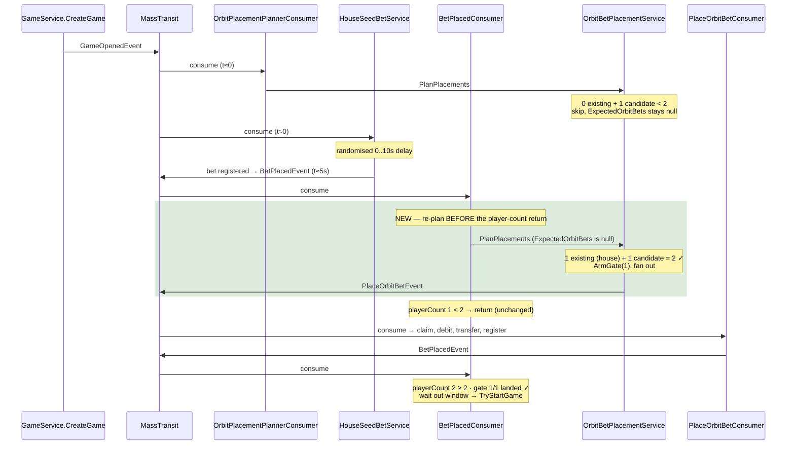

# SpaceStroker — "House seed / Orbit start conflict" — Implementation Spec

> **Status: Ready for implementation** — refined via Trello card
> [#172 Conflict between house seed and orbit](https://trello.com/c/nnn5uWri/172-conflict-between-house-seed-and-orbit)
> (2026-08-16).
> Repos affected: **`monkify-backend`** (the fix) and **`monkify-meta`** (this spec + the KB).
> **`monkify-front` is not touched — zero files.**
>
> **Purpose:** with the house seed bet live in production, every round opens holding one paid house
> bet, and [`features/games.md`](../features/games.md) §14 promises **a single real player is enough
> to start a round**. An Orbit player is a real player betting real money, so house bet + one funded
> Orbit player = 2 distinct players = `MinimumNumberOfPlayers`. The round does not start. This fixes
> the two defects that stop it, and adds a startup pass so the round already parked in production
> heals on the deploy.

---

## 1. Summary

Two independent defects combine into one stall.

**Defect 1 — the Orbit planner races the house seed bet.** `OrbitPlacementPlannerConsumer` and
`HouseSeedBetConsumer` both consume `GameOpenedEvent`, on **separate receive endpoints** (deliberate:
so a slow house placement never delays Orbit planning). The planner runs at t≈0. The house seed
service first waits a randomised `0..MaxPlacementDelaySeconds` (default 10s, clamped inside the 15s
`MinimumWaitPeriodForBets`) before it transfers and registers. So `PlanPlacements` always reads the
round **before** the house bet exists:

```
existingPlayers (0) + candidates (1) < MinimumNumberOfPlayers (2)   ⇒ skip
```

and returns at `OrbitBetPlacementService.cs:132-140` — deliberately **without** `MarkPlanned`, so
`ExpectedOrbitBets` stays `null`.

**Defect 2 — nothing re-plans when the house bet lands.** `BetPlacedConsumer` returns at
`BetPlacedConsumer.cs:67` while the round is under-subscribed and inside the betting window. The
re-plan trigger sits at `BetPlacedConsumer.cs:130`, **below** that return, so it is only ever reached
on a round that is already viable *without* Orbit.

⚠️ **Defect 2 is wider than the card title.** It equally breaks the plain **1 human + 1 funded Orbit
player** case — precisely the case
[`specs/orbit-auto-bet-engine.md`](orbit-auto-bet-engine.md) decision 4 promised would work
(*"`BetPlacedConsumer` re-runs the identical check when a human bet makes the round viable"*). That
trigger has been unreachable in the state it was written for. The house seed bet did not create the
bug; it made it permanent and visible, because from the second round onward every round has a bet in
it.

| Path | Trigger today | Works? |
| --- | --- | --- |
| Round opens with an enrolled, enabled, funded Orbit player | `GameOpenedEvent` → planner | ❌ planner runs before the house bet |
| House seed bet lands into that round | `BetPlacedEvent` → `BetPlacedConsumer` | ❌ returns above the re-plan |
| One human bets into an empty round, one Orbit player funded | `BetPlacedEvent` | ❌ same return |
| Player **enables** Orbit mid-round | `UpdateOrbitSettingsHandler.ConsiderTheCurrentRound` republishes `GameOpenedEvent` | ✅ house bet has landed by then |
| Player **deposits** mid-round | `OrbitDepositCreditedConsumer` | ✅ |

**The fix is two changes, both in `SpaceStroker.Consumers` / `SpaceStroker.Infrastructure`:**

1. Hoist the re-plan call in `BetPlacedConsumer` **above** the under-subscribed early return, so any
   bet landing in a round still accepting bets re-runs planning. One change, both cases.
2. A Consumers **startup pass** publishing `GameOpenedEvent` for every round still in
   `Game.GameAcceptingBets`, so a round already parked when this deploys heals on the deploy itself.

**No migration. No entity, DTO, controller or SignalR change. No frontend change.**

---

## 2. Constraints (MANDATORY)

From [`../constraints.md`](../constraints.md) (full list there):

- **§2 Worktree-per-repo:** `feature/house-seed-orbit-conflict`, worktrees at
  `.worktrees/house-seed-orbit-conflict/monkify-backend` and
  `.worktrees/house-seed-orbit-conflict/monkify-meta`. Both hubs stay on `main`. Push to `origin`
  after every commit (`AGENTS.md` rule 5).
- **§3 Tests:** update/add unit tests in `SpaceStroker.Tests` and **report exactly which changed**.
  Run via `scripts/run_tests.bat` — **never** a bare `dotnet test` (it drags in the `ProductionGames`
  Monte Carlo suite). Card **Level = `Minor change`** ⇒ the happy-path integration test and a
  dedicated `features/<slug>.md` are **waived**; the existing `features/*.md` docs are still corrected
  (§10.2).
- **§4 DB:** **no migration**, no schema change, no EF mapping change.
- **§5 Production data:** an agent must not point this at production or place a production bet. The
  parked production round is healed by the deploy itself (§6.2); nothing manual is required.
- **§6 Messaging:** nothing is user-facing. No new copy, no new error message.
- **§8 Scope:** money and background work live in **`SpaceStroker.Consumers`**; the API host stays
  stateless and is not touched.

---

## 3. Resolved product decisions

Decisions 1–8 come from the refined card. Decisions 9–13 are **spec-level** resolutions of gaps found
during code exploration, each with its reason.

| # | Decision |
| --- | --- |
| 1 | **The house seed bet counts as an ordinary bettor for Orbit's viability check**, exactly as it already counts for `MinimumNumberOfPlayers`. A round may run house-vs-Orbit with **no human in it**. Rejected: excluding house-seeded bets from that arithmetic — it would need a way to tell a house bet from a player's, which `house-seed-bet` decision 2 forbids by design. |
| 2 | ⚠️ **Accepted, documented consequence:** such a round carries **zero non-house entropy** — both the house bet's `Seed` and the Orbit bet's `Seed` are `OrbitChoiceGenerator.DeriveSeed(ServerSeed, playerId)` — **and the house is itself a bettor in it**. `orbit-auto-bet-engine` decision 13 already accepted "no non-house entropy" for Orbit-only rounds; this extends that acceptance to rounds the house bets in. |
| 3 | **Fix shape: re-plan on every bet.** Hoist the `ExpectedOrbitBets` → `PlanPlacements` call above the under-subscribed early return (the guard itself was refined during implementation — decision 14). Rejected: making the planner wait for the house seed bet (fixes only the house case, and couples the planner to house-seed timing that the separate receive endpoints exist to decouple) and doing both (two overlapping triggers for one defect). |
| 4 | **The hoist goes above the `playerCount < MinimumNumberOfPlayers` check**, not inside the under-subscribed branch, so a later edit to the lottery-refund path cannot move it out from under the fix. Guard unchanged. |
| 5 | **A startup pass re-plans every open round**, because a round already parked does not self-heal — nothing publishes another trigger for a dormant round, and races only roll over when they run, so one parked round stops every later round of its type. |
| 6 | ⚠️ **The startup pass publishes `GameOpenedEvent`, NEVER `BetPlacedEvent`.** A correctness finding, not a preference — see §6.3. |
| 7 | **The startup pass covers every round in `Game.GameAcceptingBets`, all types, all environments** — no production gate, no type filter. `PlanPlacements` already refuses lotteries, coming-soon and `AllowOrbit: false` types. Accepted side effect, judged a bonus: it also re-runs `HouseSeedBetConsumer`, which is idempotent per round, so a round left unseeded by a restart during the placement delay gets seeded on the next boot. |
| 8 | **Disclosure is knowledge-base only** (§10.2). Rejected: a player-facing note on the FAIR tab / verify page — it would pull `monkify-front` in and advertise that the house bets in every round, which `house-seed-bet` decision 2 deliberately keeps invisible. |
| 9 | **Spec decision — the startup pass runs inside `app.Lifetime.ApplicationStarted.Register(...)`, never inline.** `Program.cs:234-248` records why: the MassTransit transport's database and `transport` schema are provisioned by `AddPostgresMigrationHostedService`, which does not run until the host starts. An inline publish on a cold boot dies on `database "spacestroker_messaging" does not exist` — the exact failure that already once left rounds opened with no Orbit planning at all. |
| 10 | **Spec decision — it runs AFTER `CorrectScheduledLotteryDraws` and BEFORE `OpenNewGames`.** `OpenNewGames` → `GameService.CreateGame` publishes its own `GameOpenedEvent` (`GameService.cs:467`), so running after it would double-publish for every round that boot just created. Running before it means the pass covers exactly the rounds that **survived** the restart. |
| 11 | **Spec decision — in practice the pass only ever sees `WaitingBets`.** `CloseOngoingGames` runs first and closes `Game.GameInProgressStatus`, which is **`[GameStarting, InProgress]`** (`Game.cs:84`) — so no `GameStarting` round survives to reach the pass. The query still reads `Game.GameAcceptingBets` because that is the set the feature means; the narrowing is an ordering guarantee, not something to hard-code. |
| 12 | **Spec decision — the existing test `ProcessMessage_RoundBecomesViableWithNoGate_AsksThePlannerToPlace` must be corrected, not just kept green.** It seeds `GameWithBets(betCount: 2)` — an **already viable** round — while its docstring claims it covers "the human bet that makes it viable". That mismatch is why the dead trigger went unnoticed. It must be re-seeded under-subscribed (§11). |
| 13 | **Spec decision — no new logging category.** `PlanPlacements` already logs its skip and its arm decisions, and the startup pass gets one `Information` summary line plus an `Error` on failure. Nothing else in this change needs an operator signal. |
| 14 | ⚠️ **Implementation decision (2026-08-16) — the guard is NOT "null or 0". It is `null || (0 && OrbitGateExpiresAt is null)`.** A round reaches 0 two different ways and they are not interchangeable: `MarkPlanned` writes 0 with a **null** expiry ("planning ran, nobody to dispatch" — still re-plannable), while `ReleaseGateSlot` decrements to 0 with the expiry **still set** ("armed for N placements, every one failed"). Re-planning the second is an **unbounded loop**: `FailPlacement` republishes `BetPlacedEvent` to wake the round, the re-plan re-dispatches the same player, it fails again, and it republishes forever. **This was caught by the integration suite**, as hundreds of repeated *"the player has no chosen word and has not opted in to an automatic one"* placements for one player in one round, with the gate re-armed each time — it failed `AFailedPlacement_DoesNotHoldTheRound_UntilTheGateTimesOut` and, through log-error assertions, three `ProvablyFairFlowTests`. |
| 15 | ⚠️ **Correction — the `BetDebit` claim index does NOT break that loop, and the refined card said it did.** The claim only exists once `ClaimAndDebit` has run, so it bounds re-dispatch **only for failures after the claim**. Every **pre-claim** failure — no chosen word, low SOL, no committed server seed, no free choice in 10 attempts, self-excluded — calls `FailPlacement`/`SkipPlacement` with no claim row written, and loops. The expiry check in decision 14 is what actually bounds it. |

---

## 4. Data model

**Not applicable — no entity, column, EF mapping, migration or `SpaceStrokerDbContext` change.**

The change is entirely in consumer control flow. `Game.ExpectedOrbitBets` and `Game.OrbitGateExpiresAt`
already exist and are read and written exactly as they are today.

---

## 5. Configuration

**Not applicable — no new setting, no env var, no `spacestrokersettings.json` change.**

Relevant existing values, for reference only: `Games.MinimumWaitPeriodForBets` = 15,
`Operator.Token.Orbit.OrbitBetGateTimeoutSeconds` = 45,
`Operator.Token.HouseSeed.MaxPlacementDelaySeconds` = 10, and Cosmic Sprint's
`MinimumNumberOfPlayers` = 2 with `AllowOrbit: true`.

---

## 6. Backend behaviour

Everything runs in **`SpaceStroker.Consumers`** (`constraints.md` §8).

### 6.1 The hoist — `BetPlacedConsumer`

`src/SpaceStroker.Infrastructure/Consumers/BetPlaced/BetPlacedConsumer.cs`.

**Today**, in order: load game → `GameAcceptingBets` guard → load bets → count players →
**`if (playerCount < minimum) { … return; }`** → Orbit gate hold → **re-plan** → wait out the window
→ `TryStartGame`.

**After**, the re-plan moves up to sit immediately after the `gameBets` load and **before** the
player-count branch:

```csharp
var gameBets = await gameService.GetBetsByGameId(game.Id);

// Ask the engine to (re)plan BEFORE the under-subscribed return below, not after it.
//
// ⚠️ This call used to live below that return, which made it unreachable in the ONLY state it was
// written for. specs/orbit-auto-bet-engine.md decision 4 says a bet that makes an unviable round
// viable is what re-runs planning — but an under-subscribed round returns first, so the bet that
// could have been filled by Orbit never re-planned. With the house seed bet on every round that
// became permanent: house bet lands, count is 1, we return, and a funded Orbit player sits out
// every round forever. See specs/house-seed-orbit-conflict.md.
//
// ⚠️ NOT "null or 0" — see decisions 14 and 15. A POSITIVE count blocks (placements in flight, the
// gate below is armed). 0 blocks TOO when a gate was armed on this round and released by failures
// (expiry SET); it is re-plannable only when planning simply found nobody (MarkPlanned, expiry NULL).
// Without that distinction, FailPlacement's wake-up republish drives an unbounded re-dispatch loop.
if (game.ExpectedOrbitBets is null || (game.ExpectedOrbitBets == 0 && game.OrbitGateExpiresAt is null))
{
    var placement = scope.ServiceProvider.GetRequiredService<IOrbitBetPlacementService>();
    await placement.PlanPlacements(game);
}

var playerCount = gameBets…
```

Everything else stays byte-identical and in place: the player count, the under-subscribed branch
(including the lottery refund), the Orbit start gate, the remaining-window wait, `TryStartGame` and
the `RunGameEvent` publish. Delete the old block at its former position — do not leave both.

**Why this is safe for the round it re-plans:**

- `PlanPlacements` refuses to move a stake into a round that cannot reach its minimum
  (`OrbitBetPlacementService.cs:132-140`), so the hoist can never strand a lone Orbit stake in a
  race that will not start.
- `gameService.GetGameById` eager-loads `Parameters` **with `LotteryParameters` and `PresetChoices`**
  (`GameService.cs:116-132`), so `IsOrbitEligible` correctly excludes lotteries, coming-soon types and
  `AllowOrbit: false` types on every one of these new calls.
- The gate check is downstream and untouched, so a re-plan that arms the gate is still honoured before
  `TryStartGame`.

**Accepted cost:** `PlanPlacements` — including its `CashOutFloorStoppedPlayers` sweep — now runs on
every `BetPlacedEvent` for a round accepting bets, rather than only on viable rounds. Both are
bounded queries against one round and one game type.

### 6.2 The startup pass — `SpaceStroker.Consumers/Program.cs`

Registered inside the existing `app.Lifetime.ApplicationStarted.Register(…)` block
(`Program.cs:249-256`), between `CorrectScheduledLotteryDraws` and `OpenNewGames` (decisions 9, 10):

```csharp
app.Lifetime.ApplicationStarted.Register(() =>
{
    ScheduleRecurringJobs(app);
    CloseOngoingGames(app);
    CreateDefaultGameParametersAsync(app);
    CorrectScheduledLotteryDraws(app);
    ReplanOpenRounds(app);          // <-- new
    OpenNewGames(app);
});
```

```csharp
// A round that was already open when this host went down gets no further trigger on its own: the
// planner only fires on GameOpenedEvent, and BetPlacedConsumer only fires on a bet. So a race parked
// with one house seed bet on it stays parked — and because races only roll over when they RUN, that
// one round stops every later round of its type.
//
// ⚠️ GameOpenedEvent, NEVER BetPlacedEvent — see specs/house-seed-orbit-conflict.md §6.3. The latter
// would refund an open lottery round hours before its scheduled draw.
//
// Runs BEFORE OpenNewGames because CreateGame publishes its own GameOpenedEvent, so anything opened
// by this boot is already covered. Everything in GameInProgressStatus was just closed by
// CloseOngoingGames, so in practice this only ever sees WaitingBets.
void ReplanOpenRounds(WebApplication app)
{
    try
    {
        using var scope = app.Services.CreateScope();
        var dbContext = scope.ServiceProvider.GetRequiredService<SpaceStrokerDbContext>();
        var messageBus = scope.ServiceProvider.GetRequiredService<IMessageBus>();

        var openRounds = dbContext.Games
            .Where(x => Game.GameAcceptingBets.Contains(x.Status))
            .Select(x => new { x.Id, x.ParametersId })
            .ToList();

        foreach (var round in openRounds)
            messageBus.PublishEventAsync(new GameOpenedEvent(round.Id, round.ParametersId))
                      .GetAwaiter().GetResult();

        if (openRounds.Count > 0)
            Log.Information("Re-planned {Count} open round(s) at startup.", openRounds.Count);
    }
    catch (Exception ex)
    {
        // Must never take the host down: the game loop, the typer and every payout outrank a
        // recovery pass.
        Log.Error(ex, "Could not re-plan the open rounds at startup.");
    }
}
```

`.GetAwaiter().GetResult()` matches the surrounding startup functions (`CorrectScheduledLotteryDraws`,
`OpenNewGames`), which are all synchronous inside the `ApplicationStarted` callback.

**What each republished `GameOpenedEvent` reaches**, on its own receive endpoint:

| Consumer | Effect on an already-open round |
| --- | --- |
| `OrbitPlacementPlannerConsumer` | Re-plans it. The house bet has landed by now, so viability is computed correctly and the round can finally reach 2. **This is the point of the pass.** |
| `HouseSeedBetConsumer` | Production only. Idempotent — `GameBets.AnyAsync(gameId, housePlayerId)` short-circuits **before any transfer**, so a seeded round costs nothing. An **unseeded** round (a restart during the placement delay, a gap `house-seed-bet` §6.2 accepted) is seeded once. |

### 6.3 Why `GameOpenedEvent` and not `BetPlacedEvent`

`BetPlacedEvent` reads like the natural "re-evaluate this round" signal — `ReleaseGateSlot` already
publishes it for exactly that (`OrbitBetPlacementService.cs:223`). **It must not be used here.**

On an open **lottery** round, `BetPlacedConsumer` takes this path when the round is under-subscribed
and `DateTime.UtcNow - game.CreatedDate > MinimumWaitPeriodForBets` (15 s):

```csharp
foreach (var bet in gameBets)
    await messageBus.PublishEventAsync(new RefundInvalidBetEvent(...));

await gameService.UpdateGameStatus(game, GameStatus.NotEnoughPlayersToStart);
await gameService.CreateGame(game.Parameters, LotteryPotCarry.NextCarriedExtra(game));
```

Space Jackpot draws daily at 22:00 UTC with a betting window measured in **hours**, so any restart
more than 15 seconds into an under-subscribed round would **refund every bet and kill the round**
long before its scheduled Hangfire draw. `GameOpenedEvent` reaches the planner and the house seeder
only, and neither of them can end a round.

> ⚠️ **Do not "simplify" the pass to `BetPlacedEvent`.** It is the same event, one word apart, with a
> money-destroying difference.

### 6.4 What deliberately does NOT change

Pinned by acceptance criteria 3, 4, 12 and 14, and by unit tests:

- `OrbitBetPlacementService` — viability arithmetic, `ArmGate`, `MarkPlanned`, `ResolveCandidates`,
  `ReadFill`, `IsOrbitEligible`, the stop-loss sweep. Not one line.
- `OrbitPlacementPlannerConsumer`, `OrbitDepositCreditedConsumer`, `PlaceOrbitBetConsumer`.
- `HouseSeedBetService` / `HouseSeedBetConsumer` — including the `IsProduction()` gate and the
  `MinimumNumberOfPlayers < 2` refusal.
- `RegisterBetHandler`, `BetDomainService`, `SolanaService.ValidateBetPayment`,
  `RewardGameConsumer`, `RefundInvalidBetConsumer`.
- `GameService.CreateGame`, `TryStartGame`, `GetGameById`, `GetBetsByGameId`.
- Every DTO, SignalR payload and controller.

---

## 7. Frontend behaviour

**None. `monkify-front` has zero changed files** — pinned by acceptance criterion 12.

The player sees the same round they see today, only it now actually starts. No copy, no state, no
service, no type, no env flag.

---

## 8. Flow diagram

The steady-state round that stalls today, and what the hoist changes:



---

## 9. Out of scope

- Any change to `MinimumNumberOfPlayers`, stakes, the seeded catalogue, or the house seed bet's own
  placement logic.
- Giving Orbit bets non-house entropy (a per-enrolment stored client seed) — rejected in
  `orbit-auto-bet-engine` decision 13 and **not reopened**; a server-held seed known before the
  `ServerSeed` is committed buys nothing.
- A stale-round timeout for races stuck in `WaitingBets` — a pre-existing gap with its own card.
- Fixing `PlaceOrbitBetConsumer.DeriveAvailableChoice`'s missing `OrbitChoiceClaims` check
  (`house-seed-bet` decision 15) — an Orbit defect with its own card.
- Any player-facing disclosure of the entropy exposure (decision 8).
- Any `monkify-front` change. Any migration. Any Terraform change.

---

## 10. File checklist

### 10.1 Backend (`monkify-backend`)

| # | File | Change |
| --- | --- | --- |
| 1 | `src/SpaceStroker.Infrastructure/Consumers/BetPlaced/BetPlacedConsumer.cs` | §6.1 — move the `ExpectedOrbitBets is null or 0` → `PlanPlacements` block from below the under-subscribed return to above the player-count branch, with the comment explaining why. Nothing else changes. |
| 2 | `src/SpaceStroker.Consumers/Program.cs` | §6.2 — add `ReplanOpenRounds(app)` to the `ApplicationStarted` callback between `CorrectScheduledLotteryDraws` and `OpenNewGames`, plus the function itself. |

**No migration. No entity change. No DTO change. No controller change.**

### 10.2 Meta (`monkify-meta`)

| # | File | Change |
| --- | --- | --- |
| 1 | `specs/house-seed-orbit-conflict.md` | **This spec.** |
| 2 | `features/games.md` §14 | Record that a round may run on the house seed bet + Orbit bets with no human, and that such a round carries **zero non-house entropy with the house as a bettor** — an accepted exposure. Cross-reference `house-seed-bet` AC 21 and `orbit-auto-bet-engine` decision 13. |
| 3 | `features/orbit.md` §2 | Same exposure from the Orbit side, next to the existing "every eligible enrolled player bets every round" text; note the house seed bet counts toward Orbit's viability check. |
| 4 | `INDEX.md` | Spec row + "Feature currently in flight". |

Card **Level = `Minor change`** ⇒ **no** dedicated `features/house-seed-orbit-conflict.md`; the two
existing feature docs above carry the correction instead.

### 10.3 Frontend (`monkify-front`)

**No files.** Zero changes — pinned by acceptance criterion 12.

---

## 11. Unit tests

Project: `monkify-backend/src/SpaceStroker.Tests`. Run with `scripts/run_tests.bat`.

| Test file | Test case | Expected |
| --- | --- | --- |
| `UnitTests/Background/BetPlacedHandlerTests.cs` | **Correct** `ProcessMessage_RoundBecomesViableWithNoGate_AsksThePlannerToPlace` — re-seed it `GameWithBets(betCount: 1, orbitBets: 0)` (decision 12) | `PlanPlacements` called once **and** `TryStartGame` never — the round is still under-subscribed |
| | **New** — under-subscribed round holding only the house bet, `ExpectedOrbitBets` `null` | `PlanPlacements` called once |
| | **New** — under-subscribed round, `ExpectedOrbitBets == 0` | `PlanPlacements` called once (the stamped-0 case still re-plans) |
| | **New** — under-subscribed round, `ExpectedOrbitBets == 1` | `PlanPlacements` **never** called |
| | **New** — under-subscribed **lottery** past `MinimumWaitPeriodForBets` | `PlanPlacements` called once, **and** the existing refund + `NotEnoughPlayersToStart` + successor-creation behaviour is unchanged (pins that the hoist did not disturb the lottery branch) |
| | Existing `ProcessMessage_NoGateArmed_StartsTheGameAsBefore` | unchanged and green |
| | Existing `ProcessMessage_RoundPlannedEmptyBeforeThePlayerEnrolled_AsksThePlannerAgain` | unchanged and green |
| | Existing `ProcessMessage_GateAlreadyArmed_DoesNotReTriggerPlacement` | unchanged and green |
| | Existing gate-hold tests (landed < expected ⇒ no start) | unchanged and green |
| `UnitTests/Services/OrbitBetPlacementServiceTests.cs` | **New** — round holds one house-style paid bet (a `PlayerId` that is not the candidate's), one funded candidate, `MinimumNumberOfPlayers = 2` | gate armed at 1 and one `PlaceOrbitBetEvent` published — the house bet counts as an existing bettor (decision 1) |
| | Existing viability/skip/arm cases | unchanged and green |

**Startup pass.** `ReplanOpenRounds` is a local function in `Program.cs` and is not directly
unit-testable; its behaviour is pinned by AC 7, 8, 9, 10 and 11 through the manual QA in §13 and by
the `BetPlacedConsumer` / planner tests above. **Do not** refactor `Program.cs` into a testable
service for this card — that is scope the card did not ask for.

### 11.3 Integration test — added despite the `Minor change` exemption

`SpaceStroker.Tests.Integration/OrbitAutoBetFlowTests.cs` →
**`AHouseSeedBet_LetsALoneOrbitPlayerStartTheRound`**.

Level `Minor change` waives the mandatory integration test, but the card's **central claim** has no
other home: the dispatch it asserts **cannot** be unit-tested, because `PlanPlacements` reaches
`ArmGate` — an `ExecuteUpdateAsync` the EF in-memory provider **throws** on. (The
`OrbitBetPlacementServiceTests` class docstring claims that provider "silently no-ops"; it does not,
and this card is what found that out.) Added with the owner's explicit go-ahead.

It seeds one funded Orbit player on a min-2 type, asserts the planner **skips without marking**
(`ExpectedOrbitBets == null` — the precondition defect 1 creates), drives a **real** house seed bet
through `IHouseSeedBetService` below the production gate, then asserts the Orbit stake lands in the
**same** round, that exactly one `BetDebit` is written for it, and that the round reaches
`RewardForWinnersCompleted` with no human bet in it. Covers AC 1 and AC 5.

> ⚠️ **Existing suites to re-run and fix, not to ignore:** `UnitTests/Consumers/PlaceOrbitBetConsumerTests.cs`
> and `UnitTests/Services/HouseSeedBetServiceTests.cs`. Neither should need behavioural changes — if
> one does, the isolation promised in §6.4 has been broken.

---

## 12. Acceptance criteria

Copied 1:1 from the Trello **Acceptance Criteria** checklist (15 items).

1. Given a race round holding only the house seed bet and one enrolled, enabled, funded Orbit player on that type, when the house bet is registered, then Orbit planning is re-run, an Orbit bet is placed into that round, and the round reaches `GameStarting` without any human bet.
2. Given a race round holding one human bet and one enrolled, enabled, funded Orbit player, when that human bet is registered while the round is still under-subscribed, then Orbit planning is re-run and the Orbit bet fills the round — the trigger `orbit-auto-bet-engine` decision 4 promised now actually fires.
3. Given an under-subscribed round with no eligible Orbit player, when a bet is registered, then `PlanPlacements` is still invoked, places nothing, and the round waits for more bets exactly as it does today — no stake is moved into a round that cannot reach its minimum.
4. Given a round whose `ExpectedOrbitBets` is greater than 0 (placements already in flight), when another bet is registered, then planning is NOT re-run and the existing start gate still holds the round until every expected Orbit bet lands or `OrbitGateExpiresAt` passes.
5. Given the house seed bet is the only bet in the round and Orbit placements are dispatched, when the Orbit stake is still confirming on-chain, then the gate is armed (existing bettors are below the minimum) and the round does not start until the Orbit bet lands or the gate expires.
6. Given an Orbit placement already failed after its `BetDebit` claim row existed, when the gate decrement republishes `BetPlacedEvent` and the re-plan dispatches that player again, then `ClaimAndDebit` returns `AlreadyClaimed`, the consumer exits without republishing, and no re-plan / re-dispatch loop occurs.
7. Given `SpaceStroker.Consumers` starts, when the startup recovery pass runs, then it publishes exactly one `GameOpenedEvent` per game whose status is in `Game.GameAcceptingBets`, and it publishes no `BetPlacedEvent` at all.
8. Given an open lottery round older than `MinimumWaitPeriodForBets` holding fewer than `MinimumNumberOfPlayers` bets, when Consumers restarts and the startup pass runs, then none of its bets is refunded, its status is unchanged (never `NotEnoughPlayersToStart`) and its scheduled Hangfire draw still stands.
9. Given a race round parked in `WaitingBets` with only the house seed bet on it and a funded, enabled Orbit player on that type, when Consumers restarts, then the startup pass re-plans that round and it starts — no human bet and no manual operator action required.
10. Given the startup pass republishes `GameOpenedEvent` for an open round that already holds its house seed bet, when `HouseSeedBetConsumer` processes it, then no second stake leaves the house wallet; and given a round that was left unseeded by an earlier restart, then it is seeded exactly once.
11. Given the startup recovery pass fails (database unreachable, bus not ready), when `SpaceStroker.Consumers` boots, then the failure is logged at `Error` and host startup still completes — the game loop, the typer and payouts are never taken down by the recovery pass.
12. Given the work is complete, when the repositories are inspected, then there is no EF migration and no entity, DTO, controller or SignalR payload change, and `monkify-front` has zero changed files.
13. Given the house seed bet is unchanged by this card, when a seeded bet is inspected after the fix, then it is still indistinguishable from any player's bet — no marker, no column, no branch keyed on it — and `FundedByOrbit` is still false on it.
14. Given a round can now run on the house seed bet plus Orbit bets alone, when the knowledge base is read, then `features/games.md` §14 and `features/orbit.md` state that such a round carries zero non-house entropy and that this is a deliberate, accepted exposure, cross-referenced to `house-seed-bet` AC 21 and `orbit-auto-bet-engine` decision 13.
15. Given the unit suite runs via `scripts/run_tests.bat`, when the work is complete, then it is green and the added/changed tests are reported, covering at minimum: re-plan on an under-subscribed round, no re-plan when `ExpectedOrbitBets` is greater than 0, the startup pass publishing `GameOpenedEvent` only, and an open lottery round surviving a restart unrefunded.

---

## 13. Manual QA

**Agent-side (safe, non-production only):**

1. `scripts/run_tests.bat` — green; report added/changed tests.
2. Local stack (`docker-compose.yml`): open a Cosmic Sprint round, place one free/paid bet so the
   round is under-subscribed, and confirm the `Orbit skipped game … cannot reach the minimum` /
   `Dispatched N Orbit placements` lines now appear on that bet rather than never.
3. Restart the Consumers container with an open round present and confirm
   `Re-planned {Count} open round(s) at startup.` appears **once**, and that no `RefundInvalidBetEvent`
   is published for the open Space Jackpot round (AC 8) — check its bets and status are untouched.
4. Confirm the house seed bet stays inert locally (the `IsProduction()` gate) — the startup pass must
   not make it fire outside production.

**Operator-side (production, by the user — `constraints.md` §5):**

5. Deploy. Watch the boot log for `Re-planned {Count} open round(s) at startup.`
6. Confirm the parked Cosmic Sprint round picks up the Orbit bet and starts, with no human bet in it.
7. Confirm the open Space Jackpot round still holds its bets and still draws at 22:00 UTC.

---

## 14. Trello / pipeline

- **Source card:** [#172](https://trello.com/c/nnn5uWri/172-conflict-between-house-seed-and-orbit) —
  list **Specs created**; the **Implementation** block on the card carries branch, worktree, spec path
  and level.
- **Level:** `Minor change` ⇒ **no** mandatory happy-path integration test and **no** dedicated
  `features/<slug>.md`; unit tests and the existing-doc corrections in §10.2 still apply.
- **Next:** `/monkify-implement-feature` to build it, then `/monkify-ship-feature` to sync the KB and
  merge to `main`.

---

## 15. Revision log

| Date | Change |
| --- | --- |
| 2026-08-16 | Initial spec from refined card #172, with code exploration against `monkify-backend` `main` (`BetPlacedConsumer`, `OrbitBetPlacementService`, `OrbitPlacementPlannerConsumer`, `OrbitDepositCreditedConsumer`, `PlaceOrbitBetConsumer`, `UpdateOrbitSettingsHandler`, `HouseSeedBetService`, `GameService`, `Game`, `GameOpenedEvent`, `Consumers/Program.cs`, `BetPlacedHandlerTests`). Five findings promoted to spec decisions: the pass must run inside `ApplicationStarted` (9), before `OpenNewGames` (10), and in practice sees only `WaitingBets` (11); an existing test's seed contradicts its own docstring and hid the defect (12); and `GameOpenedEvent` vs `BetPlacedEvent` is a money-destroying difference on lottery rounds (6 / §6.3). |
