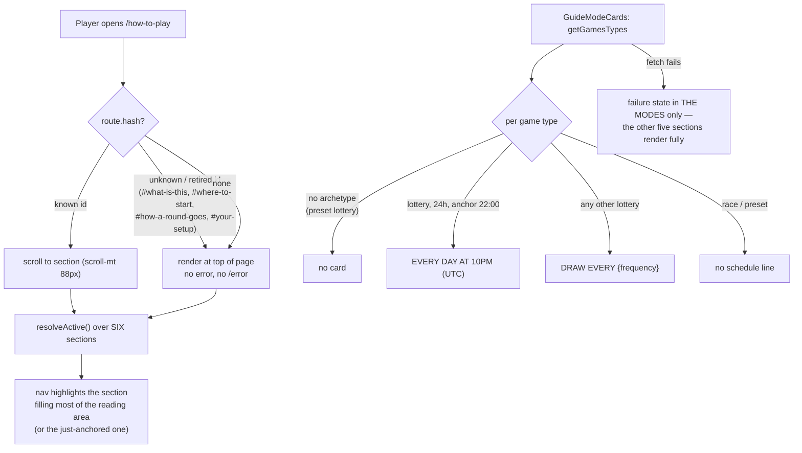

# Space Stroker — "How to play changes" — Implementation Spec

> **Status: Ready for implementation** — refined via Trello card
> [How to play changes](https://trello.com/c/aUrybUea) (#144, refined 2026-08-03).
> Repos affected: **`monkify-front`** and this doc in **`monkify-meta`**. **`monkify-backend` is not
> touched.**
> Branch / worktree: `feature/how-to-play-changes` → `.worktrees/how-to-play-changes/<repo>`.
> Level: **Minor change** (see §2 — no integration test, no new `features/` doc).
> ⚠️ **Ship target: `release/ui-ux-changes`, not `main`.**
>
> **Purpose:** `/how-to-play` shipped on 2026-08-02 (#130) with eight sections, of which the first
> three tell one continuous story in three separate frames. This card collapses those three into a
> single **HOW THE GAME WORKS** section built as art + title + description rows, adds a closing
> **WIN THE POT** beat with new art, corrects the Space Jackpot draw line to the real anchored draw
> time, and reframes **YOUR SETUP** as **PLAYER PREFERENCES**.

---

## 0. ⚠️ This card overturns decisions recorded in the shipped docs — read before touching the code

`specs/how-to-play.md` and `features/how-to-play.md` are the shipped truth for this page, and several
of their stated rules are **deliberately changed here**. The code carries doc-block comments asserting
those rules. **Rewrite the comments; do not leave them contradicting the code, and do not work around
them.**

| Shipped rule | Where it is asserted | What #144 does |
| --- | --- | --- |
| "**Eight sections**, in this order, ids fixed as a deep-link contract" | `constants/guideSections.ts` (the `GUIDE_SECTIONS` doc block), `HowToPlayPage.vue` header comment, `features/how-to-play.md` | **Six** sections; four ids retire (§7.1) |
| "The order is an argument: the idea → getting in → the round → …" | same doc block | The first three beats become **one** section; the rest of the argument is unchanged (§7.1) |
| "The page ships **two** black tips, **bookending** it (`what-is-this`, `your-setup`)" | `GuideTip.vue`, `features/how-to-play.md` → Materials | **One** tip survives, at the end of the merged section (§7.3) |
| Mode cards render `DRAW EVERY {frequency}` from `formatLotteryFrequency`'s long form | `GuideModeCards.vue` | An anchored daily lottery renders **`EVERY DAY AT 10PM (UTC)`** instead (§7.5) |
| `WHERE TO START` opens on "**Four things** happen before a round has your money in it" | `GuideWhereToStart.vue` | Both section intro lines are **deleted**; there are seven steps now (§7.2) |
| "None is named after the app surface behind it — 'Player Settings' was a section named after a modal" | `constants/guideSections.ts` | Still honoured. **`PLAYER PREFERENCES` is not the modal's name** — the surface is the **SETTINGS** panel (`PlayerCustomizationModal`). The new title names the *thing you edit*, not the panel it lives in (§7.6). |

Rules that are **NOT** relaxed and must survive verbatim:

- **The word is "word"** — never "choice", never "a run of characters", never "make your call"
  (owner-rejected wordings).
- **No character count in the prose.** It is each game's own `choiceRequiredLength` and appears only
  on the mode cards.
- **Preset-agnostic copy** (#115): never "animal", never a numeric cap like "1-8".
- **No house-cut percentage in the prose**, and never "you cannot win less than you staked".
- **`refunds` stays honest:** a lottery under-subscribed at draw time refunds; a race below its
  minimum **waits and is not refunded**.
- **The registry is the single source** for both the nav and the body — nothing downstream may read a
  hard-coded count or a literal id list.

---

## 1. Summary

Four independent changes to `/how-to-play`. Nothing else on the page moves.

| # | Change | Surface |
| --- | --- | --- |
| A | **Three sections merge into one.** `what-is-this` + `where-to-start` + `how-a-round-goes` → **`how-the-game-works`**: a short lead-in beside the existing `typing.gif`, a **7-step** rail, the fairness bridge paragraph, the black tip. | new `GuideHowTheGameWorks.vue`, `guideSections.ts` |
| B | **A new final step, `WIN THE POT`**, with the new `won.gif` art. | same |
| C | **The anchored draw time is told the truth.** A 24-hour lottery anchored at 22:00 UTC reads `EVERY DAY AT 10PM (UTC)` instead of `DRAW EVERY 24 HOURS`. | `GuideModeCards.vue` |
| D | **`YOUR SETUP` → `PLAYER PREFERENCES`**, new intro line, black tip removed. | `GuideYourSetup.vue` → `GuidePlayerPreferences.vue` |

Section count goes **8 → 6**:

| Before | After |
| --- | --- |
| `what-is-this` · `where-to-start` · `how-a-round-goes` · `what-you-win` · `the-modes` · `provably-fair` · `refunds` · `your-setup` | **`how-the-game-works`** · `what-you-win` · `the-modes` · `provably-fair` · `refunds` · **`player-preferences`** |

---

## 2. Constraints (MANDATORY)

From `monkify-meta/constraints.md` (full list there):

- **Worktree per repo** (§2): work in `.worktrees/how-to-play-changes/<repo>`; the hubs stay clean on
  `main`. Branch `feature/how-to-play-changes` in `monkify-front` + `monkify-meta`, both already
  pushed to `origin`. Never commit on `main`, never force-push, never skip hooks.
- **⚠️ Ship target is the release train `release/ui-ux-changes`** (already on `origin` in both repos),
  shared with #142 *Practice mode changes* and #143 *App home changes*. `/monkify-ship-feature` merges
  this card into that branch and leaves the card in **Implemented**; the train lands on `main`
  separately.
- **Unit tests (§3): N/A** — no backend change. `monkify-front` has no test runner.
- **Integration test: WAIVED.** The card's Level is **Minor change** (a copy-and-structure edit to a
  shipped frontend page) and there is **no backend surface** to exercise, so `constraints.md` §3's
  mandate does not apply.
- **No new `features/<slug>.md`** (Minor change). **`features/how-to-play.md` must still be corrected**
  at ship time — it documents the eight sections, their ids and the two-tip rule, all of which change.
- **Database / migrations (§4): N/A.**
- **Secrets/config (§1): N/A** — no config touched.
- **Messaging (§6):** the page states no error copy; nothing to leak.
- **`yarn lint` needs uniform CRLF.** `sed -i` mangles line endings and produces `Insert ␍` failures —
  use `unix2dos` on any file whose endings drift.

---

## 3. Resolved product decisions

| # | Decision |
| --- | --- |
| 1 | The three sections merge into **one**, titled **HOW THE GAME WORKS**, nav label "How the game works". |
| 2 | The merged section's id is the **new** `how-the-game-works`; `#what-is-this`, `#where-to-start`, `#how-a-round-goes` retire. **No alias/redirect map** — nothing links to them (verified across `monkify-front` and `monkify-lp`), and an unknown hash already lands at the top of the page by design. |
| 3 | **Seven steps**, one dedup: `PULL THE LEVER` folds into `PLACE YOUR BET` because the two bodies said nearly the same thing back to back. The lever's "no lever on a phone" clause is **kept** inside the merged body. |
| 4 | **Art is unchanged; `won.gif` is the only new asset.** Steps 1–6 keep exactly the art they render today. `strokinjg.gif` / `stroke-win.gif` (workspace root) are **not** part of this card. |
| 5 | `WIN THE POT` copy is **not** the card's draft. "Choice" is an owner-rejected wording and "the **whole** pot" is false (same-word winners split it; a house cut applies above stake). Those qualifiers stay in `WHAT YOU WIN`. |
| 6 | The **premise lead-in survives**, trimmed to `WHAT IS THIS`'s first paragraph, **beside the existing `typing.gif` slot** — #130 rebuilt this page precisely because an earlier version never said what the game **was** before listing steps. `typing.gif` also has no other consumer in the app. |
| 7 | The **fairness bridge paragraph survives**, moved to after step 7 — it is the page's only hand-off into `PROVABLY FAIR`. |
| 8 | The black **`THE WHOLE GAME`** tip survives, **last** in the section. Load-bearing: this card deletes the *other* black tip, so keeping this one is what leaves `.arcade-frame--black` with **one** consumer instead of zero. |
| 9 | Both dropped section intro lines are **deleted** ("Four things happen…" / "Every mode runs the same three beats…"). |
| 10 | Space Jackpot's line is the **hardcoded string** `EVERY DAY AT 10PM (UTC)`, **gated on live values** (24-hour lottery **and** `drawTimeUtc == 22:00`). Not a name match — `GuideModeCards` matches by SHAPE, never by name or id. Anything else falls back to today's `DRAW EVERY {frequency}`. |
| 11 | **No backend change.** `drawTimeUtc` already ships on `ActiveGame.lotteryParameters` and `formatDrawTime` already renders it; the guide simply never passed it. |
| 12 | The lobby badge and the game terminal **keep their own wording** — `utils/lotteryFrequency` documents the two forms as deliberately different. |
| 13 | `YOUR SETUP` → title **`PLAYER PREFERENCES`**, nav label "Player preferences", id **`player-preferences`**. (The card spells it "Prefferences"; ship the correct spelling.) |
| 14 | `WHAT YOU WIN`, `THE MODES`, `PROVABLY FAIR` and `REFUNDS` are otherwise **untouched**. |
| 15 | The now-dead art kinds stay **registered**: `lever` (orphaned by this card) plus `bet` and `pick-terminal` (already dead before it). `GuideLeverArt.vue` / `GuideBetPanelArt.vue` are **not** deleted — cleanup is out of scope. |

---

## 4. Data model

**N/A** — no entity, column, DTO or migration. The only data this card reads
(`ActiveGame.lotteryParameters.drawTimeUtc`) already ships.

---

## 5. Configuration

**N/A** — no `GeneralSettings`, no env var, no seed change.

For reference only (do not edit): `SpaceStroker.Common/spacestrokersettings.json` seeds Space Jackpot
with `"DrawTimeUtc": "22:00:00"`, self-healed at startup by `SpaceStroker.Consumers` — see
`features/lottery-draw-time.md`. That is the value §7.5 gates on.

---

## 6. Backend behaviour

**None.** `monkify-backend` is not opened. `GameParametersDto.DrawTimeUtc` already flows to
`ActiveGame.lotteryParameters.drawTimeUtc`, so the frontend has everything it needs.

`SpaceStroker.Tests` and `SpaceStroker.Tests.Integration` are **not run** for this card and are
unaffected.

---

## 7. Frontend behaviour (`monkify-front`)

### 7.1 The registry — `src/constants/guideSections.ts`

`GuideSectionId` becomes:

```ts
export type GuideSectionId =
  | 'how-the-game-works'
  | 'what-you-win'
  | 'the-modes'
  | 'provably-fair'
  | 'refunds'
  | 'player-preferences';
```

`GUIDE_SECTIONS` becomes six entries in that order:

| id | navLabel | title | component |
| --- | --- | --- | --- |
| `how-the-game-works` | `How the game works` | `HOW THE GAME WORKS` | `GuideHowTheGameWorks` |
| `what-you-win` | `What you win` | `WHAT YOU WIN` | `GuideWhatYouWin` (unchanged) |
| `the-modes` | `The modes` | `THE MODES` | `GuideTheModes` (unchanged) |
| `provably-fair` | `Provably Fair` | `PROVABLY FAIR` | `GuideProvablyFair` (unchanged) |
| `refunds` | `Refunds` | `REFUNDS` | `GuideRefunds` (unchanged) |
| `player-preferences` | `Player preferences` | `PLAYER PREFERENCES` | `GuidePlayerPreferences` |

Also update in this file:

- The three deleted imports; add `GuideHowTheGameWorks`; rename the `GuideYourSetup` import.
- The `GUIDE_SECTIONS` doc block: "The eight sections" → "The six sections"; keep the
  **ORDER IS THE ARGUMENT** paragraph but restate the argument for six (the game itself → the money →
  which table → why believe it → what goes wrong → the optional knobs), and keep the warning about
  naming a section after an app surface, with the note from §0 explaining why `PLAYER PREFERENCES`
  does not violate it.
- The `GuideArtKind` union and the `GuideArt` interface are **unchanged** (decision 15).

`GuideSectionNav.vue` needs **no change** — it is fully registry-driven and already
`whitespace-nowrap`, so the longer "How the game works" chip stays on one line and scrolls with the
rail below `lg`.

### 7.2 The merged section — new `src/components/guide/sections/GuideHowTheGameWorks.vue`

Rendered in this order:

1. **Lead-in + art**, reusing `GuideWhatIsThis.vue`'s existing markup wholesale — the
   `md:grid-cols-[minmax(0,1fr)_260px]` two-column block, the `aspect-[4/3] min-h-0 w-full` art box,
   and the `edsonArt` descriptor **verbatim**:

   ```ts
   const edsonArt: GuideArt = {
     src: edsonTyping,                                   // '@/assets/typing.gif'
     imgClass: 'object-contain scale-[1.1] origin-bottom',
   };
   ```

   ⚠️ Carry over the comment explaining `scale-[1.1] origin-bottom` (880×800 canvas holding 560×720
   of content, ~80 px of transparent padding above and none below). Re-deriving it by eye clips the
   keyboard.

   **Copy — the first paragraph only, verbatim:**

   > Space Stroker has exactly one moving part: Edson, a chimp in a flying saucer, smashing keys at
   > random and never, ever stopping. You pick a word. You bet it turns up.

   The other two paragraphs of `GuideWhatIsThis` are **dropped**, and so are both dropped sections'
   intro lines.

2. **The 7-step rail** — the existing `GuideRail` component, unchanged, fed:

   | # | title | art | body |
   | --- | --- | --- | --- |
   | 1 | `CONNECT A WALLET` | `{ kind: 'wallet' }` | verbatim from `GuideWhereToStart` |
   | 2 | `PICK A MODE` | `{ src: gameModeSprite, imgClass: 'object-contain scale-[0.78] -translate-y-[4%]' }` | verbatim |
   | 3 | `PICK YOUR WORD` | `{ kind: 'terminal' }` | verbatim |
   | 4 | `PLACE YOUR BET` | `{ kind: 'bet-terminal' }` | **merged, see below** |
   | 5 | `EDSON TYPES` | `{ kind: 'edson-speed' }` | verbatim from `GuideHowARoundGoes` |
   | 6 | `FIRST WORD OUT WINS` | `{ kind: 'win-reveal' }` | verbatim |
   | 7 | `WIN THE POT` | `{ src: wonSprite }` | **new, see below** |

   ⚠️ Step 2's `imgClass` is measured against that sprite's 570×520 canvas of pure monkey with zero
   transparent padding — carry it and its comment over verbatim.

   **Step 4 body** (merges the lever's job with the round's, keeping the mobile clause):

   > Locks your word in and sends the stake, and every stake in the round lands in one pot. The second
   > the round starts, betting slams shut. No lever on a phone — the bet panel does the whole thing in
   > one tap.

   **Step 7 body** (new — see §7.4 for why it reads this way):

   > Edson types your word, the pot is yours — on-chain, in the wallet that bet, the moment the round
   > is done.

3. **The fairness bridge paragraph**, verbatim from `GuideHowARoundGoes`, with its comment about why
   it belongs at the *end* of the loop rather than inside beat 2:

   > Nothing about the result is decided once the round is running. The seed behind every key Edson
   > hits is locked in before your money moves, and published afterwards so you can go and check it
   > yourself.

4. **The black tip**, verbatim:

   ```html
   <guide-tip label="THE WHOLE GAME">
     Pick a word. Every stake in the round goes into one pot. The first word Edson types out takes
     the lot.
   </guide-tip>
   ```

Outer wrapper: `<div class="flex flex-col gap-6">`, matching the sections it replaces.

`GuideWhatIsThis.vue`, `GuideWhereToStart.vue` and `GuideHowARoundGoes.vue` are **deleted**.

### 7.3 The black material after this card

`.arcade-frame--black` (`assets/styles/arcade.css:102`) has exactly one consumer component,
`GuideTip.vue`, which today renders **twice** — `what-is-this` and `your-setup`. This card deletes the
`your-setup` one (§7.6), so the merged section's `THE WHOLE GAME` tip is the **only** remaining
render. Keeping it is what stops the rule becoming dangling — the condition #124 exists to prevent.
`GuideTip.vue` itself does **not** change; update its "AT MOST ONE PER SECTION" doc block only where
it claims the page ships two bookending tips.

### 7.4 Why `WIN THE POT` does not say "the whole pot"

The card's draft read *"If Edson typed your choice, you win the whole pot."* Two problems, both of
which the page already has settled rules about:

- **"choice"** is one of the wordings the owner rejected; the page is built on *you pick a **word***.
- **"the whole pot"** is a payout promise the page deliberately never makes. `WHAT YOU WIN` states
  that same-word winners **split the pot evenly** (`winnerReward = pot / payableWinnerCount`) and that
  a **house cut** applies to winnings above your own stake
  (`features/crypto-commission.md`). A punchline claiming the whole pot contradicts the section
  directly below it.

The shipped wording keeps the punch and moves the qualifiers one section down, which is where a player
asking "how much do I get" is already sent. The trailing clause ("on-chain, in the wallet that bet")
exists because that is literally what `won.gif` shows — a wallet balance going up.

### 7.5 The mode-card draw line — `src/components/guide/GuideModeCards.vue`

**Today** the `ModeCard` carries `frequency?: string` from
`formatLotteryFrequency(game.lotteryParameters.lotteryFrequency)` (long form, **no** `drawTimeUtc`
argument), and the template hardcodes the prefix:

```html
TICKET: {{ card.price }}
<template v-if="card.frequency"> · DRAW EVERY {{ card.frequency }}</template>
```

**After:** replace `frequency` with a fully-formed `schedule?: string` computed in the script, and
render `· {{ card.schedule }}` — the "DRAW EVERY" prefix cannot stay outside the interpolation once
one branch does not start with it.

```ts
// The anchored daily jackpot is the one schedule players actually plan around, so it reads as a
// clock time rather than as a period. GATED ON THE LIVE VALUES, never on the game's NAME: names are
// operator-editable and the GUIDs change on every teardown + reseed, which is why this whole block
// matches by SHAPE. A lottery that is not daily, or not anchored at 22:00 UTC, falls back to the
// period form — the mode block must never quote a draw time that is not real.
const DAILY = 24;
const ANCHOR_HOURS = 22;

const scheduleFor = (game: ActiveGame): string | undefined => {
  const frequency = game.lotteryParameters?.lotteryFrequency;
  if (!frequency) return undefined;

  const period = formatLotteryFrequency(frequency);
  const anchor = game.lotteryParameters?.drawTimeUtc;

  if (anchor && totalHours(frequency) === DAILY && isAtHour(anchor, ANCHOR_HOURS)) {
    return 'EVERY DAY AT 10PM (UTC)';
  }

  return `DRAW EVERY ${period}`;
};
```

Implementation notes:

- **`totalHours` / `isAtHour` are small local helpers**, or — preferred — a single exported
  `isDailyAt(frequency, drawTimeUtc, hour)` predicate added to `src/utils/lotteryFrequency.ts` beside
  the existing parser, so the .NET `TimeSpan` string parsing stays in **one** file. That file already
  owns `parseTimeSpan`; do not re-parse `"1.00:00:00"` inline.
- ⚠️ **The day-component trap.** A 24-hour lottery serializes as **`"1.00:00:00"`**, not `"24:00:00"` —
  `parseTimeSpan` returns `days: 1, hours: 0`, and total hours is `hours + days * 24`. A naive
  `parseInt` reads `1`, which is the exact bug `specs/fix-pricing.md` fixed. Reuse the existing parser.
- `drawTimeUtc` arrives as `"22:00:00"`; compare the parsed **hour and minute** (`22`, `0`), not the
  raw string — `.NET` may serialize a `TimeSpan?` with a fractional-seconds tail.
- **Nothing else in the component changes** — archetype matching, blurbs, `artFor`, price formatting
  and the three render states are untouched.
- **`utils/lotteryFrequency.ts`'s existing exports keep their current behaviour.** The terminal's
  `formatLotteryFrequency(frequency, drawTimeUtc)` → `"24 HOURS AT 22:00 UTC"` and the lobby badge's
  `formatLotteryFrequencyCompact` → `"DAILY"` are **not** touched (decision 12).

### 7.6 Player preferences — `GuideYourSetup.vue` → `GuidePlayerPreferences.vue`

Rename the file and update the registry import. Inside:

- **Intro line** replaced. Today:

  > Everything down here is a knob you are free to ignore. It all lives behind the same
  > <span class="text-primary">SETTINGS</span> panel.

  becomes simply:

  > You are free to edit:

  Keep the existing `<p class="vt323-regular m-0 max-w-[80ch] text-[18px] leading-[1.35] text-ink-dim">`
  wrapper. The `SETTINGS` span disappears with the sentence; the `Open Settings` button below still
  names the panel, so nothing is lost.

- **The `GuideTip` block is deleted**, along with its `import GuideTip from …` line. ⚠️ Leaving the
  import behind fails `yarn lint` (`no-unused-vars`) — the same trap #138 hit.
- **Unchanged:** the three `GuideFactList` rows (`A DISPLAY NAME`, `SIGNING FOR IT`, `YOUR CLIENT
  SEED`) at `:columns="3"`, and the `Open Settings` button wired to `useHeaderModals().openSettings`.
- Update the file's leading doc block: it currently explains why this section is last and why it was
  renamed away from "Player Settings"; add why `PLAYER PREFERENCES` is not a repeat of that mistake
  (§0).

### 7.7 The new asset

`won.gif` — **570×520, 114,307 bytes (111.6 KB)**, pixel art on the app's near-black, showing a WALLET
panel whose balance climbs and a `MY WALLET` button.

- Source: the file already in the workspace root (`<workspace-root>/won.gif`), byte-identical to the
  Trello attachment on #144.
- Destination: **`src/assets/guide/won.gif`**, beside `game-modes.gif`.
- Rendered through the rail's existing `aspect-[4/3] min-h-0 w-full` slot via `GuideArt`'s `art.src`
  branch, which applies `pixelated h-full w-full` plus the descriptor's `imgClass`.
- **Pick `imgClass` against the asset's own canvas.** The art is ~1.1:1 in a 4:3 frame, so an
  unqualified `h-full w-full` will stretch it — start from `object-contain` and only add a scale if
  the framed result leaves obvious dead bands. Do **not** copy step 2's numbers; they are measured
  against a different sprite.
- ⚠️ **Never add `loading="lazy"`** inside a guide art frame — Chrome folds an ancestor `clip-path`
  into the intersection check and the image never loads at all, leaving a permanently empty black box
  (including for a webpack-inlined `data:` URI).

### 7.8 Light graphics

`html.light-graphics` (every phone, plus any desktop with hardware acceleration off) is resolved by
`usePerfMode`. `specs/light-graphics-mode.md` §7.10 argues against looping GIFs there; #138 took a
**scoped** exception for the 45 KB `game-modes.gif`, justified because `/how-to-play` already shipped
that exact sprite raw on every phone.

`won.gif` is a **new** 111 KB looping asset on that same page. This spec **extends the exception to it
explicitly**, on the same page, for the same reason (the guide is a read-once manual, not the money
screen) and because the page already ships `typing.gif` (147 KB) and `game-modes.gif` raw in light
mode today — one more is not a category change. What is **not** permitted, here or around it:
`backdrop-filter`, `blur()`, `mix-blend-mode`, multi-layer glows, or any infinite CSS animation.

### 7.9 The page shell — `src/pages/HowToPlayPage.vue`

**No logic change.** The active-section resolver, the `ANCHOR_BAND` exception, the rAF coalescing, the
hash handling and `isKnownSection` are all registry-driven and work unchanged over six entries.

Two comment-only edits: the header doc block says "eight deep-linkable sections", and `resolveActive`'s
cost note says "8 `getBoundingClientRect` reads". Both become six.

⚠️ **The behaviour to re-verify** (§13) is the rail, not the code: the merged section is now far taller
than any of its neighbours, which is exactly the shape the `[64, 184]` anchor exception exists for.
A click on a **short** entry sitting next to it (`Refunds`, `Player preferences`) must highlight what
was clicked.

### 7.10 Analytics

`useAnalytics.trackGuideSectionClick({ section })` is unchanged — same event
(`guide_section_click`), same consent gate, same payload shape, fired from the **nav only**. Only the
emitted id values change. No new event, no GA4 config change.

---

## 8. Flow



---

## 9. Out of scope

- `WHAT YOU WIN`, `PROVABLY FAIR` and `REFUNDS` copy — untouched.
- `/responsible-gaming` — untouched.
- The home page's own `HOW A ROUND GOES` (`HomeHowItWorks.vue`) — that is card **#143**, on the same
  release train. Do not edit it here.
- Deleting `GuideLeverArt.vue` / `GuideBetPanelArt.vue`, or removing the `lever` / `bet` /
  `pick-terminal` entries from `GuideArtKind`.
- `strokinjg.gif` / `stroke-win.gif` — not used by this card.
- The deferred **Orbit** guide section (#121–#123) — the registry keeps it a one-entry addition.
- Any backend change; any change to `formatLotteryFrequency`'s existing terminal / lobby-badge output.
- A hash-alias map for the four retired anchors.

---

## 10. File checklist

### 10.1 Backend (`monkify-backend`)

**None.** The repo is not opened; no branch or worktree was created for it.

### 10.2 Frontend (`monkify-front`)

| # | File | Change |
| --- | --- | --- |
| 1 | `src/constants/guideSections.ts` | `GuideSectionId` → six ids; `GUIDE_SECTIONS` → six entries; swap three imports for `GuideHowTheGameWorks`, rename the `GuideYourSetup` import; update the doc block (eight → six, restated order argument, the `PLAYER PREFERENCES` note from §0). |
| 2 | `src/components/guide/sections/GuideHowTheGameWorks.vue` | **NEW.** Lead-in + `typing.gif` slot, 7-step `GuideRail`, fairness paragraph, `GuideTip`. §7.2. |
| 3 | `src/components/guide/sections/GuideWhatIsThis.vue` | **DELETE** (copy + art descriptor + tip move into #2). |
| 4 | `src/components/guide/sections/GuideWhereToStart.vue` | **DELETE** (steps 1–4 move into #2; intro line dropped). |
| 5 | `src/components/guide/sections/GuideHowARoundGoes.vue` | **DELETE** (beats + bridge paragraph move into #2; intro line dropped). |
| 6 | `src/components/guide/sections/GuideYourSetup.vue` → `GuidePlayerPreferences.vue` | **RENAME + EDIT.** New intro line, `GuideTip` block **and its import** removed, doc block updated. §7.6. |
| 7 | `src/components/guide/GuideModeCards.vue` | `frequency` → `schedule`; anchored-daily branch; template renders `· {{ card.schedule }}`. §7.5. |
| 8 | `src/utils/lotteryFrequency.ts` | **Preferred:** add an `isDailyAt(frequency, drawTimeUtc, hour)` predicate reusing `parseTimeSpan`, so TimeSpan parsing stays in one file. Existing exports unchanged. |
| 9 | `src/assets/guide/won.gif` | **NEW ASSET** — copy from `<workspace-root>/won.gif` (570×520, 114,307 B). |
| 10 | `src/pages/HowToPlayPage.vue` | **Comments only** — "eight sections" → six, "8 `getBoundingClientRect` reads" → 6. No logic change. |
| 11 | `src/components/guide/GuideTip.vue` | **Comment only** — the doc block's claim that the page bookends with two tips. |

Not edited, confirmed by grep: `GuideSectionNav.vue`, `GuideSectionCard.vue`, `GuideRail.vue`,
`GuideArt.vue`, `GuideFactList.vue`, `useAnalytics.ts`, `routes.ts`, `main.ts`, `GameHeader.vue`,
`HomePage.vue` — none reads a section id or a section count.

### 10.3 Meta (`monkify-meta`)

| # | File | Change |
| --- | --- | --- |
| 1 | `specs/how-to-play-changes.md` | **NEW** — this spec. |
| 2 | `INDEX.md` | Map row for this spec (status **Ready**) + "Feature currently in flight" entry. |
| 3 | `features/how-to-play.md` | **At ship time, not now** (`/monkify-ship-feature`): the eight-section list and ids, the "order is the argument" paragraph, the two-bookending-tips rule under Materials, the mode block's draw-frequency rule, and the "Key code touchpoints" file list. |

---

## 11. Unit tests

**N/A.** No backend change ⇒ `SpaceStroker.Tests` is untouched and is not run. `monkify-front` has no
test runner, so there is no frontend test to add either.

The one piece of genuinely testable logic this card introduces — `isDailyAt` (§7.5) — is verified by
the manual QA in §13 (a real anchored daily lottery renders the string; nothing else does).

---

## 12. Acceptance criteria

Mapped 1:1 from the Trello **Acceptance Criteria** checklist on #144.

1. Given a player opens `/how-to-play`, when the page renders, then the section nav lists exactly
   **SIX** entries in order: How the game works, What you win, The modes, Provably Fair, Refunds,
   Player preferences.
2. Given the merged "How the game works" section, when a player scrolls it, then it renders in this
   order: a short premise lead-in beside the `typing.gif` art slot, a numbered rail of exactly 7
   steps, the fairness bridge paragraph, and the black `THE WHOLE GAME` tip.
3. Given the 7-step rail, when it renders, then the steps read in order `CONNECT A WALLET`,
   `PICK A MODE`, `PICK YOUR WORD`, `PLACE YOUR BET`, `EDSON TYPES`, `FIRST WORD OUT WINS`,
   `WIN THE POT`, each with art, a title and a description.
4. Given step 4 `PLACE YOUR BET`, when a player reads it, then its body covers both merged beats
   (locks the word in and sends the stake; every stake lands in one pot and betting shuts the moment
   the round starts) and still states there is no lever on a phone.
5. Given step 7 `WIN THE POT`, when it renders, then its art is the new `won.gif` and its body says
   Edson typing your **word** wins you the pot — containing neither the word "choice" nor the claim
   "the whole pot".
6. Given the branch after the change, when the repo is grepped, then `GuideWhatIsThis.vue`,
   `GuideWhereToStart.vue` and `GuideHowARoundGoes.vue` no longer exist and no live reference to them
   remains.
7. Given a cold load of `/how-to-play#how-the-game-works` or `/how-to-play#player-preferences`, when
   the page mounts, then it scrolls to that section with the sticky-header offset applied.
8. Given a cold load of a retired anchor (`#what-is-this`, `#where-to-start`, `#how-a-round-goes` or
   `#your-setup`), when the page mounts, then it renders normally at the top of the page with no
   console error and no redirect to `/error`.
9. Given the six sections, when a player clicks any nav entry — including a short one such as Refunds
   sitting next to the much taller merged section — then the clicked entry is the one highlighted, and
   scrolling the page activates all six in document order.
10. Given a 24-hour lottery game type anchored at `drawTimeUtc "22:00:00"` (Space Jackpot as seeded),
    when its card renders in `THE MODES`, then the schedule line reads `EVERY DAY AT 10PM (UTC)`.
11. Given a lottery with `drawTimeUtc` null, or an anchored lottery whose frequency is not 24 hours,
    when its card renders in `THE MODES`, then the line falls back to today's
    `DRAW EVERY {frequency}` and never shows the 10PM string.
12. Given the game terminal's `> FREQUENCY:` line and the lobby card's frequency badge, when a lottery
    is shown on either surface, then their existing wording is unchanged by this card.
13. Given the catalogue fetch fails, when `/how-to-play` renders, then only `THE MODES` shows its
    failure state and the other five sections render fully — the page neither blanks nor routes to
    `/error`.
14. Given the Player preferences section, when it renders, then the heading reads
    `PLAYER PREFERENCES`, the intro line reads "You are free to edit:", the three fact rows and the
    `Open Settings` button are unchanged, and the `NONE OF IT REQUIRED` tip is gone.
15. Given the app after this card, when `.arcade-frame--black` is grepped for consumers, then exactly
    one render remains — the merged section's `THE WHOLE GAME` tip — so the rule is never left
    dangling.
16. Given the finished branch, when the gates run, then `yarn lint` and `yarn build` both pass and
    manual QA of `/how-to-play` at 1366×768 and 390×844 shows the six sections, the working nav and
    zero console errors.

---

## 13. Manual QA

`monkify-front` has no test runner, so this list **is** the verification. Run the local stack so the
catalogue resolves (Space Jackpot must be present and anchored).

1. `yarn lint` and `yarn build` in `.worktrees/how-to-play-changes/monkify-front` — both clean.
   (⚠️ If lint reports `Insert ␍`, the file's endings drifted — `unix2dos` it. ⚠️ Building from a
   worktree: copy the hub's `yarn.lock` in first, it is gitignored and a stale image boots silently.)
2. Open `/how-to-play` at **1366×768**. Confirm six nav entries, in order, and that the merged section
   shows lead-in + art, seven numbered steps, the fairness paragraph and one black tip. (AC 1–4)
3. Confirm step 7 renders `won.gif` sharply — not stretched, not cropped through the wallet panel or
   the button. (AC 5, §7.7)
4. Click each nav entry, top to bottom, **including Refunds and Player preferences**. Each click must
   leave the highlight on what was clicked, not on a taller neighbour. Then scroll the page slowly
   from top to bottom and confirm all six activate in document order. (AC 9)
5. Cold-load `/how-to-play#player-preferences` in a new tab — it must land on that section, heading
   clear of the sticky header. (AC 7)
6. Cold-load `/how-to-play#where-to-start` and `/how-to-play#your-setup` — the page renders at the top,
   console clean, no `/error`. (AC 8)
7. In `THE MODES`, confirm the Space Jackpot card reads `EVERY DAY AT 10PM (UTC)` and that the race /
   preset cards show a ticket price with **no** schedule line. (AC 10)
8. Temporarily point at a non-anchored or non-daily lottery (or stub `drawTimeUtc` to `null` in
   devtools) and confirm the line falls back to `DRAW EVERY …`. (AC 11)
9. Open a Space Jackpot game screen and the lobby — the terminal's `> FREQUENCY:` line and the lobby
   badge must read exactly as they do on `main`. (AC 12)
10. Throttle the network to offline and reload `/how-to-play` — only `THE MODES` degrades; the other
    five sections are fully readable. (AC 13)
11. Repeat steps 2–4 at **390×844** (chip row scrolls horizontally, no section clipped on the right)
    and with **hardware acceleration off** so `html.light-graphics` engages — `won.gif` still animates,
    nothing else regresses. (AC 16, §7.8)
12. Confirm the Player preferences section: heading, "You are free to edit:", three rows,
    `Open Settings` opens the header's own modal, no black tip. (AC 14)

---

## 14. Trello / pipeline

- **Source card:** [#144 How to play changes](https://trello.com/c/aUrybUea) — list **Specs created**;
  the `## Implementation` block on the card carries branch, worktree, spec path, Level and the release
  branch.
- **Level:** `Minor change` ⇒ integration test waived, no new `features/<slug>.md`.
- **Next:** `/monkify-implement-feature How to play changes`, then
  `/monkify-ship-feature How to play changes`.
- ⚠️ **Ship merges into `release/ui-ux-changes`, not `main`**, and leaves the card in **Implemented**.
  The train lands separately via `/monkify-ship-feature release/ui-ux-changes`, alongside #142 and
  #143.

---

## 15. Revision log

| Date | Change |
| --- | --- |
| 2026-08-03 | Initial spec from refined card #144 (refinement + code exploration in the same session). |
