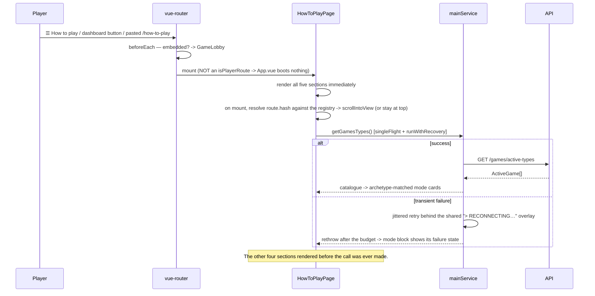

# Space Stroker — "How to play" — Implementation Spec

> **Status: Ready for implementation** — refined via Trello card
> [How to play (#130)](https://trello.com/c/mzhftjAl/130-how-to-play) (2026-08-01), re-read against
> `main` after Trello #124 shipped (2026-08-02).
> Repos affected: `monkify-front`, and this doc in `monkify-meta`. **No backend change.**
>
> **Purpose:** everything explaining how Space Stroker works currently lives in overlays a player has
> to be caught by. This card builds **`/how-to-play`** — one readable, linkable guide page whose
> sections are the adapted Quick Tour beats — **deletes the Quick Tour outright**, and converts
> **Responsible Gaming** from a ☰ modal into its own page at **`/responsible-gaming`**.

---

## 1. Summary

| | Today | After this card |
| --- | --- | --- |
| Learning the game | `overview@1` auto-opens once on `/`, a mode tour auto-opens once per archetype on `/game/play`, both behind seven guards; ☰ `How to play` re-opens them | A page at `/how-to-play` with five deep-linkable sections. **Nothing auto-opens, ever.** |
| ☰ `How to play` | opens `QuickTourModal` | `RouterLink` to `HowToPlay` |
| Dashboard `HOW A ROUND GOES` button | says `Read the wiki`, goes to `/soon?feature=wiki` | says `How to play`, goes to `HowToPlay`; the `wiki` entry is deleted from `ComingSoonPage` |
| Responsible Gaming | ☰ → `ResponsibleGamingModal` (grey `standard` dialog) | ☰ → `RouterLink` to `/responsible-gaming`; the modal is deleted |
| Tour art | 10 `Tour*Art` components + `tourArtTiming.ts` + `tourStream.ts` + `assets/tours/game-modes.gif` | **adapted and renamed** into guide section art under `components/guide/`. No new artwork. |
| The black panel | its only consumer is the quick tours | its consumer becomes the guide's **tip/callout block** (decision D1) |
| `selfExcluded` after a reload | always `false` — `applySelfExclusionPreferences` is a **dead export** | loaded from `GET /players/preferences`, on the RG page too (decision D3) |
| Analytics | `quick_tour_open` / `quick_tour_dismiss` | both deleted; new consent-gated `guide_section_click`; `trackHomeLinkClick` already reports `how_to_play` |

**Five sections, in this order:** `where-to-start` · `how-the-game-works` · `provably-fair` ·
`player-settings` · `refunds`. **Orbit is deferred** (unbuilt, unrefined — #121–#123); the page is
**registry-driven** so adding it later is one entry.

### 1.1 Where it stands today (verified in code, 2026-08-02, `monkify-front@30d45c5`)

- `src/routes.ts` — prefix-free: `/` `Home` · `/game` `GameLobby` · `/game/play` `Game` ·
  `/game/history` · `/game/stats` · `/admin` · `/wallet-bridge` · `/background` · `/soon` ·
  `/error`, plus the `/space-stroker/*` strip-prefix shim and the generic `/:pathMatch(.*)*` → `/error`.
- `src/hooks/useQuickTour.ts` — module singleton: `resolveTourKey` (archetype by **shape**), the
  versioned `localStorage` seen-set (`space-stroker.tour.seen`), `maybeAutoOpen`'s seven guards,
  `open` / `dismiss` with the two GA4 events.
- `src/constants/quickTours.ts` — `TourKey`, `TourTrigger`, `TOUR_VERSIONS`, `versioned()`,
  `TourStep`, `TourContext`, `TourContent`, `TOURS` (the copy for all four tours).
- `src/components/game/QuickTourModal.vue` — since #124 it renders through `ui/ArcadeModal.vue` and
  owns **only the step rail**. `variant="black"`, `size` = `xwide` at 4–5 steps / `wide` at 3.
- `src/components/GameHeader.vue` — mounts `QuickTourModal`, `PlayerCustomizationModal`,
  `GameFairModal`, `ResponsibleGamingModal`; owns both auto-open watchers, `openHowToPlay`, and the
  `tourContext` computed.
- `src/components/header/ResponsibleGamingModal.vue` — grey `standard` dialog on the shared shell,
  using `.dialog-copy` / `.dialog-eyebrow` / `.dialog-label` / `.dialog-input` / `.btn-dialog` and
  the `dialog__strip--err` second confirm for Permanent.
- `src/hooks/useSelfExclusion.ts` — `buildSelfExclusionMessage`, module-level `selfExcluded` /
  `selfExcludedUntil`, `exclude()` (`'submitted' | 'hopped'`), `resumeFromDeeplink()`,
  `applySelfExclusionPreferences()`.
- `src/assets/styles/arcade.css` — `.arcade-frame` (near-black, 2px `--color-line`) and
  `.arcade-frame--grey` (`--color-surface`, 1px hairline, **`/game/history` + `/game/stats` only**).
- `src/components/home/HomeSection.vue` — the dashboard's `.arcade-frame` section shell
  (`eyebrow` / `title` / default slot / `actions` slot, `+ TITLE +` marks).

### 1.2 Code-exploration findings the card does not carry

These were found reading `main` and are **binding on the implementation**.

1. **⚠️ `applySelfExclusionPreferences` is a dead export.** It is defined in
   `useSelfExclusion.ts:67` and **called from nowhere in `src/`**. `usePlayerPreferences.loadPreferences`
   folds in only `displayName` + `externalPlayerId` — the exclusion half is dropped (almost certainly
   lost when `remove-operators` rewrote that composable; `features/legal-docs-self-exclusion.md:178`
   still claims it is wired). **Consequence today:** after any page load `selfExcluded` is `false`, so
   `ResponsibleGamingModal` always renders the *not-excluded* branch and the client pre-bet guards
   (`useGame.ts:439`, `GameConsole.vue:76`) are dead. The **backend still enforces exclusion in
   `RegisterBetHandler`**, so this is a UX/trust regression, not a money hole — but **AC #16 cannot
   pass without fixing it.** Decision D3 puts the fix in this card. See §7.9.
2. **⚠️ The router has no `scrollBehavior`.** `main.ts` builds `createRouter({ history, routes })`
   with none, so a **cold load of `/how-to-play#provably-fair` does not scroll anywhere** — the page
   is not rendered when the browser looks for the anchor. AC #3 therefore needs explicit
   on-mount hash handling in the page, not a CSS-only answer. See §7.4.
3. **`getGamesTypes` is wrapped in `runWithRecovery`.** `mainService.ts:78` runs it inside
   `useBootRecovery().runWithRecovery`, which raises the **shared blocking `> RECONNECTING…` overlay**
   (`z-blocking` 70) on a transient failure and rethrows when the budget is exhausted. The guide
   reusing it is correct (it is `singleFlight`-ed, and the lobby already does exactly this) — but the
   page **must catch the rethrow** so AC #7 holds, and the QA must expect the reconnecting overlay
   over the guide on a flaky network. Nothing intercepts by status, so `/error` is never reached.
4. **`/how-to-play` is not an `isPlayerRoute()`** (AC #20), so `App.vue`'s boot fetches **neither**
   the catalogue **nor** preferences for it. The guide must fetch the catalogue itself, and the RG
   page must load preferences itself.
5. **`TourBetPanelArt.vue` is deliberately static** — its own comment says it needs no
   `usePerfMode` wiring because "every viewport that can reach this slot is a light-graphics viewport
   by construction: the slot only renders when `TourContext.isMobile` is true". That guarantee
   **disappears** on a page with no `TourContext`. The guide must keep the mobile-only gate (§7.6) or
   the assumption silently breaks on desktop.
6. **`trackHomeLinkClick` already accepts `'how_to_play'`** (`useAnalytics.ts:152`) and `HomePage.vue:47`
   **already fires it** before pushing to `/soon?feature=wiki`. The card's "repoint `wiki` → `how_to_play`"
   is already done; only the `router.push` target changes.
7. **`resolveTourKey` returns `null` for a preset lottery** — the archetype gap AC #6 is about. It is
   already correct; it just needs to survive `useQuickTour`'s deletion as a shared util.
8. **Under-subscribed races are never auto-refunded.** `features/games.md` §7: *"Not enough players:
   normal races simply **wait**; **lotteries** refund all bets at draw time."* The Refunds section
   copy must not promise a refund that does not happen. See §7.5.5.

---

## 2. Constraints (MANDATORY)

From `monkify-meta/constraints.md` (full list there) and `AGENTS.md`:

- **Worktree-per-repo (§2):** `.worktrees/how-to-play/monkify-front` and
  `.worktrees/how-to-play/monkify-meta`, branch `feature/how-to-play` in both; the shared checkouts
  stay on `main`. Push after every branch update; never force-push.
- **Backend (§3, §4):** none touched — no entity, no migration, no EF mapping, no consumer, no unit
  test. `SpaceStroker.Tests` is not run for this card.
- **Integration test (§3):** `monkify-front` has no test runner and this card adds no backend
  behaviour, so **no integration test is possible or required.** The `features/` doc **is** mandatory
  (this is a Feature).
- **Secrets (§1):** nothing configured; no env var added.
- **Vague messaging (§6):** `/error` keeps its unconditional RETRY; a typo'd `/how-to-pay` reaching
  the catch-all must not become a tell about why anything is unavailable.
- **Design workflow (`conventions/frontend.md`, mandatory):** read the card's attached mockup with
  **`claude-in-chrome`** (the `chrome-devtools` profile is not signed into Trello), run **`impeccable`**
  (skip its `NO_PRODUCT_MD` init — this workspace keeps no `PRODUCT.md`), then screenshot-compare at
  desktop *and* phone widths. **Match the mockup's design; take the copy from the decisions below.**
  Wired in as `monkify-implement-feature` Step 6b. **AC #1 is a hard gate: no markup before the owner
  approves one of five mockups.**
- **Design system:** build on Tailwind + DaisyUI + `src/components/ui/*` + the arcade tokens. A
  missing primitive is **added to the system**, not styled in place. **`arcade.css` beats Tailwind
  utilities** (imported after `@tailwind utilities`, equal specificity, later in the cascade) — do not
  half-adopt `.btn-arcade` / `.arcade-panel` and override their box.
- **`.btn-arcade` for page buttons, `.btn-dialog` inside dialogs.** ⚠️ Trello
  [#135](https://trello.com/c/jMuAlPBV) (standardize buttons + inputs) is open in Backlog and may land
  first — check it before inventing control sizing here.
- **Verification** = `yarn lint` + `yarn build` + manual QA on a GPU-rasterizing desktop, a phone, and
  with `html.light-graphics` forced on. ⚠️ `yarn lint` requires **uniform CRLF** line endings.
- **Navigate by route *name*, never by literal path**; non-component code goes through
  `services/navigation.ts`, never `window.location.assign`.

---

## 3. Resolved product decisions

Numbered `C*` = from the card's refinement (2026-08-01); `D*` = decided during this spec run
(2026-08-02), Complete mode.

| # | Decision |
| --- | --- |
| C1 | Route **`/how-to-play`**, route name `HowToPlay`, labelled **"How to play"** in the ☰ menu **and** on the dashboard. `/soon?feature=wiki` is deleted; `practice` stays (#129). |
| C2 | **The Quick Tour is deleted outright** — modal, composable, constants, both auto-open watchers, all seven guards, the versioned seen-set, the `space-stroker.tour.seen` key and both GA4 tour events. Its steps become the page's cards. |
| C3 | **The 10 art components survive** — adapted and renamed into guide section art. New artwork is out of scope; they already freeze correctly under `html.light-graphics`. |
| C4 | **Nothing replaces the first-visit nudge** — knowingly accepted. `HomeHowItWorks` ("HOW A ROUND GOES") on `/` is the onboarding now; the app loses its only **unprompted** teaching surface. |
| C5 | **Five sections + a sticky anchor nav.** Section ids are a **contract** other surfaces deep-link to. Not child routes, not an accordion. |
| C6 | **Orbit is deferred**; a **new Trello card is created once this ships** (owner's call — a fresh card, not an AC on #122). The page is registry-driven so Orbit is one entry. |
| C7 | **The adapted tour beats and all per-mode content live inside "How the game works"** — one section, not five top-level ones. |
| C8 | **Mode content is driven by the live catalogue, archetype-matched by SHAPE** (never by id or name), with the real ticket price and, for a lottery, the real frequency through `formatLotteryFrequency`. |
| C9 | **Copy stays preset-agnostic** — never "animal", never a numeric cap like "1-8" (Trello #115). |
| C10 | **Provably Fair and Player Settings sections explain, then deep-link** to the header's existing modal instances via `useHeaderModals` — no second instance, no embedded verifier UI. |
| C11 | **Responsible Gaming becomes `/responsible-gaming` and the modal is deleted.** The mobile wallet-deeplink return for self-exclusion is re-pointed at the route. **The riskiest part of this card.** |
| C12 | **Neither new route is an `isPlayerRoute()`; embedded loads of either redirect to `GameLobby`.** |
| C13 | **Analytics:** the two tour events are deleted; a consent-gated **`guide_section_click`** is added, carrying no identifiers. |
| C14 | **The 5 mockups happen at implement time (Step 6b)**, drawn against the shell #124 actually shipped. **Owner approval of one is a hard AC.** |
| **D1** | **The guide's tip/callout blocks adopt the black panel.** Deleting the tours would otherwise leave the black material with **zero consumers** — the exact dangling-rule condition #124 was filed to fix. `conventions/frontend.md` already reserved *"the How to play guide page may use cyan on its tip/callout blocks"*; this promotes that reservation to the **black material itself**, which needs a new `.arcade-frame--black` page sibling in `arcade.css` (the existing `.dialog--black` is a dialog skin). **Scope: at most one black tip block per section**, and the rule ("black needs BOTH axes: brief-and-informative AND light in tone") is unchanged. Rejected: keeping it documented-but-unused (re-creates the dangling rule), and retiring it (reverses an owner decision made five days ago and leaves Orbit's first-win upsell — #118 decision 15 — with nothing to build on). |
| **D2** | **The two new pages take different fills, and both are recorded in `conventions/frontend.md`.** `/how-to-play` → **`.arcade-frame`** (near-black), joining `/`, `/error`, `/soon` — it is the destination of a button on `/` and must not change material under the player mid-journey, and it gives D1's black tip block far less contrast to fight. `/responsible-gaming` → **`.arcade-frame .arcade-frame--grey`**, joining `/game/history` + `/game/stats` — grey is what the KB pairs with money/compliance, and it makes the modal→page conversion a **material-preserving swap**, removing a whole class of regression from the riskiest part of this card. ⚠️ The two `.arcade-frame` lists disagree **on purpose** (owner's call, #124) — this adds one entry to each, it does **not** unify them. |
| **D3** | **The dead `applySelfExclusionPreferences` is fixed in this card.** Wire it into `usePlayerPreferences.loadPreferences` (the place its own comment says it belongs) and have `/responsible-gaming` load preferences itself, since it is not an `isPlayerRoute()`. **Side effect to test deliberately:** the client pre-bet guards on the game screen come back to life for genuinely-excluded wallets — correct behaviour, but a behaviour change on the money screen that this card would not otherwise touch. It gets its own Manual QA step. |

---

## 4. Data model

**None.** Frontend-only: no entity, no column, no EF mapping, no migration.

---

## 5. Configuration

**None.** No new `VUE_APP_*` env var, no `GeneralSettings` key, no seed data. The page reads the
existing public `GET /games/active-types` through `mainService.getGamesTypes` (already
`singleFlight`-ed and recovery-wrapped).

One CSS addition (D1), in `src/assets/styles/arcade.css` next to its siblings:

```css
/* The BLACK PANEL as a page surface — the same material as `.dialog--black` (`--color-void-deep`
   behind a 2px cyan frame) rather than the near-black default or the grey fill. Its ONE consumer is
   the How to play guide's tip/callout block (Trello #130, D1), which inherited the black material
   when the quick tours — its previous only consumer — were deleted. The rule is unchanged: black is
   only for a surface that is BOTH informative-only-and-brief AND light in tone
   (conventions/frontend.md -> "Two panels"). At most one per guide section. */
.arcade-frame--black {
  background-color: var(--color-void-deep);
  border-color: var(--color-cyan);
}
```

⚠️ Read the shipped `.dialog--black` declaration before writing this and match its fill/border/glow
values exactly — two black materials that differ by a few percent is the drift #124 existed to stop.

---

## 6. Backend behaviour

**No change.** No new endpoint, entity, migration, Consumers job, Hangfire job or SignalR contract.
`SpaceStroker.Tests` and `SpaceStroker.Tests.Integration` are untouched, and neither suite is run as
part of this card's verification.

---

## 7. Frontend behaviour

### 7.1 Routing (`src/routes.ts`)

Two new records, both **registered in production**, both **redirecting to `GameLobby` when embedded**:

```ts
{
  name: 'HowToPlay',
  path: '/how-to-play',
  component: require('@/pages/HowToPlayPage.vue').default,
},
{
  name: 'ResponsibleGaming',
  path: '/responsible-gaming',
  component: require('@/pages/ResponsibleGamingPage.vue').default,
},
```

Place them **before** the `/space-stroker/*` shim and the catch-all. vue-router 4 ranks by
specificity, not declaration order, but keeping the two catch-alls last preserves the file's own
documented reading order.

**The embedded redirect goes in `main.ts`'s existing `beforeEach`**, extended rather than duplicated —
one guard, one rule, so the two redirects cannot drift:

```ts
const EMBED_REDIRECT_ROUTES = new Set(['Home', 'HowToPlay', 'ResponsibleGaming']);

router.beforeEach((to) => {
  if (EMBED_REDIRECT_ROUTES.has(to.name as string) && useEmbed().isEmbedded) {
    return { name: 'GameLobby' };
  }
  return true;
});
```

- It stays registered **before** the analytics `afterEach`, so a framed load of either page never
  counts as a pageview (AC #19: "redirects before any content paints" — a `beforeEach` returning a
  redirect never mounts the component at all, which is the strongest form of that guarantee).
- `isPlayerRoute()` in `App.vue` is **not** extended (AC #20): neither page renders a display name,
  so booting player preferences for them is wasted work — the same reason `/soon` was excluded.

**`ComingSoonPage.vue`:** delete the `wiki` entry from `FEATURES`. `practice` stays (#129), and the
`FALLBACK` still absorbs a stale `?feature=wiki` URL — a bookmarked link degrades to "This page / It
is on the way", never a broken heading.

### 7.2 The section registry (`src/constants/guideSections.ts`)

AC #4 is the design constraint: **adding a section must be one entry, with no layout rework.**

```ts
export interface GuideSection {
  /** The URL fragment. A CONTRACT — other surfaces deep-link to it; never rename one silently. */
  id: 'where-to-start' | 'how-the-game-works' | 'provably-fair' | 'player-settings' | 'refunds';
  /** Sidebar label. Short — it has to survive a horizontal chip row on a phone. */
  navLabel: string;
  /** Section heading, rendered through the shared section shell. */
  title: string;
  eyebrow?: string;
  /** The body. One component per section; the page renders <component :is>. */
  component: Component;
}

export const GUIDE_SECTIONS: GuideSection[] = [ /* five entries, in order */ ];
```

- The page derives **both** the nav and the body from this one array. Nothing about the layout may
  read a hard-coded count or a literal id list — that is what AC #4 checks.
- Orbit later is one appended entry plus one component (C6).
- A small `useGuideSections()` composable may wrap it if the page needs shared active-section state
  (§7.4); the registry itself stays a plain constant so it is trivially reviewable.

### 7.3 `HowToPlayPage.vue` — the shell

- Material **`.arcade-frame`** (D2), near-black. Reuse `HomeSection.vue` for the section cards if the
  approved mockup's header matches its `+ TITLE +` treatment; if it does not, extract the shared
  parts rather than forking a second near-black section shell.
- Layout: a **sticky left section-nav** beside a stacked column of section cards, per the mockup.
  Below `lg` the sidebar collapses to a **usable mobile nav above the content** (horizontal chip row
  or select — the approved mockup decides which) (AC #22).
- ⚠️ **Sticky offset.** `GameHeader` is `h-[64px]` and sticky, and carries `backdrop-blur-md`. Two
  rules follow:
  - the section nav's `top` must clear 64px, and every section element carries
    `scroll-margin-top` ≥ 64px + the page's own gap, so both an anchor load and a nav click land the
    heading below the header rather than under it (AC #3);
  - **do not create a second scrollport.** `html { overflow-x: hidden }` exists precisely because the
    App wrapper became one and the sticky header anchored to it instead of the viewport
    (`features/quick-tour-modals.md`). The guide must scroll the document, not an inner box.
- ⚠️ **No `loading="lazy"` on section art inside a clipped frame.** `features/home-dashboard.md`
  records it never firing inside `.pixel-border-*` — Chrome folds an ancestor `clip-path` into the
  intersection check, leaving an empty black frame forever, *including* for a webpack-inlined `data:`
  URI. All section art loads eagerly (AC #22). The page is a known-cost trade of C5.

### 7.4 Anchors, deep links and the active section

Three behaviours, and finding 2 (§1.2) means none of them is free:

1. **Cold load with a hash** (`/how-to-play#provably-fair`): the router has **no `scrollBehavior`**,
   so the page must handle it itself — on mount (after the sections have rendered), read
   `route.hash`, and if it matches a registry `id`, scroll that element into view. Use
   `scrollIntoView({ block: 'start' })` and let `scroll-margin-top` supply the header offset.
2. **Unknown anchor** (`#orbit` before Orbit ships): the lookup misses, **nothing is scrolled**, the
   player lands at the top of the page. Never a blank screen, never `/error`, never a thrown
   `querySelector` on an id that is not a valid selector — match against the registry, do not
   interpolate the raw hash into a selector (AC #3).
3. **Nav click**: update the hash *and* scroll, so the URL a player copies from the address bar is
   the deep link. Fire `guide_section_click` here (§7.12). Highlighting the active section while
   scrolling is a nice-to-have; if implemented, use `IntersectionObserver`, never a scroll listener.

### 7.5 The five sections — content contract

The spec fixes **what each section must say**; the approved mockup fixes how it looks, and the copy
comes from the decisions here (never from mockup wording — C9, and the convention's own warning).

#### 7.5.1 `where-to-start`

The entry beats, adapted from the overview tour: **connect a wallet → pick a mode → make your call →
pull the lever**. Facts that must survive from `constants/quickTours.ts`:

- *"No signup. Bets leave it, wins land in it."* — the wallet **is** the identity; there is no
  account to create.
- The choice length is the game's own `choiceRequiredLength`, so **this section states no number** —
  the mode cards in §7.5.2 do, per game.
- On a phone there is no lever: `GameConsole` collapses keyboard + lever + keypad into one bet panel,
  so typing and committing are **one action**. The section must not teach a control the player will
  never be shown (§7.6 keeps the mobile art gate that expresses this).

#### 7.5.2 `how-the-game-works`

The card's biggest section by design (C7). Two layers:

- **The round, once** — Edson types at random from a seed committed **before** the round; the first
  landed call splits the pot; nothing is decided after the round starts. This is the narrative the
  three mode tours shared.
- **Per-mode cards, driven by the live catalogue** (C8, §7.5.3), one per active game type.

Because it is the longest section it needs sub-headings or an inner rhythm — the approved mockup
decides which. It is the natural home for D1's black tip block.

#### 7.5.3 Mode content — archetype resolution and the catalogue read

**Archetype resolution moves out of `useQuickTour` and survives as a shared util** —
`src/utils/gameArchetype.ts`, exporting the logic verbatim:

```ts
export type GameArchetype = 'preset' | 'race' | 'lottery';

/**
 * Which archetype a game type is, decided by SHAPE. A preset LOTTERY matches nothing and returns
 * null — a deliberate no-op, not an error: no such type is seeded, but the admin portal can create
 * one. gameTypeId GUIDs change on every teardown + reseed and names are operator-chosen, so neither
 * can key content.
 */
export const resolveGameArchetype = (game?: ActiveGame | null): GameArchetype | null => {
  if (!game) return null;
  const isLottery = !!game.lotteryParameters?.lotteryFrequency;
  const isPreset = (game.presetChoices?.length ?? 0) > 0;
  if (isPreset && isLottery) return null;
  if (isPreset) return 'preset';
  if (isLottery) return 'lottery';
  return 'race';
};
```

- **A `null` archetype renders no card at all** (AC #6) — not an empty one, not a fallback one.
- **Ticket price** comes from `usePlayerPreferences().formatGameAmount(game, game.requiredAmount).text`
  — the same formatter the tour used, so the guide and the terminal cannot disagree.
- **Lottery frequency** comes from the kept `utils/lotteryFrequency.ts` →
  `formatLotteryFrequency(game.lotteryParameters.lotteryFrequency, game.lotteryParameters.drawTimeUtc)`
  (`"1.00:00:00"` ⇒ **24 HOURS**, not "1 HOUR"). ⚠️ Keep the long form here: the compact form is the
  lobby badge's, and "every DAILY" is broken copy.
- **The catalogue read** is `mainService.getGamesTypes()` on mount, into the shared
  `useGame().gameTypes` ref (so a player arriving from `/` where `GameTypes.vue` already filled it
  does not refetch — `singleFlight` collapses a concurrent one anyway). Three states, all rendered
  **inside the mode block only** (AC #7):

  | State | Render |
  | --- | --- |
  | loading | the section's loading treatment (reuse `LoadingDots`, as the lobby does) |
  | loaded, non-empty | one card per resolvable archetype |
  | failed **or** empty | a short inline "we could not load the modes right now" + a retry affordance, in the section's own copy voice |

  **The other four sections render fully in every state.** The page never blanks, never routes to
  `/error`, and never toasts on a boot-path retry (`runWithRecovery` marks absorbed errors
  `handled = true`; the final rethrow is caught here — see finding 3, §1.2).

#### 7.5.4 `provably-fair` and `player-settings`

Explain, then deep-link (C10):

- Each section carries a short explainer plus **one action** that calls `useHeaderModals().openFair()`
  / `.openSettings()` — the header's own instances, so there is one backdrop and one Esc handler.
- ⚠️ The Fair modal is now titled **`PROVABLY FAIR`** (`wide`, 720, full screen below `lg`) and
  Settings is **`SETTINGS`** (`standard`, 520, bottom sheet) — write the section copy against those
  names, not the old `FAIR PLAY`.
- **The Fair action is absent when embedded** (AC #9). In practice `/how-to-play` never renders in a
  frame (§7.1), so this is belt-and-braces: gate on `useEmbed().isEmbedded` anyway, exactly as
  `GameHeader` does, so the rule survives if the redirect is ever relaxed.
- Both modals self-manage their data (`GameFairModal` drives `GameFairPanel`'s lazy fetch off `open`;
  `PlayerCustomizationModal` calls `loadPreferences` itself), so opening them from a non-player route
  needs no extra wiring.

#### 7.5.5 `refunds`

This section must be **honest about what does and does not get refunded** (finding 8, §1.2). Grounded
in `features/games.md` §7 and `features/refund-safeguards.md`:

- **A lottery that is under-subscribed at draw time refunds every paid bet** and the round is marked
  not-started.
- **A race that has not reached its minimum simply waits** — it is **not** refunded and the bet
  stands. Do not write "you always get your money back if a round does not fill"; it is false for the
  most common mode.
- **A bet the game cannot accept is refunded automatically** — a duplicate signature, a choice already
  taken, a round no longer accepting bets. The player sees a generic message plus a refund notice
  (`constraints.md` §6 keeps the reason vague — the section must not enumerate causes as if they were
  distinguishable responses).
- **Free bets have no payment, so nothing is refunded** — log-only.
- **A refund that fails on-chain is retried automatically** (the 12-hour pending-refund sweep). The
  copy should say money is not lost when a transfer fails, without quoting the interval as a promise.
- Payouts and refunds are **on-chain, to the wallet that bet** — there is no account balance and no
  chargeback.

### 7.6 Guide section art — adapting the `Tour*` set

**All ten survive** (C3). They move to `src/components/guide/` and drop the `Tour` prefix:

| Today | Becomes |
| --- | --- |
| `game/TourStepArt.vue` | `guide/GuideArt.vue` |
| `game/TourModeReel.vue` | `guide/GuideArtReel.vue` |
| `game/TourCrtScreen.vue` | `guide/GuideCrtScreen.vue` |
| `game/TourWalletArt.vue` | `guide/GuideWalletArt.vue` |
| `game/TourLeverArt.vue` | `guide/GuideLeverArt.vue` |
| `game/TourTerminalArt.vue` | `guide/GuideTerminalArt.vue` |
| `game/TourBetPanelArt.vue` | `guide/GuideBetPanelArt.vue` |
| `game/TourBetTerminalArt.vue` | `guide/GuideBetTerminalArt.vue` |
| `game/TourEdsonSpeedArt.vue` | `guide/GuideEdsonSpeedArt.vue` |
| `game/TourWinRevealArt.vue` | `guide/GuideWinRevealArt.vue` |
| `constants/tourArtTiming.ts` | `constants/guideArtTiming.ts` |
| `utils/tourStream.ts` | `utils/guideStream.ts` (`TOUR_DEMO_WORD` → `GUIDE_DEMO_WORD`) |
| `assets/tours/game-modes.gif` | `assets/guide/game-modes.gif` |

**The prop rework** (the only real work here). `TourStepArt` takes `TourStep` from
`constants/quickTours.ts`, which this card deletes. Replace it with a flat, tour-free descriptor in
`constants/guideSections.ts`:

```ts
export type GuideArtKind =
  | 'wallet' | 'terminal' | 'lever' | 'bet'
  | 'bet-terminal' | 'pick-terminal' | 'edson-speed' | 'win-reveal';

export interface GuideArt {
  /** Imported asset URL. Unset (and no `kind`) renders nothing — no dashed placeholder on a page. */
  src?: string;
  /** Per-asset object-fit/position tweak, carried over verbatim from the tour steps. */
  imgClass?: string;
  kind?: GuideArtKind;
  /** The choice a mode slot shows being bet and winning; a preset game reads it live off the game. */
  word?: string;
}
```

Rules:

- **Keep every `artClass` value verbatim.** Those scale/translate numbers are measured against each
  sprite's own canvas padding (`scale-[1.1] origin-bottom` on `typing.gif`, `scale-[0.78]` on
  `game-modes.gif`) and the reasoning is in the source comments — re-deriving them by eye is how the
  art starts clipping.
- **Drop the dashed placeholder branch.** It exists because a tour step could ship before its art; a
  registry-driven page either has art for a slot or does not render the slot.
- ⚠️ **`GuideBetPanelArt` stays mobile-only.** Finding 5: it is static by construction because it
  only ever rendered under `isMobile`. Render it behind `useIsMobile()` on the guide too, and keep
  its explanatory comment updated to say *why* — otherwise the next agent sees a frozen slot on a
  desktop and "fixes" it into an animation nobody sized for.
- Everything else is unchanged: `usePerfMode().lightMode` + `prefers-reduced-motion` freezing stays
  exactly as shipped (AC #12), and the `:global(html.light-graphics)` trap stays out of scoped blocks
  (`arcade.css:257`).
- `GuideArtReel` is kept for any stacked-mobile slot that plays several beats in one panel (the mode
  cards). If the approved mockup gives each mode beat its own thumbnail on mobile, the reel becomes
  unused — **delete it in that case** rather than shipping a second dangling consumer-less component.

### 7.7 The tip / callout block (D1)

- New `src/components/guide/GuideTip.vue` — the black material as a page surface:
  `.arcade-frame .arcade-frame--black` (§5), a centred cyan label between the pixel sparkles the
  black dialog uses (`.dialog__spark`), body copy in the guide's own voice.
- **At most one per section**, and only where the content genuinely clears both axes of the black
  rule: brief, purely to read, **and** light in tone. A warning about losing money is *serious* → it
  stays on the grey/near-black body, not in a black tip.
- The one-accent-per-surface rule does **not** apply inside it — on a black panel cyan *is* the frame,
  and the accent inside is amber (`conventions/frontend.md` → "Two panels").

### 7.8 `ResponsibleGamingPage.vue`

**A container swap, not a rewrite** (D2 keeps the material). Lift the body of
`ResponsibleGamingModal.vue` onto `.arcade-frame .arcade-frame--grey` and delete the modal.

Kept verbatim (AC #16):

- The opening framing ("entertainment, not income; stakes move on-chain and cannot be reversed; no
  chargebacks; no account for us to freeze").
- Both external links — `RESPONSIBLE_GAMBLING_URL` and `TERMS_URL` from `utils/legalGate.ts`.
- **Both states**: already-excluded (**permanent** — cannot be lifted; and **dated** — with
  `endsAtLabel`, lifts on its own), and not-excluded (the duration `select`, the signing note naming
  the short wallet, and the **two-step Permanent confirm** on the `dialog__strip--err` treatment).
- **The honest note that connecting a different wallet bypasses the block.**
- **No wallet connected** → the reading material renders and the self-exclusion action explains it
  needs a connected wallet, rather than failing (AC #18) — today's `v-else` copy already does this.

Changed:

- `.dialog-*` vocabulary → the page equivalents. Where a `.dialog-*` class is genuinely the right
  thing on a grey page surface, keep it and say so in a comment; where it is a dialog-only construct
  (`.dialog__footer-hint`, `.btn-dialog`), swap for the page's own (`.btn-arcade`, per the convention
  and pending #135).
- The footer `CLOSE` button becomes a **back** affordance to `Home` (`push`, not `back()` — a player
  who pasted the URL has no history, the same reasoning `ComingSoonPage.goBack` documents).
- The page **loads self-exclusion state itself** (§7.9) — it is not an `isPlayerRoute()`.

#### The mobile deeplink return (AC #17) — the riskiest change in this card

Today `exclude()` returns `'hopped'`, `useMobileWallet` stashes the pending self-exclusion in
`localStorage`, the wallet app returns to `redirect_link`, and `useGame`'s return handler tries
`useSelfExclusion().resumeFromDeeplink(params)` **first** because a bet signature and a self-exclusion
signature are **indistinguishable** in the return params (both classify as `'sign'`, same `data` +
`nonce`, no encryption key). What was stashed before leaving is the only discriminator.

**None of that changes.** What changes is where the player lands:

- `useMobileWallet.rememberReturnTo()` already stores `window.location.pathname + window.location.search`
  before the hop, and `consumeReturnTo()` hands it back — so a hop initiated from `/responsible-gaming`
  already records `/responsible-gaming`. **Verify this in the implementation** rather than assuming
  it: the stash is written by the caller that initiates the hop, and the modal never needed it
  because the header owned it on every route.
- `App.vue`'s return handler pushes to the consumed `returnTo`. Confirm it resolves
  `/responsible-gaming` (a real route now) instead of falling through to the lobby.
- **Never infer the hop from the return params** (`conventions/frontend.md`, `features/legal-docs-self-exclusion.md`).

⚠️ `features/legal-docs-self-exclusion.md` records that the `signMessage` hop **was never exercised on
a physical phone** at ship time. This card re-points it; the QA step is the first real device test it
gets. Treat a failure here as a blocker, not a polish item.

### 7.9 Self-exclusion state actually loading (D3, finding 1)

Two lines of real change:

1. **`src/hooks/usePlayerPreferences.ts`** — inside `loadPreferences`, after the response is read,
   call `applySelfExclusionPreferences(prefs)`. This is where the function's own doc comment already
   says it belongs ("the single place that reads `GET /players/preferences` can call it without
   pulling the wallet stack in — that import chain would be circular"), so the import direction is
   already safe: `usePlayerPreferences` → `useSelfExclusion` (a plain exported function), never back.
2. **`ResponsibleGamingPage.vue`** — on mount, and on a change of `effectivePublicKey`, call
   `loadPreferences(effectivePublicKey.value)`. Failures are swallowed exactly as `loadPreferences`
   already swallows them (returning `false` and leaving the previous value alone) — the page renders
   the not-excluded branch, which is what it does today anyway, and never blanks.

**Consequences to state in the KB and test deliberately:**

- `useGame.ts:439` (the pre-pay guard) and `GameConsole.vue:76` (`allowBets`) start blocking again for
  a genuinely-excluded wallet. That is the intended behaviour and matches what the backend already
  enforces — but it is a live behaviour change on the money screen.
- `features/legal-docs-self-exclusion.md:178` stops being wrong.

### 7.10 Deleting the Quick Tour (AC #11)

Delete outright:

- `src/components/game/QuickTourModal.vue`
- `src/hooks/useQuickTour.ts`
- `src/constants/quickTours.ts` (`TourKey`, `TourTrigger`, `TOUR_VERSIONS`, `versioned`, `TourStep`,
  `TourContext`, `TourContent`, `TOURS`)
- the `space-stroker.tour.seen` localStorage key and every read/write of it

And from `GameHeader.vue`:

- the `QuickTourModal` import + mount, the `useQuickTour` import, `openHowToPlay`, the `tourContext`
  computed, and **both auto-open watchers** — the `route.name`/`gameTypes.length`/`termsAccepted`
  overview watcher and the `gameTypeId`/`route.name`/`termsAccepted` mode watcher.
- ⚠️ Check what those watchers were the **only** consumer of before deleting their dependencies.
  `gameTypes` is read by the overview watcher **and** by `GameTypes.vue`; `termsAccepted` is read by
  `LegalGate`; `useIsMobile` and `formatLotteryFrequency` have other consumers. `TourTrigger` and the
  `'auto' | 'menu'` distinction have **none** after this and go with the file.
- ⚠️ `resolveTourKey` must be extracted to `utils/gameArchetype.ts` (§7.5.3) **before** the composable
  is deleted, not after.

No tour opens on any first visit, on any route, for any player (AC #11, C4).

### 7.11 Entry points

| File | Change |
| --- | --- |
| `GameHeader.vue` | `How to play` button → `<RouterLink :to="{ name: 'HowToPlay' }">`, closing the ☰ menu on click, still inside the `v-if="!isEmbedded"` block. `Responsible Gaming` button → `<RouterLink :to="{ name: 'ResponsibleGaming' }">`, keeping its own `v-if="!isEmbedded"`. Drop the `ResponsibleGamingModal` import + mount. |
| `HomeHowItWorks.vue` | Button label `Read the wiki` → **`How to play`**; the emit stays (`HomePage` owns navigation). Update the two source comments that describe it as a placeholder for a wiki. |
| `HomePage.vue` | `openWiki` → `openHowToPlay`: keep `trackHomeLinkClick({ link: 'how_to_play' })` (already correct — finding 6), change the push to `{ name: 'HowToPlay' }`. Update the `⚠️ PLACEHOLDERS` comment — only `practice` is a placeholder now. |
| `HomeFooter.vue` | `Responsible gaming` button → `<RouterLink :to="{ name: 'ResponsibleGaming' }">` styled with the existing `.foot-link`. Drop `openResponsibleGaming` from its `useHeaderModals` destructure. |
| `useHeaderModals.ts` | Remove `responsibleGamingOpen` and `openResponsibleGaming` — the modal is gone and the shared open state has no consumer. `openFair` / `openSettings` stay and gain the guide as a caller. |
| `ComingSoonPage.vue` | Delete the `wiki` entry from `FEATURES`. |

### 7.12 Analytics (`src/hooks/useAnalytics.ts`)

- **Delete** `trackQuickTourOpen` and `trackQuickTourDismiss` (and the `quick_tour_open` /
  `quick_tour_dismiss` events with them).
- **Add**, consent-gated through the same `track()` and carrying **no identifiers**:

  ```ts
  // Which answer players actually came for. `page_view` (router.afterEach) already says whether the
  // guide was read at all; this says WHICH thing confuses them, which is the only question a help
  // page exists to answer. A section ID and nothing else — no wallet, no game, no amount.
  trackGuideSectionClick: (info: { section: string }): void =>
    track('guide_section_click', { section: info.section }),
  ```

- `trackHomeLinkClick`'s union already contains `'how_to_play'` and `HomePage` already fires it —
  nothing to change (finding 6).
- Fired from the section nav (§7.4), **not** from a scroll observer: a scroll-triggered event would
  count passive scrolling as interest and drown the signal.

### 7.13 Embedded behaviour (AC #19, AC #20)

- Both routes redirect to `GameLobby` in the shared `beforeEach` (§7.1) — before mount, before paint,
  before the analytics `afterEach`.
- Neither ☰ row is offered in-frame: both already sit inside `v-if="!isEmbedded"` blocks in
  `GameHeader`.
- `isPlayerRoute()` is unchanged.
- Rationale (C12): this matches the regulated-iframe posture — no in-frame help or RG surfaces at
  all, **by construction** rather than by remembering to hide a link. A Model-A casino owns its own
  RG tooling.

---

## 8. Flow diagrams

### 8.1 Reaching the guide, and what happens to the catalogue



### 8.2 Self-exclusion from a phone, after the modal becomes a page

```mermaid
sequenceDiagram
  participant P as Player
  participant RG as /responsible-gaming
  participant MW as useMobileWallet
  participant W as Wallet app
  participant App as App.vue return handler

  P->>RG: SELF-EXCLUDE (duration chosen; Permanent needs a 2nd confirm)
  RG->>RG: exclude() -> GET /players/nonce (purpose=self-exclusion)
  RG->>MW: stash pending self-exclusion + rememberReturnTo("/responsible-gaming")
  RG->>W: signMessage deeplink hop (page unloads)
  W-->>App: return to redirect_link with data+nonce  [indistinguishable from a bet hop]
  App->>App: resumeFromDeeplink(params) — no-op unless a self-exclusion was STASHED
  App->>App: POST /players/self-exclusion -> state applied
  App->>RG: push(consumeReturnTo()) -> back on /responsible-gaming, showing the excluded state
```

---

## 9. Out of scope

- **The Orbit section** — deferred (C6); a **new Trello card is created once this ships**.
- **Practice mode (#129)** — `/soon?feature=practice` stays.
- **Any backend change**, and any new artwork beyond adapting the existing tour art.
- **The shared modal shell and its materials** — that was #124. This card adds exactly one page
  sibling (`.arcade-frame--black`, D1) and records two page-material entries (D2).
- **Moving Settings, Provably Fair, Stats or History to or from pages.**
- **Replacing the first-visit nudge** (C4, knowingly accepted).
- **Standardizing buttons and inputs** — Trello #135, open in Backlog.

---

## 10. File checklist

### 10.1 Backend (`monkify-backend`)

**None.**

### 10.2 Frontend (`monkify-front`)

**New**

| # | File | Change |
| --- | --- | --- |
| 1 | `src/pages/HowToPlayPage.vue` | The guide shell: sticky section nav (mobile chip row below `lg`), registry-driven body, hash handling, the catalogue read + its three states. `.arcade-frame`. |
| 2 | `src/pages/ResponsibleGamingPage.vue` | Today's RG modal body on `.arcade-frame .arcade-frame--grey`; loads preferences itself; back-to-Home action. |
| 3 | `src/constants/guideSections.ts` | `GuideSection`, `GuideArt`, `GuideArtKind`, `GUIDE_SECTIONS` (five entries, in order). |
| 4 | `src/components/guide/GuideSectionNav.vue` | Sticky desktop nav + the below-`lg` treatment; fires `guide_section_click`. |
| 5 | `src/components/guide/GuideTip.vue` | The black tip/callout block (D1), `.arcade-frame--black`. |
| 6 | `src/components/guide/sections/*.vue` | One component per section (5). |
| 7 | `src/components/guide/GuideModeCards.vue` | Archetype-matched cards off the live catalogue; loading / failure / empty states. |
| 8 | `src/utils/gameArchetype.ts` | `resolveGameArchetype` — extracted verbatim from `useQuickTour.resolveTourKey`. |
| 9 | `src/hooks/useGuideSections.ts` | *(optional)* shared active-section state if the nav needs it; the registry stays a plain constant. |

**Renamed / adapted** (10 art components + 2 modules + 1 asset — see §7.6 for the full table)

| # | File | Change |
| --- | --- | --- |
| 10 | `src/components/game/Tour*Art.vue`, `TourCrtScreen.vue`, `TourModeReel.vue` → `src/components/guide/Guide*.vue` | Renamed; `TourStep` prop replaced by the flat `GuideArt`; every `artClass` value kept verbatim; the dashed-placeholder branch dropped; `GuideBetPanelArt` keeps its mobile-only gate. |
| 11 | `src/constants/tourArtTiming.ts` → `src/constants/guideArtTiming.ts` | Renamed; contents unchanged. |
| 12 | `src/utils/tourStream.ts` → `src/utils/guideStream.ts` | Renamed; `TOUR_DEMO_WORD` → `GUIDE_DEMO_WORD`. |
| 13 | `src/assets/tours/game-modes.gif` → `src/assets/guide/game-modes.gif` | Moved. |

**Changed**

| # | File | Change |
| --- | --- | --- |
| 14 | `src/routes.ts` | Add `HowToPlay` + `ResponsibleGaming`; update the `/soon` comment (only `practice` remains). |
| 15 | `src/main.ts` | Extend the embedded `beforeEach` to the two new routes via one shared set. |
| 16 | `src/components/GameHeader.vue` | Both ☰ rows → `RouterLink`s; delete the tour import/mount/context, `openHowToPlay` and **both** auto-open watchers; drop the `ResponsibleGamingModal` import + mount. |
| 17 | `src/components/home/HomeHowItWorks.vue` | Button copy → `How to play`; refresh the two stale comments. |
| 18 | `src/pages/HomePage.vue` | `openWiki` → `openHowToPlay`, pushing `{ name: 'HowToPlay' }`; refresh the placeholder comment. |
| 19 | `src/components/home/HomeFooter.vue` | `Responsible gaming` → `RouterLink`; drop `openResponsibleGaming`. |
| 20 | `src/hooks/useHeaderModals.ts` | Remove `responsibleGamingOpen` + `openResponsibleGaming`. |
| 21 | `src/hooks/useAnalytics.ts` | Delete the two tour trackers; add `trackGuideSectionClick`. |
| 22 | `src/hooks/usePlayerPreferences.ts` | **Call `applySelfExclusionPreferences(prefs)` in `loadPreferences`** (D3, finding 1). |
| 23 | `src/pages/ComingSoonPage.vue` | Delete the `wiki` entry. |
| 24 | `src/assets/styles/arcade.css` | Add `.arcade-frame--black` (§5), matching `.dialog--black`'s values exactly. |

**Deleted**

| # | File |
| --- | --- |
| 25 | `src/components/game/QuickTourModal.vue` |
| 26 | `src/hooks/useQuickTour.ts` |
| 27 | `src/constants/quickTours.ts` |
| 28 | `src/components/header/ResponsibleGamingModal.vue` |
| 29 | the `space-stroker.tour.seen` localStorage usage |

**Kept, unchanged**

- `src/utils/lotteryFrequency.ts` — shared with `GameTypeCard` and the terminal.
- `src/hooks/useSelfExclusion.ts` — its API is already right; only its *caller* was missing.

### 10.3 Meta (`monkify-meta`)

| # | File | Change |
| --- | --- | --- |
| 1 | `specs/how-to-play.md` | This document. |
| 2 | `INDEX.md` | Register the spec; update "Feature currently in flight". |
| 3 | `features/how-to-play.md` | **New** (mandatory — Feature level). Written at ship. |
| 4 | `features/quick-tour-modals.md` | **Retire / rewrite** — the feature it documents is deleted. Keep the *reasoning* worth preserving (why there was no server half; the archetype-by-shape rule, which now lives in `utils/gameArchetype.ts`). |
| 5 | `features/home-dashboard.md` | The `/soon?feature=wiki` entry and the `overview@1` first-visit rule are both gone; the button reads `How to play`. |
| 6 | `features/legal-docs-self-exclusion.md` | RG is a route; the deeplink return targets it; **line 178's claim about `loadPreferences` becomes true** (D3). |
| 7 | `conventions/frontend.md` | Routing list (+2 routes, +1 embedded-redirect rule); the black material's consumer is now the guide's tip block, **not** the deleted tours (D1); the two `.arcade-frame` fill lists each gain one entry (D2); the new analytics event. |

---

## 11. Tests

**`monkify-front` has no test runner** — there is no `.spec`/`.test` file in the repo and no unit-test
project to extend. Verification for this card is, in order:

1. `yarn lint` (⚠️ needs uniform **CRLF**; `sed -i` mangles endings to LF and produces `Insert ␍`
   failures — fix with `unix2dos` and check with `od -c`).
2. `yarn build`.
3. A **grep gate** for the deletions, which is the only mechanical check AC #11 has:
   `QuickTourModal`, `useQuickTour`, `quickTours`, `TOUR_VERSIONS`, `space-stroker.tour.seen`,
   `quick_tour_open`, `quick_tour_dismiss`, `ResponsibleGamingModal`, `openResponsibleGaming` and
   `feature=wiki` must all return **zero** hits in `src/`.
4. The Manual QA matrix in §13.

`monkify-backend` is untouched, so neither `scripts/run_tests.bat` nor
`scripts/run_integration_tests.bat` is part of this card.

---

## 12. Acceptance criteria

Copied 1:1 from the Trello checklist (27 items), with the amendments this spec introduces marked.

1. Given implementation has not started, when the design pass runs (`monkify-implement-feature`
   Step 6b), then 5 mockups of the page are produced from the card's attached mockup + the Claude
   Design project and **ONE is approved by the owner before any markup is written**.
2. Given a player navigates to `/how-to-play`, when the page loads, then it renders exactly five
   sections — Where to start, How the game works, Provably Fair, Player Settings, Refunds — in that
   order, with a sticky section nav listing them.
3. Given the guide page, when a section id is deep-linked (e.g. `/how-to-play#provably-fair`), then
   the page scrolls to that section with the sticky header offset accounted for; an unknown anchor
   (`#orbit`) lands at the top of the page rather than a blank screen or `/error`.
   **⚠️ Amended by finding 2: this must hold on a COLD load too** — the router has no
   `scrollBehavior`, so the page handles the hash itself (§7.4).
4. Given the sections are defined by a registry, when a new section entry is added, then it appears
   in both the nav and the body with no layout rework — demonstrating that adding Orbit later is a
   one-entry change.
5. Given the game catalogue has loaded, when the "How the game works" section renders, then each
   active game type is described by its **ARCHETYPE** (preset / race / lottery, matched by shape and
   never by id or name) with its real ticket price and, for a lottery, its real frequency through
   `formatLotteryFrequency`.
6. Given a game type that matches no archetype (a preset lottery), when the guide renders, then no
   empty or broken mode card is produced.
7. Given the catalogue request fails or returns nothing, when `/how-to-play` loads, then the mode
   content shows a loading/failure state and the other four sections still render fully — the page is
   never blank and never routes to `/error`. **⚠️ Note (finding 3): the shared
   `> RECONNECTING…` overlay may legitimately appear over the guide during the retry window; the
   failure state is what shows after it clears.**
8. Given the guide's copy, when it is reviewed, then it is preset-agnostic — it never says "animal"
   and never states a numeric cap such as "1-8" — matching the decision on Trello #115.
9. Given the Provably Fair section, when the player clicks its action, then the header's own Fair
   modal instance opens via `useHeaderModals` (no second instance, one backdrop, one Esc handler); the
   action is absent when embedded.
10. Given the Player Settings section, when the player clicks its action, then the header's own
    `PlayerCustomizationModal` instance opens via `useHeaderModals`.
11. Given the app after this card, when the codebase is searched, then `QuickTourModal.vue`,
    `useQuickTour.ts`, `constants/quickTours.ts` and every auto-open watcher and tour guard are gone,
    and no tour opens on any first visit.
12. Given the tour art components (`Tour*Art`, `tourArtTiming`, `tourStream`, `game-modes.gif`), when
    the guide renders, then they are reused as the sections' imagery — not deleted and not replaced by
    new artwork — and each one freezes to a readable static image under `html.light-graphics`.
13. Given the ☰ header menu, when the player clicks "How to play", then it navigates to the
    `HowToPlay` route (**by route name**) instead of opening a modal; the "Responsible Gaming" row
    navigates to the `ResponsibleGaming` route.
14. Given the starting page, when the player clicks the button under "HOW A ROUND GOES", then it reads
    "How to play" and routes to `HowToPlay`; `/soon?feature=wiki` no longer resolves and the `wiki`
    entry is deleted from `ComingSoonPage` while `practice` still works.
15. Given the dashboard footer, when the player clicks "Responsible gaming", then it navigates to
    `/responsible-gaming` and `ResponsibleGamingModal.vue` no longer exists anywhere in the app.
16. Given `/responsible-gaming`, when it renders, then it carries everything the modal held — the
    external responsible-gambling link, the Terms link, and the self-exclusion flow — with both the
    already-excluded (permanent and dated) and not-excluded states rendering correctly, and the note
    that a different wallet bypasses the block retained.
    **⚠️ Requires D3 (§7.9): today `selfExcluded` is always `false` after a reload, so the
    already-excluded branch is unreachable.**
17. Given a mobile player self-excludes from `/responsible-gaming`, when the wallet deeplink returns
    after signing, then the pending self-exclusion stashed in `localStorage` is resumed, the exclusion
    completes, and the player lands back on `/responsible-gaming` — never on the wrong surface and
    never confused with a pending bet.
18. Given no wallet is connected, when `/responsible-gaming` loads, then the reading material renders
    and the self-exclusion action explains it needs a connected wallet rather than failing.
19. Given the app is embedded in an iframe, when `/how-to-play` or `/responsible-gaming` is loaded
    directly, then it redirects to `/game` before any content paints, and neither ☰ row is offered
    in-frame.
20. Given `isPlayerRoute()` after this card, then neither `HowToPlay` nor `ResponsibleGaming` is
    included, and `/responsible-gaming` still resolves self-exclusion state itself via
    `useSelfExclusion()`.
21. Given analytics after this card, then `quick_tour_open` and `quick_tour_dismiss` no longer exist,
    `trackHomeLinkClick` reports `how_to_play` instead of `wiki`, and a consent-gated
    `guide_section_click` fires when a section is opened from the nav — carrying no identifiers.
22. Given a phone-width viewport, when `/how-to-play` loads, then the sticky sidebar collapses to a
    usable mobile nav above the content, every section image renders (**no empty black frames — do not
    use `loading="lazy"` inside clipped frames**), and the page never scrolls horizontally.
23. Given both new pages, when they render, then they use the materials and page chrome delivered by
    Trello #124 and introduce no bespoke frame of their own.
    **⚠️ Amended by D2:** the card's original wording ("grey by default, at most one cyan accent per
    surface") predates #124's shipped reality. The rule is now: `/how-to-play` takes **`.arcade-frame`**
    (near-black), `/responsible-gaming` takes **`.arcade-frame .arcade-frame--grey`**, and the one
    black surface permitted is the guide's tip/callout block (**D1**, at most one per section).
24. Given a player is mid-round on `/game/play`, when they open the guide from the ☰ menu and then
    return, then the round is intact and `useGameHub` re-attaches to the correct game group without
    opening a second socket.
25. Given the KB at ship, then `features/how-to-play.md` exists, `features/quick-tour-modals.md` is
    retired/rewritten, and `features/home-dashboard.md`, `features/legal-docs-self-exclusion.md` and
    `conventions/frontend.md` are updated for the deleted tour, the new routes and the new analytics
    event.
26. Given the finished branch, when `yarn lint` and `yarn build` run, then both pass, and manual QA
    has been done on a GPU-rasterizing desktop, a phone, and with `html.light-graphics` forced on.
27. Given this card has shipped, when the ship run completes, then a **new Trello card is created** for
    adding the Orbit section to `/how-to-play`.

**New, from this spec:**

28. Given a wallet that is already self-excluded, when any page is loaded fresh, then `selfExcluded`
    is `true` — `/responsible-gaming` shows the excluded state, and `GameConsole` blocks betting
    without waiting for the backend rejection (**D3**).
29. Given the black material after this card, when the codebase is searched, then it has **exactly one
    consumer** — the guide's tip/callout block — and `conventions/frontend.md` names it there instead
    of naming the deleted quick tours (**D1**).

---

## 13. Manual QA

Run on **(a)** a GPU-rasterizing desktop, **(b)** a real phone, and **(c)** a desktop with
`html.light-graphics` forced on.

1. `/` → the button under "HOW A ROUND GOES" reads **How to play** and lands on `/how-to-play`.
   `/soon?feature=wiki` shows the generic fallback, not the wiki blurb. `/soon?feature=practice`
   still shows the practice blurb.
2. ☰ → `How to play` navigates (no modal). ☰ → `Responsible Gaming` navigates. Neither row appears
   with `?embed=1`.
3. On `/how-to-play`: five sections in order; nav click scrolls with the heading clear of the sticky
   header **and** updates the address bar; a copied URL reloaded cold lands on the same section.
4. `/how-to-play#orbit` → top of the page, no error, no blank.
5. Kill the network, then hard-load `/how-to-play`: `> RECONNECTING…` appears, then the mode block
   shows its failure state while the **other four sections stay fully rendered**. No `/error`, no
   toast storm.
6. Mode cards match the seeded catalogue: the preset type by shape (never by name), the race type,
   and the lottery with its real ticket price and **24 HOURS** (not "1 HOUR") frequency.
7. Provably Fair action → the `PROVABLY FAIR` modal (one backdrop, Esc closes it, focus returns).
   Player Settings action → `SETTINGS`. Neither opens a second instance.
8. Phone: the sidebar is a usable nav above the content; **every** section image paints (no empty
   black frames); no horizontal scroll at 390px and at 360px.
9. `html.light-graphics`: every adapted art slot is a readable frozen frame — check
   `GuideWalletArt`, `GuideTerminalArt`, `GuideLeverArt`, `GuideEdsonSpeedArt`, `GuideWinRevealArt`,
   `GuideBetTerminalArt` individually.
10. `/responsible-gaming`: both external links open; with **no wallet** the reading material renders
    and the action explains it needs one; with a wallet the duration select works and Permanent demands
    a second confirm on the `ERR` strip.
11. **D3 check:** self-exclude a throwaway wallet for 24h, **reload the page** → the excluded state
    renders with its end date. Then go to `/game/play` with that wallet → **betting is blocked client-side**
    (not just rejected by the API). Confirm a non-excluded wallet is unaffected.
12. **AC #17, on a real phone:** self-exclude from `/responsible-gaming` with a mobile wallet →
    the hop signs → the return lands back on `/responsible-gaming` with the exclusion applied.
    Then, separately, place a mobile bet and confirm its return still lands on the game — the two hops
    must not be confused. ⚠️ This is the first physical-device test the `signMessage` hop has ever had.
13. Mid-round: on `/game/play` with a live round, open the guide from ☰, come back → the round is
    intact and only one socket exists (check the network panel's WS list).
14. `?embed=1` direct loads of `/how-to-play` and `/responsible-gaming` → `/game`, with no flash of
    guide content and no `page_view` recorded for the redirected route.
15. `/how-to-pay` (typo) → `/error` with an unconditional RETRY.

---

## 14. Trello / pipeline

- **Source card:** [How to play (#130)](https://trello.com/c/mzhftjAl/130-how-to-play) — list
  **Specs created**; the `## Implementation` block on the card carries branch, spec and worktree.
- **Depends on:** [#124](https://trello.com/c/NIMydn5I) — **shipped 2026-08-02**, unblocking this card.
- **Related, open:** [#135](https://trello.com/c/jMuAlPBV) (standardize buttons + inputs) may land
  first — check it before choosing control sizing. [#129](https://trello.com/c/) practice mode keeps
  `/soon?feature=practice`. Orbit [#118](https://trello.com/c/yxwdNTrb) / #121–#123 is why the sixth
  section is deferred.
- **Next:** `/monkify-implement-feature How to play` (Step 6b runs the mandatory design pass — AC #1
  gates all markup), then `/monkify-ship-feature How to play`. The ship run **must create the Orbit
  follow-up card** (AC #27).

---

## 15. Revision log

| Date | Change |
| --- | --- |
| 2026-08-02 | Initial spec from the refined card (#130) + its 5 comments, re-read against `main` after #124 shipped. Adds decisions D1 (guide tips adopt the black panel), D2 (guide near-black / RG grey), D3 (fix the dead `applySelfExclusionPreferences`), plus eight code-exploration findings and two new acceptance criteria (#28, #29). |
