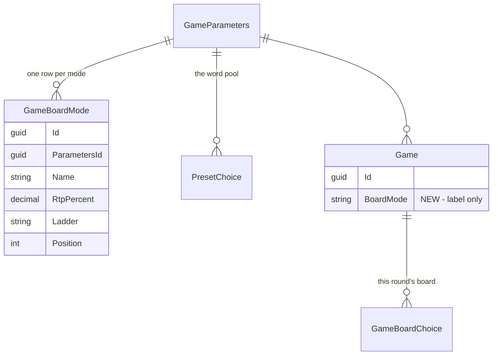
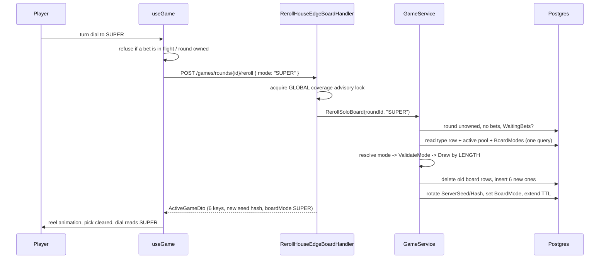

# SpaceStroker — "Hyper Roll Game Modes" Feature — Implementation Spec

> **Status: Shipped** — merged to `main` on **2026-09-24** via `feature/hyper-roll-modes` (backend, front,
> meta); distilled in [`../features/hyper-roll-modes.md`](../features/hyper-roll-modes.md). ⚠️ Post-ship note: the
> §8 rotary MODE DIAL was replaced before ship by three round **mode keys** + an LCD beside MIN / MAX
> (owner feedback, card comment 2026-09-23); behaviour (lock after bet, reroll-in-place, per-browser memory) is as specified.
>
> Originally refined via Trello card
> [Hyper Roll game modes (AVERAGE / SUPER / HYPER)](https://trello.com/c/Uyo3eq6g) (2026-09-22).
> Repos affected: `monkify-backend`, `monkify-front`, and this doc in `monkify-meta`.
> Branch / worktree: `feature/hyper-roll-modes` → `.worktrees/hyper-roll-modes/<repo>`.
> Change level: **Feature** ⇒ a mandatory happy-path integration test in
> `SpaceStroker.Tests.Integration` and a `features/hyper-roll-modes.md` KB doc at ship.
> Extends [`hyper-roll.md`](hyper-roll.md) and [`hyper-roll-solo-rounds.md`](hyper-roll-solo-rounds.md).
>
> **Purpose:** Hyper Roll ships one board — 8 words, one win in eight, 91.84% RTP. A player who wants
> to hit more often has nowhere to go. This gives the type **three selectable boards**, chosen with a
> rotary **MODE DIAL** in the console: **AVERAGE** (5 words), **SUPER** (6) and **HYPER** (8, exactly
> today's board). More words, harder to hit, bigger multipliers.

---

## 1. Summary

| | Today | With modes |
|---|---|---|
| Boards per type | One (8 words) | **Three**, player-selected |
| Ladder | One `BoardLadder` string on `GameParameters` | One row per mode in a new **`GameBoardModes`** table |
| A word's multiplier | `PresetChoice.Multiplier` (one value per word) | Derived from **(mode, word length)** — the same word pays differently per mode |
| Ladder slot | `multiplier:weight` | **`length:multiplier:weight`** |
| Word pool | 54 words, lengths 6–10 | **74 words, lengths 4–10** |
| RTP | One number (91.84%) | **Three** (91.50 / 91.14 / 91.84) |
| Choosing a board | n/a | Rotary MODE DIAL, where the `.01/.02/.05/MAX` chips are today |
| Stake presets | `.01 / .02 / .05 / MAX` chips | **Removed** — the ± bump keys are the only stake input |
| Round records | board rows only | board rows **+ `Game.BoardMode`** |

The round lifecycle, the weighted draw, the typer, rewards, payouts, refunds, the coverage lock and
provably-fair verification are **unchanged** — they are already keyed by the round's persisted board.

---

## 2. Constraints (MANDATORY)

From `monkify-meta/constraints.md` (full list there):

- **Worktree per repo:** `feature/hyper-roll-modes` at `.worktrees/hyper-roll-modes/<repo>`; the
  shared checkouts stay on `main`. Never `git checkout -b` on a hub.
- **Unit tests:** run via `scripts/run_tests.bat` — never a bare `dotnet test` (the
  `ProductionSessions` Monte Carlo suite is slow). Report changed tests at the end.
- **Integration test is mandatory** (Level = `Feature`): `SpaceStroker.Tests.Integration`,
  Testcontainers.
- **EF mapping:** inline in `SpaceStrokerDbContext.OnModelCreating` — no `IEntityTypeConfiguration`.
- **Migrations:** under `SpaceStroker.Infrastructure/Migrations/`, applied **only** by
  `SpaceStroker.Consumers`. Never edit an existing migration or hand-edit the snapshot.
- **Secrets/config:** `spacestrokersettings.json` is product config, not a secret, but never write a
  real credential anywhere near `deploy/secrets.*.json`.
- **Vague player-facing refusals** (`constraints.md` §6): an unknown mode, a taken round and an
  expired board all read the same.
- **Money path:** every rule that decides whether a paid bet is accepted runs inside the existing
  house-edge coverage advisory lock, in the same transaction as the insert.
- ⚠️ **A mis-weighted ladder or mis-tiered pool is a MONEY bug.** `HouseEdgeRules.Validate` must fail
  closed — refuse to open the round — exactly as it does today.

---

## 3. Resolved product decisions

Owner decisions, from the refined card (2026-09-22). **The odds in §4.1 are LOCKED** — any change to
a multiplier, slot count or length tier changes the RTP and must go back to the owner.

| # | Decision |
| --- | --- |
| 1 | **Three modes:** AVERAGE (5 words), SUPER (6), HYPER (8). HYPER is byte-for-byte today's board. |
| 2 | **The stake preset chips are removed entirely.** The ± bump keys are the only stake input; they already step on a 0.01 grid, so 0.002 → 0.10 is 10 taps. `HyperRollStakeChips.vue` is deleted from the live console and the practice console. |
| 3 | **The chosen mode is remembered per browser** (`localStorage`), first-ever visit opens on **AVERAGE**. Not server-side, not reset-every-load. |
| 4 | **Mode appears in games history and on the stats page.** The single `91.84% RTP` badge becomes one per mode. |
| 5 | **`SUPER`** is the middle mode's name (over TURBO / PRIME / BOOST). |
| 6 | **Turning the dial redraws the board on the spot** — the existing reroll path with a mode: same round id, board replaced, **server seed rotated**, pick cleared, reel plays. The dial is **locked once a bet is placed** and while the round runs. |
| 7 | **The key row just gets shorter**; keys keep today's sprite size. No dead key housings, no rescaling. |
| 8 | **Practice mode gets all three modes.** |
| 9 | **One stake range across modes** — min `0.002`, max `0.1` SOL. The top prize is what differs (0.70 / 0.90 / 1.00 SOL). |
| 10 | **The global tier-colour scale is kept** (`utils/houseEdge.ts`), so a colour means the same payout on every mode. On AVERAGE that makes 3×/4× both gray and 5×/6× both green — accepted. |
| 11 | **The two new word tiers are approved as listed** (§5.2). |

### 3.1 Spec-time decisions (flag at implementation start)

| # | Decision | Why |
| --- | --- | --- |
| S1 | **Modes live in a new `GameBoardModes` table**, one row per (type, mode), not as three columns on `GameParameters` and not as three `GameParameters` rows. | Three rows would mean three lobby cards for one console. Columns would not scale past three. A child table matches `GameBoardChoices` and is reconcilable from config the same way the pool is. |
| S2 | **A ladder slot carries its word LENGTH:** the format becomes `length:multiplier:weight`, and `HouseEdgeBoard.Draw` picks words **by length**, not by `PresetChoice.Multiplier`. | The locked odds make a word's multiplier mode-dependent (`banana` is 5× on AVERAGE, 4× on SUPER/HYPER), so a single per-word multiplier cannot express them. Putting the length on the slot makes each mode self-describing and removes the pool's multiplier from the draw entirely. |
| S3 | **`GameParameters.BoardLadder` / `RtpPercent` and `PresetChoice.Multiplier` are KEPT and still written, as a legacy mirror of the HYPER mode.** New code reads none of them. Removing them is a follow-up card. | Expand–migrate–**contract**. Migrations run from Consumers, which deploys before the API, so a still-running old API revision must keep finding the columns and values it expects. Dropping or nulling them in this release turns the deploy window into an outage. See §12. |
| S4 | **`Game.BoardMode` stores the mode NAME** (`string?`), not a foreign key to `GameBoardModes`. | The round's own `GameBoardChoices` rows already carry every multiplier and weight the draw and verification need, so the column is a **label**. A name survives a mode being reconfigured or removed from config; an FK would either block that or orphan history. |
| S5 | **The treasury coverage check is left alone.** `HouseEdgeCoverage.WorstCase` already prices each unsettled round at *its own* board's best multiplier and only falls back to `MaxMultiplier` (10×) when a round has no board. | AVERAGE and SUPER therefore **over**-reserve, never under. `hyper-roll.md` §6.13's "reserves a hardcoded 10×" warning is **stale** — correct that line rather than changing the math. |
| S6 | **Bump `ActiveParameters:v2` → `:v3`.** | `GameParametersDto` changes shape (it gains `Modes[]`). `hyper-roll.md` §6.8 makes the bump mandatory on any such change, or a still-running old API revision rewrites the shared Redis blob without the new fields and the new code reads it for up to 12h. `GamesHistory:*` is a 5-minute TTL and needs **no** bump. |
| S7 | **An unknown or missing mode falls back to the type's default** (lowest `Position` = AVERAGE) rather than refusing. | Mode selection sits on the path to a paid bet. A stale `localStorage` value must never turn into a refused bet. |

---

## 4. The three boards (LOCKED)

Multiplier is set by word length, as today — but **the length→multiplier map is per mode**. Weights
are out of 1,000,000 and are what the provably-fair draw publishes.

### 4.1 Ladders

**AVERAGE** — 5 words, lengths 4–8 · `RTP 91.50%` · edge 8.50% · win 1 in 5.0 · max payout 0.70 SOL

| Slot | Length | Multiplier | Win chance | Payback | Weight |
|---|---|---|---|---|---|
| 1 | 4 | 3× | 30.50% | 91.50% | 305011 |
| 2 | 5 | 4× | 22.88% | 91.50% | 228758 |
| 3 | 6 | 5× | 18.30% | 91.50% | 183007 |
| 4 | 7 | 6× | 15.25% | 91.50% | 152505 |
| 5 | 8 | 7× | 13.07% | 91.50% | 130719 |

**SUPER** — 6 words, lengths 5–9 · `RTP 91.14%` · edge 8.86% · win 1 in 6.0 · max payout 0.90 SOL

| Slot | Length | Multiplier | Win chance | Payback | Weight |
|---|---|---|---|---|---|
| 1 | 5 | 3× | 30.38% | 91.14% | 303797 |
| 2 | 6 | 4× | 22.78% | 91.14% | 227848 |
| 3 | 7 | 6× | 15.19% | 91.14% | 151899 |
| 4 | 8 | 8× | 11.39% | 91.14% | 113924 |
| 5 | 9 | 9× | 10.13% | 91.14% | 101266 |
| 6 | 9 | 9× | 10.13% | 91.14% | 101266 |

**HYPER** — 8 words, lengths 6–10 · `RTP 91.84%` · edge 8.16% · win 1 in 8.0 · max payout 1.00 SOL.
**Exactly today's shipped board.**

| Slot | Length | Multiplier | Win chance | Payback | Weight |
|---|---|---|---|---|---|
| 1 | 6 | 4× | 22.96% | 91.84% | 229591 |
| 2 | 7 | 6× | 15.31% | 91.84% | 153061 |
| 3 | 8 | 8× | 11.48% | 91.84% | 114796 |
| 4 | 8 | 8× | 11.48% | 91.84% | 114796 |
| 5 | 9 | 9× | 10.20% | 91.84% | 102041 |
| 6 | 9 | 9× | 10.20% | 91.84% | 102041 |
| 7 | 10 | 10× | 9.18% | 91.84% | 91837 |
| 8 | 10 | 10× | 9.18% | 91.84% | 91837 |

Every ladder's weights sum to exactly **1,000,000**. Every slot's `weight ÷ 1,000,000 × multiplier`
equals its mode's RTP to within 0.001 points, well inside `RtpTolerancePercent` (0.25).

⚠️ **Slot ORDER inside a ladder string is cosmetic** — `HouseEdgeBoard.Draw` groups by tier and then
shuffles the whole board. Today's `BoardLadder` happens to read `10,10,4,6,8,8,9,9`; HYPER's new
string reads lowest-first. "HYPER is unchanged" is a statement about the **multiset** of
`(length, multiplier, weight)` triples, and that is how the test asserts it.

### 4.2 Ladder strings

```
AVERAGE  4:3:305011,5:4:228758,6:5:183007,7:6:152505,8:7:130719
SUPER    5:3:303797,6:4:227848,7:6:151899,8:8:113924,9:9:101266,9:9:101266
HYPER    6:4:229591,7:6:153061,8:8:114796,8:8:114796,9:9:102041,9:9:102041,10:10:91837,10:10:91837
```

---

## 5. Data model

### 5.1 Entity changes

**New `SpaceStroker.Domain/Games/Entities/GameBoardMode.cs`:**

```csharp
public class GameBoardMode : TableEntity
{
    public GameParameters Parameters { get; set; }
    public Guid ParametersId { get; set; }

    // The player-facing name and the value stored on Game.BoardMode ("AVERAGE"). Matched
    // case-insensitively on the wire; persisted exactly as config spells it.
    public string Name { get; set; }

    // This mode's return to player, in percent. Cross-checked against Ladder by HouseEdgeRules.
    public decimal RtpPercent { get; set; }

    // "length:multiplier:weight" slots, invariant culture — e.g. "4:3:305011,5:4:228758,…".
    // One slot per board word. See HouseEdgeRules.ParseLadder.
    public string Ladder { get; set; }

    // Dial order, left to right. The LOWEST Position is the type's default mode (AVERAGE).
    public int Position { get; set; }
}
```

**`SpaceStroker.Domain/Games/Entities/Game.cs`** — add:

```csharp
// #193: the name of the board mode this round was drawn from ("AVERAGE"/"SUPER"/"HYPER"); null for
// every non-house-edge round. A LABEL for history, stats and the fairness panel — the round's
// GameBoardChoices already carry every multiplier and weight the draw and verification use, so
// nothing money-related reads this. Set at draw time; rewritten by a reroll that changes mode.
public string? BoardMode { get; set; }
```

**`SpaceStroker.Domain/Games/Entities/GameParameters.cs`** — add the navigation, keep the rest:

```csharp
public ICollection<GameBoardMode> BoardModes { get; set; }
```

⚠️ `BoardLadder` and `RtpPercent` **stay** on `GameParameters` and keep being written by the
reconciler (S3). Add to each one's comment: *"Legacy mirror of the HYPER mode, kept only so a
mid-deploy old API revision still works — read `GameBoardModes` instead (#193)."* Same for
`PresetChoice.Multiplier`.

**`SpaceStroker.Domain/Games/ValueObjects/HouseEdgeSlot.cs`** — gains the length:

```csharp
public readonly record struct HouseEdgeSlot(int Length, decimal Multiplier, int Weight);
```

### 5.2 EF configuration (inline, `SpaceStrokerDbContext.OnModelCreating`)

```csharp
modelBuilder.Entity<GameBoardMode>(builder =>
{
    builder.HasKey(x => x.Id);
    builder.Property(x => x.ParametersId).IsRequired();
    builder.Property(x => x.Name).IsRequired().HasMaxLength(16);
    builder.Property(x => x.RtpPercent).HasPrecision(5, 2).IsRequired();
    builder.Property(x => x.Ladder).IsRequired().HasMaxLength(256);
    builder.Property(x => x.Position).IsRequired();
    builder.HasIndex(x => new { x.ParametersId, x.Name }).IsUnique();
});

// Game builder
builder.Property(x => x.BoardMode).HasMaxLength(16).IsRequired(false);
```

### 5.3 Migration

```bash
# from monkify-backend/src/SpaceStroker.Infrastructure
dotnet ef migrations add HyperRollModes --startup-project ../SpaceStroker.Consumers
```

Contents: create `GameBoardModes` (+ the unique index), add `Games.BoardMode`, and **backfill**
`Games.BoardMode = 'HYPER'` for every existing house-edge round:

```sql
UPDATE "Games" g SET "BoardMode" = 'HYPER'
FROM "GameParameters" p
WHERE g."ParametersId" = p."Id" AND p."IsHouseEdge" = true;
```

No data is deleted and no column is dropped (S3).

### 5.4 ER (delta)



---

## 6. Configuration

### 6.1 `spacestrokersettings.json` → `GeneralSettings:Operator:DefaultGames` → "Hyper Roll"

`HouseEdge` gains **`Modes`**. `RtpPercent` and `Ladder` stay at the top level as the legacy HYPER
mirror (S3); `MaximumStake` and the `Words` pool stay shared across modes.

```json
"HouseEdge": {
  "RtpPercent": 91.84,
  "MaximumStake": 0.1,
  "Ladder": [ … today's eight slots, unchanged … ],
  "Modes": [
    {
      "Name": "AVERAGE",
      "RtpPercent": 91.50,
      "Ladder": [
        { "Length": 4, "Multiplier": 3, "Weight": 305011 },
        { "Length": 5, "Multiplier": 4, "Weight": 228758 },
        { "Length": 6, "Multiplier": 5, "Weight": 183007 },
        { "Length": 7, "Multiplier": 6, "Weight": 152505 },
        { "Length": 8, "Multiplier": 7, "Weight": 130719 }
      ]
    },
    {
      "Name": "SUPER",
      "RtpPercent": 91.14,
      "Ladder": [
        { "Length": 5, "Multiplier": 3, "Weight": 303797 },
        { "Length": 6, "Multiplier": 4, "Weight": 227848 },
        { "Length": 7, "Multiplier": 6, "Weight": 151899 },
        { "Length": 8, "Multiplier": 8, "Weight": 113924 },
        { "Length": 9, "Multiplier": 9, "Weight": 101266 },
        { "Length": 9, "Multiplier": 9, "Weight": 101266 }
      ]
    },
    {
      "Name": "HYPER",
      "RtpPercent": 91.84,
      "Ladder": [
        { "Length": 6,  "Multiplier": 4,  "Weight": 229591 },
        { "Length": 7,  "Multiplier": 6,  "Weight": 153061 },
        { "Length": 8,  "Multiplier": 8,  "Weight": 114796 },
        { "Length": 8,  "Multiplier": 8,  "Weight": 114796 },
        { "Length": 9,  "Multiplier": 9,  "Weight": 102041 },
        { "Length": 9,  "Multiplier": 9,  "Weight": 102041 },
        { "Length": 10, "Multiplier": 10, "Weight": 91837 },
        { "Length": 10, "Multiplier": 10, "Weight": 91837 }
      ]
    }
  ],
  "Words": [ … ]
}
```

Modes are seeded in array order; `Position` is the array index, so **AVERAGE is the default**.

### 6.2 The word pool — 54 → 74 words

Two new tiers. Every existing word and its `Multiplier` mirror value stays exactly as it is.

```json
{ "Word": "mars",  "Multiplier": 3 }, { "Word": "luna",  "Multiplier": 3 },
{ "Word": "star",  "Multiplier": 3 }, { "Word": "moon",  "Multiplier": 3 },
{ "Word": "nova",  "Multiplier": 3 }, { "Word": "warp",  "Multiplier": 3 },
{ "Word": "void",  "Multiplier": 3 }, { "Word": "apes",  "Multiplier": 3 },
{ "Word": "halo",  "Multiplier": 3 }, { "Word": "beam",  "Multiplier": 3 },
{ "Word": "pluto", "Multiplier": 4 }, { "Word": "venus", "Multiplier": 4 },
{ "Word": "orbit", "Multiplier": 4 }, { "Word": "comet", "Multiplier": 4 },
{ "Word": "solar", "Multiplier": 4 }, { "Word": "titan", "Multiplier": 4 },
{ "Word": "probe", "Multiplier": 4 }, { "Word": "rover", "Multiplier": 4 },
{ "Word": "flare", "Multiplier": 4 }, { "Word": "atlas", "Multiplier": 4 }
```

⚠️ The `Multiplier` on these rows is the **legacy mirror only** (S3) and is never read by the new
draw — it exists so the column stays non-null. It is set to AVERAGE's value for that length.

**Fill check** (`HouseEdgeRules.Validate` rule 7, now per mode and per length):

| Length | Pool | AVERAGE needs | SUPER needs | HYPER needs |
|---|---|---|---|---|
| 4 | 10 | 1 | – | – |
| 5 | 10 | 1 | 1 | – |
| 6 | 10 | 1 | 1 | 1 |
| 7 | 10 | 1 | 1 | 1 |
| 8 | 16 | 1 | 1 | 2 |
| 9 | 9 | – | 2 | 2 |
| 10 | 9 | – | – | 2 |

### 6.3 `OperatorSettings.cs`

```csharp
public class HouseEdgeSettings
{
    public decimal RtpPercent { get; set; }          // legacy HYPER mirror (S3)
    public decimal MaximumStake { get; set; }
    public List<HouseEdgeLadderSlotSettings> Ladder { get; set; } = new();   // legacy HYPER mirror (S3)
    public List<HouseEdgeModeSettings> Modes { get; set; } = new();          // #193 — the real boards
    public List<HouseEdgeWordSettings> Words { get; set; } = new();

    public IReadOnlyList<HouseEdgeSlot> LadderSlots()
        => Ladder.Select(x => new HouseEdgeSlot(x.Length, x.Multiplier, x.Weight)).ToList();
}

public class HouseEdgeModeSettings
{
    public string Name { get; set; }
    public decimal RtpPercent { get; set; }
    public List<HouseEdgeLadderSlotSettings> Ladder { get; set; } = new();

    public IReadOnlyList<HouseEdgeSlot> LadderSlots()
        => Ladder.Select(x => new HouseEdgeSlot(x.Length, x.Multiplier, x.Weight)).ToList();
}

public class HouseEdgeLadderSlotSettings
{
    public int Length { get; set; }        // #193 — NEW; the word length this slot draws
    public decimal Multiplier { get; set; }
    public int Weight { get; set; }
}
```

⚠️ `HouseEdgeLadderSlotSettings.Length` is new, so the **legacy top-level `Ladder`** must gain a
`Length` per slot too (`6,7,8,8,9,9,10,10` matching today's `4,6,8,8,9,9,10,10` multipliers), or
`LadderSlots()` produces `Length = 0` and the legacy mirror fails validation.

No deploy-surface change: `DefaultGames` ships in the committed `spacestrokersettings.json`. Nothing
goes into `deploy/secrets.<env>.json` and nothing needs a Terraform secret binding.

---

## 7. Backend behaviour

### 7.1 `HouseEdgeRules` — per-mode rules

- `WordMinLength` **6 → 4**. `WordMaxLength` stays `10`.
- `ParseLadder` / `FormatLadder` handle **three** parts (`length:multiplier:weight`). A token with
  two parts is a format error — there is no v2 back-compat path, because the only v2 strings in the
  database are rewritten by the reconciler on the boot that ships this.
- `Length` must be within `[WordMinLength, WordMaxLength]`; reject otherwise.
- **New** `HouseEdgeValidation ValidateMode(GameParameters parameters, GameBoardMode mode, IReadOnlyCollection<PresetChoice> activePool)`
  — replaces today's `Validate` for house-edge modes. Same rules as today, retargeted:
  1. `IsHouseEdge`, `MaximumStake` set; the mode's `Ladder` parses; slot count ≥ `BoardSizeMin`.
  2. Every multiplier within `[1.01, 10.00]`, ≤ 2 decimals.
  3. Every weight a positive integer; total > 0 and ≤ `MaxTotalWeight`.
  4. `MaxReturnPercentOf(ladder) < MaxReturnCapPercent` **and** within `RtpTolerancePercent` of
     **`mode.RtpPercent`** (not `parameters.RtpPercent`).
  5. `RequiredAmount ≥` the rent-exempt floor and `MaximumStake ≥ RequiredAmount` (type-level; still
     checked once).
  6. Every active pool word: length 4–10, characters within the type's alphabet, unique. **The
     per-word multiplier check is gone** — a word's multiplier is now the slot's.
  7. For each distinct **`Length`** `L` occurring `c` times in this mode's ladder, the pool has ≥ `c`
     active words of length `L`.
- `Validate(parameters, activePool)` (the type-level entry point) is kept and now means: the type has
  **at least one** mode, and **every** mode passes `ValidateMode`. Its failure reason names the mode.
- `ValidateBoard` is unchanged.

### 7.2 `HouseEdgeBoard.Draw` — pick by length

Signature is unchanged; the grouping key changes from multiplier to **length**:

```csharp
foreach (var tier in ladder.GroupBy(x => x.Length))
{
    var slots = tier.ToList();
    var candidates = activePool
        .Where(x => x.Active && x.Choice.Length == tier.Key)   // ⚠️ was: x.Multiplier == tier.Key
        .Select(x => x.Choice)
        .Distinct(StringComparer.Ordinal)
        .ToList();

    if (candidates.Count < slots.Count) return null;

    // Partial Fisher–Yates, unchanged — but Multiplier now comes from the SLOT, not the word.
    for (var i = 0; i < slots.Count; i++)
    {
        var j = rng.Next(i, candidates.Count);
        (candidates[i], candidates[j]) = (candidates[j], candidates[i]);
        board.Add(new GameBoardChoice
        {
            Choice = candidates[i],
            Multiplier = slots[i].Multiplier,
            Weight = slots[i].Weight,
        });
    }
}
```

The whole-board shuffle and `Position` assignment are unchanged. The XML doc's "words within a
multiplier tier are interchangeable" becomes "within a **length** tier".

### 7.3 `GameService.DrawHouseEdgeBoard` — the one choke point

`GameService.cs:507`. It already reads the type row and its active pool from the **database** (never
the caller's object) and is shared by `CreateGame`, `OpenSoloBoard` and `RerollSoloBoard` — that
property is what makes this change small. Signature gains the requested mode:

```csharp
private async Task<(bool IsHouseEdge, string? Mode, List<GameBoardChoice>? Board)>
    DrawHouseEdgeBoard(Guid parametersId, GameParameters fallback, string? requestedMode)
```

1. Load the row with `.Include(x => x.PresetChoices.Where(c => c.Active))` **and
   `.Include(x => x.BoardModes)`** — still one query.
2. `!IsHouseEdge` → `(false, null, null)` as today.
3. **Resolve the mode:** the `BoardModes` row whose `Name` matches `requestedMode`
   (`StringComparer.OrdinalIgnoreCase`), else the lowest `Position` (S7). No modes at all → `Log.Error`
   and `(true, null, null)`.
4. `HouseEdgeRules.ValidateMode(row, mode, pool)` — invalid → `Log.Error` naming the mode, return no
   board. **Fail closed, exactly as today.**
5. `HouseEdgeBoard.Draw(pool, HouseEdgeRules.ParseLadder(mode.Ladder), Random.Shared)`.
6. `ValidateBoard` as today.
7. Return `(true, mode.Name, board)`.

### 7.4 Opening and rerolling

- **`GameService.OpenSoloBoard(GameParameters parameters, string? mode)`** — passes `mode` through
  and sets `game.BoardMode` from the resolved name before `SaveChanges`.
- **`GameService.RerollSoloBoard(Guid gameId, string? mode)`** — unchanged guards (house-edge, no
  owner, no bets, `WaitingBets`). Additionally marks `BoardMode` modified alongside `ServerSeed`,
  `ServerSeedHash` and `BoardExpiresAt`:

  ```csharp
  game.BoardMode = drawnMode;
  _context.Entry(game).Property(x => x.BoardMode).IsModified = true;
  ```

  ⚠️ The context defaults to `NoTracking`, so an explicit `IsModified` is mandatory — a plain
  assignment persists nothing.
- **`GameService.CreateGame`** — passes `null` (the default mode). House-edge rounds are only created
  through `OpenSoloBoard` in practice; this keeps the startup/rollover paths working.

Everything else about the reroll is untouched: it still holds the **global** coverage advisory lock,
still rotates the seed, still refuses a round that has a bet.

### 7.5 Handlers and routes

- `OpenHouseEdgeBoardRequest(Guid GameTypeId, string? Mode)`;
  `POST /games/{gameTypeId:guid}/boards` gains an optional JSON body `{ "mode": "AVERAGE" }`.
  A missing body keeps working (mode `null` → default).
- `RerollHouseEdgeBoardRequest(Guid RoundId, string? Mode)`;
  `POST /games/rounds/{roundId:guid}/reroll` gains the same optional body.
- Refusals are unchanged and stay vague: unknown type → `ParameterNotFound`; could not open →
  `ParameterHasNoActiveGames`; reroll refused → `GameNotValidForBets`. **An unknown mode is never its
  own error** (S7).
- `GamesController` — bind the body; `[FromBody] OpenBoardBody? body` with a nullable `Mode`.

### 7.6 Seeding and self-heal

**`SpaceStroker.Consumers/Program.cs` `ToGameParameters` (`:585`)** — also build `BoardModes` from
`config.HouseEdge.Modes` (`Name`, `RtpPercent`, `Ladder = FormatLadder(mode.LadderSlots())`,
`Position` = index). Still create-only by name.

**`HouseEdgeReconciler.Reconcile`** — add a modes pass, in the same shape as the existing word pass:

- Insert config modes missing from `GameBoardModes`.
- `ExecuteUpdate` `RtpPercent`, `Ladder` and `Position` on existing rows whose values differ.
- **Delete** rows whose `Name` is absent from config. Safe under a live round: a round persists its
  own board rows and its `BoardMode` is a plain string (S4), so history and verification survive a
  mode being removed.
- Keep healing `BoardLadder`, `RtpPercent`, `ChoiceRequiredLength` and the word pool exactly as today
  (the legacy mirror, S3). Still **never** touches `RequiredAmount` or `MaximumStake`.

After reconciling, `Program.cs` runs `HouseEdgeRules.Validate` per type and **`Log.Error`s** on
failure — **never throws**. A Consumers crash before migrations is the 2026-08-05 incident.

### 7.7 Contracts

| DTO | Change |
| --- | --- |
| `GameParametersDto` | **+ `IEnumerable<BoardModeDto>? Modes`** — `{ Name, WordCount, RtpPercent, TopMultiplier }`, ordered by `Position`; null for non-house-edge. `RtpPercent` (scalar) becomes `Modes.Max(x => x.RtpPercent)` so an older SPA still shows a sane "up to" number. |
| `ActiveGameDto` | **+ `string? BoardMode`** from `game.BoardMode`. |
| `GameVerificationDto` | **+ `string? BoardMode`** — a label beside the board it verifies. Weights still come from the stored `GameBoardChoice` rows; the draw algorithm is untouched. |
| `GameHistoryDto` | **+ `string? BoardMode`** — ⚠️ **and `ClonePublic()` must copy it**, or every cached public row loses the field. |
| `BetAvailabilityDto` | No change. |

`WordCount` is the mode's ladder slot count; `TopMultiplier` is `max(slot.Multiplier)` — both derived
from `Ladder`, never stored twice.

**Cache:** `CacheHelper.GenerateActiveParametersCacheSettings` → `ActiveParameters:v3` (S6).

### 7.8 What does NOT change

`SpaceStrokerTyper`, the weighted fallback draw and its 32-bit rejection sampling, the
`"<prefix>|fallback"` HMAC block, `ProvablyFair`, `BetDomainService.CalculateRewardForBet`,
`RewardGameConsumer`, `HouseEdgeCoverage` / `HouseEdgeCoverageService` (S5),
`HouseEdgeBoardCleanupJob`, `HouseSeedBetService`, chat, Orbit, refunds, leaderboards.

---

## 8. Frontend behaviour (`monkify-front`)

### 8.1 Types — `src/types/index.ts`

```ts
export interface BoardMode {
  name: string;
  wordCount: number;
  rtpPercent: number;
  topMultiplier: number;
}
```

`GameParameters` gains `modes?: BoardMode[] | null`; `ActiveGame`, the verification type and the
history row each gain `boardMode?: string | null`.

### 8.2 New `src/components/game/HyperRollModeDial.vue`

Props in, events out — **presentational**, like `HyperRollStakeChips.vue` was, so the practice console
can mount it without importing `useGame`.

- Props: `modes: BoardMode[]`, `active: string`, `disabled: boolean`, `compact: boolean` (phone).
- Emits: `change(modeName: string)`.
- Three-detent rotary selector. Knurled ring, dark notch pointer at 9 / 12 / 3 o'clock, detent ticks
  on the plate. **AVERAGE** left, **SUPER** above, **HYPER** right; active name inked dark.
- **The dial face is the readout** — the mode's `topMultiplier` on a small LCD in its tier colour
  (`tierColor()`): `7×` blue, `9×` purple, `10×` gold. Word counts are not printed.
- Plate ~82px so the console row does not grow.
- ⚠️ **The knurl must stay low-contrast.** At full contrast the radial conic-gradient stripes swallow
  the pointer and the dial's position is unreadable. The notch also carries a light outline. This was
  a real defect in the mockup pass — do not "improve" the knurl contrast.
- **Phone (`compact`)**: its own full-width band beneath the lever row; a knob resists a thumb, so the
  **three names become the tap targets** and the dial animates round to follow. Knob grows to 70px.

### 8.3 `GameConsole.vue` / `PracticeConsole.vue`

- Mount `HyperRollModeDial` in the well `HyperRollStakeChips` occupies today.
- **Delete** the `HyperRollStakeChips` import and mount from both, delete
  `src/components/game/HyperRollStakeChips.vue`, and remove the duplicated sprite-key rules in
  `GameConsole.vue` (~line 939) that exist only to mirror it.
- The ± bump keys (`bumpStake(±0.01)`, `:540`/`:573` desktop, `:749`/`:800` phone) are untouched —
  they are now the only stake input.
- The key row renders from `boardKeys` (`:161` = `gameInstance.boardChoices`), which is already
  length-driven. Confirm 5/6/8 all centre without resizing the keys or moving the lever.

### 8.4 `hooks/useGame.ts`

- `modeStorageKey = (gameTypeId) => 'hyperRoll:mode:' + gameTypeId`, beside the existing
  `boardStorageKey` (`:86`). Read and write inside `try/catch` like the board id.
- Board open sends the stored mode (or the default, i.e. omit); `rerollBoard(mode?)` sends it too.
- **New `setMode(name)`**: refuses while a bet is in flight or the round is owned, otherwise stores
  the name and calls `rerollBoard(name)`. A reroll reports success only if the board actually changed
  — the existing rule.
- Expose `activeMode` and `modes` for the console.
- The `> THE BOARD CHANGED. PICK A KEY AGAIN.` resync path must also adopt the fetched round's
  `boardMode`, so a second tab's mode change is picked up rather than fighting it.

### 8.5 `services/mainService.ts`

`openHouseEdgeBoard(gameTypeId, mode?)` and `rerollHouseEdgeBoard(gameId, mode?)` post
`{ mode }` when a mode is given.

### 8.6 Practice — `constants/practiceGame.ts` + `hooks/usePracticeHyperRoll.ts`

- Replace `PRACTICE_BOARD_LADDER` (`[10,10,4,6,8,8,9,9]`) with a per-mode map of
  `{ length, multiplier }` slots matching §4.1, and re-key `PRACTICE_BOARD_WORDS` **by length**
  (it is keyed by multiplier today) with the 4- and 5-letter tiers added.
- `drawPracticeBoard(mode)` picks by length, mirroring §7.2.
- `usePracticeHyperRoll` holds the selected mode and redraws locally — **no network call**.
- Edson's beats mention eight words (`'Eight words, eight keys, …'`, ~`:519`) — make the line follow
  the board's key count.

### 8.7 Copy that hardcodes today's board

| File | Change |
| --- | --- |
| `components/guide/GuideModeCards.vue` (~:108) | *"Pick 1 of 8 words … up to 10×"* and the `91.84` fallback → per-mode wording. |
| `components/guide/sections/GuideHyperRoll.vue` | The 5 how-it-works steps gain the dial. |
| `pages/GameStatsPage.vue` | The single `N% RTP` badge → one per mode (the mounted screen). |
| `components/game/GameStatsPanel.vue` (~:64) | Same change; not mounted anywhere, kept in step. |
| `components/game/GameTerminal.vue` | `> PICK A KEY [1-8] …` must follow the key count. |
| `GameFairPanel.vue` | Name the mode beside the board it verifies. |
| Games history row | Show `boardMode` for a house-edge round. |
| `spacestrokersettings.json` `Description` | *"…the house pays up to 10x"* still true (HYPER); leave it. |

---

## 9. Flow — turning the dial



---

## 10. Out of scope

- Changing HYPER's odds in any way.
- A fourth mode, player-defined boards, per-mode stake limits.
- **Dropping the legacy mirror** (`GameParameters.BoardLadder` / `RtpPercent`,
  `PresetChoice.Multiplier`) — the contract step is its own follow-up card (S3).
- Server-side mode preference per wallet.
- Per-mode leaderboards or per-mode "hottest choice" stats.
- Any change to the weighted draw, the seed protocol or `verify.html`'s algorithm.
- The open partner-commission question for Hyper Roll (`INDEX.md`).

---

## 11. File checklist

### 11.1 Backend (`monkify-backend/src`)

| # | File | Change |
| --- | --- | --- |
| 1 | `SpaceStroker.Domain/Games/Entities/GameBoardMode.cs` | **New** entity (§5.1). |
| 2 | `SpaceStroker.Domain/Games/Entities/Game.cs` | `+ string? BoardMode`. |
| 3 | `SpaceStroker.Domain/Games/Entities/GameParameters.cs` | `+ ICollection<GameBoardMode> BoardModes`; legacy-mirror comments on `BoardLadder`/`RtpPercent`. |
| 4 | `SpaceStroker.Domain/Games/Entities/PresetChoice.cs` | Legacy-mirror comment on `Multiplier`. |
| 5 | `SpaceStroker.Domain/Games/ValueObjects/HouseEdgeSlot.cs` | `+ int Length` as the first member. |
| 6 | `SpaceStroker.Domain/Games/Services/HouseEdgeRules.cs` | `WordMinLength` 6→4; 3-part ladder parse/format; `ValidateMode`; `Validate` becomes all-modes. |
| 7 | `SpaceStroker.Domain/Games/Services/HouseEdgeBoard.cs` | Group and pick by **length**; multiplier from the slot. |
| 8 | `SpaceStroker.Domain/Configs/Entities/OperatorSettings.cs` | `+ HouseEdgeModeSettings`, `Modes`, `Length` on the slot settings. |
| 9 | `SpaceStroker.Infrastructure/Data/Context/SpaceStrokerDbContext.cs` | `GameBoardMode` mapping + `Game.BoardMode` (§5.2). |
| 10 | `SpaceStroker.Infrastructure/Migrations/*_HyperRollModes.cs` | **New** migration + `BoardMode='HYPER'` backfill (§5.3). |
| 11 | `SpaceStroker.Infrastructure/Services/Games/GameService.cs` | `DrawHouseEdgeBoard` takes a mode and returns its name; `OpenSoloBoard`/`RerollSoloBoard` signatures + `BoardMode` `IsModified`. |
| 12 | `SpaceStroker.Infrastructure/Services/Games/IGameService.cs` | Signature updates. |
| 13 | `SpaceStroker.Infrastructure/Services/Games/HouseEdgeReconciler.cs` | Modes insert/update/delete pass (§7.6). |
| 14 | `SpaceStroker.Infrastructure/Handlers/Games/OpenHouseEdgeBoard/*` | `+ string? Mode`; pass through; `.Include(BoardModes)` on the round load is **not** needed (board rows carry everything). |
| 15 | `SpaceStroker.Infrastructure/Handlers/Games/RerollHouseEdgeBoard/*` | `+ string? Mode`; pass through. |
| 16 | `SpaceStroker.Api/Controllers/GamesController.cs` | Optional JSON body on the two board routes. |
| 17 | `SpaceStroker.Infrastructure/Contracts/Games/GameParametersDto.cs` | `+ Modes[]`, `+ BoardModeDto`; `RtpPercent` = max over modes. |
| 18 | `SpaceStroker.Infrastructure/Contracts/Games/ActiveGameDto.cs` | `+ BoardMode`. |
| 19 | `SpaceStroker.Infrastructure/Contracts/Games/GameVerificationDto.cs` | `+ BoardMode`. |
| 20 | `SpaceStroker.Infrastructure/Contracts/Games/GameHistoryDto.cs` | `+ BoardMode` **and copy it in `ClonePublic()`**. |
| 21 | `SpaceStroker.Infrastructure/Handlers/Games/GetGamesHistory/GetGamesHistoryHandler.cs` | Project `BoardMode`. |
| 22 | `SpaceStroker.Infrastructure/Handlers/Games/GetGameVerification/GetGameVerificationHandler.cs` | Project `BoardMode`. |
| 23 | `SpaceStroker.Infrastructure/Services/Cache/CacheHelper.cs` | `ActiveParameters:v2` → `:v3`. |
| 24 | `SpaceStroker.Consumers/Program.cs` | `ToGameParameters` builds `BoardModes`; per-mode validation log. |
| 25 | `SpaceStroker.Common/spacestrokersettings.json` | `HouseEdge.Modes`, 20 new words, `Length` on the legacy ladder (§6). |

### 11.2 Frontend (`monkify-front`)

| # | File | Change |
| --- | --- | --- |
| 1 | `src/components/game/HyperRollModeDial.vue` | **New** (§8.2). |
| 2 | `src/components/game/HyperRollStakeChips.vue` | **Deleted** (decision 2). |
| 3 | `src/components/game/GameConsole.vue` | Mount the dial; drop the chips + their sprite rules. |
| 4 | `src/components/practice/PracticeConsole.vue` | Same. |
| 5 | `src/hooks/useGame.ts` | Mode storage, `setMode`, mode on open/reroll, resync (§8.4). |
| 6 | `src/hooks/usePracticeHyperRoll.ts` | Mode state + local redraw. |
| 7 | `src/constants/practiceGame.ts` | Per-mode ladders; pool re-keyed by **length**; new tiers. |
| 8 | `src/services/mainService.ts` | `mode` on the two board calls. |
| 9 | `src/types/index.ts` | `BoardMode`, `modes`, `boardMode`. |
| 10 | `src/components/game/GameTerminal.vue` | Key-count-aware copy. |
| 11 | `src/components/game/GameFairPanel.vue` | Show the mode. |
| 12 | `src/pages/GameStatsPage.vue` + `src/components/game/GameStatsPanel.vue` | Per-mode RTP. |
| 13 | `src/components/guide/GuideModeCards.vue` + `src/components/guide/sections/GuideHyperRoll.vue` | Teach the dial. |
| 14 | Games-history row component | Render `boardMode`. |

### 11.3 Meta (`monkify-meta`)

| # | File | Change |
| --- | --- | --- |
| 1 | `specs/hyper-roll-modes.md` | This spec. |
| 2 | `INDEX.md` | Map row + "feature in flight". |
| 3 | `specs/hyper-roll.md` | §6.13: correct the stale "reserves a hardcoded 10×" line (S5); note the board is now per-mode. |
| 4 | `features/hyper-roll-modes.md` | Written at **ship**, not now. |

---

## 12. Rollout

Migrations are applied only by Consumers, so the order is **Consumers → API** as usual.

⚠️ **Known window.** Consumers inserts the 4- and 5-letter words, which the still-running **old** API
revision rejects (its `WordMinLength` is 6). For the minutes between the two revisions going live,
that old revision's `Validate` fails and it cannot **open a new Hyper Roll board** — it logs the
misconfiguration and returns the existing vague "no active games". **No money path is touched and no
running round is affected**: boards already drawn are persisted, and bets, payouts and refunds all
work from those rows.

Mitigations, in order of preference:

1. Deploy Consumers and API back to back, off-peak. Simplest, and the window is minutes.
2. If a zero-downtime window is required: insert the 20 new words with `Active = false` in the
   Consumers pass and flip them with a hand-run `deploy/sql/hyper-roll-modes-activate-words.sql`
   (in the style of `beast-mode-deactivation.sql`) once the API revision is live. AVERAGE and SUPER
   simply cannot be drawn until that SQL runs, and the dial falls back to HYPER.

Also on deploy: the `ActiveParameters:v3` key means the first read after the API revision rebuilds
the blob — expected, not an error.

---

## 13. Tests

### 13.1 Unit — `SpaceStroker.Tests` (`scripts/run_tests.bat`)

| Test file | Test cases | Expected |
| --- | --- | --- |
| `UnitTests/Domain/Games/HouseEdgeRulesTests.cs` | `ParseLadder` on `length:multiplier:weight`; a 2-part token; length outside 4–10; weight 0 / non-integer / over `MaxTotalWeight` | Parses, or fails with the stated reason |
| ″ | `ValidateMode` per mode against the real pool | Valid for all three |
| ″ | A mode whose best return ≥ 100% | Fails on the hard cap, independently of `RtpPercent` |
| ″ | A mode whose `RtpPercent` is off by > 0.25 | Fails |
| ″ | A pool with too few words of one **length** | Fails naming the length and the mode |
| **new** `UnitTests/Domain/Games/HouseEdgeModeOddsTests.cs` | For each of AVERAGE / SUPER / HYPER: weights sum to **1,000,000**; every slot's payback equals the mode's published RTP within 0.01 | The §4.1 tables, pinned |
| ″ | HYPER's `(length, multiplier, weight)` **multiset** equals the shipped board | HYPER is unchanged |
| `UnitTests/Domain/Games/HouseEdgeBoardTests.cs` | Draw picks by length; two slots of one length never share a word; multiplier comes from the slot | Board matches the ladder |
| ″ | A 6-letter word drawn on AVERAGE carries **5×**; on SUPER/HYPER **4×** | The mode-dependent multiplier |
| `UnitTests/Api/OrbitSettingsBindingTests.cs` | Rework the existing word/multiplier assertion: every pool word's **length** is drawable by at least one mode; each mode's ladder is fillable | Config binds and is drawable |
| ″ | Each configured mode's weights sum to 1,000,000 | Guards a config typo |
| `UnitTests/Background/CreateGameTests.cs` | Existing house-edge board assertions retargeted to the default mode | Still green |
| **new** `UnitTests/Services/Games/HouseEdgeReconcilerTests.cs` | Mode inserted / updated / removed; the legacy mirror still healed | Counts and rows |
| **new** — `GameService` | `RerollSoloBoard` with a different mode rewrites `BoardMode` (⚠️ NoTracking: assert it actually persists) | Persisted |
| ″ | Unknown mode name → default mode, no exception | AVERAGE |
| `UnitTests/Contracts/…` | `GameHistoryDto.ClonePublic()` carries `BoardMode` | Copied |

### 13.2 Integration — `SpaceStroker.Tests.Integration` (`scripts/run_integration_tests.bat`)

**Mandatory happy path** (`HyperRollModeFlowTests`): for **each** of the three modes — open a board
with that mode, assert the key count (5 / 6 / 8) and that `boardMode` comes back; place a paid bet on
a known word; steer the round so that word wins; assert the credit is `stake × that slot's multiplier`
and that the treasury paid it.

Plus:

- Reroll with a different mode on an unbet round → same round id, new key count, **new seed hash**,
  `BoardMode` updated.
- Reroll with a mode on a round that already has a bet → refused, board untouched.
- A round created before the migration (seeded directly) → reads back `BoardMode = 'HYPER'` and pays
  out normally.

---

## 14. Acceptance criteria

From the Trello card's **Acceptance Criteria** checklist (18 items):

1. Given a player who has never played Hyper Roll, when they open the game screen, then the MODE DIAL reads AVERAGE and the board shows 5 words of lengths 4-8.
2. Given an unbet board on AVERAGE, when the player turns the dial to HYPER, then the round keeps its id, the board is replaced with 8 words of lengths 6-10, the server seed hash changes, the picked word is cleared and the reel animation plays.
3. Given a round that already has a bet, when the player tries to turn the dial, then the control is locked client-side and a reroll request for that round is refused server-side with the existing vague failure, leaving the board untouched.
4. Given a player whose last played mode was SUPER, when they reload the page or return later in the same browser, then the dial opens on SUPER and the board is a 6-word SUPER board.
5. Given a stored mode that no longer exists in config, when the player opens the game, then a board opens on AVERAGE, no error is surfaced and no bet is refused.
6. Given each of the three modes, when its ladder weights are summed, then they total exactly 1,000,000 and every slot's weight/1,000,000 x multiplier equals that mode's published RTP (91.50 / 91.14 / 91.84) within RtpTolerancePercent.
7. Given HYPER after this change, when its ladder, weights, RtpPercent and word tiers are compared with the board shipped before it, then they are identical.
8. Given a paid bet of 0.1 SOL on the 7x slot of an AVERAGE board, when the round is rewarded, then the player is credited exactly 0.70 SOL from the treasury with no commission taken.
9. Given a 6-letter word, when it is drawn onto an AVERAGE board it pays 5x, and when it is drawn onto a SUPER or HYPER board it pays 4x — the same word, a different multiplier per mode.
10. Given a completed round played on SUPER, when the player opens games history, then that row names SUPER, and the same mode appears on the round's provably-fair verification view.
11. Given the Hyper Roll stats page, when it is opened, then it shows an RTP per mode (91.50 / 91.14 / 91.84) instead of a single 91.84% badge.
12. Given a Hyper Roll round that existed before the migration, when it is read afterwards, then its BoardMode is HYPER and it runs, verifies and pays out exactly as it did before.
13. Given the practice console at /game/practice?mode=hyper-roll, when the dial is turned, then the offline board redraws to that mode's ladder and word lengths with no network request.
14. Given HouseEdgeEnabled is false, when the player opens a board and turns the dial, then both still work and only the bet is refused with the existing maintenance message.
15. Given a mode whose pool lacks enough active words for one of its ladder values, when Consumers starts, then Validate logs an error without throwing, Consumers still applies migrations, and CreateGame refuses to open a board for that mode only.
16. Given unsettled rounds on different modes, when the coverage check prices a new bet, then each round's exposure uses that round's own board's best multiplier and the treasury is never under-reserved.
17. Given any of the three modes, when the player taps the stake bump keys from the 0.002 minimum, then the stake walks 0.01, 0.02 ... 0.10 and clamps at 0.10, with no stake preset chips anywhere in the console.
18. Given a phone-width viewport, when the game screen is open, then the dial sits in its own band beneath the lever row, the three names are tappable, and the console row is no taller than it is today on desktop.

---

## 15. Manual QA (local stack)

1. Bring the local stack up (`local-stack-inplace-redeploy`: no migration-free shortcut here — this
   card **has** a migration, so rebuild and let Consumers apply it).
2. Open Hyper Roll. The dial reads **AVERAGE**; count 5 keys; the dial face shows `7×` in blue.
3. Turn to **SUPER** → 6 keys, face `9×` purple, seed hash changes, pick clears.
4. Turn to **HYPER** → 8 keys, face `10×` gold; compare the board against a pre-change screenshot.
5. Reload → the dial comes back on HYPER.
6. Bet the minimum on AVERAGE, win via the dev steer, confirm the credit is `stake × multiplier`.
7. Open games history → the round names its mode. Open the fairness panel → same.
8. Shrink to phone width → the dial band sits under the lever and the names are tappable.
9. Set `HouseEdgeEnabled: false` → the dial still turns, the bet is refused.

---

## 16. Trello / pipeline

- **Source card:** [#193](https://trello.com/c/Uyo3eq6g) — list **Specs created**; the
  **Implementation** block on the card carries the branch, worktree and level.
- **Next:** `/monkify-implement-feature` → then `/monkify-ship-feature`.

---

## 17. Revision log

| Date | Change |
| --- | --- |
| 2026-09-22 | Initial spec from the refined card (#193), after a code pass over `HouseEdgeRules`, `HouseEdgeBoard`, `GameService.DrawHouseEdgeBoard`, `HouseEdgeReconciler`, `HouseEdgeCoverage` and the Hyper Roll frontend. |
