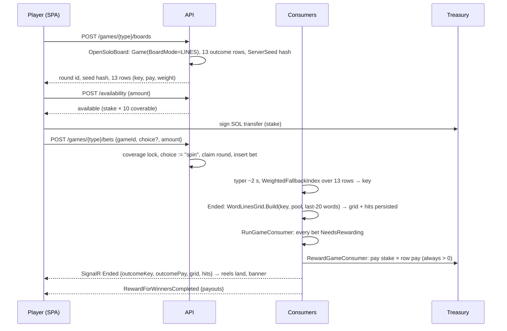

# SpaceStroker — "Hyper Roll Word Lines" Feature — Implementation Spec

> **Status: Ready for implementation** — refined via Trello card
> [#209 Hyper Roll rework — Word Lines (5×3 grid, 10 paylines, 98% RTP)](https://trello.com/c/0BtXXjVp) (2026-10-15).
> Repos affected: `monkify-backend`, `monkify-front`, `monkify-lp`, and this doc in `monkify-meta`.
> Branch / worktree: `feature/hyper-roll-word-lines` → `.worktrees/hyper-roll-word-lines/<repo>`
> (`monkify-lp` is based on `master`, the others on `main`).
> Change level: **Feature** ⇒ a mandatory happy-path integration test in
> `SpaceStroker.Tests.Integration` and a `features/hyper-roll-word-lines.md` KB doc at ship.
> Reworks [`hyper-roll.md`](hyper-roll.md), [`hyper-roll-solo-rounds.md`](hyper-roll-solo-rounds.md),
> [`hyper-roll-modes.md`](hyper-roll-modes.md) and the Hyper Roll half of
> [`auto-bet-duel-hyper-roll.md`](auto-bet-duel-hyper-roll.md).
>
> **Purpose:** Hyper Roll today asks the player to pick 1 of 5–8 words and wins at most one round in
> ~5, at 91.1–91.8% RTP. It feels stingy and repetitive. **Word Lines** replaces it in place: no word to
> pick; one provably-fair draw picks a **result** from a published 13-row table; Edson's typing lands a
> **5×3 letter grid** that shows that result on up to **10 paylines**; **every** spin pays something
> (0.3× "bad word" up to 10×); **98% RTP**. The playable reference build is
> https://claude.ai/artifact/QxsHxntTvyt8hFjBywuWgc (row **D** is the chosen paytable).

---

## 1. Summary

| | Today (Hyper Roll) | Word Lines |
|---|---|---|
| What the player chooses | Mode (AVERAGE/SUPER/HYPER) + 1 board word + stake | **Stake only** |
| What is drawn (provably fair) | The winning word, weighted by its slot | **One outcome row** of a fixed 13-row table |
| Per-round board rows (`GameBoardChoices`) | 5–8 words with multiplier + weight | **The 13 outcome rows** (key, pay, weight), a copy of the table |
| What the player sees | Word table `KEY WORD MULT PAYS`, then the winning word | A **5×3 letter grid**, paylines lit, `THIS SPIN` total |
| Payout | `stake × multiplier` if the word won, else 0 | **`stake × row pay`, every round** (0.3× … 10×) |
| RTP | 91.50 / 91.14 / 91.84 (per mode) | **98.00%** |
| Max pay | 10× | 10× (unchanged ⇒ worst spin 1 SOL at 0.1 SOL) |
| Stake bounds | 0.002 – 0.1 SOL | unchanged |
| Reroll | Yes | **Removed** |
| Word pool | 74 words, lengths 4–10 | ~470 words, lengths 3–5 (20 space words + ~450 new) |
| Round length | ~4.5 s | **~2 s** |
| Orbit / Orbit-paid / streamer bets | Mode + multiplier (+ word) | **Stake only** |

What does **not** change: solo rounds, the open-then-bet flow, the seed commit before the bet, the
`WeightedFallbackIndex` algorithm, the coverage advisory lock and fail-closed checks, treasury
payouts, refunds, the maintenance switch, Orbit's lock/AUTO states, last-stake memory.

---

## 2. Constraints (MANDATORY)

From `monkify-meta/constraints.md` (full list there):

- **Worktree per repo:** `feature/hyper-roll-word-lines` at `.worktrees/hyper-roll-word-lines/<repo>`;
  hubs stay on `main` (`master` for `monkify-lp`). Never `git checkout -b` on a hub. Push after commits.
- **Unit tests:** run via `scripts/run_tests.bat` — never a bare `dotnet test` (the `ProductionSessions`
  Monte Carlo suite is slow). Report changed tests at the end.
- **Integration test is mandatory** (Level = `Feature`): `SpaceStroker.Tests.Integration`
  (Testcontainers), run via `scripts/run_integration_tests.bat`.
- **EF mapping:** inline in `SpaceStrokerDbContext.OnModelCreating` — no `IEntityTypeConfiguration`.
  `DbContext` defaults to NoTracking: use `ExecuteUpdate` or `context.Update()` when mutating.
- **Migrations:** under `SpaceStroker.Infrastructure/Migrations/`, applied **only** by
  `SpaceStroker.Consumers`. Never edit an existing migration or hand-edit the snapshot.
- **Secrets/config:** `spacestrokersettings.json` is product config; no real credentials anywhere.
- **Vague player-facing refusals** (`constraints.md` §6): maintenance, uncoverable stake, taken or
  expired round all read **"Mode is under maintenance. Please try again later."** / the existing vague
  failures.
- **Money path:** every rule deciding whether a paid bet is accepted runs inside the existing
  house-edge coverage advisory lock, in the same transaction as the insert.
- ⚠️ **A mis-weighted outcome table is a MONEY bug.** Validation must fail closed — the type refuses to
  open rounds — exactly as today's ladder validation does.
- **Provably-fair KEEP-IN-SYNC triad:** `ProvablyFair.cs`, `monkify-front/src/utils/provablyFair.ts`,
  `monkify-front/public/verify.html` — the algorithm is unchanged; a new known-answer vector (§11.1)
  is added to the backend test and quoted in both front comments.
- **Game-rule change ⇒ guide + LP:** the `HOW HYPER ROLL WORKS` section and the LP card/terms are updated
  on this branch (`conventions/general.md`). LP legal copy is reviewed by the owner before merge.
- **Prod logs are Warning-only:** anything ops must see (generator fallback) logs at Warning.

---

## 3. Resolved product decisions

Owner decisions from the refined card (2026-10-15). **The paytable in §4 is LOCKED** — changing a pay
or weight changes the RTP and must go back to the owner.

| # | Decision |
| --- | --- |
| 1 | **Replace Hyper Roll in place** — same game type and id; lobby card, history, stats, chat and Orbit carry over. Not a new type, not a 4th mode. |
| 2 | **Every result is paid on-chain** (wallet bets), including 0.3× / 0.5×. No batching, no stake floor; the ~0.2 pt fee cost at the 0.002 SOL minimum is accepted. Orbit-paid → ledger credit; streamer → play ledger. |
| 3 | **Stake bounds unchanged** (0.002 – 0.1 SOL). Max pay 10× ⇒ worst spin 1 SOL. |
| 4 | **Paytable = option D at 98.00% RTP** (§4). Chosen over 91.7% (felt bad), 99% (partner payouts could exceed margin) and the 100× variants (10 SOL worst spin). |
| 5 | **Orbit auto-bet, Orbit-paid manual bets and streamer play bets stay, stake only.** Enrollment `BoardMode` / `Multiplier` are ignored (no backfill). Orbit setup UI hides the pickers for Hyper Roll. `/orbit/wagers` accepts a Hyper Roll wager with no word. |
| 6 | **Fairness:** the provably-fair weighted draw picks the **outcome row**; the server then builds a grid showing exactly that row with ordinary randomness and persists it. The grid is presentation (like today's board draw). |
| 7 | **Word lists follow the existing standard:** config `DefaultGames["Hyper Roll"].HouseEdge.Words` → `HouseEdgeReconciler` → `PresetChoices`. The 20 existing 4/5-letter words become the **space words**; ~150 new everyday words per length 3/4/5 are added; the 6–10-letter words are dropped from config (reconciler sets `Active = false`); a blocked list lives in the same config. **EDSON** is fixed (no rotation). |
| 8 | **No dictionary file.** Filler letters come only from `Q X Z J V K`; the generator validates every line and reel against playable + space + blocked words + `edson`. |
| 9 | **Repetition guard per player:** a grid never uses a word that appeared in a hit for that player in their last 20 rounds (Orbit auto rounds included). |
| 10 | **Results below the stake are never called a win:** bad word → **"SO CLOSE!"**, other < 1× → **"ALMOST THERE!"** + amount back, no coins/shake. > 1× → **"YOU WON!"**, count-up, coins; shake from 5×; gold ring at 8× / 10×. (D has no exact 1× row.) |
| 11 | **Round flow:** open-then-bet stays (`POST /games/{id}/boards` commits the seed hash and publishes the table before the bet). `mode` is ignored; AVERAGE/SUPER/HYPER keys are removed; **reroll is removed**. |
| 12 | **Practice demo, the `HOW HYPER ROLL WORKS` guide section and the LP** (card, how-it-works line, terms clause) are updated in this feature. |
| 13 | **Cutover:** unbet pre-feature boards are deleted at Consumers startup; old rounds that already have a bet settle under the old word rules; history and verify render old rounds as word boards and new rounds as grids. |

### 3.1 Spec-time decisions (flag at implementation start)

| # | Decision | Why |
| --- | --- | --- |
| S1 | **The outcome table is the round's board.** At open, `GameBoardChoices` gets 13 rows: `Choice = row key`, `Multiplier = pay`, `Weight = weight`. | Reuses everything already keyed by board rows: the typer's weighted fallback draw (`DecideFallbackWinner` sorts the board ordinally by `Choice`), the verification payload (`BoardChoices` with weights), `ActiveGameDto.BoardChoices`, the cleanup job, and coverage pricing (`HouseEdgeCoverage.WorstCase` prices an unknown choice at the board's best multiplier = 10×). No new draw code. |
| S2 | **`Game.BoardMode = "LINES"`** marks a Word Lines round; any other value (`AVERAGE` / `SUPER` / `HYPER` / null) is a legacy word round. | The column exists (string, max 16) and is already in history, verification and `ActiveGameDto`. One discriminator drives every "new vs old" branch (settlement, history, verify, front rendering) without a new column. Constant: `HouseEdgeRules.WordLinesMode = "LINES"`. |
| S3 | **A Word Lines bet carries `Choice = "spin"`** (`HouseEdgeRules.SpinChoice`). Requests may omit the choice or send anything; the server normalises it to `spin` for `LINES` rounds. | `Bet.Choice` is `IsRequired().HasMaxLength(20)`. A fixed token keeps the column, the typer's bet map and every `Choice`-keyed query valid. `spin` is never a row key, so it can never be confused with the drawn row. |
| S4 | **The outcome table is stored as a string on `GameParameters.OutcomeTable`** (`key:pay:weight;…`, new nullable column, max 1024), reconciled from config like `BoardLadder`. `GameBoardModes` rows for Hyper Roll are deleted by the reconciler (config no longer lists modes). | Mirrors the shipped `BoardLadder` string pattern (parse/format helpers, self-heal). A child table would duplicate what the per-round `GameBoardChoices` copy already gives verification. |
| S5 | **Grid + hits persisted on `Game`:** `WordLinesGrid` (`varchar(15)`, row-major, top row first, uppercase A–Z and `?`) and `WordLinesHits` (`text`, JSON array, §6.6). Both null for legacy rounds. | One read restores a settled round (reload, history, verify) without recomputing. JSON in a text column is the lightest way to carry a variable list; EF maps it as a plain string. |
| S6 | **Grid generated in `GameService.UpdateGameStatusCore`, Ended arm**, right after `WinningChoice` is set (Consumers). | The row is only known after the bet (the provably-fair prefix includes bet seeds), so the grid cannot be built at open. The Ended arm already persists the round's result in one save; the grid joins it. |
| S7 | **All non-voided bets of a `LINES` round are marked `NeedsRewarding`** in `RunGameConsumer`, and `CalculateHouseEdgeReward` takes the multiplier from the **drawn row** (`WinningChoice`), not from `bet.Choice`. | Today only `Choice == FirstChoiceTyped` bets are rewarded; every other bet stays `Made` and is never paid. Word Lines pays every round. |
| S8 | **"Won" means `payout > stake`** for `LINES` rounds in history, player stats, Orbit win notifications and the front's `myWon`. `TotalPaidOut` still counts every credit. | Otherwise a 0.3× bad word would count as a win in stats and fire Orbit's win toast every round — exactly the "loss disguised as a win" decision 10 forbids. |
| S9 | **Round length target ~2 s:** `HouseEdgeTargetMeanSecondsMin/Max/P95SecondsMax` → `2 / 2 / 2` (committed config + settings defaults). The front reel spins while the round types and lands on Ended. | Decision "spin ≤ 2 s". Settings are integer seconds; 2 is the floor that still satisfies the card. ⚠️ Check real round times locally after the change (`cloud-run-billing-and-typer-cpu` memory: a CPU-starved Consumers stretches rounds silently). |
| S10 | **Character pool for `LINES` rounds = the full A–Z alphabet**, not the board keys' letters. | Board keys (`edson`, `spacefive`…) are internal ids; using their letters would make the typed stream look odd. `SetCharactersOnTyper` already supports the alphabet top-up path. |
| S11 | **Bump `ActiveParameters:v3` → `:v4`.** | `GameParametersDto` changes shape (gains `Outcomes`, drops the word pool for this type). Same rule as `hyper-roll-modes.md` S6. |
| S12 | **Legacy word-round code stays** (old rounds must settle across the deploy, verify forever). Removing `OrbitSlotPicker`, `HouseEdgeBoard` and the mode code paths that only served picking is in scope **where nothing reads them**; the `GameBoardModes` table, `Game.BoardMode` values, enrollment `BoardMode`/`Multiplier` columns and `PresetChoice.Multiplier` column are **kept** (contract later). | Expand–migrate–contract. Old API revisions keep running for minutes during the deploy (§12). |

---

## 4. The outcome table (LOCKED — option D, 98.00%)

Rows in **draw order = ordinal sort of the key** (that is how `DecideFallbackWinner` and the verifier
order the board). `Weight ÷ 1,000,000` = chance.

| Key | Result | Example | Pay | Weight | Chance |
|---|---|---|---|---|---|
| `bad` | Bad word (no word anywhere) | `#@%!&` | 0.3 | 436,574 | 43.66% |
| `double` | Two 5-letter words (replaces the sum) | TIGER + BRAVE | 6 | 4,633 | 1 in 216 |
| `down` | 3-letter word top→bottom on one reel | FOX ↓ | 0.5 | 70,000 | 7.00% |
| `echo` | Same 4-letter word on 2 lines, both ×2 | BOLT + BOLT | 5.6 | 9,266 | 0.93% |
| `edson` | EDSON on a line (replaces the sum) | EDSON | 8 | 2,317 | 1 in 432 |
| `five` | One 5-letter word | BRAVE | 2.5 | 65,635 | 6.56% |
| `four` | One 4-letter word | BOLT | 1.4 | 100,382 | 10.04% |
| `full` | Three 5-letter words, one per row (replaces the sum) | COMET + ORBIT + LUNAR | 10 | 1,544 | 1 in 648 |
| `spacefive` | 5-letter space word (×2) | ORBIT | 5 | 16,988 | 1.70% |
| `spacefour` | 4-letter space word (×2) | STAR | 2.8 | 27,026 | 2.70% |
| `three` | One 3-letter word | CAT | 0.5 | 200,000 | 20.00% |
| `twolines` | A 5-letter word + a 3-letter word on two lines | TIGER + CAT | 3 | 27,026 | 2.70% |
| `wild` | 4-letter word with one `?` | B?LT = BOLT | 1.4 | 38,609 | 3.86% |

- Σ weights = **1,000,000**; Σ weight × pay / 10,000 = **98.0002%** (shown as 98%).
- Line pays implied: 3 letters 0.5×, 4 letters 1.4×, 5 letters 2.5×. Space ×2. Echo doubles both lines.
- Simulated feel: 29.3% of spins pay above the stake; 43% of players ahead after 50 spins; typical
  longest dry run 8; the house is ahead with 99% confidence after ~20,000 spins in aggregate.
- Config string (S4): `bad:0.3:436574;double:6:4633;down:0.5:70000;echo:5.6:9266;edson:8:2317;five:2.5:65635;four:1.4:100382;full:10:1544;spacefive:5:16988;spacefour:2.8:27026;three:0.5:200000;twolines:3:27026;wild:1.4:38609`
- ⚠️ Ops note (no code): a hand-made partner deal at ≥ 90% `SharePercentage` makes referred Hyper Roll
  traffic lose money (partners earn 2% × share of turnover; the house keeps ~1.7–2%).

---

## 5. Data model

### 5.1 Entity changes

`SpaceStroker.Domain/Games/Entities/GameParameters.cs` (next to `BoardLadder`, ~l.46–68):

```csharp
/// <summary>Word Lines outcome table, "key:pay:weight;…" (HouseEdgeRules.ParseOutcomeTable). Null for non-house-edge types.</summary>
public string? OutcomeTable { get; set; }
```

`SpaceStroker.Domain/Games/Entities/Game.cs` (next to `BoardMode`, ~l.195):

```csharp
/// <summary>Word Lines grid, 15 chars row-major (top row first), A–Z and '?'. Null for legacy word rounds.</summary>
public string? WordLinesGrid { get; set; }
/// <summary>Word Lines hits as JSON (WordLinesHit[]). Null for legacy word rounds.</summary>
public string? WordLinesHits { get; set; }
```

`GameBoardChoice`, `PresetChoice`, `GameBoardMode`, `OrbitEnrollment`: **no schema change** (S1, S12).
`PresetChoice.Multiplier` is reused as the **space flag**: `2` = space word, `1` = normal word.

### 5.2 EF configuration (inline, `SpaceStrokerDbContext.OnModelCreating`)

```csharp
// GameParameters (~l.68)
builder.Property(x => x.OutcomeTable).HasMaxLength(1024);
// Game (~l.170–175)
builder.Property(x => x.WordLinesGrid).HasMaxLength(15);
builder.Property(x => x.WordLinesHits).HasColumnType("text");
```

### 5.3 Migration

`HyperRollWordLines` — adds the three nullable columns above. No data migration (the reconciler fills
`OutcomeTable`; old rounds keep nulls).

```bash
# from monkify-backend/src/SpaceStroker.Infrastructure
dotnet ef migrations add HyperRollWordLines --startup-project ../SpaceStroker.Consumers
```

Latest existing migration: `20261007033746_AddStreamerWallets`.

---

## 6. Configuration and backend behaviour

### 6.1 `spacestrokersettings.json` → `GeneralSettings:Operator:DefaultGames` → "Hyper Roll" (~l.275–412)

- `Description`: "Pull the lever: Edson types a 5×3 grid and every word on 10 lines pays. 98% RTP, up to 10×."
- `ChoiceRequiredLength`: `5` (longest playable word).
- `RequiredAmount` 0.002, `MaximumStake` 0.1 — **unchanged**.
- `HouseEdge.RtpPercent`: `98.0`.
- `HouseEdge.Outcomes`: the 13 rows of §4 as objects `{ "Key", "Pay", "Weight" }`.
- **Remove** `HouseEdge.Ladder` and `HouseEdge.Modes`.
- `HouseEdge.Words`: the playable pool as `{ "Word", "Multiplier" }` where `Multiplier` = **2 for the 20
  space words** (mars luna star moon nova warp void apes halo beam / pluto venus orbit comet solar titan
  probe rover flare atlas) and **1 for the new words**. Add **~150 words each of 3, 4 and 5 letters**:
  common, family-friendly English nouns/verbs/adjectives; lowercase a–z; no proper nouns; none containing
  `edson`; no overlap with `BlockedWords`. The 6–10-letter words are **removed** (reconciler deactivates).
  The implementer curates the list; the owner reviews it in the PR.
- `HouseEdge.BlockedWords`: new string list — profanity/slurs/sexual/drug terms of 3–5 letters that the
  generator must never let appear on any line or reel (e.g. the prototype caught `lube`). Not synced to
  the DB.
- `HouseEdge.FillerLetters`: `"QXZJVK"`.
- `HouseEdge.RepeatGuardRounds`: `20`.
- `GeneralSettings:Games`: `HouseEdgeTargetMeanSecondsMin/Max/P95SecondsMax` → `2 / 2 / 2` (S9).

### 6.2 `OperatorSettings.cs` (`SpaceStroker.Domain/Configs/Entities/`, ~l.142–202)

- `HouseEdgeSettings`: add `List<HouseEdgeOutcomeSettings> Outcomes`, `List<string> BlockedWords`,
  `string FillerLetters = "QXZJVK"`, `int RepeatGuardRounds = 20`; keep `RtpPercent`, `MaximumStake`,
  `Words`. Remove `Ladder`, `Modes`, `LadderSlots()` once nothing reads them (Program.cs seeding, reconciler).
- New `HouseEdgeOutcomeSettings { string Key; decimal Pay; int Weight; }`.
- `HouseEdgeWordSettings { Word, Multiplier }` unchanged (Multiplier = space flag).
- `GameSettings.cs` (~l.134–136): defaults `HouseEdgeTargetMeanSecondsMin = 2`, `Max = 2`, `P95SecondsMax = 2`.

### 6.3 `HouseEdgeRules` (`SpaceStroker.Domain/Games/Services/HouseEdgeRules.cs`)

Add, keeping the legacy members that old-round settlement and verification still use:

- `const string WordLinesMode = "LINES"`, `const string SpinChoice = "spin"`,
  `const decimal MinOutcomePay = 0.1m`, `const int OutcomeTotalWeight = 1_000_000`,
  `WordLinesMinLength = 3`, `WordLinesMaxLength = 5`.
- `static readonly IReadOnlyList<string> OutcomeKeys` = the 13 keys of §4 (the generator supports exactly these).
- `ParseOutcomeTable(string)` / `FormatOutcomeTable(IEnumerable<HouseEdgeOutcome>)` — `key:pay:weight;…`,
  invariant culture; new `record struct HouseEdgeOutcome(string Key, decimal Pay, int Weight)`
  (`SpaceStroker.Domain/Games/ValueObjects/`).
- `ValidateOutcomeTable(IReadOnlyList<HouseEdgeOutcome> rows, decimal rtpPercent)` → fails (with a reason)
  when: a key is not in `OutcomeKeys`, duplicated, or missing; a pay is outside `[MinOutcomePay, MaxMultiplier]`;
  a weight ≤ 0; Σ weight ≠ 1,000,000; Σ weight × pay / 10,000 ≥ 100; or
  |Σ weight × pay / 10,000 − rtpPercent| > `RtpTolerancePercent` (0.25).
- `ValidateWordLinesPool(IReadOnlyList<PresetChoice> active, IReadOnlyList<string> blocked)` → fails when:
  a word is outside 3–5 letters or not a–z; a `Multiplier` is not 1 or 2; a space word (2) is not 4 or 5
  letters; fewer than **50** active normal words of any length 3/4/5; fewer than **5** space words of
  length 4 or of length 5; any playable word is in `blocked`; any word contains `edson`.
- `IsValidMultiplier` (l.73, ≥ 1.01) stays for legacy boards; Word Lines rows use `MinOutcomePay`.
- `Validate(parameters)` (l.161): for Hyper Roll (`OutcomeTable != null`), run the two validators above
  instead of requiring board modes. Fail closed → `CreateGame`/`OpenSoloBoard` refuse (Error log), the
  same way a broken ladder does today.

### 6.4 `HouseEdgeReconciler` (`SpaceStroker.Infrastructure/Services/Games/HouseEdgeReconciler.cs`)

Called from `Consumers/Program.cs:626`. In `Reconcile` (l.31–152):

1. Patch `OutcomeTable` (format of config `Outcomes`), `RtpPercent`, `ChoiceRequiredLength` (replaces the
   `BoardLadder` patch; `BoardLadder` is left as-is).
2. Delete the type's `GameBoardModes` rows when config lists no modes (the existing delete path).
3. Words: unchanged upsert/deactivate from `Words` (Multiplier now 1/2).
4. **Cutover sweep (decision 13):** delete house-edge rounds of this type that are `WaitingBets`, unowned,
   have **no bets**, and `BoardMode != "LINES"` (with their board rows), in the same style as
   `HouseEdgeBoardCleanupJob.Run`, **under the coverage advisory lock**. Log the count at Warning.

First-boot seeding `ToGameParameters` (Program.cs ~l.767–789): set `OutcomeTable`, `RtpPercent`, pool
from `Words`; no `BoardModes`.

### 6.5 Opening a round (`GameService.OpenSoloBoard`, `GameService.cs` ~l.634–659)

- For a type with `OutcomeTable`: validate (6.3), create the `Game` exactly as today (`BoardExpiresAt`,
  `ServerSeed` + hash committed in the same save), set `BoardMode = "LINES"`, and attach **13
  `GameBoardChoice` rows** from the parsed table (`Choice = key`, `Multiplier = pay`, `Weight`,
  `Position` = draw order index). The `mode` argument is ignored.
- `DrawHouseEdgeBoard` (~l.570–632) and `HouseEdgeBoard.Draw` are no longer called for Hyper Roll.
  `CreateGame` (~l.942–963, scheduler path) builds the same 13-row board.
- **Reroll removed:** delete `POST rounds/{roundId}/reroll` (`GamesController.cs` ~l.117–120),
  `RerollHouseEdgeBoardHandler`/`Request`, `GameService.RerollSoloBoard` (~l.661–699) and
  `IGameService.RerollSoloBoard`. A stale client calling it gets the framework 404.
- `OpenHouseEdgeBoardRequest` keeps `Mode` for compatibility; ignored.
- `HouseEdgeBoardCleanupJob`: unchanged.

### 6.6 The grid generator (new, Domain)

`SpaceStroker.Domain/Games/Services/WordLinesGrid.cs` — pure, no I/O, `Random` injected.

**Geometry.** Rows `r ∈ {0,1,2}` (top→bottom), reels `c ∈ {0..4}`. Index = `r * 5 + c`. The 10 paylines
(row per reel), numbered 1–10, read **from reel 0 left to right**:

```
1: 1,1,1,1,1   2: 0,0,0,0,0   3: 2,2,2,2,2   4: 0,1,2,1,0   5: 2,1,0,1,2
6: 0,0,1,2,2   7: 2,2,1,0,0   8: 1,0,0,0,1   9: 1,2,2,2,1  10: 1,0,1,2,1
```

A **line word** of length n is the first n cells of a line (n ∈ 3..5); the longest valid word on a line
wins that line. A **down word** is a reel read top→bottom (3 letters). `?` matches any letter.

**Hit model** (serialised to `Game.WordLinesHits`, camelCase JSON):

```csharp
public sealed record WordLinesHit(string Kind, int Index, string Word, string Shown, bool Space);
// Kind: "line" (Index = line 1–10) | "down" (Index = reel 0–4)
// Word: the lowercase word paid; Shown: the cells as displayed (e.g. "b?lt"); Space: pays ×2
```

**API:**

```csharp
public static WordLinesResult Build(
    string outcomeKey, WordLinesPool pool, IReadOnlySet<string> recentWords, Random rng, out bool usedFallback);
public sealed record WordLinesResult(string Grid, IReadOnlyList<WordLinesHit> Hits);
public sealed record WordLinesPool(
    IReadOnlyList<string> Words3, IReadOnlyList<string> Words4, IReadOnlyList<string> Words5,
    IReadOnlyList<string> Space4, IReadOnlyList<string> Space5,
    IReadOnlySet<string> Blocked, string FillerLetters);
public static IReadOnlyList<WordLinesHit> Scan(string grid, WordLinesPool pool); // used by validation + tests
```

**Construction per row** (pick words uniformly from the pool **excluding `recentWords`**, falling back
to the full tier when exclusion would empty it — decision 9 edge case):

| Key | Placement |
|---|---|
| `bad` | no word; all 15 cells filler |
| `three` | one 3-letter word on a random line |
| `down` | one 3-letter word down a random reel |
| `four` | one 4-letter word on a random line |
| `wild` | one 4-letter word on a random line with one random non-first cell replaced by `?` |
| `five` | one 5-letter word on a random line |
| `spacefour` / `spacefive` | one space word of that length on a random line (`Space = true`) |
| `echo` | the same 4-letter word on two lines that share **no** cell among their first 4 (e.g. 2 and 3) |
| `twolines` | a 5-letter word and a 3-letter word on two lines sharing no cell among the cells used |
| `double` | two different 5-letter words on two of the three straight rows (lines 1/2/3) |
| `full` | three different 5-letter words on lines 2, 1, 3 (all rows) |
| `edson` | `edson` on a random line |

Every remaining cell is filled from `FillerLetters`. Then **validate** with `Scan`: the set of hits found
must equal exactly the intended hits (same kinds, indexes, words), and no line prefix (3–5) or reel
spells any word in playable ∪ space ∪ blocked ∪ {`edson`} other than an intended hit. On failure, retry
(fresh random placement and filler) up to **50** times, then use the **deterministic fallback** for that
key — a hard-coded known-good grid per key (the reference build's grids, uppercase), with its words and
`usedFallback = true`. The row and payout never change.

Pay check (unit-tested): for every key, the hits' implied pay (line pays 0.5/1.4/2.5, space ×2, echo ×2,
replace-the-sum for `double`/`edson`/`full`, `bad` 0.3) equals the row's `Pay`.

### 6.7 Settlement

Execution order on the Consumers side:

1. **Typer** (`SpaceStrokerTyper.cs`): unchanged draw — `DecideFallbackWinner` (l.193–214) sorts the
   board (the 13 rows) ordinally by `Choice` and calls `WeightedFallbackIndex`; `FirstChoiceTyped` = drawn
   key. Changes:
   - `SetBets` (l.244–292): for `LINES`, `NumberOfWinners` = number of real bets (every bet is paid).
   - `SetCharactersOnTyper` (l.300–304): for `LINES`, pool = `abcdefghijklmnopqrstuvwxyz` (S10).
   - The `IsHouseEdge` pacing branch (l.365) reads the new 2/2/2 settings — no code change.
2. **`GameService.RunGame`** (l.239–293): for `LINES` rounds, **do not** emit `FirstChoiceTyped` as the
   final terminal batch (l.287–290) — the key is an internal id. Legacy rounds unchanged.
3. **`GameService.UpdateGameStatusCore`, Ended arm** (l.301–400): after `WinningChoice` is set, for
   `LINES`:
   - load the active pool (`PresetChoices` of the type) + `BlockedWords`/`FillerLetters` from options;
   - load `recentWords` = all `Word`s in `WordLinesHits` of the owner's last `RepeatGuardRounds` completed
     `LINES` rounds (`OwnerPlayerId == game.OwnerPlayerId`, ordered by `CreatedDate desc`, skip this round);
     one query;
   - `WordLinesGrid.Build(WinningChoice, pool, recentWords, Random.Shared, out fallback)`; persist
     `WordLinesGrid` + `WordLinesHits` in the same save; `fallback` → log Warning with round id + key;
   - `GameResult` (l.335–341) gets the new optional fields (6.10). `Winners` = all bets.
4. **`RunGameConsumer`** (l.72): for `LINES`, mark **every non-voided bet** `NeedsRewarding` (S7).
5. **`BetDomainService`** (ctor l.16–58, `CalculateHouseEdgeReward` l.296–311): for `LINES`, multiplier =
   `_boardMultipliers[game.WinningChoice]` (the drawn row's pay) for every bet; reward =
   `Amount × pay − AlreadyCreditedAmount`, rounded toward zero, no commission (unchanged formula). Missing
   row → existing `HouseEdgeBoardEntryMissing` failure.
6. **`RewardGameConsumer`** (l.33–269): unchanged money path — running treasury balance with the 0.001 SOL
   reserve per transfer, `NeedsManualAnalysis` when uncoverable, `settlement.Credit` / Orbit `CreditWin` /
   streamer `CreditWin`, `AddHouseEdgePayout`, payouts on `RewardForWinnersCompleted`. Every bet now goes
   through it (S7).
7. **Orbit `CreditWin`** (`OrbitBetSettlementService.cs` l.52–75): publish `OrbitWinNotificationEvent`
   **only when the credited amount > the bet's stake** (S8). The ledger credit itself always happens.

Legacy rounds (`BoardMode != "LINES"`) take every branch exactly as today.

### 6.8 Bets, availability and pre-checks

- **Choice normalisation (S3):** in `RegisterBetHandler.HandleRequest` (before l.202), when the target
  round's `BoardMode == "LINES"`, set the bet's `Choice = "spin"` regardless of the request.
  `RegisterBetRequestBody.Choice` becomes optional (validation attribute relaxed; still MaxLength 20).
- `BetDomainService.HouseEdgeChoiceIsValid` (l.267–292): for `LINES` rounds, valid iff `Choice == "spin"`
  (skip the board-word lookup at l.284). Stake bounds `PaidStakeIsValid` unchanged.
- `RegisterBetHandler.ValidateSoloRoundUnderLock` (l.1265–1280): for `LINES`, skip the
  "board has this word" check (l.1273–1277); keep "round has no bet".
- **Coverage:** `RegisterHouseEdgeBet` passes `new HouseEdgeNewBet(GameId, "spin", Amount, Multiplier: maxPay)`
  where `maxPay` = the round board's max `Multiplier` (10). `HouseEdgeCoverage.WorstCase` already prices a
  choice not on the board at the board's best multiplier → stake × 10. Add a unit test pinning this.
- **`/availability`** (`CheckBetAvailabilityHandler.cs` l.60–105, `CheckBetAvailabilityRequest.cs`):
  `Choice` is ignored for Hyper Roll; price `amount × 10`. Response unchanged.
- **`BetPreChecks.Check`** (l.43–97): for `LINES` rounds, normalise the choice to `spin` before
  `ChoiceIsValidForGame` (l.70) and skip `FindSameChoiceBet` (l.77) (one bet per solo round already).
- **`/orbit/wagers`** (`PlaceOrbitWagerRequest.cs` l.21): `Choice` becomes optional (`[MaxLength(20)]`
  only); `PlaceOrbitWagerHandler` (l.76, l.115) and `PlaceManualOrbitBetConsumer` (l.174–177) normalise to
  `spin` for `LINES` rounds. Non-house-edge types keep requiring a choice (validated in the handler).
- **Streamer play bets** (`PlaceOrbitWagerHandler.PlaceStreamerWager` l.148–241): same normalisation;
  payouts credit the play ledger as today.

### 6.9 Orbit solo loop (`OrbitSoloAutoBetService.cs`)

- Step 6 (l.211–231): drop `ResolveMode`; `worstMultiplier` = max pay of the parsed `OutcomeTable` (10).
- Step 7 (l.235): `OpenSoloBoard(parameters, null)`.
- Step 9 (l.265, `ResolveChoice` l.416–434): for Hyper Roll return `"spin"` (never null when the board
  exists).
- Enrollment `BoardMode` / `Multiplier` are **ignored** (decision 5). `OrbitSlotPicker` (+ its tests) is
  deleted once unused.
- `UpdateOrbitSettingsHandler` (l.134, 147–148, 359–361, 386–424): stop validating mode/multiplier for
  Hyper Roll; accept and ignore them (old clients). `GetOrbitHandler` (l.91–127): `Modes` empty for
  Hyper Roll.

### 6.10 Contracts

- **`GameParametersDto`** (`Contracts/Games/GameParametersDto.cs`): `RtpPercent` = table RTP (98) for
  Hyper Roll; `Modes` = empty list; `PresetChoices` = **empty** for Hyper Roll (don't ship ~470 words);
  new `Outcomes: List<OutcomeRowDto>` (`{ Key, Pay, Weight }`, draw order) for Hyper Roll, else empty.
  Bump cache key in `CacheHelper.cs:18` to `ActiveParameters:v4` (S11) and update
  `AdminGameTypeHandlerTests.cs:58`.
- **`ActiveGameDto`** (`Contracts/Games/ActiveGameDto.cs`): `BoardChoices` now carries the 13 rows for a
  `LINES` round (no change to the type). Add `WordLinesGrid` (string?) and `WordLinesHits`
  (`List<WordLinesHitDto>?`) — filled once the round has ended, so `GET /games/rounds/{id}` restores a
  settled round on reload.
- **`GameResult`** (`Contracts/Games/GameStatusUpdatedEvent.cs` l.31–40): add optional
  `OutcomeKey` (string?), `OutcomePay` (decimal?), `Grid` (string?), `Hits` (`List<WordLinesHitDto>?`).
  Additive; legacy rounds send nulls. `FirstChoiceTyped` = the key for `LINES` (front maps it).
- **`GameVerificationDto`** (`Contracts/Games/GameVerificationDto.cs`): `BoardChoices` already carries
  the rows ordered ordinally with weights — unchanged algorithmically. Add `WordLinesGrid`,
  `WordLinesHits`. `BoardMode = "LINES"`. `GetGameVerificationHandler` (l.43–166) needs no draw change.
- **History** (`GameHistoryService.cs` l.122/173/237/249/251/289–294/333, `GameHistoryDto`): for `LINES`
  rows, "won" = credited > stake (S8); add `OutcomeKey` (= `WinningChoice`) and `OutcomePay` to the row DTO
  (`ClonePublic()` copies them).
- **Stats** (`PlayerStatsService.cs` l.151–160/181, `GlobalStatsService.cs` l.98–108,
  `GameStatsService.cs` l.77–93): win/loss for `LINES` per S8; `BiggestSinglePayout` /
  `BiggestWinMultiplier` unchanged formulas.

---

## 7. Frontend behaviour (`monkify-front`)

No front test runner exists (`package.json`: `serve`, `build`, `lint`). Gate = `yarn lint` + `yarn build`
(the build type-checks) + a headless boot check (memory: module-level watch crash).

### 7.1 Types — `src/types/index.ts`

- `ActiveGame` (l.73–96): add `outcomes?: OutcomeRow[]` (`{ key, pay, weight }`).
- `GameInstance` (l.368–372): add `wordLinesGrid?: string | null`, `wordLinesHits?: WordLinesHit[] | null`.
- `GameResultPayload` (l.281): add `outcomeKey?`, `outcomePay?`, `grid?`, `hits?`.
- `GameVerification` (l.463–493): add `wordLinesGrid?`, `wordLinesHits?`.
- `GameHistoryRow` (l.221): add `outcomeKey?`, `outcomePay?`.
- New `WordLinesHit { kind: 'line' | 'down'; index: number; word: string; shown: string; space: boolean }`.
- `src/types/orbit.ts`: leave `boardMode`/`multiplier` fields (ignored); `modes` will be empty.

### 7.2 New `src/utils/wordLines.ts`

`LINES` geometry (same table as §6.6), `OUTCOME_LABELS` (key → `{ name, example }`: `bad` → "BAD WORD"…),
`isWordLinesRound(boardMode)` (`=== 'LINES'`), `tierForPay(pay)` (`< 1` gray, `< 2` green, `< 5` blue,
`< 8` purple, else gold), `bannerKind(pay)` (`'bad'` | `'under'` | `'win'`).

### 7.3 Game screen

- **`GameConsole.vue`**, house-edge plate (l.813–943): when `isWordLinesRound(boardMode)`:
  - right slot → new **`WordLinesPlate.vue`**: engraved `THIS SPIN` LCD (`-.-×` idle, scrambling while the
    round runs, the paid total after Ended, coloured by tier) + 10 payline lamps (lit in the tier colour of
    the lines that paid).
  - left slot row 2 → replace `<hyper-roll-mode-dial>` with two LCD readouts `10 LN` (green) and `10×`
    (gold) + the existing `?` HELP and MAX keys (lift them out of `HyperRollModeDial.vue` into the plate, or
    render the dial with `modes=[]` — implementer's choice, the dial's mode keys must not render).
  - Remove the 8-key grid (`presetButtons`, `keyChoice`, `isKeySelected`, `selectPresetButton`,
    l.680–725) for `LINES`.
  - `pullLever()` (l.469–507): result on screen → `openFreshBoard`; otherwise → `placeBet()`. **No reroll
    branch.** `leverTag` (l.643–658): `· · ·` / `NEW ROUND` / `SPIN <stake>`.
- **`GameTerminal.vue`**:
  - Replace the board table (l.1447–1472) and `boardRows`/board reel (l.377–446) with new
    **`WordLinesGrid.vue`** for `LINES` rounds: 5 reels × 3 cells; while the round runs, each reel scrolls
    random letters (blur), then lands left→right with a bounce when the grid arrives (Ended payload or
    `GET rounds/{id}`); CRT flicker on spin; winning cells highlighted in the tier colour with SVG
    polylines along paid paylines and line-number badges; down words drawn vertically; for `bad`, the middle
    row flips to `#@%!&` (red).
  - Header `he-head` (l.1360–1371) unchanged ("YOU vs THE HOUSE" + stake).
  - Waiting lines `houseEdgeLines` (l.617–647): `> PULL THE LEVER TO SPIN.` / `> SPINNING...` (no
    PICK/REROLL lines).
  - Result block (l.1241–1264) for `LINES`: one `> LINE n WORD  x×` line per hit (`↓ REEL n` for down),
    then `> YOU WON <amount> SOL (x×)` if pay > 1, `> ALMOST THERE! <amount> SOL BACK (x×)` if < 1 (not
    bad), or `> NO WORD ON ANY LINE. EDSON SWORE: #@%!&` + `> THE BAD WORD STILL PAYS 0.3×: <amount> SOL`.
    Orbit wording "SENT TO YOUR ORBIT BALANCE" kept.
  - "ROUND OVER" copy (l.1322–1335): "PULL THE LEVER FOR ANOTHER SPIN."
  - **FX:** pay > 1 → `HyperRollWinFx` (l.1557–1565) with `multiplier = pay` (headline forced to
    "YOU WON!", gold ring at ≥ 8). pay ≤ 1 → a new quiet variant: add prop `variant: 'win' | 'under' | 'bad'`
    to `HyperRollWinFx.vue` — `under` = "ALMOST THERE!", `bad` = "SO CLOSE!", **no coins, no shake, no
    count-up flourish**, amount shown as "+x SOL" with "x× OF YOUR STAKE BACK". `RaceResultFx` loss card is
    **not** used for `LINES` rounds (`raceFxTrigger` l.704–714 excludes them).
- **`GameTyper.vue`**: unchanged (`.winning-hit` simply has no tail for `LINES`, because the key is not
  emitted — §6.7 step 2).
- **`src/pages/GamePage.vue`** (l.52–57): no change.

### 7.4 `src/hooks/useGame.ts`

- `loadHouseEdgeRound` (l.1059–1108): drop the stored-mode argument for Hyper Roll; restore the grid
  from `GET rounds/{id}` for an ended round.
- Socket handler (l.1396–1414): on Ended store `result.grid`, `result.hits`, `result.outcomeKey`,
  `result.outcomePay`.
- House-edge pre-bet block (l.2084–2171): for `LINES`, skip the "chosen word missing from the board" check;
  call `checkGameAvailability` with `choice` omitted; `applyBet` sends `choice: 'spin'`.
- Remove `rerollBoard` (l.2859–2911) usage for `LINES`, and `boardModes`/`activeMode`/`modeLocked`/`setMode`
  + the `hyperRoll:mode:` storage (l.122–155, 2926–2959) where only Hyper Roll used them.
- `myWon` / win state for `LINES` = payout > stake (S8).
- `hyperRollBetInFlight`, `attachRound`, `stakeAmount`, `lastStake` paths unchanged.

### 7.5 Services

- `mainService.ts`: `openHouseEdgeBoard` (l.107) stops sending `mode`; delete `rerollHouseEdgeBoard` (l.119).
- `orbitService.ts` (l.168): `/orbit/wagers` body for Hyper Roll sends no `choice`.

### 7.6 Orbit UI

- `OrbitAutoBetSection.vue` (l.168–177): hide `<OrbitMultiplierPicker>` when the type is Hyper Roll; keep
  `<OrbitStakePlate>`.
- `useOrbitAutoBet.ts` (l.652–724, 742–743, 788–798): stop sending `boardMode`/`multiplier` for Hyper Roll;
  description copy → "Orbit spins Word Lines for you at your stake."
- `OrbitGameTiles.vue` (l.21, 35): subtitle "5×3 grid · 10 lines", glyph `10×`.
- `OrbitMultiplierPicker.vue`: delete if no other type uses it.

### 7.7 Provably fair

- `src/utils/provablyFair.ts` (l.123–128) and `public/verify.html` (l.178–182): **algorithm unchanged**;
  add the new 13-row known-answer vector (§11.1) to the comment beside the existing one.
- `verifyRound` house-edge branch (`provablyFair.ts` l.278–288, `verify.html` l.244–262): unchanged — it
  already verifies the weighted index over `boardChoices` sorted ordinally. For `LINES`, display the drawn
  row as "RESULT: <label> (<pay>×)" instead of "WINNER".
- `GameFairPanel.vue` (l.110–120): `decidedByLabel` → "WEIGHTED DRAW - WORD LINES"; render a small read-only
  grid when `wordLinesGrid` is present. `verify.html` output: "decided by: WEIGHTED DRAW (WORD LINES)" + the
  row key and pay.

### 7.8 History and stats

- `GameHistoryPage.vue` (l.221–240, 269–286): for `LINES` rows show the outcome label + pay (e.g.
  "5-LETTER WORD 2.5×") instead of `winningChoice`/mode; YOU column `spin · stake · WON x / BACK x`
  (BACK when pay ≤ 1). Legacy rows unchanged.
- `GameStatsPanel.vue` (l.61–71): Hyper Roll badge → `98% RTP`; subtitle → "Every spin pays from 0.3× to
  10×; the table is published before you bet."
- `GameStatsPage.vue`: no change beyond the API's win definition.

### 7.9 Practice demo

- `src/constants/practiceGame.ts`: replace `PRACTICE_BOARD_MODES` / `PRACTICE_BOARD_WORDS_BY_LENGTH` /
  `drawPracticeBoard` (l.442–548) with `PRACTICE_WORD_LINES_OUTCOMES` (the §4 table) and a small
  front-only word sample (≥ 20 per tier + the 20 space words) and **a TS port of the reference build's
  per-key grids** (no generator needed offline). `PRACTICE_HYPER_ROLL_TIMINGS.runMs` 4500 → **1600**.
  Tutorial lines (l.601–606) rewritten: "No picking. Pull and I type a grid." / "Words on any of 10 lines
  pay." / "Even a bad word pays 0.3×." / "98% back over time."
- `usePracticeHyperRoll.ts`: draw the outcome with `Math.random()` over the weights (it is practice; it no
  longer always wins), pick that key's grid; remove `pickKey`/`reroll`/`setMode`.
- `PracticeConsole.vue` (l.111–440) and `PracticeTerminal.vue` (l.91–100, 437): reuse `WordLinesPlate` and
  `WordLinesGrid`; lever → spin only.

### 7.10 How to play, lobby, art

- `src/components/guide/sections/GuideHyperRoll.vue`: rewrite the 5 rail steps — SET YOUR STAKE / PULL THE
  LEVER / READ THE GRID (10 paylines from reel 1, `?` wild, down words) / SPECIAL WORDS (space words ×2,
  echo, EDSON 8×, full board 10×) / EVERY SPIN PAYS (bad word 0.3×, 98% RTP, table published before you
  bet). Reuse existing step art where it fits; a new paylines illustration may be drawn with HTML/CSS.
- `src/constants/guideSections.ts` (l.214–217): title stays "HOW HYPER ROLL WORKS".
- `GuideModeCards.vue` (l.110–144): house-edge blurb → "5×3 grid, 10 lines, every spin pays 0.3×–10×.
  98% RTP."
- `GuideWhatYouWin.vue` (l.49–50), `GuideTheModes.vue` (l.29): copy updated likewise.
- `GameTypeCard.vue` (l.154, 264–281): tag "5×3 GRID · 10 LINES"; `HYPER_ROLL_MULTIPLIERS` → `'0.3X–10X'`.
- `useHowToPlay.ts`: unchanged (HOW TO PLAY opens practice; hides once a bet exists).

---

## 8. Flow



---

## 9. Out of scope

- Admin UI for words; word-of-the-day / EDSON rotation; a full dictionary file.
- Changing partner commission rules (ops caution only).
- 100× jackpot variants; payout batching.
- Dropping the legacy columns/tables (`GameBoardModes`, enrollment `BoardMode`/`Multiplier`,
  `GameParameters.BoardLadder`, `PresetChoice.Multiplier` semantics) — a follow-up contract card.
- New poster/GIF art for Hyper Roll (the LP and lobby keep current art).

---

## 10. File checklist

### 10.1 Backend (`monkify-backend/src`)

| # | File | Change |
| --- | --- | --- |
| 1 | `SpaceStroker.Common/spacestrokersettings.json` | Hyper Roll: Outcomes, RtpPercent 98, ChoiceRequiredLength 5, new Words (3–5 letters, space flag), BlockedWords, FillerLetters, RepeatGuardRounds; remove Ladder/Modes; HouseEdgeTarget* 2/2/2 |
| 2 | `SpaceStroker.Domain/Configs/Entities/OperatorSettings.cs` | `HouseEdgeOutcomeSettings`; new HouseEdge fields; drop Ladder/Modes |
| 3 | `SpaceStroker.Domain/Configs/Entities/GameSettings.cs` | HouseEdgeTarget defaults 2/2/2 |
| 4 | `SpaceStroker.Domain/Games/ValueObjects/HouseEdgeOutcome.cs` | **new** record struct |
| 5 | `SpaceStroker.Domain/Games/Services/HouseEdgeRules.cs` | constants, Parse/FormatOutcomeTable, ValidateOutcomeTable, ValidateWordLinesPool, Validate branch |
| 6 | `SpaceStroker.Domain/Games/Services/WordLinesGrid.cs` | **new** generator + Scan + fallbacks + hit model |
| 7 | `SpaceStroker.Domain/Games/Entities/GameParameters.cs` | `OutcomeTable` |
| 8 | `SpaceStroker.Domain/Games/Entities/Game.cs` | `WordLinesGrid`, `WordLinesHits` |
| 9 | `SpaceStroker.Infrastructure/Data/Context/SpaceStrokerDbContext.cs` | map 3 columns |
| 10 | `SpaceStroker.Infrastructure/Migrations/<ts>_HyperRollWordLines.cs` | **new** migration |
| 11 | `SpaceStroker.Infrastructure/Services/Games/HouseEdgeReconciler.cs` | outcome table patch, modes delete, cutover sweep |
| 12 | `SpaceStroker.Consumers/Program.cs` | `ToGameParameters` seeding (~l.767–789) |
| 13 | `SpaceStroker.Infrastructure/Services/Games/GameService.cs` | OpenSoloBoard/CreateGame 13-row board; remove RerollSoloBoard; RunGame no key batch; Ended arm grid + guard query |
| 14 | `SpaceStroker.Infrastructure/Services/Games/IGameService.cs` | drop RerollSoloBoard |
| 15 | `SpaceStroker.Api/Controllers/GamesController.cs` | remove reroll route |
| 16 | `SpaceStroker.Infrastructure/Handlers/Games/RerollHouseEdgeBoard/*` | **delete** |
| 17 | `SpaceStroker.Domain/Games/Services/SpaceStrokerTyper.cs` | LINES: NumberOfWinners, alphabet pool |
| 18 | `SpaceStroker.Infrastructure/Consumers/RunGame/RunGameConsumer.cs` | LINES: all bets NeedsRewarding |
| 19 | `SpaceStroker.Domain/Bets/Services/BetDomainService.cs` | LINES: choice `spin`; reward from drawn row |
| 20 | `SpaceStroker.Infrastructure/Handlers/Games/RegisterBet/RegisterBetHandler.cs` + `RegisterBetRequestBody.cs` | choice normalisation; skip board-word check; coverage multiplier; optional choice |
| 21 | `SpaceStroker.Infrastructure/Handlers/Games/CheckBetAvailability/*` | ignore choice for Hyper Roll |
| 22 | `SpaceStroker.Infrastructure/Services/Games/BetPreChecks.cs` | normalise to spin; skip same-choice check |
| 23 | `SpaceStroker.Infrastructure/Handlers/Orbit/PlaceOrbitWager/*` | optional choice; normalise |
| 24 | `SpaceStroker.Infrastructure/Consumers/OrbitBetPlacement/PlaceManualOrbitBetConsumer.cs` | normalise |
| 25 | `SpaceStroker.Infrastructure/Services/Orbit/OrbitSoloAutoBetService.cs` | no mode; worst = 10; choice spin |
| 26 | `SpaceStroker.Domain/Orbit/Services/OrbitSlotPicker.cs` | **delete** (+ tests) once unused |
| 27 | `SpaceStroker.Infrastructure/Handlers/Orbit/UpdateOrbitSettings/*`, `GetOrbit/*` | ignore/empty modes for Hyper Roll |
| 28 | `SpaceStroker.Infrastructure/Services/Orbit/OrbitBetSettlementService.cs` | win notification only when credit > stake |
| 29 | `SpaceStroker.Infrastructure/Contracts/Games/GameParametersDto.cs` | Outcomes, RTP, empty Modes/PresetChoices for Hyper Roll |
| 30 | `SpaceStroker.Infrastructure/Services/Cache/CacheHelper.cs` | `ActiveParameters:v4` |
| 31 | `SpaceStroker.Infrastructure/Contracts/Games/ActiveGameDto.cs` | grid + hits |
| 32 | `SpaceStroker.Infrastructure/Contracts/Games/GameStatusUpdatedEvent.cs` | GameResult new optional fields |
| 33 | `SpaceStroker.Infrastructure/Contracts/Games/GameVerificationDto.cs` + `GetGameVerificationHandler.cs` | grid + hits |
| 34 | `SpaceStroker.Infrastructure/Services/.../GameHistoryService.cs` + `GameHistoryDto.cs` | LINES won rule; outcome fields |
| 35 | `PlayerStatsService.cs`, `GlobalStatsService.cs`, `GameStatsService.cs` | LINES win rule |
| 36 | `SpaceStroker.Domain/Games/Services/HouseEdgeBoard.cs` | keep (legacy) unless unused — then delete with tests |

### 10.2 Frontend (`monkify-front/src`)

| # | File | Change |
| --- | --- | --- |
| 1 | `types/index.ts`, `types/orbit.ts` | new fields/types (§7.1) |
| 2 | `utils/wordLines.ts` | **new** geometry, labels, tiers |
| 3 | `components/game/WordLinesGrid.vue` | **new** reels + paylines |
| 4 | `components/game/WordLinesPlate.vue` | **new** THIS SPIN LCD + lamps |
| 5 | `components/game/GameConsole.vue` | LINES plate, no keys/dial, lever spin-only |
| 6 | `components/game/GameTerminal.vue` | grid instead of board table; copy; FX routing |
| 7 | `components/game/HyperRollWinFx.vue` | `variant` prop (win/under/bad) |
| 8 | `components/game/HyperRollModeDial.vue` | no mode keys for Hyper Roll (or HELP/MAX lifted out) |
| 9 | `hooks/useGame.ts` | grid state, no reroll/modes, spin choice, won rule |
| 10 | `services/mainService.ts`, `services/orbitService.ts` | no mode / reroll / choice |
| 11 | `components/orbit/sections/OrbitAutoBetSection.vue`, `hooks/useOrbitAutoBet.ts`, `components/orbit/OrbitGameTiles.vue`, `OrbitMultiplierPicker.vue` | hide/drop pickers, copy |
| 12 | `utils/provablyFair.ts`, `public/verify.html` | vector comment, LINES display |
| 13 | `components/game/GameFairPanel.vue` | label + grid |
| 14 | `pages/GameHistoryPage.vue` | LINES rows |
| 15 | `components/game/GameStatsPanel.vue` | 98% RTP badge, subtitle |
| 16 | `constants/practiceGame.ts`, `hooks/usePracticeHyperRoll.ts`, `components/practice/PracticeConsole.vue`, `PracticeTerminal.vue` | practice Word Lines |
| 17 | `components/guide/sections/GuideHyperRoll.vue`, `GuideModeCards.vue`, `GuideWhatYouWin.vue`, `GuideTheModes.vue` | guide copy |
| 18 | `components/game-selection/GameTypeCard.vue` | lobby tag + range |

### 10.3 Landing page (`monkify-lp`, branch from `master`)

| # | File | Change |
| --- | --- | --- |
| 1 | `src/components/GameModes.vue` (l.46–55) | tag "5×3 GRID · UP TO 10X"; blurb "Pull the lever: Edson types a 5×3 grid and words on 10 lines pay — every spin pays 0.3× to 10×." |
| 2 | `src/pages/index.astro` (l.81) | "…spin a word grid in Hyper Roll…" (drop "pick a word in Hyper Roll") |
| 3 | `src/pages/terms.astro` (l.83–85, l.6) | Hyper Roll clause: 13 results, 0.3×–10× of the stake, every spin pays, published weights, **98%** RTP, no house cut; bump `LAST_UPDATED`. **Owner reviews before merge.** |
| 4 | `src/components/SpaceRoadmap.vue` (l.53) | unchanged (still 4 modes) |

Verify with `npm run build` + a browser check of `#modes` at desktop and phone width.

### 10.4 Meta (`monkify-meta`)

| # | File | Change |
| --- | --- | --- |
| 1 | `specs/hyper-roll-word-lines.md` | this spec |
| 2 | `INDEX.md` | map row + feature in flight |
| 3 | (ship) `features/hyper-roll-word-lines.md`, `features/hyper-roll.md`, `hyper-roll-modes.md`, `auto-bet-duel-hyper-roll.md`, `orbit.md`, `provably-fair.md`, `lp.md` | KB sync by `/monkify-ship-feature` |

---

## 11. Tests

### 11.1 Unit — `SpaceStroker.Tests` (`scripts/run_tests.bat`)

| Test file | Test cases | Expected |
| --- | --- | --- |
| `UnitTests/Domain/Games/HouseEdgeRulesTests.cs` | Parse/Format round-trip of the §4 string; unknown/duplicate/missing key; pay 0.05 / 10.5; weight 0; Σ ≠ 1,000,000; RTP off by 0.3 | Parses, or fails with the stated reason |
| **new** `UnitTests/Domain/Games/WordLinesOddsTests.cs` | The shipped config table: Σ weights = 1,000,000; Σ w·pay / 10,000 = 98.00 ± 0.01; max pay 10 | §4 pinned |
| ″ | `ValidateWordLinesPool` on the shipped config: ≥ 50 per tier, space words 4/5 only, no blocked overlap, no `edson` | Valid |
| **new** `UnitTests/Domain/Games/WordLinesGridTests.cs` | For **each** of the 13 keys × 500 seeds: `Scan(grid)` equals the intended hits; implied pay = row pay; no blocked word on any line/reel | Exact |
| ″ | `bad` grid: `Scan` finds nothing | Empty |
| ″ | `recentWords` excludes words; exclusion that empties a tier falls back to the full tier | Guard honoured / no throw |
| ″ | A pool that forces failure (tiny filler + crafted words) → deterministic fallback, `usedFallback = true`, hits match the key | Fallback |
| `UnitTests/Domain/Games/ProvablyFairTests.cs` | **V4 vector:** seed `4f3c2a1b…aa00` (same as V3), prefix `11111111-1111-1111-1111-111111111111|seedA|seedB`, weights = §4 in draw order → freeze the index the implementation returns and assert it; quote it in `provablyFair.ts` / `verify.html` comments | Frozen |
| `UnitTests/Domain/Games/HouseEdgeCoverageTests.cs` | Bet with choice `spin` on a 13-row board → exposure = stake × 10 | 10× |
| `UnitTests/Domain/Games/BetDomainServiceTests.cs` | LINES: `spin` valid, a word invalid; reward = stake × drawn row pay for `bad` (0.3), `three` (0.5), `full` (10); redelivery subtracts prior credit | Exact amounts |
| `UnitTests/Domain/Games/SpaceStrokerTyperTests.cs` | LINES board: draw returns a row key; `NumberOfWinners` = bet count; pool = alphabet | As stated |
| `UnitTests/Handlers/RegisterBetHandlerTests.cs` | LINES: any/omitted choice stored as `spin`; out-of-bounds stake refused (vague); uncoverable → refunded | As today + spin |
| `UnitTests/Handlers/CheckBetAvailabilityHandlerTests.cs` | Choice ignored; priced at 10× | Open / refused |
| `UnitTests/Handlers/OpenHouseEdgeBoardHandlerTests.cs` | Returns 13 rows, `boardMode = LINES`, seed hash; mode ignored | |
| `RerollHouseEdgeBoardHandlerTests.cs`, `GameServiceBoardModeTests.cs` (mode parts), `OrbitSlotPickerTests.cs` | **Delete** with the code they cover | — |
| `UnitTests/Services/GameServiceSoloBoardTests.cs` | Ended arm persists grid + hits (⚠️ NoTracking: assert it actually persists); guard query reads only the owner's last 20 LINES rounds | Persisted |
| `UnitTests/Services/HouseEdgeReconcilerTests.cs` | OutcomeTable patched; Hyper Roll modes deleted; 6–10 letter words deactivated; cutover sweep deletes only unbet non-LINES WaitingBets rounds | Counts |
| `UnitTests/Consumers/RewardGameConsumerTests.cs` | LINES round with a bad word: bet paid 0.3× via settlement.Credit; Orbit-funded → CreditWin; streamer → play ledger | Credited |
| `UnitTests/Services/OrbitBetSettlementServiceTests.cs` | Credit ≤ stake → no win notification; > stake → notification | |
| `UnitTests/Services/OrbitSoloAutoBetServiceTests.cs` | Hyper Roll enrollment with old mode/multiplier → bets `spin`, coverage priced at 10× | |
| `UnitTests/Services/BetPreChecksTests.cs`, `Handlers/Orbit/PlaceOrbitWagerTests.cs`, `Consumers/PlaceManualOrbitBetConsumerTests.cs` | Hyper Roll wager without choice accepted; non-house-edge without choice refused | |
| `UnitTests/Contracts/GameParametersDtoTests.cs`, `GameHistoryDtoTests.cs` | Outcomes exposed, RTP 98, PresetChoices empty for Hyper Roll; history LINES won = payout > stake; `ClonePublic` copies outcome fields | |
| `UnitTests/Api/OrbitSettingsBindingTests.cs` | Rework the Hyper Roll word/ladder assertions to the outcome table + 3–5 pool | Config binds |
| `UnitTests/Handlers/AdminGameTypeHandlerTests.cs:58` | Cache key `ActiveParameters:v4` | |

### 11.2 Integration — `SpaceStroker.Tests.Integration` (`scripts/run_integration_tests.bat`)

**Mandatory happy path — new `HyperRollWordLinesFlowTests`:**

1. Open a board → 13 rows, `boardMode = LINES`, seed hash present.
2. Place a paid wallet bet (0.01 SOL, no choice) → stored choice `spin`.
3. Let the round run; steer the draw (the harness's existing seed steer / fallback steer) to `five`.
4. Assert: `WinningChoice = five`, `WordLinesGrid` is 15 chars, hits = one 5-letter line word, treasury
   credit = **0.025 SOL** (2.5×), `RewardForWinnersCompleted.payouts` carries it.
5. Repeat with a steer to `bad` → credit **0.003 SOL**, grid has no word.

Plus:

- Orbit solo loop on Hyper Roll with an enrollment that still has `BoardMode = "HYPER"`, `Multiplier = 9` →
  bets `spin`, paid to the Orbit balance.
- Cutover: a pre-seeded unbet `HYPER` board is deleted on reconciler run; a pre-seeded **bet** `HYPER`
  round settles via the legacy path and pays `stake × word multiplier` or nothing.
- Retarget or retire: `HyperRollFlowTests`, `HyperRollModeFlowTests`, `HyperRollSoloRoundsTests`,
  `HyperRollBoardWeightGuardTests`, `HyperRollMisconfigurationTests` (now: broken outcome table → no round
  opens), `HyperRollMaintenanceFlowTests` (unchanged behaviour), `OrbitSoloAutoBetFlowTests`,
  `StreamerWalletsFlowTests`, `DefaultGameSeedingTests`.

---

## 12. Rollout

Order **Consumers → API → front**, back to back, off-peak (`prod-deploy-*` memories).

- ⚠️ **Known window:** Consumers' reconciler writes the outcome table, deletes the Hyper Roll modes and
  deactivates the 6–10-letter words. The still-running **old API** then fails `Validate` (no modes) and
  cannot open a Hyper Roll board until the new API revision is live — it returns the existing vague "no
  active games". **No money path is touched**: bet rounds settle in Consumers (new code, legacy path for
  old rounds).
- The old front against the new API: opening works (mode ignored), but its bet sends a board word that is
  normalised to `spin` — still correct. Deploy the front right after the API.
- `ActiveParameters:v4` → first read rebuilds the blob (expected).
- After deploy, prove it via `/games/active-types` (Hyper Roll `rtpPercent: 98`, `outcomes` has 13 rows)
  and one `POST /games/{type}/boards` (13 rows, `boardMode: LINES`). Check real round times ≈ 2 s.

---

## 13. Acceptance criteria

From the Trello card's **Acceptance Criteria** checklist (14 items):

1. Given the Hyper Roll config, when Consumers start, then the 13-row outcome table is reconciled with Σ weights = 1,000,000, Σ weight×pay = 98.00% RTP and max pay 10×, and an invalid table stops the type from opening rounds (logged at Error).
2. Given a player opens a Hyper Roll round, when POST /games/{id}/boards returns, then it carries the server-seed hash and the 13-row table (row, pay, weight) and no words; any mode parameter is ignored.
3. Given a paid wallet bet within 0.002–0.1 SOL on an open round, when the round settles, then the provably-fair weighted draw picks one row, a 5×3 grid showing exactly that row is persisted, and the treasury pays stake × row pay on-chain (integration test, happy path).
4. Given the drawn row is Bad word, when the round settles, then the grid has no playable word on any of the 10 lines or 5 reels, the terminal shows #@%!&, and the player is paid 0.3× the stake.
5. Given any drawn row, when the generator builds the grid, then every line and reel is checked against the playable + blocked word lists and the only words shown are the row's own hits (unit tests per row, including many random seeds).
6. Given a player whose last 20 rounds won with certain words, when a new grid is built for them, then none of those words is used, unless that would leave a length tier empty.
7. Given the word config, when Consumers start, then the 20 existing 4/5-letter words are space words, the new 3/4/5-letter words are active, the 6–10-letter words are Active=false, and a unit test rejects lengths outside 3–5, non a–z letters, duplicates and playable∩blocked overlaps.
8. Given a bet whose stake × 10 the treasury cannot cover, when /availability or the post-payment backstop runs, then the bet is refused (and refunded if paid) with the vague "Mode is under maintenance" message.
9. Given an Orbit Hyper Roll enrollment (old mode/multiplier fields set or not), when the solo loop plays a round, then it bets the stake only and the row payout is credited to the Orbit balance; the same holds for a manual Orbit-paid bet and a streamer play bet sent to /orbit/wagers without a word.
10. Given a settled round, when the player opens the verify page (front and verify.html), then the row draw is reproduced from the revealed seed over the published weights and matches the stored row and payout (known-answer vector shared by ProvablyFair.cs, provablyFair.ts and verify.html).
11. Given the player pulls the lever, when the spin plays, then the grid lands in ≤ 2 s with the reel/CRT/lamp effects, the winning paylines and the THIS SPIN total are shown, and the word picker, mode keys and reroll are gone.
12. Given a result paying below the stake, when it lands, then the banner reads "SO CLOSE!" (bad word) or "ALMOST THERE!" with the amount back, with no coins or shake; given a result above the stake, then "YOU WON!" with count-up and coins, shake from 5× and the gold ring at 8×/10×.
13. Given the deploy of this feature, when Consumers start, then unbet old word boards are deleted, already-bet old rounds settle under the old rules, and history/verify render old rounds as word boards and new rounds as grids.
14. Given a visitor, when they open /game/practice?mode=hyper-roll, the HOW HYPER ROLL WORKS guide section and the LP mode card, then all describe Word Lines (10 paylines, results, bad word, 98% RTP, 10× top) and the practice demo plays with option D odds.

---

## 14. Manual QA (local stack)

1. Rebuild the local stack (this card **has** a migration — let Consumers apply it). Copy the hub
   `yarn.lock` into the front worktree before building (memory: front worktree yarn.lock gotcha).
2. `/games/active-types`: Hyper Roll shows `rtpPercent 98`, 13 `outcomes`, no modes.
3. Open Hyper Roll: no word keys, no mode keys; `10 LN` / `10×` readouts; lever reads `SPIN <stake>`.
4. Bet the minimum: reels spin ~2 s and land; the THIS SPIN LCD and payline lamps match the terminal lines;
   the treasury credit equals stake × pay.
5. Spin until a bad word: middle row `#@%!&`, "SO CLOSE!", +0.0006 SOL credited, no coins.
6. Reload mid-spin and after Ended: the round restores (grid + hits).
7. FAIR tab and `verify.html` on the round: the row matches; decided by "WEIGHTED DRAW - WORD LINES".
8. History: new rows show outcome + pay; a pre-feature round still shows its word.
9. Orbit: enable auto-bet on Hyper Roll — no multiplier picker; rounds play at the stake; win toast only
   when a spin paid above the stake.
10. Practice `/game/practice?mode=hyper-roll` and the guide section read as Word Lines.
11. LP: `npm run build`, check `#modes` on desktop and phone.

---

## 15. Trello / pipeline

- **Source card:** [#209](https://trello.com/c/0BtXXjVp) — list **Specs created**; the **Implementation**
  block on the card carries the branch, worktree and level.
- **Next:** `/monkify-implement-feature` → then `/monkify-ship-feature`.

---

## 16. Revision log

| Date | Change |
| --- | --- |
| 2026-10-15 | Initial spec from the refined card (#209) after a code pass over `HouseEdgeRules`, `HouseEdgeReconciler`, `GameService` (open/reroll/Ended), `SpaceStrokerTyper`, `RunGameConsumer`, `BetDomainService`, `RewardGameConsumer`, `HouseEdgeCoverage(Service)`, `BetPreChecks`, the Orbit solo loop and wager paths, the verification/history/stats services, the Hyper Roll frontend (console, terminal, FX, practice, guide, Orbit UI, provably-fair) and the LP. |
