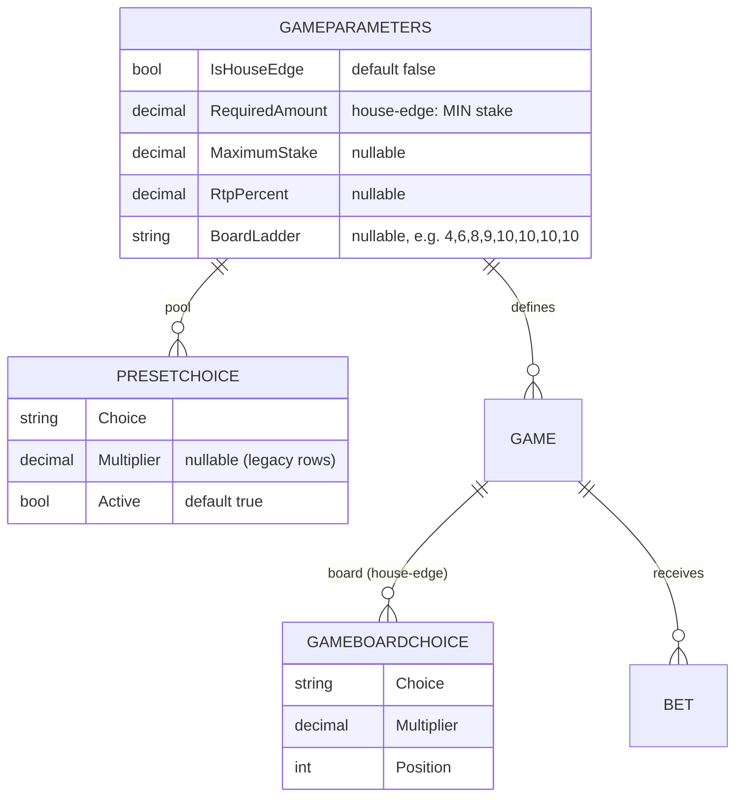
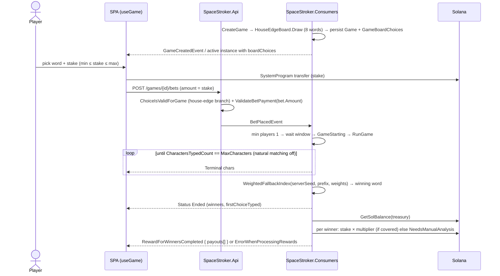
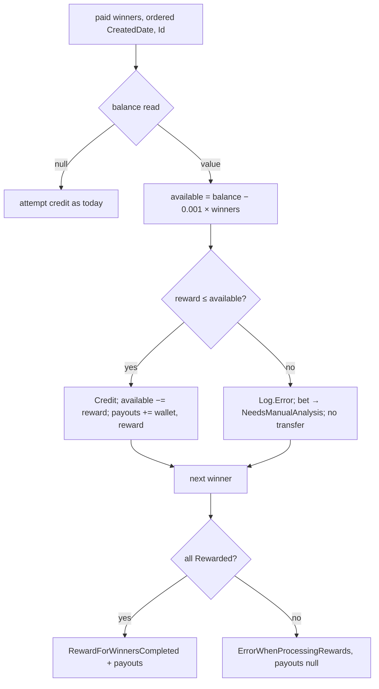

# SpaceStroker — "Hyper Roll" Feature — Implementation Spec

> **Status: Ready for implementation** — refined via Trello card
> [Hyper roll game](https://trello.com/c/XtPzB6wZ/183-hyper-roll-game) (#183, refined 2026-09-14).
> Repos affected: `monkify-backend`, `monkify-front`, `monkify-lp`, and this doc (+ `deploy/sql/`) in
> `monkify-meta`.
> Branch / worktree: `feature/hyper-roll` → `.worktrees/hyper-roll/<repo>` in all four repos
> (`monkify-lp` branches off `master`, the others off `main`).
> Change level: **Feature** — mandatory happy-path integration test + a second integration test for the
> insufficient-treasury path; `features/hyper-roll.md` is written at ship.
>
> **Purpose:** Beast Mode is gated `ComingSoon` and is not coming back as-is. **Hyper Roll** replaces it:
> a **player-vs-house** preset game. Every round offers **8 words drawn from a pool**; each player picks
> **one** word and stakes **any SOL amount within a min/max**; one provably-fair **weighted draw** picks
> the round's word, and every player who picked it is paid **`stake × that word's multiplier`** (max
> **10×**) straight from the treasury — no pot, no split, no house cut. A bigger multiplier is a rarer
> word, tuned to a fixed board recipe where the best-paying words carry **up to 94.19% RTP** — words no
> longer all pay back the same (decision 29).

---

## 1. Summary

Hyper Roll rides the **existing round machinery unchanged** — `Game`, statuses, rollover, the typer,
SignalR, history, stats, the FAIR panel. What changes is the money model and how the winner is chosen.

| Aspect | Pari-mutuel types (Cosmic Sprint, Space Jackpot, legacy presets) — unchanged | **Hyper Roll** (new) |
| --- | --- | --- |
| Opponent | Other players (pot is split) | **The house** (treasury pays) |
| Choices | Free text, or the type's full preset list | **8 words per round**, drawn from a pool, persisted on the `Game` |
| Stake | Exactly `RequiredAmount` | **`RequiredAmount` ≤ stake ≤ `MaximumStake`** (0.01 – 0.1 SOL at launch — decision 30) |
| Bets per player per round | Preset: 1 · free text: see `fix-bets-logic` | **1** (existing `OneBetPerPresetRound`) |
| Players to start | `MinimumNumberOfPlayers` (2) | **1** — house seed bet never applies |
| Winner | First sequence typed (natural), else uniform fallback | **Always the weighted fallback draw**; natural matching disabled |
| Payout | `pot / paid winners − commission` | **`stake × multiplier`**, **no commission** |
| House take | Configured commission on profit | **5% edge** baked into the multipliers (95% RTP) |
| Money source for a win | The round's own stakes | **The treasury balance** (pre-payout solvency check) |
| Near-miss `N AWAY!` row / `> POT:` line | Shown | **Hidden** |
| Orbit | Per `AllowOrbit` | **Never** (`AllowOrbit = false`) |
| STATS badge | `N% HOUSE CUT` | **`up to 94.19% RTP`** |

**The multiplier/probability rule (superseded by decision 29, 2026-09-16).** Each board slot carries its
own **published weight**; a slot's draw probability is `weight ÷ 1,000,000` and its return is
`weight/1,000,000 × multiplier`. The board is still built to a **fixed recipe** (the *ladder*, now
`multiplier:weight` pairs) — which specific words fill each slot is random, but the recipe, and therefore
every slot's odds and payback, are identical every round. Words no longer all pay back the same:
`RtpPercent` is the **best** word's return, and every word's return sits within 0.25 points of it or below.

Launch ladder: **`10× / 10× / 2× / 5× / 7× / 8× / 9× / 9×`** with weights `50000 / 50000 / 250002 / 188384 /
134560 / 117740 / 104657 / 104657` (Σ = 1,000,000) → win chances **5.00% / 5.00% / 25.00% / 18.84% / 13.46%
/ 11.77% / 10.47% / 10.47%**. Pays back: the 2× and both 10× slots return **50.0%**; the 5×, 7×, 8× and both
9× slots return **94.19%** — `RtpPercent = 94.19`, published as **"up to 94.19% RTP"**.

---

## 2. Constraints (MANDATORY)

From `monkify-meta/constraints.md` (full list there):

- **Worktree per repo:** `feature/hyper-roll` at `.worktrees/hyper-roll/<repo>` in `monkify-backend`,
  `monkify-front`, `monkify-lp`, `monkify-meta`. Hubs stay on `main`/`master`. Push after every branch
  update.
- **Unit tests:** update/add in `SpaceStroker.Tests`; run via `scripts/run_tests.bat` (never the full
  `dotnet test` — `ProductionSessions` is a slow Monte Carlo suite); report changed/added tests at the end.
- **Integration tests (mandatory, Feature + game-flow change):** `SpaceStroker.Tests.Integration` via
  `scripts/run_integration_tests.bat` — see §12.2.
- **EF mapping:** inline in `SpaceStrokerDbContext.OnModelCreating`; no `IEntityTypeConfiguration`.
- **Migrations:** under `SpaceStroker.Infrastructure/Migrations/`; applied only by `SpaceStroker.Consumers`.
  Never hand-edit the model snapshot.
- **NoTracking DbContext:** load-mutate-`SaveChanges` persists nothing — use `ExecuteUpdate` or
  `context.Update()`.
- **Secrets/config:** mock-only values in committed files. The treasury keypair is never touched; no new
  secret and no Terraform binding is added by this feature.
- **Vague messaging:** every bet refusal reuses the existing vague results (`InvalidAmount`,
  `InvalidChoice`, `GameNotValidForBets`); no state-specific copy.
- **Hosts:** the API stays stateless; board drawing, the typer, payouts and seeding live in
  `SpaceStroker.Consumers`.
- **No production queries.** The Beast Mode SQL (§6.12) is run by a human.
- **Front build gotchas:** copy the hub `yarn.lock` into the front worktree before a Docker build and
  verify the served bundle changed; `prettier --check` false-alarms on CRLF files.

---

## 3. Resolved product decisions

From the refined card (short mode) — authoritative.

| # | Decision |
| --- | --- |
| 1 | **One card.** (Moot after #2/#3 — no settlement refactor remains.) |
| 2 | **Settlement is native SOL**, through the same `TokenSettings` path as every other type. The card's original $STROKE line is superseded; the launch token stays information-only (`features/token-launch.md` is not reversed). |
| 3 | **No per-game-type token seam.** Nothing consumes it; a second asset would be its own card with its own cutover runbook. |
| 4 | ~~**Fixed tiers, constant RTP.** Probability = `RTP ÷ multiplier`; the board recipe fixes `Σ(1/m)` so the edge never drifts with the draw.~~ **Superseded by decision 29** (2026-09-16): probability is now `weight ÷ 1,000,000` with a published per-slot weight; the recipe still never drifts round to round, but words no longer share one RTP. |
| 5 | ~~**House edge 5% (RTP 95%).**~~ Publicly computable from the published weights — accepted. **Superseded by decision 29** (2026-09-16): the uniform 5% edge is replaced by a per-slot payback (50% on the 2× and 10× slots, 94.19% on the rest); `RtpPercent = 94.19` is now the best word's return, still publicly computable from the published weights. |
| 6 | **Multiplier cap 10×, floor 1.01×** (unchanged). With 8 options the board is squeezed to ~4×–10×. ~~Worked ladder `4/6/8/9/10/10/10/10`.~~ **Worked ladder superseded by decision 29** (2026-09-16): `10/10/2/5/7/8/9/9` with weights `50000/50000/250002/188384/134560/117740/104657/104657`. |
| 7 | **Stake bounds are fixed in config** (min + max), checked client-side before signing **and** on the backend. Accepted: a low treasury still accepts bets it cannot cover; those take the failed-payout path (#12). |
| 8 | **The tier (multiplier) is stored per word**, not computed from the word's shape. **Extended by decision 29** (2026-09-16, not superseded): the board now also stores a per-slot **weight** alongside the multiplier, since slots of the same multiplier can differ in payback across a board recipe. |
| 9 | **The pool lives in a reworked `PresetChoice`** table, seeded from config create-only like `DefaultGames`; add/remove words = config + Consumers redeploy. No admin CRUD. |
| 10 | **Shared round, one draw.** Everyone sees the same board and result; every winner is paid their own `stake × multiplier`. `MinimumNumberOfPlayers = 1`. |
| 11 | **Keep the monkey terminal**, reveal the winning word at the end. **Natural matching is disabled** for this type and the **near-miss row is suppressed**. A roll animation was rejected. |
| 12 | **Bankroll = the treasury (`TokenOwner`)** via the existing payout path. Pre-payout balance check; when short → bet `NeedsManualAnalysis`, round `ErrorWhenProcessingRewards`, a human resolves. |
| 13 | **Board selection is ordinary randomness at round creation.** Only the winner draw is provably fair ~~(all 8 words have identical EV, so there is nothing to exploit)~~. **Reasoning revised by decision 29** (2026-09-16), conclusion unchanged: words no longer share one EV across the whole board, but every candidate word for a given slot still shares that slot's fixed weight — which specific word fills a slot never changes its EV, so ordinary randomness is still nothing to exploit. |
| 14 | **No house commission** on this type — a 10× tile pays exactly 10×. |
| 15 | **One bet per player per round** (existing `OneBetPerPresetRound`). |
| 16 | **Beast Mode is deactivated** (`Active = false`) by a `deploy/sql/` script shipped with the feature; its history stays reachable. Hyper Roll is a fresh row. Trello #169 is archived. |
| 17 | **Stake entry = the console's green visor + bump chips** (owner picked mockup **A6**, 2026-09-14): `+0.01 / +0.05 / +0.1 / MAX`, no SET step — the lever places the bet. Lobby card shows "from <min> SOL". *(Refined as "reuse `OrbitAmountField`"; superseded by the mockup choice — only its validation rules carry over.)* |
| 18 | **Copy states the RTP**: ~~"95% RTP"~~ **"up to 94.19% RTP"** (value superseded by decision 29, 2026-09-16) where other types show the house cut, a terms clause for house-edge games, a `/how-to-play` mode card with the ladder. |
| 19 | **The draw stays count-triggered** (`CharactersTypedCount >= MaxCharacters`), never wall-clock. |
| 20 | **Implementation gate — passed 2026-09-14.** The owner reviewed mockup rounds A/B/C, A1–A3 and A4/A5 and picked **A6** (https://claude.ai/code/artifact/6db62365-7929-4135-80cd-571802ac7ab0). |
| 21 | **Console + terminal = A6 (as adjusted by the owner on 2026-09-14).** The terminal keeps today's screen line for line: `> CHOICES:` stays one `> word` per line in key order with the key number (1–8) displayed left of the word (e.g. `> 1 stardust`), and each line gains MULT · ODDS · JACKPOT (at the current stake) under a dim header; 10× lines use the terminal's existing hot yellow + glow (`.result-win`), bold. The jackpot values, the header stake and the `> BET:` line update live on every keystroke; while no bet is placed, the display stake is the typed value clamped to [min stake, max stake]. `> POT` becomes `> RTP: 95%` *(this A6 detail was superseded first by decision 25, which drops RTP from the
terminal entirely, and its numeral by decision 29 — 94.19% — 2026-09-16)*. The console keeps Option A's bottom: the stake typed in the visor with enlarged 2×2 grid of bump chips under it, the lever, and the 8 numbered keys each tagged with its multiplier (10× tags solid yellow). |
| 22 | **Spec §3.1 (S1–S14) approved by the owner, 2026-09-14.** |
| 23 | **A6 terminal/console adjustments approved by the owner on 2026-09-14:** desktop stake chips enlarged to a 2×2 grid under the visor; each CHOICES row displays its key number (1–8) left of the word; jackpot values, header stake and BET line update live on every keystroke with the display stake clamped to [min, max]; column header CHANCE renamed to ODDS; column header WIN renamed to JACKPOT (desktop shows `JACKPOT @ <stake>`); the `< TOP` marker removed while top-tier rows retain hot-yellow styling. |
| 24 | **Owner picked mockup C1 on 2026-09-15**, replacing A6's CHOICES layout and key tags. Terminal intro collapses to one line: desktop `> HYPER ROLL · BET <stake> SOL · RTP 95%`, phone `> BET <stake> SOL · RTP 95%`; the dim MIN/MAX STAKE line stays below it. Choices table one dim header `#  WORD  MULT  ODDS  JACKPOT` then one row per key, no `>` prefix, no bold/glow, no `< TOP`. Tier colours by multiplier: green `#16a34a` ≤ 4×, blue `#2563eb` ≤ 6×, red `#ef4444` ≤ 8×, yellow `#fde047` 9–10×; row text uses its colour. The 8 keys lose multiplier tags; each outlined in its tier colour; selected key thicker outline, brightens, glows. Player's pick turns terminal row to tier colour + black text, fading ~300 ms. |
| 25 | **Owner adjusted C1 on 2026-09-15.** Terminal intro drops RTP: desktop `> HYPER ROLL · BET <stake> SOL`, phone `> BET <stake> SOL`; RTP remains on STATS badge, `/how-to-play` card, and terms. Choices table header becomes `#  WORD  MULT  JACKPOT` (ODDS column removed). Key art is drawn in tier colour (filled, not outlined): green `#16a34a`, blue `#2563eb`, red `#ef4444`, yellow `#fde047`; new pixel-art variants for yellow generated from red by colour swap. Selected key brightens and glows in its tier colour. |
| 26 | **Owner picked stake-button mockup S3 on 2026-09-15.** LCD-style soft keys replace the 2×2 bump-chip grid: buttons read `+.01 / +.05 / +.1 / MAX` in green LCD style (1px green outline, green text, no fill); MAX uses dashed yellow outline and yellow text. Desktop: keys sit inside the green stake visor, positioned below the stake number (which gains a dim "SOL" suffix), separated by a thin divider. Phone: keys appear in a grey bezel row (44px tall) positioned above the cabinet visor, which displays the stake with dim "SOL" suffix. A pressed key briefly inverts: solid green background + black text (solid yellow + black for MAX). |
| 27 | **Owner picked mockup P1 on 2026-09-15** for the desktop stake-key placement: LCD soft keys move out of the visor into their own grey bezel directly below it, stacked as full-width rows (~24px tall, 9px labels). Phone: unchanged (grey bezel row of four keys above the cabinet). Each key reads `+.01 / +.05 / +.1 / MAX` in green LCD style (1px green outline, green text); MAX dashed yellow outline and yellow text; pressed key inverts to solid fill + black text. The visor now displays only the stake with dim "SOL" suffix. |
| 28 | **Hyper Roll rounds skip the bet-gathering hold on the first bet.** As soon as a Hyper Roll round receives its first valid paid bet, it skips the global `MinimumWaitPeriodForBets` (15 s) and moves straight to `GameStarting` with a 5-second countdown (new config setting `GeneralSettings:Games:HouseEdgeTimeUntilGameStarts = 5`; falls back to `TimeUntilGameStarts` when 0 or missing). Other players can still join during those 5 seconds. Cosmic Sprint, Space Jackpot and other types keep today's timing (15 s hold + their configured `TimeUntilGameStarts`). Wallets are unchanged: every type, Hyper Roll included, receives bets into and pays winners from the single shared treasury wallet (`GeneralSettings:Operator:Token:TokenOwnerPublicKey`). |
| 29 | **Odds v2 — the board no longer pays back the same RTP per word (owner decision, 2026-09-16).** New launch board (slot order fixed, words drawn per slot as before): `10×, 10×, 2×, 5×, 7×, 8×, 9×, 9×` with published weights `50000, 50000, 250002, 188384, 134560, 117740, 104657, 104657` (Σ = 1,000,000 exactly; chance of a slot = weight ÷ 1,000,000). Each slot's return (`weight/total × multiplier`) is no longer uniform: the 2× and both 10× slots pay back **50.0%**, the 5×/7×/8× and both 9× slots pay back **94.19%**. `RtpPercent` is redefined as the **best** word's return — `94.19` — and the validation rule (`HouseEdgeRules.Validate`, §6.1) is replaced: a ladder is valid when `|maxReturnPercent − RtpPercent| ≤ 0.25`, where `maxReturnPercent = max over slots of (weight/total × multiplier × 100)`, instead of the old `Σ(1/m) = 1/RTP`. Weights are **published before betting** (`ActiveGameDto.BoardChoiceDto.Weight`, `GameVerificationDto.VerificationBoardChoiceDto.Weight`) and **stored per board** on a new `GameBoardChoices.Weight` (`int`, NOT NULL, filled from the slot the word was drawn for; a new migration backfills existing rows with the old formula `100000000 / round(Multiplier * 100)` so older local rounds still verify) — `HouseEdgeRules.WeightFor(multiplier)` and its TS (`weightForMultiplier`) and verify.html twins are **removed**; the typer, the reward path and both verifiers always read the stored/published weight, never a value recomputed from the multiplier, and the verifiers additionally check every published weight is a positive integer. `GameParameters.BoardLadder` now stores `multiplier:weight` pairs (`"10:50000,10:50000,2:250002,5:188384,7:134560,8:117740,9:104657,9:104657"`, slot order as above) and its column widens 64→256 via a **new** migration (the existing `20260914181542_HyperRoll` migration is never edited, and the model snapshot is never hand-edited). The word pool is retiered (content unchanged, tier labels move): `2×` = banana, cosmos, hubble, bonobo, meteor (were `4×`); `5×` = rocket, planet, comets, launch, orbits (were `6×`); `7×` = gorilla, nebulae, stellar, shuttle, eclipse (were `8×`); `8×` = asteroid, blastoff, galactic, mandrill, starship (were `10×`); `9×` = gravity, capsule, jupiter, voyager, cyborgs (unchanged); `10×` = universe, spaceman, stardust, wormhole, redshift, nebulous, rocketry, kilonova, sunspots, starfall, moonwalk (unchanged, 11 words). **Why:** the owner wants 10× to hit only 5% of the time, only two 10× words per board, and at least one 2× word; under the old rule (every word pays back the same, chance = RTP ÷ multiplier) that combination is impossible — 10× at 5% alone forces every word to a 50% return, and a 2× at 95% would take 47.5% of all chance, leaving the other five words under their 52.8% minimum. The fix is letting words pay back different amounts: the 7×–9× middle stays near today's deal (94.19%), while the 2× and the two 10× words pay back 50%. A player who always picks a middle word keeps a ~5.8% house edge. **Supersedes** decision 4 (probability = `RTP ÷ multiplier` / `Σ(1/m)` recipe), decision 5 (uniform 5% house edge across every word), and decision 6's worked ladder `4/6/8/9/10/10/10/10` (the 10×/1.01× cap/floor themselves are unchanged). **Amends the RTP numeral only** (95% → up to 94.19%) in decisions 18 and 21; the copy/layout decisions they record are otherwise unchanged. **Revises the reasoning, not the conclusion,** of decision 13: the board draw is still ordinary (non-provably-fair) randomness, because within any one ladder slot every candidate word shares that slot's fixed weight — which specific word fills a slot never changes its EV, even though different slots now pay different amounts. Decision 8 (tier stored per word) is **extended, not superseded**: the board now also stores a weight per word instance. |
| 30 | **Launch max stake lowered to 0.1 SOL (owner, 2026-09-16; supersedes S4's 0.2).** Max single payout is now 1 SOL. Sized against a **20 SOL treasury** by a Monte Carlo on the odds-v2 board (decision 29): one player per round, always betting the max, 1,000 bets. The worst case is a player who always picks a 9× word (the riskiest word paying back 94.19%): the chance a win goes unpaid is **0.6% at 0.1**, 4.4% at 0.15, 10.8% at 0.2 and 24.0% at 0.3 (5.2% at 0.1 over 10,000 bets); a player picking a random word is ~0% at 0.1. Rule of thumb: max stake ≈ treasury ÷ 200 — raise to 0.15 once the treasury passes ~30 SOL. Caveats the numbers do not cover: several players winning on the same word in one shared round (decision 10) add up, and the same treasury also pays Cosmic Sprint. `HouseEdgeReconciler` deliberately never touches `MaximumStake`, so the config change only seeds NEW databases (Hyper Roll is unshipped, so production launches at 0.1); an existing database needs a guarded `UPDATE` plus a parameters-cache refresh. |

### 3.1 Spec-time decisions (made while writing this spec — flag to the owner at implementation start)

| # | Decision | Why |
| --- | --- | --- |
| S1 | A new **`GameParameters.IsHouseEdge`** flag selects the Hyper Roll behaviour. Preset types with `IsHouseEdge = false` keep today's pari-mutuel "the list IS the choices" behaviour. | Two test catalogues (`TestGameParameters`, `IntegrationGameParameters`) and the admin portal create legacy preset types; keying the rework on a flag keeps every fixed-price type byte-identical and avoids rewriting dozens of preset-race tests. After this card no *seeded* type uses the legacy preset path. |
| S2 | The per-word tier is stored as the **multiplier itself** (`PresetChoice.Multiplier`), and the board recipe is a **`GameParameters.BoardLadder`** column. **Updated by decision 29** (2026-09-16): the column now stores `multiplier:weight` pairs (e.g. `"10:50000,10:50000,2:250002,5:188384,7:134560,8:117740,9:104657,9:104657"`, widened 64→256 by a new migration) instead of bare multipliers, since slot weights are no longer derivable from the multiplier alone. | One number per word, one recipe per type; no tier-index indirection to keep in sync. |
| S3 | **`RequiredAmount` is the minimum stake** for a house-edge type; a new **`MaximumStake`** column is the max. Both are **create-only** (like `RequiredAmount` today); words, ladder and RTP get a startup self-heal. | Reuses the column the lobby, the `from` price and the rent floor already read. Changing a bet bound on a live DB can refuse a stale SPA's bet *after* its SOL moved, which is exactly why `RequiredAmount` has no self-heal — changing them needs a hand-run SQL like `cosmic-sprint-reprice.sql`. The board-shaping fields carry no such risk (boards are persisted per round). |
| S4 | **Launch values:** min **0.01 SOL**, ~~max **0.2 SOL** (max single payout 2 SOL)~~ max **0.1 SOL** (max single payout 1 SOL — superseded by decision 30), and the 36-word initial pool in §5.1. | Needed to write a complete spec; not decided in refinement. The owner may edit config before ship — no code change. |
| S5 | A round's board is persisted in a new **`GameBoardChoices`** child table. | Queryable and typed; the verification endpoint, bet validation, payouts and the DTO all read it. |
| S6 | **Weighted draw algorithm:** a uniform draw over the board's total weight by **32-bit rejection sampling** on the existing `"<prefix>|fallback"` HMAC block (§6.5) — this mechanism is unchanged by decision 29. ~~Weights `floor(10^8 / (multiplier×100))`~~ **superseded by decision 29** (2026-09-16): weights are no longer derived from the multiplier — they are **published, per-slot values** stored on `GameBoardChoices.Weight`; `HouseEdgeRules.WeightFor(multiplier)` is removed. | Exact, portable integer maths — identical in C#, TypeScript and the offline HTML. ~~Floor rounding moves any word's EV by < 5 ppm (94.9865%–94.9869%).~~ Moot after decision 29: weights are explicit, published values, not floor-derived. |
| S7 | Per-player payouts go on the wire as **`result.payouts: [{ wallet, amount }]`** on `RewardForWinnersCompleted`; `netRewardPerWinner` stays **null** for house-edge rounds. | `netRewardPerWinner` is documented as uniform-by-construction and a unit test pins that; Hyper Roll payouts are not uniform. Each bet's wallet, choice and amount are already public on `{gameId}/Bets`, so `stake × multiplier` leaks nothing new. An old SPA simply prints no PAID line. |
| S8 | **Treasury check = running balance, per winner, in bet order**, with a **0.001 SOL reserve per transfer**. A failed balance read (`null`) does not block — the transfer is attempted and fails on-chain the normal way. | Lets coverable winners still be paid when one is not (AC 11); "unknown is not empty" is the house convention (house seed, Orbit). |
| S9 | `> POT:` is **hidden** for house-edge rounds; `> PAID:` shows **only the viewer's own payout** (omitted if they did not win). | Σ stakes is not a pot anyone can win in a player-vs-house round; a single PAID figure cannot describe several different payouts. |
| S10 | **Beast Mode is removed from `DefaultGames`.** | Otherwise a fresh install seeds a dead, gated type forever. Existing databases are handled by the SQL (#16). |
| S11 | Art: the app picker resolves Hyper Roll to the existing **preset** art by shape; the LP card **reuses the Beast Mode poster/GIF** until dedicated art exists. | No Hyper Roll art exists; commissioning it is out of scope. |
| S12 | Every Hyper Roll round types **exactly `MaxCharacters`** (≤ 500,000) before the draw; pacing is unchanged and lands ~10 s. | Natural matching is off, so the run always hits the cap — the same CPU profile as a fallback-bound race today. |
| S13 | `HouseSeedBetService` **returns early (Information log)** for house-edge types. | Today a min-1 type reaches a `Log.Warning` on every round; production keeps Warning-and-above, so Hyper Roll would spam prod logs every ~10 s. |
| S14 | The integration catalogue's Hyper Roll type uses **`MinimumNumberOfPlayers = 8`**, so 8 players can cover the whole board before it starts. | Guarantees exactly one winner per test round (deterministic assertions); the harness `MinimumWaitPeriodForBets` is 1 s. A separate isolated min-1 type covers AC 6. |

### 3.2 Code findings — what blocks the feature today (every one is fixed by this spec)

1. **`BetDomainService.ChoiceIsValidForGame` (`:58`)** refuses variable words and stakes: exact
   `ChoiceRequiredLength` (`:62`), `Amount != RequiredAmount` (`:68`), and `InvalidChoice` against the
   type's *whole* preset list (`:74`), not the round's board.
2. **`SpaceStrokerTyper.CheckForWinners` (`:107`)** matches a rolling window sized to the longest choice;
   with 6–8-letter words the shorter ones can never match, and a longer word *could* win naturally —
   bypassing the weighted draw. **`DecideFallbackWinner` (`:162`)** is uniform over the choices.
3. **`SpaceStrokerTyper.SetBets` (`:195`)** pre-registers every `Parameters.PresetChoices` row — the
   whole pool, not the board.
4. **`BetDomainService.CalculateRewardForBet` (`:86`)** divides a pot and takes a commission;
   `BetRewardBiggerThanThePot` would reject any `10×` payout.
5. **`GameResult.NetRewardPerWinner`** is uniform by construction
   (`BetDomainServiceTests.EveryPaidWinnerInARound_ReceivesTheIdenticalNetAmount`).
6. **`GameService.GetGameById` (`:116`)** and **`RewardGameConsumer` (`:35–46`)** load no board.
7. **`HouseSeedBetService.SeedRound` (`:93`)** logs a Warning for every min-1 round (S13).
8. **`DefaultGameSettings.PresetChoices`** is `List<string>` — it cannot carry a multiplier.
9. **`IntegrationTestFixture.SeedWaitingBetsGameAsync` (`:443`)** inserts a raw `Game`, so a seeded
   round would have no board.
10. **`DefaultGameSeedingTests.ConsumersStartup_SeedsBeastModeAsComingSoon_AndLeavesTheOthersPlayable`**
    asserts Beast Mode is seeded — invalid after S10.
11. **Frontend:** `GameConsole.vue` builds its 8-key keypad from `selectedGame.presetChoices` (`:275`,
    `:292`); `useGame.ts` uses `requiredAmount` as the stake at `:836` (fee-headroom check) and `:889` (transfer
    amount) — the mobile deep-link resume already reuses that `amount` via `MobilePendingBet.amount`;
    `:614` and `:661` are embedded `postToParent` signals, of which only `bet-settled` (`:661`) should
    report the player's own stake *(corrected 2026-09-14)*; the near-miss hook is fed
    at `:247` and `:581`; `verifyRound` in `utils/provablyFair.ts` and `public/verify.html` replays the
    stream looking for natural matches and uses the uniform fallback.
12. **Positive finding — no change needed:** `SolanaService.ValidateBetPayment` validates the on-chain
    transfer against **`bet.Amount`** (`:488–504`), not `RequiredAmount`, so variable stakes validate
    as-is. Refunds use `bet.Amount` too (`CalculateRemainingBetPayout`).

---

## 4. Data model

### 4.1 Entity changes

**`SpaceStroker.Domain/Games/Entities/GameParameters.cs`** — add:

```csharp
// Player-vs-house preset type (#183 Hyper Roll). The round offers BoardLadder.Count words drawn from
// the active PresetChoices pool, the winner is ALWAYS the weighted fallback draw, and a winner is paid
// stake × multiplier from the treasury with no commission. False = today's pari-mutuel behaviour.
public bool IsHouseEdge { get; set; }

// House-edge only. RequiredAmount is the MINIMUM stake; this is the maximum. Create-only (see spec S3).
public decimal? MaximumStake { get; set; }

// House-edge only. Target return-to-player, as a percent (95 = 95%). Validated against BoardLadder.
public decimal? RtpPercent { get; set; }

// House-edge only. The board recipe: comma-separated multipliers, invariant culture, e.g.
// "4,6,8,9,10,10,10,10". Its length is the board size.
public string? BoardLadder { get; set; }
```

**`SpaceStroker.Domain/Games/Entities/PresetChoice.cs`** — add:

```csharp
// House-edge pools only: the word's multiplier (its tier). Null on legacy pari-mutuel preset rows.
public decimal? Multiplier { get; set; }

// House-edge pools only: false = retired from the pool (never drawn again). Legacy rows stay true.
public bool Active { get; set; } = true;
```

**New `SpaceStroker.Domain/Games/Entities/GameBoardChoice.cs`**:

```csharp
public class GameBoardChoice : TableEntity
{
    public Game Game { get; set; }
    public Guid GameId { get; set; }
    public string Choice { get; set; }
    public decimal Multiplier { get; set; }
    // 0-based display order (shuffled at draw time). The weighted draw does NOT use this order — it
    // orders by Choice ordinal (§6.5).
    public int Position { get; set; }
}
```

**`SpaceStroker.Domain/Games/Entities/Game.cs`** — add
`public ICollection<GameBoardChoice> BoardChoices { get; set; }` with a comment in the house style:
persisted at creation for house-edge rounds, empty otherwise; never rewritten.

### 4.2 EF configuration (inline, `SpaceStrokerDbContext.OnModelCreating`)

```csharp
// GameParameters builder
builder.Property(x => x.IsHouseEdge).IsRequired().HasDefaultValue(false);
builder.Property(x => x.MaximumStake).HasPrecision(18, 9).IsRequired(false);
builder.Property(x => x.RtpPercent).HasPrecision(5, 2).IsRequired(false);
builder.Property(x => x.BoardLadder).HasMaxLength(64).IsRequired(false);

// PresetChoice builder
builder.Property(x => x.Multiplier).HasPrecision(6, 2).IsRequired(false);
builder.Property(x => x.Active).IsRequired().HasDefaultValue(true);

// New
modelBuilder.Entity<GameBoardChoice>(builder =>
{
    builder.HasKey(x => x.Id);
    builder.Property(x => x.Choice).IsRequired().HasMaxLength(20);
    builder.Property(x => x.Multiplier).HasPrecision(6, 2).IsRequired();
    builder.Property(x => x.Position).IsRequired();
    builder.HasIndex(x => x.GameId);
});

// Game builder
builder.HasMany(x => x.BoardChoices).WithOne(x => x.Game).HasForeignKey(x => x.GameId);
```

No unique index on `PresetChoice (ParametersId, Choice)`: admin-created legacy rows in a dev database may
already duplicate, which would fail the migration. Uniqueness within a house-edge pool is enforced by the
config validation (§6.2) and the reconciler (§6.3).

### 4.3 Migration

```bash
# from monkify-backend/src/SpaceStroker.Infrastructure
dotnet ef migrations add HyperRoll \
  --startup-project ../SpaceStroker.Consumers/SpaceStroker.Consumers.csproj \
  --context SpaceStrokerDbContext
```

Adds the four `GameParameters` columns (`IsHouseEdge` default `false`), the two `PresetChoices` columns
(`Active` default `true`), and the `GameBoardChoices` table. Existing rows are untouched in meaning.

### 4.4 ER (delta)



---

## 5. Configuration

### 5.1 `SpaceStroker.Common/spacestrokersettings.json` → `GeneralSettings:Operator:DefaultGames`

**Remove the `Beast Mode` entry** (S10). **Add** (this is product config, not a secret — no mock needed):

```json
{
  "Name": "Hyper Roll",
  "Description": "Pick 1 of 8 words and set your stake - land it and the house pays your multiplier, up to 10x.",
  "AllowedCharacters": 2,
  "ChoiceRequiredLength": 8,
  "RequiredAmount": 0.01,
  "MinimumNumberOfPlayers": 1,
  "AcceptDuplicatedCharacters": true,
  "AllowOrbit": false,
  "ComingSoon": false,
  "PresetChoices": [],
  "HouseEdge": {
    "RtpPercent": 94.19,
    "MaximumStake": 0.1,
    "Ladder": [
      { "Multiplier": 10, "Weight": 50000 },  { "Multiplier": 10, "Weight": 50000 },
      { "Multiplier": 2,  "Weight": 250002 }, { "Multiplier": 5,  "Weight": 188384 },
      { "Multiplier": 7,  "Weight": 134560 }, { "Multiplier": 8,  "Weight": 117740 },
      { "Multiplier": 9,  "Weight": 104657 }, { "Multiplier": 9,  "Weight": 104657 }
    ],
    "Words": [
      { "Word": "banana", "Multiplier": 2 },   { "Word": "cosmos", "Multiplier": 2 },
      { "Word": "hubble", "Multiplier": 2 },   { "Word": "bonobo", "Multiplier": 2 },
      { "Word": "meteor", "Multiplier": 2 },
      { "Word": "rocket", "Multiplier": 5 },   { "Word": "planet", "Multiplier": 5 },
      { "Word": "comets", "Multiplier": 5 },   { "Word": "launch", "Multiplier": 5 },
      { "Word": "orbits", "Multiplier": 5 },
      { "Word": "gorilla", "Multiplier": 7 },  { "Word": "nebulae", "Multiplier": 7 },
      { "Word": "stellar", "Multiplier": 7 },  { "Word": "shuttle", "Multiplier": 7 },
      { "Word": "eclipse", "Multiplier": 7 },
      { "Word": "asteroid", "Multiplier": 8 }, { "Word": "blastoff", "Multiplier": 8 },
      { "Word": "galactic", "Multiplier": 8 }, { "Word": "mandrill", "Multiplier": 8 },
      { "Word": "starship", "Multiplier": 8 },
      { "Word": "gravity", "Multiplier": 9 },  { "Word": "capsule", "Multiplier": 9 },
      { "Word": "jupiter", "Multiplier": 9 },  { "Word": "voyager", "Multiplier": 9 },
      { "Word": "cyborgs", "Multiplier": 9 },
      { "Word": "moonwalk", "Multiplier": 10 },
      { "Word": "universe", "Multiplier": 10 }, { "Word": "spaceman", "Multiplier": 10 },
      { "Word": "stardust", "Multiplier": 10 }, { "Word": "wormhole", "Multiplier": 10 },
      { "Word": "redshift", "Multiplier": 10 }, { "Word": "nebulous", "Multiplier": 10 },
      { "Word": "rocketry", "Multiplier": 10 }, { "Word": "kilonova", "Multiplier": 10 },
      { "Word": "sunspots", "Multiplier": 10 }, { "Word": "starfall", "Multiplier": 10 }
    ]
  }
}
```

**Curation guideline for the initial pool** (not enforced in code — decision 8 stores the tier so the owner
can override it; **retiered by decision 29**, 2026-09-16 — word content unchanged, only the tier labels
move): `2×` = 6 letters with a repeated letter (were `4×`) · `5×` = 6 distinct letters (were `6×`) · `7×` =
7 letters with a repeat (were `8×`) · `9×` = 7 distinct letters (unchanged) · `8×` and `10×` = 8 letters,
split from the old `10×` tier — `8×` = `asteroid`, `blastoff`, `galactic`, `mandrill`, `starship`; `10×`
keeps the remaining eleven: `universe`, `spaceman`, `stardust`, `wormhole`, `redshift`, `nebulous`,
`rocketry`, `kilonova`, `sunspots`, `starfall`, `moonwalk`. The pool has 5 words for each of the
`2×`/`5×`/`7×`/`8×`/`9×` slots and 11 for the `10×` slot, so boards vary round to round.

`ChoiceRequiredLength: 8` is the longest word; it is **not** used to validate house-edge bets (§6.4).

### 5.1.1 Global game timing — `GeneralSettings:Games`

The global `Games` block in `spacestrokersettings.json` includes two timing settings:

```json
{
  "GeneralSettings": {
    "Games": {
      "TimeUntilGameStarts": 10,
      "HouseEdgeTimeUntilGameStarts": 5
    }
  }
}
```

- **`TimeUntilGameStarts`** (int seconds): used by Cosmic Sprint, Space Jackpot, and other pari-mutuel types.
- **`HouseEdgeTimeUntilGameStarts`** (int seconds): Hyper Roll rounds skip `MinimumWaitPeriodForBets` (15 s) and use this value to countdown to `GameStarting` after the first valid bet. If 0 or missing, falls back to `TimeUntilGameStarts`.

### 5.2 `SpaceStroker.Domain/Configs/Entities/OperatorSettings.cs`

```csharp
public class DefaultGameSettings
{
    // ... existing ...
    // Non-null => a player-vs-house preset type (#183). PresetChoices must be empty when this is set.
    public HouseEdgeSettings? HouseEdge { get; set; }
}

public class HouseEdgeSettings
{
    public decimal RtpPercent { get; set; }
    public decimal MaximumStake { get; set; }
    public List<decimal> Ladder { get; set; } = new();
    public List<HouseEdgeWordSettings> Words { get; set; } = new();
}

public class HouseEdgeWordSettings
{
    public string Word { get; set; }
    public decimal Multiplier { get; set; }
}
```

No deploy-surface change: `DefaultGames` ships in the committed `spacestrokersettings.json`; nothing goes in
`deploy/secrets.<env>.json` and nothing needs a Terraform secret binding.

---

## 6. Backend behaviour

### 6.1 Domain rules — new `SpaceStroker.Domain/Games/Services/HouseEdgeRules.cs`

A pure static class (unit-testable, no EF):

- Constants: `BoardSizeMin = 2`, `MinMultiplier = 1.01m`, `MaxMultiplier = 10.00m`,
  `RtpTolerancePercent = 0.25m`, `TreasuryFeeReservePerTransfer = 0.001m`, `WordMinLength = 6`,
  `WordMaxLength = 8`, `MaxTotalWeight = 4_294_967_296` (2^32, the draw's limit — added by decision 29).
- `IReadOnlyList<(decimal Multiplier, int Weight)> ParseLadder(string boardLadder)` /
  `string FormatLadder(IEnumerable<(decimal Multiplier, int Weight)>)` — invariant culture,
  `multiplier:weight` pairs, multiplier formatted `"0.##"` (updated by decision 29, 2026-09-16 — was a bare
  multiplier list).
- `int WeightFor(decimal multiplier)` is **removed** (decision 29, 2026-09-16): weights are no longer
  derivable from the multiplier — they are published, per-slot values stored on `GameBoardChoices.Weight`.
- `decimal MaxReturnPercentOf(IReadOnlyList<(decimal Multiplier, int Weight)> ladder)` → the **best**
  slot's return: `max over slots of (weight / total × multiplier × 100)`. Replaces `RtpPercentOf` (decision
  29, 2026-09-16).
- `HouseEdgeValidation Validate(GameParameters parameters, IReadOnlyCollection<PresetChoice> activePool)`
  — returns `IsValid` + a reason. Shipped as a two-parameter method (no separate `charset` argument): the
  alphabet comes from `parameters.AllowedCharacters.StringValueOf()`. Rules (the `Σ(1/m)`-vs-`RtpPercent`
  check is replaced by decision 29, 2026-09-16):
  1. `IsHouseEdge`, `MaximumStake`, `RtpPercent`, `BoardLadder` all set; ladder length ≥ `BoardSizeMin`; each
     slot parses as `multiplier:weight`.
  2. Every ladder multiplier within `[1.01, 10.00]` with ≤ 2 decimals.
  3. Every ladder weight is a positive integer; the ladder's total weight is > 0 and ≤ `MaxTotalWeight`.
  4. `|MaxReturnPercentOf(ladder) − RtpPercent| ≤ RtpTolerancePercent` — the **best**-paying word's return
     must sit within tolerance of `RtpPercent`, which also caps every word's return at `RtpPercent +
     RtpTolerancePercent`.
  5. `RequiredAmount ≥ NativeSol` rent-exempt floor (in SOL) and `MaximumStake ≥ RequiredAmount`.
  6. Every active word: length 6–8, all characters in `parameters.AllowedCharacters`, unique; its
     multiplier is a value that appears in the ladder.
  7. For each distinct ladder value `v` occurring `c` times, the pool has **≥ c** active words with
     multiplier `v`.

### 6.2 Board drawing — new `SpaceStroker.Domain/Games/Services/HouseEdgeBoard.cs`

`static IReadOnlyList<GameBoardChoice>? Draw(IReadOnlyCollection<PresetChoice> activePool, IReadOnlyList<decimal> ladder, Random rng)`

1. Group the ladder by multiplier value → `(v, count)`.
2. For each group, pick `count` **distinct** words uniformly from the active words with `Multiplier == v`
   (partial Fisher–Yates with `rng`). If a group is short → return `null`.
3. Concatenate, shuffle the whole board with `rng`, assign `Position = 0..n-1`.

`rng` is `Random.Shared` in production (decision 13 — ordinary randomness) and a seeded `Random` in tests.

### 6.3 Seeding and self-heal (`SpaceStroker.Consumers/Program.cs`)

- **`ToGameParameters`** (`:585`): when `config.HouseEdge != null` → `IsHouseEdge = true`,
  `MaximumStake`, `RtpPercent`, `BoardLadder = HouseEdgeRules.FormatLadder(config.HouseEdge.Ladder)`,
  and `PresetChoices` from `HouseEdge.Words` (`Multiplier` set, `Active = true`). Create-only by name, as
  today.
- **New `SpaceStroker.Infrastructure/Services/Games/HouseEdgeReconciler.cs`** — a class (not inline), for
  the same reason `ComingSoonReconciler` is one: top-level statements are unreachable from tests and
  `ExecuteUpdate` is a no-op on the in-memory provider. Called right after the `ComingSoon` reconcile. For
  every config entry with `HouseEdge` whose row exists:
  - `ExecuteUpdate` `BoardLadder` and `RtpPercent` when they differ (**not** `RequiredAmount` /
    `MaximumStake` — S3).
  - Insert config words missing from the pool (`Multiplier`, `Active = true`).
  - `ExecuteUpdate` `Multiplier` on existing words whose value differs; set `Active = true` on words present
    in config, `Active = false` on pool words absent from config.
  - Returns the patched/inserted count. **No extra cache drop is needed** — the same startup block already
    drops the `ActiveParameters:v2` key unconditionally.
  - Safe under a live round: the open round's board is already persisted on `GameBoardChoices`.
- After reconciling, run `HouseEdgeRules.Validate` for each house-edge type and **`Log.Error`** (never
  throw — a Consumers crash before migrations is the 2026-08-05 incident) with the reason when invalid.

### 6.4 Bet validation — `BetDomainService.ChoiceIsValidForGame`

At the top: `if (game.Parameters.IsHouseEdge) return HouseEdgeChoiceIsValid(bet, game, isFreeBet);`
Everything below it stays byte-identical for other types.

`HouseEdgeChoiceIsValid`, in order:

1. `WrongChoiceLength` — `bet.Choice` empty.
2. `InvalidAmount` — free: `Amount != 0`. Paid: `Amount < RequiredAmount`, `Amount > MaximumStake`, or
   `decimal.Round(Amount, NativeSol.Decimals) != Amount` (finer than the asset can move).
3. `InvalidChoice` — `bet.Choice` not in `game.BoardChoices` (a pool word not on this round's board is
   refused, as is any other string).
4. `InvalidCharacters` — defensive, as today.
5. `Valid`.

**`RegisterBetHandler` needs no code change:** `isPresetGame` (`:300`) is true for a house-edge type, so a
second bet from the same player is refused and refunded as `OneBetPerPresetRound`; `ExclusiveChoice` stays
null (`:167`), so players may share a word; choice exclusivity and Orbit claims are skipped (preset). It
reads the game via `GetGameById`, which gains the board include (§6.8).

### 6.5 Typer — `SpaceStrokerTyper`

- **Ctor:** `IsHouseEdge = game.Parameters?.IsHouseEdge == true`. A house-edge game with empty
  `BoardChoices` → `ArgumentException(ErrorMessages.TyperStartedWithoutBoard)`.
- **`SetBets` (`:195`):** house-edge registers **`game.BoardChoices`** (count 0) instead of
  `Parameters.PresetChoices`; bets are counted as today. `QueueLength` = longest board word.
- **`SetCharactersOnTyper` (`:230`):** house-edge builds the pool from the **board words'** characters
  (same diversity top-up and sort).
- **`CheckForWinners` (`:107`):** `if (IsHouseEdge) return;` — natural matching disabled (decision 11).
- **`DecideFallbackWinner` (`:162`):** house-edge orders the board by `Choice` (ordinal), reads each word's
  **stored `GameBoardChoice.Weight`** (never recomputed from the multiplier — `HouseEdgeRules.WeightFor` is
  removed, decision 29, 2026-09-16), and calls `ProvablyFair.WeightedFallbackIndex`. `NumberOfWinners
  = Bets[winningChoice]`, which may be **0** (nobody picked it) — the existing "no winners" reward path
  then completes the round with nothing to pay.
- **`CalculatePacing`:** unchanged. With the full search space unreachable the horizon is the character
  ceiling, so the run is paced to ~10 s and ends at `MaxCharacters` (S12).
- `GameService.RunGame`'s existing fallback-reveal batch (`:257`) already types the winning word last — no
  change.

**`ProvablyFair.WeightedFallbackIndex(string serverSeed, string prefix, IReadOnlyList<int> weights)`** (new,
beside `FallbackIndex`; KEEP-IN-SYNC with `provablyFair.ts` and `verify.html`):

1. `T = Σ weights`; `limit = 2^32 − (2^32 mod T)` (as unsigned 64-bit arithmetic).
2. Block `k = 0` is `HMAC-SHA256(key = UTF8(serverSeed), msg = UTF8(prefix + "|fallback"))` — the same
   bytes the uniform fallback uses. Block `k ≥ 1` uses msg `prefix + "|fallback|" + k`.
3. Read the block as 8 consecutive **big-endian unsigned 32-bit** integers; the first `u < limit` gives
   `r = u mod T`. If all 8 are rejected, move to the next block (probability ≈ 10⁻²⁹ — defined only so the
   algorithm is total).
4. Return the first index `i` whose running cumulative weight exceeds `r`.

**Known-answer vector** (every implementation's unit test must reproduce it — the HMAC / rejection-sampling
math is unchanged by decision 29, 2026-09-16; only where the `weights` array comes from changes, from
`WeightFor(multiplier)` to the stored/published per-slot weight. This vector predates the decision 29 retier
and still uses the old `4×/6×/9×/10×` labels and formula-derived weights — it remains a valid algorithm
check):

- serverSeed `4f3c2a1b0e9d8c7b6a5f4e3d2c1b0a99887766554433221100ffeeddccbbaa00`
- prefix `11111111-1111-1111-1111-111111111111|seedA|seedB`
- board (ordinal order): `asteroid 10×, banana 4×, capsule 9×, eclipse 8×, mandrill 10×, rocket 6×,
  starship 10×, wormhole 10×`
- weights `[100000, 250000, 111111, 125000, 100000, 166666, 100000, 100000]`, `T = 1052777`,
  `limit = 4294277383`
- block 0 = `9ecd1e60b2f50af775cf701159bcea8e3af86aa691f7f1d1133bfae852864fba`
- first u32 = `2664242784` (accepted), `r = 716974` → **index 5, `rocket`**

### 6.6 Round creation — `GameService.CreateGame` (`:464`)

For `parameters.IsHouseEdge`:

1. Load the type's **active** pool directly (`PresetChoices` where `ParametersId` and `Active`) — do not rely
   on the caller's includes (four call sites).
2. `HouseEdgeBoard.Draw(pool, HouseEdgeRules.ParseLadder(parameters.BoardLadder), Random.Shared)`.
3. `null` → `Log.Error("Hyper Roll pool for {ParametersId} cannot fill its board; no round opened.")` and
   **return** — no `Game`, no `GameCreatedEvent`, no `GameOpenedEvent`. (The type stays without an open
   round until config is fixed and Consumers redeploys; §6.3 already logged why at boot.)
4. Otherwise add the `Game` **and** its `BoardChoices` in the **same `SaveChanges`**, then continue exactly as
   today (seed commit, events).

**House-edge round start timing (decision 28):** when the first valid paid bet arrives on a Hyper Roll round (via `BetPlacedEvent`), the round skips `MinimumWaitPeriodForBets` (15 s) and moves to `GameStarting` with a countdown of `GeneralSettings:Games:HouseEdgeTimeUntilGameStarts` seconds (default 5; falls back to `TimeUntilGameStarts` if 0 or missing). Other players can still place bets during this countdown. Other game types keep today's behaviour (15 s hold, then their configured `TimeUntilGameStarts`).

### 6.7 Rewards — `BetDomainService` + `RewardGameConsumer`

**`BetDomainService` ctor:** for house-edge, materialise `Winners` ordered by `(CreatedDate, Id ordinal)`
(deterministic payout order for the treasury check) and build `_boardMultipliers` from `game.BoardChoices`.
Pot/commission fields are unused for house-edge. Non-house-edge construction is unchanged.

**`CalculateRewardForBet`** for house-edge:

1. Status must be `NeedsRewarding` (as today).
2. Multiplier missing from the board → `ErrorMessages.HouseEdgeBoardEntryMissing`.
3. `reward = bet.Amount × multiplier`; **no pot check, no commission**.
4. Subtract prior `Credit` rows; `≤ 0` → `BetHasAlreadyBeenRewarded` (idempotency, as today).
5. Round down to `Decimals`, compute base units, as today.

**`RewardGameConsumer.ProcessMessage`:**

1. The game query (`:35–46`) adds `.Include(x => x.BoardChoices)`.
2. After the blockhash pre-check, for a house-edge game with paid winners:
   `var balance = await solanaService.GetSolBalance(settings.Operator.Token.TokenOwnerPublicKey);`
   `decimal? available = balance - TreasuryFeeReservePerTransfer * paidWinners.Count` (null stays null).
3. In the winner loop, after a successful `CalculateRewardForBet` and **before** `settlement.Credit`: if
   `available` is known and `rewardResult.Value > available` → `Log.Error` (bet, game, amount, available),
   `UpdateBetStatus(winner, NeedsManualAnalysis)`, `continue` (no transfer attempted). Otherwise
   `available -= rewardResult.Value`.
4. On a successful credit, append `new GameResultPayout(winner.GetWalletAddress(), rewardResult.Value)`.
5. `BetHasAlreadyBeenRewarded` / pre-cutover / free-bet branches are unchanged. The existing
   "not all Rewarded ⇒ `ErrorWhenProcessingRewards`" rule produces the errored round.
6. Final status update: house-edge passes `netRewardPerWinner: null` and
   `payouts: status == RewardForWinnersCompleted ? payouts : null`; other types unchanged.

**`GameService.UpdateGameStatus`** gains an optional `IReadOnlyList<GameResultPayout>? payouts = null`
parameter; the reward-path arm builds the `GameResult` when `netRewardPerWinner.HasValue || payouts is
{ Count: > 0 }`, with the same winner derivation.

**`GameStatusUpdatedEvent.cs`:**

```csharp
public record GameResultPayout(string Wallet, decimal Amount);

public record GameResult(
    IEnumerable<string> Winners,
    int NumberOfWinners,
    string FirstChoiceTyped,
    decimal? NetRewardPerWinner = null,
    // House-edge rounds only (#183): what each PAID winner actually received. Non-uniform, so it can
    // never ride NetRewardPerWinner. Null (omitted) everywhere else.
    IEnumerable<GameResultPayout>? Payouts = null);
```

The treasury balance read runs in Consumers (which already holds the Solana service); nothing new in the API.

### 6.8 Loading the board

Add `.Include(x => x.BoardChoices)` (or an explicit load) wherever a `Game` feeds bet validation, the typer,
rewards, verification or `ActiveGameDto`:

- `GameService.GetGameById` (`:116`) — the `_context.Games` query.
- The `_context.Games` queries in `GameService` that build the live instance for `ActiveGameDto`
  (`:60–:100`).
- `RewardGameConsumer` (`:35–46`).
- `GetGameVerificationHandler`'s game load.

`RunGameConsumer` already goes through `GetGameById`.

**The parameters cache key is bumped to `ActiveParameters:v2`** (`CacheHelper.GenerateActiveParametersCacheSettings`,
same 12h TTL). The rollout runs Consumers first, then the API, and both read and write that shared Redis blob:
under the old key the still-running old API revision could rewrite it without `IsHouseEdge`, `MaximumStake`,
`RtpPercent`, `BoardLadder` or the pool's `Active`/`Multiplier`, and the new code would read that stale blob for
up to 12h. The suffix is a schema version — any schema change to `GameParametersDto`/`GameParameters` must bump
it. As a second guard, `GameService.CreateGame` (§6.6) takes the house-edge decision and every value `Validate`
and `Draw` use from the **database row** (one query: the row plus its active pool), never from the caller's
object, which may have been rebuilt from that cache.

### 6.9 Contracts

- **`GameParametersDto`:** add `IsHouseEdge`, `MaximumStake`, `RtpPercent`; `CommissionPercentage =
  parameters.IsHouseEdge ? 0 : token.CommissionPercentage`; for house-edge `PresetChoices` publishes the
  **active** pool words (harmless — the board is what matters).
- **`ActiveGameDto`:** add `IEnumerable<BoardChoiceDto>? BoardChoices` (`{ Choice, Multiplier, Weight }` —
  `Weight` added by decision 29, 2026-09-16, published **before** betting; ordered by `Position`); null for
  other types.
- **`GameVerificationDto`:** add `bool IsHouseEdge` and
  `IEnumerable<VerificationBoardChoiceDto> BoardChoices` (`{ Choice, Multiplier, Weight }`, ordered by
  `Choice` ordinal; empty for other types). **`Weight` now returns the board row's stored
  `GameBoardChoice.Weight`** (decision 29, 2026-09-16) — never a value recomputed from the multiplier.
  `OrderedChoices`, `CharacterPool`, `QueueLength`, `MaxCharacters` and the cache rule are unchanged;
  `WinnerDecidedByFallback` derives `true` because the run always reaches the cap.

### 6.10 House seed — `HouseSeedBetService.SeedRound`

Before the `MinimumViablePlayers` check (`:93`): `if (game.Parameters.IsHouseEdge) { Log.Information(...);
return; }` (S13).

### 6.11 Stats, leaderboards, history — no code change

Money predicates are unchanged and single-currency. Consequences, accepted: per-type "biggest pot" for a
house-edge round is Σ paid stakes; "hottest choice" works (it groups paid bets by choice); global and
hall-of-fame multipliers (`credit ÷ stake`) work; the gamble race can now be climbed by stake size on this
type. The global STATS page's single house-cut badge still describes the other types.

### 6.12 Beast Mode deactivation — `monkify-meta/deploy/sql/beast-mode-deactivation.sql`

Header in the style of `cosmic-sprint-reprice.sql` (Cloud SQL Studio, private-IP DB, run once, by hand).

```sql
-- PRE-CHECK (read-only): the row and any open round. GameStatus is 1-BASED:
-- WaitingBets = 1, GameStarting = 3, InProgress = 4.
SELECT p."Id", p."Name", p."Active", p."ComingSoon", g."Id" AS game_id, g."Status"
FROM "GameParameters" p
LEFT JOIN "Games" g ON g."ParametersId" = p."Id" AND g."Status" IN (1, 3, 4)
WHERE p."Name" = 'Beast Mode';

-- DEACTIVATE — refuses (0 rows) while any Beast Mode round is open.
UPDATE "GameParameters" p
SET "Active" = false, "UpdatedDate" = now()
WHERE p."Name" = 'Beast Mode'
  AND p."Active" = true
  AND NOT EXISTS (SELECT 1 FROM "Games" g WHERE g."ParametersId" = p."Id" AND g."Status" IN (1, 3, 4));
```

Footer: the 12h `ActiveParameters:v2` blob must be dropped — **run this before the Consumers deploy that ships
Hyper Roll** (its boot drops the key), or restart Consumers afterwards. Verify `GET /games/active-types` no
longer lists Beast Mode. No `GameTypeDeactivatedEvent` is needed: a `ComingSoon` type has no open round.

---

## 7. Frontend behaviour (`monkify-front`)

### 7.0 Gate — mockups before code

**Passed 2026-09-14 — the owner picked A6** (decisions 20–21). The paragraph below is kept as the record
of what the gate required.

Before writing any component code, use the **`design`** skill to produce **3 Claude Design mockups** of the
**board + stake component** (8 word tiles with multipliers, the stake field with chips/MAX, the lever
state), at desktop and 360 px. The owner picks one; implement that layout. Record the choice on the Trello
card.

### 7.1 Types — `src/types/index.ts`

- `ActiveGame`: `isHouseEdge?: boolean; maximumStake?: number | null; rtpPercent?: number | null;`
- `export interface BoardChoice { choice: string; multiplier: number; }`
- `GameInstance`: `boardChoices?: BoardChoice[] | null;`
- `GameResultPayload`: `payouts?: { wallet: string; amount: number }[];`
- Verification types: `isHouseEdge?: boolean; boardChoices?: { choice: string; multiplier: number; weight: number }[];`

All optional — an older payload or a mock without them behaves as a non-house-edge type.

### 7.2 Game console — `src/components/game/GameConsole.vue` (S3, picked by the owner on 2026-09-15)

For `selectedGame.isHouseEdge`:

- **Keypad:** the 8 numbered key sprites read **`gameInstance.boardChoices`** (Position order = key order),
  not `selectedGame.presetChoices`. Each key is drawn in its tier colour (green `#16a34a` for ≤ 4×, blue `#2563eb` for ≤ 6×, red `#ef4444` for ≤ 8×, yellow `#fde047` for 9–10×) using new pixel-art variants (yellow generated from red by colour swap); the selected key brightens and glows in its tier colour. The 8 keys lose their multiplier tags.
- **Visor:** the green visor input is the **stake** (`inputmode="decimal"`, placeholder `min–max`), not a
  word. The chosen word is shown by the lit key and the terminal. The stake display gains a dim "SOL" suffix.
- **Soft keys (LCD-style):** `+.01 / +.05 / +.1 / MAX` in green LCD style (1px green outline, green text, no fill); MAX uses dashed yellow outline and yellow text. Desktop: positioned in their own grey bezel directly below the visor, stacked as full-width rows (~24px tall, 9px labels), separated from the visor by a thin divider (steps above `maximumStake` are hidden). Phone: appears in a grey bezel row (44px tall) positioned directly above the console band. A pressed key briefly inverts (solid green background + black text; MAX solid yellow + black text). MAX is `min(maximumStake, balance − 0.001)`.
- **Lever:** refuses (error twitch) until a board word **and** a valid stake are set. No SET step.
- **Player's pick:** the key the player pressed (or their placed bet this round) turns its terminal row to the tier colour with black text, fading in (~300 ms; no animation under reduced motion).
- Other types are unchanged.

### 7.3 Bet flow — `src/hooks/useGame.ts`

- New module state `stakeAmount` (cleared on rollover with the other per-round state at `:1233`).
- `bet()`: `const stake = selectedGame.isHouseEdge ? stakeAmount : requiredAmount` — used by the
  fee-headroom check (`:836`) and the transfer amount (`:889`). Refuse client-side, before signing, when the
  stake is outside `[requiredAmount, maximumStake]` (existing vague "that could not be accepted" style).
- The transfer `amount` (`:889`) is the chosen stake, so the mobile deep-link pending-bet record, which
  already stores `amount`, resumes with the stake that was signed. The embedded `bet-settled` signal
  (`:661`) reports the player's own stake; `game-started` (`:614`) keeps `requiredAmount` (it describes the type).
- Near-miss: skip `nearMiss.trackChoice` (`:247`) and `nearMiss.feed` (`:581`) for house-edge.
- `myPayout` computed: from `statusData.result.payouts` matching the connected wallet; `maybeFireWinToast`
  (`:400`) uses `myPayout` for house-edge (still gated on the loaded bet, `!viaOrbit`, `amount > 0`).

### 7.4 Terminal — `src/components/game/GameTerminal.vue` (C1, picked by the owner on 2026-09-15, replacing A6's CHOICES layout and key tags)

For house-edge rounds, pre-run block — same lines, same order, same type as today:

- `> GAME: <name>`
- Terminal intro collapses to one line: desktop `> HYPER ROLL · BET <stake> SOL`, phone `> BET <stake> SOL`; the dim MIN/MAX STAKE line stays below it. (95% RTP is shown on STATS badge, `/how-to-play` card, and terms.)
- A dim `> MAX STAKE: <max> SOL` / `> MIN STAKE: <min> SOL` line appears when the typed value is clamped.
- `> CHOICES:` one dim header `#  WORD  MULT  JACKPOT`, then one row per board word **in key order** with key number (1–8), word, multiplier and what the current stake wins; no `>` prefix, no bold/glow, no `< TOP`. Row text uses its tier colour (green `#16a34a` for ≤ 4×, blue `#2563eb` for ≤ 6×, red `#ef4444` for ≤ 8×, yellow `#fde047` for 9–10×). Jackpot values, header stake and stake line update live on keystroke with display stake clamped to [min, max].
- `> BETS PLACED:` unchanged.

Running/result block: no `> POT:` line; `> PAID:` renders the viewer's own payout from `result.payouts`
only when they won (omitted otherwise, never `0`); the near-miss dock is not rendered.

### 7.5 Lobby card, art, guide, stats

- **`src/components/game-selection/GameTypeCard.vue`** (`ticketText` `:168`): `from <min>` for house-edge.
- **`src/utils/gameArt.ts`** (`archetypeOf` `:50`): check `game.isHouseEdge` first → `'preset'` (S11).
- **`src/utils/gameArchetype.ts`**: add a `'houseEdge'` archetype, checked **first**.
- **`src/components/guide/GuideModeCards.vue`**: a `houseEdge` card — chip `MULTIPLIER`; copy "Pick 1 of 8
  words and set your stake. If the round lands on your word, the house pays your stake times its multiplier
  — up to 10×. Bigger multiplier, rarer word. Up to 94.19% RTP, no house cut." (RTP numeral per decision 29,
  2026-09-16); price line `STAKE: <min>–<max> SOL` (replaces `TICKET:` for this archetype); the ladder read
  from `rtpPercent` and the live copy only.
- **`src/components/guide/sections/GuideWhatYouWin.vue`**: add one row stating Hyper Roll pays
  `stake × multiplier` with **no** house cut and **up to 94.19% RTP** shown on its STATS panel (numeral per
  decision 29, 2026-09-16); the `5%` rows keep describing the other modes.
- **`src/components/game/GameStatsPanel.vue`** (`houseCutLabel` `:57`): for house-edge, label
  `` `Up to ${rtpPercent}% RTP` `` (prefix added by decision 29, 2026-09-16 — `rtpPercent` is now the best
  word's return, not every word's) and blurb "Every pick pays its multiplier. Every round is seed-verifiable."

### 7.6 Provably fair — the KEEP-IN-SYNC triad

- **`src/utils/provablyFair.ts`**: add `weightedFallbackIndex(serverSeed, prefix, weights)` mirroring §6.5
  (use `bytes[i]*16777216 + (bytes[i+1]<<16) + (bytes[i+2]<<8) + bytes[i+3]` for the unsigned read).
  `weightForMultiplier(m)` is **removed** (decision 29, 2026-09-16) — `weights` comes straight from the
  published `boardChoices[i].weight`, never recomputed from the multiplier; extend `VerificationPayload`;
  `verifyRound`: when `payload.isHouseEdge` **skip the stream replay** (the winner does not depend on it),
  check every published weight is a positive integer, and draw with the published weights; report `typed =
  maxCharacters`.
- **`public/verify.html`**: the same function inline (`weightForMultiplier` dropped here too) + the same
  branch, including the positive-integer weight check; the "last 1,000 characters" download is hidden for
  house-edge rounds with a one-line note that the draw does not depend on the stream.
- **`src/workers/verifyRound.worker.ts` / `GameFairPanel.vue`**: no logic change; the recompute completes
  instantly for house-edge and the panel copy says the winner was "picked by the weighted draw".
- The three copies must reproduce the §6.5 known-answer vector.

### 7.7 Front done-ness

`yarn lint` + `yarn build` (mind the CRLF/prettier gotcha), then browser QA at 1280 px and a true 360 px
(CDP device emulation) against the local stack: board + stake, one paid bet, a won and a lost round, FAIR
recompute, `verify.html` offline.

---

## 8. Landing page (`monkify-lp`, branch off `master`)

- **`src/components/GameModes.vue`**: replace the `beast` card → key `hyperroll`, name `HYPER ROLL`, tag
  `PICK A WORD · UP TO 10X`, blurb "Pick 1 of 8 words and set your stake – land it and the house pays your
  multiplier.", reusing the Beast Mode poster/GIF (S11).
- **`src/pages/index.astro`** (`:81`): "or tap a beast in Beast Mode" → "or pick a word in Hyper Roll".
- **`src/pages/terms.astro`** (PAYOUTS AND THE HOUSE CUT, `:66–79`): scope the `5%` bullet to "the other
  modes" and add: "Hyper Roll is played against the house: a winning pick pays your stake times the
  multiplier shown on that word, with no house cut. Its return to player is 95%, shown on its STATS panel."
  This is a legal document — ship it with the feature.

---

## 9. Flow diagrams

### 9.1 Round lifecycle (house-edge)



### 9.2 Treasury check per winner



---

## 10. Out of scope

- $STROKE or any non-SOL settlement; any per-game-type token seam.
- Provably-fair **board** selection (chained or second-seed) — possible follow-up.
- House commission on this type; a dedicated bankroll keypair; a balance-derived dynamic max bet.
- Multiple bets per player per round; a roll/reel animation; practice mode for Hyper Roll.
- Admin CRUD for the word pool; any admin-portal support for creating house-edge types.
- Dedicated Hyper Roll artwork (S11); Beast Mode improvements (#169 — archive).
- A self-heal for `RequiredAmount` / `MaximumStake` (S3).

---

## 11. File checklist

### 11.1 Backend (`monkify-backend/src`)

| # | File | Change |
| --- | --- | --- |
| 1 | `SpaceStroker.Domain/Games/Entities/GameParameters.cs` | `IsHouseEdge`, `MaximumStake`, `RtpPercent`, `BoardLadder` |
| 2 | `SpaceStroker.Domain/Games/Entities/PresetChoice.cs` | `Multiplier`, `Active` |
| 3 | `SpaceStroker.Domain/Games/Entities/GameBoardChoice.cs` | **New** entity |
| 4 | `SpaceStroker.Domain/Games/Entities/Game.cs` | `BoardChoices` navigation |
| 5 | `SpaceStroker.Domain/Games/Services/HouseEdgeRules.cs` | **New** — constants, ladder parse/format, `WeightFor`, `RtpPercentOf`, `Validate` |
| 6 | `SpaceStroker.Domain/Games/Services/HouseEdgeBoard.cs` | **New** — `Draw` |
| 7 | `SpaceStroker.Domain/Games/Services/ProvablyFair.cs` | `WeightedFallbackIndex` (KEEP-IN-SYNC comment) |
| 8 | `SpaceStroker.Domain/Games/Services/SpaceStrokerTyper.cs` | `IsHouseEdge`; board in `SetBets`/`SetCharactersOnTyper`; no-op `CheckForWinners`; weighted `DecideFallbackWinner` |
| 9 | `SpaceStroker.Domain/Bets/Services/BetDomainService.cs` | `HouseEdgeChoiceIsValid`; ordered winners + board multipliers; house-edge reward branch |
| 10 | `SpaceStroker.Domain/Configs/Entities/OperatorSettings.cs` | `DefaultGameSettings.HouseEdge`, `HouseEdgeSettings`, `HouseEdgeWordSettings` |
| 11 | `SpaceStroker.Common/Resources/ErrorMessages.resx` (+ Designer) | `TyperStartedWithoutBoard`, `HouseEdgeBoardEntryMissing`. The treasury-short and pool-shortfall conditions did not get resource strings — they are logged at `Log.Error` with inline messages (`RewardGameConsumer.cs`'s manual-analysis branch and `GameService.cs`'s board-fill check), not `ErrorMessages.resx` entries. |
| 12 | `SpaceStroker.Common/spacestrokersettings.json` | Remove Beast Mode; add Hyper Roll (§5.1) |
| 13 | `SpaceStroker.Infrastructure/Data/Context/SpaceStrokerDbContext.cs` | Inline mapping (§4.2) |
| 14 | `SpaceStroker.Infrastructure/Migrations/*_HyperRoll.cs` | Generated migration |
| 15 | `SpaceStroker.Infrastructure/Services/Games/GameService.cs` | Board includes; `CreateGame` board draw; `UpdateGameStatus` `payouts` |
| 16 | `SpaceStroker.Infrastructure/Services/Games/IGameService.cs` | `payouts` parameter |
| 17 | `SpaceStroker.Infrastructure/Services/Games/HouseEdgeReconciler.cs` | **New** — words/ladder/RTP self-heal |
| 18 | `SpaceStroker.Infrastructure/Consumers/RewardGame/RewardGameConsumer.cs` | Board include; treasury check; payouts |
| 19 | `SpaceStroker.Infrastructure/Contracts/Games/GameStatusUpdatedEvent.cs` | `GameResultPayout`, `GameResult.Payouts` |
| 20 | `SpaceStroker.Infrastructure/Contracts/Games/GameParametersDto.cs` | `IsHouseEdge`, `MaximumStake`, `RtpPercent`; commission 0; active pool words |
| 21 | `SpaceStroker.Infrastructure/Contracts/Games/ActiveGameDto.cs` | `BoardChoices` (+ `BoardChoiceDto`) |
| 22 | `SpaceStroker.Infrastructure/Contracts/Games/GameVerificationDto.cs` | `IsHouseEdge`, `BoardChoices` (+ `VerificationBoardChoiceDto`) |
| 23 | `SpaceStroker.Infrastructure/Handlers/Games/GetGameVerification/GetGameVerificationHandler.cs` | Board include; populate board + weights |
| 24 | `SpaceStroker.Infrastructure/Services/HouseSeed/HouseSeedBetService.cs` | Early return for house-edge |
| 25 | `SpaceStroker.Consumers/Program.cs` | `ToGameParameters` house-edge mapping; call `HouseEdgeReconciler`; `Validate` + `Log.Error` |
| 26 | `SpaceStroker.Tests.Integration/Harness/IntegrationGameParameters.cs` | `HyperRoll` type (min players 8, ladder, pool) |
| 27 | `SpaceStroker.Tests.Integration/Harness/IntegrationTestFixture.cs` | `SeedHouseEdgeGameAsync` (through `IGameService.CreateGame`) |
| 28 | `SpaceStroker.Tests.Integration/HyperRollFlowTests.cs` | **New** (§12.2) |
| 29 | `SpaceStroker.Tests.Integration/DefaultGameSeedingTests.cs` | Replace the Beast Mode test; add reconcile test |
| 30 | `SpaceStroker.Tests/UnitTests/...` | See §12.1 |

### 11.2 Frontend (`monkify-front`)

| # | File | Change |
| --- | --- | --- |
| 1 | `src/types/index.ts` | §7.1 |
| 2 | `src/components/game/GameConsole.vue` | P1 (picked by owner 2026-09-15, desktop variant of C1): board-driven keypad drawn in tier colours (no tags), selected key brightens + glows, stake in visor, LCD soft keys in grey bezel below visor (full-width rows on desktop, inline row on phone), picked row fade in tier colour |
| 3 | `src/hooks/useGame.ts` | `stakeAmount`, stake at `:836`/`:889`, `bet-settled` amount, near-miss skip, `myPayout`, toast |
| 4 | `src/components/game/GameTerminal.vue` | Hide near-miss + POT; own-payout PAID line |
| 5 | `src/components/game-selection/GameTypeCard.vue` | `from <min>` |
| 6 | `src/utils/gameArt.ts` | House-edge → preset art |
| 7 | `src/utils/gameArchetype.ts` | `houseEdge` archetype |
| 8 | `src/components/guide/GuideModeCards.vue` | Hyper Roll mode card |
| 9 | `src/components/guide/sections/GuideWhatYouWin.vue` | No-cut / RTP row |
| 10 | `src/components/game/GameStatsPanel.vue` | RTP badge + blurb |
| 11 | `src/utils/provablyFair.ts` | Weighted draw + house-edge verify branch |
| 12 | `public/verify.html` | Same, inline |
| 13 | `src/components/game/GameFairPanel.vue` | Copy for the weighted draw |
| 14 | `src/components/game/HyperRollStakeChips.vue` (new) | `+0.01 / +0.05 / +0.1 / MAX` stake chips |
| 15 | `src/pages/GamePage.vue` | Mount the chips above the phone console band |
| 16 | `src/utils/houseEdge.ts` (new) | Stake parsing, chance, payout, top-multiplier helpers |

### 11.3 Landing page (`monkify-lp`)

| # | File | Change |
| --- | --- | --- |
| 1 | `src/components/GameModes.vue` | Beast card → Hyper Roll |
| 2 | `src/pages/index.astro` | How-it-works copy (`:81`) |
| 3 | `src/pages/terms.astro` | House-edge payout clause |

### 11.4 Meta (`monkify-meta`)

| # | File | Change |
| --- | --- | --- |
| 1 | `specs/hyper-roll.md` | This spec |
| 2 | `INDEX.md` | Map row + "Feature currently in flight" |
| 3 | `deploy/sql/beast-mode-deactivation.sql` | **New** (§6.12) — written during implementation |
| 4 | At ship: `features/hyper-roll.md` (new), `features/games.md` §2/§19 + Beast Mode references, `features/money.md`, `features/provably-fair.md` | KB sync |

---

## 12. Tests

### 12.1 Unit tests — `SpaceStroker.Tests` (`scripts/run_tests.bat`)

| Test file | Test cases | Expected |
| --- | --- | --- |
| `UnitTests/Domain/Games/HouseEdgeRulesTests.cs` (new) | Launch ladder `MaxReturnPercentOf` (decision 29, 2026-09-16); ladder parse/format round-trip (`multiplier:weight` pairs); `WeightFor` is **removed** — no test; `Validate`: valid config; best-return out of tolerance; multiplier > 10 or < 1.01 or 3 dp; weight not a positive integer, zero, or total weight > `MaxTotalWeight`; min stake below rent floor; max < min; word too short/long/bad chars/duplicate; multiplier not in ladder; pool short for a slot | launch board `MaxReturnPercentOf` = 94.19%; weights `50000/50000/250002/188384/134560/117740/104657/104657`; each invalid case names its reason |
| `UnitTests/Domain/Games/HouseEdgeBoardTests.cs` (new) | Draw follows the ladder multiset; 8 distinct words; only `Active` words; positions 0–7; seeded `Random` is reproducible; short pool → `null` | As stated |
| `UnitTests/Domain/Games/ProvablyFairTests.cs` | `WeightedFallbackIndex` known-answer vector (§6.5); the block-extension message (block 1 is `prefix + "|fallback|1"`, asserted through the internal block builder); 50,000 seeded draws land within ±1pp of `w/T` per index | `rocket` (index 5); distribution matches weights |
| `UnitTests/Domain/Games/SpaceStrokerTyperTests.cs` | House-edge: `Bets` keys are the 8 board words (not the pool); a run ends at `MaxCharacters` with `WinnerDecidedByFallback`; `CheckForWinners` never declares a natural win even when a board word is in the window (drive `GenerateNextCharacter` over a board whose words share the pool); empty board → throws; non-house-edge preset behaviour unchanged | As stated |
| `UnitTests/Domain/Games/BetDomainServiceTests.cs` | `ChoiceIsValidForGame` house-edge: below min / above max / 10 dp → `InvalidAmount`; pool word not on board → `InvalidChoice`; 6- and 8-letter board words valid (no length rule); free bet amount 0 valid; reward = stake × multiplier with commission rate 5% configured; prior credit → already rewarded; board entry missing → error; winners ordered by `CreatedDate, Id` | As stated; existing fixtures (`0.5m` rate) untouched |
| `UnitTests/Handlers/RegisterBetHandlerTests.cs` | House-edge second bet by the same player → `OneBetPerPresetRound` refund | As stated |
| `UnitTests/Consumers/RewardGameConsumerTests.cs` | House-edge: two winners, balance covers only the first → first `Rewarded`, second `NeedsManualAnalysis`, no second transfer, `ErrorWhenProcessingRewards`, Error log; null balance → credits attempted; completed round publishes `payouts`, `netRewardPerWinner` null; non-house-edge path unchanged | As stated |
| `UnitTests/Handlers/GetGameVerificationHandlerTests.cs` | House-edge payload: `isHouseEdge`, board ordinal-ordered with weights, `winnerDecidedByFallback` true | As stated |
| `UnitTests/Services/HouseSeedBetServiceTests.cs` (or its existing home) | House-edge type → no bet, no Warning | As stated |
| Contract test for `GameParametersDto` (existing contracts folder) | House-edge: `commissionPercentage` 0, `rtpPercent`, `maximumStake`, `isHouseEdge` | As stated |

Do **not** add the house-edge type to `TestGameParameters.All()` — the typer matrix constructs typers
without a board. Add a separate `TestGameParameters.HouseEdge(...)` builder.

### 12.2 Integration tests — `SpaceStroker.Tests.Integration` (`scripts/run_integration_tests.bat`)

`HyperRollFlowTests` (new; `[Collection(IntegrationCollection.Name)]`, `GameFlowTests` pattern):

1. **`HappyPath_EightPlayersCoverTheBoard_WeightedDrawPaysStakeTimesMultiplier`** *(mandatory happy path)* —
   seed a round via `SeedHouseEdgeGameAsync`; read its 8-word board from the active instance; 8 wallets
   each bet a different word with different stakes inside `[min, max]`; wait for
   `RewardForWinnersCompleted`. Assert: exactly one bet `Rewarded`, the rest not; its single `Credit` row =
   `stake × board multiplier` (no commission); 8 `Debit` rows; the `{gameId}/Status` completed frame carries
   `payouts` with that wallet + amount and no `netRewardPerWinner`; `GET /games/{id}/verification` carries
   the board + weights and recomputing `ProvablyFair.WeightedFallbackIndex` from the payload reproduces
   `winningChoice`; no Error logs.
2. **`InsufficientTreasury_WinnerGoesToManualAnalysis_NoTransfer`** *(complex flow)* — set
   `ConsumersSolanaService.NextSolBalance = 0` (restore with `Clear()` in `finally`); same 8-player round.
   Assert: the winner is `NeedsManualAnalysis`, **no** `Credit` row, round `ErrorWhenProcessingRewards`, an
   Error log names the bet.
3. **`SinglePlayer_RoundStartsAlone`** — an isolated min-1 house-edge type; one paid bet; round reaches a
   terminal reward status.
4. **`OutOfBoundsStake_IsRefusedAndRefunded`** — a stake above `MaximumStake` → vague refusal, refund event,
   no `Bet` row.

`DefaultGameSeedingTests`:

- Replace `ConsumersStartup_SeedsBeastModeAsComingSoon_AndLeavesTheOthersPlayable` with
  `ConsumersStartup_SeedsHyperRollWithItsPool_AndNoBeastMode` (flags, ladder, RTP, 36 active words, no Beast
  Mode row on a fresh database).
- Add `HouseEdgeReconcile_AddsNewWords_DeactivatesRemovedOnes_WithoutTouchingStakeBounds`.

**Regression:** the existing `GameFlowTests`, `SolSettlementFlowTests`, `LeaderboardsFlowTests`,
`ProvablyFairFlowTests`, `ChoiceExclusivityFlowTests` and `ComingSoonGameFlowTests` stay green unchanged.

---

## 13. Acceptance criteria

(From the Trello **Acceptance Criteria** checklist; wording aligned to S7 where noted.)

1. Given Hyper Roll is seeded, when `GET /games/active-types` is called, then it lists Hyper Roll with
   `comingSoon=false`, `allowOrbit=false`, `minimumNumberOfPlayers=1`, the stake min/max, the RTP (95%), and
   Beast Mode is absent (`Active=false` after the `deploy/sql` script).
2. Given a new Hyper Roll round is created, when its instance is fetched, then it carries exactly 8 distinct
   words from the active pool with their multipliers and published weights, the set follows the tier recipe
   (the best-paying slot's return is within tolerance of `RtpPercent` = 94.19% — decision 29, 2026-09-16,
   replacing `Σ 1/m = 1/0.95` — and every multiplier ≤ 10×), and the board and its weights are persisted on
   the Game row.
3. Given a paid bet with an amount inside `[min, max]` on a word that is on the round's board, when
   `POST /games/{id}/bets` is called, then the bet is accepted, a Debit ledger row is written, and the bet
   feed shows the chosen amount.
4. Given a paid bet whose amount is below min or above max, or whose word is in the pool but not on this
   round's board, when it is submitted, then it is refused with the existing vague message and the paid stake
   is refunded via `RefundInvalidBetEvent`.
5. Given a player already has a bet on the current Hyper Roll round, when they submit a second bet on any
   word, then it is refused (`OneBetPerPresetRound`) and a paid stake is refunded.
6. Given a Hyper Roll round with one paid bet, when that bet is placed, then the round skips `MinimumWaitPeriodForBets` and moves to `GameStarting` with a 5-second countdown (from `HouseEdgeTimeUntilGameStarts` config, decision 28), starting the round with a single player (no second player and no house seed bet required); other players can still join during those 5 seconds.
7. Given a Hyper Roll round runs, when the character cap is reached, then the winner is chosen by the weighted
   fallback draw (using the round's **published, stored per-slot weights** — decision 29, 2026-09-16,
   replacing weights ∝ 1/multiplier) from `HMAC(serverSeed, prefix + "|fallback")`, `winnerDecidedByFallback`
   is true, and the round ends in ~10 s as other types do.
8. Given a board word appears verbatim in the typed character stream before the cap, when the typer checks
   for winners, then it does NOT declare a natural win on a Hyper Roll round — the weighted draw alone decides
   (pinned by a unit test).
9. Given a settled Hyper Roll round, when `GET /games/{id}/verification` is called, then the payload includes
   the 8 words with their multipliers/weights, and reproducing the weighted draw from serverSeed + ordered
   bet seeds in `ProvablyFair.cs`, `provablyFair.ts` and `verify.html` yields the same winning word.
10. Given a paid winner on a Hyper Roll round, when rewards are processed, then exactly `stake × multiplier`
    is credited on-chain from the treasury with NO commission applied, one Credit ledger row is written, the
    bet becomes `Rewarded`, and the status event carries that player's own paid figure **in `payouts`**
    (integration test — happy path).
11. Given the treasury balance cannot cover a winner's `stake × multiplier`, when rewards are processed, then
    no on-chain transfer is attempted for that bet, the bet becomes `NeedsManualAnalysis`, the round ends
    `ErrorWhenProcessingRewards`, an Error-level log is written, and other coverable winners in the round are
    still paid (integration test — insufficient bankroll; multi-winner ordering in the unit test).
12. Given the active word pool cannot fill the tier recipe (a tier has too few active words), when Consumers
    tries to open a Hyper Roll round, then no round opens and the shortfall is logged at Error.
13. Given free-bet mode is allowed (backend + frontend flags + `AllowFreeBet`), when a bet with amount 0 and
    no signature is placed on Hyper Roll, then it runs the full lifecycle, a free winner is marked `Rewarded`
    with no transfer, and it never affects a paid winner's payout.
14. Given the player is on a Hyper Roll round in the SPA, when the console and terminal render (S3,
    picked by the owner on 2026-09-15), then the 8 numbered keys each are drawn in their tier colour (green
    `#16a34a` ≤ 4×, blue `#2563eb` ≤ 6×, red `#ef4444` ≤ 8×, yellow `#fde047` 9–10×), the selected key
    brightens and glows in its tier colour, the terminal lists every board word in key order with header
    `#  WORD  MULT  JACKPOT` and one row per key (no `>` prefix, no bold/glow, no `< TOP`), row text in tier
    colour, jackpot/header/stake values update live on keystroke with display stake clamped to [min, max], the
    player's pick turns its terminal row to tier colour + black text fading in (~300 ms), the stake is typed
    in the visor (displayed with dim "SOL" suffix) with an LCD-style soft-key row (`+.01 / +.05 / +.1 / MAX` in green with 1px outline and green
    text; MAX dashed yellow outline and yellow text) positioned in their own grey bezel directly below the visor on desktop (stacked as full-width rows, ~24px tall, 9px labels)
    or in a grey bezel row above the cabinet on phones, pressed keys briefly invert to
    solid fill with black text, an amount outside `[min, max]` or below balance + fee headroom is refused before
    signing, neither an `N AWAY!` row nor a `> POT:` line is shown, and the terminal intro displays no RTP (95%
    RTP is shown on the STATS badge instead).
15. Given the lobby, STATS, `/how-to-play` and the LP terms, when Hyper Roll is live, then the lobby card reads
    "from <min> SOL", STATS shows "95% RTP" (no house-cut badge) for this type, `/how-to-play` has a Hyper
    Roll mode card with the ladder, and the terms carry a house-edge clause — Beast Mode appears on none of
    them.
16. Given the Orbit panel, when eligible game types are listed, then Hyper Roll is never offered
    (`AllowOrbit=false`) and no Orbit bet can be placed on it.
17. Given the implementation phase, when frontend work begins, then 3 Claude Design mockups of the board +
    stake component exist and the owner has picked one before any component code is written.
18. Given Cosmic Sprint and Space Jackpot, when the feature ships, then their bet validation, payout math,
    commission, stats and leaderboards behave byte-identically to before (regression: existing
    `GameFlowTests` / `SolSettlementFlowTests` / `LeaderboardsFlowTests` green).

---

## 14. Manual QA (local stack)

1. Bring the stack up from the worktrees (copy the hub `yarn.lock` into the front worktree first). Confirm
   Consumers logs "Seeded … default game type(s)" and no house-edge validation Error.
2. `GET /games/active-types` → Hyper Roll present with `isHouseEdge`, `rtpPercent: 95`, `maximumStake: 0.2`,
   `commissionPercentage: 0`; Beast Mode absent on a fresh DB.
3. Open Hyper Roll: 8 tiles with multipliers; `N AWAY!` and `> POT:` absent; stake field refuses `0.001`
   and `0.3`.
4. Free bet (dev toggle) → round runs ~10 s → winning word typed last; FAIR recompute passes.
5. Paid bet (devnet wallet — see the "local paid SolanaToken bet" notes) at `0.05` → if won, `> PAID:` shows
   `0.05 × multiplier`, toast fires, one Credit row.
6. Download the verification JSON → `verify.html` offline reports OK.
7. 360 px CDP emulation: board + stake field fit, lever reachable.

---

## 15. Rollout notes

- **Ship all four repos together**: Consumers (migration + seed), API, SPA, LP. A stale SPA cannot render
  the board; the backend refusal + refund is what protects it.
- **Fund the treasury first.** A round's worst case is every bettor picking the drawn word at the maximum
  stake: `players × 10 × MaximumStake` (2 SOL per player at launch), and nothing caps players per round.
  Hold a comfortable multiple of that for the expected concurrency on top of existing obligations before
  opening Hyper Roll; an uncoverable win is parked for a human (§6.7), never lost.
- **Run `beast-mode-deactivation.sql` before the Consumers deploy** (or restart Consumers after it).
- **Verify by observable state** (prod logs are Warning-only): `/games/active-types` shows Hyper Roll and no
  Beast Mode; one Hyper Roll round completes; `/games/{id}/verification` carries the board.
- **Production runbook, in order:**
  1. **Fund and confirm the treasury balance before opening Hyper Roll.** The reward check (§6.7) reads the
     whole treasury wallet balance and does **not** reserve what other game types' open pots still owe, so the
     buffer has to be there up front.
  2. **Run `deploy/sql/beast-mode-deactivation.sql`** — its pre-check `SELECT` first, then the `UPDATE`.
  3. **Deploy Consumers, then the API.**
  4. **Verify `GET /games/active-types`:** Hyper Roll is listed with `isHouseEdge: true`,
     `maximumStake: 0.2` and `commissionPercentage: 0`, and Beast Mode is not listed. If the payload is stale,
     restart Consumers — it drops the `ActiveParameters:v2` cache key on boot.
  5. **Watch** for rounds ending `ErrorWhenProcessingRewards` and for the Error log
     "HOUSE EDGE — treasury cannot cover" (visible in prod, which logs Warning and above).
- **Rollback lever without a migration:** set Hyper Roll `ComingSoon: true` in config and redeploy Consumers
  (existing #168 mechanism: the open `WaitingBets` round is cancelled and refunded, running rounds finish and
  pay). Beast Mode can be reactivated with the inverse `UPDATE` if needed.

---

## 16. Trello / pipeline

- **Source card:** [#183 Hyper roll game](https://trello.com/c/XtPzB6wZ/183-hyper-roll-game) — list
  **Specs created**; the card's **Implementation** section lists worktree, branch, spec, repos and Level.
- **Next:** `/monkify-implement-feature Hyper roll game` (starts with the §7.0 mockup gate for the frontend
  and the §3.1 flags for the owner), then `/monkify-ship-feature Hyper roll game`.
- **Level:** `Feature` → `HyperRollFlowTests` (happy path + insufficient treasury) are mandatory;
  `features/hyper-roll.md` is written at ship. Archive Trello #169 at ship.

---

## 17. Revision log

| Date | Change |
| --- | --- |
| 2026-09-14 | Initial spec from the refined card (#183) and the same-session refinement; code exploration findings §3.2; spec-time decisions S1–S14; weighted-draw known-answer vector computed. |
| 2026-09-14 | Owner picked mockup **A6** and approved §3.1: decisions 17 and 20 revised, 21–22 added; §7.0 marked passed; §7.2, §7.4 and AC 14 rewritten for A6; code finding 11 corrected (`:614`/`:661` are embedded signals, not the deep-link resume); §11.2 gains `HyperRollStakeChips.vue`, `GamePage.vue`, `utils/houseEdge.ts`. |
| 2026-09-14 | Final-review alignment pass: INDEX.md map row + "Feature currently in flight" entry updated to reflect implementation done (stake field wording corrected to the console visor + bump chips, status set to "Implemented — awaiting ship"); §11.1 item 11 corrected to the two `ErrorMessages.resx` entries actually shipped; §6.1's `Validate` signature corrected to the shipped two-parameter form. |
| 2026-09-14 | Final-review fix pass: §15 gains the ordered production runbook (treasury first — the reward check does not reserve other types' open pots; Beast Mode SQL; Consumers then API; `/games/active-types` check; the two signals to watch); the parameters cache key is bumped to `ActiveParameters:v2` (§6.3, §6.12 footer) and §6.8 records why, plus `CreateGame` reading the house-edge values from the database row. |
| 2026-09-14 | Owner review of the deployed build: numbered choices (1–8 left of each word), live jackpot/header/stake update with clamped display stake, ODDS/JACKPOT column headers (§3 row 23), enlarged desktop chips in 2×2 grid, `< TOP` marker removed. §7.2 and §7.4 rewritten for adjusted A6; AC 14 updated; §11.2 line 2 clarified. |
| 2026-09-15 | Owner picked mockup C1: one-line intro, compact choices table, multiplier tier colours, outlined keys without tags, picked-row fade. §3 adds decision 24 recording the choice; §7.2, §7.4 and AC 14 rewritten for C1; §11.2 line 2 updated; console now uses outlined keys in tier colours (green `#16a34a` ≤ 4×, blue `#2563eb` ≤ 6×, red `#ef4444` ≤ 8×, yellow `#fde047` 9–10×) with no tags and selected-key glow, terminal uses compact table and one-line intro with tier-colour row highlights and picked-row fade animation. |
| 2026-09-15 | Owner review of C1: RTP dropped from the terminal line, ODDS column removed, keys drawn in tier colours instead of outlined. §3 adds decision 25 recording these adjustments; §7.2 updated to describe tier-coloured key art; §7.4 updated to drop RTP from terminal intro and ODDS from table header; AC 14 updated to match; §11.2 updated with asset rows for new key variants `button{1..8}-{green,blue,yellow}.png`. |
| 2026-09-15 | Owner picked stake-button mockup S3: LCD soft keys inside the visor on desktop, a bezel row on phones. §3 adds decision 26 recording the S3 choice; §7.2 updated to describe LCD soft-key placement, styling and inversion; AC 14 updated to match. |
| 2026-09-15 | Owner picked P1: desktop stake keys stacked as full-width rows in their own grey bezel directly below the visor; phone unchanged. §3 adds decision 27 recording the P1 choice; §7.2 updated to describe the new desktop bezel placement, stacked as full-width rows; AC 14 updated to match; §11.2 line 2 updated to reflect the LCD bezel keys. |
| 2026-09-15 | Owner: Hyper Roll rounds start 5 seconds after the first bet (skip the 15 s bet-gathering hold); wallet confirmed as the shared treasury. §3 adds decision 28 recording the 5-second start and treasury wallet; §5.1.1 adds the global `GeneralSettings:Games:HouseEdgeTimeUntilGameStarts = 5` setting (on `GameSettings`, not per-game); §6.6 documents the round start timing behaviour; AC 6 updated to reflect the new start condition. |
| 2026-09-15 | Corrected the location of HouseEdgeTimeUntilGameStarts: a global GeneralSettings:Games setting, not a per-game field. Removed from DefaultGameSettings in §5.2; added global section §5.1.1 showing the configuration in spacestrokersettings.json next to TimeUntilGameStarts. |
| 2026-09-16 | Owner decision — odds v2: board slots no longer pay back the same RTP. New launch board `10×/10×/2×/5×/7×/8×/9×/9×` with published weights `50000/50000/250002/188384/134560/117740/104657/104657` (Σ = 1,000,000; the 2× and 10× slots pay back 50%, the 5×/7×/8×/9× middle keeps 94.19%); `RtpPercent` redefined as the best word's return; `HouseEdgeRules.Validate`'s rule replaced with `|maxReturnPercent − RtpPercent| ≤ 0.25`; weights published pre-bet (`ActiveGameDto.BoardChoiceDto.Weight`) and stored per board (`GameBoardChoices.Weight`, backfilled on older rounds); `BoardLadder` now `multiplier:weight` pairs, its column widened 64→256 by a new migration (existing `HyperRoll` migration untouched); `HouseEdgeRules.WeightFor` and its TS/verify.html twins removed; word pool retiered (content unchanged, tiers renumbered `2/5/7/8/9/10`). §3 adds decision 29, superseding decisions 4 and 5, decision 6's worked ladder, and revising decision 13's reasoning; amends the RTP numeral in decisions 18 and 21; extends (not supersedes) decision 8. §1, §3.1 (S2, S6), §5.1 curation guideline, §6.1, §6.5, §6.9, §7.5, §7.6, §12.1 and AC 2 / AC 7 updated to match. |
| 2026-09-16 | Owner decision — launch max stake 0.2 → **0.1 SOL** (max single payout 1 SOL) after a treasury-risk simulation at 20 SOL. §3 adds decision 30; S4 annotated as superseded; §1 stake row updated; the §5.1 config excerpt now matches the shipped odds-v2 config (RtpPercent 94.19, weighted ladder slots, retiered words) and `MaximumStake` 0.1. |
