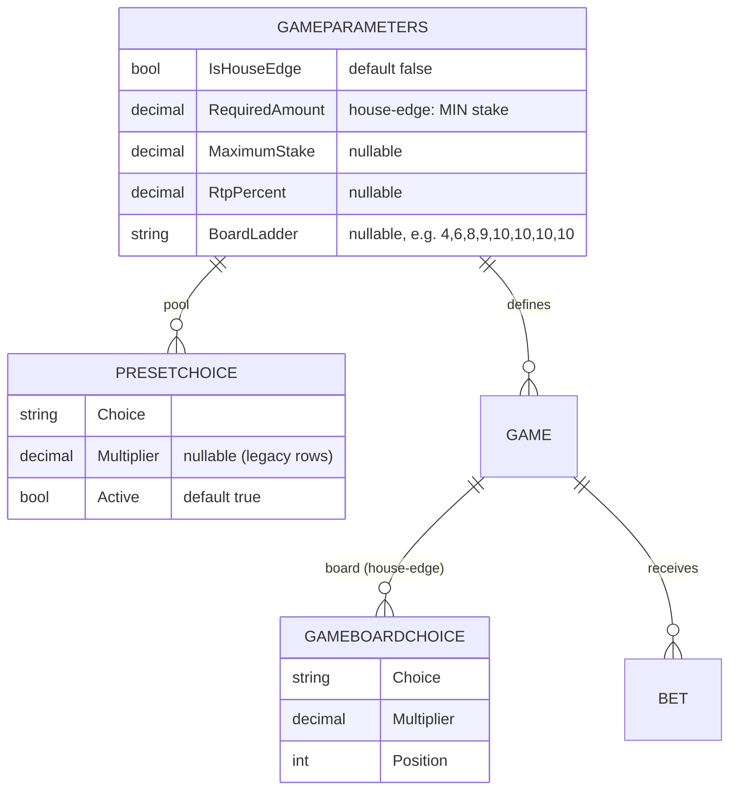
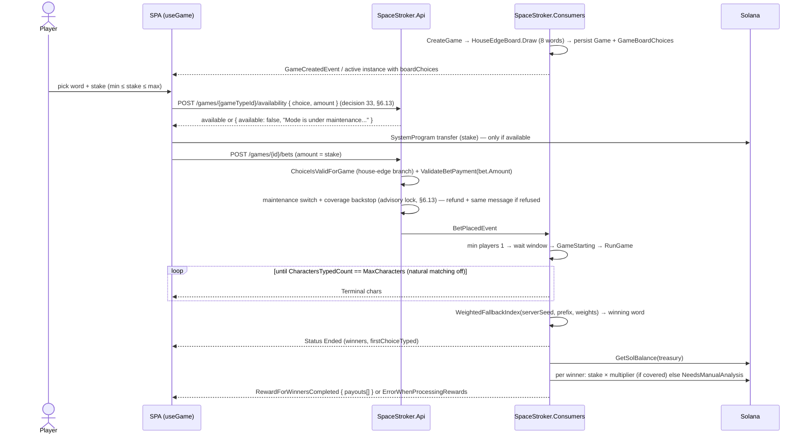
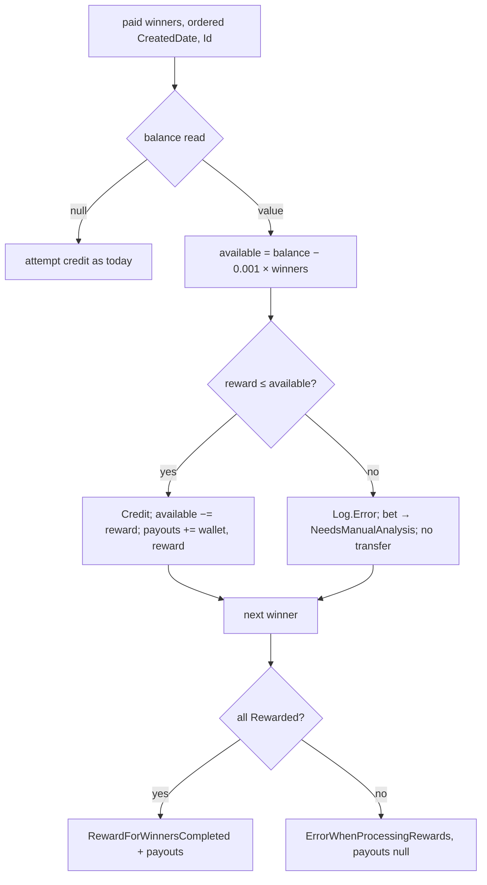

# SpaceStroker — "Hyper Roll" Feature — Implementation Spec

> **Status: Ready for implementation** — refined via Trello card
> [Hyper roll game](https://trello.com/c/XtPzB6wZ/183-hyper-roll-game) (#183, refined 2026-09-14).
> Repos affected: `monkify-backend`, `monkify-front`, `monkify-lp`, and this doc (+ `deploy/sql/`) in
> `monkify-meta`.
> Branch / worktree: `feature/hyper-roll` → `.worktrees/hyper-roll/<repo>` in all four repos
> (`monkify-lp` branches off `master`, the others off `main`).
> Change level: **Feature** — mandatory happy-path integration test + a second integration test for the
> insufficient-treasury path; `features/hyper-roll.md` is written at ship.
>
> **Purpose:** Beast Mode is gated `ComingSoon` and is not coming back as-is. **Hyper Roll** replaces it:
> a **player-vs-house** preset game. Every round offers **8 words drawn from a pool**; each player picks
> **one** word and stakes **any SOL amount within a min/max**; one provably-fair **weighted draw** picks
> the round's word, and every player who picked it is paid **`stake × that word's multiplier`** (max
> **10×**) straight from the treasury — no pot, no split, no house cut. A bigger multiplier is a rarer
> word, tuned to a fixed board recipe where **every word pays back the same 91.84% RTP** (decision 37,
> 2026-09-17 — supersedes decision 36's 87.38% board; decisions 29–31 had spread paybacks unevenly across
> slots, decision 36 flattened them again, and decision 37 lifts the flat rate to 91.84% with the **same
> multipliers and the same words** — only the slot counts moved).

---

## 1. Summary

Hyper Roll rides the **existing round machinery unchanged** — `Game`, statuses, rollover, the typer,
SignalR, history, stats, the FAIR panel. What changes is the money model and how the winner is chosen.

| Aspect | Pari-mutuel types (Cosmic Sprint, Space Jackpot, legacy presets) — unchanged | **Hyper Roll** (new) |
| --- | --- | --- |
| Opponent | Other players (pot is split) | **The house** (treasury pays) |
| Choices | Free text, or the type's full preset list | **8 words per round**, drawn from a pool, persisted on the `Game` |
| Stake | Exactly `RequiredAmount` | **`RequiredAmount` ≤ stake ≤ `MaximumStake`** (0.01 – 0.1 SOL at launch — decision 30) |
| Bets per player per round | Preset: 1 · free text: see `fix-bets-logic` | **1** (existing `OneBetPerPresetRound`) |
| Players to start | `MinimumNumberOfPlayers` (2) | **1** — house seed bet never applies |
| Winner | First sequence typed (natural), else uniform fallback | **Always the weighted fallback draw**; natural matching disabled |
| Payout | `pot / paid winners − commission` | **`stake × multiplier`**, **no commission** |
| House take | Configured commission on profit | **8.16% edge** baked into the multipliers (91.84% RTP — decision 37, 2026-09-17) |
| Money source for a win | The round's own stakes | **The treasury balance** (pre-payout solvency check) |
| Near-miss `N AWAY!` row / `> POT:` line | Shown | **Hidden** |
| Orbit | Per `AllowOrbit` | **Never** (`AllowOrbit = false`) |
| STATS badge | `N% HOUSE CUT` | **`91.84% RTP`** |

**The multiplier/probability rule (superseded by decision 29, 2026-09-16).** Each board slot carries its
own **published weight**; a slot's draw probability is `weight ÷ 1,000,000` and its return is
`weight/1,000,000 × multiplier`. The board is still built to a **fixed recipe** (the *ladder*, now
`multiplier:weight` pairs) — which specific words fill each slot is random, but the recipe, and therefore
every slot's odds and payback, are identical every round. The **model** allows words to pay back different
amounts: `RtpPercent` is the **best** word's return, and every word's return sits within 0.25 points of it
or below. **The shipped board does not use that freedom** — since decision 36, and still under decision 37
(2026-09-17), every slot pays back the same rate, so `RtpPercent` is THE payback rather than a ceiling and
the copy carries no "up to". The tolerance rule stays as decision 29 wrote it, so a future board could
spread the paybacks again without a code change.

Launch ladder (decision 37, 2026-09-17 — supersedes decision 36's board): **`10× / 10× / 4× / 6× / 8× / 8× /
9× / 9×`** with weights `91837 / 91837 / 229591 / 153061 / 114796 / 114796 / 102041 / 102041`
(Σ = 1,000,000) → win chances **9.18% / 9.18% / 22.96% / 15.31% / 11.48% / 11.48% / 10.20% / 10.20%**. Pays
back: every slot returns **91.84%** (each slot's exact return sits at 91.836–91.837%; the exact equal
return is `1 ÷ Σ(1/m) = 91.8367%`, and integer rounding of the weights hands the leftover units to the
lowest-return slots) — `RtpPercent = 91.84`, published as **"91.84% RTP"** (no "up to" — every word pays
back the same). The house keeps **8.16%** of turnover, ~8.2 SOL per 100 SOL wagered. **No multiplier
changed and no word was retiered** from decision 36's board: the five multipliers are still
`4× / 6× / 8× / 9× / 10×` and the 54-word pool's length→multiplier rule is untouched — only the slot
counts moved (the board had two `6×` slots and one `9×`; it now has one `6×` slot and two `9×`), which is
enough to lift the flat payback from 87.38% to 91.84% because the equal payback is `1 ÷ Σ(1/m)` over the
8 slots. What a player sees differently: a round now shows **one 7-letter word instead of two, and two
9-letter words instead of one**.

---

## 2. Constraints (MANDATORY)

From `monkify-meta/constraints.md` (full list there):

- **Worktree per repo:** `feature/hyper-roll` at `.worktrees/hyper-roll/<repo>` in `monkify-backend`,
  `monkify-front`, `monkify-lp`, `monkify-meta`. Hubs stay on `main`/`master`. Push after every branch
  update.
- **Unit tests:** update/add in `SpaceStroker.Tests`; run via `scripts/run_tests.bat` (never the full
  `dotnet test` — `ProductionSessions` is a slow Monte Carlo suite); report changed/added tests at the end.
- **Integration tests (mandatory, Feature + game-flow change):** `SpaceStroker.Tests.Integration` via
  `scripts/run_integration_tests.bat` — see §12.2.
- **EF mapping:** inline in `SpaceStrokerDbContext.OnModelCreating`; no `IEntityTypeConfiguration`.
- **Migrations:** under `SpaceStroker.Infrastructure/Migrations/`; applied only by `SpaceStroker.Consumers`.
  Never hand-edit the model snapshot.
- **NoTracking DbContext:** load-mutate-`SaveChanges` persists nothing — use `ExecuteUpdate` or
  `context.Update()`.
- **Secrets/config:** mock-only values in committed files. The treasury keypair is never touched; no new
  secret and no Terraform binding is added by this feature.
- **Vague messaging:** every bet refusal reuses the existing vague results (`InvalidAmount`,
  `InvalidChoice`, `GameNotValidForBets`); no state-specific copy.
- **Hosts:** the API stays stateless; board drawing, the typer, payouts and seeding live in
  `SpaceStroker.Consumers`.
- **No production queries.** The Beast Mode SQL (§6.12) is run by a human.
- **Front build gotchas:** copy the hub `yarn.lock` into the front worktree before a Docker build and
  verify the served bundle changed; `prettier --check` false-alarms on CRLF files.

---

## 3. Resolved product decisions

From the refined card (short mode) — authoritative.

| # | Decision |
| --- | --- |
| 1 | **One card.** (Moot after #2/#3 — no settlement refactor remains.) |
| 2 | **Settlement is native SOL**, through the same `TokenSettings` path as every other type. The card's original $STROKE line is superseded; the launch token stays information-only (`features/token-launch.md` is not reversed). |
| 3 | **No per-game-type token seam.** Nothing consumes it; a second asset would be its own card with its own cutover runbook. |
| 4 | ~~**Fixed tiers, constant RTP.** Probability = `RTP ÷ multiplier`; the board recipe fixes `Σ(1/m)` so the edge never drifts with the draw.~~ **Superseded by decision 29** (2026-09-16): probability is now `weight ÷ 1,000,000` with a published per-slot weight; the recipe still never drifts round to round, but words no longer share one RTP. |
| 5 | ~~**House edge 5% (RTP 95%).**~~ Publicly computable from the published weights — accepted. **Superseded by decision 29** (2026-09-16): the uniform 5% edge is replaced by a per-slot payback (50% on the 2× and 10× slots, ~~94.19%~~ ~~93.6%~~ on the rest — numeral updated by decision 31's board C, 2026-09-16); `RtpPercent = ` ~~`94.19`~~ ~~`93.6`~~ is now the best word's return, still publicly computable from the published weights. **Superseded again by decision 36** (2026-09-17): the per-slot spread is undone — every word pays back the same ~~**`87.38`**~~ once more (the same uniform-RTP shape as this decision's original 95%, at a lower numeral). **Numeral superseded by decision 37** (2026-09-17): the flat payback is raised to **`91.84`** (house edge **8.16%**) with the same multipliers — only the slot counts moved. |
| 6 | **Multiplier cap 10×, floor 1.01×** (unchanged). With 8 options the board is squeezed to ~4×–10×. ~~Worked ladder `4/6/8/9/10/10/10/10`.~~ ~~Worked ladder per decision 29 (2026-09-16): `10/10/2/5/7/8/9/9` with weights `50000/50000/250002/188384/134560/117740/104657/104657`.~~ ~~Worked ladder superseded by decision 31's board C (2026-09-16): `10/10/2/6/6/8/8/9` with weights `50000/50000/250000/156000/156000/117000/117000/104000`.~~ ~~**Worked ladder superseded by decision 36** (2026-09-17): `10/10/4/6/6/8/8/9` with weights `87379/87379/218446/145631/145631/109223/109223/97088`.~~ **Worked ladder superseded by decision 37** (2026-09-17): `10/10/4/6/8/8/9/9` with weights `91837/91837/229591/153061/114796/114796/102041/102041` — the same five multipliers, one `6×` slot traded for a second `9×`. |
| 7 | **Stake bounds are fixed in config** (min + max), checked client-side before signing **and** on the backend. Accepted: a low treasury still accepts bets it cannot cover; those take the failed-payout path (#12). |
| 8 | **The tier (multiplier) is stored per word**, not computed from the word's shape. **Extended by decision 29** (2026-09-16, not superseded): the board now also stores a per-slot **weight** alongside the multiplier, since slots of the same multiplier can differ in payback across a board recipe. **Further extended by decision 32** (2026-09-16, still not superseded): the multiplier is still stored per word, not computed at runtime — but the curated pool now sets each word's multiplier by its **length** (6→2×, 7→6×, 8→8×, 9→9×, 10→10×) rather than by shape. **The `6→2×` mapping is updated by decision 36** (2026-09-17) **to `6→4×`**; the rest of the length→multiplier mapping is unchanged. **Unchanged by decision 37** (2026-09-17): the `6→4×, 7→6×, 8→8×, 9→9×, 10→10×` mapping survives intact — decision 37 moves only the board's slot counts, never a word's multiplier. |
| 9 | **The pool lives in a reworked `PresetChoice`** table, seeded from config create-only like `DefaultGames`; add/remove words = config + Consumers redeploy. No admin CRUD. |
| 10 | **Shared round, one draw.** Everyone sees the same board and result; every winner is paid their own `stake × multiplier`. `MinimumNumberOfPlayers = 1`. |
| 11 | **Keep the monkey terminal**, reveal the winning word at the end. **Natural matching is disabled** for this type and the **near-miss row is suppressed**. A roll animation was rejected. |
| 12 | **Bankroll = the treasury (`TokenOwner`)** via the existing payout path. Pre-payout balance check; when short → bet `NeedsManualAnalysis`, round `ErrorWhenProcessingRewards`, a human resolves. |
| 13 | **Board selection is ordinary randomness at round creation.** Only the winner draw is provably fair ~~(all 8 words have identical EV, so there is nothing to exploit)~~. **Reasoning revised by decision 29** (2026-09-16), conclusion unchanged: words no longer share one EV across the whole board, but every candidate word for a given slot still shares that slot's fixed weight — which specific word fills a slot never changes its EV, so ordinary randomness is still nothing to exploit. |
| 14 | **No house commission** on this type — a 10× tile pays exactly 10×. |
| 15 | **One bet per player per round** (existing `OneBetPerPresetRound`). |
| 16 | **Beast Mode is deactivated** (`Active = false`) by a `deploy/sql/` script shipped with the feature; its history stays reachable. Hyper Roll is a fresh row. Trello #169 is archived. |
| 17 | **Stake entry = the console's green visor + bump chips** (owner picked mockup **A6**, 2026-09-14): `+0.01 / +0.05 / +0.1 / MAX`, no SET step — the lever places the bet. Lobby card shows "from <min> SOL". *(Refined as "reuse `OrbitAmountField`"; superseded by the mockup choice — only its validation rules carry over.)* |
| 18 | **Copy states the RTP**: ~~"95% RTP"~~ ~~"up to 94.19% RTP" (value superseded by decision 29, 2026-09-16)~~ ~~"up to 93.6% RTP" (value superseded again by decision 31's board C, 2026-09-16)~~ ~~"87.38% RTP" (value and "up to" wording superseded by decision 36, 2026-09-17 — every word pays back the same again)~~ **"91.84% RTP"** (value superseded by decision 37, 2026-09-17; still no "up to") where other types show the house cut, a terms clause for house-edge games, a `/how-to-play` mode card with the ladder. |
| 19 | **The draw stays count-triggered** (`CharactersTypedCount >= MaxCharacters`), never wall-clock. |
| 20 | **Implementation gate — passed 2026-09-14.** The owner reviewed mockup rounds A/B/C, A1–A3 and A4/A5 and picked **A6** (https://claude.ai/code/artifact/6db62365-7929-4135-80cd-571802ac7ab0). |
| 21 | **Console + terminal = A6 (as adjusted by the owner on 2026-09-14).** The terminal keeps today's screen line for line: `> CHOICES:` stays one `> word` per line in key order with the key number (1–8) displayed left of the word (e.g. `> 1 stardust`), and each line gains MULT · ODDS · JACKPOT (at the current stake) under a dim header; 10× lines use the terminal's existing hot yellow + glow (`.result-win`), bold. The jackpot values, the header stake and the `> BET:` line update live on every keystroke; while no bet is placed, the display stake is the typed value clamped to [min stake, max stake]. `> POT` becomes `> RTP: 95%` *(this A6 detail was superseded first by decision 25, which drops RTP from the
terminal entirely, and its numeral by decision 29 — ~~94.19%~~ ~~93.6%~~ ~~87.38%~~ **91.84%** (updated by decision 31's board C, then decision 36, then decision 37, 2026-09-17) — 2026-09-16)*. The console keeps Option A's bottom: the stake typed in the visor with enlarged 2×2 grid of bump chips under it, the lever, and the 8 numbered keys each tagged with its multiplier (10× tags solid yellow). |
| 22 | **Spec §3.1 (S1–S14) approved by the owner, 2026-09-14.** |
| 23 | **A6 terminal/console adjustments approved by the owner on 2026-09-14:** desktop stake chips enlarged to a 2×2 grid under the visor; each CHOICES row displays its key number (1–8) left of the word; jackpot values, header stake and BET line update live on every keystroke with the display stake clamped to [min, max]; column header CHANCE renamed to ODDS; column header WIN renamed to JACKPOT (desktop shows `JACKPOT @ <stake>`); the `< TOP` marker removed while top-tier rows retain hot-yellow styling. |
| 24 | **Owner picked mockup C1 on 2026-09-15**, replacing A6's CHOICES layout and key tags. Terminal intro collapses to one line: desktop `> HYPER ROLL · BET <stake> SOL · RTP 95%`, phone `> BET <stake> SOL · RTP 95%`; the dim MIN/MAX STAKE line stays below it. Choices table one dim header `#  WORD  MULT  ODDS  JACKPOT` then one row per key, no `>` prefix, no bold/glow, no `< TOP`. Tier colours by multiplier: green `#16a34a` ≤ 4×, blue `#2563eb` ≤ 6×, red `#ef4444` ≤ 8×, yellow `#fde047` 9–10×; row text uses its colour. The 8 keys lose multiplier tags; each outlined in its tier colour; selected key thicker outline, brightens, glows. Player's pick turns terminal row to tier colour + black text, fading ~300 ms. **Colour values superseded by decision 32** (2026-09-16): tiers now key to the word's exact multiplier (2×/6×/8×/9×/10×) instead of a range, 9× gets its own new orange tier, and 2× green is brightened — see decision 32 for the new hexes; the layout this decision records (compact table, outlined keys, no `< TOP`) is otherwise unchanged. |
| 25 | **Owner adjusted C1 on 2026-09-15.** Terminal intro drops RTP: desktop `> HYPER ROLL · BET <stake> SOL`, phone `> BET <stake> SOL`; RTP remains on STATS badge, `/how-to-play` card, and terms. Choices table header becomes `#  WORD  MULT  JACKPOT` (ODDS column removed). Key art is drawn in tier colour (filled, not outlined): green `#16a34a`, blue `#2563eb`, red `#ef4444`, yellow `#fde047`; new pixel-art variants for yellow generated from red by colour swap. Selected key brightens and glows in its tier colour. **Colour values superseded by decision 32** (2026-09-16): adds a new orange 9× variant (`button{1..8}-orange.png`, also colour-swapped from red) and regenerates the green 2× variant brighter (`button{1..8}-green.png`); blue/red/yellow art and the filled-key styling recorded here are otherwise unchanged. |
| 26 | **Owner picked stake-button mockup S3 on 2026-09-15.** LCD-style soft keys replace the 2×2 bump-chip grid: buttons read `+.01 / +.05 / +.1 / MAX` in green LCD style (1px green outline, green text, no fill); MAX uses dashed yellow outline and yellow text. Desktop: keys sit inside the green stake visor, positioned below the stake number (which gains a dim "SOL" suffix), separated by a thin divider. Phone: keys appear in a grey bezel row (44px tall) positioned above the cabinet visor, which displays the stake with dim "SOL" suffix. A pressed key briefly inverts: solid green background + black text (solid yellow + black for MAX). |
| 27 | **Owner picked mockup P1 on 2026-09-15** for the desktop stake-key placement: LCD soft keys move out of the visor into their own grey bezel directly below it, stacked as full-width rows (~24px tall, 9px labels). Phone: unchanged (grey bezel row of four keys above the cabinet). Each key reads `+.01 / +.05 / +.1 / MAX` in green LCD style (1px green outline, green text); MAX dashed yellow outline and yellow text; pressed key inverts to solid fill + black text. The visor now displays only the stake with dim "SOL" suffix. |
| 28 | **Hyper Roll rounds skip the bet-gathering hold on the first bet.** As soon as a Hyper Roll round receives its first valid paid bet, it skips the global `MinimumWaitPeriodForBets` (15 s) and moves straight to `GameStarting` with a 5-second countdown (new config setting `GeneralSettings:Games:HouseEdgeTimeUntilGameStarts = 5`; falls back to `TimeUntilGameStarts` when 0 or missing). Other players can still join during those 5 seconds. Cosmic Sprint, Space Jackpot and other types keep today's timing (15 s hold + their configured `TimeUntilGameStarts`). Wallets are unchanged: every type, Hyper Roll included, receives bets into and pays winners from the single shared treasury wallet (`GeneralSettings:Operator:Token:TokenOwnerPublicKey`). *(Superseded by decision 35: solo rounds start immediately on their single bet.)* |
| 29 | **Odds v2 — the board no longer pays back the same RTP per word (owner decision, 2026-09-16).** New launch board (slot order fixed, words drawn per slot as before): `10×, 10×, 2×, 5×, 7×, 8×, 9×, 9×` with published weights `50000, 50000, 250002, 188384, 134560, 117740, 104657, 104657` (Σ = 1,000,000 exactly; chance of a slot = weight ÷ 1,000,000). Each slot's return (`weight/total × multiplier`) is no longer uniform: the 2× and both 10× slots pay back **50.0%**, the 5×/7×/8× and both 9× slots pay back **94.19%**. `RtpPercent` is redefined as the **best** word's return — `94.19` — and the validation rule (`HouseEdgeRules.Validate`, §6.1) is replaced: a ladder is valid when `|maxReturnPercent − RtpPercent| ≤ 0.25`, where `maxReturnPercent = max over slots of (weight/total × multiplier × 100)`, instead of the old `Σ(1/m) = 1/RTP`. Weights are **published before betting** (`ActiveGameDto.BoardChoiceDto.Weight`, `GameVerificationDto.VerificationBoardChoiceDto.Weight`) and **stored per board** on a new `GameBoardChoices.Weight` (`int`, NOT NULL, filled from the slot the word was drawn for; a new migration backfills existing rows with the old formula `100000000 / round(Multiplier * 100)` so older local rounds still verify) — `HouseEdgeRules.WeightFor(multiplier)` and its TS (`weightForMultiplier`) and verify.html twins are **removed**; the typer, the reward path and both verifiers always read the stored/published weight, never a value recomputed from the multiplier, and the verifiers additionally check every published weight is a positive integer. `GameParameters.BoardLadder` now stores `multiplier:weight` pairs (`"10:50000,10:50000,2:250002,5:188384,7:134560,8:117740,9:104657,9:104657"`, slot order as above) and its column widens 64→256 via a **new** migration (the existing `20260914181542_HyperRoll` migration is never edited, and the model snapshot is never hand-edited). The word pool is retiered (content unchanged, tier labels move): `2×` = banana, cosmos, hubble, bonobo, meteor (were `4×`); `5×` = rocket, planet, comets, launch, orbits (were `6×`); `7×` = gorilla, nebulae, stellar, shuttle, eclipse (were `8×`); `8×` = asteroid, blastoff, galactic, mandrill, starship (were `10×`); `9×` = gravity, capsule, jupiter, voyager, cyborgs (unchanged); `10×` = universe, spaceman, stardust, wormhole, redshift, nebulous, rocketry, kilonova, sunspots, starfall, moonwalk (unchanged, 11 words). **Why:** the owner wants 10× to hit only 5% of the time, only two 10× words per board, and at least one 2× word; under the old rule (every word pays back the same, chance = RTP ÷ multiplier) that combination is impossible — 10× at 5% alone forces every word to a 50% return, and a 2× at 95% would take 47.5% of all chance, leaving the other five words under their 52.8% minimum. The fix is letting words pay back different amounts: the 7×–9× middle stays near today's deal (94.19%), while the 2× and the two 10× words pay back 50%. A player who always picks a middle word keeps a ~5.8% house edge. **Supersedes** decision 4 (probability = `RTP ÷ multiplier` / `Σ(1/m)` recipe), decision 5 (uniform 5% house edge across every word), and decision 6's worked ladder `4/6/8/9/10/10/10/10` (the 10×/1.01× cap/floor themselves are unchanged). **Amends the RTP numeral only** (95% → up to 94.19%) in decisions 18 and 21; the copy/layout decisions they record are otherwise unchanged. **Revises the reasoning, not the conclusion,** of decision 13: the board draw is still ordinary (non-provably-fair) randomness, because within any one ladder slot every candidate word shares that slot's fixed weight — which specific word fills a slot never changes its EV, even though different slots now pay different amounts. Decision 8 (tier stored per word) is **extended, not superseded**: the board now also stores a weight per word instance. **Its "10× at 5%" target and `RtpPercent` numeral (carried into decision 31's board C at 93.6) are superseded by decision 36** (2026-09-17): the owner later accepted `10×` landing at ~~8.74%~~ of the time in exchange for a flat ~~87.38%~~ payback on every word — see decision 36. **Both numerals are superseded again by decision 37** (2026-09-17): `10×` now lands **9.18%** of the time and the flat payback is **91.84%**; this decision's model — explicit published per-slot weights, `|maxReturnPercent − RtpPercent| ≤ 0.25`, weights published before betting and stored per board — is **unchanged by decision 37 and stays in force**. **Its launch board and word-pool retier are superseded by decision 31** (2026-09-16, board C: `10×, 10×, 2×, 6×, 6×, 8×, 8×, 9×` with weights `50000, 50000, 250000, 156000, 156000, 117000, 117000, 104000`, `RtpPercent = 93.6`); this decision's **model stays in force** — explicit published per-slot weights, the `HouseEdgeRules.Validate` rule (`|maxReturnPercent − RtpPercent| ≤ 0.25`), and weights published before betting / stored per board are unchanged. |
| 30 | **Launch max stake lowered to 0.1 SOL (owner, 2026-09-16; supersedes S4's 0.2).** Max single payout is now 1 SOL. Sized against a **20 SOL treasury** by a Monte Carlo on the odds-v2 board (decision 29): one player per round, always betting the max, 1,000 bets. The worst case is a player who always picks a 9× word (the riskiest word paying back 94.19%): the chance a win goes unpaid is **0.6% at 0.1**, 4.4% at 0.15, 10.8% at 0.2 and 24.0% at 0.3 (5.2% at 0.1 over 10,000 bets); a player picking a random word is ~0% at 0.1. Rule of thumb: max stake ≈ treasury ÷ 200 — raise to 0.15 once the treasury passes ~30 SOL. Caveats the numbers do not cover: several players winning on the same word in one shared round (decision 10) add up, and the same treasury also pays Cosmic Sprint. `HouseEdgeReconciler` deliberately never touches `MaximumStake`, so the config change only seeds NEW databases (Hyper Roll is unshipped, so production launches at 0.1); an existing database needs a guarded `UPDATE` plus a parameters-cache refresh. **The 0.1 SOL max stake is unchanged; under decision 31's board C the same worst-case (always-9×) Monte Carlo now finds a 0.39% chance of an unpaid win over 1,000 bets** (was 0.6% on decision 29's board) — decision 31, 2026-09-16. **Risk figure further updated by decision 36** (2026-09-17): on the flat 87.38% board, the worst case moves to the `10×` word — ~~**0.12%**~~ (was 0.39% on board C's `9×` word) — see decision 36. **Risk figure updated again by decision 37** (2026-09-17): on the flat **91.84%** board the same worst case (always the max stake on a `10×` word) is **0.41%** over 1,000 bets and **1.97%** over 10,000 — the thinner 8.16% edge lengthens the window before the treasury has grown. The **0.1 SOL `MaximumStake` and the 20 SOL treasury are unchanged**; so are the caveats — the simulation is ONE player, and with solo rounds (decision 35) several players can hold open rounds at once whose worst cases must be covered together (two simultaneous max bets need 2 SOL free, not 1), and the same treasury also pays Cosmic Sprint. Revisit a higher payback once the treasury grows: at 40 SOL the 95.53% board's 10,000-bet risk drops to 1.22%, about where 91.84% sits at 20 SOL today — see decision 37. |
| 31 | **Odds v2 — launch board C, 5 distinct multipliers (owner decision, 2026-09-16). Supersedes decision 29's LAUNCH BOARD and word retier only** — decision 29's model (explicit published per-slot weights, the `|maxReturnPercent − RtpPercent| ≤ 0.25` validation rule, and weights published before betting / stored per board) **stays in force**. New launch board: `10×, 10×, 2×, 6×, 6×, 8×, 8×, 9×` with published weights `50000, 50000, 250000, 156000, 156000, 117000, 117000, 104000` (Σ = 1,000,000 exactly). Chances: **5.0% / 5.0% / 25.0% / 15.6% / 15.6% / 11.7% / 11.7% / 10.4%**. Returns: the 2× and both 10× slots pay back **50%**; the two 6×, two 8× and the 9× slot pay back **93.6%** exactly (`0.65 ÷ (2/6 + 2/8 + 1/9) = 0.65 × 36/25 = 0.936`). `RtpPercent` is redefined to **`93.6`** (the best word's return, down from 94.19), published as **"up to 93.6% RTP"**. `BoardLadder`: `10:50000,10:50000,2:250000,6:156000,6:156000,8:117000,8:117000,9:104000`. House edge for a player who always picks a middle word is now **6.4%** (was 5.8% on decision 29's board). **Word pool retier** (content unchanged, only tier labels move — this restores the original letter-shape tiers for 6/8/9/10): `2×` = banana, cosmos, hubble, bonobo, meteor (unchanged, 6 letters with a repeat); `6×` = rocket, planet, comets, launch, orbits (were `5×`, 6 distinct letters); `8×` = gorilla, nebulae, stellar, shuttle, eclipse (were `7×`, 7 letters with a repeat); `9×` = gravity, capsule, jupiter, voyager, cyborgs (unchanged, 7 distinct letters); `10×` = asteroid, blastoff, galactic, mandrill, starship, moonwalk, universe, spaceman, stardust, wormhole, redshift, nebulous, rocketry, kilonova, sunspots, starfall (were split across the old `8×`/`10×` tiers; now one 16-word, 8-letter tier). There are no `5×` or `7×` words any more. **Why:** the owner asked to see the board with 5 distinct multipliers instead of 6 (keeping two 10× at 5% and one 2× at 25%); three options were simulated: **A** drop 7× (middle return 94.74%), **B** drop 8× (middle return 91.82%), **C** put 6× in place of both 5× and 7× (middle return 93.60%); the owner picked **C**. **Risk** (decision 30's 0.1 SOL max stake, 20 SOL treasury, unchanged): a Monte Carlo of one player per round always betting the max on the riskiest (9×) word, 1,000 bets, finds a **0.39%** chance of an unpaid win on board C (was 0.58% on decision 29's board, rounded to 0.6% in decision 30); same caveats as decision 30 — several winners on the same word in one shared round (decision 10) add up, and the treasury also pays Cosmic Sprint. **Amends** decision 29's launch board, `RtpPercent` numeral (94.19 → 93.6), `BoardLadder` value and word-pool retier only; decision 29's weighted-slot model, `Validate` rule and publish/store mechanism are unchanged and remain in force. Decision 30's 0.1 SOL max stake is unchanged; only its risk figure changes (0.6% → 0.39%) under this board — see decision 30's annotation. **Its word-pool retier is superseded by decision 32** (2026-09-16): the pool is replaced wholesale and curated by word length (6→2×, 7→6×, 8→8×, 9→9×, 10→10×, 54 words total) instead of by letter shape; this decision's board recipe — ladder, weights, `RtpPercent 93.6`, `MaximumStake 0.1` (per decision 30) — stays in force, unchanged by decision 32. **Its board recipe (ladder, weights, `RtpPercent` 93.6) is superseded by decision 36** (2026-09-17): every word pays back the same ~~87.38%~~ instead of this board's 50%/93.6% split — decision 30's 0.1 SOL `MaximumStake` and decision 32's word-length curation (aside from the `2×`→`4×` relabel) stay in force, unchanged by decision 36. **The flat numeral is superseded again by decision 37** (2026-09-17): **91.84%**, on the same five multipliers, with one `6×` slot traded for a second `9×`. |
| 32 | **Word length now sets the multiplier — pool curated by length, 9× gets its own tier, 2× green much brighter (owner decision, 2026-09-16).** New 54-word pool (content wholly replaced; all lowercase a–z, no duplicates), one multiplier per word length: `2×` = 6-letter words (`banana`, `cosmos`, `hubble`, `bonobo`, `meteor`, `rocket`, `planet`, `comets`, `launch`, `orbits` — 10 words); `6×` = 7-letter words (`gorilla`, `nebulae`, `stellar`, `shuttle`, `eclipse`, `gravity`, `capsule`, `jupiter`, `voyager`, `cyborgs` — 10 words); `8×` = 8-letter words (`asteroid`, `blastoff`, `galactic`, `mandrill`, `starship`, `moonwalk`, `universe`, `spaceman`, `stardust`, `wormhole`, `redshift`, `nebulous`, `rocketry`, `kilonova`, `sunspots`, `starfall` — 16 words); `9×` = 9-letter words (`astronaut`, `spaceship`, `satellite`, `telescope`, `supernova`, `andromeda`, `starlight`, `blackhole`, `orangutan` — 9 words, new tier); `10×` = 10-letter words (`chimpanzee`, `spacecraft`, `astronomer`, `cosmonauts`, `lightyears`, `hyperdrive`, `multiverse`, `starflight`, `stargazers` — 9 words). Word-length range becomes **6–10** (was 6–8; `HouseEdgeRules.WordMinLength`/`WordMaxLength`, §6.1, become `6`/`10`). **The rule is enforced only where the shipped pool is defined**, by a **config-binding unit test** that asserts every Hyper Roll word's length matches its multiplier per this table (§12.1) — it is explicitly **not** a runtime validation rule: `HouseEdgeRules.Validate` keeps checking length only against `[WordMinLength, WordMaxLength]`, charset and per-tier uniqueness, exactly as before, and the model still stores a multiplier per word (decision 8) so a future board could use other tiers or shapes again. Board C's recipe (decision 31: ladder `10×,10×,2×,6×,6×,8×,8×,9×`, weights `50000,50000,250000,156000,156000,117000,117000,104000`, `RtpPercent 93.6`, `MaximumStake 0.1`) is **unchanged** — only the pool the words are drawn from is replaced. **Tier colours:** `9×` gets its own **new orange tier** (was folded into yellow's 9–10× band) — terminal row colour `#fb923c`, key art dark/mid/main/light `#7c2d12`/`#ea580c`/`#fb923c`/`#ffedd5`, a new colour-swapped `button{1..8}-orange.png` variant; and the `2×` green tier is made **much brighter** — terminal row colour `#86efac` (was `#16a34a`), key art dark/mid/main/light `#166534`/`#16a34a`/`#4ade80`/`#f0fdf4` (was `#14532d`/`#15803d`/`#22c55e`/`#dcfce7`), `button{1..8}-green.png` **regenerated** at the new tones. Blue (`6×`, `#2563eb`) and red (`8×`, `#ef4444`, the original art) are unchanged; yellow now covers only `10×` (`#fde047`, unchanged) — tiers are keyed to the word's **exact** multiplier, not a range, since the pool now assigns exactly one multiplier per word length. The grey tones in the key art (`#c7cfdd`, `#92a1b9`) stay un-recoloured; every variant remains an exact palette swap of the original red art (dark `#571c27` / mid `#891e2b` / main `#ea323c` / light `#fdd2ed`). **`ChoiceRequiredLength`** for Hyper Roll becomes **10**, the longest pool word (resolved in backend `bb229ab`: no server path uses it for a house-edge bet, clients size their choice input from it, and `HouseEdgeReconciler` now heals it on existing rows); this is the final value. **Supersedes/extends:** decision 8 (tier stored per word) is **extended, not superseded** — the multiplier is still stored per word, only now curated by length instead of ad hoc. **Supersedes** decision 31's word-pool retier only (decision 31's board recipe — ladder, weights, `RtpPercent`, `MaximumStake` — stays in force, unchanged by this decision). **Supersedes** decisions 24 and 25's tier-colour values (range-keyed `green ≤4×/blue ≤6×/red ≤8×/yellow 9–10×`) with the exact-multiplier scheme above; the layout/behaviour those decisions record (compact table, filled keys, fade-in, no tags, no `< TOP`) is otherwise unchanged. **Supersedes** the §5.1 curation guideline (shape-based curation — repeated/distinct letter counts — is replaced by pure length curation). **Its `2×` (6-letter) tier label is superseded by decision 36** (2026-09-17): the ten 6-letter words move from `2×` to `4×` — same words, same colour tier (relabelled `2×` gray → `4×` gray, no art change); every other length→multiplier mapping (`7→6×`, `8→8×`, `9→9×`, `10→10×`) and the pool composition are unchanged. **Wholly unchanged by decision 37** (2026-09-17): the `6→4×, 7→6×, 8→8×, 9→9×, 10→10×` mapping, the 54-word pool and its 10/10/16/9/9 composition, and every tier colour and key-art variant survive decision 37 untouched — that decision rebalances only how many BOARD SLOTS each existing multiplier gets (one fewer `6×`, one more `9×`), so a round simply shows one 7-letter word instead of two and two 9-letter words instead of one. |
| 33 | **Maintenance switch + treasury coverage check — binding contract (owner decision, 2026-09-16).** Hyper Roll (and any future house-edge type) gains an operational off-switch so an operator can stop taking new bets without a migration, plus a server-authoritative treasury-coverage check so a bet is never accepted when the treasury cannot pay it if it wins. **The switch:** new global config key **`GeneralSettings:Games:HouseEdgeEnabled`** (bool, on `GameSettings` — §5.1.1, next to `HouseEdgeTimeUntilGameStarts`). **Missing = `true`** (enabled), so existing environments keep working unchanged; it applies to every house-edge type (today only Hyper Roll). It is plain config, read at request time via options/settings — never persisted to a table, never frozen into the `ActiveParameters:v2` cache. Deploy surface: an `appConfig` entry in `deploy/secrets.<env>.json` (not a secret, no Terraform binding); **flipping it is a redeploy of API + Consumers** (a new Cloud Run revision), not a live toggle. While disabled, open rounds keep running and existing bets settle and pay exactly as today — **only NEW bets are refused.** `GameParametersDto` gains **`UnderMaintenance`** (bool) = `IsHouseEdge && !HouseEdgeEnabled`; always `false` for non-house-edge types (§6.9). **Owner answer 1 — badge, not hidden:** while disabled, Hyper Roll **stays in the lobby** with a **MAINTENANCE badge** on its card and remains clickable (unlike `comingSoon`, which gates the card outright); only placing a bet is blocked. **Owner answer 2 — checked before signing, backstopped after paying:** the SPA checks BEFORE the wallet signs; the server repeats the same check as a backstop AFTER the payment lands, and REFUNDS if it refuses — the client check saves the player a doomed transfer, the backstop is what actually protects the money. **Pre-check endpoint:** **`POST /games/{gameTypeId}/availability`** — deliberately **not** nested under `/bets`, because `POST /games/{id}/bets` is deliberately left unlimited app-side (`conventions/backend.md` → "Adding a rate-limit rule is a money-path decision") and the rule-list guard (`RateLimitSettingsTests`) refuses any rule whose `Endpoint` contains `/bets`; this new read is a different, safely rate-limitable path (new `IpRateLimiting` rule, 60/min). Body `{ choice, amount }`; response is the standard `DefaultResponse` shape — `{ available: true }` or `{ available: false, message: "<verbatim message below>" }`; non-house-edge types always return `available: true`; the check is read-only — it never reserves stake and never moves money. **Server backstop:** in `RegisterBetHandler`, for paid house-edge bets, after the payment signature is verified and before the bet row is inserted — if the switch is off, or the coverage rule (below) fails — refuse via the existing **`RefundInvalidBet`** path with a new `ErrorMessages` entry carrying the verbatim message (a paid bet is refunded on-chain; a free bet is reject-only), and return that message to the client. **Owner answer 3 — coverage is the round's worst case, not this bet alone and not other modes' pots:** a house-edge bet is coverable only when `treasuryBalance − feeReserve ≥ exposure`, where: `treasuryBalance` is a FRESH, uncached `solanaService.GetSolBalance(Operator.Token.TokenOwnerPublicKey)` read (the incoming stake is never added to it — it may not be reflected yet at the RPC's commitment level, so the read stays conservative); `exposure` sums, over every house-edge round not yet settled (any status before rewards complete — normally just the current round), that round's **worst case** — the maximum over its board words of `Σ(stake × that word's multiplier)` over its accepted PAID bets on that word (free bets excluded), with the new bet counted in its own round; `feeReserve` is `HouseEdgeRules.TreasuryFeeReservePerTransfer` (0.001) × the count of paid bets on each round's worst-case word, summed (one payout transfer each), plus one more for the new bet's own transfer. This one domain rule is shared by the pre-check and the backstop so the two paths can never disagree. **A failed balance read (RPC error) counts as NOT coverable — fail closed** — the player gets the maintenance message rather than an optimistic accept. Other game modes' pari-mutuel pots are deliberately excluded from `exposure`: they are paid from their own round's stakes, never from the treasury, so they add no exposure to it. **Concurrency:** because the API runs as multiple instances, the "compute exposure → decide → insert" sequence is serialized with **one global PostgreSQL transaction-scoped advisory lock** (a single key shared by every house-edge round, not one per round — exposure is summed over every unsettled round, so bets on different rounds must serialize too; see decision 35 and `hyper-roll-solo-rounds.md` T1), so two simultaneous bets can never both pass when together they exceed coverage. **The existing payout-time solvency check in `RewardGameConsumer` (§6.7, S8) stays in place as the last line of defence, unchanged** — the switch and the pre-check/backstop stop a bet from being *accepted*; the payout-time check still catches anything that slips through between acceptance and payout (e.g. a treasury draw-down from another round's payout in between). **The single player-facing message, verbatim, used for BOTH causes (deliberately vague — it must not reveal whether the cause is the switch or the treasury):** `"Mode is under maintenance. Please try again later."` Revealing "treasury is short" would tell the world the house is undercapitalized; revealing "feature disabled" is merely cosmetic, but one shared message costs nothing and closes the first leak too — consistent with the vague-messaging convention this spec already follows (§2, and `constraints.md` §6). |
| 34 | **Solo UI redesign — rarity keys, golden 10×, sprite stake plate, win moment (owner, 2026-09-16, picked across three artifact rounds).** The owner judged the round screen still read as a multiplayer race and the stake controls as off-theme. **Copy:** written for one player against the house — header `YOU vs THE HOUSE` + stake, no `BETS PLACED` / player count / `RACING`, a `LOCKED: <word> · <m>× · <chance> TO LAND` line, `EDSON IS TYPING...`, `EDSON TYPED: <word>`, and a plain loss line (`NO WIN THIS ROUND.`) — the owner explicitly rejected near-miss and word-comparison lines. **Keys:** stay the official `button{n}.png` sprites (the owner rejected redrawn keys), recoloured by exact palette swap into a **rarity ladder** — `2×` gray, `6×` green, `8×` blue, `9×` purple, `10×` **gold** (the owner: "10× must feel golden, special") — with one soft top-right sparkle on 10× keys; the selected key is pressed, with **no glow ring**. **Table:** `KEY WORD MULT PAYS` *(owner follow-up during the decision-35 implementation, 2026-09-17: the ODDS column was removed)*; only the MULT box is coloured — a vivid fill (gray `#d3d9e4`, green `#1dff6e`, blue `#2f86ff`, purple `#c24dff`, gold `#ffc21a`) with dark ink, and **every** MULT square carries a darker rim and a soft glow in its tier colour *(same follow-up: replaces the original "flat, no gloss" boxes with only 10× rimmed; the green, blue and purple key art was regenerated in brighter ramps, §7.2)*; the picked row is outlined and the rest dim; new boards reel in. **Stake plate:** the old plate-key stepper and soft-key rows are replaced by console sprites drawn to the key's own 7×9 / 4-tone rules — `−`/`+` slate keys around an LCD bezel, and `.01 / .02 / .05` chips that ARE the official keys 1/2/5 in slate, plus a red MAX key; chips now **set** the stake instead of adding to it. **Win moment:** a banner (headline scaled by multiplier — NICE WIN! → MAX HIT!, `×m`, count-up payout) over a coin shower and tier flash, shaking from 8× up, gold triple ring for 10×. **Supersedes** decision 32's tier colours/art mapping (green/blue/red/orange/yellow) and decisions 24/25's picked-row fill, selected-key glow and `# WORD MULT JACKPOT` header; §7.2, §7.4, AC 14 and §11.2 are rewritten to match. **Not in this decision:** rerolling the board with the lever *mid-round* (explored in the artifacts) needs a backend change — a board is shared by every player in a round (decisions 10, 13) — and is left open; today the lever still rolls to the next round, which is where the reel-in plays. *(Resolved by decision 35.)* **Its `2×` tier label is renamed `4×` by decision 36** (2026-09-17, same word content and colour values — only the multiplier changes). |
| 35 | **Solo rounds — every Hyper Roll round belongs to one player (owner, 2026-09-17).** "There is no case where more than one player should ever bet in the same round for this game." Each player opens their own board (anonymously, bound to the wallet by the first and only bet), rerolls it in place with the lever while unbet, and their bet starts their round immediately; the next board comes from a lever pull or a reload; abandoned boards expire; chat becomes per game type; the lobby card loses its live pill. Full design: **[`hyper-roll-solo-rounds.md`](hyper-roll-solo-rounds.md)**. **Supersedes** decision 10 (shared round, one draw for everyone), decision 15 (one bet *per player* per round → one bet per round), decision 28 (start 5 s after the first bet → immediately), decision 30's "several winners in one shared round" caveat (no longer possible), and §6.13's per-round lock wording (the lock is and stays global — see that spec's T1). |
| 36 | **Odds v3 — every word pays back the same again, 87.38% flat (owner decision, 2026-09-17).** ~~New launch board: `10×, 10×, 4×, 6×, 6×, 8×, 8×, 9×` with published weights `87379, 87379, 218446, 145631, 145631, 109223, 109223, 97088` (Σ = 1,000,000 exactly). Chances: **8.74% / 8.74% / 21.84% / 14.56% / 14.56% / 10.92% / 10.92% / 9.71%**. Every slot's return sits at **87.378–87.379%** (the exact equal return is `1 ÷ Σ(1/m) = 87.3786%`; integer rounding of the weights hands the 3 leftover units to the lowest-return slots). `RtpPercent` is redefined to **`87.38`**, published as **"87.38% RTP"** (no longer "up to" — every word pays back the same). `BoardLadder`: `10:87379,10:87379,4:218446,6:145631,6:145631,8:109223,8:109223,9:97088`.~~ **This board, ladder, weights and `RtpPercent` numeral are superseded by decision 37** (2026-09-17): the same five multipliers, one `6×` slot traded for a second `9×`, lift the flat payback to **91.84%**. **The former `2×` slot becomes `4×`** — the ten 6-letter words (`banana`, `cosmos`, `hubble`, `bonobo`, `meteor`, `rocket`, `planet`, `comets`, `launch`, `orbits`) move from `2×` to `4×`; decision 32's word-length→multiplier rule becomes `6→4×, 7→6×, 8→8×, 9→9×, 10→10×` (only the 6-letter row changes — every other tier, the pool content, and the 54-word/10-10-16-9-9 composition are unchanged). There are no `2×` words any more. **Frontend tier colours:** the grey (lowest) tier now covers multiplier `4×` instead of `2×`, so the decision-34 rarity ladder keeps its five distinct colours — **`4×` grey, `6×` green, `8×` blue, `9×` purple, `10×` gold** — same hexes and art as decision 34/32, only the label moves from `2×` to `4×`; no new art, no colour value changes. **Why:** the owner wanted the paybacks less spread out than board C's 50%/93.6% split. Three boards were compared: **(1)** keep `10×` at 5% and lift the `2×` slot to `3×` (payback range 50–93.6%), **(2)** `10×` at 6.5% with slot 3 at `4×` (payback range 65–92.1%), **(3)** every word pays back the same (87.38% flat). The owner picked **(3)**, accepting that `10×` words now win ~~**8.74%**~~ of the time (supersedes decisions 29/31's "10× at 5%" target) and that every player now pays a flat ~~**12.6%**~~ house edge, up from **6.4%** for a player who previously picked the best (middle) word on board C. **Risk** (Monte Carlo, 20 SOL treasury, 0.1 SOL max stake — decision 30, unchanged — 1,000 max bets always on one word, same method as decisions 30–31): the unpaid-win chance is now ~~**0.12%**~~, always on a `10×` word (the new riskiest tier — a reversal from board C, whose riskiest word was `9×`); ~~**0.05%** on `9×`~~; **~0%** on `4×` (was **0.39–0.44%** on board C's riskiest/safest words, decision 31). **Settings-only change:** shipped as a backend commit on `feature/hyper-roll`, recorded as "backend feature/hyper-roll, 2026-09-17" — `HouseEdgeReconciler` (§6.3) applies the new ladder, `RtpPercent` and word tiers on **existing** databases, the same self-heal path as every prior odds revision. **Supersedes** decision 31's launch board, ladder, weights and `RtpPercent` numeral, and decision 32's `2×`/6-letter tier label only — decision 29's weighted-slot model, `Validate` rule and publish/store mechanism, and decision 30's 0.1 SOL `MaximumStake`, stay in force and are unchanged by this decision. **Superseded by decision 37** (2026-09-17, same day) **in its numerals only** — launch board, ladder, weights and `RtpPercent` — because the owner asked for more payback at the same multipliers: `10×` now lands **9.18%**, the flat payback is **91.84%**, the house edge **8.16%**, and the risk figures become **0.41%** / **1.97%**. Everything else this decision established stays in force: the `2×`→`4×` relabel, the "flat payback, no more 'up to' in the copy" rule, and the settings-only `HouseEdgeReconciler` delivery path. |
| 37 | **Odds v4 — same multipliers, more payback: flat 91.84% (owner decision, 2026-09-17, applied the same day).** The owner asked to raise the payback above decision 36's 87.38% while **keeping the current multipliers**, and while the house stays comfortably ahead on a **20 SOL treasury with a 0.1 SOL max stake** (decision 30, unchanged). New launch board: `10×, 10×, 4×, 6×, 8×, 8×, 9×, 9×` with published weights `91837, 91837, 229591, 153061, 114796, 114796, 102041, 102041` (Σ = 1,000,000 exactly). Chances: **9.18% / 9.18% / 22.96% / 15.31% / 11.48% / 11.48% / 10.20% / 10.20%**. Every slot's return sits at **91.836–91.837%** (the exact equal return is `1 ÷ Σ(1/m) = 91.8367%`; integer rounding of the weights hands the leftover units to the lowest-return slots). `RtpPercent` = **`91.84`**, published as **"91.84% RTP"** — still **not** "up to", because every word pays back the same (decision 36's copy rule, kept). The house keeps **8.16%** of turnover (was 12.62% under decision 36), i.e. ~8.2 SOL per 100 SOL wagered. `BoardLadder`: `10:91837,10:91837,4:229591,6:153061,8:114796,8:114796,9:102041,9:102041`. **NO multiplier changed and NO word was retiered.** The five multipliers are still `4×, 6×, 8×, 9×, 10×`; decision 32's word-length→multiplier rule (`6→4×, 7→6×, 8→8×, 9→9×, 10→10×`), the 54-word pool and its 10/10/16/9/9 composition, and decision 34/36's tier colours (`4×` grey, `6×` green, `8×` blue, `9×` purple, `10×` gold) are all untouched — no new art, no colour value changes, no migration, no word-pool change. **Only the SLOT COUNTS moved:** the board had two `6×` slots and one `9×`; it now has one `6×` slot and two `9×`. Because the equal payback is `1 ÷ Σ(1/m)` over the 8 slots, moving one slot from a low multiplier to a high one raises the flat payback on its own — 87.38% → 91.84% — with zero changes to multipliers, words, tiers or frontend colours. **What a player sees differently:** a round now shows **one** 7-letter word instead of two, and **two** 9-letter words instead of one. **Why this board and not a higher one.** The owner first asked for the best payback reachable at a fixed 20 SOL treasury and 0.1 SOL max stake. All **20** reachable equal-payback boards over the five existing multipliers (slot counts summing to 8, at least one slot per multiplier so every tier colour survives) were simulated with the same Monte Carlo as decisions 30/31/36 — one player per round, always betting the max on the same word, the worst word being `10×`. Results (slot counts written `4×/6×/8×/9×/10×`, then payback, then the chance a win cannot be paid over 1,000 and 10,000 consecutive max bets): `1/2/2/1/2` = 87.38% (decision 36) — 0.10% / 0.17%; `1/2/1/2/2` = 88.45% — 0.15% / 0.31%; `1/2/1/1/3` = 89.33% — 0.19% / 0.51%; `1/1/3/1/2` = 90.68% — 0.28% / 1.07%; **`1/1/2/2/2` = 91.84% — 0.41% / 1.97% ← CHOSEN**; `1/1/2/1/3` = 92.78% — 0.56% / 3.09%; `1/1/1/2/3` = 93.99% — 0.80% / 5.87%; `1/1/1/1/4` = 94.99% — 1.06% / 9.17%. **91.84% is the last board whose long-horizon (10,000-bet) unpaid-win risk stays under 2%**; past it the risk roughly doubles per step, because the thinner edge lengthens the window before the treasury has grown. Two alternatives were also offered and **rejected in favour of keeping the multipliers**: changing the multipliers themselves to `5×/6×/6×/8×/8×/9×/10×/10×` (91.37%) or `5×/7×/7×/8×/8×/9×/10×/10×` (95.53%, which needs ~40 SOL to reach today's risk level). The owner's instruction was "can you keep the current multipliers?", then "apply it". **Risk** (20 SOL treasury, 0.1 SOL max stake, unchanged): the unpaid-win chance is **0.41%** over 1,000 worst-case max bets (was 0.12% on decision 36's board) and **1.97%** over 10,000 — still always on a `10×` word, the riskiest tier. Same caveats as decisions 30/31/36: the simulation is **ONE player**, and with solo rounds (decision 35) several players can hold open rounds at once whose worst cases must be covered together — two simultaneous max bets need **2 SOL free, not 1** — and the same treasury also pays Cosmic Sprint. Revisit a higher payback once the treasury grows: at 40 SOL the 95.53% board's 10,000-bet risk drops to **1.22%**, about where 91.84% sits at 20 SOL today. **Settings-only change**, exactly like decision 36: `HouseEdgeReconciler` (§6.3) applies the new ladder and `RtpPercent` to existing databases on startup. No migration, no word-pool change. **Supersedes** decision 36's launch board, ladder, weights and `RtpPercent` numeral **ONLY**. Everything else stays in force and unchanged: decision 29's weighted-slot model (explicit published per-slot weights, the `\|maxReturnPercent − RtpPercent\| ≤ 0.25` validation rule, weights published before betting and stored per board), decision 30's 0.1 SOL `MaximumStake`, decision 32's word-length curation and 54-word pool, decision 34/36's tier colours, and decision 36's "no more 'up to' in the copy" rule. **Copy bug fixed alongside it (a decision-36 leftover):** the STATS badge in `GameStatsPanel.vue` and the `/how-to-play` mode-card blurb in `GuideModeCards.vue` were still rendering "**UP TO** N% RTP" even though decision 36 had already dropped "up to"; both now render the bare `91.84% RTP` (§7.5). If a future board ever reintroduces unequal per-slot paybacks, "UP TO" goes back in **both** places together. |

### 3.1 Spec-time decisions (made while writing this spec — flag to the owner at implementation start)

| # | Decision | Why |
| --- | --- | --- |
| S1 | A new **`GameParameters.IsHouseEdge`** flag selects the Hyper Roll behaviour. Preset types with `IsHouseEdge = false` keep today's pari-mutuel "the list IS the choices" behaviour. | Two test catalogues (`TestGameParameters`, `IntegrationGameParameters`) and the admin portal create legacy preset types; keying the rework on a flag keeps every fixed-price type byte-identical and avoids rewriting dozens of preset-race tests. After this card no *seeded* type uses the legacy preset path. |
| S2 | The per-word tier is stored as the **multiplier itself** (`PresetChoice.Multiplier`), and the board recipe is a **`GameParameters.BoardLadder`** column. **Updated by decision 29** (2026-09-16): the column now stores `multiplier:weight` pairs (e.g. ~~`"10:50000,10:50000,2:250000,6:156000,6:156000,8:117000,8:117000,9:104000"` — the launch board per decision 31's board C, 2026-09-16~~ ~~`"10:87379,10:87379,4:218446,6:145631,6:145631,8:109223,8:109223,9:97088"` — the launch board per decision 36, 2026-09-17~~ **`"10:91837,10:91837,4:229591,6:153061,8:114796,8:114796,9:102041,9:102041"` — the launch board per decision 37, 2026-09-17** —, widened 64→256 by a new migration) instead of bare multipliers, since slot weights are no longer derivable from the multiplier alone. | One number per word, one recipe per type; no tier-index indirection to keep in sync. |
| S3 | **`RequiredAmount` is the minimum stake** for a house-edge type; a new **`MaximumStake`** column is the max. Both are **create-only** (like `RequiredAmount` today); words, ladder and RTP get a startup self-heal. | Reuses the column the lobby, the `from` price and the rent floor already read. Changing a bet bound on a live DB can refuse a stale SPA's bet *after* its SOL moved, which is exactly why `RequiredAmount` has no self-heal — changing them needs a hand-run SQL like `cosmic-sprint-reprice.sql`. The board-shaping fields carry no such risk (boards are persisted per round). |
| S4 | **Launch values:** min **0.01 SOL**, ~~max **0.2 SOL** (max single payout 2 SOL)~~ max **0.1 SOL** (max single payout 1 SOL — superseded by decision 30), and the ~~36-word~~ **54-word** initial pool in §5.1 (word count and curation superseded by decision 32, 2026-09-16). | Needed to write a complete spec; not decided in refinement. The owner may edit config before ship — no code change. |
| S5 | A round's board is persisted in a new **`GameBoardChoices`** child table. | Queryable and typed; the verification endpoint, bet validation, payouts and the DTO all read it. |
| S6 | **Weighted draw algorithm:** a uniform draw over the board's total weight by **32-bit rejection sampling** on the existing `"<prefix>|fallback"` HMAC block (§6.5) — this mechanism is unchanged by decision 29. ~~Weights `floor(10^8 / (multiplier×100))`~~ **superseded by decision 29** (2026-09-16): weights are no longer derived from the multiplier — they are **published, per-slot values** stored on `GameBoardChoices.Weight`; `HouseEdgeRules.WeightFor(multiplier)` is removed. | Exact, portable integer maths — identical in C#, TypeScript and the offline HTML. ~~Floor rounding moves any word's EV by < 5 ppm (94.9865%–94.9869%).~~ Moot after decision 29: weights are explicit, published values, not floor-derived. |
| S7 | Per-player payouts go on the wire as **`result.payouts: [{ wallet, amount }]`** on `RewardForWinnersCompleted`; `netRewardPerWinner` stays **null** for house-edge rounds. | `netRewardPerWinner` is documented as uniform-by-construction and a unit test pins that; Hyper Roll payouts are not uniform. Each bet's wallet, choice and amount are already public on `{gameId}/Bets`, so `stake × multiplier` leaks nothing new. An old SPA simply prints no PAID line. |
| S8 | **Treasury check = running balance, per winner, in bet order**, with a **0.001 SOL reserve per transfer**. A failed balance read (`null`) does not block — the transfer is attempted and fails on-chain the normal way. | Lets coverable winners still be paid when one is not (AC 11); "unknown is not empty" is the house convention (house seed, Orbit). |
| S9 | `> POT:` is **hidden** for house-edge rounds; `> PAID:` shows **only the viewer's own payout** (omitted if they did not win). | Σ stakes is not a pot anyone can win in a player-vs-house round; a single PAID figure cannot describe several different payouts. |
| S10 | **Beast Mode is removed from `DefaultGames`.** | Otherwise a fresh install seeds a dead, gated type forever. Existing databases are handled by the SQL (#16). |
| S11 | Art: the app picker resolves Hyper Roll to the existing **preset** art by shape; the LP card **reuses the Beast Mode poster/GIF** until dedicated art exists. | No Hyper Roll art exists; commissioning it is out of scope. |
| S12 | Every Hyper Roll round types **exactly `MaxCharacters`** (≤ 500,000) before the draw; pacing is unchanged and lands ~10 s. | Natural matching is off, so the run always hits the cap — the same CPU profile as a fallback-bound race today. |
| S13 | `HouseSeedBetService` **returns early (Information log)** for house-edge types. | Today a min-1 type reaches a `Log.Warning` on every round; production keeps Warning-and-above, so Hyper Roll would spam prod logs every ~10 s. |
| S14 | The integration catalogue's Hyper Roll type uses **`MinimumNumberOfPlayers = 8`**, so 8 players can cover the whole board before it starts. | Guarantees exactly one winner per test round (deterministic assertions); the harness `MinimumWaitPeriodForBets` is 1 s. A separate isolated min-1 type covers AC 6. |

### 3.2 Code findings — what blocks the feature today (every one is fixed by this spec)

1. **`BetDomainService.ChoiceIsValidForGame` (`:58`)** refuses variable words and stakes: exact
   `ChoiceRequiredLength` (`:62`), `Amount != RequiredAmount` (`:68`), and `InvalidChoice` against the
   type's *whole* preset list (`:74`), not the round's board.
2. **`SpaceStrokerTyper.CheckForWinners` (`:107`)** matches a rolling window sized to the longest choice;
   with 6–10-letter words the shorter ones can never match, and a longer word *could* win naturally —
   bypassing the weighted draw. **`DecideFallbackWinner` (`:162`)** is uniform over the choices.
3. **`SpaceStrokerTyper.SetBets` (`:195`)** pre-registers every `Parameters.PresetChoices` row — the
   whole pool, not the board.
4. **`BetDomainService.CalculateRewardForBet` (`:86`)** divides a pot and takes a commission;
   `BetRewardBiggerThanThePot` would reject any `10×` payout.
5. **`GameResult.NetRewardPerWinner`** is uniform by construction
   (`BetDomainServiceTests.EveryPaidWinnerInARound_ReceivesTheIdenticalNetAmount`).
6. **`GameService.GetGameById` (`:116`)** and **`RewardGameConsumer` (`:35–46`)** load no board.
7. **`HouseSeedBetService.SeedRound` (`:93`)** logs a Warning for every min-1 round (S13).
8. **`DefaultGameSettings.PresetChoices`** is `List<string>` — it cannot carry a multiplier.
9. **`IntegrationTestFixture.SeedWaitingBetsGameAsync` (`:443`)** inserts a raw `Game`, so a seeded
   round would have no board.
10. **`DefaultGameSeedingTests.ConsumersStartup_SeedsBeastModeAsComingSoon_AndLeavesTheOthersPlayable`**
    asserts Beast Mode is seeded — invalid after S10.
11. **Frontend:** `GameConsole.vue` builds its 8-key keypad from `selectedGame.presetChoices` (`:275`,
    `:292`); `useGame.ts` uses `requiredAmount` as the stake at `:836` (fee-headroom check) and `:889` (transfer
    amount) — the mobile deep-link resume already reuses that `amount` via `MobilePendingBet.amount`;
    `:614` and `:661` are embedded `postToParent` signals, of which only `bet-settled` (`:661`) should
    report the player's own stake *(corrected 2026-09-14)*; the near-miss hook is fed
    at `:247` and `:581`; `verifyRound` in `utils/provablyFair.ts` and `public/verify.html` replays the
    stream looking for natural matches and uses the uniform fallback.
12. **Positive finding — no change needed:** `SolanaService.ValidateBetPayment` validates the on-chain
    transfer against **`bet.Amount`** (`:488–504`), not `RequiredAmount`, so variable stakes validate
    as-is. Refunds use `bet.Amount` too (`CalculateRemainingBetPayout`).

---

## 4. Data model

### 4.1 Entity changes

**`SpaceStroker.Domain/Games/Entities/GameParameters.cs`** — add:

```csharp
// Player-vs-house preset type (#183 Hyper Roll). The round offers BoardLadder.Count words drawn from
// the active PresetChoices pool, the winner is ALWAYS the weighted fallback draw, and a winner is paid
// stake × multiplier from the treasury with no commission. False = today's pari-mutuel behaviour.
public bool IsHouseEdge { get; set; }

// House-edge only. RequiredAmount is the MINIMUM stake; this is the maximum. Create-only (see spec S3).
public decimal? MaximumStake { get; set; }

// House-edge only. The BEST word's return-to-player as a percent (91.84 = 91.84%) — words need not all pay
// back the same, so this is an upper bound ("up to"). Validated against BoardLadder.
public decimal? RtpPercent { get; set; }

// House-edge only. The board recipe: comma-separated multiplier:weight slots, invariant culture, e.g.
// "10:91837,10:91837,4:229591,6:153061,8:114796,8:114796,9:102041,9:102041". Its slot count is the board
// size; a slot wins with weight ÷ Σ weights. See HouseEdgeRules.
public string? BoardLadder { get; set; }
```

**`SpaceStroker.Domain/Games/Entities/PresetChoice.cs`** — add:

```csharp
// House-edge pools only: the word's multiplier (its tier). Null on legacy pari-mutuel preset rows.
public decimal? Multiplier { get; set; }

// House-edge pools only: false = retired from the pool (never drawn again). Legacy rows stay true.
public bool Active { get; set; } = true;
```

**New `SpaceStroker.Domain/Games/Entities/GameBoardChoice.cs`**:

```csharp
public class GameBoardChoice : TableEntity
{
    public Game Game { get; set; }
    public Guid GameId { get; set; }
    public string Choice { get; set; }
    public decimal Multiplier { get; set; }
    // 0-based display order (shuffled at draw time). The weighted draw does NOT use this order — it
    // orders by Choice ordinal (§6.5).
    public int Position { get; set; }
}
```

**`SpaceStroker.Domain/Games/Entities/Game.cs`** — add
`public ICollection<GameBoardChoice> BoardChoices { get; set; }` with a comment in the house style:
persisted at creation for house-edge rounds, empty otherwise; never rewritten.

### 4.2 EF configuration (inline, `SpaceStrokerDbContext.OnModelCreating`)

```csharp
// GameParameters builder
builder.Property(x => x.IsHouseEdge).IsRequired().HasDefaultValue(false);
builder.Property(x => x.MaximumStake).HasPrecision(18, 9).IsRequired(false);
builder.Property(x => x.RtpPercent).HasPrecision(5, 2).IsRequired(false);
builder.Property(x => x.BoardLadder).HasMaxLength(64).IsRequired(false);

// PresetChoice builder
builder.Property(x => x.Multiplier).HasPrecision(6, 2).IsRequired(false);
builder.Property(x => x.Active).IsRequired().HasDefaultValue(true);

// New
modelBuilder.Entity<GameBoardChoice>(builder =>
{
    builder.HasKey(x => x.Id);
    builder.Property(x => x.Choice).IsRequired().HasMaxLength(20);
    builder.Property(x => x.Multiplier).HasPrecision(6, 2).IsRequired();
    builder.Property(x => x.Position).IsRequired();
    builder.HasIndex(x => x.GameId);
});

// Game builder
builder.HasMany(x => x.BoardChoices).WithOne(x => x.Game).HasForeignKey(x => x.GameId);
```

No unique index on `PresetChoice (ParametersId, Choice)`: admin-created legacy rows in a dev database may
already duplicate, which would fail the migration. Uniqueness within a house-edge pool is enforced by the
config validation (§6.2) and the reconciler (§6.3).

### 4.3 Migration

```bash
# from monkify-backend/src/SpaceStroker.Infrastructure
dotnet ef migrations add HyperRoll \
  --startup-project ../SpaceStroker.Consumers/SpaceStroker.Consumers.csproj \
  --context SpaceStrokerDbContext
```

Adds the four `GameParameters` columns (`IsHouseEdge` default `false`), the two `PresetChoices` columns
(`Active` default `true`), and the `GameBoardChoices` table. Existing rows are untouched in meaning.

### 4.4 ER (delta)



---

## 5. Configuration

### 5.1 `SpaceStroker.Common/spacestrokersettings.json` → `GeneralSettings:Operator:DefaultGames`

**Remove the `Beast Mode` entry** (S10). **Add** (this is product config, not a secret — no mock needed):

```json
{
  "Name": "Hyper Roll",
  "Description": "Pick 1 of 8 words and set your stake - land it and the house pays your multiplier, up to 10x.",
  "AllowedCharacters": 2,
  "ChoiceRequiredLength": 10,
  "RequiredAmount": 0.01,
  "MinimumNumberOfPlayers": 1,
  "AcceptDuplicatedCharacters": true,
  "AllowOrbit": false,
  "ComingSoon": false,
  "PresetChoices": [],
  "HouseEdge": {
    "RtpPercent": 91.84,
    "MaximumStake": 0.1,
    "Ladder": [
      { "Multiplier": 10, "Weight": 91837 },  { "Multiplier": 10, "Weight": 91837 },
      { "Multiplier": 4,  "Weight": 229591 }, { "Multiplier": 6,  "Weight": 153061 },
      { "Multiplier": 8,  "Weight": 114796 }, { "Multiplier": 8,  "Weight": 114796 },
      { "Multiplier": 9,  "Weight": 102041 }, { "Multiplier": 9,  "Weight": 102041 }
    ],
    "Words": [
      { "Word": "banana", "Multiplier": 4 },   { "Word": "cosmos", "Multiplier": 4 },
      { "Word": "hubble", "Multiplier": 4 },   { "Word": "bonobo", "Multiplier": 4 },
      { "Word": "meteor", "Multiplier": 4 },   { "Word": "rocket", "Multiplier": 4 },
      { "Word": "planet", "Multiplier": 4 },   { "Word": "comets", "Multiplier": 4 },
      { "Word": "launch", "Multiplier": 4 },   { "Word": "orbits", "Multiplier": 4 },
      { "Word": "gorilla", "Multiplier": 6 },  { "Word": "nebulae", "Multiplier": 6 },
      { "Word": "stellar", "Multiplier": 6 },  { "Word": "shuttle", "Multiplier": 6 },
      { "Word": "eclipse", "Multiplier": 6 },  { "Word": "gravity", "Multiplier": 6 },
      { "Word": "capsule", "Multiplier": 6 },  { "Word": "jupiter", "Multiplier": 6 },
      { "Word": "voyager", "Multiplier": 6 },  { "Word": "cyborgs", "Multiplier": 6 },
      { "Word": "asteroid", "Multiplier": 8 }, { "Word": "blastoff", "Multiplier": 8 },
      { "Word": "galactic", "Multiplier": 8 }, { "Word": "mandrill", "Multiplier": 8 },
      { "Word": "starship", "Multiplier": 8 }, { "Word": "moonwalk", "Multiplier": 8 },
      { "Word": "universe", "Multiplier": 8 }, { "Word": "spaceman", "Multiplier": 8 },
      { "Word": "stardust", "Multiplier": 8 }, { "Word": "wormhole", "Multiplier": 8 },
      { "Word": "redshift", "Multiplier": 8 }, { "Word": "nebulous", "Multiplier": 8 },
      { "Word": "rocketry", "Multiplier": 8 }, { "Word": "kilonova", "Multiplier": 8 },
      { "Word": "sunspots", "Multiplier": 8 }, { "Word": "starfall", "Multiplier": 8 },
      { "Word": "astronaut", "Multiplier": 9 }, { "Word": "spaceship", "Multiplier": 9 },
      { "Word": "satellite", "Multiplier": 9 }, { "Word": "telescope", "Multiplier": 9 },
      { "Word": "supernova", "Multiplier": 9 }, { "Word": "andromeda", "Multiplier": 9 },
      { "Word": "starlight", "Multiplier": 9 }, { "Word": "blackhole", "Multiplier": 9 },
      { "Word": "orangutan", "Multiplier": 9 },
      { "Word": "chimpanzee", "Multiplier": 10 }, { "Word": "spacecraft", "Multiplier": 10 },
      { "Word": "astronomer", "Multiplier": 10 }, { "Word": "cosmonauts", "Multiplier": 10 },
      { "Word": "lightyears", "Multiplier": 10 }, { "Word": "hyperdrive", "Multiplier": 10 },
      { "Word": "multiverse", "Multiplier": 10 }, { "Word": "starflight", "Multiplier": 10 },
      { "Word": "stargazers", "Multiplier": 10 }
    ]
  }
}
```

**Curation guideline for the initial pool — owner decision 32, 2026-09-16, tier label updated by decision
36, 2026-09-17** (supersedes this guideline as it stood after decision 29, then decision 31's board C;
decision 8 still stores the tier per word so the owner can override it): the pool is curated **purely by
word length**, and word length directly sets the multiplier — the earlier shape-based rules (repeated- vs
distinct-letter counts) no longer apply. The pool: 54 words, all lowercase a–z, no duplicates, 10 words
each for `4×`/`6×` (decision 36 relabels the 6-letter tier from `2×` to `4×`; the words are unchanged), 16
for `8×`, 9 words each for `9×`/`10×`:

- `4×` (6 letters, was `2×` — decision 36, 2026-09-17): `banana`, `cosmos`, `hubble`, `bonobo`, `meteor`,
  `rocket`, `planet`, `comets`, `launch`, `orbits`
- `6×` (7 letters): `gorilla`, `nebulae`, `stellar`, `shuttle`, `eclipse`, `gravity`, `capsule`,
  `jupiter`, `voyager`, `cyborgs`
- `8×` (8 letters): `asteroid`, `blastoff`, `galactic`, `mandrill`, `starship`, `moonwalk`, `universe`,
  `spaceman`, `stardust`, `wormhole`, `redshift`, `nebulous`, `rocketry`, `kilonova`, `sunspots`,
  `starfall`
- `9×` (9 letters, **new tier**): `astronaut`, `spaceship`, `satellite`, `telescope`, `supernova`,
  `andromeda`, `starlight`, `blackhole`, `orangutan`
- `10×` (10 letters): `chimpanzee`, `spacecraft`, `astronomer`, `cosmonauts`, `lightyears`, `hyperdrive`,
  `multiverse`, `starflight`, `stargazers`

Word-length range is now **6–10** (was 6–8; `HouseEdgeRules.WordMinLength`/`WordMaxLength`, §6.1, are `6`/
`10`). **The rule is enforced only where the shipped pool is defined** — a **config-binding unit test**
(§12.1) asserts every word's length matches its multiplier per this table; it is explicitly **not** a
runtime validation rule (`HouseEdgeRules.Validate` still just checks length against
`[WordMinLength, WordMaxLength]`, charset and per-tier uniqueness, so a future board could still curate
words by shape or any other rule). Board C's recipe (decision 31: ladder, weights, `RtpPercent 93.6`,
`MaximumStake 0.1`) is **unchanged by this decision** — only the pool the words are drawn from is replaced;
the board recipe itself (ladder, weights, `RtpPercent`) is superseded by **decision 36** (2026-09-17), then by
**decision 37** (2026-09-17): `10×,10×,4×,6×,8×,8×,9×,9×` with weights
`91837,91837,229591,153061,114796,114796,102041,102041`, `RtpPercent 91.84`, `MaximumStake 0.1` unchanged.
Decision 37 changes **no word and no multiplier** — the 54-word pool, its 10/10/16/9/9 composition and the
`6→4×, 7→6×, 8→8×, 9→9×, 10→10×` rule above are exactly as decision 32/36 left them; only the number of
board slots per multiplier moved (one fewer `6×`, one more `9×`).

`ChoiceRequiredLength` for Hyper Roll is **10** — the longest pool word (backend `bb229ab`). No server path
uses it for a house-edge bet: `BetDomainService.ChoiceIsValidForGame` accepts any word on the round's board
regardless of this value, and the typer and verification work from the board. It matters to CLIENTS, which
size their choice input from it, so at 8 a 9- or 10-letter word could be cut short. Because seeding is
create-only, `HouseEdgeReconciler` now also heals `ChoiceRequiredLength` from config on an existing row.

### 5.1.1 Global game timing — `GeneralSettings:Games`

The global `Games` block in `spacestrokersettings.json` includes two timing settings:

```json
{
  "GeneralSettings": {
    "Games": {
      "TimeUntilGameStarts": 10,
      "HouseEdgeTimeUntilGameStarts": 0,
      "HouseEdgeEnabled": true
    }
  }
}
```

- **`TimeUntilGameStarts`** (int seconds): used by Cosmic Sprint, Space Jackpot, and other pari-mutuel types.
- **`HouseEdgeTimeUntilGameStarts`** (int seconds, nullable): Hyper Roll rounds skip `MinimumWaitPeriodForBets` (15 s) and use this value as the countdown to `GameStarting` after their bet. **Missing falls back to `TimeUntilGameStarts`; 0 means start immediately.** The committed value is **0**: a solo round has exactly one bet, so there is nobody to wait for (decision 35).
- **`HouseEdgeEnabled`** (bool, decision 33, 2026-09-16): the maintenance switch for every house-edge type. **Missing = `true`** (enabled) — the property carries a code default of `true`, so existing environments and a fresh database are unaffected until an operator deliberately sets it `false`. When `false`, `GameParametersDto.UnderMaintenance` is `true` for every house-edge type, the pre-check endpoint (§6.13) and the `RegisterBetHandler` backstop refuse every NEW bet with the maintenance message, and rounds already open keep running and pay out normally. Flipping it is a redeploy of API + Consumers (an `appConfig` entry in `deploy/secrets.<env>.json` — not a secret, no Terraform binding), never a live toggle. See §6.13 for the full switch + coverage-check design and §15 for the production runbook.

### 5.2 `SpaceStroker.Domain/Configs/Entities/OperatorSettings.cs`

```csharp
public class DefaultGameSettings
{
    // ... existing ...
    // Non-null => a player-vs-house preset type (#183). PresetChoices must be empty when this is set.
    public HouseEdgeSettings? HouseEdge { get; set; }
}

public class HouseEdgeSettings
{
    public decimal RtpPercent { get; set; }
    public decimal MaximumStake { get; set; }
    public List<decimal> Ladder { get; set; } = new();
    public List<HouseEdgeWordSettings> Words { get; set; } = new();
}

public class HouseEdgeWordSettings
{
    public string Word { get; set; }
    public decimal Multiplier { get; set; }
}
```

No deploy-surface change: `DefaultGames` ships in the committed `spacestrokersettings.json`; nothing goes in
`deploy/secrets.<env>.json` and nothing needs a Terraform secret binding.

---

## 6. Backend behaviour

### 6.1 Domain rules — new `SpaceStroker.Domain/Games/Services/HouseEdgeRules.cs`

A pure static class (unit-testable, no EF):

- Constants: `BoardSizeMin = 2`, `MinMultiplier = 1.01m`, `MaxMultiplier = 10.00m`,
  `RtpTolerancePercent = 0.25m`, `TreasuryFeeReservePerTransfer = 0.001m`, `WordMinLength = 6`,
  `WordMaxLength = 10` (raised from 8 by decision 32, 2026-09-16), `MaxTotalWeight = 4_294_967_296`
  (2^32, the draw's limit — added by decision 29).
- `IReadOnlyList<(decimal Multiplier, int Weight)> ParseLadder(string boardLadder)` /
  `string FormatLadder(IEnumerable<(decimal Multiplier, int Weight)>)` — invariant culture,
  `multiplier:weight` pairs, multiplier formatted `"0.##"` (updated by decision 29, 2026-09-16 — was a bare
  multiplier list).
- `int WeightFor(decimal multiplier)` is **removed** (decision 29, 2026-09-16): weights are no longer
  derivable from the multiplier — they are published, per-slot values stored on `GameBoardChoices.Weight`.
- `decimal MaxReturnPercentOf(IReadOnlyList<(decimal Multiplier, int Weight)> ladder)` → the **best**
  slot's return: `max over slots of (weight / total × multiplier × 100)`. Replaces `RtpPercentOf` (decision
  29, 2026-09-16).
- `HouseEdgeValidation Validate(GameParameters parameters, IReadOnlyCollection<PresetChoice> activePool)`
  — returns `IsValid` + a reason. Shipped as a two-parameter method (no separate `charset` argument): the
  alphabet comes from `parameters.AllowedCharacters.StringValueOf()`. Rules (the `Σ(1/m)`-vs-`RtpPercent`
  check is replaced by decision 29, 2026-09-16):
  1. `IsHouseEdge`, `MaximumStake`, `RtpPercent`, `BoardLadder` all set; ladder length ≥ `BoardSizeMin`; each
     slot parses as `multiplier:weight`.
  2. Every ladder multiplier within `[1.01, 10.00]` with ≤ 2 decimals.
  3. Every ladder weight is a positive integer; the ladder's total weight is > 0 and ≤ `MaxTotalWeight`.
  4. `|MaxReturnPercentOf(ladder) − RtpPercent| ≤ RtpTolerancePercent` — the **best**-paying word's return
     must sit within tolerance of `RtpPercent`, which also caps every word's return at `RtpPercent +
     RtpTolerancePercent`.
  5. `RequiredAmount ≥ NativeSol` rent-exempt floor (in SOL) and `MaximumStake ≥ RequiredAmount`.
  6. Every active word: length 6–10 (`WordMinLength`–`WordMaxLength`; ceiling raised from 8 to 10 by
     decision 32, 2026-09-16), all characters in `parameters.AllowedCharacters`, unique; its multiplier is
     a value that appears in the ladder.
  7. For each distinct ladder value `v` occurring `c` times, the pool has **≥ c** active words with
     multiplier `v`.

### 6.2 Board drawing — new `SpaceStroker.Domain/Games/Services/HouseEdgeBoard.cs`

`static IReadOnlyList<GameBoardChoice>? Draw(IReadOnlyCollection<PresetChoice> activePool, IReadOnlyList<decimal> ladder, Random rng)`

1. Group the ladder by multiplier value → `(v, count)`.
2. For each group, pick `count` **distinct** words uniformly from the active words with `Multiplier == v`
   (partial Fisher–Yates with `rng`). If a group is short → return `null`.
3. Concatenate, shuffle the whole board with `rng`, assign `Position = 0..n-1`.

`rng` is `Random.Shared` in production (decision 13 — ordinary randomness) and a seeded `Random` in tests.

### 6.3 Seeding and self-heal (`SpaceStroker.Consumers/Program.cs`)

- **`ToGameParameters`** (`:585`): when `config.HouseEdge != null` → `IsHouseEdge = true`,
  `MaximumStake`, `RtpPercent`, `BoardLadder = HouseEdgeRules.FormatLadder(config.HouseEdge.Ladder)`,
  and `PresetChoices` from `HouseEdge.Words` (`Multiplier` set, `Active = true`). Create-only by name, as
  today.
- **New `SpaceStroker.Infrastructure/Services/Games/HouseEdgeReconciler.cs`** — a class (not inline), for
  the same reason `ComingSoonReconciler` is one: top-level statements are unreachable from tests and
  `ExecuteUpdate` is a no-op on the in-memory provider. Called right after the `ComingSoon` reconcile. For
  every config entry with `HouseEdge` whose row exists:
  - `ExecuteUpdate` `BoardLadder` and `RtpPercent` when they differ (**not** `RequiredAmount` /
    `MaximumStake` — S3).
  - Insert config words missing from the pool (`Multiplier`, `Active = true`).
  - `ExecuteUpdate` `Multiplier` on existing words whose value differs; set `Active = true` on words present
    in config, `Active = false` on pool words absent from config.
  - Returns the patched/inserted count. **No extra cache drop is needed** — the same startup block already
    drops the `ActiveParameters:v2` key unconditionally.
  - Safe under a live round: the open round's board is already persisted on `GameBoardChoices`.
- After reconciling, run `HouseEdgeRules.Validate` for each house-edge type and **`Log.Error`** (never
  throw — a Consumers crash before migrations is the 2026-08-05 incident) with the reason when invalid.

### 6.4 Bet validation — `BetDomainService.ChoiceIsValidForGame`

At the top: `if (game.Parameters.IsHouseEdge) return HouseEdgeChoiceIsValid(bet, game, isFreeBet);`
Everything below it stays byte-identical for other types.

`HouseEdgeChoiceIsValid`, in order:

1. `WrongChoiceLength` — `bet.Choice` empty.
2. `InvalidAmount` — free: `Amount != 0`. Paid: `Amount < RequiredAmount`, `Amount > MaximumStake`, or
   `decimal.Round(Amount, NativeSol.Decimals) != Amount` (finer than the asset can move).
3. `InvalidChoice` — `bet.Choice` not in `game.BoardChoices` (a pool word not on this round's board is
   refused, as is any other string).
4. `InvalidCharacters` — defensive, as today.
5. `Valid`.

**`RegisterBetHandler` needs no code change for the board/multiplier mechanics:** `isPresetGame` (`:300`) is
true for a house-edge type, so a second bet from the same player is refused and refunded as
`OneBetPerPresetRound`; `ExclusiveChoice` stays null (`:167`), so players may share a word; choice exclusivity
and Orbit claims are skipped (preset). It reads the game via `GetGameById`, which gains the board include
(§6.8). **It DOES gain a code change for the maintenance switch and treasury coverage (decision 33,
2026-09-16):** after `ValidateBetPayment` succeeds and before `InsertBet`, a paid house-edge bet is refused
and refunded via the same `RefundInvalidBet` path (free bets are reject-only, as every other inline refusal
here already is) when the switch is off or the coverage rule fails, carrying the new
`ErrorMessages.ModeUnderMaintenance` verbatim message — see §6.13 for the full design and the global
advisory lock that serializes this check across API instances.

### 6.5 Typer — `SpaceStrokerTyper`

- **Ctor:** `IsHouseEdge = game.Parameters?.IsHouseEdge == true`. A house-edge game with empty
  `BoardChoices` → `ArgumentException(ErrorMessages.TyperStartedWithoutBoard)`.
- **`SetBets` (`:195`):** house-edge registers **`game.BoardChoices`** (count 0) instead of
  `Parameters.PresetChoices`; bets are counted as today. `QueueLength` = longest board word.
- **`SetCharactersOnTyper` (`:230`):** house-edge builds the pool from the **board words'** characters
  (same diversity top-up and sort).
- **`CheckForWinners` (`:107`):** `if (IsHouseEdge) return;` — natural matching disabled (decision 11).
- **`DecideFallbackWinner` (`:162`):** house-edge orders the board by `Choice` (ordinal), reads each word's
  **stored `GameBoardChoice.Weight`** (never recomputed from the multiplier — `HouseEdgeRules.WeightFor` is
  removed, decision 29, 2026-09-16), and calls `ProvablyFair.WeightedFallbackIndex`. `NumberOfWinners
  = Bets[winningChoice]`, which may be **0** (nobody picked it) — the existing "no winners" reward path
  then completes the round with nothing to pay.
- **`CalculatePacing`:** unchanged. With the full search space unreachable the horizon is the character
  ceiling, so the run is paced to ~10 s and ends at `MaxCharacters` (S12).
- `GameService.RunGame`'s existing fallback-reveal batch (`:257`) already types the winning word last — no
  change.

**`ProvablyFair.WeightedFallbackIndex(string serverSeed, string prefix, IReadOnlyList<int> weights)`** (new,
beside `FallbackIndex`; KEEP-IN-SYNC with `provablyFair.ts` and `verify.html`):

1. `T = Σ weights`; `limit = 2^32 − (2^32 mod T)` (as unsigned 64-bit arithmetic).
2. Block `k = 0` is `HMAC-SHA256(key = UTF8(serverSeed), msg = UTF8(prefix + "|fallback"))` — the same
   bytes the uniform fallback uses. Block `k ≥ 1` uses msg `prefix + "|fallback|" + k`.
3. Read the block as 8 consecutive **big-endian unsigned 32-bit** integers; the first `u < limit` gives
   `r = u mod T`. If all 8 are rejected, move to the next block (probability ≈ 10⁻²⁹ — defined only so the
   algorithm is total).
4. Return the first index `i` whose running cumulative weight exceeds `r`.

**Known-answer vector** (every implementation's unit test must reproduce it — the HMAC / rejection-sampling
math is unchanged by decision 29, 2026-09-16; only where the `weights` array comes from changes, from
`WeightFor(multiplier)` to the stored/published per-slot weight. This vector predates the decision 29 retier
and still uses the old `4×/6×/9×/10×` labels and formula-derived weights — it remains a valid algorithm
check):

- serverSeed `4f3c2a1b0e9d8c7b6a5f4e3d2c1b0a99887766554433221100ffeeddccbbaa00`
- prefix `11111111-1111-1111-1111-111111111111|seedA|seedB`
- board (ordinal order): `asteroid 10×, banana 4×, capsule 9×, eclipse 8×, mandrill 10×, rocket 6×,
  starship 10×, wormhole 10×`
- weights `[100000, 250000, 111111, 125000, 100000, 166666, 100000, 100000]`, `T = 1052777`,
  `limit = 4294277383`
- block 0 = `9ecd1e60b2f50af775cf701159bcea8e3af86aa691f7f1d1133bfae852864fba`
- first u32 = `2664242784` (accepted), `r = 716974` → **index 5, `rocket`**

### 6.6 Round creation — `GameService.CreateGame` (`:464`)

For `parameters.IsHouseEdge`:

1. Load the type's **active** pool directly (`PresetChoices` where `ParametersId` and `Active`) — do not rely
   on the caller's includes (four call sites).
2. `HouseEdgeBoard.Draw(pool, HouseEdgeRules.ParseLadder(parameters.BoardLadder), Random.Shared)`.
3. `null` → `Log.Error("Hyper Roll pool for {ParametersId} cannot fill its board; no round opened.")` and
   **return** — no `Game`, no `GameCreatedEvent`, no `GameOpenedEvent`. (The type stays without an open
   round until config is fixed and Consumers redeploys; §6.3 already logged why at boot.)
4. Otherwise add the `Game` **and** its `BoardChoices` in the **same `SaveChanges`**, then continue exactly as
   today (seed commit, events).

**House-edge round start timing (decision 28, as amended by decision 35):** when the valid bet arrives on a Hyper Roll round (via `BetPlacedEvent`), the round skips `MinimumWaitPeriodForBets` (15 s) and moves to `GameStarting` with a countdown of `GeneralSettings:Games:HouseEdgeTimeUntilGameStarts` seconds — committed as **0**, so it starts immediately (missing falls back to `TimeUntilGameStarts`; 0 means start immediately). There is no 5 s countdown and nobody else joins: a solo round accepts exactly one bet (decision 35, `hyper-roll-solo-rounds.md`). Other game types keep today's behaviour (15 s hold, then their configured `TimeUntilGameStarts`).

### 6.7 Rewards — `BetDomainService` + `RewardGameConsumer`

**`BetDomainService` ctor:** for house-edge, materialise `Winners` ordered by `(CreatedDate, Id ordinal)`
(deterministic payout order for the treasury check) and build `_boardMultipliers` from `game.BoardChoices`.
Pot/commission fields are unused for house-edge. Non-house-edge construction is unchanged.

**`CalculateRewardForBet`** for house-edge:

1. Status must be `NeedsRewarding` (as today).
2. Multiplier missing from the board → `ErrorMessages.HouseEdgeBoardEntryMissing`.
3. `reward = bet.Amount × multiplier`; **no pot check, no commission**.
4. Subtract prior `Credit` rows; `≤ 0` → `BetHasAlreadyBeenRewarded` (idempotency, as today).
5. Round down to `Decimals`, compute base units, as today.

**`RewardGameConsumer.ProcessMessage`:**

1. The game query (`:35–46`) adds `.Include(x => x.BoardChoices)`.
2. After the blockhash pre-check, for a house-edge game with paid winners:
   `var balance = await solanaService.GetSolBalance(settings.Operator.Token.TokenOwnerPublicKey);`
   `decimal? available = balance - TreasuryFeeReservePerTransfer * paidWinners.Count` (null stays null).
3. In the winner loop, after a successful `CalculateRewardForBet` and **before** `settlement.Credit`: if
   `available` is known and `rewardResult.Value > available` → `Log.Error` (bet, game, amount, available),
   `UpdateBetStatus(winner, NeedsManualAnalysis)`, `continue` (no transfer attempted). Otherwise
   `available -= rewardResult.Value`.
4. On a successful credit, append `new GameResultPayout(winner.GetWalletAddress(), rewardResult.Value)`.
5. `BetHasAlreadyBeenRewarded` / pre-cutover / free-bet branches are unchanged. The existing
   "not all Rewarded ⇒ `ErrorWhenProcessingRewards`" rule produces the errored round.
6. Final status update: house-edge passes `netRewardPerWinner: null` and
   `payouts: status == RewardForWinnersCompleted ? payouts : null`; other types unchanged.

**`GameService.UpdateGameStatus`** gains an optional `IReadOnlyList<GameResultPayout>? payouts = null`
parameter; the reward-path arm builds the `GameResult` when `netRewardPerWinner.HasValue || payouts is
{ Count: > 0 }`, with the same winner derivation.

**`GameStatusUpdatedEvent.cs`:**

```csharp
public record GameResultPayout(string Wallet, decimal Amount);

public record GameResult(
    IEnumerable<string> Winners,
    int NumberOfWinners,
    string FirstChoiceTyped,
    decimal? NetRewardPerWinner = null,
    // House-edge rounds only (#183): what each PAID winner actually received. Non-uniform, so it can
    // never ride NetRewardPerWinner. Null (omitted) everywhere else.
    IEnumerable<GameResultPayout>? Payouts = null);
```

The treasury balance read runs in Consumers (which already holds the Solana service); nothing new in the API.

### 6.8 Loading the board

Add `.Include(x => x.BoardChoices)` (or an explicit load) wherever a `Game` feeds bet validation, the typer,
rewards, verification or `ActiveGameDto`:

- `GameService.GetGameById` (`:116`) — the `_context.Games` query.
- The `_context.Games` queries in `GameService` that build the live instance for `ActiveGameDto`
  (`:60–:100`).
- `RewardGameConsumer` (`:35–46`).
- `GetGameVerificationHandler`'s game load.

`RunGameConsumer` already goes through `GetGameById`.

**The parameters cache key is bumped to `ActiveParameters:v2`** (`CacheHelper.GenerateActiveParametersCacheSettings`,
same 12h TTL). The rollout runs Consumers first, then the API, and both read and write that shared Redis blob:
under the old key the still-running old API revision could rewrite it without `IsHouseEdge`, `MaximumStake`,
`RtpPercent`, `BoardLadder` or the pool's `Active`/`Multiplier`, and the new code would read that stale blob for
up to 12h. The suffix is a schema version — any schema change to `GameParametersDto`/`GameParameters` must bump
it. As a second guard, `GameService.CreateGame` (§6.6) takes the house-edge decision and every value `Validate`
and `Draw` use from the **database row** (one query: the row plus its active pool), never from the caller's
object, which may have been rebuilt from that cache.

### 6.9 Contracts

- **`GameParametersDto`:** add `IsHouseEdge`, `MaximumStake`, `RtpPercent`; `CommissionPercentage =
  parameters.IsHouseEdge ? 0 : token.CommissionPercentage`; for house-edge `PresetChoices` publishes the
  **active** pool words (harmless — the board is what matters). **Adds `UnderMaintenance`** (bool, decision
  33, 2026-09-16) = `IsHouseEdge && !gameSettings.HouseEdgeEnabled`; always `false` for non-house-edge types
  — see §6.13.
- **`ActiveGameDto`:** add `IEnumerable<BoardChoiceDto>? BoardChoices` (`{ Choice, Multiplier, Weight }` —
  `Weight` added by decision 29, 2026-09-16, published **before** betting; ordered by `Position`); null for
  other types.
- **`GameVerificationDto`:** add `bool IsHouseEdge` and
  `IEnumerable<VerificationBoardChoiceDto> BoardChoices` (`{ Choice, Multiplier, Weight }`, ordered by
  `Choice` ordinal; empty for other types). **`Weight` now returns the board row's stored
  `GameBoardChoice.Weight`** (decision 29, 2026-09-16) — never a value recomputed from the multiplier.
  `OrderedChoices`, `CharacterPool`, `QueueLength`, `MaxCharacters` and the cache rule are unchanged;
  `WinnerDecidedByFallback` derives `true` because the run always reaches the cap.

### 6.10 House seed — `HouseSeedBetService.SeedRound`

Before the `MinimumViablePlayers` check (`:93`): `if (game.Parameters.IsHouseEdge) { Log.Information(...);
return; }` (S13).

### 6.11 Stats, leaderboards, history — no code change

Money predicates are unchanged and single-currency. Consequences, accepted: per-type "biggest pot" for a
house-edge round is Σ paid stakes; "hottest choice" works (it groups paid bets by choice); global and
hall-of-fame multipliers (`credit ÷ stake`) work; the gamble race can now be climbed by stake size on this
type. The global STATS page's single house-cut badge still describes the other types.

### 6.12 Beast Mode deactivation — `monkify-meta/deploy/sql/beast-mode-deactivation.sql`

Header in the style of `cosmic-sprint-reprice.sql` (Cloud SQL Studio, private-IP DB, run once, by hand).

```sql
-- PRE-CHECK (read-only): the row and any open round. GameStatus is 1-BASED:
-- WaitingBets = 1, GameStarting = 3, InProgress = 4.
SELECT p."Id", p."Name", p."Active", p."ComingSoon", g."Id" AS game_id, g."Status"
FROM "GameParameters" p
LEFT JOIN "Games" g ON g."ParametersId" = p."Id" AND g."Status" IN (1, 3, 4)
WHERE p."Name" = 'Beast Mode';

-- DEACTIVATE — refuses (0 rows) while any Beast Mode round is open.
UPDATE "GameParameters" p
SET "Active" = false, "UpdatedDate" = now()
WHERE p."Name" = 'Beast Mode'
  AND p."Active" = true
  AND NOT EXISTS (SELECT 1 FROM "Games" g WHERE g."ParametersId" = p."Id" AND g."Status" IN (1, 3, 4));
```

Footer: the 12h `ActiveParameters:v2` blob must be dropped — **run this before the Consumers deploy that ships
Hyper Roll** (its boot drops the key), or restart Consumers afterwards. Verify `GET /games/active-types` no
longer lists Beast Mode. No `GameTypeDeactivatedEvent` is needed: a `ComingSoon` type has no open round.

### 6.13 Maintenance switch, availability pre-check and treasury coverage (decision 33, 2026-09-16)

This is an **operational** addition on top of the feature above, not a redesign of it: an off-switch the
operator can flip without a migration, and a server-authoritative coverage rule so a bet is never accepted
when the treasury cannot pay it if it wins. Binding contract: the maintenance switch, the two owner-picked
checkpoints (before signing + a server backstop), the round-worst-case coverage rule, and the single vague
message are decision 33 in §3 — this section is its backend design.

**The switch.** `GameSettings` (`SpaceStroker.Domain/Configs/Entities/GameSettings.cs`, bound from
`GeneralSettings:Games` — §5.1.1) gains `public bool HouseEdgeEnabled { get; set; } = true;` — the `= true`
code default is what makes a missing key behave as enabled. `GameParametersDto` gains
**`UnderMaintenance`** = `parameters.IsHouseEdge && !gameSettings.HouseEdgeEnabled`; always `false` for
non-house-edge types. No new column, no self-heal, no cache-key bump — the value is derived at DTO-build
time from live config, same as any other `GameSettings` read.

**Availability pre-check — `POST /games/{gameTypeId}/availability`.** A new action on the existing
`GamesController` (`[Route("games")]`, alongside `[HttpGet("{gameTypeId:guid}")]` and the other
per-type actions), gated by a new `IpRateLimiting` rule (`spacestrokersettings.json`, 60/min) — a rule the
existing money-path guard (`RateLimitSettingsTests`, `conventions/backend.md` → "Adding a rate-limit rule
is a money-path decision") does not refuse, precisely because the path does not contain `/bets`. Request
body `{ choice, amount }`; the handler:

1. Non-house-edge type, or `HouseEdgeEnabled == true` **and** the shared coverage check (below) passes for
   this `(choice, amount)` treated as a hypothetical new bet on the type's current round → `DefaultResponse`
   `{ available: true }`.
2. Otherwise → `{ available: false, message: ErrorMessages.ModeUnderMaintenance }` (verbatim text below).

Read-only: it never inserts a row, reserves stake, or touches the ledger — a player can call it repeatedly
without side effects, which is exactly why it needs its own rate limit.

**The shared coverage rule.** One function, called by both the pre-check and the `RegisterBetHandler`
backstop, so the two paths can never disagree:

```
coverable  ⇔  treasuryBalance − feeReserve ≥ exposure
```

- `treasuryBalance`: a FRESH (uncached) `solanaService.GetSolBalance(Operator.Token.TokenOwnerPublicKey)`
  read. The incoming stake is never added to it (it may not be reflected yet at the RPC's commitment level —
  conservative, same caution as `RewardGameConsumer`'s existing balance read, §6.7).
- `exposure`: summed over every house-edge round **not yet settled** (any status before rewards complete —
  normally just the current round) of that round's **worst case** = the MAXIMUM over its board words of
  `Σ(stake × that word's multiplier)` over its accepted PAID bets on that word (free bets excluded), with
  the bet under test included in its own round.
- `feeReserve`: `HouseEdgeRules.TreasuryFeeReservePerTransfer` (0.001) × the number of paid bets on the
  worst-case word of each round, summed (one payout transfer each), plus one more for the bet under test's
  own transfer.
- A balance read that FAILS (RPC error) counts as **NOT coverable** — fail closed; the player gets the
  maintenance message, never an optimistic accept.
- Other game types' pari-mutuel pots are **excluded** from `exposure` on purpose (owner answer 3, decision
  33): they pay from their own round's stakes, never from the treasury, so they add no treasury exposure.

The per-round worst-case math (`HouseEdgeRules.TreasuryFeeReservePerTransfer`, the board multipliers, the
`Σ(stake × multiplier)` per word) is pure and belongs beside the rest of `HouseEdgeRules.cs` (§6.1); summing
that across every unsettled house-edge round and doing the live Solana balance read needs the DB and the
Solana service, so that gathering step lands on a small Infrastructure-level piece shared by the pre-check
handler and the `RegisterBetHandler` backstop (exact class name TBD at implementation — follow the existing
`HouseEdgeReconciler`-style "one class, testable, called from both places" pattern, not two copies of the
same rule).

**Server backstop — `RegisterBetHandler`.** For paid house-edge bets, after `ValidateBetPayment` succeeds
and before `InsertBet`: if `HouseEdgeEnabled == false`, or the coverage rule above fails for this bet, refuse
via the existing **`RefundInvalidBet`** path (a paid bet is refunded on-chain; a free bet is reject-only, as
every other inline refusal in this handler already is — `RegisterBetHandler` runs every check before
`InsertBet`, so nothing is ever "refunded" that was actually persisted) with a new
`ErrorMessages.ModeUnderMaintenance` entry carrying the verbatim message, and that message is what the
client receives — never the generic "There was an error processing your bet". This is in addition to, not
instead of, the client-side pre-check (§7.3): the pre-check saves an honest player a doomed on-chain
transfer, but only the backstop is authoritative, because the pre-check's answer can be stale by the time the
transfer lands.

**Concurrency — one global advisory lock.** The API runs as multiple instances, so two simultaneous bets
could each read a coverage picture that does not yet include the other. The
"compute exposure → decide → insert" sequence is wrapped in a **PostgreSQL transaction-scoped advisory
lock** (`pg_advisory_xact_lock`, released automatically at commit/rollback) on **one global key shared by
every house-edge round** — not keyed by the round's `Game.Id`. Exposure is summed over every unsettled
house-edge round, so two bets on two DIFFERENT rounds (with solo rounds, every player's bet is on its own
round) must serialize too, or both could pass on the same headroom (decision 35, `hyper-roll-solo-rounds.md`
T1). At most one of two bets can pass when together they exceed coverage — the integration scenarios in
§12.2 (two concurrent bets on two solo rounds, only one fits) are the proof.

**The verbatim message (both causes, deliberately indistinguishable):**

> `Mode is under maintenance. Please try again later.`

Never branch player-facing copy on which of the two checks refused — that is the whole point of decision 33's
owner answer: revealing "the treasury is short" leaks the house's capitalization, so both causes share one
string, consistent with the vague-messaging convention this spec already follows for every other bet
refusal (§2; `constraints.md` §6).

**What does NOT change.** `RewardGameConsumer`'s payout-time solvency check (§6.7, spec-time decision S8)
stays exactly as designed — it is the **last line of defence** for anything that slips through between a
bet's acceptance and its round's payout (for example, another round's payout draining the treasury in
between). The switch and the coverage check in this section only gate **acceptance**; they do not replace
or duplicate the payout-time check, and a bet that was accepted as coverable can still land on
`NeedsManualAnalysis` at payout time exactly as before.

---

## 7. Frontend behaviour (`monkify-front`)

### 7.0 Gate — mockups before code

**Passed 2026-09-14 — the owner picked A6** (decisions 20–21). The paragraph below is kept as the record
of what the gate required.

Before writing any component code, use the **`design`** skill to produce **3 Claude Design mockups** of the
**board + stake component** (8 word tiles with multipliers, the stake field with chips/MAX, the lever
state), at desktop and 360 px. The owner picks one; implement that layout. Record the choice on the Trello
card.

### 7.1 Types — `src/types/index.ts`

- `ActiveGame`: `isHouseEdge?: boolean; maximumStake?: number | null; rtpPercent?: number | null;
  underMaintenance?: boolean;` (decision 33, 2026-09-16 — always falsy/absent for non-house-edge types).
- `export interface BoardChoice { choice: string; multiplier: number; }`
- `GameInstance`: `boardChoices?: BoardChoice[] | null;`
- `GameResultPayload`: `payouts?: { wallet: string; amount: number }[];`
- Verification types: `isHouseEdge?: boolean; boardChoices?: { choice: string; multiplier: number; weight: number }[];`

All optional — an older payload or a mock without them behaves as a non-house-edge type.

### 7.2 Game console — `src/components/game/GameConsole.vue` (S3, picked by the owner on 2026-09-15)

For `selectedGame.isHouseEdge`:

- **Keypad (decision 34, 2026-09-16; tier relabelled `2×`→`4×` by decision 36, 2026-09-17):** the 8
  numbered key sprites read **`gameInstance.boardChoices`**
  (Position order = key order), not `selectedGame.presetChoices`. Each key is the official
  `button{n}.png` art as an exact palette swap in its **rarity tier** (`houseEdge.tierName`, low to high,
  so the rarest word pays the most): `4×` **gray** (`#30343d`/`#5f6572`/`#a2a9b6`/`#ffffff`), `6×` **green**
  (`#0b6b2e`/`#12b14a`/`#2dff72`/`#eafff0`), `8×` **blue** (`#14338f`/`#1f5fff`/`#3d8cff`/`#e3efff`), `9×`
  **purple** (`#3f0a78`/`#8a1fe0`/`#c04dff`/`#f6e6ff`), `10×` **gold** (`#6b3500`/`#c98300`/`#ffbf1f`/`#fff3b8`)
  — ramps listed dark/mid/main/light, swapped for the red source's `#571c27`/`#891e2b`/`#ea323c`/`#fdd2ed`.
  *(Owner follow-up, 2026-09-17: green, blue and purple were brightened to these vivid ramps and their
  `-green`/`-blue`/`-purple` PNGs regenerated — green and blue are no longer the pre-existing sets.)*
  `-gray`, `-purple` and `-gold` are new sets;
  `-orange` and `-yellow` are deleted (only Hyper Roll used them); red stays for legacy games. A 10× key
  carries one soft pixel sparkle at its top-right (fades in/out; static under light-graphics and reduced
  motion). The **selected key is pressed**: it drops one art-pixel into its shadow row — no glow, ring or
  brightening. The keys carry no multiplier tags.
- **Visor (decision 34):** `−` key / LCD / `+` key, all console sprites under `src/assets/game/stake/`
  (the key silhouette in the slate ramp `#232843`/`#424c6e`/`#657392`/`#eef1f7`, and a 17×9 slate LCD bezel),
  columns 7 : 17 : 7 so the row scales with its well. The stake input sits over the LCD's black screen
  (VT323 digits sized off the LCD, ≥16px on phones); placeholder is the minimum stake. Desktop engraves
  `-.01` / `SOL` / `+.01` pixel labels into the plate below; the phone visor has none.
- **Stake chips (decision 34):** `.01 / .02 / .05 / MAX` — the chips are the official `button1/2/5.png` in
  slate (`stake/chip-{1,2,5}.png`), MAX is a 9-wide key in the original red ramp with a bar-over-up-arrow
  glyph, each with its value engraved below. A chip **sets** the stake (`useGame.setStake`, clamped);
  chips above `maximumStake` are hidden. The current stake's chip (and MAX when the stake equals the
  maximum) sits pressed. Desktop: a row under the visor, scaling with the well. Phone: a centred row of
  44px hit areas above the cabinet, labels lightened for the dark backdrop. MAX is
  `min(maximumStake, balance − 0.001)`.
- **Lever:** refuses (error twitch) until a board word **and** a valid stake are set. No SET step.
- **Player's pick:** the key the player pressed (or their placed bet this round) outlines its terminal row
  in the tier colour and dims the other rows (§7.4).
- Other types are unchanged.

### 7.3 Bet flow — `src/hooks/useGame.ts`

*(Solo rounds: see decision 35 / hyper-roll-solo-rounds.md.)* — round loading (open / restore / re-attach a
board), the reroll lever, the availability `gameId` and the expired-board check live in that spec's §7.1–§7.2.

- New module state `stakeAmount` (cleared on rollover with the other per-round state at `:1233`).
- `bet()`: `const stake = selectedGame.isHouseEdge ? stakeAmount : requiredAmount` — used by the
  fee-headroom check (`:836`) and the transfer amount (`:889`). Refuse client-side, before signing, when the
  stake is outside `[requiredAmount, maximumStake]` (existing vague "that could not be accepted" style).
- **Maintenance pre-check (decision 33, 2026-09-16) — for a house-edge game, BEFORE any wallet signing /
  transfer, in this order:**
  1. `selectedGame.underMaintenance` → show `"Mode is under maintenance. Please try again later."`, stop
     (no network call needed — the lobby-fetched flag already says so).
  2. Otherwise call `POST /games/{gameTypeId}/availability` with the chosen board word and stake. `available:
     false`, or the call itself failing (treated the same as unavailable — never let a network error fall
     through to signing), → show the same message, stop.
  3. Otherwise continue exactly as today (transfer, then `POST /games/{id}/bets`).
  If the bet POST itself comes back refused with the maintenance message (the server backstop, §6.13),
  show that exact message — never the generic "There was an error processing your bet".
- The transfer `amount` (`:889`) is the chosen stake, so the mobile deep-link pending-bet record, which
  already stores `amount`, resumes with the stake that was signed. The embedded `bet-settled` signal
  (`:661`) reports the player's own stake; `game-started` (`:614`) keeps `requiredAmount` (it describes the type).
- Near-miss: skip `nearMiss.trackChoice` (`:247`) and `nearMiss.feed` (`:581`) for house-edge.
- `myPayout` computed: from `statusData.result.payouts` matching the connected wallet; `maybeFireWinToast`
  (`:400`) uses `myPayout` for house-edge (still gated on the loaded bet, `!viaOrbit`, `amount > 0`).

### 7.4 Terminal — `src/components/game/GameTerminal.vue` (C1, picked by the owner on 2026-09-15, replacing A6's CHOICES layout and key tags)

For house-edge rounds (decision 34, 2026-09-16 — written for ONE player against the house), pre-run block:

- One header line: desktop `> HYPER ROLL · YOU vs THE HOUSE`, phone `> YOU vs THE HOUSE`, with
  `STAKE <stake> SOL` pushed to the right (wraps when tight). No RTP (shown on the STATS badge,
  `/how-to-play` card and terms).
- A dim `> MAX STAKE: <max> SOL` / `> MIN STAKE: <min> SOL` line appears when the typed value is clamped.
- The table: a dim header `KEY  WORD  MULT  PAYS` (the ODDS column was removed on every width by the owner's
  2026-09-17 follow-up; the chance still shows on the `LOCKED:` line), then one row per board word **in key
  order**: key number, word, the multiplier, and what the current stake pays. Words and payouts stay terminal
  green; **only the MULT box carries the tier** — a vivid fill with dark ink: `4×` `#d3d9e4`, `6×` `#1dff6e`,
  `8×` `#2f86ff`, `9×` `#c24dff`, `10×` `#ffc21a` (`2×` relabelled `4×` by decision 36, 2026-09-17). **Every** MULT square has a darker rim in its tier (2px
  inset) and a soft glow of its fill colour (owner follow-up, 2026-09-17 — replaces the earlier "flat, no
  gloss" boxes where only 10× was rimmed); 10× also keeps one soft sparkle at its top-right. The player's pick (their placed bet, else the lit key)
  gets a tier outline and a `>` in the key column while the other rows dim. PAYS, the header stake and the
  stake line update live on keystroke with display stake clamped to [min, max].
- **Reel-in:** whenever a new board arrives (first load or the next round), each row scrambles its letters
  and settles in key order like a slot reel (~1.2s, display only; skipped under reduced motion).
- No `> BETS PLACED:` list, no `WAITING FOR N MORE PLAYERS`. Status lines: nothing picked →
  `> PICK A KEY [1-8] TO LOCK A WORD.` / `> SET YOUR STAKE, THEN PULL THE LEVER.`; picked →
  `> LOCKED: <word> · <m>× · <chance> TO LAND` / `> PULL THE LEVER: PLAY <stake>, WIN <pays> SOL`; during
  the start countdown with no bet, `> THIS ROUND STARTS IN <n> SECONDS.` is added; own bet placed →
  `> YOUR BET IS IN.` / `> EDSON STARTS TYPING IN <n> SECONDS...`. Error/payout states keep the shared labels.
  *(Solo rounds: see decision 35 / hyper-roll-solo-rounds.md §7.3 — no countdown lines; nothing picked reads
  `> OR PULL THE LEVER TO REROLL THE BOARD.` as its second line.)*

Running/result block: `> EDSON IS TYPING...` (not `RACING...`); no `> POT:` line; the near-miss dock is not
rendered. Result: `> EDSON TYPED: <word>`, then for a player with a bet this round either
`> THAT'S YOUR WORD. <headline>` + `> +<payout> SOL SENT TO YOUR WALLET.` (payout from `result.payouts`,
omitted until it arrives, never `0`) or the plain `> NO WIN THIS ROUND. -<stake> SOL.` (stake omitted for a
free bet) — no near-miss or word-comparison copy, no `PAID TO` list. `ROUND OVER. PULL THE LEVER FOR A FRESH
BOARD.` The headline scales with the multiplier instead of naming a tier: `4×` NICE WIN! (was `2×` — decision
36, 2026-09-17), `6×` GOOD HIT!, `8×` BIG HIT!, `9×` HUGE HIT!, `10×` MAX HIT!.

**Win moment** (`HyperRollWinFx.vue`, once per won round, when the typer lands the player's word): a banner
with the headline, `×<m>` and the payout counting up (`FREE BET` for a free bet; stake × multiplier until
the backend payout arrives), over a pixel coin shower and a flash in the tier colour. Scales with the tier:
coin count grows with the multiplier, `8×` and up also shake; `10×` gets a gold triple-ring banner with one
top-right sparkle. ~3s, clipped to the terminal. Light-graphics drops the coin count to a third; reduced
motion shows the banner only.

### 7.5 Lobby card, art, guide, stats

- **`src/components/game-selection/GameTypeCard.vue`** (`ticketText` `:168`): `from <min>` for house-edge.
  **Adds a MAINTENANCE badge (decision 33, 2026-09-16)** when `game.underMaintenance` is true — unlike the
  `comingSoon` badge/gate, the card **stays clickable**; opening it and trying to bet is what surfaces the
  vague maintenance message (§6.13, §7.3).
- **`src/utils/gameArt.ts`** (`archetypeOf` `:50`): check `game.isHouseEdge` first → `'preset'` (S11).
- **`src/utils/gameArchetype.ts`**: add a `'houseEdge'` archetype, checked **first**.
- **`src/components/guide/GuideModeCards.vue`**: a `houseEdge` card — chip `MULTIPLIER`; copy "Pick 1 of 8
  words and set your stake. If the round lands on your word, the house pays your stake times its multiplier
  — up to 10×. Bigger multiplier, rarer word. 91.84% RTP, no house cut." (RTP numeral per decision 29,
  retargeted by decision 31's board C, flattened by decision 36, then raised by decision 37, 2026-09-17 —
  the hard-coded fallback numeral, used only when a response omits `rtpPercent`, is `91.84`). **The blurb
  said "UP TO N% RTP" until decision 37** — a decision-36 leftover, since that decision already dropped
  "up to"; it now renders the bare `91.84% RTP`. If a future board reintroduces unequal per-slot paybacks,
  "UP TO" goes back here and in `GameStatsPanel.vue` together; price line
  `STAKE: <min>–<max> SOL` (replaces `TICKET:` for this archetype); the ladder read from `rtpPercent` and the
  live copy only.
- **`src/components/guide/sections/GuideWhatYouWin.vue`**: add one row stating Hyper Roll pays
  `stake × multiplier` with **no** house cut and **91.84% RTP** shown on its STATS panel (numeral per
  decision 29, retargeted by decision 31's board C, then decision 36, then decision 37, 2026-09-17); the
  `5%` rows keep describing the other modes.
- **`src/components/game/GameStatsPanel.vue`** (`houseCutLabel` `:57`): for house-edge, label
  `` `${rtpPercent}% RTP` `` — the bare form, **no "Up to"**. The prefix was added by decision 29
  (2026-09-16) when slots paid back different amounts; decision 36 flattened the board and dropped "up to"
  from the copy rule but **left this badge and the `/how-to-play` blurb still rendering "UP TO"** — a copy
  bug fixed with decision 37 (2026-09-17), which keeps every word on the same rate (91.84%), so
  `rtpPercent` is THE payback, not a ceiling. Blurb unchanged: "Every pick pays its multiplier. Every round
  is seed-verifiable." If a future board ever reintroduces unequal per-slot paybacks, "UP TO" goes back
  here and in `GuideModeCards.vue` together.

### 7.6 Provably fair — the KEEP-IN-SYNC triad

- **`src/utils/provablyFair.ts`**: add `weightedFallbackIndex(serverSeed, prefix, weights)` mirroring §6.5
  (use `bytes[i]*16777216 + (bytes[i+1]<<16) + (bytes[i+2]<<8) + bytes[i+3]` for the unsigned read).
  `weightForMultiplier(m)` is **removed** (decision 29, 2026-09-16) — `weights` comes straight from the
  published `boardChoices[i].weight`, never recomputed from the multiplier; extend `VerificationPayload`;
  `verifyRound`: when `payload.isHouseEdge` **skip the stream replay** (the winner does not depend on it),
  check every published weight is a positive integer, and draw with the published weights; report `typed =
  maxCharacters`.
- **`public/verify.html`**: the same function inline (`weightForMultiplier` dropped here too) + the same
  branch, including the positive-integer weight check; the "last 1,000 characters" download is hidden for
  house-edge rounds with a one-line note that the draw does not depend on the stream.
- **`src/workers/verifyRound.worker.ts` / `GameFairPanel.vue`**: no logic change; the recompute completes
  instantly for house-edge and the panel copy says the winner was "picked by the weighted draw".
- The three copies must reproduce the §6.5 known-answer vector.

### 7.7 Front done-ness

`yarn lint` + `yarn build` (mind the CRLF/prettier gotcha), then browser QA at 1280 px and a true 360 px
(CDP device emulation) against the local stack: board + stake, one paid bet, a won and a lost round, FAIR
recompute, `verify.html` offline.

---

## 8. Landing page (`monkify-lp`, branch off `master`)

- **`src/components/GameModes.vue`**: replace the `beast` card → key `hyperroll`, name `HYPER ROLL`, tag
  `PICK A WORD · UP TO 10X`, blurb "Pick 1 of 8 words and set your stake – land it and the house pays your
  multiplier.", reusing the Beast Mode poster/GIF (S11).
- **`src/pages/index.astro`** (`:81`): "or tap a beast in Beast Mode" → "or pick a word in Hyper Roll".
- **`src/pages/terms.astro`** (PAYOUTS AND THE HOUSE CUT, `:66–79`): scope the `5%` bullet to "the other
  modes" and add: "Hyper Roll is played against the house: a winning pick pays your stake times the
  multiplier shown on that word, with no house cut. Its return to player is 91.84%, shown on its STATS
  panel." (Numeral per decision 37, 2026-09-17 — the `95%` this section carried was never updated by
  decisions 29/31/36.)
  This is a legal document — ship it with the feature.

---

## 9. Flow diagrams

### 9.1 Round lifecycle (house-edge)

*(Solo rounds: see decision 35 / hyper-roll-solo-rounds.md.)* The diagram below is the shared-round lifecycle;
under decision 35 the player opens the board (`POST /games/{gameTypeId}/boards`), may reroll it, the
availability call carries `gameId`, the round starts immediately on its one bet, and no successor round is
created.



### 9.2 Treasury check per winner



---

## 10. Out of scope

- $STROKE or any non-SOL settlement; any per-game-type token seam.
- Provably-fair **board** selection (chained or second-seed) — possible follow-up.
- House commission on this type; a dedicated bankroll keypair; a balance-derived dynamic max bet.
- Multiple bets per player per round; a roll/reel animation; practice mode for Hyper Roll.
- Admin CRUD for the word pool; any admin-portal support for creating house-edge types.
- Dedicated Hyper Roll artwork (S11); Beast Mode improvements (#169 — archive).
- A self-heal for `RequiredAmount` / `MaximumStake` (S3).

---

## 11. File checklist

### 11.1 Backend (`monkify-backend/src`)

| # | File | Change |
| --- | --- | --- |
| 1 | `SpaceStroker.Domain/Games/Entities/GameParameters.cs` | `IsHouseEdge`, `MaximumStake`, `RtpPercent`, `BoardLadder` |
| 2 | `SpaceStroker.Domain/Games/Entities/PresetChoice.cs` | `Multiplier`, `Active` |
| 3 | `SpaceStroker.Domain/Games/Entities/GameBoardChoice.cs` | **New** entity |
| 4 | `SpaceStroker.Domain/Games/Entities/Game.cs` | `BoardChoices` navigation |
| 5 | `SpaceStroker.Domain/Games/Services/HouseEdgeRules.cs` | **New** — constants, ladder parse/format, `WeightFor`, `RtpPercentOf`, `Validate`; **decision 33 (2026-09-16)** adds the pure per-round worst-case / fee-reserve math shared by the availability pre-check and the `RegisterBetHandler` backstop (§6.13) |
| 6 | `SpaceStroker.Domain/Games/Services/HouseEdgeBoard.cs` | **New** — `Draw` |
| 7 | `SpaceStroker.Domain/Games/Services/ProvablyFair.cs` | `WeightedFallbackIndex` (KEEP-IN-SYNC comment) |
| 8 | `SpaceStroker.Domain/Games/Services/SpaceStrokerTyper.cs` | `IsHouseEdge`; board in `SetBets`/`SetCharactersOnTyper`; no-op `CheckForWinners`; weighted `DecideFallbackWinner` |
| 9 | `SpaceStroker.Domain/Bets/Services/BetDomainService.cs` | `HouseEdgeChoiceIsValid`; ordered winners + board multipliers; house-edge reward branch |
| 10 | `SpaceStroker.Domain/Configs/Entities/OperatorSettings.cs` | `DefaultGameSettings.HouseEdge`, `HouseEdgeSettings`, `HouseEdgeWordSettings` |
| 11 | `SpaceStroker.Common/Resources/ErrorMessages.resx` (+ Designer) | `TyperStartedWithoutBoard`, `HouseEdgeBoardEntryMissing`. The treasury-short and pool-shortfall conditions did not get resource strings — they are logged at `Log.Error` with inline messages (`RewardGameConsumer.cs`'s manual-analysis branch and `GameService.cs`'s board-fill check), not `ErrorMessages.resx` entries. **Decision 33 (2026-09-16)** adds `ModeUnderMaintenance` = `"Mode is under maintenance. Please try again later."` (verbatim, shared by the switch and the coverage refusal — §6.13). |
| 12 | `SpaceStroker.Common/spacestrokersettings.json` | Remove Beast Mode; add Hyper Roll (§5.1) |
| 13 | `SpaceStroker.Infrastructure/Data/Context/SpaceStrokerDbContext.cs` | Inline mapping (§4.2) |
| 14 | `SpaceStroker.Infrastructure/Migrations/*_HyperRoll.cs` | Generated migration |
| 15 | `SpaceStroker.Infrastructure/Services/Games/GameService.cs` | Board includes; `CreateGame` board draw; `UpdateGameStatus` `payouts` |
| 16 | `SpaceStroker.Infrastructure/Services/Games/IGameService.cs` | `payouts` parameter |
| 17 | `SpaceStroker.Infrastructure/Services/Games/HouseEdgeReconciler.cs` | **New** — words/ladder/RTP self-heal |
| 18 | `SpaceStroker.Infrastructure/Consumers/RewardGame/RewardGameConsumer.cs` | Board include; treasury check; payouts |
| 19 | `SpaceStroker.Infrastructure/Contracts/Games/GameStatusUpdatedEvent.cs` | `GameResultPayout`, `GameResult.Payouts` |
| 20 | `SpaceStroker.Infrastructure/Contracts/Games/GameParametersDto.cs` | `IsHouseEdge`, `MaximumStake`, `RtpPercent`; commission 0; active pool words; **decision 33 (2026-09-16)** adds `UnderMaintenance` |
| 21 | `SpaceStroker.Infrastructure/Contracts/Games/ActiveGameDto.cs` | `BoardChoices` (+ `BoardChoiceDto`) |
| 22 | `SpaceStroker.Infrastructure/Contracts/Games/GameVerificationDto.cs` | `IsHouseEdge`, `BoardChoices` (+ `VerificationBoardChoiceDto`) |
| 23 | `SpaceStroker.Infrastructure/Handlers/Games/GetGameVerification/GetGameVerificationHandler.cs` | Board include; populate board + weights |
| 24 | `SpaceStroker.Infrastructure/Services/HouseSeed/HouseSeedBetService.cs` | Early return for house-edge |
| 25 | `SpaceStroker.Consumers/Program.cs` | `ToGameParameters` house-edge mapping; call `HouseEdgeReconciler`; `Validate` + `Log.Error` |
| 26 | `SpaceStroker.Tests.Integration/Harness/IntegrationGameParameters.cs` | `HyperRoll` type (min players 8, ladder, pool) |
| 27 | `SpaceStroker.Tests.Integration/Harness/IntegrationTestFixture.cs` | `SeedHouseEdgeGameAsync` (through `IGameService.CreateGame`) |
| 28 | `SpaceStroker.Tests.Integration/HyperRollFlowTests.cs` | **New** (§12.2) |
| 29 | `SpaceStroker.Tests.Integration/DefaultGameSeedingTests.cs` | Replace the Beast Mode test; add reconcile test |
| 30 | `SpaceStroker.Tests/UnitTests/...` | See §12.1 (decision 33, 2026-09-16: coverage/availability/backstop/DTO/settings-default cases) |
| 31 | `SpaceStroker.Domain/Configs/Entities/GameSettings.cs` | **Decision 33 (2026-09-16)** — `HouseEdgeEnabled` (bool, `= true` code default, next to `HouseEdgeTimeUntilGameStarts`) |
| 32 | `SpaceStroker.Api/Controllers/GamesController.cs` | **Decision 33 (2026-09-16)** — new `[HttpPost("{gameTypeId:guid}/availability")]` action (§6.13) |
| 33 | New — availability handler backing the endpoint above (home/name TBD at implementation; same `Handlers/Games/<Name>` pattern as `GetGameVerificationHandler`) | **Decision 33 (2026-09-16)** — §6.13 |
| 34 | `SpaceStroker.Infrastructure/Handlers/Bets/RegisterBet/RegisterBetHandler.cs` | **Decision 33 (2026-09-16)** — maintenance-switch + coverage backstop before `InsertBet`, global advisory lock, `RefundInvalidBet` with `ModeUnderMaintenance` (§6.13) |
| 35 | New — the shared coverage-check gatherer (DB unsettled-round query + live Solana balance read, calling into `HouseEdgeRules.cs`'s pure math); home/name TBD, follows the `HouseEdgeReconciler` "one class, called from both call sites" pattern | **Decision 33 (2026-09-16)** — §6.13 |
| 36 | `SpaceStroker.Common/spacestrokersettings.json` (`IpRateLimiting:GeneralRules`) + `SpaceStroker.Tests/UnitTests/.../RateLimitSettingsTests.cs` | **Decision 33 (2026-09-16)** — new 60/min rule for the availability endpoint; the exact-list assertion in the test is updated to include it |
| 37 | `SpaceStroker.Tests.Integration/HouseEdgeMaintenanceFlowTests.cs` (name TBD) | **New — decision 33 (2026-09-16)** — the four scenarios in §12.2 |

### 11.2 Frontend (`monkify-front`)

| # | File | Change |
| --- | --- | --- |
| 1 | `src/types/index.ts` | §7.1 (+ `underMaintenance` — decision 33, 2026-09-16) |
| 2 | `src/components/game/GameConsole.vue` | Board-driven keypad in rarity-tier key art (no tags), selected key pressed (no glow), 10× key sparkle; **decision 34 (2026-09-16)** sprite visor (`−` key / LCD bezel with the stake input / `+` key) on desktop and phone |
| 3 | `src/hooks/useGame.ts` | `stakeAmount`, stake at `:836`/`:889`, `bet-settled` amount, near-miss skip, `myPayout`, toast; **decision 33 (2026-09-16)** adds the `bet()` maintenance/availability pre-check (§7.3) and shows the backstop's verbatim message on a refused POST |
| 4 | `src/components/game/GameTerminal.vue` | Hide near-miss + POT; own-payout PAID line; **decision 34 (2026-09-16)** solo header/table/status/result copy, vivid MULT boxes with rim + glow (no ODDS column, 2026-09-17 follow-up), picked-row outline + dim, board reel-in, mounts the win moment |
| 5 | `src/components/game-selection/GameTypeCard.vue` | `from <min>`; **decision 33 (2026-09-16)** adds the MAINTENANCE badge (card stays clickable) |
| 6 | `src/utils/gameArt.ts` | House-edge → preset art |
| 7 | `src/utils/gameArchetype.ts` | `houseEdge` archetype |
| 8 | `src/components/guide/GuideModeCards.vue` | Hyper Roll mode card |
| 9 | `src/components/guide/sections/GuideWhatYouWin.vue` | No-cut / RTP row |
| 10 | `src/components/game/GameStatsPanel.vue` | RTP badge + blurb |
| 11 | `src/utils/provablyFair.ts` | Weighted draw + house-edge verify branch |
| 12 | `public/verify.html` | Same, inline |
| 13 | `src/components/game/GameFairPanel.vue` | Copy for the weighted draw |
| 14 | `src/components/game/HyperRollStakeChips.vue` (new) | **Decision 34 (2026-09-16):** sprite `.01 / .02 / .05 / MAX` chips that set the stake (`useGame.setStake`), engraved labels |
| 15 | `src/pages/GamePage.vue` | Mount the chips above the phone console band |
| 16 | `src/utils/houseEdge.ts` (new) | Stake parsing, chance, payout, top-multiplier helpers; **decision 34** rarity `tierName`/`tierColor`, `formatChance`, `winHeadline` |
| 17 | `src/components/game/HyperRollWinFx.vue` (new) | **Decision 34 (2026-09-16):** the win moment — banner, count-up payout, coin shower, flash, shake; gold 10× variant |
| 18 | `src/assets/game/buttons/button{1..8}-{gray,purple,gold}.png`, `src/assets/game/stake/*` (new) | **Decision 34:** palette-swapped tier keys (`-orange`/`-yellow` deleted); stake chips, `−`/`+`/MAX keys, LCD bezel, engraved labels |
| 19 | `src/assets/styles/arcade.css` | **Decision 34:** light-graphics freezes the 10× sparkles (the win moment is a one-shot exception) |

### 11.3 Landing page (`monkify-lp`)

| # | File | Change |
| --- | --- | --- |
| 1 | `src/components/GameModes.vue` | Beast card → Hyper Roll |
| 2 | `src/pages/index.astro` | How-it-works copy (`:81`) |
| 3 | `src/pages/terms.astro` | House-edge payout clause |

### 11.4 Meta (`monkify-meta`)

| # | File | Change |
| --- | --- | --- |
| 1 | `specs/hyper-roll.md` | This spec |
| 2 | `INDEX.md` | Map row + "Feature currently in flight" |
| 3 | `deploy/sql/beast-mode-deactivation.sql` | **New** (§6.12) — written during implementation |
| 4 | At ship: `features/hyper-roll.md` (new), `features/games.md` §2/§19 + Beast Mode references, `features/money.md`, `features/provably-fair.md` | KB sync |

---

## 12. Tests

### 12.1 Unit tests — `SpaceStroker.Tests` (`scripts/run_tests.bat`)

| Test file | Test cases | Expected |
| --- | --- | --- |
| `UnitTests/Domain/Games/HouseEdgeRulesTests.cs` (new) | `MaxReturnPercentOf` over its `LaunchLadder` fixture (decision 29, 2026-09-16); ladder parse/format round-trip (`multiplier:weight` pairs); `WeightFor` is **removed** — no test; `Validate`: valid config; best-return out of tolerance; multiplier > 10 or < 1.01 or 3 dp; weight not a positive integer, zero, or total weight > `MaxTotalWeight`; min stake below rent floor; max < min; word too short/long (now 6–10, decision 32, 2026-09-16)/bad chars/duplicate; multiplier not in ladder; pool short for a slot. ⚠️ **Its `LaunchLadder` fixture is deliberately STALE** — it is decision 29's unequal board (`10:50000,10:50000,2:250002,5:188384,7:134560,8:117740,9:104657,9:104657`, best return 94.192%), kept on purpose as the only **unequal-payback** fixture in the suite, which is exactly what `MaxReturnPercentOf` and `Validate`'s tolerance rule must handle. The **live** launch board is asserted in `OrbitSettingsBindingTests` and `DefaultGameSeedingTests`, not here (comment added with decision 37, 2026-09-17) | Fixture `MaxReturnPercentOf` = 94.192%; each invalid case names its reason |
| `UnitTests/Api/OrbitSettingsBindingTests.cs` (Hyper Roll config test — decision 32, 2026-09-16, mapping updated by decision 36, board updated by decision 37, 2026-09-17) | **Config-binding test, not a runtime rule**: loads `spacestrokersettings.json`'s Hyper Roll `HouseEdge` block and asserts (a) `RtpPercent` = `91.84` and the eight `Ladder` slots are `(10, 91837), (10, 91837), (4, 229591), (6, 153061), (8, 114796), (8, 114796), (9, 102041), (9, 102041)` summing to 1,000,000, (b) the seeded `BoardLadder` string is `10:91837,10:91837,4:229591,6:153061,8:114796,8:114796,9:102041,9:102041`, (c) every word's length matches its multiplier per decision 32's table as updated by decision 36 (6→4×, 7→6×, 8→8×, 9→9×, 10→10×), and (d) the pool has exactly 54 words (10/10/16/9/9 per tier) with no duplicates | `RtpPercent` 91.84 and the decision-37 ladder/weights; every configured word's length matches its multiplier; pool composition matches decision 32 as retiered by decision 36 and left untouched by decision 37 |
| `UnitTests/Domain/Games/HouseEdgeBoardTests.cs` (new) | Draw follows the ladder multiset; 8 distinct words; only `Active` words; positions 0–7; seeded `Random` is reproducible; short pool → `null` | As stated |
| `UnitTests/Domain/Games/ProvablyFairTests.cs` | `WeightedFallbackIndex` known-answer vector (§6.5); the block-extension message (block 1 is `prefix + "|fallback|1"`, asserted through the internal block builder); 50,000 seeded draws land within ±1pp of `w/T` per index | `rocket` (index 5); distribution matches weights |
| `UnitTests/Domain/Games/SpaceStrokerTyperTests.cs` | House-edge: `Bets` keys are the 8 board words (not the pool); a run ends at `MaxCharacters` with `WinnerDecidedByFallback`; `CheckForWinners` never declares a natural win even when a board word is in the window (drive `GenerateNextCharacter` over a board whose words share the pool); empty board → throws; non-house-edge preset behaviour unchanged | As stated |
| `UnitTests/Domain/Games/BetDomainServiceTests.cs` | `ChoiceIsValidForGame` house-edge: below min / above max / 10 dp → `InvalidAmount`; pool word not on board → `InvalidChoice`; 6- and 10-letter board words valid (no length rule at the bet-validation layer; length 6–10, decision 32, 2026-09-16); free bet amount 0 valid; reward = stake × multiplier with commission rate 5% configured; prior credit → already rewarded; board entry missing → error; winners ordered by `CreatedDate, Id` | As stated; existing fixtures (`0.5m` rate) untouched |
| `UnitTests/Handlers/RegisterBetHandlerTests.cs` | House-edge second bet by the same player → `OneBetPerPresetRound` refund | As stated |
| `UnitTests/Consumers/RewardGameConsumerTests.cs` | House-edge: two winners, balance covers only the first → first `Rewarded`, second `NeedsManualAnalysis`, no second transfer, `ErrorWhenProcessingRewards`, Error log; null balance → credits attempted; completed round publishes `payouts`, `netRewardPerWinner` null; non-house-edge path unchanged | As stated |
| `UnitTests/Handlers/GetGameVerificationHandlerTests.cs` | House-edge payload: `isHouseEdge`, board ordinal-ordered with weights, `winnerDecidedByFallback` true | As stated |
| `UnitTests/Services/HouseSeedBetServiceTests.cs` (or its existing home) | House-edge type → no bet, no Warning | As stated |
| Contract test for `GameParametersDto` (existing contracts folder) | House-edge: `commissionPercentage` 0, `rtpPercent`, `maximumStake`, `isHouseEdge`; **decision 33 (2026-09-16)**: `underMaintenance` false when `HouseEdgeEnabled` true, true when false, always false for non-house-edge | As stated |
| `UnitTests/Domain/Games/HouseEdgeRulesTests.cs` (coverage cases — decision 33, 2026-09-16) | Coverage function: single bet under/at/over the limit; stacked bets on one word vs bets spread across words (only the worst word counts); free bets ignored in exposure; multiple unsettled rounds summed; fee reserve counted once per paid bet on each round's worst word plus one for the new bet; a failed balance read is NOT coverable (fail closed) | Matches the §6.13 formula exactly; failed read never optimistically accepts |
| `UnitTests/Handlers/...AvailabilityHandlerTests.cs` (new — decision 33, 2026-09-16; exact home TBD) | Switch off → `available: false` + verbatim message; covered bet → `available: true`; uncovered bet → `available: false` + verbatim message; non-house-edge type → always `available: true` regardless of switch/coverage | As stated |
| `UnitTests/Handlers/RegisterBetHandlerTests.cs` (decision 33, 2026-09-16 additions) | House-edge paid bet, switch off → refund + `ModeUnderMaintenance` message; house-edge paid bet, coverage fails → refund + same message; house-edge paid bet, covered and switch on → accepted, no refund | As stated |
| `UnitTests/Domain/Configs/GameSettingsTests.cs` (or existing settings-binding home; decision 33, 2026-09-16) | `HouseEdgeEnabled` binds `true` when the config key is missing (code default) | As stated |

Do **not** add the house-edge type to `TestGameParameters.All()` — the typer matrix constructs typers
without a board. Add a separate `TestGameParameters.HouseEdge(...)` builder.

### 12.2 Integration tests — `SpaceStroker.Tests.Integration` (`scripts/run_integration_tests.bat`)

`HyperRollFlowTests` (new; `[Collection(IntegrationCollection.Name)]`, `GameFlowTests` pattern):

1. **`HappyPath_EightPlayersCoverTheBoard_WeightedDrawPaysStakeTimesMultiplier`** *(mandatory happy path)* —
   seed a round via `SeedHouseEdgeGameAsync`; read its 8-word board from the active instance; 8 wallets
   each bet a different word with different stakes inside `[min, max]`; wait for
   `RewardForWinnersCompleted`. Assert: exactly one bet `Rewarded`, the rest not; its single `Credit` row =
   `stake × board multiplier` (no commission); 8 `Debit` rows; the `{gameId}/Status` completed frame carries
   `payouts` with that wallet + amount and no `netRewardPerWinner`; `GET /games/{id}/verification` carries
   the board + weights and recomputing `ProvablyFair.WeightedFallbackIndex` from the payload reproduces
   `winningChoice`; no Error logs.
2. **`InsufficientTreasury_WinnerGoesToManualAnalysis_NoTransfer`** *(complex flow)* — set
   `ConsumersSolanaService.NextSolBalance = 0` (restore with `Clear()` in `finally`); same 8-player round.
   Assert: the winner is `NeedsManualAnalysis`, **no** `Credit` row, round `ErrorWhenProcessingRewards`, an
   Error log names the bet.
3. **`SinglePlayer_RoundStartsAlone`** — an isolated min-1 house-edge type; one paid bet; round reaches a
   terminal reward status.
4. **`OutOfBoundsStake_IsRefusedAndRefunded`** — a stake above `MaximumStake` → vague refusal, refund event,
   no `Bet` row.

**New test class (name TBD — e.g. `HouseEdgeMaintenanceFlowTests`; `[Collection(IntegrationCollection.Name)]`)
for decision 33 (2026-09-16)** — the four mandatory maintenance/coverage scenarios:

1. **Happy path** — `HouseEdgeEnabled = true`, treasury balance comfortably covers the round's worst case; a
   paid bet inside `[min, max]` on a board word is accepted, the round runs to completion, and the winner (if
   any) is paid `stake × multiplier` exactly as in the §12.2 happy path above.
2. **Switch off** — `HouseEdgeEnabled = false`; a paid bet on an otherwise-valid Hyper Roll round is refused
   and refunded on-chain, carrying the verbatim maintenance message; no `Bet` row is inserted.
3. **Treasury too low** — `HouseEdgeEnabled = true` but the fake Solana balance (`ConsumersSolanaService`,
   restored with `Clear()` in `finally`) is set below the round's worst-case exposure; the paid bet is refused
   and refunded on-chain, carrying the same verbatim message; no `Bet` row is inserted.
4. **Two concurrent bets, only one fits** — a round whose remaining coverage headroom fits exactly one more
   bet on a given word; two paid bets on that word are submitted concurrently; exactly one is accepted (a
   `Bet` row exists) and the other is refused and refunded with the verbatim message — proving the global
   advisory lock (§6.13) actually serializes the two requests rather than letting both pass.

`DefaultGameSeedingTests`:

- Replace `ConsumersStartup_SeedsBeastModeAsComingSoon_AndLeavesTheOthersPlayable` with
  `ConsumersStartup_SeedsHyperRollWithItsPool_AndNoBeastMode` (flags, ladder, RTP, 54 active words — decision
  32, 2026-09-16, no Beast Mode row on a fresh database). Asserted values per decision 37 (2026-09-17):
  `RtpPercent` `91.84` and `BoardLadder`
  `10:91837,10:91837,4:229591,6:153061,8:114796,8:114796,9:102041,9:102041`.
- Add `HouseEdgeReconcile_AddsNewWords_DeactivatesRemovedOnes_WithoutTouchingStakeBounds`.

**Regression:** the existing `GameFlowTests`, `SolSettlementFlowTests`, `LeaderboardsFlowTests`,
`ProvablyFairFlowTests`, `ChoiceExclusivityFlowTests` and `ComingSoonGameFlowTests` stay green unchanged.

---

## 13. Acceptance criteria

(From the Trello **Acceptance Criteria** checklist; wording aligned to S7 where noted.)

1. Given Hyper Roll is seeded, when `GET /games/active-types` is called, then it lists Hyper Roll with
   `comingSoon=false`, `allowOrbit=false`, `minimumNumberOfPlayers=1`, the stake min/max, the RTP (91.84% —
   decision 37, 2026-09-17), and
   Beast Mode is absent (`Active=false` after the `deploy/sql` script).
2. Given a new Hyper Roll round is created, when its instance is fetched, then it carries exactly 8 distinct
   words from the active pool with their multipliers and published weights, the set follows the tier recipe
   (every slot's return is within tolerance of `RtpPercent` = 91.84% — decision 29's model, flattened again
   by decision 36 and raised by decision 37, 2026-09-17, replacing `Σ 1/m = 1/0.95` — and every
   multiplier ≤ 10×), and the board and
   its weights are persisted on the Game row.
3. Given a paid bet with an amount inside `[min, max]` on a word that is on the round's board, when
   `POST /games/{id}/bets` is called, then the bet is accepted, a Debit ledger row is written, and the bet
   feed shows the chosen amount.
4. Given a paid bet whose amount is below min or above max, or whose word is in the pool but not on this
   round's board, when it is submitted, then it is refused with the existing vague message and the paid stake
   is refunded via `RefundInvalidBetEvent`.
5. Given a player already has a bet on the current Hyper Roll round, when they submit a second bet on any
   word, then it is refused (`OneBetPerPresetRound`) and a paid stake is refunded.
6. Given a Hyper Roll round with one paid bet, when that bet is placed, then the round skips `MinimumWaitPeriodForBets` and starts immediately (`HouseEdgeTimeUntilGameStarts` = 0 — no 5-second countdown; decision 28 as amended by decision 35), with a single player (no second player and no house seed bet required); no other player can join — a solo round accepts exactly one bet (decision 35).
7. Given a Hyper Roll round runs, when the character cap is reached, then the winner is chosen by the weighted
   fallback draw (using the round's **published, stored per-slot weights** — decision 29, 2026-09-16,
   replacing weights ∝ 1/multiplier) from `HMAC(serverSeed, prefix + "|fallback")`, `winnerDecidedByFallback`
   is true, and the round ends in ~10 s as other types do.
8. Given a board word appears verbatim in the typed character stream before the cap, when the typer checks
   for winners, then it does NOT declare a natural win on a Hyper Roll round — the weighted draw alone decides
   (pinned by a unit test).
9. Given a settled Hyper Roll round, when `GET /games/{id}/verification` is called, then the payload includes
   the 8 words with their multipliers/weights, and reproducing the weighted draw from serverSeed + ordered
   bet seeds in `ProvablyFair.cs`, `provablyFair.ts` and `verify.html` yields the same winning word.
10. Given a paid winner on a Hyper Roll round, when rewards are processed, then exactly `stake × multiplier`
    is credited on-chain from the treasury with NO commission applied, one Credit ledger row is written, the
    bet becomes `Rewarded`, and the status event carries that player's own paid figure **in `payouts`**
    (integration test — happy path).
11. Given the treasury balance cannot cover a winner's `stake × multiplier`, when rewards are processed, then
    no on-chain transfer is attempted for that bet, the bet becomes `NeedsManualAnalysis`, the round ends
    `ErrorWhenProcessingRewards`, an Error-level log is written, and other coverable winners in the round are
    still paid (integration test — insufficient bankroll; multi-winner ordering in the unit test).
12. Given the active word pool cannot fill the tier recipe (a tier has too few active words), when Consumers
    tries to open a Hyper Roll round, then no round opens and the shortfall is logged at Error.
13. Given free-bet mode is allowed (backend + frontend flags + `AllowFreeBet`), when a bet with amount 0 and
    no signature is placed on Hyper Roll, then it runs the full lifecycle, a free winner is marked `Rewarded`
    with no transfer, and it never affects a paid winner's payout.
14. Given the player is on a Hyper Roll round in the SPA, when the console and terminal render (S3,
    picked by the owner on 2026-09-15; redesigned per decision 34, 2026-09-16), then the 8 numbered keys are
    the official key art in their rarity tier (`4×` gray, `6×` green, `8×` blue, `9×` purple, `10×` gold with a
    sparkle — `2×` relabelled `4×` by decision 36, 2026-09-17), the selected key sits pressed with no glow, the terminal header reads `YOU vs THE HOUSE` with
    the stake, the table lists every board word in key order under `KEY  WORD  MULT  PAYS` with only
    the MULT box tier-coloured (vivid, every square rimmed and glowing; 10× gold with a sparkle), the player's pick is outlined in its
    tier while the other rows dim, PAYS/header/stake values update live on keystroke with display stake
    clamped to [min, max], no `BETS PLACED` list or player count is shown, the stake is typed in the sprite
    LCD between sprite `−`/`+` keys with sprite `.01 / .02 / .05 / MAX` chips that set the stake, a win plays
    the scaled win moment and a loss prints `NO WIN THIS ROUND.`, an amount outside `[min, max]` or below
    balance + fee headroom is refused before signing, neither an `N AWAY!` row nor a `> POT:` line is shown,
    and the terminal displays no RTP (shown on the STATS badge instead).
15. Given the lobby, STATS, `/how-to-play` and the LP terms, when Hyper Roll is live, then the lobby card reads
    "from <min> SOL", STATS shows "91.84% RTP" — bare, with no "UP TO" prefix (decision 37, 2026-09-17) —
    and no house-cut badge for this type, `/how-to-play` has a Hyper
    Roll mode card with the ladder, and the terms carry a house-edge clause — Beast Mode appears on none of
    them.
16. Given the Orbit panel, when eligible game types are listed, then Hyper Roll is never offered
    (`AllowOrbit=false`) and no Orbit bet can be placed on it.
17. Given the implementation phase, when frontend work begins, then 3 Claude Design mockups of the board +
    stake component exist and the owner has picked one before any component code is written.
18. Given Cosmic Sprint and Space Jackpot, when the feature ships, then their bet validation, payout math,
    commission, stats and leaderboards behave byte-identically to before (regression: existing
    `GameFlowTests` / `SolSettlementFlowTests` / `LeaderboardsFlowTests` green).
19. **(Decision 33, 2026-09-16 — the switch.)** Given `GeneralSettings:Games:HouseEdgeEnabled` is `false` (or
    missing is treated as `true`), when a client fetches Hyper Roll's active instance, then
    `underMaintenance` reflects `IsHouseEdge && !HouseEdgeEnabled` exactly, the lobby card shows a
    MAINTENANCE badge while staying clickable, `POST /games/{gameTypeId}/availability` returns
    `available: false` with the verbatim message, and a paid `POST /games/{id}/bets` on it is refused and
    refunded on-chain with the same verbatim message — while any round already open when the switch flips
    keeps running and pays its existing bets normally (integration test — switch off).
20. **(Decision 33, 2026-09-16 — coverage.)** Given the switch is on but the treasury balance cannot cover a
    round's worst case (`Σ(stake × multiplier)` over the round's most-exposed word, plus the per-transfer fee
    reserve, summed across every unsettled house-edge round), when a new paid bet is submitted for that
    round, then both the availability pre-check and the `RegisterBetHandler` backstop refuse it with the same
    verbatim maintenance message, the paid stake is refunded on-chain, a failed balance read is treated as
    NOT coverable (fail closed), and of two bets submitted concurrently for the same headroom, the global
    advisory lock lets exactly one through (integration tests — treasury too low; two concurrent bets, only
    one fits). The existing `RewardGameConsumer` payout-time solvency check (AC 11, §6.7) is unchanged and
    still applies to whatever was accepted.

---

## 14. Manual QA (local stack)

1. Bring the stack up from the worktrees (copy the hub `yarn.lock` into the front worktree first). Confirm
   Consumers logs "Seeded … default game type(s)" and no house-edge validation Error.
2. `GET /games/active-types` → Hyper Roll present with `isHouseEdge`, `rtpPercent: 91.84`,
   `maximumStake: 0.1`, `commissionPercentage: 0`; Beast Mode absent on a fresh DB. (Numerals per decisions
   30 and 37 — this step still quoted the pre-decision-30 `0.2` and the pre-decision-29 `95`.)
3. Open Hyper Roll: 8 tiles with multipliers; `N AWAY!` and `> POT:` absent; stake field refuses `0.001`
   and `0.3`.
4. Free bet (dev toggle) → round runs ~10 s → winning word typed last; FAIR recompute passes.
5. Paid bet (devnet wallet — see the "local paid SolanaToken bet" notes) at `0.05` → if won, `> PAID:` shows
   `0.05 × multiplier`, toast fires, one Credit row.
6. Download the verification JSON → `verify.html` offline reports OK.
7. 360 px CDP emulation: board + stake field fit, lever reachable.

---

## 15. Rollout notes

- **Ship all four repos together**: Consumers (migration + seed), API, SPA, LP. A stale SPA cannot render
  the board; the backend refusal + refund is what protects it.
- **Fund the treasury first.** A round's worst case is every bettor picking the drawn word at the maximum
  stake: `players × 10 × MaximumStake` (**1 SOL per player** at the launch `MaximumStake` of 0.1 —
  decision 30; this line still said 2 SOL), and nothing caps players per round.
  Hold a comfortable multiple of that for the expected concurrency on top of existing obligations before
  opening Hyper Roll; an uncoverable win is parked for a human (§6.7), never lost.
- **Run `beast-mode-deactivation.sql` before the Consumers deploy** (or restart Consumers after it).
- **Verify by observable state** (prod logs are Warning-only): `/games/active-types` shows Hyper Roll and no
  Beast Mode; one Hyper Roll round completes; `/games/{id}/verification` carries the board.
- **Production runbook, in order:**
  1. **Fund and confirm the treasury balance before opening Hyper Roll.** The reward check (§6.7) reads the
     whole treasury wallet balance and does **not** reserve what other game types' open pots still owe, so the
     buffer has to be there up front. The bet-acceptance coverage check (§6.13, decision 33) reads the same
     wallet, at bet time rather than payout time — an underfunded treasury now shows up as EVERY new Hyper
     Roll bet being refused with the maintenance message, not just as an occasional `NeedsManualAnalysis`.
  2. **Run `deploy/sql/beast-mode-deactivation.sql`** — its pre-check `SELECT` first, then the `UPDATE`.
  3. **Deploy Consumers, then the API.**
  4. **Verify `GET /games/active-types`:** Hyper Roll is listed with `isHouseEdge: true`,
     `maximumStake: 0.1` (decision 30 — this step still said `0.2`), `rtpPercent: 91.84` (decision 37) and
     `commissionPercentage: 0`, and Beast Mode is not listed. If the payload is stale,
     restart Consumers — it drops the `ActiveParameters:v2` cache key on boot.
  5. **Watch** for rounds ending `ErrorWhenProcessingRewards` and for the Error log
     "HOUSE EDGE — treasury cannot cover" (visible in prod, which logs Warning and above).
- **Flipping the maintenance switch (decision 33, 2026-09-16) — the fast lever, no migration:**
  1. Set `GeneralSettings:Games:HouseEdgeEnabled` in `deploy/secrets.<env>.json`'s `appConfig` block to
     `false` (pause new bets) or back to `true` (resume). It is plain config, not a secret — no Terraform
     binding.
  2. **Redeploy both API and Consumers** — the switch is read at request/round time from live config, so
     both hosts must pick up the new value; there is no live-toggle path.
  3. **Verify by observable state** (prod logs are Warning-only): `GET /games/active-types` shows Hyper
     Roll's `underMaintenance` flipped; the lobby card shows/hides the MAINTENANCE badge; a test bet against
     it is refused/accepted with the verbatim message as expected.
  4. Rounds already open when the switch flips **keep running and pay** — only bet acceptance is gated, so
     flipping it off mid-round never strands an in-flight player.
  5. This is a **narrower**, faster lever than `ComingSoon` below: it stops new bets without cancelling the
     open round or touching `AllowOrbit`/lobby visibility (the type stays listed with its badge, not gated
     off the lobby).
- **Rollback lever without a migration:** set Hyper Roll `ComingSoon: true` in config and redeploy Consumers
  (existing #168 mechanism: the open `WaitingBets` round is cancelled and refunded, running rounds finish and
  pay). Beast Mode can be reactivated with the inverse `UPDATE` if needed. Prefer the maintenance switch above
  for a treasury/operational pause; reserve `ComingSoon` for pulling the type off the lobby entirely.

---

## 16. Trello / pipeline

- **Source card:** [#183 Hyper roll game](https://trello.com/c/XtPzB6wZ/183-hyper-roll-game) — list
  **Specs created**; the card's **Implementation** section lists worktree, branch, spec, repos and Level.
- **Next:** `/monkify-implement-feature Hyper roll game` (starts with the §7.0 mockup gate for the frontend
  and the §3.1 flags for the owner), then `/monkify-ship-feature Hyper roll game`.
- **Level:** `Feature` → `HyperRollFlowTests` (happy path + insufficient treasury) are mandatory;
  `features/hyper-roll.md` is written at ship. Archive Trello #169 at ship.

---

## 17. Revision log

| Date | Change |
| --- | --- |
| 2026-09-14 | Initial spec from the refined card (#183) and the same-session refinement; code exploration findings §3.2; spec-time decisions S1–S14; weighted-draw known-answer vector computed. |
| 2026-09-14 | Owner picked mockup **A6** and approved §3.1: decisions 17 and 20 revised, 21–22 added; §7.0 marked passed; §7.2, §7.4 and AC 14 rewritten for A6; code finding 11 corrected (`:614`/`:661` are embedded signals, not the deep-link resume); §11.2 gains `HyperRollStakeChips.vue`, `GamePage.vue`, `utils/houseEdge.ts`. |
| 2026-09-14 | Final-review alignment pass: INDEX.md map row + "Feature currently in flight" entry updated to reflect implementation done (stake field wording corrected to the console visor + bump chips, status set to "Implemented — awaiting ship"); §11.1 item 11 corrected to the two `ErrorMessages.resx` entries actually shipped; §6.1's `Validate` signature corrected to the shipped two-parameter form. |
| 2026-09-14 | Final-review fix pass: §15 gains the ordered production runbook (treasury first — the reward check does not reserve other types' open pots; Beast Mode SQL; Consumers then API; `/games/active-types` check; the two signals to watch); the parameters cache key is bumped to `ActiveParameters:v2` (§6.3, §6.12 footer) and §6.8 records why, plus `CreateGame` reading the house-edge values from the database row. |
| 2026-09-14 | Owner review of the deployed build: numbered choices (1–8 left of each word), live jackpot/header/stake update with clamped display stake, ODDS/JACKPOT column headers (§3 row 23), enlarged desktop chips in 2×2 grid, `< TOP` marker removed. §7.2 and §7.4 rewritten for adjusted A6; AC 14 updated; §11.2 line 2 clarified. |
| 2026-09-15 | Owner picked mockup C1: one-line intro, compact choices table, multiplier tier colours, outlined keys without tags, picked-row fade. §3 adds decision 24 recording the choice; §7.2, §7.4 and AC 14 rewritten for C1; §11.2 line 2 updated; console now uses outlined keys in tier colours (green `#16a34a` ≤ 4×, blue `#2563eb` ≤ 6×, red `#ef4444` ≤ 8×, yellow `#fde047` 9–10×) with no tags and selected-key glow, terminal uses compact table and one-line intro with tier-colour row highlights and picked-row fade animation. |
| 2026-09-15 | Owner review of C1: RTP dropped from the terminal line, ODDS column removed, keys drawn in tier colours instead of outlined. §3 adds decision 25 recording these adjustments; §7.2 updated to describe tier-coloured key art; §7.4 updated to drop RTP from terminal intro and ODDS from table header; AC 14 updated to match; §11.2 updated with asset rows for new key variants `button{1..8}-{green,blue,yellow}.png`. |
| 2026-09-15 | Owner picked stake-button mockup S3: LCD soft keys inside the visor on desktop, a bezel row on phones. §3 adds decision 26 recording the S3 choice; §7.2 updated to describe LCD soft-key placement, styling and inversion; AC 14 updated to match. |
| 2026-09-15 | Owner picked P1: desktop stake keys stacked as full-width rows in their own grey bezel directly below the visor; phone unchanged. §3 adds decision 27 recording the P1 choice; §7.2 updated to describe the new desktop bezel placement, stacked as full-width rows; AC 14 updated to match; §11.2 line 2 updated to reflect the LCD bezel keys. |
| 2026-09-15 | Owner: Hyper Roll rounds start 5 seconds after the first bet (skip the 15 s bet-gathering hold); wallet confirmed as the shared treasury. §3 adds decision 28 recording the 5-second start and treasury wallet; §5.1.1 adds the global `GeneralSettings:Games:HouseEdgeTimeUntilGameStarts = 5` setting (on `GameSettings`, not per-game); §6.6 documents the round start timing behaviour; AC 6 updated to reflect the new start condition. |
| 2026-09-15 | Corrected the location of HouseEdgeTimeUntilGameStarts: a global GeneralSettings:Games setting, not a per-game field. Removed from DefaultGameSettings in §5.2; added global section §5.1.1 showing the configuration in spacestrokersettings.json next to TimeUntilGameStarts. |
| 2026-09-16 | Owner decision — odds v2: board slots no longer pay back the same RTP. New launch board `10×/10×/2×/5×/7×/8×/9×/9×` with published weights `50000/50000/250002/188384/134560/117740/104657/104657` (Σ = 1,000,000; the 2× and 10× slots pay back 50%, the 5×/7×/8×/9× middle keeps 94.19%); `RtpPercent` redefined as the best word's return; `HouseEdgeRules.Validate`'s rule replaced with `|maxReturnPercent − RtpPercent| ≤ 0.25`; weights published pre-bet (`ActiveGameDto.BoardChoiceDto.Weight`) and stored per board (`GameBoardChoices.Weight`, backfilled on older rounds); `BoardLadder` now `multiplier:weight` pairs, its column widened 64→256 by a new migration (existing `HyperRoll` migration untouched); `HouseEdgeRules.WeightFor` and its TS/verify.html twins removed; word pool retiered (content unchanged, tiers renumbered `2/5/7/8/9/10`). §3 adds decision 29, superseding decisions 4 and 5, decision 6's worked ladder, and revising decision 13's reasoning; amends the RTP numeral in decisions 18 and 21; extends (not supersedes) decision 8. §1, §3.1 (S2, S6), §5.1 curation guideline, §6.1, §6.5, §6.9, §7.5, §7.6, §12.1 and AC 2 / AC 7 updated to match. |
| 2026-09-16 | Owner decision — launch max stake 0.2 → **0.1 SOL** (max single payout 1 SOL) after a treasury-risk simulation at 20 SOL. §3 adds decision 30; S4 annotated as superseded; §1 stake row updated; the §5.1 config excerpt now matches the shipped odds-v2 config (RtpPercent 94.19, weighted ladder slots, retiered words) and `MaximumStake` 0.1. |
| 2026-09-16 | Owner decision — odds v2 board C: 5 distinct multipliers, replacing the 6-multiplier board from decision 29. New launch board `10×/10×/2×/6×/6×/8×/8×/9×` with weights `50000/50000/250000/156000/156000/117000/117000/104000` (Σ = 1,000,000; the 2× and 10× slots still pay back 50%, the 6×/8×/9× middle now pays back 93.6%, down from 94.19%); `RtpPercent` updated to `93.6`; word pool retiered again (content unchanged) — `6×`/`8×` restore the original letter-shape bands, `10×` absorbs the old `8×` tier into one 16-word band; no `5×` or `7×` words remain. Worst-case (9× word) unpaid-win risk at the unchanged 0.1 SOL max stake / 20 SOL treasury is 0.39% (down from 0.6% on decision 29's board). §3 adds decision 31, superseding decision 29's launch board and word retier only — decision 29's weighted-slot model, `Validate` rule and publish/store mechanism stay in force; decisions 29 and 30 annotated accordingly. §1 summary, §3.1 (S2 example), §5.1 config excerpt + curation guideline, §7.5 copy, §12.1 and AC 2 updated to match board C. |
| 2026-09-16 | Owner decision — word length now sets the multiplier: the word pool is wholly replaced with a new 54-word pool curated purely by length (`2×` = 6-letter words, `6×` = 7-letter, `8×` = 8-letter, `9×` = 9-letter — new tier, `10×` = 10-letter), word-length range widened to 6–10 (was 6–8), enforced by a new **config-binding unit test** rather than a runtime rule (`HouseEdgeRules.Validate` keeps its existing length/charset/uniqueness checks against `[WordMinLength, WordMaxLength] = [6, 10]`); `9×` gets its own **new orange** tier (`#fb923c`; key art `#7c2d12`/`#ea580c`/`#fb923c`/`#ffedd5`, new `button{1..8}-orange.png`) and the `2×` green tier is made **much brighter** (`#86efac`; key art `#166534`/`#16a34a`/`#4ade80`/`#f0fdf4`, `button{1..8}-green.png` regenerated); blue/red/yellow art unchanged. Board C's recipe (decision 31: ladder, weights, `RtpPercent 93.6`, `MaximumStake 0.1`) is unchanged — only the pool and the tier colours change. `ChoiceRequiredLength` (still `8` in §5.1) is **not** changed here — the backend is still determining the correct value for the new 10-letter ceiling; a follow-up decision will record it. §3 adds decision 32, extending decision 8 (tier still stored per word, now curated by length), superseding decision 31's word-pool retier and decisions 24/25's tier-colour values, and replacing the §5.1 curation guideline. §3.2 finding 2, S4, §5.1 (Words list, curation guideline, `ChoiceRequiredLength` note), §6.1 (`WordMaxLength`, `Validate` rule 6), §7.2, §7.4, §12.1 (new `HouseEdgeWordLengthTests.cs`, word-length wording) and AC 14 updated to match. |
| 2026-09-16 | Owner decision — maintenance switch + treasury coverage check (binding contract). New global config `GeneralSettings:Games:HouseEdgeEnabled` (default `true` when missing) gates NEW house-edge bets while leaving open rounds to settle; `GameParametersDto.UnderMaintenance` = `IsHouseEdge && !HouseEdgeEnabled`. Owner answers: a MAINTENANCE badge on a still-clickable lobby card (not hidden like `comingSoon`); checked BEFORE wallet signing via new `POST /games/{gameTypeId}/availability` (deliberately outside `/bets` so it can be rate-limited, 60/min) with the `RegisterBetHandler` backstop refunding via `RefundInvalidBet` after payment as the authoritative check; coverage is the round's WORST CASE (`Σ(stake × multiplier)` over the round's most-exposed word, plus a per-transfer fee reserve, summed across every unsettled house-edge round, against a fresh uncached treasury balance read) — not this-bet-only, and explicitly excluding other modes' pari-mutuel pots; a failed balance read fails closed; a per-round PostgreSQL advisory lock serializes concurrent bets. One verbatim message, `"Mode is under maintenance. Please try again later."`, covers both causes on purpose. `RewardGameConsumer`'s payout-time check (§6.7, S8) stays unchanged as the last line of defence. §3 adds decision 33 (new, does not supersede any prior decision); §5.1.1, §6.4, §6.9, §6.13 (new), §7.1, §7.3, §7.5, §9.1, §11.1, §11.2, §12.1, §12.2, §13 (AC 19–20) and §15 updated to match. |
| 2026-09-16 | Owner decision — solo UI redesign, picked across three design-artifact rounds: single-player copy (no bets list/player count/race wording, plain loss line), official key sprites recoloured into a rarity ladder (gray/green/blue/purple/gold 10× with a sparkle; `-orange`/`-yellow` deleted, `-gray`/`-purple`/`-gold` added), pressed selected key with no glow, `KEY WORD ODDS MULT PAYS` table with flat vivid MULT boxes and an outlined picked row, board reel-in, sprite stake plate (slate `−`/`+` keys and LCD bezel, `.01/.02/.05` chips from the official keys that set the stake, red MAX key), and a tier-scaled win moment (banner, count-up, coin shower, gold triple ring for 10×). §3 adds decision 34, superseding decision 32's tier colours/art and decisions 24/25's picked-row fill, key glow and table header; §7.2, §7.4, §11.2 and AC 14 rewritten. Mid-round lever reroll left open (needs a backend change). |
| 2026-09-17 | Owner decision — solo rounds: one player per round, anonymous board handles bound at the first bet, in-place reroll, immediate start, lever/reload for the next board, per-type chat. §3 adds decision 35 (supersedes decisions 10, 15, 28, decision 30's shared-round caveat and §6.13's per-round lock wording); the design lives in the new `specs/hyper-roll-solo-rounds.md`. |
| 2026-09-17 | Owner follow-up during the decision-35 implementation (decision 34 visuals): ODDS column removed from the terminal table on every width (header now `KEY WORD MULT PAYS`); MULT fills made vivid (gray `#d3d9e4`, green `#1dff6e`, blue `#2f86ff`, purple `#c24dff`, gold `#ffc21a`) and every MULT square given a darker rim + glow instead of flat boxes; green, blue and purple key art regenerated in brighter ramps (`#0b6b2e/#12b14a/#2dff72/#eafff0`, `#14338f/#1f5fff/#3d8cff/#e3efff`, `#3f0a78/#8a1fe0/#c04dff/#f6e6ff`). Decision 34's row, §7.2, §7.4, §11.2 row 4 and AC 14 updated; one-line decision-35 pointers added at §7.3, §7.4's status lines and §9.1. Solo rounds implemented on `feature/hyper-roll`. |
| 2026-09-17 | Final-review fix wave for decision 35 — stale shared-round text corrected. Decision 28's row marked superseded (solo rounds start immediately on their single bet); §5.1.1's `HouseEdgeTimeUntilGameStarts` is now `0`, with the rule "missing falls back to `TimeUntilGameStarts`; 0 means start immediately"; §6.6 and AC 6 drop the 5 s countdown and "other players can still join" (decision 35). The coverage lock is described as the ONE global advisory key it always was, not a per-round lock, in decision 33's row, §6.4, §6.13, §11.2 row 34, §12.2 scenario 4 and AC 20 (`hyper-roll-solo-rounds.md` T1). `deploy/secrets.example.json` sets `HouseEdgeTimeUntilGameStarts` to 0 with the same rule. |
| 2026-09-17 | Owner decision — odds v3: every word pays back the same again, 87.38% flat, replacing board C's 50%/93.6% split. New launch board `10×/10×/4×/6×/6×/8×/8×/9×` with weights `87379/87379/218446/145631/145631/109223/109223/97088` (Σ = 1,000,000; exact equal return `1 ÷ Σ(1/m) = 87.3786%`); `RtpPercent` redefined to `87.38`, published as "87.38% RTP" (no longer "up to"). The former `2×` slot becomes `4×`: the ten 6-letter words move `2×` → `4×`; the word-length→multiplier rule becomes `6→4×, 7→6×, 8→8×, 9→9×, 10→10×` (every other tier and the pool content unchanged). Frontend rarity-ladder grey tier now keys to `4×` instead of `2×` (same hexes/art, label only). Chosen over two other simulated boards (10× at 5% with 2×→3×, and 10× at 6.5% with slot 3 at 4×) because the owner wanted less spread; accepted trade-off: `10×` now hits 8.74% of the time and every player pays a flat 12.6% house edge (was 6.4% on the best word under board C). Risk (same 20 SOL treasury / 0.1 SOL max stake Monte Carlo as decisions 30–31): unpaid-win chance now 0.12% on `10×` (the new riskiest tier), 0.05% on `9×`, ~0% on `4×` (was 0.39–0.44% on board C). Shipped as a settings-only backend change (`HouseEdgeReconciler` self-heals existing databases). §3 adds decision 36, superseding decision 31's launch board/ladder/weights/`RtpPercent` and decision 32's `2×`/6-letter tier label only (decision 29's weighted-slot model, decision 30's 0.1 SOL `MaximumStake`, and the rest of decision 32's length curation stay in force); decisions 5, 6, 8, 18, 21, 29, 30, 31, 32 and 34 annotated in place. §1, §3.1 (S2), §5.1 (JSON excerpt, curation guideline), §7.2, §7.4, §7.5, §12.1, AC 2 and AC 14 updated to match. `deploy/secrets.example.json`'s `_comment_hyperRoll` risk figure updated to 0.12% / decisions 30 and 36. |
| 2026-09-17 | Owner decision — odds v4: **same multipliers, more payback**. The owner asked to lift decision 36's 87.38% flat payback while KEEPING the current multipliers and while the house stays comfortably ahead on a 20 SOL treasury at a 0.1 SOL max stake (decision 30, unchanged). New launch board `10×/10×/4×/6×/8×/8×/9×/9×` with weights `91837/91837/229591/153061/114796/114796/102041/102041` (Σ = 1,000,000; exact equal return `1 ÷ Σ(1/m) = 91.8367%`); `RtpPercent` → `91.84`, published as "91.84% RTP" (still no "up to"); `BoardLadder` `10:91837,10:91837,4:229591,6:153061,8:114796,8:114796,9:102041,9:102041`; house edge 12.62% → **8.16%** of turnover. ⚠️ **NO multiplier changed and NO word was retiered** — the five multipliers are still `4×/6×/8×/9×/10×`, and decision 32's word-length rule (`6→4×, 7→6×, 8→8×, 9→9×, 10→10×`), the 54-word pool's 10/10/16/9/9 composition and decision 34/36's tier colours (`4×` grey, `6×` green, `8×` blue, `9×` purple, `10×` gold) are untouched. Only the SLOT COUNTS moved: one fewer `6×` slot, one more `9×` — which on its own lifts the flat payback, because it is `1 ÷ Σ(1/m)` over the 8 slots. A player just sees one 7-letter word instead of two and two 9-letter words instead of one. Chosen from all 20 reachable equal-payback boards over the five existing multipliers (same Monte Carlo as decisions 30/31/36): 91.84% is the **last board whose 10,000-bet unpaid-win risk stays under 2%** (0.41% over 1,000 / 1.97% over 10,000, always on a `10×` word), and past it the risk roughly doubles per step; two multiplier-changing alternatives (91.37% and 95.53%, the latter needing ~40 SOL) were rejected to keep the multipliers. Shipped as a settings-only backend change (`HouseEdgeReconciler` self-heals existing databases — no migration, no word-pool change). §3 adds decision 37, superseding decision 36's launch board/ladder/weights/`RtpPercent` **only** (decision 29's weighted-slot model and `Validate` rule, decision 30's 0.1 SOL `MaximumStake`, decision 32's length curation and pool, decision 34/36's tier colours and decision 36's no-"up to" copy rule all stay in force); decisions 5, 6, 8, 18, 21, 29, 30, 31, 32 and 36 annotated in place. §1, §3.1 (S2), §4 (`GameParameters` doc comments, which still showed `95 = 95%` and the pre-decision-29 bare-multiplier ladder), §5.1 (JSON excerpt + curation guideline), §7.5, §8 (LP terms, which still said 95%), §12.1, §12.2, AC 1, AC 2 and AC 15 updated to match, and INDEX.md's Hyper Roll map row + in-flight entry re-stated against the shipped board. Also fixed a **decision-36 copy leftover**: `GameStatsPanel.vue`'s STATS badge and `GuideModeCards.vue`'s `/how-to-play` blurb were still rendering "UP TO N% RTP" although decision 36 had dropped "up to"; both now render the bare `91.84% RTP` (§7.5 records that they go back together if a board ever pays unequally again). `HouseEdgeRulesTests`' `LaunchLadder` fixture is documented as deliberately the stale decision-29 unequal board — the only unequal-payback fixture — with the live board asserted in `OrbitSettingsBindingTests`/`DefaultGameSeedingTests` (§12.1). `deploy/secrets.example.json`'s `_comment_hyperRoll` risk figure updated to 0.41% / 1.97% over 10,000 / decisions 30 and 37. ⚠️ Three stale numerals predating decision 36 were corrected in the same pass: §14 step 2 and §15's runbook step 4 still quoted `maximumStake: 0.2` (decision 30 set 0.1) and `rtpPercent: 95`, and §15's worst-case line said 2 SOL per player instead of 1. |
