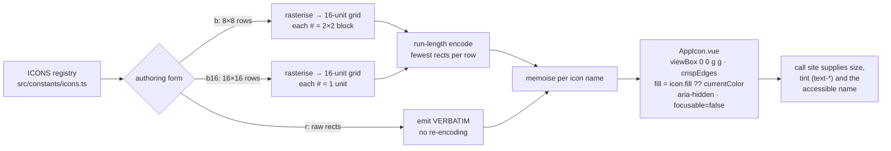

# Space Stroker — "Icons and Menu Overhaul" — Implementation Spec

> **Status: Ready for implementation** — refined via Trello card
> [Icons and Menu overhaul](https://trello.com/c/1omDew5a) (2026-08-09).
> Repos affected: `monkify-front` and this doc in `monkify-meta`. **No backend change.**
>
> **Design artifact (visual source of truth, revision 5, reviewed by the owner):**
> <https://claude.ai/code/artifact/f081e67e-e469-4ed1-9624-49b3a89de691>
> Every drawing in §5 is transcribed **verbatim** from that artifact's `ICONS` map, so the
> implementer never has to re-derive a silhouette from a screenshot. The artifact remains the visual
> reference; this spec is the authoritative data.
>
> **Purpose:** Give the app **one pixel-art icon language** — a shared `<AppIcon>` registry replacing
> nine inline feather-stroke SVGs, a literal VT323 letter `X`, and the `✓ ✗ ▶ ▼` text characters that
> stand in for glyphs today — an **identity mark per page/feature** (the way Orbit already has one),
> and a **☰ menu that reads as a place**: a 3-column icon grid instead of a 180px text list.

---

## 1. Summary

The app has **no icon system**. What it has is:

| What ships today | Where | Problem |
| --- | --- | --- |
| 9 feather-style **stroke** SVGs pasted inline | `GameHeader.vue` (speaker ×4 + hamburger), `WalletButtons.vue` (wallet ×3) | Generic outline icons inside a pixel-arcade product; duplicated markup in two files |
| A literal VT323 letter **`X`** | `ui/ArcadeModal.vue:248`, styled by `.dialog__close` | Every modal's close control is a typographic character |
| **`✓` / `✗`** characters | `game/GameFairPanel.vue` ×5, `pages/GameHistoryPage.vue:177` | Pass/fail markers are text |
| **`▶` / `▼`** characters | `orbit/OrbitModal.vue:956,1452`, `pages/OrbitPage.vue:416,552` | Two of the four sit in **Press Start 2P**, which does not cover `▶` — the browser substitutes a system font (a smooth anti-aliased arrow inside pixel type). This is a **documented bug**, recorded in `OrbitGlyph.vue:80-84`. |
| `spinner.svg` (``), `usdc.svg` | `LoaderSpinner.vue`, money surfaces | The spinner is a continuously-rotating raster asset |
| **Real pixel art**: `OrbitMark` + `OrbitGlyph` | `components/orbit/` | Seven marks whose own source says they are *"NOT the seed of an app-wide icon system (spec D7 / AC16)"* — feature-scoped by an explicit rule |

Result: generic stroke icons in an arcade product, most pages and features with no mark of their own,
and a ☰ menu that is a 180px text list of seven rows.

This card ships **26 icons** in one registry, **folds Orbit's drawings in unchanged**, and rebuilds
the header menu as a **3×3 pad**.

### 1.1 Level and test obligation

**Level: new feature, frontend-only.** `monkify-front` has **no test suite** (no `.spec` / `.test`
files) and there is **no backend change** — no entity, enum, handler, consumer, EF mapping, migration,
endpoint or SignalR contract is touched. Game-type art is resolved client-side (`utils/gameArt.ts` →
local PNG/GIF); the backend serves no icon or art identifiers.

`AGENTS.md` rule 8 (mandatory backend integration test for every new feature) **does not bite**:
there is no backend happy path to drive. This follows the precedent set by
`features/app-design-refinement.md` ("Frontend-only ⇒ no backend unit/integration test") and
`features/mobile-layout.md`.

**Definition of done:** `yarn lint` + `yarn build` green, plus browser QA (§13) against the running
local stack with **0 console errors**.

### 1.2 What the card supersedes

This card **retires the `#124` D7 / AC16 rule** — *"OrbitMark and OrbitGlyph are NOT the seed of an
app-wide icon system"*. That rule existed because a documented design rule with one feature's worth of
consumers is a dangling rule. It is now the opposite: Orbit's technique **becomes** the house
technique, and the rule's comment must be **rewritten to state the new rule**, not silently deleted
and not left contradicting the code (AC7).

### 1.3 Findings from code exploration

Five things were confirmed in the code while writing this spec that the card does not fully resolve.
All are **in scope** and each has a required handling below.

**Finding A — only ONE of the four `▶` sites is actually a disclosure control.**
The card's AC10 reads *"a disclosure control that today prints `▶` or `▼` (OrbitModal ×2, OrbitPage
×2)"*. Verified against the code, the four sites split into two different affordances:

| File:line | Markup | Font | What it really is |
| --- | --- | --- | --- |
| `pages/OrbitPage.vue:552` | `{{ showLog ? '▼' : '▶' }}` | **Press Start 2P** 10px | The **only** true expand/collapse disclosure |
| `orbit/OrbitModal.vue:1452` | `ADVANCED SETTINGS ▶` | **Press Start 2P** 8px (`.orbit-advanced`, `OrbitModal.vue:1775-1782`) | A **navigation** button (goes to `/orbit` settings) |
| `orbit/OrbitModal.vue:956` | `How Orbit works ▶` | VT323 18px | An inline **text link** to `/how-to-play#orbit` |
| `pages/OrbitPage.vue:416` | `How it works ▶` | VT323 (`.dialog-copy`) | An inline **text link** to `/how-to-play#orbit` |

**Required handling:** all four lose the text character and take `chevron` (§7.6). Only
`OrbitPage.vue:552` needs the **90° rotation** for its expanded state — the other three have no
expanded state. The two Press Start 2P sites are the ones the documented font-substitution bug
actually applies to; the two VT323 sites are replaced for consistency and need **baseline alignment**
inside running text (`align-middle`, not `align-baseline` — a 16-unit box has no baseline).
`OrbitModal.vue:1446` and `:1774` carry `⚠️ '▶', never '▸'` comments that become **dead** once the
character is gone; delete them with the character.

**Finding B — the artifact's `tone` field is PREVIEW-ONLY and must not become a registry fill.**
In the artifact, `wallet`, `stake` and `pot` carry `tone: 'amber'`, `check` carries `tone: 'live'`,
`warn` carries `tone: 'warnc'` and `orbit-run` carries `tone: 'live'`. Those set a CSS class on the
**preview cell** (`.icell--amber` etc.), i.e. they tint the *container*; the icon itself still paints
`currentColor`. Only **two** drawings carry a fill in production today (`OrbitGlyph.vue:28-32`):
`win-at` → `var(--color-live)`, `falls-to` → `oklch(0.8 0.16 25)`. Copying the artifact's `tone`
fields into the registry as fills would (a) violate AC3 (no per-call-site fill; icons inherit the
surface tint) and (b) **change Orbit's `run` glyph from `currentColor` to green**, which is a visual
regression on a shipped surface (AC5 demands zero visual change). **Only `win-at` and `falls-to` get a
registry fill.**

**Finding C — Orbit's call sites use sizes that are NOT on the new legal-size ladder.**
The 20 shipped `<OrbitMark>` / `<OrbitGlyph>` call sites render at **11, 13, 14, 18, 20, 24, 26, 28,
30, 52** px. Several (13, 14, 18, 20, 26, 28, 30, 52) are not multiples of 8 or 16, and `run`/`stop`
are drawn on a 24-unit grid rendered at 24 and 28. **AC5 (zero visual change at Orbit's call sites)
overrides AC12 (crisp at legal sizes) for these.** The legal-size ladder in §4.3 governs the **new**
icons and any **new** placement; Orbit's existing placements keep their shipped `:size` values
verbatim. Do **not** "fix" them — that is a redesign this card explicitly refused.

**Finding D — `.dialog__close` boxes the glyph at 20px (22px on the black variant).**
`arcade.css:338-369` sets `width/height: 20px`, `font-family: var(--font-body, 'VT323', …)` and
`font-size: 16px` on the close control, and the `--black` variant grows the box to 22px with a 2px
cyan border. Once the character becomes an SVG, the two **font rules become dead** and must be
removed (AC8). 20px and 22px are **not** on the coarse ladder — the icon inside the box therefore
renders at **16px** in both variants (see §7.5), which is the largest legal coarse size that fits a
20px box with its 1px border.

**Finding E — `html.light-graphics` strips the popover's blur but does NOT make it opaque.**
`arcade.css:2143-2147` kills `backdrop-filter` on every `[class*='backdrop-blur']`, and separately
paints `.app-header`, `.header-content`, `.retro-box` and `.card-content` opaque — the header menu
popover is **none of those**. Today it survives on `color-mix(… var(--color-void) 94%, transparent)`,
which is nearly opaque by luck rather than by rule. AC19 makes it a requirement, so the popover gets a
named class and an explicit light-graphics override (§7.7).

---

## 2. Constraints (MANDATORY)

From `monkify-meta/constraints.md` (full list there):

- **Worktree-per-repo** (§2): work in `.worktrees/icons-and-menu-overhaul/monkify-front` and
  `.worktrees/icons-and-menu-overhaul/monkify-meta`. Each hub stays a clean `main`. The branch
  `feature/icons-and-menu-overhaul` exists and is pushed in **both** repos for the PR.
- **Unit tests** (§3): **N/A** — `monkify-front` has no test suite and there is no backend change.
  Nothing in `SpaceStroker.Tests` or `SpaceStroker.Tests.Integration` changes; report that explicitly
  at the end of implementation.
- **Integration tests** (§3, `AGENTS.md` rule 8): **N/A** — see §1.1.
- **EF / migrations** (§4): **N/A** — no database surface.
- **Secrets/config** (§1): nothing touched.
- **User-facing messaging** (§6): no error copy changes.
- **⚠️ CRLF** — `yarn lint` requires uniform CRLF line endings across `monkify-front`. Do **not** let
  a tool (`sed -i`, a script, an editor default) rewrite a file to LF; prettier will fail with
  `Insert ␍` on every line. Verify with `git diff --stat` staying proportional to the real change.
- **Reduced motion** — the only animation this card adds (the `loading` step-rotation) must freeze
  under `prefers-reduced-motion: reduce`, per the app design system
  (`features/app-design-refinement.md`).

---

## 3. Resolved product decisions

| # | Decision |
| --- | --- |
| 1 | **Technique: pixel-grid inline SVG + one `<AppIcon>` registry.** Rejected: PNG sprites (fixed colours, @2x variants, ~40 unreviewable binaries), an SVG sprite sheet (needs a webpack sprite-loader; `<use>` breaks under the embed CSP), model-generated raster (not deterministic, not tintable). |
| 2 | Every icon: `viewBox="0 0 g g"` (`g` per icon, §4.3), `shape-rendering="crispEdges"`, `fill="currentColor"`, `aria-hidden="true"`, `focusable="false"`. This is **exactly** the technique `OrbitMark` already ships — the house technique already existed, it was just Orbit-only. |
| 3 | Icons are **decorative**. The accessible name always comes from the control (`aria-label` / visible label), never from the SVG. |
| 4 | **Two grids, declared per icon.** **Coarse 8×8** (each cell = 2 units of a 16-unit box) is the **default**. **Fine 16×16** (one cell = one unit) is a **standing, reusable standard** — available whenever a subject genuinely needs the detail, not a one-off. |
| 5 | Rule attached to the two grids: **coarse by default; fine is opt-in and only when the coarse grid provably cannot hold the silhouette.** A fine-grid mark may only be placed at multiples of 16. |
| 6 | **Today exactly one drawing is fine-grid: `practice`** (a console gamepad — wings, d-pad cross, four-button diamond and two centre dashes do not exist in eight cells across; the owner supplied a ~20px-wide reference). Accepted cost: it reads a step finer than its neighbours up close. |
| 7 | **Style A — Solid**: filled single-colour silhouettes. Rejected: **B Capped** (mark on a notched keycap plate — heavy furniture on a 40px header button, and the +4 units break 24px), **C Duotone** (shade + lit edge — muddies below ~20px and fights bright surfaces). |
| 8 | **`OrbitMark.vue` + `OrbitGlyph.vue` are deleted.** Their rect data moves into the shared registry **unchanged** and their 20 call sites become `<AppIcon>`. |
| 9 | **This supersedes the #124 D7 / AC16 rule.** The comment must be **rewritten** to state the new rule, not silently contradicted (AC7). |
| 10 | **Orbit's mark is NOT redrawn.** A heavier re-cut was mocked and rejected. Zero visual change at its call sites. Violet stays. |
| 11 | **Stake vs pot split.** **A single coin = the stake** (what you put in). **A stack of three coins = the pot** (what is on the table). The three-coin drawing is Orbit's existing `stake` glyph, **reassigned from stake to pot**. |
| 12 | ⚠️ **The split applies inside Orbit too** (owner confirmed). `OrbitStatusBanner`, `OrbitStatStrip` and `/orbit` currently mark the **stake** with the three-coin stack; they move to the single coin. `OrbitGlyph.vue:119-123`'s *"Three coins seen edge-on: what ONE round costs"* comment is now wrong and must be **rewritten**, not left in place (AC7). |
| 13 | **Menu trigger unchanged**: the ☰ button, now drawing the pixel `menu` glyph. |
| 14 | **Menu layout 1 — Compact pad**: the same anchored popover, **270px**, **3×3**, icons at **32px**. Rejected: **2 Keycap board** (raised keys; `box-shadow` + `clip-path` are stripped by light-graphics on every phone) and **3 Destination sheet** (an `ArcadeModal`; would dim the game behind it mid-round). |
| 15 | **9 cells:** Home · Practice · Orbit · Stats · Fair · How to play · History · Responsible · Settings. A clean 3×3. |
| 16 | **`/game` (the lobby) gets no cell** — owner's call: it is a leftover page already absorbed into Home. **Home and Practice are new to the menu** (Home was reachable only via the wordmark, Practice only from three CTAs on `/`). |
| 17 | **Settings and Fair keep cells** even though they open modals rather than routes. Cells look identical and must not advertise the difference. |
| 18 | **32px is not arbitrary** — it is the only size both the coarse and the fine grid land on exactly. The popover widened **234 → 270px** to hold it. |
| 19 | **Audio is not a cell.** On phones the existing mute toggle + volume slider stay in the popover as a **full-width strip above the grid**, separated by a hairline (a cell cannot hold a slider). At `md+` audio stays on the header bar, unchanged. |
| 20 | **Current page is marked**: amber label + faint amber wash + `aria-current="page"`. |
| 21 | **Dismissal unchanged** (item click / outside click via `useClickOutside` / Esc). **No arrow-key roving focus** — plain tab order, left-to-right, top-to-bottom. (The Orbit tab bar's arrow keys are a `tablist` pattern and do not apply to a link grid.) |
| 22 | **Embedded renders the SAME grid** with two cells (Settings + History) in the same 3-column frame. No second layout, no collapse-to-one-column special case — the embed is the least-tested path and must not own the only conditional layout. |
| 23 | Two deliberate reuses instead of new drawings: **`close` tinted warm-red serves the `✗` mismatch marker**, and **`chevron` rotated 90° serves the `▼` expanded state** (a 90° rotation of pixel art stays pixel-aligned). |
| 24 | **Kept, not folded in:** `usdc.svg` (a brand mark, not a generic icon), game-type art (`utils/gameArt.ts`, `assets/types/*` — already bespoke pixel art), the guide's illustration components (`GuideWalletArt`, `GuideBetTerminalArt`, … — illustrations, not icons). |
| 25 | *(spec decision, §7.7)* The **Responsible Gaming** cell's visible label is **"Responsible"** — what the artifact draws, and what fits an ~86px cell without a three-line wrap. Its `aria-label` / accessible name stays the full **"Responsible Gaming"**. |

---

## 4. The icon system

### 4.1 Two authoring forms, one raster target

The registry stores each drawing in the form it was authored in. There are three:

| Form | Field | Meaning |
| --- | --- | --- |
| **Coarse bitmap** | `b: string[8]` | Eight 8-character rows. Each `#` becomes a **2×2 block** in a 16-unit box — exactly how `OrbitMark` is built. |
| **Fine bitmap** | `b16: string[16]` | Sixteen 16-character rows. Each `#` becomes a **1×1 cell** in a 16-unit box. |
| **Raw rects** | `r: [x,y,w,h][]` (+ optional `g`) | Emitted **verbatim**. Used only for the seven drawings already in production, so their markup is byte-identical. |

`.` (and any non-`#` character) is empty. Rows are exactly as long as the grid is wide.

### 4.2 Rendering rules

- **Bitmap icons** (`b` / `b16`) rasterise to a boolean grid, then **run-length encode filled runs per
  row** — the fewest rects that draw the shape. One `<rect>` per horizontal run, `height="1"` for
  fine, `height="2"` for coarse (a coarse `#` is a 2×2 block, so consecutive rows merge naturally when
  encoded from the raster; encoding per **raster row** is also correct and simpler — pick one and keep
  it, the painted pixels are identical).
- **Raw-rect icons** (`r`) emit their rects **exactly as stored** — no rasterisation, no re-encoding.
  This is what guarantees AC5's *zero visual change* for Orbit: the SVG output is character-identical
  to what `OrbitMark` / `OrbitGlyph` render today.
- Results are **memoised** per icon name in a module-level `Map` — the geometry is static, so a given
  icon is computed at most once per page load.

### 4.3 Grid, viewBox and legal sizes

`viewBox` is always `0 0 g g`, where `g` is the icon's unit box:

| Grid | `g` | Legal (pixel-exact) sizes | Which icons |
| --- | --- | --- | --- |
| Coarse 8×8 (2-unit cells) | 16 | **16 / 24 / 32 / 40** | every new mark except `practice`; `orbit`; `pot` |
| Fine 16×16 (1-unit cells) | 16 | **16 / 32 / 48** | `practice` only (today) |
| Raw 16-unit | 16 | 16 / 32 / 48 (they carry 1-unit detail) | `deposit`, `cash-out`, `win-at`, `falls-to` |
| Raw 24-unit | 24 | multiples of 24 | `run`, `stop` |

A coarse icon at 20px, or a fine icon at 24px, goes soft. The registry should make the legal sizes
obvious (a comment beside each grid is enough — a runtime assert is not required). Today's header
(24px) and the new menu (32px) are both legal for both grids.

> ⚠️ **Finding C applies here.** Orbit's 20 existing call sites keep their shipped `:size` values
> (11, 13, 14, 18, 20, 24, 26, 28, 30, 52), several of which are off-ladder. Zero visual change wins.
> The ladder governs new icons and new placements.

### 4.4 Semantic fill

Two icons — and only two — carry a fill of their own, copied from `OrbitGlyph.vue:28-32`:

| Icon | Fill | Why |
| --- | --- | --- |
| `win-at` | `var(--color-live)` | green for a rise |
| `falls-to` | `oklch(0.8 0.16 25)` | warm red for a fall — written **literally**, exactly as `arcade.css`'s `.dialog__strip--err` states it. Adding a token for it would be a design-system change this card is not making. |

Everything else is `currentColor` and takes the surface's tint for free (amber wallet pill, violet
Orbit pill, muted eyebrow). See **Finding B** — do not promote the artifact's `tone` fields to fills.

### 4.5 Registry shape

```ts
// src/constants/icons.ts
export type IconName = 'home' | 'practice' | 'orbit' | /* … */ | 'stop';

interface IconDef {
  /** Coarse 8×8 authoring form — eight 8-char rows, each '#' a 2×2 block in a 16-unit box. */
  b?: string[];
  /** Fine 16×16 authoring form — sixteen 16-char rows, each '#' one unit. Opt-in (D5). */
  b16?: string[];
  /** Raw rects, emitted verbatim. Production drawings only. */
  r?: [number, number, number, number][];
  /** Unit box; defaults to 16. Only `run` / `stop` differ (24). */
  g?: number;
  /** Baked semantic fill. ONLY win-at and falls-to (§4.4). */
  fill?: string;
  /** Renders with the four-step rotation (§7.4). Only `loading`. */
  spin?: true;
}

export const ICONS: Record<IconName, IconDef> = { /* §5 */ };
```

---

## 5. The inventory — 26 icons, verbatim

> Transcribed from the design artifact's `ICONS` map (revision 5). **Copy these exactly.** A single
> flipped character changes the silhouette.

### 5.1 Page & feature identity (9)

```
home            practice (FINE 16×16)      orbit            stats
...##...        ................           (raw rects,      ########
..####..        ................            §5.3)           #.....##
.######.        ................                            #....#.#
########        ..############..                            #..##..#
.######.        .##############.                            #.#....#
.##..##.        ###.#######.####                            #......#
.##..##.        ##...#####.#.###                            ########
.##..##.        ###.#######.####                            ..####..
                #######.#.######
                ################
                .####......####.
                .####......####.
                ..##........##..
                ................
                ................
                ................

fair            how-to-play      history          responsible      settings
..####..        .######.         ..####..         .#####..         ........
.##..##.        ##....##         .#....#.         .######.         ..##....
.##..##.        ......##         #..#...#         .#....#.         ########
########        ...####.         #..#...#         .######.         ..##....
########        ...##...         #..###.#         .#....#.         .....##.
###..###        ........         #......#         .######.         ########
########        ...##...         .#...##.         .#...##.         .....##.
########        ........         ..####..         .######.         ........
```

Notes (from the refinement changelog — these are the **third** cuts of several):

- **`stats`** — a CRT with a rising trace. Was ascending bars; that collided with Orbit's `win-at` bar
  chart.
- **`responsible`** — a page with a folded corner and three knocked-out lines of text. A shield was
  rejected: its two knocked-out slots read as a face.
- **`history`** — a clock face, hands at three. Hourglass and rewind glyphs were both rejected.
- **`practice`** — ⚠️ **the one fine-grid drawing** (D6). Reticle → arcade stick → console gamepad; the
  first gamepad attempt failed because 8 cells across cannot hold one.
- **`orbit`** — the shipped drawing, unchanged. Stored as raw rects (§5.3) so its markup is identical.
- **`fair`**, **`how-to-play`**, **`home`**, **`settings`** — as drawn above.

### 5.2 Chrome glyphs (11)

```
menu            close            sound-on         sound-off        wallet
........        ........         ........         ........         ........
########        .#....#.         ....#...         ....#...         .######.
........        ..#..#..         ...##..#         ...###.#         ########
########        ...##...         .####.##         .####.#.         ########
........        ...##...         .####.##         .####.#.         #####..#
########        ..#..#..         ...##..#         ...###.#         #####..#
........        .#....#.         ....#...         ....#...         ########
........        ........         ........         ........         .######.

stake           loading          chevron          check            warn
..####..        ..####..         ..#.....         ........         ...##...
.######.        .##..##.         ..##....         ......##         ..####..
########        ##....#.         ..###...         .....##.         ..#..#..
###..###        ##......         ..####..         #...##..         .##..##.
###..###        #.......         ..####..         ##.##...         .##..##.
########        ........         ..###...         .####...         ##.##.##
.######.        ........         ..##....         ..##....         ##....##
..####..        ........         ..#.....         ........         ########
```

`pot` is **raw rects** (§5.3) — it is Orbit's shipped three-coin drawing, reassigned.

- **`stake`** = one coin (a ring: outer disc, knocked-out centre). **`pot`** = the three-coin stack.
  This is the D11/D12 split, and it applies inside Orbit too.
- **`loading`** carries `spin: true` (§7.4).
- **`chevron`** points right; the expanded state is the same drawing **rotated 90°** (D23).
- **`close`** doubles as the `✗` mismatch marker when tinted warm red (D23).

### 5.3 Raw-rect drawings (7 — Orbit's shipped set, unchanged)

Copy these **verbatim**; they are the production data from `OrbitMark.vue:31-44` and
`OrbitGlyph.vue:60-137`.

```ts
orbit:      { g: 16, r: [[6,0,4,2],[4,2,2,2],[10,2,4,4],[2,4,2,2],[0,6,2,2],[14,6,2,2],
                         [0,8,2,2],[14,8,2,2],[2,10,2,2],[12,10,2,2],[4,12,2,2],[10,12,2,2],
                         [6,14,4,2],[6,6,4,4]] },

pot:        { g: 16, r: [[4,2,8,2],[2,4,12,2],[4,6,8,2],[2,8,12,2],[4,10,8,2],[2,12,12,2]] },

deposit:    { g: 16, r: [[6,1,4,6],[3,7,10,2],[5,9,6,2],[7,11,2,2],[1,14,14,2]] },
'cash-out': { g: 16, r: [[7,1,2,2],[5,3,6,2],[3,5,10,2],[6,7,4,6],[1,14,14,2]] },

'win-at':   { g: 16, fill: 'var(--color-live)',
              r: [[0,0,16,2],[1,11,3,5],[6,7,3,9],[11,2,3,14]] },
'falls-to': { g: 16, fill: 'oklch(0.8 0.16 25)',
              r: [[0,14,16,2],[1,0,3,4],[6,0,3,8],[11,0,3,14]] },

run:        { g: 24, r: [[3,1,3,2],[3,3,6,2],[3,5,9,2],[3,7,12,2],[3,9,15,2],[3,11,18,2],
                         [3,13,15,2],[3,15,12,2],[3,17,9,2],[3,19,6,2],[3,21,3,2]] },
stop:       { g: 24, r: [[4,1,6,22],[14,1,6,22]] },
```

⚠️ **`pot`'s rects are what `OrbitGlyph name="stake"` draws today.** The name changes; the drawing
does not. Orbit's own stake readouts move to the **new** `stake` coin (§7.3).

⚠️ **`run` / `stop` keep the 24-unit grid** and its explanatory comment (`OrbitGlyph.vue:34-43`,
`:85-99`) — carry that reasoning into the registry rather than dropping it. It is the precedent for
"grid is per icon".

### 5.4 The count

| Group | Count | Names |
| --- | --- | --- |
| Page & feature identity | 9 | `home`, `practice`, `orbit`, `stats`, `fair`, `how-to-play`, `history`, `responsible`, `settings` |
| Chrome | 11 | `menu`, `close`, `sound-on`, `sound-off`, `wallet`, `stake`, `pot`, `loading`, `chevron`, `check`, `warn` |
| Orbit, folded in | 6 | `deposit`, `cash-out`, `win-at`, `falls-to`, `run`, `stop` |
| **Total** | **26** | (`orbit` counts once, in identity; the 7th Orbit drawing became `pot`) |

---

## 6. `AppIcon.vue` — the component contract

`src/components/ui/AppIcon.vue`:

```vue
<script setup lang="ts">
  // THE icon. One shared registry (this card retires the #124 D7/AC16 "Orbit-scoped" rule):
  // every player-facing mark in the app renders from ICONS, nothing re-inlines an <svg>.
  //
  // Pixel-grid inline SVG, crispEdges, currentColor — exactly the technique OrbitMark shipped.
  // Two grids, declared per icon: coarse 8×8 by default (exact at 16/24/32/40), fine 16×16 opt-in
  // and only when the coarse grid cannot hold the silhouette (exact at 16/32/48).
  //
  // Icons are DECORATIVE. The accessible name comes from the control, never from here.
  const props = withDefaults(defineProps<{ name: IconName; size?: number }>(), { size: 16 });
</script>
```

| Prop | Type | Default | Notes |
| --- | --- | --- | --- |
| `name` | `IconName` | — | Required. Union type, so a typo is a **build error**, not a blank square. |
| `size` | `number` | `16` | Rendered `width`/`height` in px. Same prop name and default as `OrbitMark` / `OrbitGlyph`, so every folded-in call site keeps its existing `:size="…"` untouched. |

Rendered SVG, on every icon (AC2):

```html
<svg :width="size" :height="size" :viewBox="`0 0 ${g} ${g}`" :fill="fill"
     aria-hidden="true" focusable="false" shape-rendering="crispEdges" class="flex-none">
  <!-- rects -->
</svg>
```

- `class="flex-none"` carries over from `OrbitMark` / `OrbitGlyph` — several Orbit call sites are flex
  children and rely on it. Dropping it would squash the mark inside a flex row (a visual change, AC5).
- `fill` is the icon's `fill` when set, otherwise `currentColor`.
- `spin: true` icons get the animation class (§7.4). Nothing else animates.
- Class and style pass through to the root `<svg>` via Vue's default attribute fallthrough, which is
  how call sites tint (`class="text-orbit"`) today. Do **not** set `inheritAttrs: false`.

---

## 7. Frontend behaviour — per call site

### 7.1 `GameHeader.vue` — 5 inline SVGs out, menu rebuilt

Removed inline markup: the bar speaker pair (`:222-251`), the in-menu speaker pair (`:322-351`), and
the hamburger (`:294-307`). Each becomes:

| Was | Becomes |
| --- | --- |
| bar speaker (`h-6 w-6`), muted / unmuted branches | `<AppIcon :name="isMutedish ? 'sound-off' : 'sound-on'" :size="24" />` |
| menu speaker (`h-5 w-5`), same two branches | `<AppIcon … :size="16" />` — 20px is **not** on the coarse ladder; 16 is the legal neighbour |
| hamburger (`h-6 w-6`) | `<AppIcon name="menu" :size="24" />` |

The existing mute condition (`audioMuted || audioVolume === 0`) is unchanged; only the glyph swaps.
`aria-label` on the buttons is unchanged and remains the accessible name (D3).

### 7.2 `WalletButtons.vue` — 3 inline wallet SVGs out

Three copies of the same feather wallet path at `:151-164`, `:197-210` and `:233-246`. Each becomes
`<AppIcon name="wallet" :size="…" />`:

- The **door** branch renders at `h-[18px] w-[18px]` today → `:size="16"` (18 is not on the ladder;
  16 is the legal neighbour and the artifact's in-situ header mock draws the pill glyph at 16–18px).
- The **not-connected** branch renders `h-4 w-4 md:hidden` → `:size="16"` plus the `md:hidden` class
  passed through on the component.

`doorLabel` / `aria-label` / `title` are untouched — the wallet's accessible name is unaffected.

### 7.3 Orbit — fold in, and the stake→pot split

**Delete** `src/components/orbit/OrbitMark.vue` and `src/components/orbit/OrbitGlyph.vue`.

All 20 call sites become `<AppIcon>`; **sizes and classes are copied across verbatim** (Finding C):

| File:line | Today | Becomes |
| --- | --- | --- |
| `orbit/OrbitBetLock.vue:28` | `<OrbitMark :size="11" class="flex-none text-orbit" aria-hidden="true" />` | `<AppIcon name="orbit" :size="11" … />` |
| `orbit/OrbitControlBar.vue:150` | `<OrbitGlyph :name="status === 'running' ? 'stop' : 'run'" :size="28" class="orbit-trio__btn-icon" />` | `<AppIcon :name="…" :size="28" … />` |
| `orbit/OrbitFirstWinModal.vue:178` | `<OrbitMark :size="30" class="first-win__pitch-mark" … />` | `<AppIcon name="orbit" :size="30" … />` |
| `orbit/OrbitLauncher.vue:73` | `<OrbitMark :size="18" />` | `<AppIcon name="orbit" :size="18" />` |
| `orbit/OrbitModal.vue:925` | `<OrbitMark :size="13" class="flex-none text-orbit" … />` | `<AppIcon name="orbit" :size="13" … />` |
| `orbit/OrbitModal.vue:978`, `:1022` | `<OrbitMark :size="52" class="orbit-intro__glyph" … />` | `<AppIcon name="orbit" :size="52" … />` |
| `orbit/OrbitModal.vue:1408`, `:1421` | `<OrbitGlyph name="run"/"stop" :size="24" class="orbit-transport__icon" />` | `<AppIcon name="run"/"stop" :size="24" … />` |
| `orbit/OrbitStatStrip.vue:75` | `<OrbitMark :size="26" class="orbit-statstrip__icon text-orbit" … />` | `<AppIcon name="orbit" :size="26" … />` |
| **`orbit/OrbitStatStrip.vue:94`** | `<OrbitGlyph name="stake" :size="26" … />` | **`<AppIcon name="stake" :size="26" … />`** — now the **single coin** (D12) |
| `orbit/OrbitStatusBanner.vue:83` | `<OrbitMark :size="24" class="orbit-stat__icon text-orbit" … />` | `<AppIcon name="orbit" :size="24" … />` |
| **`orbit/OrbitStatusBanner.vue:105`** | `<OrbitGlyph name="stake" :size="24" … />` | **`<AppIcon name="stake" :size="24" … />`** — single coin |
| `orbit/OrbitStatusBanner.vue:116` | `<OrbitGlyph name="deposit" :size="24" … />` | `<AppIcon name="deposit" :size="24" … />` |
| `pages/OrbitPage.vue:338`, `:339` | `<OrbitMark :size="18"/:size="20" class="text-orbit …" />` | `<AppIcon name="orbit" … />` |
| `pages/OrbitPage.vue:377` | `<OrbitMark :size="14" class="mt-1 flex-none text-orbit" />` | `<AppIcon name="orbit" :size="14" … />` |
| `pages/OrbitPage.vue:384` | `<OrbitGlyph name="deposit" :size="14" … />` | `<AppIcon name="deposit" :size="14" … />` |
| `pages/OrbitPage.vue:391`, `:398` | `<OrbitGlyph name="win-at"/"falls-to" :size="14" … />` | `<AppIcon name="win-at"/"falls-to" :size="14" … />` — **fills preserved** (AC4) |
| `home/HomeOrbitCard.vue:3` | imports `OrbitMark` | update the import (no `<OrbitMark>` in its template — verify with `git grep` after the swap that the import is either used or removed; an unused import fails `yarn lint`) |

**Comments that must be rewritten in the same branch** (AC7):

| Where | Today | Must become |
| --- | --- | --- |
| `OrbitMark.vue:13-15` *(file deleted — the note moves into the registry)* | *"Orbit-scoped on purpose. This and OrbitGlyph are NOT the seed of an app-wide icon system (spec D7)"* | State the **new** rule: Orbit's technique **is** the house technique; the registry is app-wide; #124 D7/AC16 is retired by Trello #159. |
| `OrbitGlyph.vue:119-123` | *"Three coins seen edge-on: what ONE round costs."* + the "a stake is a rate" argument | State the **new** rule: three coins = the **pot** (what is on the table); one coin = the **stake** (what you put in). |
| `OrbitGlyph.vue:15` | *"no sprite sheet, no `<Icon>` wrapper, no registry (AC16)"* | Retired — there **is** a registry now. |
| `OrbitStatStrip.vue`, `OrbitStatusBanner.vue` | header notes echoing "the two marks are not the same" / the stake-coin argument | Reconcile with the stake/pot split. |

### 7.4 `LoaderSpinner.vue` — spinner.svg out

```
   →   <AppIcon name="loading" :size="…" />
```

- `spinner.svg` is no longer referenced. (Leave the asset file in place unless nothing else imports
  it — verify with `git grep spinner.svg`; if it is the sole reference, delete the asset too.)
- The rotation is **four 90° steps**, not continuous: `animation: … steps(4) infinite`. A continuous
  rotation puts pixel edges at arbitrary angles and destroys the crisp read; `steps(4)` keeps every
  frame axis-aligned.
- ⚠️ **Freeze under `prefers-reduced-motion: reduce`** (AC11). Put the keyframes and the reduced-motion
  guard in `arcade.css` beside the other motion rules, **not** in a `<style scoped>` block — the
  existing light-graphics/reduced-motion overrides all live globally for exactly this reason
  (`arcade.css:2130-2137`).
- The `h-40` (160px) render is not on either ladder. 160 **is** a multiple of 16 and of 8, so it is
  legal on both grids — keep the visual size, express it as `:size="160"`.

### 7.5 `ui/ArcadeModal.vue` + `arcade.css` — the close `X`

`ArcadeModal.vue:241-249`: the literal `X` between the button tags becomes
`<AppIcon name="close" :size="16" />`.

`arcade.css:338-358` (`.dialog__close`) — **remove the two now-dead rules** (AC8):

```diff
-    font-family: var(--font-body, 'VT323', ui-monospace, monospace);
-    font-size: 16px;
     line-height: 1;
```

Keep everything else (the 20px box, the border, the colour transitions, the `--black` 22px/2px-cyan
override at `:363-369`). The 16px icon inside a 20px box with a 1px border leaves 1px of breathing
room per side; inside the black variant's 22px box with a 2px border, 1px. Both read correctly — see
the artifact's modal-titlebar in-situ mock.

### 7.6 The text characters — `✓ ✗ ▶ ▼`

| File:line | Today | Becomes |
| --- | --- | --- |
| `game/GameFairPanel.vue:342` | `{{ commitmentOk ? '✓ SHA256 matches' : '✗ hash mismatch' }}` | `<AppIcon :name="commitmentOk ? 'check' : 'close'" :size="16" />` + the text. The existing `:class="commitmentOk ? 'text-primary' : 'text-red-400'"` already supplies the colour — the icon inherits it via `currentColor`, so **no per-call-site fill** (AC3). |
| `game/GameFairPanel.vue:361` | `✓ HMAC(clientSeed, …) → …` | `<AppIcon name="check" :size="16" />` + text (`text-primary` on the wrapper) |
| `game/GameFairPanel.vue:387-388` | `✓ "…" matches` / `✗ mismatch — recomputed "…"` | Split the ternary: an `<AppIcon :name="recomputeResult.ok ? 'check' : 'close'" />` beside the text. ⚠️ This one is currently a **string-interpolating ternary** producing the whole line — it must become markup, not a string, so the icon can be an element. |
| `game/GameFairPanel.vue:416` | `✗ {{ recomputeError }}` | `<AppIcon name="close" :size="16" />` + text (`text-red-400`) |
| `pages/GameHistoryPage.vue:177` | `{{ mineOnly ? '✓ MINE ONLY' : 'MINE ONLY' }}` | `<AppIcon v-if="mineOnly" name="check" :size="16" />` + a constant `MINE ONLY` label. Keep the button's width from jumping — the icon slot should reserve its space (a fixed-width span, or `visibility` rather than `v-if`) so the toggle does not reflow the filter row. |
| `pages/OrbitPage.vue:552` | `{{ showLog ? '▼' : '▶' }}` | `<AppIcon name="chevron" :size="16" :class="showLog ? 'rotate-90' : ''" />` — the **only** rotation case (Finding A). A 90° rotation of pixel art stays pixel-aligned. Drop the now-wrong `▶/▼ rather than a rotating chevron` comment at `:549-550`. |
| `orbit/OrbitModal.vue:1452` | `ADVANCED SETTINGS ▶` | label text + `<AppIcon name="chevron" :size="16" />`. This is Press Start 2P at 8px (`.orbit-advanced`) — the icon now sizes **independently of the font ramp**, which is the fix. |
| `orbit/OrbitModal.vue:956` | `How Orbit works ▶` | text + `<AppIcon name="chevron" :size="16" class="align-middle" />` |
| `pages/OrbitPage.vue:416` | `How it works ▶` | text + `<AppIcon name="chevron" :size="16" class="align-middle" />` |

Delete the two `⚠️ '▶', never '▸' — U+25B8 is absent from Press Start 2P` comments
(`OrbitModal.vue:1446`, `:1774`) with the characters they explain.

**No `✓`, `✗`, `▶` or `▼` character may remain in any template** in `GameFairPanel.vue`,
`GameHistoryPage.vue`, `OrbitModal.vue` or `OrbitPage.vue` after this change (AC9, AC10). Verify with
`git grep -n '✓\|✗\|▶\|▼' src/` — the only survivors should be prose in code comments that
*describe* the old behaviour, and `OrbitWordField.vue:171` (a comment) plus `OrbitStatusBanner.vue:17`
(a comment) which are out of scope.

### 7.7 The menu — a 3×3 compact pad

Replaces `GameHeader.vue:310-440`.

**Popover container** (was `min-w-[180px] … p-1`):

| Property | Value |
| --- | --- |
| width | **270px** (was 234px effective / `min-w-[180px]`) |
| grid | `grid-template-columns: repeat(3, 1fr)`, `gap: 2px` |
| padding | `4px` |
| background | `color-mix(in oklab, var(--color-void) 94%, transparent)` (unchanged) |
| border | `1px solid color-mix(in oklab, var(--color-line) 60%, transparent)` (unchanged) |
| radius | `var(--radius-arcade)` (unchanged) |
| anchor | `absolute right-0 mt-1 z-popover` (unchanged) |

Give it a named class (e.g. `.menu-pad`) in `arcade.css` and add the light-graphics override
(**Finding E**, AC19):

```css
html.light-graphics .menu-pad {
  background: var(--color-void);
}
```

`backdrop-blur-md` may stay on the element — light-graphics already strips the filter globally
(`arcade.css:2143-2147`); the override above is what makes it *legible* rather than merely unblurred.

**Cell** (`.menu-pad__cell`): `flex` column, `align-items: center`, `gap: 7px`,
`padding: 10px 4px 8px`, `border-radius: 3px`, transparent background, no border.

- hover: `background: color-mix(in oklab, var(--color-primary) 12%, transparent)`, `color: var(--color-primary)`
- current: `color: var(--color-primary)`, `background: color-mix(in oklab, var(--color-primary) 8%, transparent)`, **and `aria-current="page"`** (AC15)
- focus: the existing `.btn-icon:focus-visible` ring pattern (`arcade.css:1199-1202`) — a visible ring is required (AC17)

**Icon:** `<AppIcon :name="cell.icon" :size="32" />` — 32px, the one size both grids land on (D18).

**Label:** Press Start 2P, `9px` (`0.5625rem`), `letter-spacing: 0.07em`, `text-transform: uppercase`,
`text-align: center`, `line-height: 1.25`. "How to play" wraps to two lines by design.

**The nine cells**, in order (D15, D16):

| # | Icon | Label | Target | Hidden when embedded |
| --- | --- | --- | --- | --- |
| 1 | `home` | HOME | `{ name: 'Home' }` | ✅ (`main.ts` `EMBED_REDIRECT_ROUTES`) |
| 2 | `practice` | PRACTICE | `{ name: 'Practice' }` | ✅ (same set) |
| 3 | `orbit` | ORBIT | `{ name: 'Orbit' }` | ✅ (also gated by `orbitEnabled`) |
| 4 | `stats` | STATS | `{ name: 'GameStats' }` | ✅ (existing `!isEmbedded` guard) |
| 5 | `fair` | FAIR | opens `isFairOpen` (modal) | ✅ |
| 6 | `how-to-play` | HOW TO PLAY | `{ name: 'HowToPlay' }` | ✅ |
| 7 | `history` | HISTORY | `{ name: 'GameHistory' }` | ❌ **stays** |
| 8 | `responsible` | RESPONSIBLE *(D25)* | `{ name: 'ResponsibleGaming' }` | ✅ |
| 9 | `settings` | SETTINGS | opens `isSettingsOpen` (modal) | ❌ **stays** |

Cells 5 and 9 are `<button>`s (they open modals); the rest are `<RouterLink>`s. **They must look
identical** — the player is not told which is which (D17). Every cell closes the menu on click, as
today.

> ⚠️ **`/game` (GameLobby) gets no cell** (D16). It is not in the menu today either; do not add it.

**Embedded** (AC16): cells 1–6 and 8 are hidden, leaving **History + Settings** — **rendered in the
same 3-column grid**, so they occupy the first two columns of one row. No alternate layout, no
`grid-cols-1` branch, no list fallback (D22).

**Current-page marking** (AC15): compare `route.name` to the cell's target route name. The two modal
cells (Fair, Settings) have no route and are never marked current.

**Audio strip** (D19, AC17): the existing `md:hidden` mute + slider block (`GameHeader.vue:315-363`)
stays, above the grid, **full width** (`grid-column: 1 / -1` or outside the grid element), separated
by the existing hairline (`border-t border-terminal-border/40`, `:364`). Its speaker becomes
`<AppIcon :size="16" />` per §7.1. At `md+` the strip stays hidden and audio remains on the header
bar, unchanged.

**Dismissal and focus** (D21, AC17): unchanged — `useClickOutside(menuRoot, …, menuOpen)` (the ref
must keep wrapping **both** the button and the popover, per its contract at
`useClickOutside.ts:11-13`), Esc, and item click. **No arrow-key roving focus**; plain DOM order gives
left-to-right, top-to-bottom tabbing for free.

### 7.8 Not touched

`usdc.svg`; `utils/gameArt.ts` + `assets/types/*`; the guide illustration components
(`GuideWalletArt`, `GuideBetTerminalArt`, `GuideLeverArt`, …); the admin portal and wallet-bridge
(dev/ops surfaces, left out by `app-design-refinement` for the same reason); `monkify-lp`.

---

## 8. Flow diagram — how a drawing reaches the screen



The **verbatim** branch is what guarantees AC5: Orbit's seven drawings never pass through the
rasteriser, so their emitted SVG is byte-identical to today's.

---

## 9. Out of scope

- **Game-screen in-play glyphs** (console / terminal / side panel) — not selected.
- **Game-type card art** (`utils/gameArt.ts`, the 10 archetype PNG/GIFs) — already bespoke pixel art.
- **Admin portal + wallet-bridge** — dev/ops surfaces (Courier New, un-QA'd forms).
- **The landing page** (`monkify-lp`) — separate repo, not touched.
- Any backend, DB, API or SignalR change.
- Restructuring the game screen or the lobby.
- Redrawing Orbit's mark (explicitly mocked and rejected).
- Adding `/game` to the menu.

---

## 10. File checklist

### 10.1 Backend (`monkify-backend`)

**None.** No file in `monkify-backend` changes.

### 10.2 Frontend (`monkify-front`)

| # | File | Change |
| --- | --- | --- |
| 1 | `src/constants/icons.ts` | **NEW.** The `ICONS` registry + `IconName` union + the two-grid rule as a header comment (carrying over the retired-#124-D7 note and the 24-unit `run`/`stop` reasoning). |
| 2 | `src/components/ui/AppIcon.vue` | **NEW.** Rasterise → RLE (bitmaps) / verbatim (raw rects), memoised; renders the §6 SVG contract. |
| 3 | `src/components/orbit/OrbitMark.vue` | **DELETE.** |
| 4 | `src/components/orbit/OrbitGlyph.vue` | **DELETE.** |
| 5 | `src/components/GameHeader.vue` | 5 inline SVGs → `AppIcon`; the 7-row text dropdown → the 3×3 pad (9 cells, `aria-current`, embedded 2-cell case, full-width audio strip). |
| 6 | `src/components/header/WalletButtons.vue` | 3 inline wallet SVGs → `AppIcon name="wallet"`. |
| 7 | `src/components/ui/ArcadeModal.vue` | Text `X` → `AppIcon name="close" :size="16"`. |
| 8 | `src/assets/styles/arcade.css` | Remove `.dialog__close`'s dead `font-family` / `font-size`; add `.menu-pad` + `.menu-pad__cell` + `html.light-graphics .menu-pad`; add the `loading` `steps(4)` keyframes + reduced-motion guard. |
| 9 | `src/components/LoaderSpinner.vue` | `spinner.svg` `` → `AppIcon name="loading" :size="160"`, four-step rotation. |
| 10 | `src/components/game/GameFairPanel.vue` | `✓`/`✗` ×5 → `check` / `close` (colour inherited from the existing `:class`). One string-ternary becomes markup. |
| 11 | `src/pages/GameHistoryPage.vue` | `✓ MINE ONLY` → `check` + constant label, no width jump. |
| 12 | `src/components/orbit/OrbitModal.vue` | 5 Orbit call sites → `AppIcon`; `▶` ×2 → `chevron`; delete the dead `▸` comments. |
| 13 | `src/pages/OrbitPage.vue` | 6 Orbit call sites → `AppIcon`; `▶`/`▼` ×2 → `chevron` (`:552` rotates); delete the dead disclosure comment. |
| 14 | `src/components/orbit/OrbitStatStrip.vue` | 2 call sites → `AppIcon`; **`stake` becomes the single coin**; reconcile the header comment. |
| 15 | `src/components/orbit/OrbitStatusBanner.vue` | 3 call sites → `AppIcon`; **`stake` becomes the single coin**; reconcile the header comment. |
| 16 | `src/components/orbit/OrbitControlBar.vue` | `run`/`stop` → `AppIcon`. |
| 17 | `src/components/orbit/OrbitBetLock.vue` | `OrbitMark` → `AppIcon name="orbit"`. |
| 18 | `src/components/orbit/OrbitFirstWinModal.vue` | `OrbitMark` → `AppIcon name="orbit"`. |
| 19 | `src/components/orbit/OrbitLauncher.vue` | `OrbitMark` → `AppIcon name="orbit"`. |
| 20 | `src/components/home/HomeOrbitCard.vue` | Update or remove the `OrbitMark` import (unused imports fail lint). |
| 21 | `src/assets/spinner.svg` | Delete **only if** `git grep spinner.svg` shows no other reference. |

### 10.3 Meta (`monkify-meta`)

| # | File | Change |
| --- | --- | --- |
| 1 | `specs/icons-and-menu-overhaul.md` | **NEW.** This document. |
| 2 | `INDEX.md` | Spec row (status **Ready**) + "Feature currently in flight". |
| 3 | *(at ship time)* `features/icons-and-menu-overhaul.md` | **NEW.** Distilled summary — written by `/monkify-ship-feature`, not now. |
| 4 | *(at ship time)* `conventions/frontend.md`, `features/orbit-ui-overhaul.md` | Record that the app-wide icon registry exists and that #124 D7/AC16 is retired. |

---

## 11. Unit tests

**None.** `monkify-front` has no test suite (no `.spec` / `.test` files in the repo) and this card
changes **no backend code**, so `SpaceStroker.Tests` and `SpaceStroker.Tests.Integration` are not
touched. Per `constraints.md` §3 and `AGENTS.md` rule 8 (see §1.1), no unit or integration test is
required.

**Report at the end of implementation:** "no unit tests changed or added — frontend-only change, no
test suite in `monkify-front`."

Verification is `yarn lint` + `yarn build` + the manual QA in §13, against the acceptance criteria in
§12.

---

## 12. Acceptance criteria

Copied 1:1 from the Trello checklist.

1. Given the app renders any player-facing icon, when the branch is built, then it comes from the shared AppIcon registry and no inline `<svg>` icon markup remains in `GameHeader.vue` or `WalletButtons.vue`.
2. Given any icon in the registry, when it is rendered, then its SVG carries the drawing's declared `viewBox`, `shape-rendering="crispEdges"`, `aria-hidden="true"` and `focusable="false"`.
3. Given an icon with no semantic colour, when it is placed on any surface, then it paints with `currentColor` and inherits that surface's tint (amber wallet pill, violet Orbit pill, muted eyebrow) with no per-call-site fill.
4. Given the `win-at` and `falls-to` glyphs, when they render, then they keep their semantic fills (green `--color-live` and warm red `oklch(0.8 0.16 25)`) and are **NOT** flattened to `currentColor`.
5. Given `OrbitMark.vue` and `OrbitGlyph.vue`, when the branch is built, then both files are deleted, all call sites render `AppIcon` with the same drawings, and Orbit's surfaces show **ZERO** visual change.
6. Given a pot value anywhere in the app, when it is marked with an icon, then the icon is the three-coin stack; and given a stake value anywhere — including `OrbitStatusBanner`, `OrbitStatStrip` and `/orbit` — then the icon is the single coin.
7. Given the code comments that contradict this card (`OrbitMark`'s "NOT the seed of an app-wide icon system", and the "three coins = what ONE round costs" note in `OrbitGlyph` / `OrbitStatStrip` / `OrbitStatusBanner`), when the branch is built, then they are rewritten to state the new rule rather than left contradicting it.
8. Given a modal with a titlebar, when it renders, then the close control shows the pixel close icon instead of the VT323 letter "X", and `.dialog__close`'s now-dead `font-family` / `font-size` rules are removed.
9. Given `GameFairPanel` or `GameHistoryPage` shows a pass/fail marker, when it renders, then it uses the `check` icon (semantic green) or the `close` icon in warm red — no "✓" or "✗" characters remain in either file's template.
10. Given a disclosure control that today prints "▶" or "▼" (`OrbitModal` ×2, `OrbitPage` ×2), when it renders, then it shows the chevron icon — rotated 90° for the expanded state — and no font substitution occurs inside Press Start 2P text.
11. Given a loading state, when `LoaderSpinner` renders, then it shows the `loading` icon animated in four 90° steps, `spinner.svg` is no longer referenced, and the animation freezes under `prefers-reduced-motion`.
12. Given a coarse-grid (8×8) icon rendered at 16 / 24 / 32 / 40px, or a fine-grid (16×16) icon rendered at 16 / 32 / 48px, when inspected at 1x and 2x, then every edge is hard with no half-pixel softening.
13. Given the registry supports both grids, when a new icon is added later, then it declares its own grid and the renderer handles it without a system change — coarse is the default and fine is used only where the coarse grid cannot hold the silhouette (today: Practice only).
14. Given a standalone (non-embedded) player clicks the ☰ button, when the popover opens, then it shows a 3-column grid of 9 cells — Home, Practice, Orbit, Stats, Fair, How to play, History, Responsible Gaming, Settings — each with a 32px icon above a centred title, and no cell for `/game`.
15. Given the player is on one of the menu destinations, when the menu opens, then that cell is visually marked as current (amber) and carries `aria-current="page"`.
16. Given the app is loaded embedded (`isEmbedded`), when the menu opens, then only Settings and History render, laid out as two cells in the **SAME** 3-column grid — no alternate list layout and no collapse-to-one-column branch.
17. Given a viewport below `md`, when the menu opens, then the mute toggle + volume slider render as a full-width strip above the grid, separated by a hairline; and at `md+` audio stays on the header bar exactly as today.
18. Given the menu is open, when the player clicks a cell, clicks outside it, or presses Esc, then it closes; and when the player tabs through it, then focus moves left-to-right, top-to-bottom with a visible focus ring and no arrow-key roving.
19. Given `html.light-graphics` is active (every viewport below 1024px, plus any software renderer), when the menu popover renders, then it is fully legible without `backdrop-filter` and no icon depends on a filter, blend mode or infinite animation.
20. Given the branch is complete, when `yarn lint` and `yarn build` run, then both pass; and when the app is QA'd in a browser against the running local stack (desktop 64px header, phone 54px header, embedded), then there are 0 console errors.

> **Reading note on AC10:** per **Finding A**, only `OrbitPage.vue:552` is a true disclosure with an
> expanded state; the other three `▶` sites are a navigation button and two inline text links. All
> four lose the character and take `chevron`; only `:552` rotates.

---

## 13. Manual QA

Run the local stack (`docker compose up -d --build` in `monkify-backend`, then `yarn serve` in the
front worktree with the hub's `.env.local` and `yarn.lock` copied in — see
`local-dev` notes in `AGENTS.md` / the workspace `CLAUDE.md`).

1. **Desktop, 64px header, standalone.** Wallet disconnected then connected: the wallet pill glyph is
   pixel art and amber. Speaker toggles between `sound-on` / `sound-off`. ☰ draws the pixel `menu`.
2. **Open the menu.** 270px, 3 columns, 9 cells, 32px icons above centred PS2P labels. Navigate to
   `/game/stats` and reopen: the **Stats** cell is amber-washed and carries `aria-current="page"`
   (check in DevTools).
3. **Tab through the open menu.** Focus moves 1→9 left-to-right, top-to-bottom with a visible ring.
   Arrow keys do **nothing**. Esc closes; an outside click closes; a cell click closes and navigates.
4. **Fair and Settings cells** open their modals and look identical to the seven route cells.
5. **Phone width (< md).** The audio strip is full width above the grid with a hairline under it; the
   bar speaker is gone. The popover is legible (`html.light-graphics` is on — confirm the class on
   `<html>` and that `backdrop-filter` is `none` in computed styles).
6. **Embedded.** Load with `?embed=1`. The menu shows exactly **two** cells (History, Settings) in the
   same 3-column frame — first two columns of one row, not a list, not one column.
7. **Any modal** (Settings, Fair, Orbit): the close control is the pixel `close` glyph, not an `X`.
8. **`/game` after a round ends** → the FAIR tab: the commitment line shows a green `check`; force a
   mismatch (edit the payload in DevTools) and confirm the warm-red `close`.
9. **`/game/history`:** toggle MINE ONLY — the `check` appears and the button does **not** change
   width.
10. **`/orbit`:** the intro mark, the stat strip and the status banner are pixel-identical to `main`
    **except** that stake now shows the **single coin** and pot the three-coin stack. Expand "WHAT
    ORBIT HAS DONE" — the chevron rotates 90°. `win-at` is green, `falls-to` warm red.
11. **Orbit panel transport:** RUN/STOP unchanged.
12. **Reduced motion:** enable it in DevTools rendering; the loader freezes.
13. **Zoom to 200%** and check a 32px menu icon and a 24px header icon: edges stay hard.
14. **Console: 0 errors** on every screen above.

---

## 14. Trello / pipeline

- **Source card:** [Icons and Menu overhaul](https://trello.com/c/1omDew5a) (#159) — list
  **Specs created**; the **Implementation** section in its description carries branch, spec, repos and
  worktree.
- **Worktrees:** `.worktrees/icons-and-menu-overhaul/monkify-front` and
  `.worktrees/icons-and-menu-overhaul/monkify-meta`; branch `feature/icons-and-menu-overhaul` pushed
  to `origin` in both.
- **Next:** `/monkify-implement-feature Icons and Menu overhaul`, then
  `/monkify-ship-feature Icons and Menu overhaul`.

---

## 15. Revision log

| Date | Change |
| --- | --- |
| 2026-08-09 | Initial spec from the refined card (#159, 20 acceptance criteria + 2 refinement-changelog comments), the design artifact's `ICONS` map (revision 5, transcribed verbatim in §5), and code exploration of `monkify-front@main` (`66b5972`). Five code-exploration findings documented in §1.3. |
